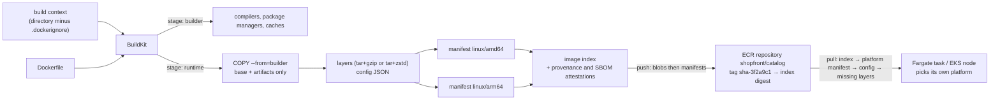

# Container fundamentals · L200 — Images, builds and registries

**Level:** 200 · **Time:** ~75 min · **Prerequisites:** [L100 · Containers explained](L100-containers-explained.md); [02 · L100 ECR basics](../02-ecr/L100-ecr-basics.md) for pushing and authentication

**After this document you can:**

- read an OCI manifest, index and config and say which bytes a runtime downloads for one
  platform, and why a digest changes when a tag does not
- write a multi-stage Dockerfile for Go, Node.js and Python that produces a small, non-root,
  read-only-compatible image with pinned bases and OCI labels
- use BuildKit cache mounts, build secrets and a remote cache in ECR, and build `linux/amd64`
  and `linux/arm64` in one command for Graviton
- choose a base image with the trade-offs stated, make PID 1 handle signals, decide where health
  checks belong, and keep secrets out of layers
- generate an SBOM and provenance at build time and measure what an image costs at start-up

## 1. Mental model



An image is a small tree of JSON documents pointing at compressed tar files, every pointer a
SHA-256 digest. A build produces that tree; a registry stores and serves it by digest; a runtime
walks it top-down, downloading only the manifest for its own CPU architecture and only the layers
it does not already have. Everything in this document follows from that shape: multi-stage builds
exist so the final tree contains no compiler; the cache works because unchanged inputs produce
identical digests; multi-arch is one more level in the tree; an SBOM or a signature is one more
document pointing at the image digest. Build for the pull, not for the push: what matters in
production is how many bytes a fresh Fargate microVM must fetch and unpack before the first
request.

## 2. Concepts

### 2.1 The OCI image: manifest, config, layers, index

The [OCI Image Format Specification](https://github.com/opencontainers/image-spec/blob/main/spec.md)
defines four documents:

| Document | Media type | Contains | Digest changes when |
| --- | --- | --- | --- |
| Image index (manifest list) | `application/vnd.oci.image.index.v1+json` | one descriptor per platform manifest (`platform.os`, `platform.architecture`, optional `variant`), plus attestation manifests | any platform manifest changes |
| Image manifest | `application/vnd.oci.image.manifest.v1+json` | descriptor of the config, ordered descriptors of the layers; optional `subject`, `artifactType`, `annotations` | config or any layer changes |
| Config | `application/vnd.oci.image.config.v1+json` | `architecture`, `os`, `config` (`User`, `Env`, `Entrypoint`, `Cmd`, `WorkingDir`, `ExposedPorts`, `Labels`, `StopSignal`), `rootfs.diff_ids` (digests of the *uncompressed* layers), `history` | any instruction or layer changes |
| Layer | `application/vnd.oci.image.layer.v1.tar+gzip` or `+zstd` (uncompressed `.tar` also allowed) | filesystem changes; deletions are whiteout files (`.wh.<name>`) | the tar bytes change |

Docker's own media types (`application/vnd.docker.distribution.manifest.v2+json`,
`…manifest.list.v2+json`, `application/vnd.docker.image.rootfs.diff.tar.gzip`) are structurally
the same and every registry and runtime accepts both; BuildKit emits OCI types when you set
`oci-mediatypes=true` or push attestations. A descriptor is always `{mediaType, digest, size}`, so
a client can verify every byte it downloads against the parent document it already trusts, up to
the digest you asked for. This is why deploying by digest is a security property and not only a
versioning convenience.

```bash
docker buildx imagetools inspect 123456789012.dkr.ecr.us-east-1.amazonaws.com/shopfront/catalog:sha-3f2a9c1
# Name:      …/shopfront/catalog:sha-3f2a9c1
# MediaType: application/vnd.oci.image.index.v1+json
# Digest:    sha256:6c3a1f0e9b7d2c4a5e8f1b3d7c9e2a4f6b8d0c1e3a5f7b9d2c4e6a8f0b1d3c5e
# Manifests:
#   … Platform: linux/amd64
#   … Platform: linux/arm64
#   … Platform: unknown/unknown   (attestation manifest for linux/amd64)
#   … Platform: unknown/unknown   (attestation manifest for linux/arm64)
docker buildx imagetools inspect --raw <ref>            # the JSON itself
docker image inspect shopfront/catalog:dev --format '{{json .RootFS.Layers}}'   # diff_ids of the local copy
```

The `unknown/unknown` entries are BuildKit's provenance and SBOM attestations (§2.4, §2.10),
carried in the index with annotations `vnd.docker.reference.type=attestation-manifest` and
`vnd.docker.reference.digest=<the manifest they describe>`. Image spec 1.1 (2024) added the
`subject` field so any manifest (a signature, an SBOM, a SOCI index) can point at another one; the
registry exposes those relationships through the referrers API (§2.2).

### 2.2 The OCI distribution API: what push and pull do on the wire

The [OCI Distribution Specification](https://github.com/opencontainers/distribution-spec/blob/main/spec.md)
is a handful of HTTPS endpoints under `/v2/`:

| Endpoint | Used by | Notes |
| --- | --- | --- |
| `GET /v2/` | every client first | `401` with `WWW-Authenticate` tells the client how to authenticate (bearer token realm, or `Basic` for ECR's 12-hour token) |
| `HEAD/GET /v2/<name>/manifests/<tag or digest>` | pull | `Accept` header lists the media types the client understands; the response `Docker-Content-Digest` is the digest |
| `PUT /v2/<name>/manifests/<tag or digest>` | push | creates or moves a tag; ECR `ecr:PutImage` |
| `HEAD /v2/<name>/blobs/<digest>` | push | "do you already have this layer?" — the reason base layers upload once |
| `POST /v2/<name>/blobs/uploads/` → `PATCH` chunks → `PUT ?digest=` | push | resumable upload; `POST …?mount=<digest>&from=<repo>` mounts a blob from another repository without re-upload |
| `GET /v2/<name>/blobs/<digest>` | pull | ECR answers with a redirect to a presigned S3 URL |
| `GET /v2/<name>/tags/list` | tooling | paginated with `n` and `last` |
| `GET /v2/<name>/referrers/<digest>` | signing and SBOM tools | distribution spec 1.1: index of manifests whose `subject` is the digest, filterable by `artifactType`; registries without it fall back to a `sha256-<digest>` tag scheme |

A pull is therefore: authenticate, fetch the index, pick the platform, fetch that manifest, fetch
the config, then fetch every layer not already present, verifying each digest. The ECR API calls
and quotas behind these requests are in [02 · L300](../02-ecr/L300-pull-through-cache-replication-and-limits.md).

### 2.3 Multi-stage builds for the three `shopfront` runtimes

A stage is a `FROM … AS name` block; only what a later stage copies with `COPY --from` survives
into the final image, so compilers, package caches and test tooling never ship. The three
languages in `shopfront` need three shapes.

**Go (`catalog`): compile in a full image, ship a static binary on distroless.** The binary is
built with `CGO_ENABLED=0` so it links nothing from the base, which lets the runtime stage be
`gcr.io/distroless/static-debian12:nonroot` (CA certificates, `tzdata`, `/etc/passwd`, nothing
else, about 2 MB). `--platform=$BUILDPLATFORM` keeps the compiler native and cross-compiles with
`GOARCH=$TARGETARCH`, so the `arm64` image builds at full speed on an `amd64` runner.

```dockerfile
# syntax=docker/dockerfile:1
FROM --platform=$BUILDPLATFORM golang:1.23-bookworm AS build
ARG TARGETOS TARGETARCH
WORKDIR /src
COPY go.mod go.sum ./
RUN --mount=type=cache,target=/go/pkg/mod go mod download
COPY . .
RUN --mount=type=cache,target=/go/pkg/mod --mount=type=cache,target=/root/.cache/go-build \
    CGO_ENABLED=0 GOOS=$TARGETOS GOARCH=$TARGETARCH \
    go build -trimpath -ldflags="-s -w" -o /out/catalog ./cmd/catalog

FROM gcr.io/distroless/static-debian12:nonroot
COPY --from=build /out/catalog /app/catalog
USER 10001:10001
EXPOSE 8081
ENTRYPOINT ["/app/catalog"]
```

A numeric `USER` needs no `/etc/passwd` entry, which is why the contract fixes `10001:10001`
instead of the image's `nonroot` (uid 65532): Kubernetes `runAsNonRoot` and ECS `user` can verify a
number without reading the image.

**Node.js (`orders`): install, build, prune, then copy `node_modules` and `dist` onto a slim
base.** `npm ci` from the lockfile in a cached layer; the TypeScript build in the next; `npm prune
--omit=dev` removes compilers and test frameworks; the runtime stage is `node:22-bookworm-slim`
(roughly 200 MB against about 1.1 GB for `node:22-bookworm`), not distroless, because native
modules and debugging tooling expect glibc and a shell during development. `NODE_ENV=production`
is set in the image because frameworks read it at start.

```dockerfile
# syntax=docker/dockerfile:1
FROM node:22-bookworm-slim AS build
WORKDIR /app
COPY package.json package-lock.json ./
RUN --mount=type=cache,target=/root/.npm npm ci
COPY tsconfig.json ./
COPY src ./src
RUN npm run build && npm prune --omit=dev

FROM node:22-bookworm-slim
ENV NODE_ENV=production HOME=/tmp
RUN groupadd --system --gid 10001 app \
 && useradd --system --uid 10001 --gid 10001 --no-create-home --home-dir /tmp --shell /usr/sbin/nologin app
WORKDIR /app
COPY --from=build /app/node_modules ./node_modules
COPY --from=build /app/dist ./dist
COPY package.json ./
USER 10001:10001
EXPOSE 8080
ENTRYPOINT ["node", "dist/server.js"]
```

**Python (`worker`, `report-job`): install into a virtual environment, copy the venv.** The real
file is [`labs/apps/worker/Dockerfile`](../../labs/apps/worker/Dockerfile): `python -m venv
/opt/venv` in the builder, `pip install -r requirements.txt` with `PIP_NO_CACHE_DIR=1`, then
`COPY --from=builder /opt/venv /opt/venv` into a fresh `python:3.12-slim-bookworm` with
`PATH=/opt/venv/bin:$PATH`. The venv is relocatable because both stages use the same base and
the same `/opt/venv` path. `PYTHONDONTWRITEBYTECODE=1` and `HOME=/tmp` make the image work with a
read-only root filesystem; `useradd … --uid 10001` gives the platform a uid it can check. One
image serves two entrypoints (`python -m worker.fulfillment`, `python -m worker.analytics`) by
overriding `CMD`, which is why the Dockerfile uses `CMD` and not `ENTRYPOINT` for the module.

All four Dockerfiles share the rules in [`labs/CONTRACT.md` §8](../../labs/CONTRACT.md): pinned
base tag with the digest in a comment, `org.opencontainers.image.source|version|revision` labels
filled from `--build-arg`, `WORKDIR /app`, non-root `10001`, `linux/amd64` and `linux/arm64`.

### 2.4 BuildKit: cache mounts, secrets, remote cache, attestations

BuildKit is the builder behind `docker build` and `docker buildx build`. The `# syntax=docker/dockerfile:1`
line pins the Dockerfile frontend so new instructions work on any daemon.

| Feature | Syntax | Why |
| --- | --- | --- |
| Cache mount | `RUN --mount=type=cache,target=/root/.cache/pip pip install …` | package manager caches persist between builds without ending up in a layer |
| Secret mount | `RUN --mount=type=secret,id=npmrc,target=/root/.npmrc npm ci` with `--secret id=npmrc,src=$HOME/.npmrc` | the file exists only during that `RUN`; nothing in layers or history |
| SSH mount | `RUN --mount=type=ssh go mod download` with `--ssh default` | private Git dependencies without copying keys |
| Bind mount | `RUN --mount=type=bind,from=build,source=/out,target=/out cp /out/catalog /app/` | read another stage without a layer |
| `COPY --link` | `COPY --link --from=build /out/catalog /app/catalog` | the layer no longer depends on earlier layers, so it is reused even when they change |
| `COPY --chmod`, `--chown` | `COPY --chown=10001:10001 --chmod=0555 …` | permissions in one layer instead of `RUN chmod` (which duplicates the files) |
| Heredocs | `RUN <<EOF … EOF`, `COPY <<EOF /app/config.yaml … EOF` | multi-line scripts and small files without `echo` chains |
| `ADD --checksum` | `ADD --checksum=sha256:… https://…/tool.tgz /tmp/` | verified downloads |
| Remote cache | `--cache-to type=registry,ref=<ecr>/shopfront/catalog:buildcache,mode=max,image-manifest=true,oci-mediatypes=true` and the matching `--cache-from` | ephemeral CI runners share layer cache through ECR; the two flags make the cache manifest one ECR accepts |
| Attestations | `--provenance=mode=max --sbom=true` | SLSA provenance and an SPDX SBOM attached to the index (§2.10, L400 §2.5) |

Two rules about the cache. A layer is reused only if its instruction and every input (files
copied, the parent layer) are identical, so instruction order is the cache strategy: base,
system packages, dependency manifests plus install, source, in that order. And a `.dockerignore`
is part of correctness, not only speed: excluding `.git`, `node_modules`, `.env*`, test fixtures
and local build output keeps secrets and gigabytes out of the context that BuildKit uploads and
`COPY . .` would otherwise ship. With `.git` excluded, the revision comes in as a build argument:

```bash
docker buildx build --platform linux/amd64,linux/arm64 \
  --build-arg VERSION=sha-$SHA --build-arg REVISION=$(git rev-parse HEAD) \
  --cache-from type=registry,ref=$REG/shopfront/catalog:buildcache \
  --cache-to   type=registry,ref=$REG/shopfront/catalog:buildcache,mode=max,image-manifest=true,oci-mediatypes=true \
  --provenance=mode=max --sbom=true \
  -t $REG/shopfront/catalog:sha-$SHA --push labs/apps/catalog
```

`mode=max` provenance records the build arguments, which is one more reason secrets travel as
`--secret` and never as `--build-arg`. The pipeline that runs this is
[`labs/pipelines/github-actions/ci.yml`](../../labs/pipelines/github-actions/ci.yml); the cache
backends for GitHub (`type=gha`) and S3 (`type=s3`) are alternatives when ECR is not the right
place for cache blobs.

### 2.5 Multi-architecture images for Graviton

An image index with a `linux/amd64` and a `linux/arm64` manifest lets the same tag run on x86 and
on Graviton; the runtime selects its platform and downloads nothing else. Three ways to produce
the second architecture, in order of preference:

| Method | How | Cost |
| --- | --- | --- |
| Cross-compile | `FROM --platform=$BUILDPLATFORM` for the build stage, `GOARCH=$TARGETARCH` (Go), `dotnet publish -r linux-arm64`, Rust targets | native speed; only for compiled languages |
| Native builders | a `docker-container` builder with an `arm64` node (`docker buildx create --append --platform linux/arm64 ssh://…`), GitHub-hosted `arm64` runners, CodeBuild Graviton fleets | fastest for interpreted languages with native extensions (`npm rebuild`, wheels compiled from source) |
| Emulation | QEMU through `binfmt_misc` (`docker run --privileged --rm tonistiigi/binfmt --install arm64`); Docker Desktop ships it | 5–20× slower for anything that compiles; fine for `pip install` of prebuilt wheels and `COPY` |

For `orders` and `worker` the `arm64` build downloads `aarch64` wheels and npm binaries; only a
dependency without a prebuilt binary compiles under emulation. Once the index exists, the
platform side is configuration: ECS `runtimePlatform.cpuArchitecture: ARM64`
([03 · L200](../03-ecs/L200-task-definitions-services-and-scaling.md)); EKS node groups or
Karpenter/Auto Mode `NodePool` requirements on `kubernetes.io/arch` and pods scheduled with
`nodeSelector` or left free to land on either
([04 · L200](../04-eks/L200-cluster-components-and-add-ons.md)); Batch compute environments with
Graviton instance types. The price-performance and migration path are in L400 §2.9.

### 2.6 Choosing a base image

| Base | Size (uncompressed, approximate, September 2026) | Has | Trade-off |
| --- | --- | --- | --- |
| `scratch` | 0 | nothing: no shell, no CA bundle, no `/etc/passwd`, no `tzdata` | for static binaries that ship their own certificates; debugging needs an ephemeral container |
| `gcr.io/distroless/static-debian12` | ≈ 2 MB | CA certificates, `tzdata`, `/etc/passwd` with `nonroot`, `/tmp` | the default for Go and Rust static binaries; no shell, so `kubectl exec` and ECS Exec need a debug sidecar (L400 §2.3) |
| `gcr.io/distroless/base-debian12`, `cc-debian12` | ≈ 20 MB | plus glibc, `libssl` (`cc` adds `libgcc`, `libstdc++`) | dynamically linked binaries, Rust with C dependencies |
| distroless language images (`java21-debian12`, `nodejs22-debian12`) | 100–250 MB | a runtime, still no shell or package manager | small attack surface for JVM and Node; Python variant is experimental (verify) |
| `alpine:3.20` | ≈ 8 MB | musl libc, BusyBox shell, `apk` | smallest general base; musl differs from glibc in DNS resolution details, threading performance and Python wheel compatibility (`musllinux`), so test before adopting |
| `debian:bookworm-slim`, `python:3.12-slim-bookworm`, `node:22-bookworm-slim` | 75–200 MB | glibc, `apt`, a shell | the pragmatic default for interpreted languages; more CVEs listed than distroless because more packages exist to list |
| `ubuntu:24.04` | ≈ 80 MB | glibc, `apt`, a shell; long support windows | when your organisation standardises on Ubuntu tooling |
| `public.ecr.aws/amazonlinux/amazonlinux:2023-minimal` | ≈ 40 MB | glibc, `microdnf`, AWS-maintained packages, in ECR Public (no Docker Hub limits) | AWS-aligned patch cadence; smaller package universe |
| Chainguard (`cgr.dev/chainguard/static`, `…/python`, `…/node`) | comparable to distroless | Wolfi-based, glibc, rebuilt daily, signed, SBOM shipped; `-dev` variants add a shell | near-zero known CVEs at pull time; pinned version tags are a paid feature (verify) |

Bottlerocket's admin container image is a host maintenance tool, not an application base
(L300 §2.13). The choice is a trade-off between attack surface and scan noise on one side and
debuggability and ecosystem fit on the other; the `shopfront` choices (distroless for Go, slim
Debian for Node and Python) are the common middle. Whatever you pick, pin the tag, record the
digest, and rebuild on a schedule so base-image CVEs leave your images without waiting for a code
change (L400 §2.7).

### 2.7 PID 1, signals and an init process

The first process in a container is PID 1 of its PID namespace, and the kernel treats PID 1
specially: a signal whose disposition is the default is not delivered to it, and every orphaned
descendant is re-parented to it and must be reaped with `wait()`. Two failure modes follow. A
process without a SIGTERM handler as PID 1 ignores `docker stop`, the ECS agent and the kubelet,
which then wait for the grace period (Docker 10 s, Kubernetes `terminationGracePeriodSeconds`
30 s, ECS `stopTimeout` 30 s) and send SIGKILL: no graceful shutdown, in-flight requests
dropped. A PID 1 that never calls `wait()` accumulates zombies until `pids.max` is hit.

| Situation | Fix |
| --- | --- |
| Shell-form `CMD python app.py` (`/bin/sh -c` is PID 1) | exec form `CMD ["python", "app.py"]`; some shells `exec` a single simple command, which hides the bug until someone adds `&&` |
| The application handles SIGTERM (Fastify `close`, Go `signal.NotifyContext`, Python `signal.signal`, JVM shutdown hooks) | exec form is enough; this is what the `shopfront` services do ([contract §7](../../labs/CONTRACT.md)) |
| The application spawns children (shell scripts, `gunicorn`, browsers, `ffmpeg`) or does not handle signals | a minimal init as PID 1: `tini` in the image (`ENTRYPOINT ["/sbin/tini", "--", …]`), `docker run --init`, ECS `linuxParameters.initProcessEnabled: true` (adds the same init), Kubernetes `shareProcessNamespace: true` (the pause container becomes PID 1 and reaps) |
| The process expects a different signal | `STOPSIGNAL SIGINT` in the Dockerfile (nginx and some JVM wrappers) |

The shutdown budget is a chain: the application finishes within `SHUTDOWN_TIMEOUT_SECONDS` (20)
which is below the platform's grace period (30), which is above the load balancer's
deregistration delay (20), so no request arrives at a process that has already stopped
listening. The whole timeline is [10 · L200](../10-resilience-and-dr/L200-designing-for-failure.md).

### 2.8 Health checks: who runs them

| Mechanism | Who executes it | Effect | Notes |
| --- | --- | --- | --- |
| Dockerfile `HEALTHCHECK CMD curl -f http://localhost:8080/healthz` | Docker Engine (`docker ps` shows `healthy`/`unhealthy`, `.State.Health` in `inspect`) | Compose `depends_on: condition: service_healthy`; nothing else acts on it | Kubernetes ignores it entirely; ECS ignores it unless the container definition has its own `healthCheck` |
| ECS container `healthCheck` (`command`, `interval`, `timeout`, `retries`, `startPeriod`) | the ECS agent, inside the container | task health, deployment circuit breaker, replacement of unhealthy tasks | needs a binary inside the image (`curl`, `wget`, or a `-healthcheck` subcommand of your own program on distroless) |
| Kubernetes `livenessProbe`, `readinessProbe`, `startupProbe` (`httpGet`, `tcpSocket`, `grpc`, `exec`) | the kubelet | restart (liveness), endpoint membership (readiness), delayed liveness during start (startup) | `httpGet` needs nothing in the image, which is why it is the right choice for distroless |
| Load balancer target health checks | ALB/NLB | traffic routing only | independent of the above; align paths and thresholds |

The `shopfront` images ship no `HEALTHCHECK` because ECS and Kubernetes would not use it and it
would need `curl` in a slim image for nothing. The services expose `/healthz` (liveness) and
`/readyz` (readiness) and let the platform decide between restarting and stopping traffic
([contract §3](../../labs/CONTRACT.md)).

### 2.9 Twelve-factor configuration and what leaks into an image

Configuration comes from the environment at run time; the image holds defaults only. Three things
leak if you are careless:

- `ENV SECRET=…` and `COPY .env .` are in the config and layers of every copy of the image.
- `ARG TOKEN` used in a `RUN` is recorded in `docker history --no-trunc` for that layer, and in
  `mode=max` provenance.
- A file written in one `RUN` and deleted in a later one is still in the first layer.

Use `--mount=type=secret` for build-time credentials, the platform's secret injection for
run-time ones (ECS `secrets[]`, Secrets Store CSI driver or External Secrets on EKS,
[06 · L200](../06-identity-and-security/L200-iam-for-containers.md)), and a scanner that reads
layers and history (Trivy's secret scanning, ECR enhanced scanning) as the safety net.

### 2.10 SBOM generation

A software bill of materials lists the packages in an image with versions and licences, in SPDX
or CycloneDX, so that when the next `xz` or `log4j` advisory lands you query a database instead of
rebuilding everything to find out. Generate it where the image is built, from the image, not from
the source tree, because the base image contributes most of the packages:

```bash
syft shopfront/orders:dev -o spdx-json > orders.spdx.json            # or: docker sbom shopfront/orders:dev
trivy image --format cyclonedx --output orders.cdx.json shopfront/orders:dev
docker buildx build --sbom=true --provenance=mode=max -t $REG/shopfront/orders:sha-$SHA --push labs/apps/orders
docker buildx imagetools inspect $REG/shopfront/orders:sha-$SHA --format '{{json .SBOM}}'
grype sbom:orders.spdx.json                                          # scan the SBOM, not the image again
```

`--sbom=true` runs syft inside the build and attaches the SPDX document as an in-toto attestation
in the index, so it travels with the image through every registry copy. A standalone SBOM can be
attached later as a referrer (`oras attach`, `cosign attest`) or exported by Amazon Inspector for
images ECR has scanned. What to require, where to store them and how to query them at fleet scale
is L400 §2.6.

### 2.11 Image size and start-up time

Start-up is pull plus unpack plus process initialisation plus readiness, and the first two are a
property of the image:

| Cost | Driven by | Measure with |
| --- | --- | --- |
| download | compressed size (`imageSizeInBytes` in ECR) and layer count (containerd downloads three layers of an image at a time by default) | `aws ecr describe-images`; `docker buildx imagetools inspect` sizes per layer |
| unpack | uncompressed size, gzip vs zstd, single core per layer | `docker image inspect --format '{{.Size}}'`; `describe-tasks` `pullStartedAt` to `pullStoppedAt` |
| disk | uncompressed size on the node or in Fargate ephemeral storage | `docker system df`; kubelet image GC thresholds (L300 §2.14) |
| cache benefit | how many layers are shared with images already on the node | `docker history`, layer ordering |

Fargate has no layer cache, so every task start pays the whole download and unpack; a 1 GB
`node:22-bookworm` image versus 200 MB `-slim` is the difference between a scale-out that takes
a minute and one that takes ten seconds. Multi-stage builds, slim or distroless bases, fewer and
better-ordered layers, zstd layers for CPU-poor tasks, and a SOCI index for images that cannot get
small (L300 §2.15) are the levers, in that order.

## 3. How it interacts with the rest of AWS

| Component | Talks to | Protocol/API | Prerequisite (IAM, network, DNS) | What breaks if missing |
| --- | --- | --- | --- | --- |
| BuildKit (`docker buildx`) | Amazon ECR | distribution API over HTTPS: `PutImage`, layer uploads, `BatchCheckLayerAvailability`; cache manifests | pusher identity with push actions; repository exists (or a creation template) | `denied`, `name unknown`; cache export fails without `image-manifest=true,oci-mediatypes=true` |
| CI runner (GitHub Actions) | AWS STS then ECR | OIDC federation → `sts:AssumeRoleWithWebIdentity` → `GetAuthorizationToken` | IAM role trusting the GitHub OIDC provider with `sub` conditions ([08 · L200](../08-delivery-cicd-gitops/L200-pipelines-on-aws.md)) | `Not authorized to perform sts:AssumeRoleWithWebIdentity` |
| BuildKit | base image registries (Docker Hub, `gcr.io`, ECR Public) | pull of `FROM` images | internet egress or a pull-through cache rule ([02 · L300](../02-ecr/L300-pull-through-cache-replication-and-limits.md)) | `toomanyrequests`, builds blocked by an upstream outage |
| Amazon ECR | Amazon Inspector | scan on push, continuous rescans | enhanced scanning enabled at the registry | only basic scanning; no continuous findings |
| Fargate / EKS node | ECR | index → platform manifest → layers | execution role or node role; `runtimePlatform` or node architecture matching a manifest in the index | `CannotPullContainerError: … no match for platform in manifest`, `exec format error` |
| CodeBuild | ECR, Secrets Manager | Docker builds on x86 or Graviton fleets; build secrets from Secrets Manager | project role; `privilegedMode` or a BuildKit-capable image | build fails to talk to the daemon |
| Signing and SBOM tools (Notation, cosign, `oras`) | ECR referrers API | `ListImageReferrers`, manifest push with `subject` | push permissions on the repository | artifacts under `sha256-*` tags instead of referrers; lifecycle rules delete them |

Two surprises. A multi-arch push from a laptop can succeed while the deployment fails: if only
`arm64` was built and the Fargate task says `X86_64`, the runtime finds no matching manifest.
And the remote build cache lives in the same repository as the image unless you point it
elsewhere, so lifecycle rules written for `sha-*` tags may delete `buildcache` or the cache may
inflate storage cost; exclude it or give it its own repository.

## 4. Use it when / avoid it when

Multi-stage builds, pinned bases and multi-arch indexes are always appropriate. The judgement
calls:

Use distroless or `scratch` when:

- the binary is static or has a small, known set of shared libraries (Go, Rust, Java with
  `distroless/java`)
- you can debug with ephemeral containers (`kubectl debug`) or a debug sidecar and do not need a
  shell in production

Use a slim Debian or Ubuntu base when:

- the runtime needs glibc, native extensions and system tools (Node.js, Python, Ruby, PHP)
- operators need `kubectl exec`/ECS Exec into the container for diagnostics

Avoid:

- Alpine for Python and Node.js unless you have tested musl behaviour and wheel availability
- full `node:22`, `python:3.12`, `golang:1.23` images as runtime stages (they are build stages)
- QEMU emulation for compiled languages in CI; cross-compile or use native runners

Alternatives to hand-written Dockerfiles, one line each:

- Cloud Native Buildpacks (`pack`) — reproducible images without a Dockerfile; less control
- `ko` (Go), Jib (Java) — build images without Docker, straight to the registry
- Nix or Bazel `rules_oci` — fully reproducible, steep learning curve
- In-cluster builders (BuildKit, kaniko) — when CI runs inside Kubernetes ([08 · L200](../08-delivery-cicd-gitops/L200-pipelines-on-aws.md))

## 5. Well-Architected view

| Pillar | What good images give you | What it costs you | Practice |
| --- | --- | --- | --- |
| Operational Excellence | one Dockerfile shape across languages; reproducible tags and labels | pipeline complexity (cache, attestations, multi-arch) | template Dockerfiles, `hadolint` in `make check`, `sha-<gitsha>` plus digest deploys |
| Security | small attack surface; non-root; no secrets in layers; SBOM and provenance | debugging without a shell | distroless where possible, `--mount=type=secret`, scan on push, labels for traceability |
| Reliability | signals handled, health probed by the platform | an init process or handlers to write | exec form, `tini` where needed, `/healthz` and `/readyz` |
| Performance Efficiency | small pulls, shared layers, arm64 available | build time for two platforms | multi-stage, layer ordering, remote cache, cross-compilation |
| Cost Optimization | less registry storage and transfer; Graviton eligible | none material | slim bases, `.dockerignore`, lifecycle rules for `buildcache` |
| Sustainability | fewer bytes moved and stored; Graviton | none material | multi-arch by default, rebuild only what changed |

The [Container Build Lens](https://docs.aws.amazon.com/wellarchitected/latest/container-build-lens/container-build-lens.html)
names most of these practices; [12 · L200](../12-well-architected/L200-pillar-checklists-ecs-and-eks.md)
turns them into a checklist.

## 6. Failure modes and troubleshooting

| Symptom | Likely cause | How to confirm (command/metric) | Fix |
| --- | --- | --- | --- |
| `exec /app/catalog: no such file or directory` on distroless | dynamically linked binary (`CGO_ENABLED=1`, or a Go package that needs cgo) on `static-debian12` | `docker run --rm --entrypoint sh <build-stage> -c 'ldd /out/catalog'` in the build stage | `CGO_ENABLED=0`, or use `distroless/base` |
| `exec format error` | the node's architecture has no manifest in the index, or a single-arch image | `docker buildx imagetools inspect <ref>` lists the platforms | build both platforms; check `runtimePlatform` / node arch |
| Cache never hits in CI | ephemeral runner without `--cache-from`; `COPY . .` before dependency install; `mode=min` exporting only the final stage | BuildKit output shows `CACHED` on nothing | remote cache in ECR with `mode=max`; reorder instructions |
| `failed to solve: … unsupported media type` or `400` when exporting cache to ECR | cache manifest media type ECR rejects | error text mentions the cache ref | add `image-manifest=true,oci-mediatypes=true` to `--cache-to` |
| Container killed after the grace period on every deploy | PID 1 ignores SIGTERM (shell form, no handler) | `docker inspect --format '{{json .Config.Entrypoint}} {{json .Config.Cmd}}'`; `time docker stop` ≈ 10 s | exec form, handler, or `tini`/`--init`/`initProcessEnabled` |
| Zombie processes pile up, `pids.max` reached | PID 1 does not reap | `ps -o pid,stat,cmd` inside the container shows `Z` | init process as PID 1 |
| `EACCES: permission denied, mkdir '/home/app/.npm'` or Python `PermissionError` at start | non-root user with `HOME` on a read-only root filesystem | `docker inspect --format '{{.HostConfig.ReadonlyRootfs}} {{.Config.User}}'` | `HOME=/tmp`, tmpfs `/tmp`, `PYTHONDONTWRITEBYTECODE=1` |
| Image works on the laptop, pod fails on `arm64` nodes with a native module error | a dependency compiled under emulation for the wrong platform, or missing `aarch64` wheel | pod logs; `docker run --platform linux/arm64 <image> …` locally | native `arm64` builder; pin a dependency version with prebuilt binaries |
| Secret visible in `docker history` or found by ECR scanning | `ARG`/`ENV` secret or `COPY .env` | `docker history --no-trunc <image>`; scan findings | rotate the secret, rebuild with `--mount=type=secret`, extend `.dockerignore` |
| `HEALTHCHECK` shows `healthy` locally, Kubernetes restarts the pod | Dockerfile health check is ignored; liveness probe misconfigured or too aggressive | `kubectl describe pod` events | configure probes; drop the Dockerfile `HEALTHCHECK` |
| Fargate task takes minutes to start | large image, gzip, no SOCI, cross-Region pull | `describe-tasks` `pullStartedAt`/`pullStoppedAt`; `imageSizeInBytes` | slim base, zstd, SOCI index, same-Region registry |
| `toomanyrequests` pulling `FROM` in CI | anonymous Docker Hub pulls | error names `docker.io` | pull-through cache; ECR Public or AL2023 bases |

Runtime symptoms with exit codes are [crashloop and exit codes](../../playbooks/incidents/crashloop-and-exit-codes.md);
pull-side failures are [image pull failures](../../playbooks/incidents/image-pull-failures.md).

## 7. Signals: metrics, logs, traces

- Image size and layer count per repository: `aws ecr describe-images … imageSizeInBytes`
  (compressed) trended per build; a step change means a base or a `.dockerignore` regression.
- Pull duration: ECS `describe-tasks` `pullStartedAt` → `pullStoppedAt` per task; kubelet
  `kubelet_runtime_operations_duration_seconds{operation_type="pull_image"}` (histogram) and
  `kubelet_runtime_operations_errors_total{operation_type="pull_image"}`; Kubernetes `Pulled`
  events carry the duration in their message. Alarm when the p95 exceeds your deployment budget.
- Build pipeline: duration and the share of `CACHED` steps in BuildKit output; a fall in cache
  hits after a Dockerfile change is a layer-ordering regression.
- Scan results: `ECR Image Scan` EventBridge events and Inspector finding counts by severity per
  repository; new criticals on an unchanged image mean a base rebuild is due (L400 §2.7).
- Docker Hub pull budget in CI: the `ratelimit-remaining` header from
  `GET /v2/ratelimitpreview/test/manifests/latest`; zero means the next build fails.
- Start-up as the process sees it: time from container start to `/readyz` returning `200`, in the
  service's own logs (`ready` event with `trace_id` per [contract §6](../../labs/CONTRACT.md)).

Full table in [reference/metrics-catalog.md](../../reference/metrics-catalog.md).

## 8. Testing and DR notes

Test the artifact in the pipeline, before the push, in this order: `hadolint` on the Dockerfile;
build both platforms; a container structure test (user is `10001`, `/app/catalog` exists and is
executable, no shell in distroless images, expected labels); `docker run --platform linux/arm64`
of the `arm64` image to `/healthz` under emulation, slow but decisive; Trivy with
`--exit-code 1 --severity CRITICAL` and secret scanning; then the Compose smoke test
(`make smoke`) against the freshly built images. Testcontainers and ephemeral environments are
[11 · L200](../11-testing-workloads/L200-testing-in-pipelines-and-clusters.md). Reproducibility
helps testing and recovery alike: pinned base digests, lockfiles, `SOURCE_DATE_EPOCH` and
BuildKit's `rewrite-timestamp` output option get you close to bit-identical rebuilds.

Disaster recovery at this layer is about being able to rebuild and being able not to have to.
The inputs (Dockerfile, source, lockfiles, base digests, pipeline definition) live in Git; the
build cache is disposable; the pushed digest is the artifact, and it must exist in every Region
you would recover into ([02 · L300](../02-ecr/L300-pull-through-cache-replication-and-limits.md)
replication). Base images should come through a pull-through cache so a Docker Hub outage does
not block an emergency rebuild, and the SBOMs tell you which images to rebuild when a base CVE
is the disaster. Time a full rebuild of all `shopfront` images from a cold cache once; that
number is part of your RTO when the registry is lost.

## 9. Hands-on

From the repository root. A local registry stands in for ECR so multi-arch pushes work without
an AWS account.

```bash
docker run -d -p 5000:5000 --name registry registry:2
docker buildx create --name shopfront --driver docker-container --use        # once
docker buildx build --platform linux/amd64,linux/arm64 \
  --provenance=mode=max --sbom=true \
  -t localhost:5000/shopfront/catalog:multi --push labs/apps/catalog
docker buildx imagetools inspect localhost:5000/shopfront/catalog:multi       # two platforms + two attestation manifests
docker buildx imagetools inspect localhost:5000/shopfront/catalog:multi --raw | jq '.manifests[].platform'
docker buildx imagetools inspect localhost:5000/shopfront/catalog:multi --format '{{json .SBOM}}' \
  | jq '.. | .SPDX? // empty | .packages | length'                            # packages per platform
docker buildx imagetools inspect localhost:5000/shopfront/catalog:multi --format '{{json .Provenance}}' \
  | jq '.. | .SLSA? // empty | .buildType'
docker run --rm --platform linux/arm64 localhost:5000/shopfront/catalog:multi --help 2>&1 | head -3   # runs under QEMU
docker history --no-trunc shopfront/worker:dev | head -20                     # layer order and ARG visibility
docker run -d --name t1 python:3.12-slim-bookworm sleep 600 && time docker stop t1          # ≈ 10 s: PID 1 ignores SIGTERM
docker run -d --name t2 --init python:3.12-slim-bookworm sleep 600 && time docker stop t2   # < 1 s: tini forwards it
docker run --rm -v /var/run/docker.sock:/var/run/docker.sock anchore/syft shopfront/orders:dev -o spdx-json \
  | jq '.packages | length'
docker run --rm -v /var/run/docker.sock:/var/run/docker.sock aquasec/trivy image --severity HIGH,CRITICAL shopfront/orders:dev
docker rm -f t1 t2 registry
```

Observe: the index lists `linux/amd64`, `linux/arm64` and two `unknown/unknown` attestation
manifests; the SBOM for the distroless `catalog` has a few dozen packages while `orders` on
`node:22-bookworm-slim` has several hundred; `docker stop` on `sleep` as PID 1 takes the full
grace period and returns in well under a second with `--init`; the Trivy report for a slim Debian
base is longer than for distroless because there are more packages to report on, which is the
scan-noise trade-off of §2.6.

## 10. Check yourself

1. A tag was re-pointed to a new build. Which digests changed: index, platform manifests,
   config, layers?

<details><summary>Answer</summary>
Whatever the build changed, bottom-up: a changed source layer changes that layer's digest, the
config (its <code>diff_ids</code> and history), the platform manifest, and the index. Unchanged
base layers keep their digests and are not re-uploaded. The tag itself has no digest; it is a
pointer.
</details>

2. Why does the `catalog` build stage use `--platform=$BUILDPLATFORM` while the runtime stage
   does not?

<details><summary>Answer</summary>
The build stage should run natively on the builder and cross-compile with
<code>GOARCH=$TARGETARCH</code>; the runtime stage must be the target platform's base image so
the resulting manifest is for <code>linux/arm64</code> or <code>linux/amd64</code>. Emulating the
compiler would be 5–20× slower for no benefit.
</details>

3. Your Node.js container takes exactly 30 seconds to stop on Kubernetes and requests fail
   during deployments. Name two likely causes and the fix for each.

<details><summary>Answer</summary>
Shell-form <code>CMD</code> making <code>sh</code> PID 1 (use exec form), or no SIGTERM handler
in the application (register one that calls <code>server.close()</code>, or run under
<code>tini</code>/<code>--init</code>). Either way the kubelet waits
<code>terminationGracePeriodSeconds</code> and sends SIGKILL.
</details>

4. The security team wants a shell-free image for `orders`, and the developers want
   `kubectl exec`. What do you propose?

<details><summary>Answer</summary>
Ship <code>orders</code> on distroless (<code>nodejs22-debian12</code>) or a Chainguard image and
debug with ephemeral containers (<code>kubectl debug --image=… --target=orders</code>) that share
the pod's namespaces, or keep a slim Debian base and accept the larger scan surface. Health
checks must be <code>httpGet</code> probes either way, since there is no <code>curl</code>.
</details>

5. `docker buildx build --cache-to type=registry,ref=…ecr…/shopfront/orders:buildcache` fails
   while the same command against Docker Hub works. Why?

<details><summary>Answer</summary>
ECR does not accept BuildKit's default cache manifest media type; add
<code>image-manifest=true,oci-mediatypes=true</code> so the cache is exported as an OCI image
manifest. Then keep it out of the lifecycle rules that expire <code>sha-*</code> tags.
</details>

## 11. Sources

- OCI Image Format Specification — https://github.com/opencontainers/image-spec/blob/main/spec.md
- OCI Image Format Specification: Image Index — https://github.com/opencontainers/image-spec/blob/main/image-index.md
- OCI Distribution Specification — https://github.com/opencontainers/distribution-spec/blob/main/spec.md
- Docker Docs: Dockerfile reference — https://docs.docker.com/reference/dockerfile/
- Docker Docs: Multi-stage builds — https://docs.docker.com/build/building/multi-stage/
- Docker Docs: Build cache and cache storage backends — https://docs.docker.com/build/cache/
- Docker Docs: Build secrets — https://docs.docker.com/build/building/secrets/
- Docker Docs: Multi-platform builds — https://docs.docker.com/build/building/multi-platform/
- Docker Docs: Build attestations (provenance and SBOM) — https://docs.docker.com/build/metadata/attestations/
- Docker Docs: Build variables (`TARGETARCH`, `BUILDPLATFORM`) — https://docs.docker.com/build/building/variables/
- Distroless container images — https://github.com/GoogleContainerTools/distroless
- Chainguard Images documentation — https://edu.chainguard.dev/chainguard/chainguard-images/
- tini: a tiny but valid init for containers — https://github.com/krallin/tini
- Kubernetes: Configure liveness, readiness and startup probes — https://kubernetes.io/docs/tasks/configure-pod-container/configure-liveness-readiness-startup-probes/
- Kubernetes: Share process namespace between containers in a pod — https://kubernetes.io/docs/tasks/configure-pod-container/share-process-namespace/
- Amazon ECS Developer Guide: Task definition parameters (`healthCheck`, `initProcessEnabled`, `runtimePlatform`) — https://docs.aws.amazon.com/AmazonECS/latest/developerguide/task_definition_parameters.html
- Amazon ECR User Guide: Pushing a multi-architecture image — https://docs.aws.amazon.com/AmazonECR/latest/userguide/docker-push-multi-architecture-image.html
- AWS Graviton Getting Started: containers — https://github.com/aws/aws-graviton-getting-started/blob/main/containers.md
- syft — https://github.com/anchore/syft
- Trivy documentation — https://trivy.dev/latest/docs/
- SPDX specification — https://spdx.dev/use/specifications/
- The Twelve-Factor App: Config — https://12factor.net/config
- AWS Well-Architected Container Build Lens — https://docs.aws.amazon.com/wellarchitected/latest/container-build-lens/container-build-lens.html
