# Container fundamentals · L400 — Hardening, supply chain and performance

**Level:** 400 · **Time:** ~100 min · **Prerequisites:**
[L300 Runtimes and the kernel](L300-runtimes-and-the-kernel.md),
[ECR L400](../02-ecr/L400-supply-chain-and-multi-account-registries.md),
[Identity and security L300](../06-identity-and-security/L300-hardening-workloads-and-clusters.md)

**After this document you can:**

- Design an image supply chain (build → SBOM → scan → sign → push → verify at admission) that
  meets SLSA expectations and survives a compromised dependency or CI job.
- Decide the fleet-wide image policy: bases, rebuild cadence, debugging without shells, rootless.
- Tune runtimes (JVM, Node.js, Go, Python) for cgroup limits and settle the CPU-limits debate with
  data from your own metrics.
- Set ephemeral storage, PID and ulimit boundaries and know what Fargate allows.
- Run a Graviton migration and read its cost and sustainability numbers.

## 1. Mental model

```mermaid
flowchart LR
  SRC[source + lockfiles] --> BUILD[BuildKit multi-arch build<br/>pinned base by digest]
  BUILD --> SBOM[SBOM SPDX/CycloneDX<br/>+ provenance attestation]
  SBOM --> SCAN[scan: Trivy/Grype in CI<br/>ECR enhanced scanning after push]
  SCAN --> SIGN[sign: Notation + AWS Signer<br/>or cosign keyless]
  SIGN --> PUSH[push by digest to ECR<br/>referrers: sig, sbom, provenance]
  PUSH --> ADMIT[admission verifies signature,<br/>digest, registry, no critical CVEs]
  ADMIT --> RUN[runtime: non-root, ro rootfs,<br/>no caps, seccomp, limits]
  RUN --> DETECT[Inspector rescans · GuardDuty runtime]
  DETECT -->|new CVE| REBUILD[scheduled rebase/rebuild] --> BUILD
```



An image is a promise about what will run; the supply chain is how you keep it. Each stage produces
an artifact the next stage verifies, and the loop closes when a newly disclosed vulnerability
triggers a rebuild rather than a meeting. Performance is the other half of "fundamentals at scale":
a container that ignores its cgroup limits wastes the isolation the kernel gives it, and the fixes
are runtime flags and limit policy, not bigger nodes.

## 2. Concepts

### 2.1 Threats to the image

| Threat | Example | Control |
| --- | --- | --- |
| Mutable tags | `node:22` changes under you; a rollback pulls a different image | pin bases by digest; deploy by digest; ECR tag immutability |
| Compromised base or dependency | malicious package version; typosquat | pull-through cache with allowlisted upstreams; lockfiles with integrity hashes; SBOM diffs; Inspector |
| Secrets in layers | `COPY .env`; `ARG TOKEN` baked into a layer | `.dockerignore`; BuildKit `--mount=type=secret`; secret scanning on images (`trufflehog`, ECR/Inspector secret detection where available) |
| Compromised CI | attacker edits the workflow, steals the deploy role | OIDC with `sub` conditions per repo/branch/environment; SHA-pinned actions; ephemeral runners; provenance verified at admission |
| Rebuild drift | "same Dockerfile, different bytes" | reproducible-ish builds: pinned bases, pinned packages, provenance records materials |
| Unsigned or unknown images | someone `kubectl run`s a Docker Hub image | admission: allowlisted registries, required signatures |
| Old images | a service last built 14 months ago with 40 critical CVEs | rebuild cadence with automated rebase; policy on image age |

### 2.2 Base images and debugging without shells

| Base | Size (approx.) | Shell/package manager | Use |
| --- | --- | --- | --- |
| `scratch` | 0 | none | static Go/Rust binaries |
| `gcr.io/distroless/static-debian12:nonroot` | ~2 MiB | none; CA certs, tzdata, passwd | static binaries needing certs/timezones (shopfront `catalog`) |
| `gcr.io/distroless/base`/`cc` | ~20 MiB | none; glibc | dynamically linked binaries |
| Chainguard/Wolfi images | small | none in runtime variants; `-dev` variants have apk | curated, frequently rebuilt bases with SBOMs |
| `node:22-bookworm-slim`, `python:3.12-slim-bookworm` | 70–150 MiB | shell + apt | runtimes that need the interpreter (shopfront `orders`, `worker`) |
| `alpine` | ~8 MiB | sh + apk | musl caveats (DNS, performance for some runtimes) |
| `amazonlinux:2023-minimal` | ~30 MiB | sh + dnf | AWS-aligned base |

Debugging a distroless container: `kubectl debug -it <pod> --image=nicolaka/netshoot --target=<container>`
(ephemeral container sharing the process namespace), `kubectl debug node/` for host-level views,
`nsenter` on EC2 nodes, and for ECS a debug sidecar image in non-production or ECS Exec into a
sidecar that has a shell. The absence of a shell removes an entire class of post-exploitation
techniques (webshells, package installation) and is worth the inconvenience.

**Rootless and user namespaces**: running the *runtime* rootless (rootless Docker/containerd) is a
developer-machine and CI concern; in Kubernetes, user namespaces (`hostUsers: false`) map the
container's uid 0 to an unprivileged host uid, so even a root-in-container escape lands as nobody
on the node — verify the feature's GA status and containerd/AMI support for your version. Until
then, `runAsNonRoot` plus dropped capabilities is the baseline.

### 2.3 Signing and verification

**Notation + AWS Signer**: a signing profile in AWS Signer (platform `Notation-OCI-SHA384-ECDSA`)
holds a managed key and certificate chain; `notation sign` produces a signature artifact stored in
ECR as an OCI referrer of the image; admission verifies with the trust store containing the Signer
root and a trust policy naming the profile; revocation is handled by Signer (revoking the profile
or a signing job invalidates signatures).

```bash
aws signer put-signing-profile --profile-name shopfront_prod --platform-id Notation-OCI-SHA384-ECDSA
notation plugin install --url https://d2hvyiie56hcat.cloudfront.net/linux/amd64/plugin/latest/notation-aws-signer-plugin.zip --sha256sum <sum>
notation key add --id "arn:aws:signer:us-east-1:123456789012:/signing-profiles/shopfront_prod" --plugin com.amazonaws.signer.notation.plugin shopfront-prod
notation sign --key shopfront-prod 123456789012.dkr.ecr.us-east-1.amazonaws.com/shopfront/orders@sha256:<digest>
notation verify 123456789012.dkr.ecr.us-east-1.amazonaws.com/shopfront/orders@sha256:<digest>
```

**Sigstore cosign**: keyless signing binds the signature to the CI job's OIDC identity (`repo`,
`workflow`, `ref`) and records it in the Rekor transparency log; verification names the expected
identity and issuer. ECR stores cosign signatures as tags/referrers.

```bash
cosign sign --yes 123456789012.dkr.ecr.us-east-1.amazonaws.com/shopfront/orders@sha256:<digest>
cosign verify --certificate-identity-regexp 'https://github.com/ErickrU/containers-on-aws/.github/workflows/ci.yml@refs/heads/main' \
  --certificate-oidc-issuer https://token.actions.githubusercontent.com \
  123456789012.dkr.ecr.us-east-1.amazonaws.com/shopfront/orders@sha256:<digest>
```

Verification at admission: Kyverno `verifyImages` (both formats), Ratify + Gatekeeper, or the
Notation Kubernetes integration; on ECS, verification happens in the pipeline (a deploy step runs
`notation verify` before `register-task-definition`) because ECS has no admission hook — AWS Config
rules can flag task definitions whose images lack a signature by digest (custom rule). Fail closed.

### 2.4 SBOM, provenance and SLSA

| Artifact | Produced by | Stored | Consumed by |
| --- | --- | --- | --- |
| SBOM (SPDX or CycloneDX) | `syft`, `docker buildx build --sbom=true`, `trivy image --format spdx-json` | ECR referrer (`oci-artifact`) or S3; attested with `cosign attest` | vulnerability correlation (new CVE → which images), licence checks, diffs between releases |
| Provenance (SLSA, in-toto) | `docker buildx build --provenance=mode=max`, GitHub Actions `actions/attest-build-provenance`, `cosign attest --type slsaprovenance` | referrer | admission policies that require provenance from your builder identity |
| Vulnerability report | Trivy/Grype in CI; Inspector after push | CI artifacts; Inspector findings | gates (block critical/high with fixes) and SLAs |

SLSA levels, in practice: L1 = provenance exists; L2 = provenance generated by the hosted build
platform (GitHub Actions/CodeBuild) and signed; L3 = builds run on hardened, isolated runners and
the provenance cannot be forged by the build steps themselves (ephemeral runners, no long-lived
credentials, separate signing identity). Most organisations should target L2 with signature and
provenance verification at admission and a pipeline that uses OIDC instead of stored keys
([08 L300](../08-delivery-cicd-gitops/L300-progressive-delivery-and-gitops-internals.md)).

### 2.5 Vulnerability management flow

1. Build-time scan (Trivy/Grype) fails the pipeline on critical/high CVEs **with a fix available**
   in the OS or language layers you control; unfixable findings are recorded, not blocking.
2. ECR enhanced scanning (Inspector) rescans continuously as new CVEs publish; findings flow to
   Security Hub and EventBridge.
3. An EventBridge rule opens a ticket per repository for new critical findings with an SLA (for
   example: critical 7 days, high 30 days).
4. A scheduled rebuild (weekly) rebases every image on the latest base digest and republishes,
   so most findings close without human work; deploy-by-digest pipelines roll the new digest out
   through the normal progressive delivery.
5. A dashboard tracks running images by age and by open critical findings; anything older than the
   rebuild cadence is a bug in the pipeline.

Correlate findings with what runs (`kubectl get pods -A -o jsonpath='{..imageID}'`, ECS
`describe-tasks`), not with what is stored; ECR lifecycle policies keep stored images few.

### 2.6 Runtime performance under cgroup limits

| Runtime | Container awareness | Flags/settings | Trap |
| --- | --- | --- | --- |
| JVM 17+ | reads cgroup v2 limits | `-XX:MaxRAMPercentage=75 -XX:InitialRAMPercentage=50 -XX:+UseContainerSupport` (default on); `-XX:ActiveProcessorCount` when CPU limit is fractional | GC threads sized from the CPU *limit* rounded up; with 500m you get 1 CPU's worth of threads that throttle |
| Node.js 22 | heap not sized from cgroup by default | `--max-old-space-size=<~75% of limit in MB>` (or `NODE_OPTIONS`), `UV_THREADPOOL_SIZE` ≤ CPUs available | default heap can exceed a small memory limit → OOM 137 |
| Go 1.23 | GOMAXPROCS = host CPUs unless set | `GOMAXPROCS` via `automaxprocs` or env; `GOMEMLIMIT=<~90% of limit>` | 64 host cores → 64 Ps under a 1-CPU quota → heavy throttling; GC ignoring the limit → OOM |
| Python | n/a | worker count (gunicorn/uvicorn) from CPU limit; `MALLOC_ARENA_MAX=2` for glibc fragmentation | too many workers each with their own memory |
| .NET | reads cgroup | `DOTNET_GCHeapHardLimitPercent`, server GC off for small containers | server GC per core |

The shopfront images set `GOMEMLIMIT`/`GOMAXPROCS` in the manifests and `--max-old-space-size` for
`orders` through `NODE_OPTIONS` in the Kustomize overlays ([labs/eks/manifests](../../labs/eks/manifests/)).

**The CPU-limits debate**, settled per service with data:

| Situation | Recommendation | Why |
| --- | --- | --- |
| Latency-sensitive service, trusted neighbours, requests set | request only, **no CPU limit** | quota throttling adds tail latency; `cpu.weight` still arbitrates contention fairly |
| Batch/CPU-bound jobs | limit = request (Guaranteed) | predictable, avoids starving neighbours |
| Multi-tenant cluster with untrusted tenants | limits with ResourceQuota | the noisy-neighbour risk outweighs tail latency |
| Fargate | task size is the limit | no choice; size for peak |
| Memory | limit = request, always | memory is not compressible; over-commit ends in OOM kills of *other* pods |

Measure `container_cpu_cfs_throttled_periods_total / container_cpu_cfs_periods_total` before and
after; above 25% on a service with acceptable average CPU means the limit, not the code, is the
bottleneck.

### 2.7 Start-up time

Levers, in order of impact: image size (distroless, multi-stage, no dev dependencies — `orders`
went from ~1 GiB with dev deps to ~480 MiB; `catalog` is 33 MiB); layer count and ordering (cache
hits on pull); lazy loading (SOCI on Fargate/Auto Mode GPU nodes); runtime warm-up (JVM class-data
sharing / AppCDS, Node.js snapshot, Python bytecode precompiled in the image); connection
establishment (fail fast, retry with backoff — the shopfront services wait up to 30 s for the
database); readiness gating (a `startupProbe` so slow starts are not killed). Measure with
`PullStartedAt`/`PullStoppedAt` (ECS), `kubelet_image_pull_duration_seconds`, and the time from
container start to readiness in your own logs.

### 2.8 Ephemeral storage, PIDs, ulimits, sysctls

| Boundary | Kubernetes | ECS | Notes |
| --- | --- | --- | --- |
| Ephemeral storage | `resources.requests/limits.ephemeral-storage`; `emptyDir.sizeLimit`; eviction on node disk pressure | Fargate `ephemeralStorage.sizeInGiB` 20–200; EC2 instance disk | logs, `/tmp`, image layers count against it |
| Process/thread count | `podPidsLimit` (kubelet) or `pids.max` via `pids` cgroup; `PIDPressure` node condition | `ulimits` `nproc` | thread leaks and fork bombs |
| Open files | `ulimits` on ECS; container default from the runtime (1M on containerd since 1.7? verify) | `ulimits: nofile 65536` | `EMFILE` under connection storms |
| Kernel parameters | `securityContext.sysctls` (safe: `net.core.somaxconn`, `net.ipv4.ip_local_port_range`, …); unsafe require kubelet allowlist | `systemControls` (Fargate: limited set, e.g. `net.*` subset — verify) | `somaxconn` for high-connection services |
| Core dumps | disable or route (`kernel.core_pattern` is host-wide) | same | a core dump can fill ephemeral storage |

### 2.9 Graviton (arm64) and sustainability

Graviton instances and Fargate ARM64 cost about 20% less per vCPU and use less energy per unit of
work. Migration steps: build multi-arch images (`--platform linux/amd64,linux/arm64`, as the labs'
Dockerfiles do with `TARGETARCH`), verify native dependencies (Node native modules, Python wheels —
`confluent-kafka` and `psycopg[binary]` ship arm64 wheels), run the test suite per architecture in
CI (`runs-on: ubuntu-24.04-arm` or QEMU for light tests), benchmark with the same load test on both
(request throughput per vCPU-hour), then switch NodePools/task `runtimePlatform` per service with
canary deployments. Keep an amd64 NodePool for the long tail. Sustainability follows from
utilisation: right-sized requests, consolidation and scale-to-zero in non-production reduce
energy more than any single hardware choice; the Well-Architected Sustainability pillar and the
Container Build Lens both measure it as resources consumed per unit of business work.

### 2.10 Container Build Lens mapping

| Lens area | Practice in this repository |
| --- | --- |
| Build in multiple stages, minimal final image | every `labs/apps/*/Dockerfile` |
| Pin dependencies and bases | tags + digest comments; lockfiles; `go.sum` |
| Scan and sign; store SBOMs | CI workflow in [`labs/pipelines/github-actions/ci.yml`](../../labs/pipelines/github-actions/ci.yml) |
| Immutable artifacts, deploy by digest | `versionConsistency`, digest references in task definitions and manifests |
| Non-root, read-only, no secrets in images | `USER 10001`, `readOnlyRootFilesystem`, `secrets[]`/ESO |
| Observability built into the image | `/healthz`, `/readyz`, `/metrics`, JSON logs, OTLP |
| Reproducible local = production | Compose with the same images and env contract |

## 3. How it interacts with the rest of AWS

| Component | Talks to | Protocol/API | Prerequisite (IAM, network, DNS) | What breaks if missing |
| --- | --- | --- | --- | --- |
| CI (GitHub Actions/CodeBuild) | ECR, Signer, S3 (cache) | OIDC → STS → `ecr:*`, `signer:StartSigningJob`, `signer:GetSigningProfile` | trust policy with `sub` conditions; SHA-pinned actions | unsigned or unpushed images; or an over-broad role |
| Admission (Kyverno/Ratify) | ECR (referrers), Signer (revocation), Rekor | HTTPS via Pod Identity | `ecr:BatchGetImage`, `ecr:GetDownloadUrlForLayer`, `signer:GetRevocationStatus`; endpoints | fail-closed admission |
| Inspector | ECR | scanning | enhanced scanning enabled | no continuous CVE view |
| EventBridge → ticketing | Inspector/Security Hub findings | events | rules per severity | findings ignored |
| Rebuild scheduler | CI | cron | base digest lookup | images age |
| Runtime (Fargate/EKS) | ECR + S3 | pulls by digest | replication in DR Regions | pulls fail after failover |

## 4. Use it when / avoid it when

Use:

- Digest pinning, signatures and admission verification for every production namespace/cluster; ECS
  verification in the pipeline.
- Distroless or Chainguard bases wherever the runtime allows; slim bases otherwise.
- No CPU limits on latency-sensitive services with trusted neighbours; memory limit = request always.
- Weekly automated rebuilds; SBOMs attached to every image.

Avoid:

- Scanning as the only control; scanning finds known CVEs, signing and provenance prove origin.
- `latest` tags, `imagePullPolicy: Always` on tags, or `:main` images in production.
- Adding shells/debug tools to production images "for incidents"; use ephemeral containers.
- Blanket CPU limits copied from a template; measure throttling.

Alternatives: managed build services (CodeBuild with `--provenance`, GitHub-hosted attestations) to
reach SLSA L2 quickly; Chainguard/Wolfi images to outsource base maintenance.

## 5. Well-Architected view

| Pillar | Practice | Cost | Container Build Lens tie-in |
| --- | --- | --- | --- |
| Operational Excellence | automated rebuilds, image age dashboards, deploy by digest | pipeline maintenance | "build reproducibly, deploy immutably" |
| Security | signatures, provenance, SBOMs, admission, distroless, non-root | policy operations | supply-chain design principles |
| Reliability | start-up tuning, startup probes, limits that do not kill neighbours | tuning per runtime | health built into images |
| Performance Efficiency | runtime flags for cgroups, no CPU limits where throttling hurts, SOCI | measurement | right-size |
| Cost Optimization | Graviton, smaller images (less pull/transfer), right-sizing | migration | efficiency |
| Sustainability | utilisation, arm64, scale to zero | none | resources per unit of work |

## 6. Failure modes and troubleshooting

| Symptom | Likely cause | How to confirm (command/metric) | Fix |
| --- | --- | --- | --- |
| Admission rejects every deployment after a CI change | signing profile/identity changed; policy attestor stale | Kyverno logs; `notation verify`/`cosign verify` locally | update trust policy/attestor; roll policy in Audit first |
| JVM OOM-killed at 1 GiB limit with 256 MiB heap | `MaxRAMPercentage` default 25% of *limit* is fine, but metaspace/threads/direct buffers exceed; or old JVM ignoring cgroups | `memory.stat`, `jcmd VM.native_memory` | container-aware JVM, set `MaxRAMPercentage` ~75, cap metaspace/direct memory ([playbook](../../playbooks/incidents/oom-and-cpu-throttling.md)) |
| Go service throttled heavily | `GOMAXPROCS` = host cores | `cpu.stat`; `runtime.NumCPU` logs | `automaxprocs`/`GOMAXPROCS`; remove CPU limit |
| Node.js exits 137 under load | default heap > limit | `--max-old-space-size` absent | set to ~75% of limit |
| New CVE, 40 services to redeploy | no automated rebuild | image age dashboard | weekly rebase pipeline |
| `exec format error` on some nodes | non-multi-arch image after Graviton NodePool added | `docker manifest inspect`; node arch label | multi-arch build; nodeSelector until fixed |
| Pod evicted for ephemeral storage | logs/tmp exceed limit | `kubectl describe pod` evicted reason | `emptyDir.sizeLimit`, log rotation, stream to stdout |
| Secrets found in image history | `ARG`/`COPY` of secrets | `docker history`, secret scanner | BuildKit secrets; rebuild; rotate |
| Slow cold starts on Fargate | large image, no SOCI | `PullStartedAt`→`PullStoppedAt` | SOCI index, smaller image ([playbook](../../playbooks/incidents/image-pull-failures.md)) |

## 7. Signals: metrics, logs, traces

- Supply chain: percentage of running images signed/pinned by digest/with SBOM; image age
  distribution; Inspector critical/high open findings by repository and age; rebuild pipeline
  success rate.
- Admission: rejections by policy (Kyverno `kyverno_policy_results_total`), webhook latency.
- Runtime: `container_cpu_cfs_throttled_periods_total` ratio, `container_memory_working_set_bytes`
  vs limit, OOM kills, `container_processes`, ephemeral storage usage
  (`kubelet_volume_stats`/`container_fs_usage_bytes`).
- Start-up: image pull duration, time-to-ready per deployment, `startupProbe` failures.
- Cost/sustainability: vCPU-hours per 1,000 requests by architecture, Graviton share.

Full table: [`reference/metrics-catalog.md`](../../reference/metrics-catalog.md).

## 8. Testing and DR notes

Testing: container structure tests (user, entrypoint, no shell, labels) per image; `notation verify`/
`cosign verify` and SBOM presence as pipeline gates; negative admission tests (unsigned image,
Docker Hub image, `:latest`) in an ephemeral cluster; load tests per runtime flag change comparing
throttling and p99; per-architecture test runs; a chaos test that revokes a signing profile in a
staging account to confirm admission fails closed and alarms fire.

DR: images, signatures and SBOMs live in ECR and replicate with replication rules (verify that
referrer artifacts replicate for your configuration); Signer profiles and trust stores are per
Region and must exist in the DR Region; policy engines and their attestors are part of the cluster
rebuild from git ([10 L300](../10-resilience-and-dr/L300-dr-strategies-for-container-platforms.md)).

## 9. Hands-on

```bash
# 1. Inspect the labs' images for the hardening properties
make build-images
for i in catalog orders worker report-job; do
  docker inspect shopfront/$i:dev --format '{{.Config.User}} {{.Config.Entrypoint}} {{index .Config.Labels "org.opencontainers.image.source"}}'
  docker history shopfront/$i:dev | head -5
done
docker run --rm --entrypoint sh shopfront/catalog:dev -c 'id' ; echo "expected: no shell in distroless (exec error)"

# 2. SBOM and scan locally (install syft/trivy with brew)
syft shopfront/orders:dev -o spdx-json > /tmp/orders.spdx.json && jq '.packages | length' /tmp/orders.spdx.json
trivy image --severity HIGH,CRITICAL --ignore-unfixed shopfront/orders:dev

# 3. Multi-arch build and provenance/SBOM attestations (pushes only if you add --push)
docker buildx build --platform linux/amd64,linux/arm64 --provenance=mode=max --sbom=true \
  -t shopfront/catalog:multi labs/apps/catalog --output type=image,push=false

# 4. Throttling experiment: the same service with and without a CPU limit under load (compose)
docker update --cpus 0.25 shopfront-orders-1 && hey -z 30s -c 20 http://localhost:8080/orders?status=CREATED >/tmp/limited.txt
docker update --cpus 0 shopfront-orders-1 && hey -z 30s -c 20 http://localhost:8080/orders?status=CREATED >/tmp/unlimited.txt
grep -E '99%|Requests/sec' /tmp/limited.txt /tmp/unlimited.txt
# Observe: p99 and throughput under the 0.25 CPU quota vs unlimited (weight-only) — the throttling tax.

# 5. Runtime flags in the manifests
grep -nE 'GOMEMLIMIT|GOMAXPROCS|NODE_OPTIONS|max-old-space' -r labs/eks/manifests/ labs/ecs/taskdefs/ | head
```

## 10. Check yourself

1. Scanning shows zero critical CVEs. Why is that insufficient as a supply-chain control, and what
   two artifacts close the gap?

<details><summary>Answer</summary>
Scanning finds *known* vulnerabilities in *what you scanned*; it does not prove the image running in
production is the one CI built from your source, nor that a dependency was not swapped. A signature
bound to your signing identity (Notation/Signer or cosign keyless) proves origin and integrity of
the exact digest, and a provenance attestation records builder, source revision and materials so
admission can require "built by our pipeline from our repository".
</details>

2. Why can removing a CPU limit reduce tail latency without increasing cost, and when is that the
   wrong call?

<details><summary>Answer</summary>
The limit enforces a CFS quota per 100 ms period; bursts exhaust it and the process stalls even
when the node has idle CPU. Removing the limit leaves `cpu.weight` from the request to arbitrate
contention fairly, so the service uses idle cycles without taking guaranteed share from neighbours;
node cost is unchanged because scheduling is by requests. It is wrong with untrusted tenants (a
runaway process can hog a node) and for batch jobs where predictability matters more than latency.
</details>

3. A JVM service has `-Xmx256m` and a 512 MiB limit yet gets OOM-killed. List the memory the heap
   flag does not cover.

<details><summary>Answer</summary>
Metaspace, thread stacks (hundreds of threads × 1 MiB default), code cache, direct/NIO buffers,
GC data structures, native libraries, plus page cache and any sidecar or shell in the container.
Prefer `-XX:MaxRAMPercentage` with a container-aware JVM, cap `MaxMetaspaceSize` and
`MaxDirectMemorySize`, size thread pools, and leave 25–30% headroom below the limit.
</details>

4. What does deploying by digest with `versionConsistency`/digest references protect against that
   tag immutability alone does not?

<details><summary>Answer</summary>
Immutability stops a tag from being overwritten in your registry, but a deployment referencing a tag
still resolves it at pull time on each node or task, so a race with a retag (or a mirror/cache
serving a different version, or a different registry) can produce mixed versions. A digest is the
content itself: every task/pod runs identical bytes and rollbacks are exact.
</details>

5. Which base image do you choose for a Python worker that needs `psycopg` and `confluent-kafka`,
   and why not distroless?

<details><summary>Answer</summary>
`python:3.12-slim-bookworm` (or a Chainguard Python image): the interpreter and C extensions need
glibc and shared libraries, and the wheels for both packages ship for Debian-based glibc on amd64
and arm64. Distroless has no Python and its `base` variant lacks the interpreter; Alpine's musl can
break binary wheels. Harden the slim image with a venv in `/opt/venv`, non-root user, read-only
rootfs and no build tools in the final stage, as the labs' worker Dockerfile does.
</details>

## 11. Sources

- AWS Well-Architected Container Build Lens — https://docs.aws.amazon.com/wellarchitected/latest/container-build-lens/container-build-lens.html
- SLSA specification — https://slsa.dev/spec/
- Notation and AWS Signer container image signing — https://docs.aws.amazon.com/signer/latest/developerguide/container-workflow.html and https://notaryproject.dev/docs/
- Sigstore cosign — https://docs.sigstore.dev/cosign/
- Docker Build attestations (SBOM, provenance) — https://docs.docker.com/build/metadata/attestations/
- Syft and Trivy — https://github.com/anchore/syft and https://aquasecurity.github.io/trivy/
- Amazon Inspector for ECR (continuous scanning) — https://docs.aws.amazon.com/inspector/latest/user/scanning-ecr.html
- Distroless images — https://github.com/GoogleContainerTools/distroless
- Kubernetes user namespaces — https://kubernetes.io/docs/concepts/workloads/pods/user-namespaces/
- Kubernetes: ephemeral containers and `kubectl debug` — https://kubernetes.io/docs/tasks/debug/debug-application/debug-running-pod/
- JVM container support (`MaxRAMPercentage`, `UseContainerSupport`) — https://docs.oracle.com/en/java/javase/21/docs/specs/man/java.html
- Node.js command-line options (`--max-old-space-size`) — https://nodejs.org/docs/latest-v22.x/api/cli.html
- Go runtime environment variables (`GOMAXPROCS`, `GOMEMLIMIT`) — https://pkg.go.dev/runtime and https://github.com/uber-go/automaxprocs
- Kubernetes resource management (CPU limits, QoS) and PID limits — https://kubernetes.io/docs/concepts/configuration/manage-resources-containers/ and https://kubernetes.io/docs/concepts/policy/pid-limiting/
- Amazon ECS task definition ulimits and Fargate system controls — https://docs.aws.amazon.com/AmazonECS/latest/developerguide/task_definition_parameters.html
- AWS Graviton getting started (per-language guidance) — https://github.com/aws/aws-graviton-getting-started
- Seekable OCI — https://github.com/awslabs/soci-snapshotter
- AWS Well-Architected Sustainability pillar — https://docs.aws.amazon.com/wellarchitected/latest/sustainability-pillar/sustainability-pillar.html
