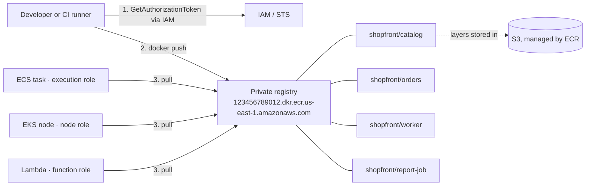

# Amazon ECR · L100 — ECR basics

**Level:** 100 · **Time:** ~35 min · **Prerequisites:** [Container fundamentals L100](../01-container-fundamentals/L100-containers-explained.md); an AWS account, the AWS CLI v2 and Docker (or Colima) on your machine

**After this document you can:**

- read an ECR image URI and explain registry, repository, image, tag and digest in one sentence each
- authenticate Docker to ECR with the 12-hour token or the credential helper, then push and pull
  the `shopfront` images
- explain how ECS, EKS and Lambda pull without ever running `docker login`
- apply a first lifecycle policy without deleting an image that is still deployed
- estimate what a registry costs and name the three things that make the bill grow

## 1. Mental model



ECR is an OCI-compatible registry that AWS runs per account and per Region. A registry holds
repositories; a repository holds images; an image is a manifest that lists layers and a config,
and every object is addressed by its SHA-256 digest. Two things make ECR different from a
registry you would run yourself. First, there are no registry accounts or passwords: the Docker
protocol still expects a username and a password, so ECR exchanges your IAM identity for a
12-hour token, and every pull or push is then authorized by IAM, per request. Second, it is a
managed service with a regional control plane and layers in S3, which is why it is durable, why a
pull from a private subnet needs an S3 route, and why a registry in `us-east-1` is not reachable
from a private subnet in `eu-west-1` without extra work.

## 2. Concepts

### 2.1 Registry, repository, image, tag, digest

| Term | What it is | In `shopfront` |
| --- | --- | --- |
| Registry | One per account per Region: `123456789012.dkr.ecr.us-east-1.amazonaws.com`. Registry-level settings: replication, pull-through cache rules, scanning configuration, registry permissions | the `123456789012` registry in `us-east-1` |
| Repository | A named collection of images. Names are 2–256 characters, lowercase, with `/` allowed, so `team/service` namespaces are one flat string, not a hierarchy | `shopfront/catalog`, `shopfront/orders`, `shopfront/worker`, `shopfront/report-job` |
| Image (manifest) | JSON that lists a config blob and ordered layer blobs by digest. A multi-architecture image is an *index* (manifest list) pointing at one manifest per platform | the `linux/amd64` + `linux/arm64` index that CI pushes |
| Layer | A compressed tar of filesystem changes, content-addressed, deduplicated inside a repository | the distroless base layer shared by every `catalog` build |
| Tag | A mutable, human name that points at one manifest. Many tags can point at the same manifest | `sha-3f2a9c1` per build; `latest` is never deployed ([contract §8](../../labs/CONTRACT.md)) |
| Digest | `sha256:<64 hex>` of the manifest. Immutable: the same bytes always have the same digest, on any registry | what task definitions and manifests deploy |

Reading a full reference:

```text
123456789012.dkr.ecr.us-east-1.amazonaws.com/shopfront/catalog:sha-3f2a9c1@sha256:6c3a1f0e9b7d2c4a5e8f1b3d7c9e2a4f6b8d0c1e3a5f7b9d2c4e6a8f0b1d3c5e
|________________ registry ________________| |___ repository ___| |___ tag ___| |__________________________ digest __________________________|
```

When both a tag and a digest are present the runtime uses the digest and treats the tag as a
comment. `describe-images` shows `imageDigest`, `imageTags`, `imagePushedAt`, `imageSizeInBytes`
and `lastRecordedPullTime` for every manifest.

### 2.2 Private registry vs Amazon ECR Public

| | Private registry | ECR Public |
| --- | --- | --- |
| Hostname | `123456789012.dkr.ecr.us-east-1.amazonaws.com` | `public.ecr.aws/<alias>/<repo>`; gallery at `gallery.ecr.aws` |
| Who can pull | IAM principals you allow (same account, other accounts, AWS services) | anyone; authenticated pulls get higher rate limits |
| Rate limits | API quotas per account per Region (L300) | unauthenticated 1 pull/s and 500 GB/month, authenticated 10 pulls/s — see [ECR Public quotas](https://docs.aws.amazon.com/AmazonECR/latest/public/public-service-quotas.html) |
| Typical use | your services, cached copies of third-party images | open-source projects, AWS-published images (`public.ecr.aws/docker/library/…`, `public.ecr.aws/eks/…`) |
| Cost | $0.10 per GB-month storage; pulls inside the Region are free | 50 GB storage free; egress to AWS compute free |

The `shopfront` labs only use the private registry. Third-party images (`postgres`, `valkey`,
`kafka`) enter it through a pull-through cache rule, which is a L300 topic.

### 2.3 Authentication: the 12-hour token and the credential helper

The registry protocol wants basic-auth credentials. `GetAuthorizationToken` turns your IAM
identity into one: the username is the literal string `AWS`, the password is an opaque token, and
both expire after 12 hours.

```bash
aws ecr get-login-password --region us-east-1 \
  | docker login --username AWS --password-stdin 123456789012.dkr.ecr.us-east-1.amazonaws.com
```

Three properties to remember:

- The token authenticates *who you are*; it grants nothing. Each `push` or `pull` is evaluated by
  IAM against the actions in §2.4: a principal without `ecr:BatchGetImage` logs in fine and then
  fails to pull.
- `ecr:GetAuthorizationToken` must be allowed on resource `*`; it is the only ECR action that
  cannot be scoped to a repository.
- One token works for every registry the principal may reach, including other accounts'. The
  hostname you `docker login` to only decides where the credential is stored.

Because tokens expire, long-lived machines (CI runners, laptops, self-managed nodes) use the
[Amazon ECR Docker credential helper](https://github.com/awslabs/amazon-ecr-credential-helper),
which fetches and caches tokens on demand through the AWS credential chain, so `docker`, `crane`,
`notation` and anything else that reads `~/.docker/config.json` never sees a login step:

```json
{ "credHelpers": { "123456789012.dkr.ecr.us-east-1.amazonaws.com": "ecr-login", "public.ecr.aws": "ecr-login" } }
```

AWS services never log in either. The ECS agent and Fargate call `GetAuthorizationToken` with
the task's **execution role**; the kubelet on an EKS node uses the **node instance role** (or the
Fargate pod execution role) through a credential-provider plugin; Lambda uses the function's
permissions and a repository policy. Which role is which, and how to grant pulls across accounts,
is [L200 §2.4](L200-lifecycle-scanning-access-and-endpoints.md).

### 2.4 Push and pull: what the CLI does for you

`docker push` and `docker pull` (commands in §9) are sequences of registry-protocol calls, and
each one maps to an ECR API action that IAM authorizes and CloudTrail records:

| Step | Registry protocol call | ECR API action behind it | Note |
| --- | --- | --- | --- |
| login | `GET /v2/` | `ecr:GetAuthorizationToken` | once per 12 h |
| push, per layer | `HEAD /v2/<repo>/blobs/<digest>` | `ecr:BatchCheckLayerAvailability` | layers already present are skipped |
| push, per new layer | `POST … /blobs/uploads/`, `PATCH`, `PUT` | `ecr:InitiateLayerUpload`, `ecr:UploadLayerPart`, `ecr:CompleteLayerUpload` | multipart upload |
| push, manifest | `PUT /v2/<repo>/manifests/<tag>` | `ecr:PutImage` | this is where a tag is created or moved |
| pull, manifest | `GET /v2/<repo>/manifests/<ref>` | `ecr:BatchGetImage` | one call per manifest; an index adds one more |
| pull, per layer | `GET /v2/<repo>/blobs/<digest>` | `ecr:GetDownloadUrlForLayer` | ECR answers with a redirect to a presigned S3 URL |

The repository must exist before the first push (`name unknown` otherwise), unless the registry
has a repository creation template for "create on push" (L200). The IAM action names matter
later: quotas, CloudTrail entries and `AccessDenied` messages all use them.

### 2.5 Tags vs digests

A tag is a pointer that anyone with `ecr:PutImage` can move. `latest` is the classic trap: two
nodes that pull it a minute apart can run different code, and a rollback has nothing to roll back
to. The `shopfront` rule: CI tags every build `sha-<gitsha>`, deployments reference the digest,
and repositories use tag immutability so `sha-3f2a9c1` can never be re-pointed (L200 §2.2).
Digest pinning also works across registries: after replication or a `crane copy` the digest is
identical, so one manifest deploys in every Region by changing only the hostname.

### 2.6 A first lifecycle policy

Every push of a changed image leaves the previous manifest behind, usually untagged, and a busy
repository grows by tens of gigabytes a month. A lifecycle policy is a JSON list of rules that
ECR evaluates about once a day; matching images are expired (deleted) or, since November 2025,
moved to the cheaper archive storage class.

```json
{ "rules": [
  { "rulePriority": 10, "description": "untagged manifests are build leftovers: expire after 7 days",
    "selection": { "tagStatus": "untagged", "countType": "sinceImagePushed", "countUnit": "days", "countNumber": 7 },
    "action": { "type": "expire" } },
  { "rulePriority": 20, "description": "keep the newest 100 sha-* builds",
    "selection": { "tagStatus": "tagged", "tagPatternList": ["sha-*"], "countType": "imageCountMoreThan", "countNumber": 100 },
    "action": { "type": "expire" } }
] }
```

`start-lifecycle-policy-preview` + `get-lifecycle-policy-preview` list what *would* be expired;
`put-lifecycle-policy` applies it (commands in §9). Two beginner rules. Always run the preview first. And remember that ECR has no idea what is
deployed: a count rule like "keep 100" deletes the 101st-newest image even if a task still runs
it, and the next scale-out fails with `CannotPullContainerError … manifest unknown`. Keep count
rules for throwaway builds, use time-based rules or archiving for release images, and read
[L200 §2.1](L200-lifecycle-scanning-access-and-endpoints.md) before touching a production
repository.

### 2.7 What it costs

| Item | Price driver | `shopfront` estimate |
| --- | --- | --- |
| Storage | $0.10 per GB-month of compressed layers, deduplicated per repository | 4 repos × 100 retained images × ~40 MB unique per image ≈ 16 GB ≈ $1.60/month |
| Data transfer | free between ECR and compute in the same Region; charged across Regions and to the internet at data-transfer rates | $0 while everything runs in `us-east-1` |
| Scanning | basic scanning is free; enhanced scanning is billed by Amazon Inspector per image | depends on push volume |
| KMS | per-request KMS charges only if you choose customer managed keys | $0 with the default encryption |

Prices from the [ECR pricing page](https://aws.amazon.com/ecr/pricing/) as of September 2026;
verify before quoting. The bill grows from untagged leftovers, copies in many Regions, and
multi-architecture images (each platform has its own layers): lifecycle policies address the
first, the L400 cost model the rest.

## 3. How it interacts with the rest of AWS

| Component | Talks to | Protocol/API | Prerequisite (IAM, network, DNS) | What breaks if missing |
| --- | --- | --- | --- | --- |
| Docker / CI runner | ECR API and registry endpoints | HTTPS 443; `GetAuthorizationToken`, push actions | IAM identity with push actions on the repository; route to `api.ecr.us-east-1.amazonaws.com` and `*.dkr.ecr.us-east-1.amazonaws.com` | `no basic auth credentials`, `denied`, `name unknown` |
| ECS task | ECR | pull actions with the **execution role** | execution role has `AmazonECSTaskExecutionRolePolicy` (includes pull actions); NAT or VPC endpoints | `CannotPullContainerError` |
| EKS node | ECR | pull actions with the **node role** | node role has `AmazonEC2ContainerRegistryPullOnly` (or `…ReadOnly`) | `ImagePullBackOff` with `401`/`403` |
| Lambda (container image) | ECR | `BatchGetImage`, `GetDownloadUrlForLayer` | repository policy statement for `lambda.amazonaws.com`, added automatically in the same account | function stuck in `Pending`/`Failed` |
| ECR | S3 | presigned URLs for layer download | route to S3 (internet, NAT or S3 gateway endpoint) | manifest pulls succeed, layer downloads time out |
| ECR | CloudTrail, EventBridge | management events; `ECR Image Action`, `ECR Image Scan` events | a trail; EventBridge rules | no audit, no push notifications |
| ECR | Amazon Inspector | enhanced scanning | Inspector enabled in the account | only basic scanning available |

Three interactions surprise newcomers. The execution role, not the task role, pulls the image
for an ECS task, so a task that cannot restart after a role change is usually an execution role
problem. Layers come from S3, so a private subnet with only ECR endpoints reads manifests and
still fails to download layers. And the registry is regional: a cluster in `eu-west-1` pulling
from the `us-east-1` registry crosses Regions on every node start.

## 4. Use it when / avoid it when

Use ECR when:

- the images run on AWS compute (ECS, EKS, Lambda, Batch, App Runner, SageMaker): same-Region
  pulls are free and IAM is the only credential you manage
- you need per-repository access control, scanning and lifecycle rules without running a registry
- you want a private, rate-limit-free copy of third-party images (pull-through cache, L300)

Avoid or look elsewhere when:

- you distribute an open-source image to the public: ECR Public, not cross-account grants to all
- you need language packages, not OCI artifacts: ECR stores charts, SBOMs and signatures, but
  npm/pip/Maven packages belong in CodeArtifact
- your runtime is off AWS and needs a registry with local presence: latency and egress cost apply

Alternatives, one line each:

- Docker Hub — the default upstream; rate-limited for anonymous pulls, no IAM integration
- GitHub / GitLab container registries — close to the source; credentials to manage
- Quay, Harbor, Artifactory — richer RBAC and features; you own availability and operations

## 5. Well-Architected view

| Pillar | What ECR gives you | What it costs you | Practice |
| --- | --- | --- | --- |
| Operational Excellence | managed, no registry servers; CloudTrail on every API call | tags and clean-up are your job | immutable tags, `sha-<gitsha>`, lifecycle preview before apply |
| Security | IAM per request, encryption at rest, scanning | long-lived Docker Hub credentials in CI if you skip ECR | `PullOnly` policies for nodes, scan on push, no `latest` |
| Reliability | layers in S3, regional control plane | a regional dependency for every scale-out | pull by digest; replicate before going multi-Region (L300) |
| Performance Efficiency | same-Region pulls from S3, endpoints available | large images pull slowly, Fargate has no layer cache | small multi-stage images ([01 · L200](../01-container-fundamentals/L200-images-builds-and-registries.md)) |
| Cost Optimization | pay for storage only | forgotten images and multi-Region copies | lifecycle rules, archive class for release history |
| Sustainability | shared, deduplicated storage | redundant copies per team | one registry per environment, not per developer |

The [Container Build Lens](https://docs.aws.amazon.com/wellarchitected/latest/container-build-lens/container-build-lens.html)
covers image build and registry practices; domain 12 maps these into checklists.

## 6. Failure modes and troubleshooting

| Symptom | Likely cause | How to confirm (command/metric) | Fix |
| --- | --- | --- | --- |
| `no basic auth credentials` on push or pull | not logged in, or the token for this registry hostname expired (12 h) | `docker logout <registry>` then re-run `get-login-password` | re-login or install the credential helper |
| `denied: User … is not authorized to perform: ecr:BatchGetImage` | IAM identity lacks pull actions on that repository, or the repository is in another account without a repository policy | `aws sts get-caller-identity`; read the `resource:` ARN in the error | grant the action in the identity policy; for another account add a repository policy (L200 §2.4) |
| `name unknown: The repository with name 'shopfront/catalog' does not exist` | pushing before `create-repository`, or a typo in the namespace | `aws ecr describe-repositories --repository-names shopfront/catalog` | create the repository (IaC) or fix the name |
| `manifest unknown` on pull | the tag or digest was never pushed, or a lifecycle rule expired it | `aws ecr describe-images --repository-name shopfront/catalog --image-ids imageTag=sha-3f2a9c1`; CloudTrail `PolicyExecutionEvent` | re-push from CI; fix the lifecycle rule (§2.6) |
| `tag invalid: The image tag 'sha-3f2a9c1' already exists` (`ImageTagAlreadyExistsException`) | tag immutability is on and you re-pushed a different image under an existing tag | `aws ecr describe-repositories` shows `imageTagMutability: IMMUTABLE` | push under a new tag; this is the feature working |
| ECS task stops with `CannotPullContainerError` | execution role, network path to ECR or S3, or missing image | `aws ecs describe-tasks … --query 'tasks[].stoppedReason'` | see [image pull failures](../../playbooks/incidents/image-pull-failures.md) and [ECS stopped reasons](../../playbooks/incidents/ecs-task-stopped-reasons.md) |
| `toomanyrequests` / `Rate exceeded` | API quota exceeded during a large scale-out, or Docker Hub limits if the image is not in ECR | CloudWatch `AWS/Usage` `CallCount` for `BatchGetImage`; the image reference in the error | L300 §2.4; move third-party images behind a pull-through cache |

## 7. Signals: metrics, logs, traces

ECR publishes few native metrics; most signals are derived from CloudTrail and events.

- `AWS/ECR` `RepositoryPullCount` (dimension `RepositoryName`, 1-minute periods, statistic
  `Sum`): the only per-repository metric. Zero pulls while a service should be scaling is a pull
  problem; zero pulls for 90 days marks a lifecycle candidate.
- `AWS/Usage` `CallCount` (`Service=ECR`, `Type=API`, `Resource=GetAuthorizationToken |
  BatchGetImage | GetDownloadUrlForLayer`): compare with the quotas; alarm at 70 %.
- CloudTrail management events (`PutImage`, `BatchGetImage`, `BatchDeleteImage`,
  `SetRepositoryPolicy`, lifecycle `PolicyExecutionEvent`) with the calling identity: the audit
  trail for "who deleted / who pulled".
- EventBridge `ECR Image Action` (`PUSH`, `DELETE`) and `ECR Image Scan`: trigger deployments and
  notifications; alarm on `DELETE` in production repositories.
- Storage has no metric: sum `imageSizeInBytes` from `describe-images` or use Cost Explorer.

The full table with thresholds is in [reference/metrics-catalog.md](../../reference/metrics-catalog.md).

## 8. Testing and DR notes

Testing at this level means proving the round trip with the runtime's identity, not your laptop:
after `docker push`, CI runs `aws ecr describe-images --image-ids imageDigest=<digest>` and fails
if the digest is missing, then deploys to a test environment whose execution or node role does
the pull, so permission mistakes surface before production.

For disaster recovery, two facts: the data is durable (layers in S3), but the service is
regional. If the Region is impaired you cannot pull; running tasks keep running while new ones
cannot start. The state that must survive is the image content (the image *is* the artifact
unless your builds are reproducible) plus the configuration (repositories, policies, rules, all
code). The L100 posture: Dockerfiles and pipelines in Git, deploy by digest, never rely on a tag
you can re-point. Copying images to a second Region is the L300 replication topic; the plan that
goes with it is [10 · L300](../10-resilience-and-dr/L300-dr-strategies-for-container-platforms.md).

## 9. Hands-on

Work in the `shopfront` repository root with credentials for a sandbox account (check with
`aws sts get-caller-identity`; an unknown account is production).

```bash
export REG=123456789012.dkr.ecr.us-east-1.amazonaws.com AWS_REGION=us-east-1
for r in catalog orders worker report-job; do
  aws ecr create-repository --repository-name shopfront/$r \
    --image-tag-mutability IMMUTABLE --image-scanning-configuration scanOnPush=true
done
aws ecr get-login-password | docker login --username AWS --password-stdin $REG
GIT_SHA=$(git rev-parse --short=7 HEAD)
docker build -t $REG/shopfront/catalog:sha-$GIT_SHA -f labs/apps/catalog/Dockerfile labs/apps/catalog
docker push $REG/shopfront/catalog:sha-$GIT_SHA          # one line per layer; base layers: "Layer already exists"
DIGEST=$(aws ecr describe-images --repository-name shopfront/catalog \
  --image-ids imageTag=sha-$GIT_SHA --query 'imageDetails[0].imageDigest' --output text)
docker pull $REG/shopfront/catalog@$DIGEST               # pull by digest
docker push $REG/shopfront/catalog:sha-$GIT_SHA          # same bytes under an immutable tag: accepted
aws ecr describe-images --repository-name shopfront/catalog --image-ids imageTag=sha-$GIT_SHA \
  --query 'imageDetails[0].[imageSizeInBytes,imageScanStatus.status,lastRecordedPullTime]'
aws ecr start-lifecycle-policy-preview --repository-name shopfront/catalog --lifecycle-policy-text file://lifecycle.json
aws ecr get-lifecycle-policy-preview --repository-name shopfront/catalog --query 'previewResults[].[imageTags,action.type]'
aws ecr put-lifecycle-policy --repository-name shopfront/catalog --lifecycle-policy-text file://lifecycle.json
aws cloudtrail lookup-events --lookup-attributes AttributeKey=EventName,AttributeValue=DryRunEvent --max-results 3
```

Observe: `imageScanStatus.status` moves from `IN_PROGRESS` to `COMPLETE` within minutes; the
re-push of identical content is accepted under an immutable tag because the digest did not
change; the preview lists nothing for a fresh repository, and the `DryRunEvent` still appears in
CloudTrail. The GitHub Actions version of this flow, with OIDC instead of a laptop identity, is
[`labs/pipelines/github-actions/ci.yml`](../../labs/pipelines/github-actions/ci.yml).

## 10. Check yourself

1. A colleague says "I logged in to ECR, so I have access to the repository." What is wrong with
   that sentence?

<details><summary>Answer</summary>
The token only proves identity; every push and pull is authorized by IAM per API call
(<code>ecr:BatchGetImage</code>, <code>ecr:GetDownloadUrlForLayer</code>, <code>ecr:PutImage</code>).
Any principal with <code>ecr:GetAuthorizationToken</code> can log in, even with no repository permissions.
</details>

2. Which IAM role pulls the image for a Fargate task: the task role or the execution role? Why
   does it matter?

<details><summary>Answer</summary>
The execution role; the task role is what the application uses at runtime. A pull failure after a
role change is an execution-role problem, and a cross-account repository policy must name the
execution role (or its account), not the task role.
</details>

3. Two nodes started a minute apart run different versions of `shopfront/orders`. What was
   deployed, and what should have been?

<details><summary>Answer</summary>
A mutable tag such as <code>latest</code>, moved by CI between the two pulls. Deploy the digest
(or an immutable <code>sha-&lt;gitsha&gt;</code> tag) so every node resolves the same bytes.
</details>

4. Why can a private subnet with `ecr.api` and `ecr.dkr` interface endpoints still fail to pull?

<details><summary>Answer</summary>
Layers are served from S3 through presigned URLs. Without an S3 gateway endpoint (or a NAT route)
the manifest request succeeds and the layer download times out.
</details>

5. Your lifecycle rule keeps the newest 30 images. A deployment that has been running for two
   weeks fails to scale out. What happened and what is the safer rule shape?

<details><summary>Answer</summary>
CI pushed more than 30 newer builds, the rule expired the deployed image, and new tasks fail with
<code>manifest unknown</code>; ECR does not know what is running. Count rules only for throwaway
<code>sha-*</code> builds; time-based or archive rules for release images; always preview.
</details>

## 11. Sources

- Amazon ECR User Guide: What is Amazon ECR — https://docs.aws.amazon.com/AmazonECR/latest/userguide/what-is-ecr.html
- Amazon ECR User Guide: Private registry authentication — https://docs.aws.amazon.com/AmazonECR/latest/userguide/registry_auth.html
- Amazon ECR Docker credential helper — https://github.com/awslabs/amazon-ecr-credential-helper
- Amazon ECR User Guide: Pushing an image — https://docs.aws.amazon.com/AmazonECR/latest/userguide/docker-push-ecr-image.html
- Amazon ECR User Guide: Lifecycle policies — https://docs.aws.amazon.com/AmazonECR/latest/userguide/LifecyclePolicies.html
- Amazon ECR User Guide: Using Amazon ECR images with Amazon ECS — https://docs.aws.amazon.com/AmazonECR/latest/userguide/ECR_on_ECS.html
- Amazon ECR User Guide: Repository metrics — https://docs.aws.amazon.com/AmazonECR/latest/userguide/ecr-repository-metrics.html
- Amazon ECR Public service quotas — https://docs.aws.amazon.com/AmazonECR/latest/public/public-service-quotas.html
- Amazon ECR pricing — https://aws.amazon.com/ecr/pricing/
- OCI Distribution Specification — https://github.com/opencontainers/distribution-spec/blob/main/spec.md
