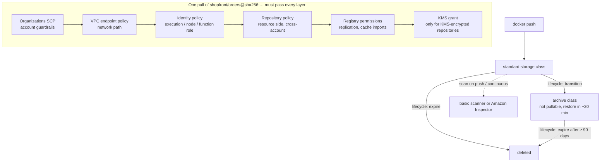

# Amazon ECR · L200 — Lifecycle, scanning, access and endpoints

**Level:** 200 · **Time:** ~60 min · **Prerequisites:** [L100 · ECR basics](L100-ecr-basics.md); [06 · L200 IAM for containers](../06-identity-and-security/L200-iam-for-containers.md) for task/execution/node roles; [05 · L100 VPC for containers](../05-networking/L100-vpc-for-containers.md)

**After this document you can:**

- write a lifecycle policy whose evaluation order you can predict, including archive transitions,
  and prove it with a preview before it deletes anything
- choose a tag mutability setting and explain how it interacts with caches, replication and
  retagging
- configure basic or enhanced (Inspector) scanning at the registry level and route findings to
  EventBridge and Security Hub
- grant pulls to ECS, EKS and Lambda in another account with the minimum identity, repository and
  registry policies
- encrypt repositories with KMS without breaking pulls, and build a private-only pull path with
  `ecr.api`, `ecr.dkr`, the S3 gateway endpoint and endpoint policies

## 1. Mental model



Every ECR feature at this level is a policy document attached to one of four objects: the
repository (lifecycle policy, repository policy, tag mutability, encryption, scanning filters
match here), the registry (scanning configuration, registry permissions, replication, cache
rules, creation templates), the caller's IAM identity, or the network path (endpoint policy). A
pull succeeds only when all of them agree, which is why the same `AccessDenied` has five possible
authors. Storage follows a second small state machine: an image is `standard` until a lifecycle
rule expires it or, since November 2025, transitions it to the archive class, from which it can be
restored but not pulled.

## 2. Concepts

### 2.1 Lifecycle policies: fields and evaluation order

A policy is up to 50 rules (30,720 characters). ECR evaluates all rules, then applies them in
`rulePriority` order (lowest number first), and acts within 24 hours of an image meeting the
criteria. Every action is logged to CloudTrail as `PolicyExecutionEvent`; a preview logs
`DryRunEvent` with the same structure.

| Field | Values | Meaning and constraints |
| --- | --- | --- |
| `rulePriority` | unique positive integer | order of application; a `tagStatus: any` rule must have the highest number |
| `selection.tagStatus` | `tagged`, `untagged`, `any` | `tagged` requires `tagPrefixList` **or** `tagPatternList`; only one rule per storage class may select `untagged` |
| `selection.tagPatternList` | list of patterns, `*` wildcard, max 4 wildcards per pattern | preferred for tagged images; `["release-*"]` |
| `selection.tagPrefixList` | list of prefixes | legacy form; cannot be combined with `tagPatternList` in the same rule |
| `selection.countType` | `imageCountMoreThan`, `sinceImagePushed`, `sinceImagePulled`, `sinceImageTransitioned` | count-based or time-based selection |
| `selection.countUnit` | `days` | required for the three `since*` types, forbidden otherwise |
| `selection.countNumber` | positive integer | images to keep, or age in days |
| `selection.storageClass` | `standard` (default), `archive` | `archive` is required (and the only value) with `sinceImageTransitioned` |
| `action.type` | `expire`, `transition` | delete, or move to the archive class |
| `action.targetStorageClass` | `archive` | required with `transition` |

Evaluation rules that decide what really happens (paraphrased from the AWS documentation):

1. An image is expired or archived by exactly one rule or none. Once a higher-priority rule
   matches an image, lower-priority rules cannot act on it, though they still count it when
   sorting.
2. Multiple entries in one `tagPatternList` (or `tagPrefixList`) are an AND: the image must carry
   a tag matching each entry. To say "tags starting with `a` or `b`" write two rules.
3. With `imageCountMoreThan`, images are sorted newest to oldest by push time and everything past
   the count goes. With `sinceImagePushed`, everything older than N days goes. `sinceImagePulled`
   uses the last recorded pull time (falling back to push time) and is meant for archiving what
   nobody uses. `sinceImageTransitioned` acts on images already in the archive class.
4. Expiration always removes older images before newer ones.
5. A platform manifest referenced by an image index cannot be expired or archived while the index
   exists: the index goes first, its children follow on a later run.
6. Referrer artifacts (signatures, SBOMs, SOCI indexes) are expired or archived automatically
   within 24 hours of their subject image.
7. Archived images have a 90-day minimum; a lifecycle rule cannot expire an image archived for
   fewer than 90 days (`batch-delete-image` can, and you are billed the minimum anyway).

A complete policy for `shopfront/orders`, whose pipeline pushes `sha-<gitsha>` on every commit and
adds `release-<semver>` on promotion:

```json
{
  "rules": [
    { "rulePriority": 10, "description": "build leftovers",
      "selection": { "tagStatus": "untagged", "countType": "sinceImagePushed",
                     "countUnit": "days", "countNumber": 7 },
      "action": { "type": "expire" } },
    { "rulePriority": 20, "description": "keep the newest 200 commit builds",
      "selection": { "tagStatus": "tagged", "tagPatternList": ["sha-*"],
                     "countType": "imageCountMoreThan", "countNumber": 200 },
      "action": { "type": "expire" } },
    { "rulePriority": 30, "description": "release images nobody pulled for 90 days go to archive",
      "selection": { "tagStatus": "tagged", "tagPatternList": ["release-*"],
                     "countType": "sinceImagePulled", "countUnit": "days", "countNumber": 90 },
      "action": { "type": "transition", "targetStorageClass": "archive" } },
    { "rulePriority": 40, "description": "archived releases are deleted after two years",
      "selection": { "tagStatus": "any", "storageClass": "archive",
                     "countType": "sinceImageTransitioned", "countUnit": "days", "countNumber": 730 },
      "action": { "type": "expire" } }
  ]
}
```

Walk through it: a build tagged both `sha-3f2a9c1` and `release-1.4.0` is matched by rule 20
(the tags match `sha-*`), so a count of 200 newer commit builds would expire a release. That is
the classic self-inflicted outage. Either give release rules a lower priority number than the
count rule (so rule 30 claims release images first and rule 20 can no longer touch them), or keep
release tags in a separate repository or namespace. The fix here is to swap priorities 20 and 30.
Always run `start-lifecycle-policy-preview` and read the result; the preview is free, the
deletion is permanent.

Archive class mechanics (November 2025): an archived image keeps its tags and digest but cannot
be pulled; `UpdateImageStorageClass` restores it to `standard` in about 20 minutes, after which
it behaves like a newly pushed image (scanned again, replicated if rules match, subject to the
lifecycle policy again). The EventBridge event is `ECR Image Action` with
`action-type: UPDATE_STORAGE_CLASS`. Pricing for archive storage is on the ECR pricing page;
verify it before modelling savings.

### 2.2 Tag immutability

| Setting | Behaviour |
| --- | --- |
| `MUTABLE` (default) | any principal with `ecr:PutImage` can re-point a tag |
| `IMMUTABLE` | pushing an existing tag to a different manifest fails with `ImageTagAlreadyExistsException`; re-pushing the identical manifest is accepted |
| `IMMUTABLE_WITH_EXCLUSION` (July 2025) | immutable, except tags matching wildcard filters, for example `latest` or `dev-*` |
| `MUTABLE_WITH_EXCLUSION` | mutable, except tags matching the filters |

```bash
aws ecr put-image-tag-mutability --repository-name shopfront/orders \
  --image-tag-mutability IMMUTABLE_WITH_EXCLUSION \
  --image-tag-mutability-exclusion-filters '[{"filter":"dev-*","filterType":"WILDCARD"}]'
```

(Flag names as of September 2026; verify against `aws ecr put-image-tag-mutability help`.)
Interactions to know before switching a repository to immutable:

- Pull-through cache repositories must stay mutable: ECR updates cached images under the same
  upstream tag, and immutability blocks that update (L300 §2.2).
- Replication into an immutable destination where the tag already exists succeeds, but the image
  arrives **untagged** (L300 §2.3).
- Retagging with `put-image` (fetch the manifest with `batch-get-image`, push it under a new tag)
  still works; moving an existing tag does not. Promotion therefore means adding `release-1.4.0`
  to the digest that `sha-3f2a9c1` already points to, never re-pushing.
- Security Hub control `ECR.2` and the AWS Config rule `ecr-private-tag-immutability-enabled`
  flag mutable repositories; use them as the compliance signal.

### 2.3 Scanning: basic vs enhanced

| | Basic scanning | Enhanced scanning |
| --- | --- | --- |
| Engine | AWS-native scanner, 50+ vulnerability feeds | Amazon Inspector |
| Coverage | operating-system packages | OS packages **and** programming-language packages (Java, Node.js, Python, Go, Ruby, Rust, .NET… verify the current list) |
| Trigger | scan on push (registry filters) or manual `start-image-scan`; one scan per image per 24 h; 100,000 scans per registry per day | scan on push or continuous (rescan when new CVEs are published); no manual scans |
| Duration | one-off | continuous for a configurable window (default: as long as the image exists); older images show `SCAN_ELIGIBILITY_EXPIRED` |
| Retroactive | no | at enablement only images pushed in the last 14 days are scanned; re-push older ones |
| Findings | `describe-image-scan-findings`, ECR console | same, plus Inspector console, Security Hub, image-usage data (which EKS/ECS clusters run the image) |
| Events | `ECR Image Scan` (severity counts per image) | `ECR Scan Resource Change` from ECR; `Inspector2 Finding` events from Inspector |
| Cost | none | Inspector pricing per image scanned |
| Unsupported images | `UNSUPPORTED_IMAGE` status (unsupported OS, Windows, scratch) | same, per Inspector's supported list |

The configuration is registry-wide with repository filters:

```bash
aws ecr put-registry-scanning-configuration --region us-east-1 --scan-type ENHANCED \
  --rules '[
    {"scanFrequency":"CONTINUOUS_SCAN","repositoryFilters":[{"filter":"shopfront/*","filterType":"WILDCARD"}]},
    {"scanFrequency":"SCAN_ON_PUSH","repositoryFilters":[{"filter":"*","filterType":"WILDCARD"}]}
  ]'
aws ecr describe-image-scan-findings --repository-name shopfront/orders \
  --image-id imageTag=sha-3f2a9c1 --query 'imageScanFindings.findingSeverityCounts'
```

When two filters match a repository, continuous wins over scan-on-push. Switching the registry to
`ENHANCED` enables Inspector for ECR in the account (a service-linked role appears). Route the
signal, do not stare at the console: an EventBridge rule on `Inspector2 Finding` with severity
`CRITICAL` to an SNS topic, and Security Hub for the fleet view. Distroless `catalog` images have
no OS package manager, so their findings come from the Go module list that enhanced scanning
reads from the binary; a `python:3.12-slim` `worker` image produces both OS and pip findings.
The remediation loop (rebuild on base-image update, block on critical findings in CI) is in
[01 · L400](../01-container-fundamentals/L400-hardening-supply-chain-and-performance.md).

### 2.4 Access control: five policy layers and the action map

| Layer | Attached to | Governs | Written by |
| --- | --- | --- | --- |
| Identity policy | the role that pulls or pushes (execution role, node role, CI role) | what this principal may do; the only place `ecr:GetAuthorizationToken` (resource `*`) can be granted | workload/platform team |
| Repository policy | one repository | who may act on this repository; required for cross-account access and for AWS service principals such as `lambda.amazonaws.com` | registry owner |
| Registry permissions policy | the registry (per Region) | registry-level operations: `ecr:ReplicateImage` for inbound replication, scoping of `ecr:BatchImportUpstreamImage` / `ecr:CreateRepository` for pull-through cache | registry owner |
| VPC endpoint policy | `ecr.api` and `ecr.dkr` endpoints | which principals and actions may traverse this network path | network team |
| Service control policy | the OU | what nobody in the account may do (delete repositories, disable immutability, make anything public) | organization |

Same-account access needs one allow (identity **or** repository policy). Cross-account access
needs both sides: the identity policy in the pulling account and the repository policy in the
registry account. Action map for writing them:

| Purpose | Actions |
| --- | --- |
| Log in | `ecr:GetAuthorizationToken` on `*` |
| Pull | `ecr:BatchGetImage`, `ecr:GetDownloadUrlForLayer`, (`ecr:BatchCheckLayerAvailability` is used by some clients) |
| Push | pull actions + `ecr:InitiateLayerUpload`, `ecr:UploadLayerPart`, `ecr:CompleteLayerUpload`, `ecr:PutImage` |
| Read metadata | `ecr:DescribeRepositories`, `ecr:DescribeImages`, `ecr:ListImages`, `ecr:DescribeImageScanFindings`, `ecr:ListImageReferrers` |
| Manage a repository | `ecr:CreateRepository`, `ecr:DeleteRepository`, `ecr:PutLifecyclePolicy`, `ecr:SetRepositoryPolicy`, `ecr:PutImageTagMutability`, `ecr:BatchDeleteImage`, `ecr:UpdateImageStorageClass`, `ecr:TagResource` |
| Manage the registry | `ecr:PutRegistryPolicy`, `ecr:PutReplicationConfiguration`, `ecr:PutRegistryScanningConfiguration`, `ecr:CreatePullThroughCacheRule`, `ecr:CreateRepositoryCreationTemplate` |
| Cache and replicate | `ecr:BatchImportUpstreamImage` (pull through an upstream), `ecr:ReplicateImage` (internal; only meaningful in a registry policy) |

Managed policies: `AmazonEC2ContainerRegistryPullOnly` (login + pull, the right choice for node
and execution roles), `AmazonEC2ContainerRegistryReadOnly` (adds describe/list),
`AmazonEC2ContainerRegistryPowerUser` (push), `AmazonEC2ContainerRegistryFullAccess`.

Cross-account pulls, three recipes. The registry account is `123456789012`; the workload account
is written `<workload-account-id>`.

**ECS.** The task's execution role in the workload account carries
`AmazonECSTaskExecutionRolePolicy` (which contains the pull actions) or
`AmazonEC2ContainerRegistryPullOnly`. The repository policy in `123456789012` allows that role
(or the whole account, or the whole organization):

```json
{
  "Version": "2012-10-17",
  "Statement": [{
    "Sid": "PullFromWorkloadAccounts",
    "Effect": "Allow",
    "Principal": { "AWS": "arn:aws:iam::<workload-account-id>:role/shopfront-dev-execution" },
    "Action": ["ecr:BatchGetImage", "ecr:GetDownloadUrlForLayer", "ecr:BatchCheckLayerAvailability"]
  }]
}
```

For an organization-wide grant replace the principal with `"AWS": "*"` and add
`"Condition": {"StringEquals": {"aws:PrincipalOrgID": "o-exampleorgid"}}`. The task definition
references the registry account's hostname; the agent obtains its token from its own account's
API endpoint and presents it to `123456789012.dkr.ecr.us-east-1.amazonaws.com`.

**EKS.** Same repository policy, principal = the node role (managed node groups, Auto Mode) or
the Fargate pod execution role. No `imagePullSecrets`: the kubelet's ECR credential provider
matches any `*.dkr.ecr.*.amazonaws.com` reference and signs with the node's role. Cross-Region
references work the same way, at cross-Region transfer cost and with no PrivateLink path.

**Lambda.** Lambda pulls with its own service principal and re-fetches the image periodically
(functions unused for weeks are re-optimized from the registry; a deleted image puts the
function into the `Failed` state). Two statements are needed:

```json
{
  "Version": "2012-10-17",
  "Statement": [
    { "Sid": "CrossAccountPermission", "Effect": "Allow",
      "Principal": { "AWS": "arn:aws:iam::<workload-account-id>:root" },
      "Action": ["ecr:BatchGetImage", "ecr:GetDownloadUrlForLayer"] },
    { "Sid": "LambdaECRImageCrossAccountRetrievalPolicy", "Effect": "Allow",
      "Principal": { "Service": "lambda.amazonaws.com" },
      "Action": ["ecr:BatchGetImage", "ecr:GetDownloadUrlForLayer"],
      "Condition": { "StringLike": { "aws:sourceARN": "arn:aws:lambda:us-east-1:<workload-account-id>:function:*" } } }
  ]
}
```

The `aws:sourceARN` condition is confused-deputy prevention: without it any Lambda function in
any account could use your repository policy. Lambda cannot pull through a pull-through cache
rule (L300 §2.2).

### 2.5 Encryption at rest with KMS

Default encryption is SSE-S3 (AES-256) on the S3 buckets ECR manages; nothing to configure.
Choosing `KMS` at repository creation encrypts with the AWS managed key `aws/ecr` or with a
customer managed key in the same Region. The encryption configuration cannot be changed after
creation; to migrate, create a new repository and copy images (L400 §2.8). Mechanics:

- On `create-repository`, ECR calls `DescribeKey` and issues two `CreateGrant`s naming the
  repository as grantee. Pushes call `GenerateDataKey`, pulls call `Decrypt` through those grants.
  On `delete-repository`, ECR retires the grants. Never revoke the grants by hand: pulls stop
  immediately.
- The creating principal needs `kms:CreateGrant`, `kms:DescribeKey` and `kms:RetireGrant` (the
  last one only in its identity policy). Pulling principals need no KMS permissions: ECR
  decrypts on their behalf through the grant. This is also what makes cross-account pulls from a
  KMS-encrypted repository work without sharing the key.
- Lock the key policy to ECR with `"kms:ViaService": "ecr.us-east-1.amazonaws.com"`. CloudTrail
  KMS entries carry the encryption context keys `aws:ecr:arn` (repository) and `aws:s3:arn`.
- DSSE-KMS (two layers) exists only in the GovCloud (US) Regions as of September 2026.
- Repositories that ECR creates for you (pull-through cache, replication, create on push) get
  AES-256 unless a repository creation template with `encryptionConfiguration` and a
  `customRoleArn` says otherwise (L300 §2.2).

Deleting or disabling the key is data loss for every image in the repository; the DR posture for
KMS-encrypted registries is a template that pins a multi-Region key replica in the DR Region.

### 2.6 VPC endpoints: `ecr.api`, `ecr.dkr`, S3 gateway and endpoint policies

| Endpoint | Type | Serves | Needed by |
| --- | --- | --- | --- |
| `com.amazonaws.us-east-1.ecr.api` | interface, private DNS **on** | the ECR API: `GetAuthorizationToken`, `BatchGetImage`, `DescribeImages`, everything the SDK calls | every pull (token), ECS agent, Fargate ≥ 1.4.0, kubelet |
| `com.amazonaws.us-east-1.ecr.dkr` | interface, private DNS **on** | the registry protocol at `123456789012.dkr.ecr.us-east-1.amazonaws.com` (`/v2/…/manifests`, `/blobs`) | every pull and push |
| `com.amazonaws.us-east-1.s3` | gateway, attached to the route tables | layer downloads from `arn:aws:s3:::prod-us-east-1-starport-layer-bucket/*` | every pull |
| `com.amazonaws.us-east-1.logs` | interface | `awslogs` driver | Fargate tasks without internet |
| ECS: `ecs`, `ecs-agent`, `ecs-telemetry`; EKS: `ec2`, `sts`, `eks`, `eks-auth`… | interface | control planes of the orchestrators | full list in [reference/ports-addresses-and-endpoints.md](../../reference/ports-addresses-and-endpoints.md) |

Rules that follow from the design:

- Private DNS must be enabled on both interface endpoints; the registry hostname is not
  configurable in ECS or Kubernetes image references, so the public name has to resolve to the
  endpoint ENIs inside the VPC. The endpoint security group must accept 443 from the subnets.
- Fargate platform 1.4.0 (`LATEST`) needs `ecr.api`, `ecr.dkr` and S3; 1.3.0 needed only
  `ecr.dkr` and S3. This is the usual cause of "it worked on the old platform version".
- Endpoints serve the Region's registries, including registries of **other accounts** in the same
  Region. They do not serve `eu-west-1` registries, and they do not serve `public.ecr.aws` image
  pulls; the way to pull public or cross-Region images privately is a pull-through cache or
  replication into the local registry (L300).
- The first pull through a pull-through cache rule may need an internet route even when
  endpoints exist; AWS documents this caveat, so warm the cache from a runner with egress.
- ECR offers dual-stack hostnames (`ecr.us-east-1.api.aws` and
  `123456789012.dkr-ecr.us-east-1.on.aws`) for IPv6 networks, dual-stack interface endpoints, and
  FIPS variants (`ecr-fips`) for regulated workloads.

An endpoint policy is a resource policy on the network path. Pin it to your organization and to
pull/push actions, so a stolen token from elsewhere cannot use your VPC as an exfiltration path:

```json
{
  "Statement": [{
    "Sid": "OrgPrincipalsPullAndPushOnly",
    "Effect": "Allow",
    "Principal": "*",
    "Action": ["ecr:GetAuthorizationToken", "ecr:BatchGetImage", "ecr:GetDownloadUrlForLayer",
               "ecr:BatchCheckLayerAvailability", "ecr:InitiateLayerUpload", "ecr:UploadLayerPart",
               "ecr:CompleteLayerUpload", "ecr:PutImage", "ecr:BatchImportUpstreamImage",
               "ecr:CreateRepository"],
    "Resource": "*",
    "Condition": { "StringEquals": { "aws:PrincipalOrgID": "o-exampleorgid" } }
  }]
}
```

The S3 gateway endpoint policy needs `s3:GetObject` on
`arn:aws:s3:::prod-us-east-1-starport-layer-bucket/*` (plus whatever else your tasks read from
S3). On the identity side, a Fargate execution role can be pinned to the path with
`aws:SourceVpce` or `aws:SourceVpc` conditions on the pull actions. Endpoint pricing is per
AZ-hour plus per GB processed, and layer bytes flow through the S3 gateway endpoint, which is
free; the interface endpoints only carry manifests and API calls.

### 2.7 Registry permissions and repository creation templates

The registry permissions policy (`put-registry-policy`) is one document per Region. It has two
jobs: allow other accounts to replicate **into** this registry, and scope who may import upstream
images through pull-through cache rules and create the repositories that come with them:

```json
{
  "Version": "2012-10-17",
  "Statement": [
    { "Sid": "InboundReplicationFromBuildAccount", "Effect": "Allow",
      "Principal": { "AWS": "arn:aws:iam::<build-account-id>:root" },
      "Action": ["ecr:ReplicateImage", "ecr:CreateRepository"],
      "Resource": "arn:aws:ecr:us-east-1:123456789012:repository/shopfront/*" },
    { "Sid": "PullThroughCacheForNodes", "Effect": "Allow",
      "Principal": { "AWS": "arn:aws:iam::123456789012:role/shopfront-dev-node" },
      "Action": ["ecr:BatchImportUpstreamImage", "ecr:CreateRepository"],
      "Resource": "arn:aws:ecr:us-east-1:123456789012:repository/docker-hub/*" }
  ]
}
```

Repositories that ECR creates on your behalf (pull-through cache, replication, create on push)
get default settings: mutable tags, AES-256, no policies. A repository creation template keyed by
prefix (`ROOT` for "everything else", `appliedFor` = `PULL_THROUGH_CACHE`, `REPLICATION`,
`CREATE_ON_PUSH`) sets mutability, encryption, repository policy, lifecycle policy and resource
tags at creation time; a `customRoleArn` is required when the template uses tags or KMS. Without
a matching `CREATE_ON_PUSH` template, pushing to a missing repository still fails with
`name unknown`.

## 3. How it interacts with the rest of AWS

| Component | Talks to | Protocol/API | Prerequisite (IAM, network, DNS) | What breaks if missing |
| --- | --- | --- | --- | --- |
| ECS agent / Fargate | ECR API + registry + S3 | `GetAuthorizationToken`, pull actions, S3 GET | execution role with `PullOnly`; NAT or `ecr.api` + `ecr.dkr` + S3 endpoints; private DNS | `ResourceInitializationError: unable to pull secrets or registry auth` (API path), `CannotPullContainerError … i/o timeout` (layer path) |
| kubelet (EKS) | same | ECR credential provider plugin with the node role | node role with `PullOnly`; endpoints or NAT | `ImagePullBackOff`, `401 Unauthorized` |
| Lambda | ECR | `BatchGetImage`, `GetDownloadUrlForLayer` as `lambda.amazonaws.com` | repository policy statement with `aws:sourceARN` | function `Failed` / creation error |
| ECR | KMS | `GenerateDataKey`, `Decrypt` via grants | key in the same Region; grants intact | pushes and pulls fail with KMS errors |
| ECR | Amazon Inspector | enhanced scanning | Inspector enabled; images pushed within 14 days | `SCAN_ELIGIBILITY_EXPIRED`, no findings |
| ECR | EventBridge / Security Hub | `ECR Image Scan`, `ECR Scan Resource Change`, `Inspector2 Finding`; Security Hub controls `ECR.1–3` | rules and integrations enabled | findings nobody sees |
| ECR | CloudTrail | management events incl. `PolicyExecutionEvent`, `SetRepositoryPolicy` | a trail or CloudTrail Lake | no audit of deletions or policy changes |
| Route 53 private DNS | ECR endpoints | resolves `*.dkr.ecr.us-east-1.amazonaws.com` to endpoint ENIs | private DNS enabled on the endpoint | pulls go to the public IP and are blocked |
| S3 gateway endpoint | ECR layer bucket | presigned GETs | route table entry, endpoint policy allowing the bucket | manifests work, layers time out |

Two surprises. Endpoint policies and repository policies are both resource policies, but an
endpoint policy that omits `ecr:GetAuthorizationToken` breaks *every* pull through the path,
because the token call goes through `ecr.api`. And a repository policy alone never suffices
cross-account: the puller's own account must also allow the actions on the identity, which is why
"I added the account to the repo policy and it still says AccessDenied" is the most common ticket.

## 4. Use it when / avoid it when

Use these mechanisms when:

- more than one account or Region consumes your images: repository policies with
  `aws:PrincipalOrgID`, plus replication for other Regions
- images must never change under a deployed tag: `IMMUTABLE` (with exclusions only for
  developer sandboxes)
- you run anything in a private subnet: `ecr.api` + `ecr.dkr` + S3 gateway, always the three
- compliance needs language-package CVEs and continuous rescans: enhanced scanning with a
  `CONTINUOUS_SCAN` filter on production namespaces
- an auditor asks who can decrypt images: KMS customer managed keys with `kms:ViaService`

Avoid or reconsider when:

- granting `ecr:*` on `*` to CI or nodes: nodes pull, they never push or delete
- exposing repositories to `"Principal": "*"` without an organization condition
- using count-based lifecycle rules on repositories whose images are deployed for long periods
- turning on KMS with customer managed keys "because it is more secure" without a key-loss plan:
  the default SSE-S3 encryption is already at rest, and a deleted key deletes the images
- relying on basic scanning for a Go or Node.js application: it does not see language packages

Alternatives, one line each:

- Copy images into each account instead of cross-account policies — simpler IAM, N copies to
  keep in sync (replication does this for you, L300)
- Scan in CI with Trivy or Grype instead of in the registry — catches issues before push, but
  nothing rescans images already in production
- NAT gateway instead of endpoints — fewer objects, but ECR pulls traverse NAT at per-GB cost
  and rely on public DNS

## 5. Well-Architected view

| Pillar | What this layer gives you | What it costs you | Practice |
| --- | --- | --- | --- |
| Operational Excellence | policies as code; lifecycle preview; CloudTrail on every change | policy sprawl across five layers | one IaC module per repository (mutability, scanning, lifecycle, policy), tested with the preview |
| Security | least-privilege pulls, cross-account without shared secrets, KMS, scanning | KMS operational risk; scanning noise | `PullOnly` for runtimes, `aws:PrincipalOrgID` everywhere, block on critical findings in CI |
| Reliability | lifecycle keeps the registry predictable | a wrong rule deletes a deployed image | time-based or archive rules for releases; alarm on `PolicyExecutionEvent` |
| Performance Efficiency | endpoints keep pulls inside the Region | endpoint hours per AZ | S3 gateway for bytes (free), interface endpoints for control |
| Cost Optimization | archive class for history, lifecycle for leftovers | Inspector per-image cost on noisy repositories | continuous scanning on production namespaces only |
| Sustainability | fewer stored bytes, fewer transfers | — | expire untagged within days |

The [ECS best-practices guide](https://docs.aws.amazon.com/AmazonECS/latest/bestpracticesguide/)
(image and networking sections) and the
[EKS best-practices guide](https://docs.aws.amazon.com/eks/latest/best-practices/) (image security)
give the same advice from the consumer side.

## 6. Failure modes and troubleshooting

| Symptom | Likely cause | How to confirm (command/metric) | Fix |
| --- | --- | --- | --- |
| `AccessDenied … ecr:BatchGetImage … because no resource-based policy allows` from another account | repository policy missing or names the wrong principal (task role instead of execution role) | read the principal ARN in the error; `aws ecr get-repository-policy --repository-name shopfront/orders` | add the execution/node role or account to the repository policy (§2.4) |
| Same-account pull denied although the repository policy allows it | an SCP or a VPC endpoint policy denies; or the identity has an explicit deny | CloudTrail event `errorCode` and `errorMessage`; check `aws:SourceVpce` in the event | fix the layer named in the error |
| Fargate `ResourceInitializationError: unable to pull secrets or registry auth` | no `ecr.api` endpoint / no route / endpoint SG blocks 443 / private DNS off | `aws ec2 describe-vpc-endpoints --filters Name=service-name,Values=com.amazonaws.us-east-1.ecr.api`; `PrivateDnsEnabled` | add or fix the endpoint; open 443 from the task subnets |
| `CannotPullContainerError: … dial tcp …:443: i/o timeout` on the layer download | no S3 gateway endpoint or route table not associated | `describe-vpc-endpoints` for `s3`, `RouteTableIds` includes the task subnets' tables | associate the route tables; check the endpoint policy allows the `starport` bucket |
| `ImageTagAlreadyExistsException` in CI | immutability on, pipeline re-pushes a changed image under an existing tag | `describe-repositories` `imageTagMutability` | tag by commit SHA; promote by retagging the digest, not by re-pushing |
| Release image disappeared | count-based rule matched it (release tags also match `sha-*`, or `any` rule) | CloudTrail `PolicyExecutionEvent` for the repository | reorder priorities; move releases to time/archive rules; restore from CI cache or rebuild (L400 §2.6) |
| Scan status `UNSUPPORTED_IMAGE` | OS not supported by the scanner, Windows, or a non-image artifact | `describe-image-scan-findings … imageScanStatus` | expected for signatures/SBOMs; for images, use a supported base |
| Scan status `SCAN_ELIGIBILITY_EXPIRED` | enhanced scanning enabled after the image was pushed (>14 days), or rescan window elapsed | `describe-image-scan-findings` | re-push, or extend the Inspector rescan duration |
| Pull fails with `KMS.DisabledException` / `KMS.NotFoundException` | key disabled, deleted or grant revoked | CloudTrail `Decrypt` failures with `aws:ecr:arn` context | re-enable the key; if deleted, the images are gone: restore from another Region |
| Replicated image shows no tag in the destination | destination repository is immutable and the tag existed | `describe-images` in the destination | keep destination mutable for caches, or accept digest-only deployment |
| Lambda function state `Failed` | image deleted from ECR or repository policy removed | `aws lambda get-function --query 'Configuration.[State,StateReason]'` | restore the image or the `lambda.amazonaws.com` statement |

Playbooks: [image pull failures](../../playbooks/incidents/image-pull-failures.md),
[IAM AccessDenied from containers](../../playbooks/incidents/iam-accessdenied-from-containers.md).

## 7. Signals: metrics, logs, traces

- `AWS/ECR` `RepositoryPullCount` per repository: baseline it per environment; zero pulls for a
  release repository during a deployment window means the deployment is not pulling from where
  you think.
- `AWS/Usage` `CallCount` for `GetAuthorizationToken`, `BatchGetImage`, `GetDownloadUrlForLayer`:
  alarm at 70 % of quota (L300 §2.4 explains the arithmetic).
- CloudTrail: `PolicyExecutionEvent` (what lifecycle deleted or archived; alarm when the affected
  tags match `release-*`), `SetRepositoryPolicy`, `PutImageTagMutability`,
  `PutRegistryPolicy`, `DeleteRepository`, `BatchDeleteImage`: every one of these in production is
  a change-management event.
- Security Hub controls `ECR.1` (scan on push), `ECR.2` (tag immutability), `ECR.3` (lifecycle
  policy present) and AWS Config rules `ecr-private-image-scanning-enabled`,
  `ecr-private-tag-immutability-enabled`, `ecr-private-lifecycle-policy-configured`: fleet
  compliance percentages, not per-image findings.
- Inspector: count of `CRITICAL`/`HIGH` findings per repository and their age; the useful SLO is
  "no critical finding older than N days on an image that is pulled".
- EventBridge `ECR Image Scan` `finding-severity-counts` per push: gate deployments on it.

Thresholds and sources are consolidated in [reference/metrics-catalog.md](../../reference/metrics-catalog.md).

## 8. Testing and DR notes

Test policies the way you test code. Lifecycle: `start-lifecycle-policy-preview` in CI against a
copy of the production repository's image list, assert that no image tagged `release-*` appears in
the preview output, and only then `put-lifecycle-policy`. Access: an integration test that
assumes the real execution or node role (`aws sts assume-role`) and pulls the digest through the
private path; `aws iam simulate-principal-policy` helps for identity policies but does not
evaluate repository policies across accounts, so run the real pull. Endpoints: a smoke task in the
private subnet that pulls a fresh digest and reports `pullStartedAt`/`pullStoppedAt` from
`describe-tasks`. Scanning: push a known-vulnerable test image (an old `python:3.12-slim` build)
to a sandbox repository and assert that the `ECR Image Scan` event arrives with the expected
severity counts.

Disaster recovery at this layer is about configuration and keys. Every policy here is declarative:
keep repositories, lifecycle and repository policies, registry permissions, scanning configuration
and endpoints in CloudFormation or Terraform so a Region rebuilds from the repository
([cluster rebuild runbook](../../playbooks/dr/cluster-rebuild-runbook.md)). Replication copies no
policies or settings, so the destination needs the same IaC or repository creation templates. KMS
customer managed keys are the one non-rebuildable dependency: a deleted key makes the Region's
images unrecoverable, so a DR Region holds its own key (a multi-Region replica works) and its own
replicated copies. RPO for images is the replication lag (L300); RTO for configuration is the time
to run the IaC.

## 9. Hands-on

Continue from the L100 repositories (`$REG`, `$GIT_SHA` and `AWS_REGION=us-east-1` set).

```bash
  # 1. lifecycle preview with the §2.1 policy, then swap priorities 20 and 30 and preview again
aws ecr start-lifecycle-policy-preview --repository-name shopfront/orders --lifecycle-policy-text file://lifecycle.json
sleep 20; aws ecr get-lifecycle-policy-preview --repository-name shopfront/orders \
  --query 'previewResults[].[imageTags,appliedRulePriority,action.type]' --output table
  # 2. immutability with an exclusion, then a deliberate violation
aws ecr put-image-tag-mutability --repository-name shopfront/orders --image-tag-mutability IMMUTABLE_WITH_EXCLUSION \
  --image-tag-mutability-exclusion-filters '[{"filter":"dev-*","filterType":"WILDCARD"}]'
docker tag $REG/shopfront/orders:sha-$GIT_SHA $REG/shopfront/orders:dev-erick && docker push $REG/shopfront/orders:dev-erick
  # rebuild with a code change, re-tag as sha-$GIT_SHA, push: expect ImageTagAlreadyExistsException
  # 3. enhanced scanning (Inspector charges apply) and findings for the Python image vs the distroless one
aws ecr put-registry-scanning-configuration --scan-type ENHANCED \
  --rules '[{"scanFrequency":"SCAN_ON_PUSH","repositoryFilters":[{"filter":"shopfront/*","filterType":"WILDCARD"}]}]'
docker build -t $REG/shopfront/worker:sha-$GIT_SHA -f labs/apps/worker/Dockerfile labs/apps/worker && docker push $REG/shopfront/worker:sha-$GIT_SHA
sleep 90; aws ecr describe-image-scan-findings --repository-name shopfront/worker --image-id imageTag=sha-$GIT_SHA \
  --query '[imageScanStatus.status, imageScanFindings.findingSeverityCounts]'
  # 4. private pull path: after labs/ecs/cloudformation/deploy.sh (prints the account, waits for confirmation)
aws ecs describe-tasks --cluster shopfront-dev --tasks <task-arn> \
  --query 'tasks[0].[lastStatus,stoppedReason,pullStartedAt,pullStoppedAt]'
```

Observe: (1) an image tagged both `sha-…` and `release-…` appears under `appliedRulePriority: 20`
with `expire` before the swap and under `30` with `transition` after it; (2) the `dev-*` push
succeeds, the re-pushed `sha-*` tag is refused; (3) `worker` reports OS and pip findings,
`catalog` (distroless) only Go modules; (4) `01-network.yaml` created the `ecr.api`, `ecr.dkr`,
`logs` and S3 endpoints in `10.42.0.0/16` and `02-cluster.yaml` the execution role, so the task
pulls with no internet route. Then, in a sandbox only, remove the S3 gateway endpoint's route-table
association and start another task: `CannotPullContainerError … i/o timeout` on the layer URL.
Finally, with a second sandbox account, apply the ECS repository policy from §2.4 and run the same
task definition there against `123456789012.dkr.ecr.us-east-1.amazonaws.com`; remove the statement
and watch new tasks fail while running ones survive.

## 10. Check yourself

1. Your policy has rule 1 `tagStatus: any, imageCountMoreThan: 50` and rule 2
   `tagPatternList: ["release-*"], sinceImagePushed: 365 days`. What does ECR do?

<details><summary>Answer</summary>
It rejects the policy: a <code>tagStatus: any</code> rule must have the highest
<code>rulePriority</code> (be evaluated last). If you renumber so the <code>any</code> rule is
last, rule 1 (<code>release-*</code>) claims release images first and the count rule can no longer
expire them, which is the intended protection.
</details>

2. Enhanced scanning was enabled today. Why do most images show `SCAN_ELIGIBILITY_EXPIRED`?

<details><summary>Answer</summary>
Inspector only picks up images pushed in the last 14 days when enhanced scanning is turned on;
older images are not scanned until they are pushed again. The same status appears later when the
configured rescan duration for an image elapses.
</details>

3. A Fargate task on platform 1.4.0 in a private subnet fails with `ResourceInitializationError:
   unable to pull secrets or registry auth`. The `ecr.dkr` endpoint and the S3 gateway exist.
   What is missing?

<details><summary>Answer</summary>
The <code>ecr.api</code> interface endpoint (with private DNS). Platform 1.4.0 obtains the
registry token and task metadata through the ECR API; 1.3.0 only needed <code>ecr.dkr</code> and
S3, which is why older tasks worked.
</details>

4. Which two IAM permission sets are needed for a Lambda function in account
   `<workload-account-id>` to use an image in `123456789012`, and what does the `aws:sourceARN`
   condition prevent?

<details><summary>Answer</summary>
An identity policy on the creator's role in the workload account allowing
<code>ecr:BatchGetImage</code> and <code>ecr:GetDownloadUrlForLayer</code>, plus a repository
policy in <code>123456789012</code> with a statement for the workload account root and a statement
for the <code>lambda.amazonaws.com</code> service principal. The condition limits the service
statement to functions in that account, so a function in an unrelated account cannot use your
policy as a confused deputy.
</details>

5. Why do pulling principals need no `kms:Decrypt` permission on a KMS-encrypted repository, and
   what is the operational consequence?

<details><summary>Answer</summary>
ECR created grants on the key with the repository as grantee and performs the
<code>Decrypt</code> itself when serving a pull. The consequence is that access is controlled
purely by ECR policies, and that revoking the grant or disabling the key stops every pull
immediately, so key lifecycle is part of the registry's DR plan.
</details>

## 11. Sources

- Amazon ECR User Guide: Lifecycle policies — https://docs.aws.amazon.com/AmazonECR/latest/userguide/LifecyclePolicies.html
- Amazon ECR User Guide: Lifecycle policy properties — https://docs.aws.amazon.com/AmazonECR/latest/userguide/lifecycle_policy_parameters.html
- Amazon ECR User Guide: Archiving an image — https://docs.aws.amazon.com/AmazonECR/latest/userguide/archive_restore_image.html
- Amazon ECR User Guide: Preventing image tags from being overwritten — https://docs.aws.amazon.com/AmazonECR/latest/userguide/repository-edit.html
- Amazon ECR User Guide: Basic scanning — https://docs.aws.amazon.com/AmazonECR/latest/userguide/image-scanning-basic.html
- Amazon ECR User Guide: Enhanced scanning — https://docs.aws.amazon.com/AmazonECR/latest/userguide/image-scanning-enhanced.html
- Amazon ECR User Guide: Private repository policies — https://docs.aws.amazon.com/AmazonECR/latest/userguide/repository-policies.html
- Amazon ECR User Guide: Private registry permissions — https://docs.aws.amazon.com/AmazonECR/latest/userguide/registry-permissions.html
- Amazon ECR User Guide: AWS managed policies — https://docs.aws.amazon.com/AmazonECR/latest/userguide/security-iam-awsmanpol.html
- Amazon ECR User Guide: Encryption at rest — https://docs.aws.amazon.com/AmazonECR/latest/userguide/encryption-at-rest.html
- Amazon ECR User Guide: Interface VPC endpoints (AWS PrivateLink) — https://docs.aws.amazon.com/AmazonECR/latest/userguide/vpc-endpoints.html
- Amazon ECR User Guide: Making requests to Amazon ECR registries (dual-stack) — https://docs.aws.amazon.com/AmazonECR/latest/userguide/ecr-requests.html
- Amazon ECR User Guide: Repository creation templates — https://docs.aws.amazon.com/AmazonECR/latest/userguide/repository-creation-templates.html
- Amazon ECR User Guide: Events and EventBridge — https://docs.aws.amazon.com/AmazonECR/latest/userguide/ecr-eventbridge.html
- AWS Lambda Developer Guide: Amazon ECR permissions for container images — https://docs.aws.amazon.com/lambda/latest/dg/images-create.html
- Amazon Inspector User Guide: Scanning Amazon ECR container images — https://docs.aws.amazon.com/inspector/latest/user/scanning-ecr.html
- What's new: exceptions to tag immutability (July 2025) — https://aws.amazon.com/about-aws/whats-new/2025/07/amazon-ecr-exceptions-tag-immutability/
- What's new: archive storage class (November 2025) — https://aws.amazon.com/about-aws/whats-new/2025/11/amazon-ecr-archive-storage-class-container-images/
