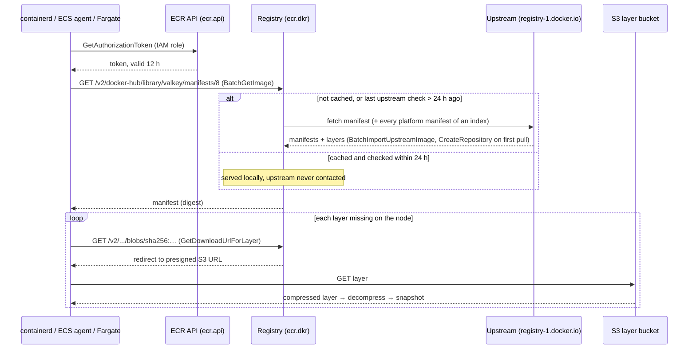
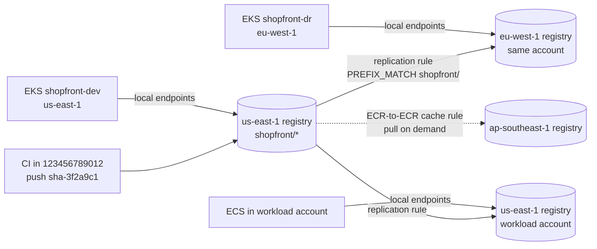

# Amazon ECR · L300 — Pull-through cache, replication and limits

**Level:** 300 · **Time:** ~90 min · **Prerequisites:** [L200 · Lifecycle, scanning, access and endpoints](L200-lifecycle-scanning-access-and-endpoints.md); [01 · L300 runtimes and the kernel](../01-container-fundamentals/L300-runtimes-and-the-kernel.md) for how containerd unpacks layers; [05 · L300 container networking internals](../05-networking/L300-container-networking-internals.md) for PrivateLink

**After this document you can:**

- list the API calls behind one image pull and turn a scale-out plan into a request rate you can
  compare with the quotas
- design pull-through cache rules for the upstream registries you use and explain what happens
  on the first pull, on a cached pull, and when the upstream changes or disappears
- configure cross-Region and cross-account replication, state exactly what it copies and does
  not copy, and verify a digest has arrived before deploying it in another Region
- diagnose throttling and slow pulls with `AWS/Usage` metrics, `describe-tasks` timestamps and
  containerd/kubelet settings, and speed pulls up with parallelism, zstd and SOCI
- answer "who pulled, who deleted, who imported" from CloudTrail

## 1. Mental model



A pull is a token call, one API call per manifest, one API call per missing layer, and one S3
download per layer; everything ECR-specific is rate-limited per account per Region on the API
side and unlimited on the S3 side. A pull-through cache rule puts ECR in the position of the
client towards an upstream registry, so the same sequence runs twice on a first pull and once
afterwards. Replication is the same copy in the other direction, pushed by ECR to another
registry after every image push. Both features exist to remove a runtime dependency (Docker Hub,
a registry in another Region) and to move bytes close to the compute before a scale-out needs
them. What is left to you is arithmetic: how many manifests and layers will N nodes request in
the same ten seconds, and does that fit in 2,000 and 3,000 requests per second.

## 2. Concepts

### 2.1 Anatomy of a pull and the load it creates

| Step | Registry call | ECR API (quota, default) | Count per image pull |
| --- | --- | --- | --- |
| authenticate | `GET /v2/` with basic auth | `GetAuthorizationToken` (500/s) | 1 per client per 12 h; kubelet's credential provider and the ECS agent cache the token; every **Fargate task** is a new client |
| resolve tag or digest | `GET /v2/<repo>/manifests/<ref>` | `BatchGetImage` (2,000/s) | 1 for a single-platform image; 2 for a multi-arch index (index, then the platform manifest) |
| fetch config + layers | `GET /v2/<repo>/blobs/<digest>` | `GetDownloadUrlForLayer` (3,000/s) | 1 per blob not already on the node: config + each missing layer |
| download | `GET` presigned S3 URL | none (S3) | 1 per blob; bandwidth-bound, not quota-bound |
| unpack | local | none | CPU-bound: gunzip or zstd, then write into the snapshotter (overlayfs) |

containerd fetches up to `max_concurrent_downloads` (default 3) layers of one image in parallel
and unpacks them as they complete; the kubelet by default pulls images serially per node
(`serializeImagePulls: true`) and throttles registry calls with `registryPullQPS` 5 and
`registryBurst` 10; EKS Auto Mode ships `registryPullQPS` 25 / `registryBurst` 50 and disables
serialization where local NVMe is present ([FACTS](../../docs/FACTS-2026-09.md)). The ECS agent
pulls containers of a task concurrently and honours `ECS_IMAGE_PULL_BEHAVIOR`. Fargate has no
layer cache: every task downloads every layer of every container, and task billing starts when
the pull starts.

Load model for a scale-out, with realistic `shopfront` numbers: a node group adds 400 nodes, each
node starts 12 images (`aws-node`, `kube-proxy`, CoreDNS, the CloudWatch agent, ADOT, a network
policy agent, plus `catalog`, `orders`, `worker` ×2 and two sidecars), multi-arch, 7 blobs each.

| Quantity | Calculation | If the nodes join within 60 s | Within 10 s |
| --- | --- | --- | --- |
| `GetAuthorizationToken` | 400 nodes × 1 | 7/s | 40/s |
| `BatchGetImage` | 400 × 12 × 2 | 160/s | 960/s |
| `GetDownloadUrlForLayer` | 400 × 12 × 7 | 560/s | 3,360/s → **throttled** (quota 3,000/s) |

The same exercise for Fargate: 600 tasks started in the same second each call
`GetAuthorizationToken` → 600/s against a 500/s quota, and the tasks fail with
`ResourceInitializationError … ThrottlingException` before any layer moves. Quotas are per
account per Region and adjustable (§2.4); the arithmetic is what you show in the increase request.

### 2.2 Pull-through cache rules in depth

A rule maps a repository prefix in your registry to an upstream registry. Pulling
`123456789012.dkr.ecr.us-east-1.amazonaws.com/<prefix>/<upstream path>:<tag>` makes ECR fetch
`<upstream path>:<tag>` from the upstream, store it in a repository it creates, and serve it. As
of September 2026 the supported upstreams are:

| Upstream | Rule `--upstream-registry` / URL | Credentials | Example: upstream reference → cached reference |
| --- | --- | --- | --- |
| Amazon ECR Public | `ecr-public` / `public.ecr.aws` | none | `public.ecr.aws/docker/library/postgres:16` → `…/ecr-public/docker/library/postgres:16` |
| Kubernetes registry | `k8s` / `registry.k8s.io` | none | `registry.k8s.io/kube-state-metrics/kube-state-metrics:v2.14.0` → `…/k8s/kube-state-metrics/kube-state-metrics:v2.14.0` |
| Quay | `quay` / `quay.io` | none | `quay.io/prometheus/node-exporter:v1.8.2` → `…/quay/prometheus/node-exporter:v1.8.2` |
| Docker Hub | `docker-hub` / `registry-1.docker.io` | Secrets Manager secret | `docker.io/library/valkey:8` → `…/docker-hub/library/valkey:8` (official images need `library/`) |
| GitHub Container Registry | `ghcr.io` | secret | `ghcr.io/<org>/<image>:<tag>` → `…/ghcr/<org>/<image>:<tag>` |
| Microsoft Azure Container Registry | `<name>.azurecr.io` | secret | one rule per Azure registry |
| GitLab Container Registry (SaaS only) | `registry.gitlab.com` | secret | `registry.gitlab.com/<group>/<image>` |
| Chainguard Registry | `cgr.dev` | secret | `cgr.dev/chainguard/static:latest` |
| Amazon ECR (another Region or account, March 2025) | `<account>.dkr.ecr.<region>.amazonaws.com` | IAM role assumed by ECR (cross-account) | pull model alternative to replication, §2.3 |

The prefix (`ecr-public`, `docker-hub`, …) is whatever you choose at rule creation; the table uses
the conventional names. Exact upstream URL strings and the `--upstream-registry` enum values
differ per upstream; copy them from the [current documentation](https://docs.aws.amazon.com/AmazonECR/latest/userguide/pull-through-cache-creating-rule.html)
rather than from memory. Creating a Docker Hub rule:

```bash
aws secretsmanager create-secret --region us-east-1 \
  --name ecr-pullthroughcache/docker-hub \
  --secret-string '{"username":"shopfront-ci","accessToken":"<docker hub access token>"}'
aws ecr create-pull-through-cache-rule --region us-east-1 \
  --ecr-repository-prefix docker-hub \
  --upstream-registry docker-hub --upstream-registry-url registry-1.docker.io \
  --credential-arn arn:aws:secretsmanager:us-east-1:123456789012:secret:ecr-pullthroughcache/docker-hub-AbCdEf
aws ecr validate-pull-through-cache-rule --region us-east-1 --ecr-repository-prefix docker-hub
docker pull 123456789012.dkr.ecr.us-east-1.amazonaws.com/docker-hub/library/valkey:8
```

The secret name must start with `ecr-pullthroughcache/` and live in the same account and Region
as the rule; ECR reads it through the service-linked role `AWSServiceRoleForECRPullThroughCache`,
which also creates repositories and pushes the cached copies. Up to 50 rules per registry.

What happens on each kind of pull:

| Situation | Behaviour | Latency | Who needs what |
| --- | --- | --- | --- |
| First pull of `docker-hub/library/valkey:8` | ECR authenticates upstream with the secret, fetches the index **and every platform manifest and layer**, creates the repository (defaults or a matching repository creation template), stores the image, then serves it | upstream download time on top of a normal pull; Fargate tasks may time out on very large images | puller needs `ecr:BatchImportUpstreamImage` and, if the repository does not exist, `ecr:CreateRepository` (identity policy or registry permissions); the repository must be mutable |
| Cached pull, last upstream check < 24 h ago | served from your registry; the upstream is not contacted | normal ECR pull | plain pull permissions |
| Cached pull, last check > 24 h ago | ECR asks the upstream whether the tag moved; if so, imports the new image under the same tag (the old manifest stays, untagged); serves the current image | normal pull plus a HEAD upstream; import happens in the background | import permission for the refresh |
| Upstream unreachable, credentials invalid, or rate-limited | the last cached image is served; the `ECR Pull Through Cache Action` event carries `sync-status: FAILED` | normal pull | nothing: this is the availability win |
| Pull by digest | served if the digest is cached; otherwise imported from upstream | — | as above |
| Referrers (signatures, SBOMs, SOCI indexes) | `ListImageReferrers` on a cached repository returns them; ECR re-checks upstream referrers every 6 h (April 2026) | — | — |

Points that decide whether the cache helps or hurts:

- **Tag drift.** The cache honours upstream tags with up to 24 hours of lag. For base images that
  is desirable; for `latest`-style tags in production it is one more reason to deploy digests.
- **Immutability.** A cached repository with `IMMUTABLE` tags cannot receive the refreshed image,
  so pulls keep returning the old one. Repository creation templates for cache prefixes should
  leave tags mutable and pin behaviour with digests instead.
- **Direct pushes** into a cache repository are unsupported: the next refresh may replace them or
  keep serving the stale copy until the 24-hour window passes.
- **Lambda** cannot pull container images through a cache rule. **FIPS** endpoints do not work for
  the first pull. Windows images carry foreign layers fetched from Microsoft.
- **Network.** ECR fetches the upstream from AWS address space, so your nodes can sit in private
  subnets with only the ECR endpoints. AWS documents that the *first* pull through a rule may
  still need an internet route from the client VPC; the practical answer is to warm the cache from
  a CI runner (`docker pull` or `crane digest` against every third-party reference in your
  manifests) so nodes only ever see cached pulls.
- **Rewriting references.** Manifests must point at your registry. Options: Kustomize `images:`
  and Helm `global.imageRegistry` values in [`labs/eks/manifests/`](../../labs/eks/manifests/base/),
  a Kyverno mutating policy that prefixes `docker.io/` references, or containerd registry
  mirrors (`hosts.toml` with the cache repository as `server`) on nodes you control — Auto Mode
  does not let you change containerd, so rewrite in manifests there.
- **Scanning, lifecycle and replication** apply to cache repositories like any other. A lifecycle
  rule expiring untagged images will remove superseded upstream versions; a rule expiring tagged
  images older than N days will remove a base image that is still referenced, and the next pull
  imports it again from upstream (slow, but self-healing).

Scoping who may import and create, with a registry permissions statement (identity policies
work too; the registry policy is a way to hand cache permissions to node roles without touching
their IAM):

```json
{
  "Version": "2012-10-17",
  "Statement": [{
    "Sid": "NodesMayImportDockerHubImages",
    "Effect": "Allow",
    "Principal": { "AWS": ["arn:aws:iam::123456789012:role/shopfront-dev-node",
                           "arn:aws:iam::123456789012:role/shopfront-dev-execution"] },
    "Action": ["ecr:BatchImportUpstreamImage", "ecr:CreateRepository"],
    "Resource": "arn:aws:ecr:us-east-1:123456789012:repository/docker-hub/*"
  }]
}
```

ECR-to-ECR rules (March 2025) turn another private registry into an upstream: same-account
cross-Region needs only an IAM role that ECR assumes (trust principal: the pull-through cache
service) with pull permissions on the upstream; cross-account additionally needs a repository or
registry policy in the upstream account granting the downstream account
`ecr:BatchGetImage`, `ecr:GetDownloadUrlForLayer`, `ecr:BatchImportUpstreamImage` and
`ecr:GetImageCopyStatus`. This is the lazy, pull-on-demand counterpart to replication.

### 2.3 Replication rules in depth

Replication is configured once per registry (per Region) as up to 25 rules; each rule has
destinations (`region` + `registryId`, at most 25 unique destinations across all rules) and up to
100 repository filters (`PREFIX_MATCH`). After every image push, ECR copies the image to each
destination whose filter matches.

```json
{
  "rules": [
    {
      "destinations": [
        { "region": "eu-west-1", "registryId": "123456789012" },
        { "region": "us-east-1", "registryId": "<workload-account-id>" }
      ],
      "repositoryFilters": [ { "filter": "shopfront/", "filterType": "PREFIX_MATCH" } ]
    }
  ]
}
```

```bash
aws ecr put-replication-configuration --region us-east-1 --replication-configuration file://replication.json
aws ecr describe-registry --region us-east-1 --query replicationConfiguration
aws ecr describe-image-replication-status --region us-east-1 --repository-name shopfront/catalog \
  --image-id imageDigest=sha256:6c3a1f0e9b7d2c4a5e8f1b3d7c9e2a4f6b8d0c1e3a5f7b9d2c4e6a8f0b1d3c5e
```

The destination account (never the source) must allow it in its registry permissions policy:

```json
{
  "Version": "2012-10-17",
  "Statement": [{
    "Sid": "AllowReplicationFromBuildAccount",
    "Effect": "Allow",
    "Principal": { "AWS": "arn:aws:iam::123456789012:root" },
    "Action": ["ecr:CreateRepository", "ecr:ReplicateImage"],
    "Resource": "arn:aws:ecr:us-east-1:<workload-account-id>:repository/shopfront/*"
  }]
}
```

`ecr:ReplicateImage` is an internal action that only makes sense here. Without
`ecr:CreateRepository` the destination repositories must pre-exist with identical names (a valid
choice when the destination wants to control settings through IaC instead of templates). Both
accounts must be opted in to the destination Region; replication never crosses partitions. The
source uses the service-linked role `AWSServiceRoleForECRReplication`. If the destination's
repository creation template uses a customer managed KMS key, the key policy must allow the
replication service-linked role (the docs page "Creating a KMS key policy for replication" has
the statement).

What replicates and what does not:

| Replicated | Not replicated |
| --- | --- |
| manifests, indexes, layers and tags of images **pushed or restored after** the rule exists (each push replicates once, one hop: A→B does not continue to C) | anything pushed before the rule (backfill with `crane copy`, L400 §2.8) |
| referrer artifacts pushed to the repository (they are repository content; verify for your signing tool) | deletions and archive transitions: destinations keep their copies until their own lifecycle policy acts |
| the repository name (cannot be renamed on the way) | repository policy, lifecycle policy, tag mutability, encryption configuration, scanning filters, resource tags (use a `REPLICATION` repository creation template in the destination) |
| — | an existing tag in an **immutable** destination: the image arrives, but untagged |

Timing and verification: most images replicate in under 30 minutes, usually in a few minutes for
`shopfront`-sized images, but there is no SLA. `describe-image-replication-status` returns one
entry per destination with `status` `IN_PROGRESS`, `COMPLETE` or `FAILED` and a `failureCode`;
the destination emits an `ECR Replication Action` event with `source-region` and
`source-account` on completion; failed `CreateRepository` or `ReplicateImage` calls appear in
the **destination's** CloudTrail with the source account as caller. Data leaving the source Region
is billed as data transfer out from that Region, and the copy is billed as storage in the
destination.

How a cluster in the other Region pulls: it uses its local registry hostname. The digest is a
property of the bytes, so `123456789012.dkr.ecr.eu-west-1.amazonaws.com/shopfront/catalog@sha256:6c3a…`
is the same image as in `us-east-1`; EKS manifests and ECS task definitions parameterize only the
hostname (Kustomize overlay per Region, or a CloudFormation parameter `RegistryHost`), and the
`eu-west-1` VPC gets its own `ecr.api`/`ecr.dkr`/S3 endpoints, because endpoints never reach
another Region's registry. Two consequences for pipelines: promote a digest to the second Region
only after `describe-image-replication-status` reports `COMPLETE` for that destination, and treat
the replication lag as the RPO of your image tier. A deployment that reaches the DR Region before
its image does fails with `manifest unknown` exactly like a lifecycle deletion.



Replication vs ECR-to-ECR cache: replication is eager (every matching push, within minutes, at
storage cost even for images nobody pulls there) and predictable for DR; the cache is lazy (first
pull pays the cross-Region download, then local) and cheaper for large fleets of rarely used
images. For a DR Region you want eager; for a "sometimes we burst into a third Region" you want
lazy, plus a warm-up job for the images that must start in the first minute.

### 2.4 Throttling and service quotas

| Quota (per account, per Region) | Default | Adjustable | Bites when |
| --- | --- | --- | --- |
| `GetAuthorizationToken` | 500/s | yes | Fargate/Batch launch storms; CI matrices that log in per job |
| `BatchGetImage` | 2,000/s | yes | node scale-outs; DaemonSet rollouts |
| `GetDownloadUrlForLayer` | 3,000/s | yes | same, multiplied by layers per image |
| `BatchCheckLayerAvailability` | 1,000/s | yes | parallel CI pushes |
| `InitiateLayerUpload` / `CompleteLayerUpload` | 100/s each | yes | parallel pushes of many-layer images |
| `UploadLayerPart` | 500/s | yes | large pushes (parts are 5–10 MiB) |
| `PutImage` | 10/s | yes | bulk retagging or migrations with `crane`/`skopeo` |
| Images per repository | 100,000 | yes | cache repositories without lifecycle rules |
| Registered repositories | 100,000 | yes | one repository per PR |
| Maximum layer size | 52,000 MiB | no | monolithic ML images |
| Tags per image | 1,000 | no | tag-per-deploy schemes |
| Rules per lifecycle policy / policy length | 50 / 30,720 chars | no | — |
| Pull-through cache rules | 50 per registry | no | one rule per upstream, not per image |
| Replication rules / unique destinations / filters per rule | 25 / 25 / 100 | no | hub registries fanning out to many accounts (L400 §2.2) |
| Basic scans | 100,000 per 24 h; 1 per image per 24 h | no | rescanning everything after a feed update |

Values as of September 2026 from the
[service quotas page](https://docs.aws.amazon.com/AmazonECR/latest/userguide/service-quotas.html);
the consolidated table across services is
[reference/quotas-and-limits.md](../../reference/quotas-and-limits.md). Throttling surfaces as
`ThrottlingException: Rate exceeded` on the API and as HTTP `429 Too Many Requests` on the
registry endpoint, which the kubelet reports in `ImagePullBackOff` events and the ECS agent as
`CannotPullContainerError`. The kubelet's exponential backoff (10 s doubling to 5 min) amplifies a
short burst into minutes of delayed pods, so the fix is to shape the burst, not only to raise the
quota:

- stagger node group scale-outs and DaemonSet rollouts (`maxUnavailable` on DaemonSets, Karpenter
  `disruption.budgets`, ECS `minimumHealthyPercent`), and keep node images (`aws-node`,
  `kube-proxy`, agents) on the AMI or in a warm cache so they are not pulled at boot
- lower `registryPullQPS`/`registryBurst` when the goal is to survive, raise them with
  `serializeImagePulls: false` and `maxParallelImagePulls` when the goal is speed on wide nodes
- on ECS EC2 set `ECS_IMAGE_PULL_BEHAVIOR=prefer-cached` (or `once`) so deploy-by-digest tasks do
  not re-pull on every start
- request quota increases with the arithmetic from §2.1; `BatchGetImage` and
  `GetDownloadUrlForLayer` are reviewed together
- split registries per account: quotas are per account, so a hub registry serving 40 accounts
  concentrates 40 accounts' scale-outs on one 3,000/s budget (L400 §2.1)

Upstream limits matter too. ECR Public serves unauthenticated pulls at 1 per second and
authenticated pulls at 10 per second (quota names "Rate of unauthenticated/authenticated image
pulls"); Docker Hub allows 100 pulls per 6 hours per
IPv4 address for anonymous clients and 200 for free authenticated accounts (Docker's current
limits; verify them), and a NAT gateway makes an entire cluster one IPv4 address. A pull-through
cache turns both into one authenticated pull per tag per day.

### 2.5 Pull performance: parallelism, compression, SOCI and timeouts

Where the time goes for a 1 GB compressed image on a fresh node, order-of-magnitude:

| Phase | Governed by | Typical | Lever |
| --- | --- | --- | --- |
| token + manifests | ECR API latency, `registryPullQPS` | 50–200 ms | cache tokens; avoid one-image-per-container sprawl |
| layer download | S3 throughput and instance network baseline; `max_concurrent_downloads` 3 | 1 GB at 1 Gbit/s ≈ 8 s; small instances have low baseline bandwidth | fewer, larger layers; instance size; same-Region registry with endpoints |
| decompress + unpack | one CPU core per layer for gzip (~100–300 MB/s); EBS write throughput (gp3 baseline 125 MiB/s) | 2.5 GB uncompressed ≈ 20 s on gp3 | zstd layers (multi-threaded, faster to decompress), larger gp3 throughput, local NVMe |
| snapshot + start | containerd snapshotter | < 1 s | — |

Design rules that follow: multi-stage builds and distroless bases
([01 · L200](../01-container-fundamentals/L200-images-builds-and-registries.md)) reduce every
phase; put the layers that change least first so cached nodes skip them; build zstd layers
(`docker buildx build --output type=image,compression=zstd,force-compression=true`) for Fargate
and for nodes with few cores. On EKS, `serializeImagePulls: false` with `maxParallelImagePulls`
lets a large node start several images at once; on ECS EC2, `prefer-cached` avoids repeated
pulls; Bottlerocket and AL2023 AMIs can pre-load images at build time.

**Fargate.** No layer cache, one microVM per task, download plus unpack on every start, and the
clock for billing and for the service's deployment health starts at `pullStartedAt`. Fargate
lazily loads images that have a Seekable OCI (SOCI) index in the same repository: the task
starts as soon as the files the process touches are fetched, with the rest streamed on demand. AWS
recommends it for images above roughly 250 MB. The index is built from the pushed image with the
`soci` CLI (`soci create`, `soci push`) or by the AWS SOCI Index Builder (a CloudFormation
deployment that reacts to `ECR Image Action` push events); SOCI Index Manifest v2 (July 2025)
ties the index to the image so deployments cannot pick up a stale index. Verify current
platform requirements in the
[ECS documentation](https://docs.aws.amazon.com/AmazonECS/latest/developerguide/fargate-pull-behavior.html).

**EKS.** Auto Mode enables SOCI parallel pull and unpack by default on G, P and Trn instances
with local NVMe (FACTS); on standard clusters the `soci-snapshotter` is an install on nodes you
manage, worth it for multi-gigabyte ML images and pointless for `shopfront`.

**Timeouts, so you can read the error:**

| Layer | Setting | Default | Failure text |
| --- | --- | --- | --- |
| containerd CRI | `image_pull_progress_timeout` (cancel when no bytes arrive for this long) | 5 min (containerd ≥ 1.7; verify) | `context deadline exceeded`, `failed to pull image … : rpc error` |
| kubelet | backoff between attempts | 10 s → 5 min | `ImagePullBackOff`, `ErrImagePull` |
| ECS agent (EC2) | `ECS_IMAGE_PULL_INACTIVITY_TIMEOUT` / `ECS_IMAGE_PULL_TIMEOUT` | 1 min / 30 min | `CannotPullContainerError: … inactivity time exceeded timeout` |
| Fargate | fixed retry policy, not configurable | manifest resolution retried 5 times | `CannotPullContainerError: pull image manifest has been retried 5 time(s): failed to resolve ref …: 403 Forbidden` (permission), `… i/o timeout` (network), `… manifest unknown` (deleted) |

### 2.6 Auditing with CloudTrail

Every ECR API call is a CloudTrail management event with `eventSource: ecr.amazonaws.com`. That
includes the pull path (`GetAuthorizationToken`, `BatchGetImage`, `GetDownloadUrlForLayer`), so
"who pulled which digest from where" is answerable, at the cost of event volume proportional to
pulls. Service-initiated actions appear as `AwsServiceEvent`s: `PolicyExecutionEvent`
(lifecycle expirations and archive transitions; `DryRunEvent` for previews; split into several
events past ten images), `ReplicateImage` and `CreateRepository` in the destination account,
`BatchImportUpstreamImage` when a cache imports. The questions you will be asked, as CloudTrail
Lake SQL (the table name is your event data store id):

```sql
-- Who pulled shopfront/orders in the last 30 days, from which IP, how often?
SELECT userIdentity.arn, sourceIPAddress, count(*) AS pulls
FROM <event-data-store-id>
WHERE eventSource = 'ecr.amazonaws.com' AND eventName = 'BatchGetImage'
  AND element_at(requestParameters, 'repositoryName') = 'shopfront/orders'
  AND eventTime > date_add('day', -30, now())
GROUP BY 1, 2 ORDER BY pulls DESC;

-- What did lifecycle policies delete this week? (serviceEventDetails carries rules and tags)
SELECT eventTime, element_at(resources, 1).arn AS repository, serviceEventDetails
FROM <event-data-store-id>
WHERE eventSource = 'ecr.amazonaws.com' AND eventName = 'PolicyExecutionEvent'
  AND eventTime > date_add('day', -7, now());

-- Denied pulls: which role, which repository, which error?
SELECT eventTime, userIdentity.arn, element_at(requestParameters, 'repositoryName') AS repo, errorCode, errorMessage
FROM <event-data-store-id>
WHERE eventSource = 'ecr.amazonaws.com' AND errorCode IS NOT NULL
  AND eventName IN ('BatchGetImage', 'GetDownloadUrlForLayer', 'BatchImportUpstreamImage')
  AND eventTime > date_add('day', -1, now());
```

Without Lake, `aws cloudtrail lookup-events --lookup-attributes AttributeKey=ResourceName,AttributeValue=arn:aws:ecr:us-east-1:123456789012:repository/shopfront/orders`
covers 90 days of management events. Pair CloudTrail with the EventBridge events for real time:
`ECR Image Action` (`PUSH`, `DELETE`, `UPDATE_STORAGE_CLASS`), `ECR Pull Through Cache Action`
(`sync-status`), `ECR Replication Action`, `ECR Image Scan`, `ECR Referrer Action`. Events are
best-effort; CloudTrail is the record.

## 3. How it interacts with the rest of AWS

| Component | Talks to | Protocol/API | Prerequisite (IAM, network, DNS) | What breaks if missing |
| --- | --- | --- | --- | --- |
| ECR (pull-through cache) | upstream registries | HTTPS from AWS address space; credentials from Secrets Manager | secret named `ecr-pullthroughcache/*` in the same account/Region; service-linked role | `sync-status: FAILED`; first pulls fail, cached pulls continue |
| ECR (pull-through cache) | your registry | `CreateRepository`, `BatchImportUpstreamImage` on behalf of the puller | puller allowed via identity or registry policy; repository mutable; creation template for settings | `403 Forbidden` on first pull; stale images if immutable |
| ECR (replication) | destination registries | `ReplicateImage`, `CreateRepository` | destination registry policy for cross-account; Region opt-in; service-linked role | `FAILED` status, CloudTrail errors in the destination |
| ECR (replication) | KMS in the destination | `GenerateDataKey` through the destination template's key | key policy allows the replication service-linked role | replication fails for KMS templates |
| kubelet / containerd | ECR API + registry + S3 | credential provider; `registryPullQPS`; `max_concurrent_downloads` | node role `PullOnly`; endpoints | `ImagePullBackOff` with `429` or `deadline exceeded` |
| ECS agent / Fargate | same | `ECS_IMAGE_PULL_*` (EC2 only); SOCI index lookup (Fargate) | execution role; endpoints; index in the same repository | `CannotPullContainerError` variants above |
| Service Quotas / CloudWatch | ECR usage | `AWS/Usage` `CallCount`, `SERVICE_QUOTA()` metric math | nothing | no early warning before `429` |
| CloudTrail / CloudTrail Lake | ECR | management events, `AwsServiceEvent`s | a trail or event data store | no forensic record of pulls, deletions, imports |
| EventBridge | ECR | event types listed in §2.6 | rules | no real-time reaction to failed syncs or replications |

Two interactions surprise operators. A cache rule makes ECR the client of the upstream, so
Docker Hub's rate limits are counted against the credentials in the secret and against AWS
addresses, not your NAT gateway; one Docker Hub account can therefore serve thousands of nodes at
one pull per tag per day. And replication is triggered by pushes, not by existence: enabling a
rule on a repository with 3,000 images replicates none of them until they are pushed again or
copied by hand.

## 4. Use it when / avoid it when

Pull-through cache when:

- any manifest references a registry you do not own (`docker.io`, `quay.io`, `registry.k8s.io`,
  `ghcr.io`, `public.ecr.aws`); the cache removes the runtime dependency and the rate limits
- nodes live in private subnets with ECR endpoints and no NAT
- you want third-party images scanned, lifecycle-managed and replicated like your own

Avoid the cache when:

- the consumer is Lambda (unsupported), or a FIPS-only environment for first pulls
- you need the upstream tag to be authoritative within minutes: lag is up to 24 h
- someone wants to push their own images into the cache namespace

Replication when:

- a second Region runs or may run the workload (DR, latency, data residency)
- workload accounts must pull locally within their own quotas and endpoints
- you want the copy to exist *before* the incident

Avoid replication when:

- you need to backfill: it only handles pushes after the rule; use `crane copy`
- destinations need different repository names, or more than 25 unique destinations
- images are large, rarely used and the target is a burst Region: ECR-to-ECR cache is cheaper

Alternatives, one line each:

- Rebuild in every Region — reproducible only if your builds are; slow and doubles CI cost
- `crane copy` / `skopeo sync` in a scheduled job — full control, no service-linked roles, but you
  own retries, ordering and monitoring (L400 §2.8)
- Registry mirrors in containerd (`hosts.toml`) instead of rewriting references — transparent to
  manifests, not available on Auto Mode or Fargate, one more node-level configuration to drift

## 5. Well-Architected view

| Pillar | What these features give you | What they cost you | Practice |
| --- | --- | --- | --- |
| Operational Excellence | one registry to reason about; events and CloudTrail for everything | more rules, templates and policies to keep in code | IaC for rules, templates, registry policies; alarms on `FAILED` sync/replication events |
| Security | third-party images enter through one door where they are scanned; no Docker Hub credentials on nodes | a Secrets Manager secret per upstream; import permissions on runtime roles | scope `BatchImportUpstreamImage` to prefixes; rotate upstream tokens; deny non-ECR registries at admission |
| Reliability | pulls survive upstream outages and Regional dependencies; capacity math replaces surprises | replication lag is an RPO; the first pull is slow | warm caches from CI; gate cross-Region deploys on replication status; quota alarms at 70 % |
| Performance Efficiency | local, endpoint-served pulls; SOCI and zstd for start-up | index building in the pipeline | SOCI for Fargate images > 250 MB; zstd for CPU-poor tasks |
| Cost Optimization | fewer NAT bytes, fewer Docker Hub seats, fewer cross-Region pulls | storage per copy; replication data transfer | replicate `shopfront/`, not `dev/`; lifecycle rules on cache repositories |
| Sustainability | one download from the internet per tag per day instead of one per node | — | keep base images shared across services so cached layers are reused |

## 6. Failure modes and troubleshooting

| Symptom | Likely cause | How to confirm (command/metric) | Fix |
| --- | --- | --- | --- |
| First pull through the cache: `403 Forbidden` / `denied: requested access to the resource is denied` | puller lacks `ecr:BatchImportUpstreamImage` or `ecr:CreateRepository`; prefix in the reference does not match a rule; upstream path wrong (`valkey` instead of `library/valkey`) | `aws ecr describe-pull-through-cache-rules`; CloudTrail `BatchImportUpstreamImage` `errorCode`; `ECR Pull Through Cache Action` event | grant the import/create actions (identity or registry policy); fix the reference |
| Cache pull of a private Docker Hub image fails; public ones work | secret missing/invalid, wrong name prefix, or token revoked | `aws ecr validate-pull-through-cache-rule`; event `sync-status: FAILED` | fix the secret content; name must start with `ecr-pullthroughcache/` |
| Cached tag is stale after upstream release | < 24 h since last check; or cache repository is `IMMUTABLE` | `describe-images` `imagePushedAt` vs upstream; `describe-repositories` mutability | pull by digest for exactness; set the cache repository mutable |
| Cache repository created with wrong settings (mutable, no lifecycle, AES256) | no repository creation template for the prefix | `aws ecr describe-repository-creation-templates` | add a template for the prefix with `appliedFor PULL_THROUGH_CACHE`; recreate the repository |
| Replication status `FAILED` for one destination | destination registry policy missing `ReplicateImage`/`CreateRepository`; repository missing when create not granted; Region not opted in | `describe-image-replication-status` `failureCode`; destination CloudTrail | fix the destination registry policy; create the repository; opt in |
| Images pushed before the rule never appear in the destination | replication is push-triggered | `describe-image-replication-status` returns nothing for old digests | backfill with `crane copy` (L400 §2.8) |
| Replicated image is untagged in the destination | destination immutable and the tag existed | `describe-images` in the destination | deploy by digest; keep destinations mutable for cache namespaces |
| Deployment in the DR Region fails with `manifest unknown` minutes after the primary succeeded | replication lag | `describe-image-replication-status` shows `IN_PROGRESS` | gate the second Region on `COMPLETE`; retry the rollout |
| `429 Too Many Requests` / `ThrottlingException` during scale-out | quota exceeded (`GetDownloadUrlForLayer` usually first) | `AWS/Usage` `CallCount` per API; Service Quotas console history | shape the burst (§2.4); request an increase; pre-load node images |
| Fargate `ResourceInitializationError … ThrottlingException` on mass launch | `GetAuthorizationToken` 500/s exceeded | `CallCount` for `GetAuthorizationToken` | slower deployment ramp (`maximumPercent`), quota increase |
| Slow Fargate starts (minutes) | large image, gzip, no SOCI; cross-Region pull | `describe-tasks` `pullStartedAt`/`pullStoppedAt` delta; image size in `describe-images` | shrink the image; zstd; SOCI index; same-Region registry |
| `ImagePullBackOff` with `context deadline exceeded` | no bytes for 5 min: S3 route, endpoint SG, or a 52 GB layer on a small instance | kubelet events; `describe-vpc-endpoints`; instance network baseline | fix the route; larger instance; split layers |
| Pull works from a laptop, fails from a node with `401 Unauthorized` | node role lacks pull permission or the token cache holds a token for a different account's registry | CloudTrail `GetAuthorizationToken` from the node role; kubelet log | attach `AmazonEC2ContainerRegistryPullOnly`; check credential-provider config |

Playbooks: [image pull failures](../../playbooks/incidents/image-pull-failures.md),
[pending pods and capacity](../../playbooks/incidents/pending-pods-and-capacity.md),
[ECS task stopped reasons](../../playbooks/incidents/ecs-task-stopped-reasons.md).

## 7. Signals: metrics, logs, traces

- `AWS/Usage` `CallCount` (`Service=ECR`, `Type=API`, `Resource=GetAuthorizationToken |
  BatchGetImage | GetDownloadUrlForLayer`, statistic `Sum` over 1 minute ÷ 60): alarm at 70 % of
  the quota using `SERVICE_QUOTA(m1)` metric math; a flat top at the quota value during a
  scale-out is throttling even if nothing else alarms.
- `AWS/ECR` `RepositoryPullCount` per repository: sudden zero on a cache repository while pods
  are Pending means pulls are failing before the manifest call (auth or network).
- EventBridge `ECR Pull Through Cache Action` with `sync-status: FAILED` and
  `ECR Replication Action` with `result != SUCCESS`: route to an alarm; sustained cache failures
  mean the next new tag will not be available.
- Replication lag SLI: `imagePushedAt` in the source vs the `COMPLETE` timestamp from polling
  `describe-image-replication-status`; alert above 30 minutes.
- Kubelet: `kubelet_image_pull_duration_seconds` (or the runtime's pull metrics), pod events
  with `429`; Container Insights `pod_number_of_container_restarts` is a lagging indicator.
- ECS: `pullStartedAt`/`pullStoppedAt` deltas from `describe-tasks` (emit them from a deploy
  script); `stoppedReason` counts for `CannotPullContainerError` from ECS task state-change
  events.
- CloudTrail: `errorCode` counts for ECR events by `userIdentity.arn` (denied pulls),
  `PolicyExecutionEvent` volume (unexpected deletions), `BatchImportUpstreamImage` errors.

Definitions and thresholds: [reference/metrics-catalog.md](../../reference/metrics-catalog.md).

## 8. Testing and DR notes

Test the cache like a dependency: a CI job pulls every third-party reference in
`labs/eks/manifests/` and `labs/ecs/taskdefs/` through the cache (`crane digest` is enough) so
the cache is warm and the rule is proven before nodes need it; a chaos test replaces the Docker
Hub secret with an invalid token, pulls a cached tag (must succeed) and an uncached one (must
fail), then restores the secret. Test replication with a canary: push a tiny image tagged
`canary-<timestamp>` to `shopfront/report-job`, poll `describe-image-replication-status`, record
the lag as a metric, and fail the pipeline if it exceeds 30 minutes. Load-test the registry by
scaling a node group from 0 to N in a sandbox while watching `CallCount`; the point is to know the
N at which you throttle, then set alarms below it. Game days
([playbooks/dr/game-day-guide.md](../../playbooks/dr/game-day-guide.md)): block the `ecr.dkr`
endpoint security group and observe that running pods survive while new pods fail; then fail the
upstream (remove the cache secret) and confirm that only uncached tags are affected.

DR for this layer: the state is the set of digests present in each Region plus the rules that keep
them in sync. Replication to the DR Region with a `shopfront/` filter gives an RPO equal to the
replication lag (minutes) and an RTO of zero for pulls, provided manifests already use the
Region-local hostname and the DR VPC has its own endpoints. Cache repositories are warm only for
tags pulled there before; the DR runbook ([region failover](../../playbooks/dr/region-failover-runbook.md))
therefore includes a warm-up step or replicates the cache namespaces too. Rules, templates and
registry policies are IaC and rebuild in minutes ([cluster rebuild](../../playbooks/dr/cluster-rebuild-runbook.md)).
Lifecycle policies in the DR Region are independent: keep them more conservative there, since
the DR registry is your last copy when the primary Region is the one that failed.

## 9. Hands-on

1. Create the cache rules the labs use (`ecr-public` needs no secret) and pull the local stack's
   third-party images through them:

```bash
aws ecr create-pull-through-cache-rule --region us-east-1 \
  --ecr-repository-prefix ecr-public --upstream-registry ecr-public --upstream-registry-url public.ecr.aws
export REG=123456789012.dkr.ecr.us-east-1.amazonaws.com
time docker pull $REG/ecr-public/docker/library/postgres:16          # first pull: upstream fetch
time docker pull $REG/ecr-public/docker/library/postgres:16          # cached: local
aws ecr describe-images --repository-name ecr-public/docker/library/postgres --region us-east-1 \
  --query 'imageDetails[].[imageTags,imagePushedAt,imageManifestMediaType]' --output table
```

Observe: the repository `ecr-public/docker/library/postgres` appeared without `create-repository`;
the index and each platform manifest are listed; the second pull is faster and generates no
`ECR Pull Through Cache Action` event with an upstream fetch.

2. Watch a refresh decision. Pull a tag that moves upstream (`…/ecr-public/docker/library/postgres:latest`),
   note `imagePushedAt`, and re-pull the next day; compare with a pull of the same digest.

3. Replication to `eu-west-1`, then a gated cross-Region deployment. Apply the configuration from
   §2.3 (single-account version), push a fresh `shopfront/catalog` build from
   [`labs/apps/catalog/Dockerfile`](../../labs/apps/catalog/Dockerfile) and poll:

```bash
DIGEST=$(aws ecr describe-images --repository-name shopfront/catalog --region us-east-1 \
  --image-ids imageTag=sha-$GIT_SHA --query 'imageDetails[0].imageDigest' --output text)
until aws ecr describe-image-replication-status --region us-east-1 --repository-name shopfront/catalog \
      --image-id imageDigest=$DIGEST --query 'replicationStatuses[?region==`eu-west-1`].status' --output text \
      | grep -q COMPLETE; do sleep 15; done
aws ecr describe-images --region eu-west-1 --repository-name shopfront/catalog --image-ids imageDigest=$DIGEST \
  --query 'imageDetails[0].[imageDigest,imageTags]'
```

Observe: the digest is identical in both Regions; the `eu-west-1` repository has no lifecycle
policy and mutable tags unless you created a `REPLICATION` creation template first.

4. Quota headroom for the ECS lab. Deploy `labs/ecs/cloudformation/04-services.yaml` with a
   desired count of 50 for `orders`, then read pull timings and API usage:

```bash
aws ecs list-tasks --cluster shopfront-dev --service-name orders --query 'taskArns' --output text \
  | xargs aws ecs describe-tasks --cluster shopfront-dev --tasks \
  --query 'tasks[].[pullStartedAt,pullStoppedAt]' --output text | head
aws cloudwatch get-metric-statistics --namespace AWS/Usage --metric-name CallCount \
  --dimensions Name=Service,Value=ECR Name=Type,Value=API Name=Resource,Value=GetAuthorizationToken \
               Name=Class,Value=None \
  --start-time "$(date -u -v-30M +%FT%TZ)" --end-time "$(date -u +%FT%TZ)" --period 60 --statistics Sum
  # BSD/macOS date shown; on GNU date use: date -u -d '-30 min' +%FT%TZ
```

Observe: 50 Fargate tasks produce 50 `GetAuthorizationToken` calls (one per task), and
`pullStoppedAt − pullStartedAt` for the 30 MB `catalog` image is a few seconds; compare with
`worker` (Python, larger).

5. Forensics: find every principal that pulled `shopfront/orders` this week with the first Lake
   query from §2.6, or with `lookup-events` if you have no event data store, and match the
   `userIdentity.arn` values to the execution role in
   [`labs/ecs/cloudformation/02-cluster.yaml`](../../labs/ecs/cloudformation/02-cluster.yaml).

## 10. Check yourself

1. A node group of 300 nodes joins within 5 seconds; each node pulls 10 multi-arch images with
   8 blobs each. Which quota is exceeded first, by how much, and what are two mitigations that do
   not involve a quota increase?

<details><summary>Answer</summary>
<code>GetDownloadUrlForLayer</code>: 300 × 10 × 8 = 24,000 calls in 5 s = 4,800/s against a
3,000/s quota, 60 % over. <code>BatchGetImage</code> is 300 × 10 × 2 = 6,000 in 5 s = 1,200/s,
under its 2,000/s quota, and 300 token calls are far below 500/s. Mitigations: stagger node
joins (Karpenter disruption budgets, smaller Auto Scaling step sizes) and bake or pre-pull the
system images into the AMI so only workload images are pulled at boot; on wide nodes keep kubelet
<code>registryPullQPS</code> conservative.
</details>

2. Docker Hub is down. Which pulls through your cache rule fail, and which succeed?

<details><summary>Answer</summary>
Pulls of tags already cached succeed, whether or not the 24-hour window has passed: ECR serves
the last cached image when it cannot reach the upstream. Pulls of tags (or digests) never cached
before fail, because there is nothing to serve. The <code>ECR Pull Through Cache Action</code>
event shows <code>sync-status: FAILED</code>.
</details>

3. You enabled replication of `shopfront/` to `eu-west-1` yesterday; the DR cluster there fails to
   pull `shopfront/orders@sha256:a8f2…`, which was built last month. Why, and what fixes it?

<details><summary>Answer</summary>
Replication copies only images pushed (or restored) after the rule existed; last month's digest
was never replicated. Copy it with <code>crane copy</code> (or re-push it) and, for the future,
gate DR deployments on <code>describe-image-replication-status</code> reporting
<code>COMPLETE</code>.
</details>

4. Why does a cached Docker Hub image keep coming back as the old version even though upstream
   released a new build with the same tag two days ago?

<details><summary>Answer</summary>
Either nobody pulled it through the cache since the release (refresh only happens on a pull that
finds the 24-hour window expired), or the cache repository has tag immutability on, which blocks
ECR from moving the tag to the new manifest. Pull again, or make the repository mutable; deploy by
digest if the exact upstream version matters.
</details>

5. Which CloudTrail event names tell you (a) that a lifecycle rule deleted an image, (b) that a
   cache imported one, (c) that a cross-account replication was refused, and in which account do
   you look for (c)?

<details><summary>Answer</summary>
(a) <code>PolicyExecutionEvent</code> (an <code>AwsServiceEvent</code> in the repository's
account); (b) <code>BatchImportUpstreamImage</code>; (c) failed <code>ReplicateImage</code> or
<code>CreateRepository</code> calls, recorded in the <strong>destination</strong> account's
CloudTrail with the source account as the caller.
</details>

## 11. Sources

- Amazon ECR User Guide: Sync an upstream registry with a private registry (pull through cache) — https://docs.aws.amazon.com/AmazonECR/latest/userguide/pull-through-cache.html
- Amazon ECR User Guide: IAM permissions for pull through cache — https://docs.aws.amazon.com/AmazonECR/latest/userguide/pull-through-cache-iam.html
- Amazon ECR User Guide: Cross-account ECR to ECR pull through cache — https://docs.aws.amazon.com/AmazonECR/latest/userguide/pull-through-cache-private.html
- Amazon ECR User Guide: Troubleshooting pull through cache — https://docs.aws.amazon.com/AmazonECR/latest/userguide/error-pullthroughcache.html
- Amazon ECR User Guide: Private image replication — https://docs.aws.amazon.com/AmazonECR/latest/userguide/replication.html
- Amazon ECR User Guide: Registry permissions for cross-account replication — https://docs.aws.amazon.com/AmazonECR/latest/userguide/registry-permissions-create-replication.html
- Amazon ECR User Guide: Repository creation templates — https://docs.aws.amazon.com/AmazonECR/latest/userguide/repository-creation-templates.html
- Amazon ECR User Guide: Service quotas — https://docs.aws.amazon.com/AmazonECR/latest/userguide/service-quotas.html
- Amazon ECR User Guide: Usage metrics — https://docs.aws.amazon.com/AmazonECR/latest/userguide/monitoring-usage.html
- Amazon ECR User Guide: Logging with AWS CloudTrail — https://docs.aws.amazon.com/AmazonECR/latest/userguide/logging-using-cloudtrail.html
- Amazon ECR User Guide: Events and EventBridge — https://docs.aws.amazon.com/AmazonECR/latest/userguide/ecr-eventbridge.html
- Amazon ECR User Guide: Interface VPC endpoints — https://docs.aws.amazon.com/AmazonECR/latest/userguide/vpc-endpoints.html
- Amazon ECR Public service quotas — https://docs.aws.amazon.com/AmazonECR/latest/public/public-service-quotas.html
- Amazon ECS Developer Guide: Fargate container image pull behavior — https://docs.aws.amazon.com/AmazonECS/latest/developerguide/fargate-pull-behavior.html
- Amazon ECS Developer Guide: Container agent configuration (`ECS_IMAGE_PULL_*`) — https://docs.aws.amazon.com/AmazonECS/latest/developerguide/ecs-agent-config.html
- Kubernetes: kubelet configuration (`registryPullQPS`, `serializeImagePulls`, `maxParallelImagePulls`) — https://kubernetes.io/docs/reference/config-api/kubelet-config.v1beta1/
- containerd: CRI plugin configuration (`max_concurrent_downloads`, `image_pull_progress_timeout`) — https://github.com/containerd/containerd/blob/main/docs/cri/config.md
- soci-snapshotter — https://github.com/awslabs/soci-snapshotter
- Docker Hub usage and limits — https://docs.docker.com/docker-hub/usage/
- What's new: Amazon ECR announces ECR to ECR pull through cache (March 2025) — https://aws.amazon.com/about-aws/whats-new/2025/03/amazon-ecr-pull-through-cache/
- What's new: AWS Fargate supports SOCI Index Manifest v2 (July 2025) — https://aws.amazon.com/about-aws/whats-new/2025/07/aws-fargate-soci-index-manifest-v2-deployment-consistency
