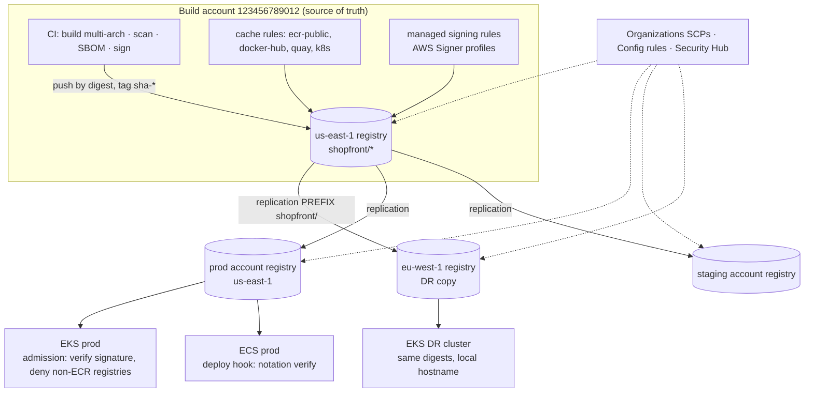
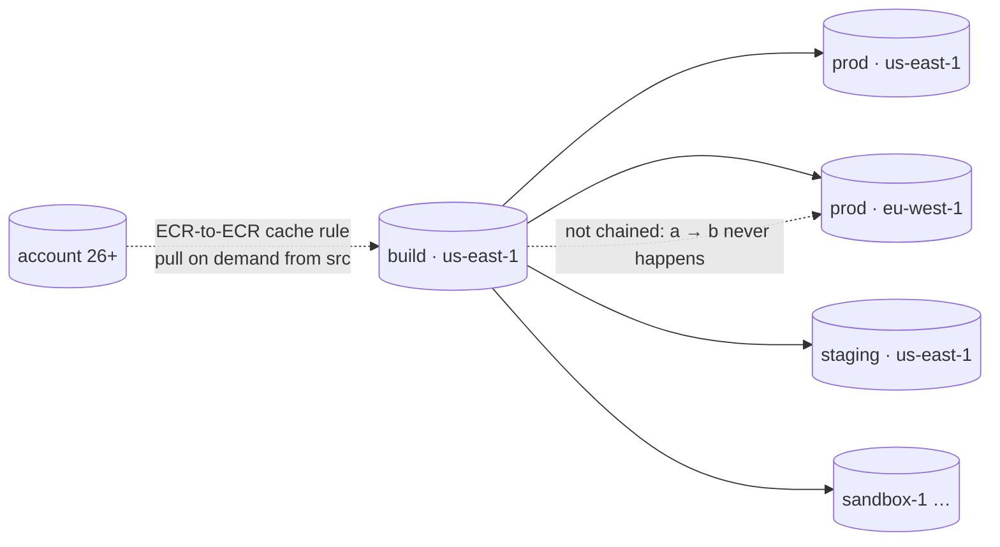

# Amazon ECR · L400 — Supply chain and multi-account registries

**Level:** 400 · **Time:** ~90 min · **Prerequisites:** [L300 · Pull-through cache, replication and limits](L300-pull-through-cache-replication-and-limits.md); [01 · L400 hardening, supply chain and performance](../01-container-fundamentals/L400-hardening-supply-chain-and-performance.md) for SLSA, provenance and SBOM mechanics; [08 · L400 platform engineering](../08-delivery-cicd-gitops/L400-platform-engineering-and-delivery-at-scale.md)

**After this document you can:**

- choose between one central registry, per-account registries and a build-then-replicate topology,
  and defend the choice with quota, cost, blast-radius and RPO numbers
- design signing and verification that a fleet of clusters and ECS services can enforce without
  blocking an emergency rollback
- express every registry setting as code and as an organization guardrail, and know which
  compliance signals prove it
- write the DR chapter for the registry: what state exists where, what the RPO is, how to restore
  after a Regional outage, a deletion or a key loss
- run the three classic incidents (quota exceeded, upstream outage, lifecycle deleted a running
  image) as post-mortems you have already read
- migrate images between registries with `crane` and `skopeo` without changing a single digest

## 1. Mental model



At platform scale the registry stops being storage and becomes two things at once: the single
chokepoint through which every byte of executable code enters production, and a runtime
dependency of every scale-out and every recovery. The first role argues for centralization (one
place to scan, sign, cache and audit); the second argues for distribution (local copies inside each
account's quotas and endpoints, in every Region you may need to run). The design that satisfies
both is *build once in one place, sign there, then copy to where it runs*: a source-of-truth
registry in the build account, replication (or ECR-to-ECR caching) into runtime accounts and
Regions, admission and deployment hooks that verify signatures against digests, and organization
guardrails that make the whole thing hard to undo by accident. Everything else in this document is
the numbers and the failure stories behind that sentence.

## 2. Concepts

### 2.1 Central vs per-account registries

| Criterion | A · Per-account build and registry | B · Central registry, cross-account pulls | C · Central build, replicate to runtime registries |
| --- | --- | --- | --- |
| Source of truth | N registries, N pipelines | one registry | one registry, N read-only copies |
| Runtime dependency | own account, own Region | another account's registry (same Region: endpoints work; other Region: internet path) | own account, own Region |
| API quotas at scale-out | per account (isolated) | one account's `BatchGetImage` 2,000/s and `GetDownloadUrlForLayer` 3,000/s shared by **all** consumers | per account (isolated) |
| IAM | none across accounts | repository policies with `aws:PrincipalOrgID` in every repository | destination registry policies (`ReplicateImage`), no cross-account pulls at runtime |
| Consistency | teams drift (bases, scanners, signing) | strong | strong, eventually (minutes of lag) |
| Storage cost | N × images (uncoordinated) | 1 × | 1 + copies (only filtered prefixes) |
| Blast radius of a bad lifecycle rule or deletion | one account | every consumer at once | source only; copies survive until their own rules act |
| DR posture | each team on its own | the central Region is a single point of failure for pulls everywhere | copies exist in the DR Region before the incident |
| Operations | many small registries to govern | one registry, one quota ticket queue | replication rules, templates and registry policies as IaC per account |

Numbers that usually settle it. Storage: 60 services × 3 environments × 40 retained images ×
250 MB average unique content ≈ 1.8 TB → $180 per month per copy; four copies (source, prod
account, staging account, DR Region) ≈ $720 per month. Cross-Region replication transfer for
30 GB of new images a day ≈ 900 GB per month, billed as data transfer out of the source Region
(the pricing page's cross-Region example uses $0.09/GB; verify) ≈ $80. Against that, topology B
puts a 400-node scale-out from two accounts on the same 3,000 requests-per-second budget, and a
central-Region impairment stops every account from scaling; topology A produces the "which of the
seven `python:3.12-slim` variants are we running" question during every CVE. C is the default
for anything with more than one production account; B is fine for a handful of accounts in one
Region, with the quota math from L300 §2.1 done once a year; A is what you inherit.

### 2.2 Org-wide replication topology

Replication is one hop and fan-out is capped at 25 unique destinations per source registry, so the
topology is a star, not a tree:



- **Filters by namespace, not by tag.** `PREFIX_MATCH` applies to repository names, so encode the
  promotion boundary in the name: `shopfront/` replicates to production accounts, `dev/` and
  `ecr-public/` do not. Promotion is then a copy or a retag inside the source registry that lands
  the digest in a replicated namespace, and an image that was never in `shopfront/` cannot reach
  production by construction.
- **Spokes own their settings.** Nothing but content replicates, so every spoke needs a
  `REPLICATION` repository creation template (immutable tags, KMS if required, a conservative
  lifecycle policy) and the registry permissions statement that lets the hub in. Deploy them with
  CloudFormation StackSets or a Terraform module per account so a new account is a one-line
  change in the hub's replication configuration.
- **Beyond 25 destinations** (or for hundreds of sandbox accounts), flip the model: spokes create
  an ECR-to-ECR pull-through cache rule pointing at the hub (L300 §2.2), and the hub's repository
  or registry policy grants them `ecr:BatchGetImage`, `ecr:GetDownloadUrlForLayer`,
  `ecr:BatchImportUpstreamImage` and `ecr:GetImageCopyStatus`. Lazy copies, no fan-out limit,
  first-pull latency instead of eager storage.
- **Third-party images** are cached once in the hub (`ecr-public/`, `docker-hub/`, `quay/`,
  `k8s/`) and replicated or cache-chained like your own, so Docker Hub credentials exist in exactly
  one account.
- **Pipelines promote digests, never tags**, and the promotion step for a second Region polls
  `describe-image-replication-status` until `COMPLETE` (L300 §2.3). Replication lag is the RPO of
  the image tier; write it into the DR plan.

### 2.3 Signing and verification at scale

Signing binds a digest to an identity you control; verification refuses to run anything else.
Three moving parts, each with a scale question:

**Who signs.** With AWS Signer the key never leaves the service: a *signing profile*
(platform `Notation-OCI-SHA384-ECDSA`, optional validity period) issues short-lived certificates
chained to the Signer root; revoking a signature or a profile version invalidates everything it
signed. Two ways to produce signatures:

- **ECR managed signing** (November 2025): a registry-level *signing configuration* with up to 10
  rules, each mapping repository filters to a signing profile (profiles may live in another
  account but must be in the same Region). ECR signs on push using the identity of the pusher,
  which therefore needs `signer:SignPayload` on the profile and push permissions on the
  repository. Nothing to install on runners; signing becomes a registry policy the platform team
  owns.
- **Pipeline signing** with the Notation CLI and the AWS Signer plugin, for pipelines that must
  sign after tests rather than at push time, or that sign attestations too:

```bash
aws signer put-signing-profile --profile-name shopfront_release \
  --platform-id Notation-OCI-SHA384-ECDSA --signature-validity-period value=12,type=MONTHS
notation sign 123456789012.dkr.ecr.us-east-1.amazonaws.com/shopfront/catalog@sha256:6c3a1f0e9b7d2c4a5e8f1b3d7c9e2a4f6b8d0c1e3a5f7b9d2c4e6a8f0b1d3c5e \
  --plugin com.amazonaws.signer.notation.plugin \
  --id arn:aws:signer:us-east-1:123456789012:/signing-profiles/shopfront_release
```

The signature is an OCI referrer (`application/vnd.cncf.notary.signature`) stored in the same
repository (ECR has supported the OCI 1.1 referrers API since June 2024), so it replicates with
the image, follows the image through the lifecycle policy, and is listed by
`aws ecr list-image-referrers`. `cosign` is the alternative: KMS-backed keys
(`cosign sign --key awskms:///alias/shopfront-cosign …`) or keyless with Fulcio and Rekor bound to
the GitHub Actions OIDC identity; by default it stores signatures as tags
(`sha256-<digest>.sig`), which a `tagStatus: tagged` lifecycle rule can delete, so either switch it
to referrers mode or exclude `sha256-*` from tag rules.

**Who verifies, and where.** A trust policy names the identities and the scope:

```json
{
  "version": "1.0",
  "trustPolicies": [{
    "name": "shopfront-production",
    "registryScopes": ["123456789012.dkr.ecr.us-east-1.amazonaws.com/shopfront/catalog",
                       "123456789012.dkr.ecr.us-east-1.amazonaws.com/shopfront/orders",
                       "123456789012.dkr.ecr.us-east-1.amazonaws.com/shopfront/worker",
                       "123456789012.dkr.ecr.us-east-1.amazonaws.com/shopfront/report-job"],
    "signatureVerification": { "level": "strict" },
    "trustStores": ["signingAuthority:aws-signer-ts"],
    "trustedIdentities": ["arn:aws:signer:us-east-1:123456789012:/signing-profiles/shopfront_release"]
  }]
}
```

| Runtime | Enforcement point | Mechanism | Scale note |
| --- | --- | --- | --- |
| EKS (standard and Auto Mode) | admission | Kyverno `verifyImages` (Notary type, trust anchored on the Signer root certificate) or Ratify + Gatekeeper with the AWS Signer Notation plugin, which also honours Signer revocation; verify plugin support in the tool you pick | policy per cluster via GitOps; every pod creation does a registry round-trip (`ListImageReferrers`) — cache results, exclude `kube-system`, and keep the verifier's own image in an allowlist repository |
| ECS | deployment | `notation verify` in the pipeline before `register-task-definition`, and again in a native blue/green **lifecycle hook** (Lambda) before traffic shifts, so nothing unsigned reaches production even through a manual deploy | no admission layer exists; the hook is the control ([03 · L200](../03-ecs/L200-task-definitions-services-and-scaling.md)) |
| Lambda | deployment | pipeline verification of the digest, then `update-function-code --image-uri …@sha256:…` | Lambda has no admission hook either |
| Replicated Regions | none extra | signatures replicate with the image; verify with the same trust policy, registry scope set to the local hostname or a wildcard | one trust policy per Region if scopes are host-specific |

Rules that make this survivable: verify **digests**, never tags (a signature covers a manifest);
give release profiles a validity period long enough for the longest supported rollback window,
otherwise the emergency rollback to last quarter's image fails verification; keep a documented
break-glass path (a second trust policy applied by a platform role, logged to CloudTrail) rather
than a `disable` switch; and treat "scan, SBOM, provenance" as attestations attached to the same
digest (BuildKit `--provenance --sbom` produce attestation manifests inside the image index; the
`ci.yml` in the labs does this), so the admission question is always "is this exact digest signed
by the release profile" and never "does this tag look right".

### 2.4 Policy as code for registries

Everything in this domain is a declarative resource. The platform module per repository:

```yaml
Resources:
  CatalogRepository:
    Type: AWS::ECR::Repository
    DeletionPolicy: Retain
    Properties:
      RepositoryName: shopfront/catalog
      ImageTagMutability: IMMUTABLE_WITH_EXCLUSION
      ImageTagMutabilityExclusionFilters:
        - ImageTagMutabilityExclusionFilterType: WILDCARD
          ImageTagMutabilityExclusionFilter: dev-*
      ImageScanningConfiguration: { ScanOnPush: true }
      EncryptionConfiguration: { EncryptionType: AES256 }
      EmptyOnDelete: false
      LifecyclePolicy:
        LifecyclePolicyText: !Sub '${LifecyclePolicyJson}'
      RepositoryPolicyText: !Sub '${OrgPullPolicyJson}'
      Tags: [ { Key: app.kubernetes.io/part-of, Value: shopfront } ]
```

Registry-level resources exist for the rest: `AWS::ECR::ReplicationConfiguration`,
`AWS::ECR::RegistryPolicy`, `AWS::ECR::PullThroughCacheRule`,
`AWS::ECR::RepositoryCreationTemplate`, and the registry scanning configuration (verify the
resource name in the current CloudFormation reference; Terraform has `aws_ecr_registry_scanning_configuration`).
Property names for exclusion filters are as of September 2026; verify against the reference.

What to enforce, and where the signal comes from:

| Control | Enforced by | Proved by |
| --- | --- | --- |
| tag immutability on every production repository | module default; SCP denies `ecr:PutImageTagMutability` outside the platform role | Security Hub `ECR.2`; Config `ecr-private-tag-immutability-enabled` |
| scanning on (enhanced, continuous for `shopfront/*`) | registry scanning configuration in the hub and spokes | Security Hub `ECR.1`; Config `ecr-private-image-scanning-enabled` |
| lifecycle policy present, no count rule on release namespaces | module; cfn-guard / OPA rule on the PR that parses `LifecyclePolicyText` | Config `ecr-private-lifecycle-policy-configured`; CloudTrail `PolicyExecutionEvent` alarm |
| no repository policy with `Principal: *` without `aws:PrincipalOrgID` | IAM Access Analyzer (external access findings on ECR repositories) | Access Analyzer findings |
| no deletion of repositories or images outside the platform pipeline | SCP | CloudTrail |
| only ECR references in manifests and task definitions | Kyverno/Gatekeeper `validate` (image registry allowlist); task-definition lint in CI | admission audit logs |
| signatures required on `shopfront/*` | admission and deploy hooks (§2.3); managed signing rule in the hub | `list-image-referrers` coverage job |

The SCP that removes most human-error incidents from this document:

```json
{
  "Version": "2012-10-17",
  "Statement": [{
    "Sid": "RegistryChangesOnlyThroughPlatformPipeline",
    "Effect": "Deny",
    "Action": ["ecr:DeleteRepository", "ecr:BatchDeleteImage", "ecr:PutImageTagMutability",
               "ecr:DeleteLifecyclePolicy", "ecr:PutLifecyclePolicy", "ecr:SetRepositoryPolicy",
               "ecr:DeleteRepositoryPolicy", "ecr:PutRegistryPolicy", "ecr:DeleteRegistryPolicy",
               "ecr:PutReplicationConfiguration", "ecr:DeletePullThroughCacheRule",
               "ecr:PutRegistryScanningConfiguration"],
    "Resource": "*",
    "Condition": { "ArnNotLike": { "aws:PrincipalArn": "arn:aws:iam::*:role/platform-registry-deployer" } }
  }]
}
```

SCPs do not apply to service-linked roles, so replication, caching and Inspector keep working;
they do apply to administrators, which is the point. Lifecycle expirations still happen (they are
service actions), which is why the lifecycle rule review lives in the PR check, not in the SCP.

### 2.5 DR for the registry

| State | Where it lives | Backed up by | Rebuilt by | Loss mode |
| --- | --- | --- | --- | --- |
| image content (manifests, layers, referrers) | S3 and metadata in each Region's registry | replication to the DR Region and to runtime accounts | re-push from CI cache; rebuild from Git only if builds are reproducible (rarely bit-identical) | Regional impairment (no pulls), lifecycle or human deletion, KMS key loss |
| repositories, policies, rules, templates | registry configuration | IaC | StackSets / Terraform apply | drift, accidental change |
| signatures and attestations | referrers in the repository | replicate with the image | re-sign from the pipeline (new signature, same digest) | expired profile validity |
| cache contents | cache repositories | nothing (they are copies) | first pull re-imports from upstream | upstream outage during recovery |
| Docker Hub / GHCR credentials | Secrets Manager | cross-Region secret replication | re-create | rotation without updating the rule |

Design rules:

1. **Copies exist before the incident.** Replicate `shopfront/` to the DR Region; make manifests
   and task definitions reference the Region-local hostname with the digest; give the DR VPC its
   own endpoints. RTO for pulls is then zero, RPO is the replication lag (minutes).
2. **Deletion is the likelier disaster.** Immutable tags, `DeletionPolicy: Retain`,
   `EmptyOnDelete: false`, the SCP above, and lifecycle rules that *archive* release images
   instead of expiring them: an archived image restores in about 20 minutes, a deleted one is a
   rebuild. Alarm on `PolicyExecutionEvent` and `BatchDeleteImage` in production namespaces.
3. **Keys are part of the registry.** A KMS-encrypted repository is unrecoverable if its key is
   scheduled for deletion; ECR needs the key in the same Region, so the DR template pins a
   multi-Region replica key in `eu-west-1` and the key policy allows the replication
   service-linked role.
4. **Know the digest table.** During a failover the question is "which digest is production for
   each service"; keep it in the deployment system (Argo CD `Application` revisions, ECS task
   definition revisions), not in tags, and verify each digest exists in the DR registry as a
   pre-flight step of the [region failover runbook](../../playbooks/dr/region-failover-runbook.md).
5. **Test the restore path, not the backup.** Quarterly: restore an archived image, redeploy a
   service in the DR Region from replicated digests only, and rebuild one registry's configuration
   from IaC in a sandbox account ([cluster rebuild runbook](../../playbooks/dr/cluster-rebuild-runbook.md)).

### 2.6 Three incidents

**Quota exceeded during a node fleet replacement.** 02:10, a scheduled AMI rotation replaces
900 nodes across three clusters in one account within four minutes; each node pulls 14 system and
workload images (multi-arch, ~8 blobs). `GetDownloadUrlForLayer` reaches 900 × 14 × 8 / 240 s ≈
420/s on average but the joins cluster in the first 60 s, peaking above 3,000/s; ECR answers
`429`, kubelets back off to 5 minutes, CoreDNS and the CNI daemon pods are among the delayed
images, and nodes stay `NotReady` long enough for the cluster autoscaler to add more nodes, which
pull more images. Signals that were available: `AWS/Usage` `CallCount` for
`GetDownloadUrlForLayer` flat at the quota; pod events with `429 Too Many Requests`. Fix at the
time: pause the rotation, request an increase through Service Quotas, resume in batches of 100.
Prevention: system images baked into the AMI or pre-pulled on boot, rotation budgets (Karpenter
`disruption.budgets`, managed node group `maxUnavailable`), quota alarms at 70 %, and topology C
so each account has its own budget. The math is L300 §2.1; the fix is in the schedule, not in
the registry.

**Upstream outage.** A Docker Hub incident coincides with a routine deployment. Deployments
referencing `123456789012.dkr.ecr…/shopfront/*` proceed; two workloads fail: an init container
`docker.io/library/busybox:1.36` and a sidecar `docker.io/bitnami/kubectl` referenced directly in
manifests that pre-dated the cache rule, plus a CI job that pulled `python:3.12-slim` as a base.
Running pods are unaffected (images on disk); new pods sit in `ImagePullBackOff` with
`toomanyrequests` or connection errors. Fix: rewrite the two references to the `docker-hub/`
cache prefix (the cache had never seen them, so the first pull also failed until Docker Hub
recovered; images already cached kept working throughout). Prevention: an admission policy that
denies any image reference outside `*.dkr.ecr.*.amazonaws.com`, a CI check on task definitions
and manifests for the same rule, base images pulled through the cache in Dockerfiles
(`FROM 123456789012.dkr.ecr.us-east-1.amazonaws.com/docker-hub/library/python:3.12-slim`), and a
nightly job that warms every third-party reference through the cache. After this, an upstream
outage is a 24-hour-delayed tag refresh, not an incident.

**Lifecycle policy deleted a running image.** `shopfront/orders` has a rule `sha-* keep 150`.
The team ships 20 builds a day to the repository from feature branches (all tagged `sha-*`), and
production has been pinned to the same digest for nine days: 180 newer builds exist, so at
03:00 the evaluator expires it. Nothing happens until 09:40, when a traffic peak triggers
service auto scaling: new tasks fail with `CannotPullContainerError: … manifest unknown`, the
deployment circuit breaker is not involved (no deployment is running), and the service runs at
its old capacity with rising latency. Signals: `PolicyExecutionEvent` in CloudTrail at 03:00 with
the digest, `RepositoryPullCount` at zero while `RunningTaskCount` is flat, `stoppedReason` on the
failed tasks. Fix: the CI cache still had the layers; re-pushing the build under the same tag
produced the identical digest and scale-out resumed (a rebuild from source would have produced a
new digest and required a normal deployment). Prevention: release images get a `release-*` tag
whose rule has the lower priority number and transitions to archive instead of expiring; commit
builds from feature branches go to a `dev/` namespace with aggressive count rules; the deploy
pipeline records the digest it deployed and a daily job asserts every deployed digest still
exists in every Region; the lifecycle preview runs in CI on any policy change. With the archive
class the same mistake now costs a 20-minute restore instead of a rebuild, which is a good reason
to prefer `transition` over `expire` for anything tagged `release-*`.

### 2.7 Cost model at scale

```text
monthly cost ≈ Σ_registries ( unique compressed GB × $0.10 )                  storage
             + replicated GB per month × cross-Region transfer rate            replication
             + images scanned × Inspector price + rescans (continuous)         scanning
             + KMS requests (GenerateDataKey per push, Decrypt per pull)       encryption (CMK only)
             + interface endpoints ( AZs × hours × rate + GB processed )       networking
```

Levers, roughly in order of payoff:

| Lever | Effect | Caveat |
| --- | --- | --- |
| lifecycle rules on every repository, including cache namespaces | removes the long tail; untagged leftovers are typically 30–60 % of a repository without rules | never count-based on release namespaces |
| archive class for release history older than 90 days without pulls | cheaper storage for compliance retention | 90-day minimum; restore latency |
| replicate only production namespaces | avoids N copies of `dev/` and `ecr-public/` | DR Region still needs the third-party images it will pull: replicate `docker-hub/` too, or warm its own cache |
| shared base layers across services and blob mounting (January 2026, opt-in per registry) | a layer stored once per registry instead of once per repository | same encryption type and key required; not for cache repositories |
| multi-arch only where arm64 actually runs | halves layer storage and replication volume for x86-only services | Graviton savings usually dominate; decide per service |
| zstd and smaller bases | fewer bytes stored, transferred and unpacked | rebuild base images |
| enhanced scanning continuous on `shopfront/*` only | Inspector cost proportional to images, not to registries | scan-on-push elsewhere |

For `shopfront`-scale fleets the whole registry costs less than one engineer-hour a month; the
document exists because the incidents above cost far more than the storage they would have saved.

### 2.8 Migrating images between registries

Use a registry-to-registry copier that preserves digests, not `docker pull` + `docker push`
(Docker may rewrite manifests when it converts media types or re-layers, and it drags every
blob through a workstation).

```bash
SRC=123456789012.dkr.ecr.us-east-1.amazonaws.com
DST=123456789012.dkr.ecr.eu-west-1.amazonaws.com
DIGEST=sha256:6c3a1f0e9b7d2c4a5e8f1b3d7c9e2a4f6b8d0c1e3a5f7b9d2c4e6a8f0b1d3c5e
crane copy $SRC/shopfront/catalog@$DIGEST $DST/shopfront/catalog:sha-3f2a9c1   # one image, all platforms, digest kept
crane copy --all-tags $SRC/shopfront/orders $DST/shopfront/orders               # backfill after enabling replication
skopeo copy --all --preserve-digests docker://quay.io/prometheus/node-exporter:v1.8.2 \
  docker://$SRC/quay/prometheus/node-exporter:v1.8.2                            # fails rather than changing a digest
skopeo sync --all --src docker --dest docker ghcr.io/example-org $SRC/ghcr/example-org   # appends image name to dest
oras cp --recursive $SRC/shopfront/catalog@$DIGEST $DST/shopfront/catalog       # referrers: signatures, SBOMs
```

Operational notes:

- **Authentication.** `crane` and `skopeo` read `~/.docker/config.json`, so the ECR credential
  helper covers both; otherwise `aws ecr get-login-password | crane auth login --username AWS --password-stdin <registry>`.
- **Repositories must exist** at the destination (`name unknown` otherwise). Create them from the
  same IaC module so settings come along, or add a `CREATE_ON_PUSH` repository creation template
  for the migration namespace and remove it afterwards.
- **Quotas.** `PutImage` is 10/s and `InitiateLayerUpload`/`CompleteLayerUpload` 100/s; a
  migration of 5,000 tags is a 10-minute job at best and a throttled one if you fan out too hard.
  Layers already present in the destination are skipped by `BatchCheckLayerAvailability`, so
  copying by digest first and adding tags afterwards is cheap.
- **Verify by digest, not by tag count.** `crane digest <ref>` on both sides; a mismatch means
  the copier changed something (usually a schema conversion) and signatures no longer verify.
- **Signatures survive** because the digest does; make sure the trust policy's `registryScopes`
  include the new hostname before switching consumers, or verification fails for the right reason.
- **Cut over by digest:** repoint manifests and task definitions to the new hostname with the
  same digest, run the verification hook, then archive (not delete) the old repositories after the
  last `RepositoryPullCount` has been zero for a full lifecycle window.

## 3. How it interacts with the rest of AWS

| Component | Talks to | Protocol/API | Prerequisite (IAM, network, DNS) | What breaks if missing |
| --- | --- | --- | --- | --- |
| AWS Organizations | every account's ECR | SCPs on `ecr:*` mutating actions | platform role ARN pattern in the condition | admins can delete production images |
| AWS Signer | ECR (managed signing), Notation CLI | `signer:SignPayload`; profiles per Region | profile in the registry's Region; pusher permissions | pushes succeed unsigned; admission denies them |
| Kyverno / Gatekeeper + Ratify | ECR registry | `ListImageReferrers`, manifest fetch with the node or verifier role | verifier's own image allowlisted; registry reachable from the cluster | every pod creation fails closed, including the verifier's restart |
| ECS blue/green lifecycle hook (Lambda) | ECR, Signer trust store | `notation verify` by digest | hook Lambda role with pull permissions | unsigned task definitions reach production |
| Security Hub / AWS Config | ECR configuration | controls `ECR.1–3`, managed rules | Config recorder, Security Hub standards enabled | no fleet-wide compliance view |
| IAM Access Analyzer | repository policies | external access findings | analyzer per organization | world-readable repositories go unnoticed |
| CloudFormation StackSets / Terraform | spoke registries | templates, registry policies, endpoints | delegated administrator, execution roles | spokes drift from the hub's expectations |
| CloudTrail Lake (organization store) | all registries | `PolicyExecutionEvent`, `BatchDeleteImage`, `ReplicateImage`, `BatchGetImage` | organization trail | forensic questions span accounts you cannot query |
| KMS multi-Region keys | DR registry | replica key ARN in the creation template | key policy for ECR and the replication role | replication into KMS templates fails; images unrecoverable after key loss |

Two surprises at this level. Admission verification fails closed: if the verifier cannot reach ECR
(endpoint outage, throttling) no pod starts, including the pods that would fix it, so exclude
system namespaces and keep an audited break-glass. And SCPs are invisible in ECR error messages
until you read CloudTrail: `AccessDenied` on a `BatchDeleteImage` a developer "definitely has
permission for" is the SCP doing its job.

## 4. Use it when / avoid it when

Centralize (build account + replication) when:

- more than one production account or Region exists, or is planned within a year
- compliance asks who can change what runs in production and you want one answer
- third-party images must be scanned and cached under one set of credentials

Keep per-account registries when:

- teams are fully independent, single-Region, and the organization does not sign or centrally
  scan; the cost of a platform team exceeds the risk you are removing
- data-residency rules forbid images leaving the account's Region (replicate within the boundary)

Sign and verify when production runs anything a person did not build in the same pipeline that
deploys it — which is always; defer only the enforcement mode (audit first, enforce after the
coverage job shows 100 % of pulled digests are signed).

Alternatives, one line each:

- Harbor or Artifactory in front of ECR — richer RBAC and proxy features, an availability tier you
  now own, and one more place to replicate
- Rebuild per Region instead of replicating — only with reproducible builds and provenance
  verification; doubles CI cost
- GitOps image updater that promotes tags — convenient, but promotes tags; make it write digests

## 5. Well-Architected view

| Pillar | What the architecture gives you | What it costs you | Practice |
| --- | --- | --- | --- |
| Operational Excellence | one place to build, sign, scan and audit; spokes as code | StackSets, templates, registry policies to maintain | platform module per repository; nightly coverage and existence jobs |
| Security | signatures verified at admission and deploy; SCP-protected registries; one set of upstream credentials | fail-closed verification needs a break-glass design | strict trust policies by digest; Access Analyzer on repository policies |
| Reliability | local copies in every runtime account and Region; quotas isolated | replication lag as RPO | gate cross-Region promotion on `COMPLETE`; archive instead of expire for releases |
| Performance Efficiency | endpoint-local pulls everywhere | verifier round-trips on pod creation | cache verification results; pre-warm caches |
| Cost Optimization | copies only where needed, lifecycle everywhere | storage × copies | replicate production namespaces only; archive class |
| Sustainability | shared base layers, blob mounting, single upstream download | — | consolidate base images across teams |

The Security and Reliability pillar checklists for this architecture are in
[12 · L200](../12-well-architected/L200-pillar-checklists-ecs-and-eks.md); the trade-off records
(central vs distributed, sign or not) in [12 · L400](../12-well-architected/L400-trade-offs-and-anti-patterns.md).

## 6. Failure modes and troubleshooting

| Symptom | Likely cause | How to confirm (command/metric) | Fix |
| --- | --- | --- | --- |
| New account never receives replicated images | hub replication configuration already has 25 unique destinations, or spoke registry policy missing | `describe-registry` in the hub; `describe-image-replication-status` `FAILED`; spoke CloudTrail | move the account to the ECR-to-ECR cache model; fix the spoke registry policy |
| Every pull from a moved account fails | repository policies use `aws:PrincipalOrgID` and the account left the organization, or a SCP on the new OU denies ECR | CloudTrail `errorMessage` names the policy type (`explicit deny in a service control policy`) | re-invite or adjust the OU SCP |
| Emergency rollback blocked by admission | signature validity period expired for last quarter's image, or the profile version was revoked | `notation verify` output; `aws signer list-signing-jobs` | break-glass trust policy via the platform role; lengthen validity on release profiles |
| Nothing starts in a cluster after an ECR endpoint outage, including the verifier | fail-closed admission with the verifier itself under policy | admission webhook events; verifier pod `Pending` | exclude system namespaces; `failurePolicy: Ignore` only for the verifier's namespace; runbook step to scale the webhook down |
| Third-party pulls fail everywhere at once | the hub's Docker Hub token was rotated but the Secrets Manager secret was not updated | `ECR Pull Through Cache Action` `sync-status: FAILED` in the hub | update the secret; add rotation to the credential runbook |
| Images unrecoverable after "cleaning up KMS" | key scheduled for deletion, grants gone | KMS `Decrypt` failures with `aws:ecr:arn` context | cancel key deletion within the waiting period; otherwise restore from the DR Region's copies |
| Storage bill triples in a quarter | `sha-*` feature builds replicated to every spoke; no lifecycle on cache namespaces | Cost Explorer by usage type and account; `describe-images` sizes | filter replication to production namespaces; lifecycle on `ecr-public/*`, `docker-hub/*` |
| Signature verification fails after a migration | digest changed in the copy (schema conversion) or trust policy scope lacks the new hostname | `crane digest` both sides; `notation verify` error text | recopy with `--preserve-digests`; add the scope |
| Scale-out throttled in the production account although the hub is idle | consumers pull cross-account from the hub (topology B), sharing its quota | `AWS/Usage` `CallCount` in the hub account | move to topology C or raise the hub's quotas |
| Lifecycle rule in a spoke deleted images the hub still has | spoke templates copied the hub's aggressive policy | spoke CloudTrail `PolicyExecutionEvent` | conservative spoke templates; archive instead of expire |

Playbooks: [image pull failures](../../playbooks/incidents/image-pull-failures.md),
[IAM AccessDenied from containers](../../playbooks/incidents/iam-accessdenied-from-containers.md),
[DR plan template](../../playbooks/dr/dr-plan-template.md).

## 7. Signals: metrics, logs, traces

- Per account and Region: `AWS/Usage` `CallCount` for the three pull APIs vs quota; in topology B
  aggregate consumers' pull counts against the hub's quota, which is the number that throttles.
- Replication lag SLI (push time → `COMPLETE` per destination) from the canary job of L300 §8;
  alarm above 30 minutes; report the p99 in the DR readiness review.
- Signature coverage: a nightly job lists deployed digests (Argo CD, ECS task definitions,
  Lambda) and calls `list-image-referrers`; the SLI is "signed and verifiable digests / deployed
  digests", target 100 % before enforcement.
- Existence check: the same job asserts every deployed digest exists in every Region it may run
  in; a miss is the lifecycle incident before it happens.
- Compliance: Security Hub `ECR.1–3` and Config rule compliance percentages per account; IAM
  Access Analyzer external-access findings on repositories (target zero outside the org).
- Security: Inspector critical findings on *pulled* images (join findings with
  `RepositoryPullCount` or `lastRecordedPullTime`), age of the oldest unremediated critical.
- Change: CloudTrail organization store queries for `PolicyExecutionEvent`, `BatchDeleteImage`,
  `SetRepositoryPolicy`, `PutRegistryPolicy`, `PutReplicationConfiguration`; every hit in a
  production account outside the platform role is an alert.
- Cost: storage GB per registry per month from Cost Explorer with account and usage-type
  grouping; replication transfer GB from the source account.

Sources and thresholds: [reference/metrics-catalog.md](../../reference/metrics-catalog.md).

## 8. Testing and DR notes

Test the architecture, not the components. A quarterly game day
([playbooks/dr/game-day-guide.md](../../playbooks/dr/game-day-guide.md)) runs: (1) block the
`ecr.dkr` endpoint in the DR VPC and confirm the failure mode is only new pods; (2) deploy the
current production digest set into the DR Region from replicated copies only, with verification
enforced, and time it; (3) restore an archived release image and redeploy it; (4) rotate the
Docker Hub secret and pull cached and uncached tags; (5) rebuild one spoke registry's
configuration from IaC in a fresh sandbox account and replicate into it. Chaos on the supply
chain: push an unsigned image to a production namespace in staging and confirm admission and the
ECS hook both refuse it; revoke a test profile version and confirm the coverage job flags every
digest it signed. Unit-level checks run on every PR: cfn-guard or OPA on the repository module
(immutability, scanning, lifecycle shape), a lifecycle preview against a snapshot of production
tags, and a manifest lint that rejects non-ECR references.

DR content for the plan ([DR plan template](../../playbooks/dr/dr-plan-template.md)): tier the
registry with the services it serves (it is a dependency of every tier's recovery, so it sits in
the highest tier); RPO = replication lag, measured; RTO = 0 for pulls if hostnames are Region-local
and digests are pre-verified, otherwise the time to run `crane copy` for the digest table; the
decision criterion "when do we promote the DR registry to source of truth" (after failover,
pipelines push to the DR Region and replication runs the other way, which is a configuration
change in the hub's replication rules — write the exact commands); failback re-establishes the
original direction and copies anything built during the incident back with `crane`. Pitfalls
listed in [10 · L400](../10-resilience-and-dr/L400-dr-plan-and-game-days.md) all apply:
quotas in the DR account, endpoints per Region, signing profiles per Region, KMS keys per Region.

## 9. Hands-on

All steps run in one sandbox account; treat the second Region as the "other account".

1. Sign and verify. Run [`labs/pipelines/github-actions/ci.yml`](../../labs/pipelines/github-actions/ci.yml)
   (or its steps locally) to build `shopfront/catalog` with `--provenance --sbom`, push, and sign
   with the profile from §2.3. Then verify by digest and inspect the referrers:

```bash
export REG=123456789012.dkr.ecr.us-east-1.amazonaws.com
DIGEST=$(aws ecr describe-images --repository-name shopfront/catalog --image-ids imageTag=sha-$GIT_SHA \
  --query 'imageDetails[0].imageDigest' --output text)
notation verify $REG/shopfront/catalog@$DIGEST
aws ecr list-image-referrers --repository-name shopfront/catalog --subject-id imageDigest=$DIGEST \
  --query 'referrers[].[artifactType,imageDigest]' --output table
```

Observe: one `application/vnd.cncf.notary.signature` referrer per signing rule or `notation sign`
run; verification prints the trusted identity. (Flag names for `list-image-referrers` as of
September 2026; verify.)

2. Managed signing. Create a signing configuration with one rule for `shopfront/*` pointing at
   the profile, push `shopfront/orders` from
   [`labs/apps/orders/Dockerfile`](../../labs/apps/orders/Dockerfile) with a principal that has
   `signer:SignPayload`, and confirm a signature appeared without running `notation sign`. Then
   push with a principal that lacks `signer:SignPayload` and observe the push outcome and the
   absence of a signature.

3. Admission. On the `shopfront-dev` EKS cluster apply a Kyverno `verifyImages` policy (or Ratify
   + Gatekeeper) in `Audit` mode scoped to `shopfront/*`, deploy the signed digest from
   [`labs/eks/manifests/`](../../labs/eks/manifests/base/), then deploy an unsigned build and read
   the policy report. Switch to `Enforce` and repeat.

4. Replication star and backfill. Configure replication of `shopfront/` to `eu-west-1`, then
   backfill last week's digests with `crane copy --all-tags`, and prove digests match:

```bash
crane copy --all-tags $REG/shopfront/worker 123456789012.dkr.ecr.eu-west-1.amazonaws.com/shopfront/worker
crane digest $REG/shopfront/worker:sha-$GIT_SHA
crane digest 123456789012.dkr.ecr.eu-west-1.amazonaws.com/shopfront/worker:sha-$GIT_SHA
notation verify 123456789012.dkr.ecr.eu-west-1.amazonaws.com/shopfront/worker@$DIGEST_WORKER   # after adding the eu-west-1 scope
```

5. The lifecycle incident, safely. In a sandbox repository push 12 tiny images tagged `sha-*`,
   tag the third one `release-1.0.0`, apply a `sha-* keep 10` rule, and run the preview: the
   release image is listed for expiry. Reorder priorities as in L200 §2.1 and preview again. Then
   apply the archive variant, wait for the transition (up to 24 hours), attempt a pull (fails),
   restore with `update-image-storage-class`, and time the restore.

6. Guardrail. Attach the SCP from §2.4 to a sandbox OU, then attempt
   `aws ecr batch-delete-image` as an administrator and read the CloudTrail entry that names the
   SCP.

## 10. Check yourself

1. Two production accounts and a DR Region. What is wrong with "everyone pulls from the build
   account's registry", quantitatively?

<details><summary>Answer</summary>
All consumers share the build account's per-Region quotas (2,000 <code>BatchGetImage</code>/s,
3,000 <code>GetDownloadUrlForLayer</code>/s), so a scale-out in one account throttles the other;
the DR Region cannot reach the <code>us-east-1</code> registry through endpoints at all and would
pull cross-Region over the internet path during the very incident that made <code>us-east-1</code>
unavailable. Replicate <code>shopfront/</code> into each production account and into the DR
Region, and pull locally.
</details>

2. Why must a replication topology be a star, and what do you do for the 26th account?

<details><summary>Answer</summary>
Replication happens once per push and never chains (an image replicated from A to B is not
re-replicated from B to C), and a source registry supports at most 25 unique destinations. The
26th account pulls lazily through an ECR-to-ECR pull-through cache rule pointing at the hub, with
the hub granting it <code>BatchGetImage</code>, <code>GetDownloadUrlForLayer</code>,
<code>BatchImportUpstreamImage</code> and <code>GetImageCopyStatus</code>.
</details>

3. An emergency rollback to a six-month-old image is refused by admission. Name two likely
   causes and the design change that prevents each.

<details><summary>Answer</summary>
The signing profile's validity period was shorter than the rollback window (set release profiles
to at least the supported rollback horizon), or the signature was produced by a profile version
that has since been revoked (revoke per signing job when possible, and keep a logged break-glass
trust policy applied by the platform role rather than a switch that disables verification).
</details>

4. What does replication carry across, and which three settings must you therefore configure in
   every spoke?

<details><summary>Answer</summary>
Only repository content (manifests, layers, tags, referrers) pushed after the rule exists. Spokes
need their own registry permissions statement allowing the hub's <code>ReplicateImage</code> and
<code>CreateRepository</code>, a <code>REPLICATION</code> repository creation template (tag
immutability, encryption, lifecycle policy), and their own VPC endpoints; none of these replicate.
</details>

5. Why is `crane copy` preferred over `docker pull` followed by `docker push` for a migration,
   and how do you prove the copy is faithful?

<details><summary>Answer</summary>
<code>crane</code> copies manifests and blobs registry-to-registry byte for byte, so the digest is
unchanged and existing signatures still verify; Docker may rewrite manifests (media types,
re-layering) and routes every blob through a workstation. Prove it with <code>crane digest</code>
on both sides (or <code>skopeo copy --preserve-digests</code>, which fails instead of changing a
digest) and a <code>notation verify</code> against the new hostname.
</details>

## 11. Sources

- Amazon ECR User Guide: Private image replication — https://docs.aws.amazon.com/AmazonECR/latest/userguide/replication.html
- Amazon ECR User Guide: Private registry permissions — https://docs.aws.amazon.com/AmazonECR/latest/userguide/registry-permissions.html
- Amazon ECR User Guide: Cross-account ECR to ECR pull through cache — https://docs.aws.amazon.com/AmazonECR/latest/userguide/pull-through-cache-private.html
- Amazon ECR User Guide: Managed signing — https://docs.aws.amazon.com/AmazonECR/latest/userguide/managed-signing.html
- Amazon ECR User Guide: Private images and OCI artifacts (referrers) — https://docs.aws.amazon.com/AmazonECR/latest/userguide/images.html
- Amazon ECR User Guide: Blob mounting — https://docs.aws.amazon.com/AmazonECR/latest/userguide/blob-mounting.html
- Amazon ECR User Guide: Archiving an image — https://docs.aws.amazon.com/AmazonECR/latest/userguide/archive_restore_image.html
- Amazon ECR User Guide: Encryption at rest — https://docs.aws.amazon.com/AmazonECR/latest/userguide/encryption-at-rest.html
- Amazon ECR User Guide: Service quotas — https://docs.aws.amazon.com/AmazonECR/latest/userguide/service-quotas.html
- AWS Signer Developer Guide: Sign a container image — https://docs.aws.amazon.com/signer/latest/developerguide/image-signing-steps.html
- AWS Signer Developer Guide: Verify a container image — https://docs.aws.amazon.com/signer/latest/developerguide/image-verification.html
- Notary Project: trust policy specification — https://github.com/notaryproject/specifications/blob/main/specs/trust-store-trust-policy.md
- Sigstore cosign documentation — https://docs.sigstore.dev/cosign/signing/overview/
- AWS CloudFormation: AWS::ECR resource types — https://docs.aws.amazon.com/AWSCloudFormation/latest/TemplateReference/AWS_ECR.html
- AWS Security Hub: Amazon ECR controls — https://docs.aws.amazon.com/securityhub/latest/userguide/ecr-controls.html
- AWS Config: managed rules list (ECR rules) — https://docs.aws.amazon.com/config/latest/developerguide/managed-rules-by-aws-service.html
- AWS Organizations: service control policies — https://docs.aws.amazon.com/organizations/latest/userguide/orgs_manage_policies_scps.html
- crane (go-containerregistry) — https://github.com/google/go-containerregistry/blob/main/cmd/crane/README.md
- skopeo — https://github.com/containers/skopeo
- ORAS CLI — https://oras.land/docs/
- Amazon ECR pricing — https://aws.amazon.com/ecr/pricing/
- What's new: Amazon ECR now supports managed container image signing (November 2025) — https://aws.amazon.com/about-aws/whats-new/2025/11/amazon-ecr-managed-container-image-signing/
- What's new: Amazon ECR cross-repository layer sharing / blob mounting (January 2026) — https://aws.amazon.com/about-aws/whats-new/2026/01/amazon-ecr-cross-repository-layer-sharing/
