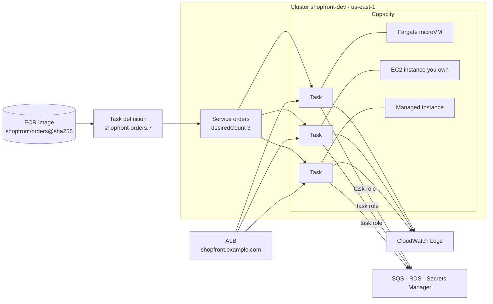

# Amazon ECS · L100 — ECS basics

**Level:** 100 · **Time:** ~45 min · **Prerequisites:**
[Containers explained](../01-container-fundamentals/L100-containers-explained.md),
[ECR basics](../02-ecr/L100-ecr-basics.md), [VPC for containers](../05-networking/L100-vpc-for-containers.md)

**After this document you can:**

- Name every ECS object (cluster, task definition, task, service, scheduled task) and say which one
  you change when you want a new image, more copies, or a different schedule.
- Choose between Fargate, EC2, ECS Managed Instances and ECS Express Mode for a first service and
  explain what each one bills you for.
- Explain what runs your container on each capacity type ("Docker for ECS"), which tools were
  retired, and what to use instead.
- Deploy the `shopfront` `orders` service behind an ALB with the CLI and read its state back.
- Give the one-paragraph answer to "ECS or EKS?" and know where the long answer lives.

## 1. Mental model



ECS is a Regional scheduler with three nouns. A **task definition** is an immutable, versioned JSON
description of one or more containers that start and stop together (image, CPU, memory, ports,
environment, roles, logging). A **task** is one running copy of a task definition. A **service**
keeps a desired number of tasks running, replaces the ones that die, registers them with a load
balancer and rolls out new task definition revisions. Everything lives in a **cluster**, which is a
namespace for tasks plus the capacity they run on. The problem ECS solves is "run N copies of this
process group across a fleet, keep them healthy, replace them safely" without you operating an
orchestrator control plane: there is no API server or etcd to patch, the API is the AWS API, and
IAM, CloudTrail and CloudFormation apply to every object.

## 2. Concepts

### 2.1 The object model

| Object | What it is | You change it when | Kubernetes cousin (rough) |
| --- | --- | --- | --- |
| Cluster | Regional grouping of tasks, services and capacity; holds settings (Container Insights, ECS Exec logging) and capacity providers | Adding capacity, enabling cluster-wide settings | Cluster |
| Task definition | `family:revision`, immutable; up to 10 container definitions, task-level `cpu`/`memory`, `networkMode`, roles, volumes | New image, new environment variable, different size — register a new revision | Pod template |
| Container definition | One container inside the task definition: image, ports, `essential`, health check, log driver, secrets | Same as above | Container spec |
| Task | A running (or stopped) instance of a task definition revision, with a lifecycle and a `stoppedReason` | You do not edit tasks; you stop them or let the service replace them | Pod |
| Service | Desired count, deployment configuration, load balancer and discovery wiring, auto scaling target, capacity provider strategy | Scaling, deploying a revision, changing networking or discovery | Deployment + Service |
| Scheduled task | An EventBridge Scheduler (or EventBridge rule) target that calls `RunTask` on a cron or rate | Batch and housekeeping jobs | CronJob |
| Container instance | An EC2 instance (or ECS Anywhere host) running the ECS agent, registered to a cluster | Only with the EC2 launch type | Node |
| Capacity provider | Where tasks may be placed: `FARGATE`, `FARGATE_SPOT`, an Auto Scaling group, or a Managed Instances provider | Choosing cost/ops trade-offs | Node pool |
| Namespace | AWS Cloud Map namespace used by Service Connect and service discovery, for example `shopfront.local` | Wiring service-to-service calls | Service DNS |

A deployment is what a service does when its task definition or configuration changes: it starts
tasks of the new revision and stops tasks of the old one according to rules you set (L200 §2.8).

### 2.2 Where tasks run: the capacity options

| | Fargate | EC2 launch type | ECS Managed Instances | ECS Anywhere |
| --- | --- | --- | --- | --- |
| Who owns the host | AWS; you never see it | You: AMI, patching, agent, scaling | AWS operates EC2 instances that live in your account and VPC | You, on premises or another cloud |
| Isolation unit | One Firecracker microVM per task | Tasks share the instance kernel | Tasks share an AWS-managed instance | Tasks share your host |
| Network mode | `awsvpc` only | `awsvpc`, `bridge`, `host`, `none` | `awsvpc` | `bridge`, `host`, `none` |
| Scaling unit | The task | The instance (Auto Scaling group + capacity provider) | Instances AWS adds and removes to fit tasks | Your hosts |
| You cannot | Use `privileged`, `host` networking, GPUs, daemon services, custom kernels | Avoid operating an OS fleet | SSH, pick an AMI, install host agents (verify current limits) | Use `awsvpc` or ELB integration |
| Billing | Per task: vCPU-seconds + GB-seconds (1 min minimum), extra ephemeral storage, Spot discount | Per instance-hour regardless of packing; ECS itself is free | EC2 instance price plus a management fee per vCPU-hour and GiB-hour of instance capacity | Per registered host-hour |
| Pick it when | You want no fleet; workloads fit 0.25–16 vCPU and 0.5–120 GB | You need GPUs, `host`/`bridge`, daemon tasks, Spot fleets you tune, dense bin-packing, or special AMIs | You want EC2 economics and instance types without running the fleet | Existing hardware or data locality |

Two orientation facts. First, none of these has a control-plane fee: the cluster is free, you pay
for compute, load balancers, logs and data transfer. Second, **launch type** (`FARGATE`, `EC2`,
`EXTERNAL`) and **capacity provider strategy** are two ways to say where a task goes; new work
should use capacity providers because that is how Fargate Spot, Auto Scaling group management and
Managed Instances are expressed (L200 §2.7).

**ECS Express Mode** is not a fifth capacity type. It is an opinionated front door announced in
November 2025: you provide a small number of required inputs (the container image and identity and
naming details) and ECS creates the load balancer, networking, a domain and auto scaling with AWS
defaults on Fargate. It exists so that a first web service does not require you to learn
target groups and task definitions on day one; the objects it creates are ordinary ECS, ELB and IAM
resources you can inspect and later manage with infrastructure as code. Verify the current input
list in the documentation linked in §11.

### 2.3 Networking in one paragraph

With `awsvpc` every task gets its own elastic network interface (ENI), private IP address and
security groups, exactly like a small EC2 instance in your subnet. Fargate uses it exclusively.
That is what lets an Application Load Balancer target tasks by IP (`targetType: ip`), lets
security groups express "only the ALB may reach `orders` on 8080", and lets tasks reach RDS or SQS
through the same routes and endpoints your instances use. The consequence beginners meet first:
a task in a private subnet needs a route to ECR, CloudWatch Logs and Secrets Manager (NAT gateway
or VPC interface endpoints) or it never starts. Depth: [VPC for containers](../05-networking/L100-vpc-for-containers.md).

### 2.4 "Docker for ECS": what actually runs your container

| Capacity | Runtime under your container | Who upgrades it |
| --- | --- | --- |
| EC2 launch type | Docker Engine, driven by the **ECS agent** on ECS-optimized Amazon Linux 2023 or Bottlerocket AMIs. The agent registers the instance, receives tasks from the control plane and asks Docker to pull, create, start and stop containers | You: rotate AMIs, update the agent |
| Fargate | A **Firecracker microVM** per task; inside it the Fargate agent runs containerd (platform version 1.4.0, the current `LATEST`) | AWS |
| Managed Instances | The same agent model on EC2 instances AWS provisions, patches and replaces in your account | AWS |
| ECS Anywhere | Docker Engine plus the ECS agent and the SSM agent on your host | You |

Because ECS speaks OCI images, anything you build with `docker build`, BuildKit, kaniko or
`ko` runs unchanged; the differences are in the runtime and the isolation boundary, covered in
[L300 §2.2 and §2.5](L300-ecs-internals.md) and in
[runtimes and the kernel](../01-container-fundamentals/L300-runtimes-and-the-kernel.md).

What was retired, and what to use instead (dates from [`docs/FACTS-2026-09.md`](../../docs/FACTS-2026-09.md)):

| Retired tool | Status | Use instead |
| --- | --- | --- |
| Docker Compose ECS integration (`docker context create ecs`, `docker compose up` to ECS) | Retired 2023-11; the compose-cli project reached end of life 2024-01-01 | Keep Compose for local development ([`labs/local/compose.yaml`](../../labs/local/compose.yaml)); deploy with CloudFormation, CDK or Terraform ([`labs/ecs/cloudformation/`](../../labs/ecs/cloudformation/)) |
| AWS Copilot CLI | End of support 2026-06-12; repository archived 2026-06-22 | ECS Express Mode for a first service; CloudFormation/CDK/Terraform for everything you will keep |
| `ecs-cli` | Deprecated years earlier | `aws ecs` plus infrastructure as code |

### 2.5 First deployment walkthrough

The full walkthrough is in §9. The shape is always the same:

1. Push an image to ECR (`123456789012.dkr.ecr.us-east-1.amazonaws.com/shopfront/orders`).
2. Register a task definition (`aws ecs register-task-definition`).
3. Create a cluster and attach capacity providers.
4. Create a service with a network configuration (subnets, security groups) and a load balancer
   target group, or let Express Mode do steps 3 and 4.
5. Read state back: `describe-services` for deployments and events, `list-tasks` and
   `describe-tasks` for individual tasks, the ALB target group for health.

Two IAM roles appear in step 2 and they are the most common beginner confusion. The **task
execution role** is used by ECS itself to pull the image, fetch secrets and write logs before your
code runs. The **task role** is what your code gets when it calls the SDK (SQS, RDS IAM auth, S3).
Depth: [L200 §2.2](L200-task-definitions-services-and-scaling.md) and
[IAM for containers](../06-identity-and-security/L200-iam-for-containers.md).

### 2.6 Pricing model

| You pay for | Fargate | EC2 | Managed Instances |
| --- | --- | --- | --- |
| Compute | vCPU-seconds and GB-seconds of each task's configured size, 1-minute minimum; ephemeral storage above 20 GiB; arm64 (Graviton) is cheaper than x86; Fargate Spot is discounted and interruptible; Compute Savings Plans apply | Instance-hours of the Auto Scaling group whether or not tasks fill them; Savings Plans, Reserved Instances and Spot apply | Instance-hours plus the Managed Instances management fee; the fee is charged on the instance capacity, not on task size |
| Not the cluster | free | free | free |
| Everything around it | ALB/NLB hours and capacity units, CloudWatch Logs ingestion and storage, Container Insights metrics, NAT gateway or VPC endpoint hours and data, ECR storage, Cloud Map, Private CA when Service Connect TLS is on | same | same |

Prices change; the September 2026 figures used for planning are in
[L400 §2.4](L400-ecs-at-scale.md), always with a link to the pricing page.

### 2.7 ECS or EKS

Choose ECS when your team wants to run containers, not a Kubernetes distribution: the object model
above is the whole model, the API is AWS-shaped, the integrations (IAM roles per task, ALB, Cloud
Map, CloudWatch, Secrets Manager) are first-party and there is nothing to upgrade on a schedule.
Choose EKS when you need the Kubernetes ecosystem (operators, Helm charts, CRDs, admission
policy, GitOps controllers), portability across clouds, or a platform team that will invest in
running clusters for many teams. The long answer with numbers is in
[decision guides](../../reference/decision-guides.md) and [L400 §2.10](L400-ecs-at-scale.md);
the EKS side starts at [Kubernetes and EKS basics](../04-eks/L100-kubernetes-and-eks-basics.md).

## 3. How it interacts with the rest of AWS

| Component | Talks to | Protocol/API | Prerequisite (IAM, network, DNS) | What breaks if missing |
| --- | --- | --- | --- | --- |
| ECS agent / Fargate | Amazon ECR | HTTPS: `ecr:GetAuthorizationToken`, `BatchGetImage`, `GetDownloadUrlForLayer`; layers from S3 | Execution role permissions; route to ECR and S3 (NAT or `ecr.api`, `ecr.dkr`, S3 gateway endpoints) | Task stops with `CannotPullContainerError` |
| ECS agent / Fargate | Secrets Manager, SSM Parameter Store | HTTPS `GetSecretValue`, `GetParameters` | Execution role; route or endpoints | `ResourceInitializationError: unable to pull secrets` |
| Containers | CloudWatch Logs | `awslogs` driver, `logs:CreateLogStream`, `PutLogEvents` | Execution role; route or `logs` endpoint; log group exists or `awslogs-create-group` | Task fails to start (log driver) or logs vanish |
| Your code | AWS services | SDK with credentials from `169.254.170.2` | Task role with least privilege | `AccessDenied` or credential timeouts |
| Service | Elastic Load Balancing | `RegisterTargets`, `DeregisterTargets`, target health checks | Service-linked role `AWSServiceRoleForECS`; security group from ALB to task port | Tasks killed for failing ELB health checks; 503 from ALB |
| Task | VPC | ENI per task in your subnet | Free IP addresses in the subnet; security groups | `PROVISIONING` stalls, "unable to place" |
| Service | Application Auto Scaling | `RegisterScalableTarget`, scaling policies | Service-linked role for Application Auto Scaling | Desired count never changes under load |
| Service | AWS Cloud Map | Namespace, service and instance registration | Namespace in the same VPC/Region | Callers cannot resolve `catalog.shopfront.local` |
| Scheduler | EventBridge Scheduler | `ecs:RunTask` + `iam:PassRole` | Scheduler role trusting `scheduler.amazonaws.com` | Scheduled job never runs |

Two of these surprise everyone once. The execution role, not your task role, is what pulls the
image and reads secrets, so a service whose code has every permission it needs can still fail to
start. And on Fargate the task's own ENI carries the image pull and the secret fetch, so the
task's security group and subnet route table must allow that traffic; a private subnet with no NAT
and no endpoints produces a task that never reaches `RUNNING`.

## 4. Use it when / avoid it when

Use ECS when:

- You run stateless HTTP services, queue consumers and scheduled jobs and want IAM-per-task, ALB,
  CloudWatch and Secrets Manager wired in without add-ons.
- The team is small or AWS-only and does not want to own a Kubernetes upgrade cadence.
- You want per-task isolation without managing hosts (Fargate) or EC2 economics without a fleet
  team (Managed Instances).

Avoid, or look further, when:

- You depend on Kubernetes-native tooling: operators, Helm-packaged software, CRD-based platforms,
  Argo Rollouts, Istio.
- You need workload portability to other clouds or on premises beyond what ECS Anywhere offers.
- You need one process per node with host access on Fargate (impossible) or exotic kernel
  settings.

Alternatives, one line each:

- **Amazon EKS** — full Kubernetes; more capability, more to operate; see domain 04.
- **AWS Lambda** — functions with 15-minute limits and per-request scaling; no long-lived
  connections or daemons.
- **AWS App Runner** — source or image to HTTPS with fewer knobs than ECS; less network control.
- **Elastic Beanstalk (Docker platform)** — legacy PaaS wrapper; new work should not start here.
- **Amazon Lightsail containers** — fixed-price small deployments outside a VPC you control.

## 5. Well-Architected view

The Amazon ECS Best Practices Guide (now part of the ECS Developer Guide) is the lens to read next
to this table.

| Pillar | What ECS gives you | What it costs you | Practice at this level |
| --- | --- | --- | --- |
| Operational Excellence | Managed control plane, deployments as API calls, events for every state change | You still own task definitions, alarms and runbooks | Keep task definitions and services in CloudFormation/CDK/Terraform; never edit in the console |
| Security | IAM role per task, per-task ENI and security groups, secrets injected at start, Fargate microVM isolation | Two roles to get right; execution role scope | Separate execution and task roles per service; `secrets[]` never `environment` for credentials |
| Reliability | Service scheduler replaces failed tasks, spreads across Availability Zones, health checks | Misconfigured health checks kill healthy tasks | Run at least two tasks in two AZs; set `healthCheckGracePeriodSeconds` |
| Performance Efficiency | Right-size per task (Fargate) or per instance; arm64 with `runtimePlatform` | Fargate sizes are discrete steps | Start small, measure `CPUUtilization`/`MemoryUtilization`, adjust |
| Cost Optimization | No control-plane fee; Spot; Savings Plans | Fargate premium at high utilization; idle EC2 capacity | Fargate for spiky or small fleets; revisit when steady-state vCPU count is large (L400 §2.4) |
| Sustainability | Graviton (arm64) and scale-to-fit | Multi-arch image builds | Build `linux/arm64` images from day one |

## 6. Failure modes and troubleshooting

| Symptom | Likely cause | How to confirm (command/metric) | Fix |
| --- | --- | --- | --- |
| Tasks start then stop every minute; service events say "task failed to start" | Image pull, secrets or log group problem | `aws ecs list-tasks --cluster shopfront-dev --service-name orders --desired-status STOPPED` then `aws ecs describe-tasks --cluster shopfront-dev --tasks <arn> --query 'tasks[].{code:stopCode,reason:stoppedReason}'` | Fix the execution role or the route to ECR/Secrets Manager/Logs; see [ECS task stopped reasons](../../playbooks/incidents/ecs-task-stopped-reasons.md) |
| Task reaches `RUNNING`, then stops with "Task failed ELB health checks" | Health check path or port wrong; security group blocks ALB → task; app not ready in time | `aws elbv2 describe-target-health --target-group-arn <arn>`; container logs | Point the target group at `/readyz`, open the task security group to the ALB security group, raise `healthCheckGracePeriodSeconds`; see [ALB 5xx and unhealthy targets](../../playbooks/incidents/alb-5xx-and-unhealthy-targets.md) |
| Service stuck: "unable to place a task because no container instance met all of its requirements" | EC2 cluster out of CPU/memory or ports; wrong instance attributes | `aws ecs describe-services --cluster shopfront-dev --services orders --query 'services[0].events[:5]'` | Add capacity (capacity provider managed scaling) or shrink the task; L200 §2.7 |
| Deployment never completes | New tasks unhealthy; circuit breaker not enabled so it loops | `describe-services` → `deployments[].rolloutState` | Enable the deployment circuit breaker with rollback; see [ECS deployment stuck or rolled back](../../playbooks/incidents/ecs-deployment-stuck-or-rolled-back.md) |
| Code gets `AccessDenied` although "the role has the permission" | Permission is on the execution role, or the task has no task role | `aws ecs describe-task-definition --task-definition shopfront-orders --query 'taskDefinition.{task:taskRoleArn,exec:executionRoleArn}'` | Move the permission to the task role; see [IAM AccessDenied from containers](../../playbooks/incidents/iam-accessdenied-from-containers.md) |
| Container exits with code 137 | Memory hard limit hit (OOM) or SIGKILL after `stopTimeout` | `describe-tasks` → `containers[].exitCode`, `stoppedReason` contains `OutOfMemoryError` | Raise `memory` or fix the leak; see [OOM and CPU throttling](../../playbooks/incidents/oom-and-cpu-throttling.md) |

## 7. Signals: metrics, logs, traces

- `AWS/ECS` `CPUUtilization` and `MemoryUtilization` (dimensions `ClusterName`, `ServiceName`):
  percentage of the task's configured size in use. Sustained above 80 percent means scale out or
  resize; near zero for long means you are paying for headroom you do not use.
- `ECS/ContainerInsights` `RunningTaskCount`, `PendingTaskCount`, `DesiredTaskCount`: running
  below desired for more than a few minutes is a launch or health problem, not load.
- `AWS/ApplicationELB` `HealthyHostCount`, `UnHealthyHostCount`, `HTTPCode_ELB_5XX_Count`,
  `TargetResponseTime`: the customer-facing view of the service. Alarm on `HealthyHostCount < 2`.
- Service events (`describe-services` → `events[]`): the scheduler's own narrative, including
  "has reached a steady state" and placement failures. They are not in CloudWatch unless you ship
  them through EventBridge.
- Container logs in CloudWatch Logs under the `awslogs-group` you configured; structured JSON with
  `trace_id` per [`labs/CONTRACT.md`](../../labs/CONTRACT.md) §6.
- Full table with thresholds: [metrics catalog](../../reference/metrics-catalog.md); tooling in
  [observability basics](../07-observability/L100-observability-basics.md).

## 8. Testing and DR notes

Test the container before ECS sees it: `make up && make smoke` runs the same images with the same
environment variables locally ([`labs/local/compose.yaml`](../../labs/local/compose.yaml)), which
removes application bugs from the list of things a failing task might mean. Task definitions are
validated when you register them (invalid JSON or unsupported field combinations fail the API
call), and CloudFormation templates are linted with `cfn-lint` in `make check`. After a deployment,
run the smoke test against the ALB hostname instead of `localhost`.

Disaster recovery at this level is a statement of what state exists: none inside ECS that you
cannot recreate. Task definitions, services and clusters are code; images live in ECR (replicate
them, [ECR at scale](../02-ecr/L400-supply-chain-and-multi-account-registries.md)); application
state lives in RDS, Valkey, SQS and S3 and has its own recovery story
([stateful dependencies](../09-data-messaging-and-batch/L100-stateful-dependencies.md)). Losing an
Availability Zone is handled by running tasks in at least two AZs; losing a Region means
re-creating the stacks elsewhere, which is [L400 §2.8](L400-ecs-at-scale.md).

## 9. Hands-on

Deploy `shopfront` to ECS on Fargate with the lab templates. Each command prints what it will do
and the account it targets; nothing runs without `CONFIRM=yes`.

```bash
aws sts get-caller-identity --query Account --output text        # expect 123456789012
cd labs/ecs/cloudformation
CONFIRM=yes ./deploy.sh 01-network 02-cluster 03-data 04-services # ~15 min, incurs cost

aws ecs describe-clusters --clusters shopfront-dev \
  --query 'clusters[0].{status:status,running:runningTasksCount,pending:pendingTasksCount,cp:capacityProviders}'

aws ecs describe-services --cluster shopfront-dev --services orders catalog \
  --query 'services[].{name:serviceName,desired:desiredCount,running:runningCount,rollout:deployments[0].rolloutState}'

TASK=$(aws ecs list-tasks --cluster shopfront-dev --service-name orders --query 'taskArns[0]' --output text)
aws ecs describe-tasks --cluster shopfront-dev --tasks "$TASK" \
  --query 'tasks[0].{status:lastStatus,health:healthStatus,cpu:cpu,memory:memory,az:availabilityZone,ip:attachments[0].details[?name==`privateIPv4Address`].value|[0]}'

ALB=$(aws cloudformation describe-stacks --stack-name shopfront-dev-services \
  --query 'Stacks[0].Outputs[?OutputKey==`AlbDnsName`].OutputValue' --output text)
curl -s "http://$ALB/readyz"
curl -s -X POST "http://$ALB/orders" -H 'content-type: application/json' -d '{"productId":1,"quantity":2}'
```

What to observe: the service shows `runningCount == desiredCount` and `rolloutState: COMPLETED`;
the task has a private IP from `10.42.0.0/16` and `healthStatus: HEALTHY`; the `POST /orders`
returns `201` and, within 30 seconds, `GET /orders/<id>` shows `FULFILLED` because the
`fulfillment-worker` service consumed the SQS message. Then stop a task on purpose and watch the
service replace it:

```bash
aws ecs stop-task --cluster shopfront-dev --task "$TASK" --reason "L100 exercise"
sleep 20
aws ecs list-tasks --cluster shopfront-dev --service-name orders --desired-status STOPPED
aws ecs describe-services --cluster shopfront-dev --services orders --query 'services[0].events[:3].message'
```

Tear down with `CONFIRM=yes ./destroy.sh` when you are done; the ALB and NAT gateway bill by the
hour. The same task definitions, annotated field by field, are in
[`labs/ecs/taskdefs/`](../../labs/ecs/taskdefs/) and are the subject of L200.

## 10. Check yourself

1. You need to ship a new image of `orders`. Which ECS object do you change, and what does the
   service do in response?

<details><summary>Answer</summary>
Register a new task definition revision (the task definition is immutable) and update the service
to point at it. The service starts a deployment: it launches tasks of the new revision, waits for
them to pass health checks and be registered with the load balancer, then stops tasks of the old
revision according to <code>minimumHealthyPercent</code> and <code>maximumPercent</code>.
</details>

2. A task on Fargate in a private subnet never leaves `PENDING` and finally stops with
   `CannotPullContainerError`. Name two infrastructure fixes.

<details><summary>Answer</summary>
Give the subnet a route to a NAT gateway, or add VPC interface endpoints for
<code>ecr.api</code> and <code>ecr.dkr</code> plus the S3 gateway endpoint (layers are served from
S3). Also check that the task security group allows outbound HTTPS and that the execution role
has the ECR pull permissions.
</details>

3. What is the difference between the task role and the task execution role?

<details><summary>Answer</summary>
The execution role is assumed by ECS on your behalf before the container starts: pulling the
image from ECR, reading <code>secrets[]</code> from Secrets Manager or SSM, and writing logs with
the <code>awslogs</code> driver. The task role is what your application code receives through the
SDK credential chain at runtime, for calls such as SQS <code>SendMessage</code>.
</details>

4. Which capacity options bill by task size, and which bill by instance?

<details><summary>Answer</summary>
Fargate bills per task (vCPU-seconds and GB-seconds of the configured task size, plus ephemeral
storage above 20 GiB). The EC2 launch type bills instance-hours whether tasks fill them or not.
Managed Instances bills the EC2 instance price plus a management fee computed on instance
capacity. The ECS control plane is free in every case.
</details>

5. Your colleague proposes `docker compose up` against an ECS context for production. What do you
   say?

<details><summary>Answer</summary>
The Docker Compose ECS integration was retired in November 2023 and the compose-cli project
reached end of life on 2024-01-01; Copilot reached end of support on 2026-06-12. Keep Compose for
local development and deploy with CloudFormation, CDK or Terraform, or start with ECS Express Mode
for a first web service and export what it creates into infrastructure as code.
</details>

## 11. Sources

- Amazon ECS Developer Guide: What is Amazon ECS — https://docs.aws.amazon.com/AmazonECS/latest/developerguide/Welcome.html
- Amazon ECS Developer Guide: Amazon ECS clusters, task definitions, tasks and services — https://docs.aws.amazon.com/AmazonECS/latest/developerguide/ecs_services.html
- Amazon ECS Developer Guide: AWS Fargate for Amazon ECS — https://docs.aws.amazon.com/AmazonECS/latest/developerguide/AWS_Fargate.html
- Amazon ECS Developer Guide: Amazon ECS Managed Instances — https://docs.aws.amazon.com/AmazonECS/latest/developerguide/ecs-managed-instances.html
- Amazon ECS Developer Guide: Amazon ECS Express Mode — https://docs.aws.amazon.com/AmazonECS/latest/developerguide/ecs-express-mode.html
- Amazon ECS Developer Guide: Amazon ECS-optimized AMIs — https://docs.aws.amazon.com/AmazonECS/latest/developerguide/ecs-optimized_AMI.html
- Amazon ECS Developer Guide: Task IAM role and task execution IAM role — https://docs.aws.amazon.com/AmazonECS/latest/developerguide/task-iam-roles.html and https://docs.aws.amazon.com/AmazonECS/latest/developerguide/task_execution_IAM_role.html
- Amazon ECS Developer Guide: Best practices — https://docs.aws.amazon.com/AmazonECS/latest/bestpracticesguide/intro.html
- AWS Fargate pricing — https://aws.amazon.com/fargate/pricing/
- Amazon ECS pricing — https://aws.amazon.com/ecs/pricing/
- Docker documentation: Docker Compose ECS integration (retired) — https://docs.docker.com/cloud/ecs-integration/
- AWS Copilot CLI repository (archived) — https://github.com/aws/copilot-cli
- Firecracker microVM project — https://firecracker-microvm.github.io/
