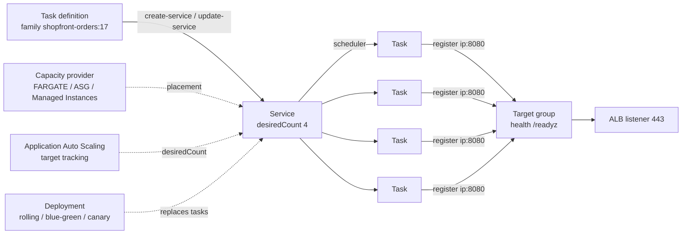

# Amazon ECS · L200 — Task definitions, services and scaling

**Level:** 200 · **Time:** ~75 min · **Prerequisites:** [L100 ECS basics](L100-ecs-basics.md),
[Networking L100](../05-networking/L100-vpc-for-containers.md),
[`labs/CONTRACT.md`](../../labs/CONTRACT.md)

**After this document you can:**

- Write a production-grade task definition for a service and explain every field you set.
- Choose between task role and execution role for each permission a task needs.
- Wire a service to an ALB, to Service Connect or to Cloud Map and know what each buys you.
- Configure auto scaling, capacity providers and a deployment strategy with a safe rollback.
- Recognise the first ten mistakes teams make with ECS and the field that prevents each one.

## 1. Mental model



A task definition is an immutable, versioned recipe: which images, how much CPU and memory, which
ports, which roles, how to log, how to check health, how long to wait at shutdown. A service is the
controller that keeps `desiredCount` copies of one revision running, replaces failed tasks, registers
them with load balancers or a namespace, and executes deployments when you point it at a new
revision. Capacity providers decide where tasks land; Application Auto Scaling moves
`desiredCount`; the deployment configuration decides how the old revision gives way to the new one.
Almost every ECS incident is a mismatch between two of these objects (a task definition that needs
more memory than the capacity provider has, a health check faster than the application starts, a
`stopTimeout` shorter than the load balancer's deregistration delay). This document goes through
each object field by field so those mismatches become visible before deployment.

## 2. Concepts

### 2.1 The task definition, field by field

The complete definition for the `orders` service on Fargate. Field notes follow the JSON.

```json
{
  "family": "shopfront-orders",
  "networkMode": "awsvpc",
  "requiresCompatibilities": ["FARGATE"],
  "runtimePlatform": { "cpuArchitecture": "ARM64", "operatingSystemFamily": "LINUX" },
  "cpu": "512",
  "memory": "1024",
  "executionRoleArn": "arn:aws:iam::123456789012:role/shopfront-dev-task-execution",
  "taskRoleArn": "arn:aws:iam::123456789012:role/shopfront-dev-orders-task",
  "ephemeralStorage": { "sizeInGiB": 21 },
  "containerDefinitions": [
    {
      "name": "orders",
      "image": "123456789012.dkr.ecr.us-east-1.amazonaws.com/shopfront/orders@sha256:1f2e3d4c5b6a79880000000000000000000000000000000000000000deadbeef",
      "essential": true,
      "cpu": 384,
      "memoryReservation": 512,
      "portMappings": [
        { "name": "http", "containerPort": 8080, "protocol": "tcp", "appProtocol": "http" }
      ],
      "environment": [
        { "name": "PORT", "value": "8080" },
        { "name": "AWS_REGION", "value": "us-east-1" },
        { "name": "CATALOG_URL", "value": "http://catalog:8081" },
        { "name": "SQS_QUEUE_URL", "value": "https://sqs.us-east-1.amazonaws.com/123456789012/shopfront-dev-orders-created" },
        { "name": "KAFKA_BROKERS", "value": "b-1.shopfrontdev.abc123.c2.kafka.us-east-1.amazonaws.com:9098" },
        { "name": "KAFKA_SASL_IAM", "value": "true" },
        { "name": "OTEL_EXPORTER_OTLP_ENDPOINT", "value": "http://127.0.0.1:4318" },
        { "name": "OTEL_SERVICE_NAME", "value": "orders" },
        { "name": "OTEL_RESOURCE_ATTRIBUTES", "value": "deployment.environment=dev" },
        { "name": "SHUTDOWN_TIMEOUT_SECONDS", "value": "20" }
      ],
      "secrets": [
        { "name": "DATABASE_URL",
          "valueFrom": "arn:aws:secretsmanager:us-east-1:123456789012:secret:shopfront/dev/orders/database-url-AbCdEf" }
      ],
      "dependsOn": [ { "containerName": "otel-collector", "condition": "HEALTHY" } ],
      "stopTimeout": 30,
      "user": "10001:10001",
      "readonlyRootFilesystem": true,
      "linuxParameters": { "initProcessEnabled": true, "capabilities": { "drop": ["ALL"] } },
      "ulimits": [ { "name": "nofile", "softLimit": 65536, "hardLimit": 65536 } ],
      "mountPoints": [ { "sourceVolume": "tmp", "containerPath": "/tmp" } ],
      "logConfiguration": {
        "logDriver": "awslogs",
        "options": {
          "awslogs-group": "/shopfront/dev/orders",
          "awslogs-region": "us-east-1",
          "awslogs-stream-prefix": "ecs",
          "awslogs-create-group": "true",
          "mode": "non-blocking",
          "max-buffer-size": "25m"
        }
      }
    },
    {
      "name": "otel-collector",
      "image": "public.ecr.aws/aws-observability/aws-otel-collector:v0.50.0",
      "essential": false,
      "cpu": 128,
      "memoryReservation": 256,
      "command": ["--config=/etc/ecs/ecs-default-config.yaml"],
      "healthCheck": {
        "command": ["CMD", "/healthcheck"],
        "interval": 10, "timeout": 5, "retries": 5, "startPeriod": 10
      },
      "logConfiguration": {
        "logDriver": "awslogs",
        "options": { "awslogs-group": "/shopfront/dev/otel", "awslogs-region": "us-east-1",
                     "awslogs-stream-prefix": "ecs", "awslogs-create-group": "true" }
      }
    }
  ],
  "volumes": [ { "name": "tmp" } ]
}
```

| Field | Purpose | Sane value | Mistake it prevents |
| --- | --- | --- | --- |
| `family` / revision | Name of the definition; every registration creates revision N+1, revisions are immutable | one family per service | Editing a live revision (impossible) instead of registering a new one |
| `networkMode` | How containers get network identity | `awsvpc` (required on Fargate; recommended on EC2) | Port collisions and shared instance security groups in `bridge` mode |
| `requiresCompatibilities` | Validates the definition against a launch type at registration | `FARGATE`, `EC2`, `EXTERNAL` | Registering a Fargate definition with unsupported fields (`privileged`, host ports) |
| `runtimePlatform` | CPU architecture and OS family | `ARM64/LINUX` for Graviton (about 20% cheaper on Fargate) | Pulling an amd64-only image onto arm64 capacity (`exec format error`) |
| task `cpu` / `memory` | Fargate billing size and the hard ceiling for all containers; valid pairs are fixed (0.25 vCPU with 0.5–2 GiB … 16 vCPU with 32–120 GiB) | size for p99 memory plus headroom | `OutOfMemoryError` when the sum of containers exceeds the task |
| container `cpu` | CPU shares (1024 = 1 vCPU) used to arbitrate between containers of the same task; on Fargate it also caps each container at its share | leave headroom for sidecars | A chatty sidecar starving the application |
| `memory` vs `memoryReservation` | `memory` is a hard limit (container killed above it); `memoryReservation` is a soft reservation used for placement | soft reservation for the app, hard limit only when isolation from a sidecar matters | Killing the application on a transient spike instead of the sidecar |
| `essential` | When an essential container stops, the task stops | application `true`, sidecars `false` unless the app cannot work without them | A crashing log router taking down the application, or a dead application leaving a zombie task |
| `dependsOn` | Start ordering with conditions `START`, `COMPLETE`, `SUCCESS`, `HEALTHY` | app depends on collector `HEALTHY` | The first spans/logs lost because the sidecar was not ready |
| `healthCheck` | Command ECS runs inside the container; result feeds the task health and deployments | only where the image has a shell or a health binary; use ALB health checks otherwise | A distroless image that cannot run `CMD-SHELL` (see below) |
| `stopTimeout` | Seconds between SIGTERM and SIGKILL (Fargate maximum 120; default 30) | `30`, above the application's own drain budget | In-flight requests killed mid-response |
| `user` | UID:GID the container starts as | `10001:10001` matching the image | Root by default when the image forgot `USER` |
| `readonlyRootFilesystem` | Mounts `/` read-only | `true`, with a `tmp` volume for scratch | Attackers writing to the container filesystem; images that mutate at run time |
| `linuxParameters.initProcessEnabled` | Runs a tiny init as PID 1 so signals and zombies are handled | `true` (platform 1.3.0+) | A runtime that ignores SIGTERM as PID 1 and waits for SIGKILL |
| `linuxParameters.capabilities` | Add or drop Linux capabilities; Fargate allows only `SYS_PTRACE` in `add` | `drop: ["ALL"]` | Unneeded kernel privileges |
| `ulimits` | Per-container resource limits | `nofile 65536` for network-heavy services | `EMFILE` under load with the default 1024 open files |
| `environment` | Plain configuration | non-secret values only | Secrets visible in `describe-task-definition` and CloudTrail |
| `secrets` | Injected at start from Secrets Manager or SSM Parameter Store by the execution role | ARN plus optional `:json-key:version-stage:version-id` selectors | Secrets baked into images or plain environment |
| `portMappings` | Ports and their names; `name` + `appProtocol` are what Service Connect binds to | one named mapping per listening port | Service Connect refusing the service because no port is named |
| `logConfiguration` | Driver and options; `awslogs` writes straight to CloudWatch Logs, FireLens routes through Fluent Bit | `awslogs` with `mode: non-blocking` and a 25 MiB buffer | The default blocking mode stalling the application when CloudWatch is throttled |
| `ephemeralStorage` | Fargate scratch space, 20 GiB default, up to 200 GiB, encrypted | 21 GiB when the image unpacks large models or caches | Image pull failure `no space left on device` |
| `volumes` / `mountPoints` | Bind (scratch), EFS (`efsVolumeConfiguration`), or EBS (`configuredAtLaunch: true` with `volumeConfigurations` on the service) | a nameless volume for `/tmp` on read-only images | Read-only filesystem errors from runtimes that write temporary files |
| `restartPolicy` | Container-level restart without replacing the task (`enabled`, `ignoredExitCodes`, `restartAttemptPeriod`) | enable for sidecars that crash independently | A whole task replaced (new ENI, new IP, cold caches) because a sidecar died |
| `versionConsistency` | Resolves image tags to digests when the deployment starts so every task in a deployment runs the same bytes | leave `enabled`; deploy by digest anyway | Two tasks of the same revision running different images behind one `latest` tag |

Two details that surprise people. First, a Fargate container health check runs inside the
container, so the image needs the tool the command uses; `orders` and `catalog` are distroless and
have no shell, which is why the JSON above has no `healthCheck` on the application and relies on the
ALB health check against `/readyz`. The worker image has Python and can check itself:

```json
"healthCheck": {
  "command": ["CMD-SHELL",
    "python -c \"import sys,urllib.request; sys.exit(0 if urllib.request.urlopen('http://127.0.0.1:8082/healthz', timeout=2).status == 200 else 1)\""],
  "interval": 30, "timeout": 5, "retries": 3, "startPeriod": 30
}
```

Second, the image reference is a digest. Tags are mutable; a digest is the content. CI pushes
`sha-<gitsha>` for humans and the pipeline writes the digest into the task definition
([08 L200](../08-delivery-cicd-gitops/L200-pipelines-on-aws.md)).

The FireLens variant replaces the `awslogs` block with a router sidecar; use it when logs must go to
OpenSearch, S3, a third party or several destinations at once:

```json
{ "name": "log-router", "essential": true,
  "image": "public.ecr.aws/aws-observability/aws-for-fluent-bit:stable",
  "firelensConfiguration": { "type": "fluentbit", "options": { "enable-ecs-log-metadata": "true" } },
  "memoryReservation": 64 }
```

and, on the application container,
`"logConfiguration": { "logDriver": "awsfirelens", "options": { "Name": "cloudwatch_logs", "region": "us-east-1", "log_group_name": "/shopfront/dev/orders", "auto_create_group": "true", "log_stream_prefix": "ecs/" } }`.

### 2.2 Task role versus task execution role

| | Task role (`taskRoleArn`) | Task execution role (`executionRoleArn`) |
| --- | --- | --- |
| Who uses it | your application code, through the SDK credential chain | the ECS agent / Fargate, on your behalf, before and around the container |
| Typical permissions | `sqs:SendMessage`, `kafka-cluster:*Connect`, `s3:PutObject`, `secretsmanager:GetSecretValue` for secrets the app fetches itself | `ecr:GetAuthorizationToken`, `ecr:BatchGetImage`, `ecr:GetDownloadUrlForLayer`, `logs:CreateLogStream/PutLogEvents`, `secretsmanager:GetSecretValue` and `ssm:GetParameters` for `secrets[]`, `kms:Decrypt` for those secrets |
| Trust policy principal | `ecs-tasks.amazonaws.com` | `ecs-tasks.amazonaws.com` |
| Credentials delivered how | link-local `169.254.170.2` via `AWS_CONTAINER_CREDENTIALS_RELATIVE_URI` ([L300 §2.3](L300-ecs-internals.md)) | never visible to the container |
| Scope | one per service (least privilege) | often one per cluster or environment |

A task failing to start with `ResourceInitializationError: unable to pull secrets` is an execution
role problem; an application logging `AccessDenied` on `sqs:SendMessage` is a task role problem.
Add `aws:SourceArn`/`aws:SourceAccount` conditions to both trust policies to prevent the confused
deputy pattern ([06 L200](../06-identity-and-security/L200-iam-for-containers.md)).

### 2.3 Network modes

| Mode | Where | Network identity | Ports | Security group | IMDS reachability |
| --- | --- | --- | --- | --- | --- |
| `awsvpc` | Fargate (only option), EC2, Managed Instances | one ENI and private IP per task | container port = host port; no collisions | per task | blocked on Fargate; EC2 blocked with `ECS_AWSVPC_BLOCK_IMDS=true` |
| `bridge` | EC2 | Docker bridge network, NAT to the instance | dynamic host ports (`hostPort: 0`) required to run two copies on one instance | instance's | reachable unless hop limit 1 or iptables |
| `host` | EC2 | the instance's network namespace | container port bound on the instance | instance's | reachable |
| `none` | EC2 | no external network | none | n/a | none |

`awsvpc` on EC2 consumes one ENI per task, which caps task density by the instance's ENI limit
unless you enable ENI trunking (`aws ecs put-account-setting-default --name awsvpcTrunking --value enabled`);
with trunking a c5.large goes from 2 to about 10 tasks per instance
([L300 §2.7](L300-ecs-internals.md)).

### 2.4 Service Connect versus Cloud Map service discovery

Both register tasks in an AWS Cloud Map namespace. They differ in who resolves and who proxies.

| | Service Connect | Cloud Map service discovery |
| --- | --- | --- |
| Mechanism | ECS injects an Envoy-based agent into every task; clients call `http://orders:8080` and the agent proxies, load-balances, retries | Route 53 private hosted zone answers A or SRV queries for `orders.shopfront.local`; the client connects directly |
| Load balancing | per request, outlier detection, connection draining during deployments | per DNS answer; clients cache; TTL decides how stale |
| Telemetry | request metrics per client/server pair in Container Insights without app changes | none beyond your application's |
| TLS | automatic with AWS Private CA, terminated in the agents | your application's job |
| Cost | agent CPU/memory (about 0.25 vCPU and 64–128 MiB per task) | Cloud Map + Route 53 query charges only |
| Cross-cluster | yes, one namespace shared by several clusters | yes |
| Non-ECS clients | cannot resolve the client aliases (they exist only inside tasks) | anything in the VPC can query the zone |

Service Connect on the `orders` service (server and client in the same namespace):

```json
"serviceConnectConfiguration": {
  "enabled": true,
  "namespace": "shopfront.local",
  "services": [{
    "portName": "http",
    "discoveryName": "orders",
    "clientAliases": [{ "port": 8080, "dnsName": "orders" }],
    "timeout": { "idleTimeoutSeconds": 300, "perRequestTimeoutSeconds": 30 },
    "tls": {
      "issuerCertificateAuthority": { "awsPcaAuthorityArn": "arn:aws:acm-pca:us-east-1:123456789012:certificate-authority/11111111-2222-3333-4444-5555555555ab" },
      "roleArn": "arn:aws:iam::123456789012:role/shopfront-dev-service-connect-tls"
    }
  }],
  "logConfiguration": { "logDriver": "awslogs",
    "options": { "awslogs-group": "/shopfront/dev/service-connect", "awslogs-region": "us-east-1",
                 "awslogs-stream-prefix": "sc", "awslogs-create-group": "true" } }
}
```

A client-only service (the worker, which calls nothing over HTTP but might) sets `enabled: true`
with an empty `services` list. `perRequestTimeoutSeconds` exists only for `http`/`http2`/`grpc`
`appProtocol`; TCP gets `idleTimeoutSeconds` only.

Cloud Map discovery instead uses `serviceRegistries` on the service:

```json
"serviceRegistries": [{ "registryArn": "arn:aws:servicediscovery:us-east-1:123456789012:service/srv-0123456789abcdef0" }]
```

With `awsvpc` an A record per task is enough; with `bridge` you must add `containerName` and
`containerPort` so an SRV record carries the dynamic host port. Keep TTLs at 10–15 s; clients that
cache longer keep talking to stopped tasks.

### 2.5 Load balancer target groups and the shutdown timeline

```json
"loadBalancers": [{
  "targetGroupArn": "arn:aws:elasticloadbalancing:us-east-1:123456789012:targetgroup/shopfront-dev-orders/0123456789abcdef",
  "containerName": "orders",
  "containerPort": 8080
}],
"healthCheckGracePeriodSeconds": 60
```

The target group (created with the ALB in
[`labs/ecs/cloudformation/04-services.yaml`](../../labs/ecs/cloudformation/04-services.yaml)) uses
`TargetType: ip` (mandatory for `awsvpc`), health check path `/readyz`, interval 15 s, healthy
threshold 2, unhealthy threshold 3, matcher `200`, and `deregistration_delay.timeout_seconds = 20`.
`healthCheckGracePeriodSeconds` stops the service scheduler from killing a slow-starting task
because the ALB has not yet marked it healthy.

The shutdown timeline for one task during a deployment, with the shopfront values:

```text
t=0     scheduler picks the task; ALB target -> draining (no new connections)
t=0     SIGTERM sent to the essential containers (stopTimeout clock starts, 30 s)
t=0-20  ALB deregistration delay: in-flight requests finish; the app stopped accepting at t=0
t≈0-20  application drains within SHUTDOWN_TIMEOUT_SECONDS=20 and exits 0
t=30    if still running: SIGKILL
```

The order that matters: the application must keep serving in-flight requests after SIGTERM until
the load balancer has stopped sending new ones, so `SHUTDOWN_TIMEOUT_SECONDS` (20) is at least the
deregistration delay (20) and below `stopTimeout` (30). Invert any of these and you get `502`s
during every deployment ([alb-5xx playbook](../../playbooks/incidents/alb-5xx-and-unhealthy-targets.md)).

### 2.6 Service auto scaling

Scaling is Application Auto Scaling acting on `desiredCount`. Register the target once, then attach
policies.

```bash
aws application-autoscaling register-scalable-target \
  --service-namespace ecs --scalable-dimension ecs:service:DesiredCount \
  --resource-id service/shopfront-dev/orders --min-capacity 2 --max-capacity 20

# CPU target tracking: the default choice for request-driven services
aws application-autoscaling put-scaling-policy \
  --service-namespace ecs --scalable-dimension ecs:service:DesiredCount \
  --resource-id service/shopfront-dev/orders --policy-name orders-cpu60 \
  --policy-type TargetTrackingScaling \
  --target-tracking-scaling-policy-configuration '{
    "TargetValue": 60.0,
    "PredefinedMetricSpecification": { "PredefinedMetricType": "ECSServiceAverageCPUUtilization" },
    "ScaleOutCooldown": 60, "ScaleInCooldown": 180 }'

# Requests per target: scales on demand rather than on its symptom
aws application-autoscaling put-scaling-policy ... --policy-name orders-rpt \
  --policy-type TargetTrackingScaling \
  --target-tracking-scaling-policy-configuration '{
    "TargetValue": 500.0,
    "PredefinedMetricSpecification": {
      "PredefinedMetricType": "ALBRequestCountPerTarget",
      "ResourceLabel": "app/shopfront-dev/50dc6c495c0c9188/targetgroup/shopfront-dev-orders/0123456789abcdef" } }'
```

| Policy type | Use when | Notes |
| --- | --- | --- |
| Target tracking | a metric should sit near a value (CPU 60%, 500 requests per target, 100 messages per task) | creates the alarms for you; scale-in is conservative by design |
| Step scaling | you want explicit tiers (add 2 tasks at 70%, 5 at 90%) | you own the alarms; combine with target tracking only if you understand the interactions |
| Scheduled | known daily/weekly shape | changes min/max, lets target tracking work inside the window |
| Predictive | recurring patterns with slow-starting tasks | forecasts from 14 days of history; verify current availability for ECS |

For the SQS worker, the right metric is backlog per task: `ApproximateNumberOfMessagesVisible /
RunningTaskCount`, published as a custom metric by a small Lambda or metric math in the policy's
`CustomizedMetricSpecification`, with a target such as 100 messages per task. Scaling on CPU for
a consumer that long-polls is meaningless.

### 2.7 Capacity providers and strategies

```bash
# EC2 capacity managed by ECS: scale the ASG to keep 90% of its capacity used, drain before termination
aws ecs create-capacity-provider --name shopfront-dev-asg \
  --auto-scaling-group-provider '{
    "autoScalingGroupArn": "arn:aws:autoscaling:us-east-1:123456789012:autoScalingGroup:11111111-2222-3333-4444-5555555555ab:autoScalingGroupName/shopfront-dev-nodes",
    "managedScaling": { "status": "ENABLED", "targetCapacity": 90, "minimumScalingStepSize": 1,
                        "maximumScalingStepSize": 10, "instanceWarmupPeriod": 300 },
    "managedTerminationProtection": "ENABLED",
    "managedDraining": "ENABLED" }'

aws ecs put-cluster-capacity-providers --cluster shopfront-dev \
  --capacity-providers FARGATE FARGATE_SPOT shopfront-dev-asg \
  --default-capacity-provider-strategy capacityProvider=FARGATE,weight=1

# A service that keeps two on-demand tasks and puts the rest on Spot 3:1
aws ecs create-service ... --capacity-provider-strategy \
  capacityProvider=FARGATE,base=2,weight=1 capacityProvider=FARGATE_SPOT,weight=3
```

| Provider | You manage | ECS manages | Choose when |
| --- | --- | --- | --- |
| `FARGATE` / `FARGATE_SPOT` | nothing below the task | everything | default; Spot for interruption-tolerant tasks (2-minute SIGTERM warning) |
| Auto Scaling group provider | AMI, instance types, patching | scaling to `targetCapacity`, draining, termination protection | GPUs, special instance types, daemon tasks, very high utilisation targets |
| ECS Managed Instances | instance requirements and the launch template you point at | the instances themselves: selection, patching by replacement, scaling | EC2 economics and features without fleet operations |
| `EXTERNAL` (ECS Anywhere) | the machines | scheduling only | on-premises or edge |

`base` is satisfied first, then `weight` splits the remainder proportionally. Strategies cannot mix
Fargate and EC2 providers in one service.

### 2.8 Deployments

```json
"deploymentConfiguration": {
  "minimumHealthyPercent": 100,
  "maximumPercent": 200,
  "deploymentCircuitBreaker": { "enable": true, "rollback": true },
  "alarms": { "alarmNames": ["shopfront-dev-orders-5xx", "shopfront-dev-orders-p99"], "enable": true, "rollback": true }
}
```

| `minimumHealthyPercent` / `maximumPercent` | Behaviour with `desiredCount` 4 | Use |
| --- | --- | --- |
| 100 / 200 | starts 4 new before stopping any; needs capacity for 8 | default for services behind a load balancer |
| 50 / 100 | stops 2, starts 2, repeats; no extra capacity | EC2 clusters at capacity, tolerant services |
| 100 / 150 | two at a time | slow-starting tasks with limited headroom |
| 0 / 100 | stop all, start all | single-instance daemons; downtime |

The circuit breaker watches for tasks that fail to reach `RUNNING`/healthy (threshold scales with
`desiredCount`, minimum 10 failures, maximum 200) and, with `rollback`, redeploys the last steady
revision. Alarm rollback watches your CloudWatch alarms during the deployment and rolls back when
one enters `ALARM`; pair a target 5xx alarm with a latency alarm and give the deployment a bake
window by making the alarms use at least three evaluation periods.

Native blue/green (2025) and canary/linear (late 2025) keep both revisions running and move
traffic at the listener:

```json
"deploymentConfiguration": {
  "strategy": "BLUE_GREEN",
  "bakeTimeInMinutes": 10,
  "lifecycleHooks": [{
    "hookTargetArn": "arn:aws:lambda:us-east-1:123456789012:function:shopfront-dev-orders-smoke",
    "roleArn": "arn:aws:iam::123456789012:role/shopfront-dev-deploy-hooks",
    "lifecycleStages": ["POST_TEST_TRAFFIC_SHIFT"]
  }]
},
"loadBalancers": [{
  "targetGroupArn": "...:targetgroup/shopfront-dev-orders-blue/...",
  "containerName": "orders", "containerPort": 8080,
  "advancedConfiguration": {
    "alternateTargetGroupArn": "...:targetgroup/shopfront-dev-orders-green/...",
    "productionListenerRule": "arn:aws:elasticloadbalancing:us-east-1:123456789012:listener-rule/app/shopfront-dev/.../.../...",
    "testListenerRule": "arn:aws:elasticloadbalancing:us-east-1:123456789012:listener-rule/app/shopfront-dev/.../.../...",
    "roleArn": "arn:aws:iam::123456789012:role/shopfront-dev-ecs-infrastructure" } }]
```

The lifecycle stages (`PRE_SCALE_UP`, `POST_SCALE_UP`, `TEST_TRAFFIC_SHIFT`,
`POST_TEST_TRAFFIC_SHIFT`, `PRODUCTION_TRAFFIC_SHIFT`, `POST_PRODUCTION_TRAFFIC_SHIFT`,
`RECONCILE_SERVICE`) call a Lambda that returns `SUCCEEDED` or `FAILED`; a failed hook rolls back
before production traffic moves. Canary and linear strategies add a first step that sends a
configurable share of production traffic (as low as 0.1%) to green, bake, then complete
(`canaryConfiguration` / `linearConfiguration`; verify field names in the current API reference).
Deployments can be paused and continued (2026-05) and inspected with
`aws ecs describe-service-deployments` and `describe-service-revisions`; `stop-service-deployment`
aborts or rolls back a deployment in progress. CodeDeploy-driven blue/green (`deploymentController:
CODE_DEPLOY`) still works and is what older pipelines use; new services should use the native
strategies ([08 L300](../08-delivery-cicd-gitops/L300-progressive-delivery-and-gitops-internals.md)).

### 2.9 ECS Exec

```bash
aws ecs update-service --cluster shopfront-dev --service orders --enable-execute-command --force-new-deployment
aws ecs execute-command --cluster shopfront-dev --task 0123456789abcdef0123456789abcdef \
  --container worker --interactive --command "/bin/sh"
```

Requirements: the task role allows `ssmmessages:CreateControlChannel`, `CreateDataChannel`,
`OpenControlChannel`, `OpenDataChannel`; the Session Manager plugin is installed locally; Fargate
platform 1.4.0 or ECS agent 1.50.2+; outbound access to the `ssmmessages` endpoint. ECS injects the
SSM agent binaries into the task, so a distroless image still works for `execute-command` but has
no shell to run; use a debug sidecar image in non-production or rely on logs. Sessions are logged
to CloudWatch/S3 and can be KMS-encrypted; the `amazon-ecs-exec-checker` script diagnoses missing
prerequisites.

### 2.10 Scheduled and standalone tasks

`run-task` starts tasks outside a service (migrations, one-off jobs). EventBridge Scheduler runs
them on a schedule with retries and a dead-letter queue:

```bash
aws scheduler create-schedule --name shopfront-dev-report-daily \
  --schedule-expression "cron(15 1 * * ? *)" --schedule-expression-timezone UTC \
  --flexible-time-window Mode=OFF \
  --target '{
    "Arn": "arn:aws:ecs:us-east-1:123456789012:cluster/shopfront-dev",
    "RoleArn": "arn:aws:iam::123456789012:role/shopfront-dev-scheduler",
    "EcsParameters": {
      "TaskDefinitionArn": "arn:aws:ecs:us-east-1:123456789012:task-definition/shopfront-report-job:9",
      "LaunchType": "FARGATE", "PlatformVersion": "LATEST", "TaskCount": 1,
      "NetworkConfiguration": { "awsvpcConfiguration": {
        "Subnets": ["subnet-0aaa", "subnet-0bbb"], "SecurityGroups": ["sg-0ccc"], "AssignPublicIp": "DISABLED" } } },
    "RetryPolicy": { "MaximumRetryAttempts": 2 } }'
```

For heavy or parallel jobs, AWS Batch on Fargate ([09 L200](../09-data-messaging-and-batch/L200-integration-patterns.md))
adds queues, array jobs and retries that Scheduler lacks.

### 2.11 Placement strategies and constraints (EC2 and Managed Instances)

```json
"placementStrategy": [
  { "type": "spread", "field": "attribute:ecs.availability-zone" },
  { "type": "binpack", "field": "memory" }
],
"placementConstraints": [
  { "type": "memberOf", "expression": "attribute:ecs.instance-type =~ m7g.*" }
]
```

Strategies are applied in order: spread across AZs first, then pack by memory within the chosen
AZ. `distinctInstance` guarantees one task per instance; the `daemon` scheduling strategy runs
exactly one task per instance for agents (log shippers, monitoring). Fargate ignores placement
strategies and spreads across the subnets you list; since 2024 ECS also rebalances tasks across
Availability Zones after an AZ outage recovers (`availabilityZoneRebalancing`).

### 2.12 The first ten mistakes

1. `stopTimeout` shorter than the ALB deregistration delay, or the app exiting on SIGTERM
   immediately: 502s on every deploy (§2.5).
2. Secrets in `environment`: visible to anyone with `ecs:DescribeTaskDefinition` (§2.1).
3. Deploying `latest`: two tasks of one revision running different code (`versionConsistency`,
   digests).
4. Blocking `awslogs` mode: CloudWatch throttling stalls the application (`mode: non-blocking`).
5. Using the instance role for application permissions instead of a task role (§2.2).
6. `bridge` mode on EC2 with a fixed `hostPort`: only one task per instance.
7. No `healthCheckGracePeriodSeconds` for slow starters: the scheduler kills healthy-in-a-minute
   tasks.
8. `maximumPercent: 100` on an EC2 cluster with no headroom: deployments stall.
9. Scaling a queue consumer on CPU instead of backlog per task (§2.6).
10. Tags on the Fargate task but no `ephemeralStorage`: a 4 GiB model download fails with
    `no space left on device`.

## 3. How it interacts with the rest of AWS

| Component | Talks to | Protocol/API | Prerequisite (IAM, network, DNS) | What breaks if missing |
| --- | --- | --- | --- | --- |
| Fargate/agent (execution role) | ECR | `ecr:GetAuthorizationToken`, `BatchGetImage`, `GetDownloadUrlForLayer` over HTTPS; layers from S3 | execution role policy; NAT or `ecr.api`/`ecr.dkr`/S3 endpoints | `CannotPullContainerError` |
| Fargate/agent (execution role) | Secrets Manager / SSM | `GetSecretValue`, `GetParameters`, `kms:Decrypt` | execution role; endpoints in private subnets | `ResourceInitializationError: unable to pull secrets` |
| awslogs driver | CloudWatch Logs | `logs:CreateLogGroup/CreateLogStream/PutLogEvents` | execution role; `logs` endpoint | task fails to start (`failed to initialize logging driver`) |
| Service | ELB | `elasticloadbalancing:RegisterTargets` via the ECS service-linked role | target group type `ip`, health check path, SG from ALB to task port | tasks never become healthy, deployment stalls |
| Service Connect agent | Cloud Map | service-linked role | namespace exists (`servicediscovery:*` when ECS creates it) | `ResourceInitializationError` mentioning Service Connect |
| Application (task role) | SQS, MSK, RDS, S3 | SDK calls with credentials from `169.254.170.2` | task role policy; security groups from task SG to the data stores | `AccessDenied` or connection timeouts |
| Application Auto Scaling | ECS | `ecs:UpdateService` through its service-linked role | scalable target registered | `desiredCount` never changes |
| EventBridge Scheduler | ECS | `ecs:RunTask` + `iam:PassRole` | scheduler role can pass task and execution roles | schedule fires, no task appears (check the schedule's DLQ) |
| ECS Exec | SSM Session Manager | `ssmmessages:*` from the task role | `ssmmessages` endpoint; plugin locally | `TargetNotConnectedException` |

Two interactions surprise people. Security groups are attached to the task ENI in `awsvpc`, so the
ALB's security group must be allowed inbound on the task's security group; the instance security
group is irrelevant on Fargate. And Secrets Manager secrets are fetched once at task start; a
rotated secret reaches the task only when a new deployment starts new tasks (`update-service
--force-new-deployment`), which is why RDS Proxy or IAM database authentication is preferred for
frequently rotated database credentials ([09 L200](../09-data-messaging-and-batch/L200-integration-patterns.md)).

## 4. Use it when / avoid it when

Use these mechanisms when:

- A service is HTTP or gRPC behind an ALB: ALB target group plus rolling deployment with circuit
  breaker and alarms is the baseline.
- Services call each other inside the cluster and you want retries, per-request metrics and TLS
  without code: Service Connect.
- A queue drives the work: no load balancer, scale on backlog per task, `FARGATE_SPOT` for the bulk.
- A job runs on a schedule: EventBridge Scheduler for one task, AWS Batch for many.

Avoid or reconsider when:

- Fargate container health checks on distroless images: use ALB/readiness instead.
- Service Connect for services that non-ECS clients (Lambda, EC2, on-premises) must resolve: use
  an internal ALB, Cloud Map DNS or VPC Lattice.
- `bridge` mode for new services: it exists for legacy fixed-port images.
- Step scaling stacked on target tracking without modelling the interaction: oscillation.

Alternatives: EKS Deployments/HPA/Ingress (same concepts, Kubernetes API, more knobs, more
operations); Lambda for spiky, short, event-driven work under 15 minutes; App Runner or ECS
Express Mode for a single web service where you do not want to own the task definition.

## 5. Well-Architected view

| Pillar | What these mechanisms give you | What they cost you | Practice (ECS Best Practices Guide) |
| --- | --- | --- | --- |
| Operational Excellence | immutable revisions, deployment history (`describe-service-deployments`), circuit breaker, alarms | task definitions as code in CI; keep families per service | version task definitions in git, deploy by digest, alarm-gated rollouts |
| Security | task role per service, `secrets[]`, read-only rootfs, non-root, capability drop, ECS Exec audit | execution role hygiene; Private CA for Service Connect TLS | least-privilege task roles, block IMDS, no secrets in environment |
| Reliability | multi-AZ placement, health checks, `healthCheckGracePeriodSeconds`, deregistration timeline, capacity provider `base` | correct timeouts require understanding the sequence in §2.5 | `minimumHealthyPercent: 100`, PDB-equivalent through `maximumPercent`, Spot only with `base` on-demand |
| Performance Efficiency | right-sized task cpu/memory, ARM64, target tracking on request count | Fargate size pairs are coarse; over-provisioning is easy | Compute Optimizer recommendations for Fargate; `ALBRequestCountPerTarget` policies |
| Cost Optimization | Fargate Spot, weights, scale-in, Graviton | Service Connect agent per task; ALB per service unless shared with listener rules | shared ALB with path/host rules, Spot for workers, scheduled scale-down in dev |
| Sustainability | scale to demand, ARM64 | none specific | scale-to-zero for non-production with scheduled actions |

## 6. Failure modes and troubleshooting

| Symptom | Likely cause | How to confirm (command/metric) | Fix |
| --- | --- | --- | --- |
| Deployment never completes, tasks cycle | health check fails before the app is ready; wrong health path; SG blocks ALB | `aws ecs describe-services --query 'services[0].events[:10]'`; `aws elbv2 describe-target-health` | raise `healthCheckGracePeriodSeconds`, fix `/readyz`, allow ALB SG on the task SG ([playbook](../../playbooks/incidents/ecs-deployment-stuck-or-rolled-back.md)) |
| `ResourceInitializationError: unable to pull secrets or registry auth` | execution role lacks `secretsmanager:GetSecretValue`/`kms:Decrypt`; no route to endpoints | `describe-tasks --query 'tasks[].stoppedReason'`; CloudTrail `AccessDenied` for the execution role | fix the execution role; add interface endpoints ([playbook](../../playbooks/incidents/ecs-task-stopped-reasons.md)) |
| 502/504 during deployments | app exits on SIGTERM before deregistration completes; `stopTimeout` too low | ALB `HTTPCode_ELB_502_Count` spikes aligned with deployments | drain for at least the deregistration delay; `stopTimeout: 30` ([playbook](../../playbooks/incidents/alb-5xx-and-unhealthy-targets.md)) |
| `OutOfMemoryError: Container killed due to memory usage` | container hard limit or task memory too small; JVM/Node unaware of limits | `describe-tasks` exit code 137; Container Insights `MemoryUtilized` | raise memory, set runtime flags ([playbook](../../playbooks/incidents/oom-and-cpu-throttling.md)) |
| Application `AccessDenied` on AWS APIs | task role missing actions; SDK picked up a different credential source | `curl 169.254.170.2$AWS_CONTAINER_CREDENTIALS_RELATIVE_URI` from ECS Exec; CloudTrail `userIdentity.sessionContext` | fix task role; block IMDS ([playbook](../../playbooks/incidents/iam-accessdenied-from-containers.md)) |
| Service Connect client gets `503` or connection refused | server service has no named port / `appProtocol`; namespaces differ; client not in Service Connect | agent logs in `/shopfront/dev/service-connect`; `aws servicediscovery list-instances` | name the port, put both services in the same namespace, enable the client side |
| Tasks stuck `PENDING` on EC2 | no instance with enough CPU/memory/ENIs; placement constraint unsatisfiable | service events `unable to place a task because no container instance met all of its requirements` | add capacity, enable ENI trunking, loosen constraints ([playbook](../../playbooks/incidents/pending-pods-and-capacity.md)) |
| Auto scaling never scales in | scale-in cooldown; alarm on a metric that stays above target; min capacity | Application Auto Scaling `describe-scaling-activities` | tune target/cooldown; check the metric's dimensions |
| Scheduled task never runs | scheduler role cannot `iam:PassRole`; subnets without route to ECR | Scheduler DLQ messages; CloudTrail `RunTask` errors | fix the role; use private subnets with endpoints |

## 7. Signals: metrics, logs, traces

- `AWS/ECS CPUUtilization`, `MemoryUtilization` per service (percent of reservation): sustained
  above 80% means undersized tasks or missing scale-out; watch alongside `RunningTaskCount`.
- `ECS/ContainerInsights RunningTaskCount`, `PendingTaskCount`, `DesiredTaskCount`,
  `DeploymentCount`: `PendingTaskCount > 0` for minutes means placement or start failures;
  `DeploymentCount > 1` for longer than a deployment should take means a stalled rollout.
- `ECS/ContainerInsights CpuUtilized`/`CpuReserved`, `MemoryUtilized`/`MemoryReserved` per task
  and container (enhanced observability): the basis for right-sizing.
- Service Connect metrics per service pair (request count, 5xx, target response time, active
  connections, TLS negotiation errors): the only client-side view without application code.
- `AWS/ApplicationELB HealthyHostCount`, `UnHealthyHostCount`, `TargetResponseTime`,
  `HTTPCode_Target_5XX_Count` vs `HTTPCode_ELB_5XX_Count`: the target/ELB split says whether the
  application or the routing failed.
- `AWS/ECS/ManagedScaling CapacityProviderReservation`: above 100 means tasks are waiting for
  instances.
- Service events (`describe-services … events`) and task `stoppedReason`: the first place to look;
  they are not metrics, export them to CloudWatch Logs with EventBridge (`ECS Task State Change`).
- Application logs in `/shopfront/dev/<service>` with `trace_id`; traces through the ADOT sidecar
  to X-Ray/Transaction Search ([07 L200](../07-observability/L200-tooling-on-aws.md)).

Thresholds and the full table: [`reference/metrics-catalog.md`](../../reference/metrics-catalog.md).

## 8. Testing and DR notes

Testing this layer:

- Validate definitions before deploying: `aws ecs register-task-definition --generate-cli-skeleton`
  gives the schema; `cfn-lint` validates the CloudFormation in
  [`labs/ecs/cloudformation/`](../../labs/ecs/cloudformation/); a `run-task` into a test cluster
  proves the execution role, secrets and image pull before a service depends on them.
- Rehearse the shutdown timeline locally: `make up`, then `docker compose -f labs/local/compose.yaml
  stop orders` while a load generator runs; every request must complete or be refused, none reset.
- Load test through the ALB with k6 to size `cpu`/`memory` and the scaling target
  ([11 L300](../11-testing-workloads/L300-performance-and-chaos-testing.md)).
- Chaos: AWS FIS `aws:ecs:stop-task` on a percentage of tasks during traffic proves the service
  recovers within the health check window; `aws:ecs:task-cpu-stress`/`task-io-stress` exercise
  limits.
- Deployment safety: deploy a revision that fails `/readyz` on purpose and confirm the circuit
  breaker rolls back within the expected number of attempts.

DR for this layer: a service is stateless configuration. Everything here lives in the task
definition, the service definition and the auto scaling policies, all reproducible from
CloudFormation. Recovery in another Region is: replicate images (ECR replication rules), deploy the
same stacks with Region-specific parameters, point Route 53 at the new ALB. The data stores the
tasks use carry the real RTO/RPO ([10 L300](../10-resilience-and-dr/L300-dr-strategies-for-container-platforms.md)).

## 9. Hands-on

Standalone, annotated task definitions live in [`labs/ecs/taskdefs/`](../../labs/ecs/taskdefs/)
and the deployable stacks in [`labs/ecs/cloudformation/`](../../labs/ecs/cloudformation/). Read
before you deploy; deployment creates billable resources and requires the confirmation variable in
`deploy.sh`.

```bash
# 1. Inspect the service task definition and compare with the table in §2.1
jq '.containerDefinitions[0] | {essential, stopTimeout, user, readonlyRootFilesystem, linuxParameters, logConfiguration}' \
  labs/ecs/taskdefs/orders.json

# 2. Lint the CloudFormation that creates the ALB, target groups, services and scaling policies
.venv/bin/cfn-lint labs/ecs/cloudformation/04-services.yaml

# 3. (Optional, billable) deploy network + cluster + data + services, then watch the first deployment
CONFIRM_DEPLOY=yes labs/ecs/cloudformation/deploy.sh dev
aws ecs describe-services --cluster shopfront-dev --services orders \
  --query 'services[0].{status:status,running:runningCount,pending:pendingCount,deployments:deployments[].{status:status,rollout:rolloutState,running:runningCount}}'
# Observe: one PRIMARY deployment reaching rolloutState COMPLETED; events show "has reached a steady state".

# 4. Prove the credentials path from inside a task (worker image has a shell)
aws ecs execute-command --cluster shopfront-dev --task <task-id> --container worker --interactive \
  --command "sh -c 'curl -s 169.254.170.2\$AWS_CONTAINER_CREDENTIALS_RELATIVE_URI | head -c 120; echo; curl -s \$ECS_CONTAINER_METADATA_URI_V4/task | head -c 300'"
# Observe: RoleArn of the task role (not the execution role); task metadata with LaunchType FARGATE.

# 5. Force a rollback: register a revision with a wrong health path in the target group or a broken
#    command, update the service, and watch the circuit breaker
aws ecs update-service --cluster shopfront-dev --service orders --task-definition shopfront-orders:BROKEN
aws ecs describe-service-deployments --cluster shopfront-dev --service orders --query 'serviceDeployments[0].{status:status,reason:statusReason}'
# Observe: status ROLLBACK_SUCCESSFUL, reason mentions the circuit breaker.

# 6. Locally: the shutdown timeline
make up && (while true; do curl -s -o /dev/null -w '%{http_code}\n' localhost:8080/orders; sleep 0.2; done) &
docker compose -f labs/local/compose.yaml stop orders
# Observe: 200s until the stop, then connection refused; never a truncated response. Logs show
# "shutdown signal received" then "stopped" within 20 s.
```

## 10. Check yourself

1. A deployment shows `502` errors for about ten seconds every time. `stopTimeout` is 30,
   deregistration delay is 30, and the application closes its listener the instant it gets SIGTERM.
   What is wrong?

<details><summary>Answer</summary>
The application stops accepting new connections before the ALB stops sending them. Deregistration
starts at the same moment as SIGTERM, and for up to 30 s the ALB may still route new requests to a
target that has closed its socket. The application must keep serving until the deregistration delay
has passed (sleep or keep the listener open while draining), then exit; `stopTimeout` must exceed
that drain. Alternatively lower the deregistration delay to match the drain budget.
</details>

2. Which role needs `kms:Decrypt` for a Secrets Manager secret referenced in `secrets[]`, and
   which role needs `sqs:SendMessage`?

<details><summary>Answer</summary>
The task execution role decrypts and injects `secrets[]` before the container starts, so it needs
`secretsmanager:GetSecretValue` and `kms:Decrypt` on that secret's key. The application sends to
SQS with the task role, which needs `sqs:SendMessage`. Mixing them up produces
`ResourceInitializationError` at start (execution role) or `AccessDenied` at run time (task role).
</details>

3. Why does the `orders` task definition have no `healthCheck` while the worker's does?

<details><summary>Answer</summary>
ECS container health checks execute a command inside the container. The `orders` image is
distroless with no shell or HTTP client, so no command can run; its health is judged by the ALB
health check on `/readyz`. The worker image includes Python, so a one-line `urllib` call can probe
`/healthz` locally.
</details>

4. A queue consumer service is scaled with a CPU target of 60%. The queue backlog grows to a
   million messages while CPU stays at 15%. What should the scaling policy use instead?

<details><summary>Answer</summary>
Backlog per task: `ApproximateNumberOfMessagesVisible / RunningTaskCount` as a customized metric in
a target tracking policy (target e.g. 100 messages per task). A long-polling consumer waits on the
network, so CPU is not a proxy for work; the queue depth divided by consumers is.
</details>

5. With `desiredCount` 6, `minimumHealthyPercent` 50 and `maximumPercent` 100 on an EC2 cluster
   that is nearly full, describe the deployment sequence and its risk.

<details><summary>Answer</summary>
ECS may stop up to 3 tasks (50% of 6 must stay healthy) and start up to 3 new ones without
exceeding 6 in total, repeating until all 6 run the new revision. It needs no extra capacity, but
the service runs at half capacity during the rollout, so a traffic spike mid-deployment degrades
service. Behind a load balancer, prefer 100/200 and provide headroom or use Fargate where capacity
is elastic.
</details>

## 11. Sources

- Amazon ECS task definition parameters — https://docs.aws.amazon.com/AmazonECS/latest/developerguide/task_definition_parameters.html
- Task size on Fargate (valid CPU/memory combinations) — https://docs.aws.amazon.com/AmazonECS/latest/developerguide/fargate-tasks-services.html#fargate-tasks-size
- Passing sensitive data to a container (Secrets Manager, SSM) — https://docs.aws.amazon.com/AmazonECS/latest/developerguide/specifying-sensitive-data.html
- Task IAM role and task execution IAM role — https://docs.aws.amazon.com/AmazonECS/latest/developerguide/task-iam-roles.html and https://docs.aws.amazon.com/AmazonECS/latest/developerguide/task_execution_IAM_role.html
- Amazon ECS task networking (network modes) — https://docs.aws.amazon.com/AmazonECS/latest/developerguide/task-networking.html
- Amazon ECS Service Connect — https://docs.aws.amazon.com/AmazonECS/latest/developerguide/service-connect.html
- Service Connect TLS — https://docs.aws.amazon.com/AmazonECS/latest/developerguide/service-connect-tls.html
- Service discovery with AWS Cloud Map — https://docs.aws.amazon.com/AmazonECS/latest/developerguide/service-discovery.html
- Use load balancing to distribute Amazon ECS service traffic — https://docs.aws.amazon.com/AmazonECS/latest/developerguide/service-load-balancing.html
- Service auto scaling — https://docs.aws.amazon.com/AmazonECS/latest/developerguide/service-auto-scaling.html
- Amazon ECS capacity providers — https://docs.aws.amazon.com/AmazonECS/latest/developerguide/cluster-capacity-providers.html
- Amazon ECS Managed Instances capacity providers — https://docs.aws.amazon.com/AmazonECS/latest/developerguide/managed-instances-capacity-providers-concept.html
- Amazon ECS deployment types (rolling, blue/green) — https://docs.aws.amazon.com/AmazonECS/latest/developerguide/deployment-types.html
- Amazon ECS blue/green deployments and lifecycle hooks — https://docs.aws.amazon.com/AmazonECS/latest/developerguide/deployment-type-blue-green.html
- Deployment circuit breaker — https://docs.aws.amazon.com/AmazonECS/latest/developerguide/deployment-circuit-breaker.html
- Monitor Amazon ECS containers with ECS Exec — https://docs.aws.amazon.com/AmazonECS/latest/developerguide/ecs-exec.html
- Amazon EventBridge Scheduler with ECS targets — https://docs.aws.amazon.com/scheduler/latest/UserGuide/managing-targets-templated.html
- Amazon ECS task placement — https://docs.aws.amazon.com/AmazonECS/latest/developerguide/task-placement.html
- Using the awslogs log driver (non-blocking mode) — https://docs.aws.amazon.com/AmazonECS/latest/developerguide/using_awslogs.html
- Amazon ECS Best Practices Guide — https://docs.aws.amazon.com/AmazonECS/latest/bestpracticesguide/intro.html
