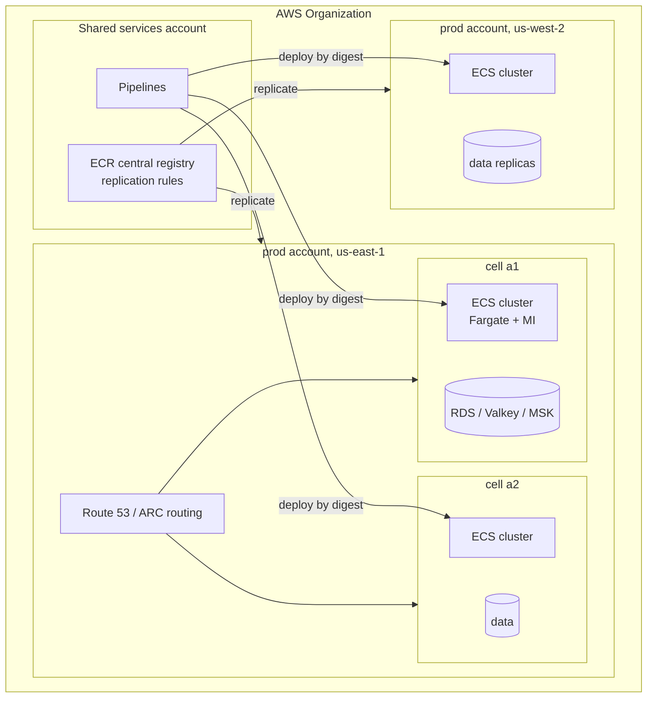

# Amazon ECS · L400 — ECS at scale

**Level:** 400 · **Time:** ~90 min · **Prerequisites:** [L300 ECS internals](L300-ecs-internals.md),
[Resilience and DR L300](../10-resilience-and-dr/L300-dr-strategies-for-container-platforms.md),
[Well-Architected L200](../12-well-architected/L200-pillar-checklists-ecs-and-eks.md)

**After this document you can:**

- Lay out ECS across accounts, Regions and cells and defend where each boundary sits.
- Build a capacity and cost model that compares Fargate, EC2, Managed Instances and Spot with real
  utilisation numbers rather than list prices.
- Design deployment safety for hundreds of services (canary math, bake time, alarm design).
- Plan the App Mesh exit and the retirement of Compose/Copilot tooling.
- Recognise the failure stories that only appear at fleet scale and the controls that prevent them.

## 1. Mental model



At scale, ECS stops being "a cluster" and becomes a fleet: many clusters in many accounts, each a
deployment unit with its own blast radius. The control plane is regional and multi-tenant, so the
boundaries you draw are organisational (accounts), geographic (Regions) and architectural (cells).
Cost is decided by utilisation and by which party absorbs idle capacity (you on EC2, AWS on Fargate,
shared on Managed Instances). Deployment risk is decided by how many tasks change at once and how
long you watch before continuing. This document is about those three levers and the stories that
teach them.

## 2. Concepts

### 2.1 Topology: accounts, Regions, cells

| Boundary | What it isolates | ECS specifics | Cost of adding one |
| --- | --- | --- | --- |
| Account | IAM, quotas, billing, blast radius of a bad policy | clusters, capacity providers, namespaces, task roles are account-scoped; images pulled cross-account need repository policies | landing-zone work, cross-account ECR/Secrets/Logs |
| Region | infrastructure faults, data residency, latency | clusters are regional; Fargate capacity, Managed Instances pools and Service Connect namespaces are regional; ECR replicates | duplicate stacks, data replication, DNS/ARC routing |
| Cluster | scheduling domain, capacity providers, Container Insights setting | one cluster per environment per team is common; clusters are free | none in ECS; more in observability grouping |
| Cell | a full copy of the service stack serving a slice of customers | one cluster + data tier per cell; routing by Route 53/ARC or a thin router | full stack per cell; operational tooling must be cell-aware |

Guidance that survives contact with real fleets: one production account per business unit or per
large product; one cluster per environment per team inside it; cells only when a single failure of
the stack must not affect all customers (payments, multi-tenant SaaS) because cells double the
operational surface. Shared services (ECR, pipelines, observability) sit in their own account and
reach workloads through cross-account permissions, not through shared clusters.

Quotas that bind first at scale (verify current values): tasks per service (5,000), services per
cluster (5,000), container instances per cluster (5,000), Fargate on-demand vCPU per Region
(adjustable, starts around 4,000–6,000), ENIs per Region, target groups per ALB and targets per
target group (1,000), Cloud Map instances per namespace, EventBridge rules. Design the account
layout so that no single account approaches them; request increases before load tests, not during
incidents ([quotas reference](../../reference/quotas-and-limits.md)).

### 2.2 Capacity and cost model

The right question is not "Fargate or EC2" but "who pays for idle capacity and for operations".
A worked comparison for a fleet of 200 services, average 4 tasks of 0.5 vCPU / 1 GiB, 24×7,
us-east-1 list prices (verify current pricing; the structure matters more than the digits):

| Option | Effective utilisation | What you pay for | Approximate monthly compute | Hidden costs |
| --- | --- | --- | --- | --- |
| Fargate on-demand, x86 | 100% of requested task size (no bin-packing loss), but you pay for headroom inside each task | 800 tasks × (0.5 vCPU × $0.04048 + 1 GiB × $0.004445) × 730 h | ≈ $14.4k | nothing to patch; Service Connect agent adds to every task's size |
| Fargate on-demand, Graviton (arm64) | same | about 20% less per vCPU/GiB | ≈ $11.5k | multi-arch images |
| Fargate Spot for 70% of tasks | same | up to 70% discount on the Spot share | ≈ $6–8k | interruptions; `base` on-demand tasks; not for stateful/latency-critical |
| EC2 (m7g) at 65% cluster utilisation | 65% (bin-packing gaps, reserved memory, daemon tasks, deployment headroom) | 400 vCPU / 800 GiB requested ÷ 0.65 ≈ 616 vCPU → ~39 × m7g.4xlarge at $0.6528/h | ≈ $18.6k on-demand, ≈ $11–12k with Savings Plans | AMI pipeline, agent updates, capacity provider tuning, on-call for hosts |
| ECS Managed Instances | similar packing, AWS operates the hosts | EC2 price + management fee (percentage of instance price) | EC2 line + fee | fewer host operations; GPU fee reductions in 2026 |

Reading the table: at 65% utilisation EC2 on-demand is not cheaper than Fargate for small tasks
once you count headroom; EC2 wins with Savings Plans, high utilisation (80%+ via `binpack`), large
tasks that pack well, or hardware Fargate cannot offer (GPUs, local NVMe, specific families).
Fargate wins on operations and on bursty fleets where capacity providers would otherwise hold idle
instances. Managed Instances sits between: EC2 economics and hardware with most of Fargate's
operational profile. Always include the people cost: an AMI/agent/patching pipeline and host on-call
is a fraction of an engineer per fleet, which is often the largest line.

Capacity planning inputs: p95 CPU and memory per task from Container Insights over two weeks;
deployment headroom (`maximumPercent`); Spot interruption rates per instance family (Spot placement
score); ENI limits with trunking; and the ALB's target limit per target group. Plan scale-out
speed too: Fargate tasks start in ~30–60 s plus image pull; EC2 capacity providers add instance
boot (2–4 min) unless warm pools are used.

### 2.3 Image supply at scale

Every task start pulls an image. At 800 tasks with a bad deployment loop that is thousands of pulls
per hour. Controls: deploy by digest; keep images small (Graviton-ready distroless as in the labs);
pull-through cache for public bases so Docker Hub limits never stop a deployment
([02 L300](../02-ecr/L300-pull-through-cache-replication-and-limits.md)); ECR replication to every
Region you run in; `ECS_IMAGE_PULL_BEHAVIOR=prefer-cached` on EC2; SOCI indexes for images above a
few hundred MiB on Fargate; and a lifecycle policy that never deletes a digest a running task
definition references (the "lifecycle deleted my image" incident in
[02 L400](../02-ecr/L400-supply-chain-and-multi-account-registries.md)).

### 2.4 Deployment safety for large fleets

The unit of risk is tasks changed per unit time across the fleet. Controls, from cheapest to most
expensive:

1. Circuit breaker with rollback on every service (free; catches tasks that never become healthy).
2. Alarm-based rollback with two alarms per service: target 5xx rate and p99 latency, three
   evaluation periods of one minute, so a rollout bakes for at least three minutes before ECS
   trusts it.
3. Canary or linear strategies for tier-1 services: shift 1–5% for a bake period sized to detect
   the failure you fear. Canary math: to observe an error-rate regression from 0.1% to 1% with 95%
   confidence at 1% traffic on a service doing 200 requests/s, you need roughly 3,000 canary
   requests ≈ 25 minutes. Bake times shorter than that are theatre.
4. Lifecycle hooks that run synthetic tests against the test listener before production traffic
   shifts, and that fail closed.
5. Fleet-level orchestration: deploy to one cell, wait, then the next; never all cells in one
   pipeline stage. Pause/continue (2026) lets an operator hold a rollout at a stage.

Bake time also protects against slow failures: memory leaks that OOM after 40 minutes, connection
pools that exhaust after the first cache expiry, or a Kafka consumer group that rebalances only when
the old tasks leave.

### 2.5 App Mesh end of support and the mesh question

AWS App Mesh reaches end of support on 2026-09-30; the console and resources stop working after
that date. Migration targets and what each gives back:

| Need | Service Connect | VPC Lattice | Self-managed mesh (Istio/Cilium on EKS) |
| --- | --- | --- | --- |
| ECS-to-ECS discovery, retries, per-request metrics | yes | yes (HTTP/gRPC target groups) | not on ECS |
| TLS between services | automatic with Private CA | TLS to the Lattice service, SigV4 auth policies | mTLS with SPIFFE |
| Cross-account / cross-VPC | same namespace across clusters in one account and VPC set | yes, service network shared across accounts (RAM) | no |
| Non-ECS clients (Lambda, EC2, EKS) | no | yes | EKS only |
| Traffic shaping (weighted routes) | no; use ECS deployment strategies | weighted target groups | yes |
| Cost | task CPU/memory for the agent | per-request and per-hour Lattice pricing | your operations |

Most ECS fleets land on Service Connect for east-west inside a VPC and Lattice where they must cross
accounts or reach non-ECS targets. Migrate service by service: add Service Connect with the same
DNS names App Mesh virtual services used, cut clients over, remove the Envoy sidecar and the mesh
resources.

Retired tooling: the Docker Compose ECS integration (retired 2023-11) and the Copilot CLI (end of
support 2026-06-12) leave a gap for "just run my compose file". Replacements are CloudFormation/CDK/
Terraform modules that own the task definition, or ECS Express Mode for single web services with
AWS defaults. Do not adopt archived tools for new work.

### 2.6 Failure stories

**IP exhaustion under Fargate.** A team placed 1,200 Fargate tasks in two /24 subnets (506 usable
IPs after AWS reserves five per subnet); scale-out failed with `insufficient free addresses`. Fix:
/20 subnets per AZ dedicated to tasks, alarms on subnet free IPs, IPv6 dual-stack for new VPCs
([05 L400](../05-networking/L400-network-architecture-at-scale.md)).

**Deployment storm.** A shared pipeline deployed 140 services in parallel after a base-image CVE.
Fargate capacity, ECR pulls and Secrets Manager `GetSecretValue` all throttled; circuit breakers
tripped everywhere, rollbacks created a second storm. Fix: rate-limit deployments per account (a
pipeline semaphore), stagger by cell, `prefer-cached` on EC2, and a Secrets Manager caching layer
(or fewer secrets fetched at start).

**Blocking log driver.** CloudWatch Logs `PutLogEvents` throttled during a Region event; `awslogs`
in blocking mode stalled application threads; latency alarms fired and rollbacks made it worse. Fix:
`mode: non-blocking` with `max-buffer-size`, alarms on dropped log lines, FireLens with a local
buffer where log completeness matters.

**Spot mass interruption.** 60% of a fleet on Fargate Spot in one Region lost capacity at once
during a demand spike; services with `base: 0` went to zero. Fix: `base` on-demand equal to the
minimum viable capacity, weights rather than all-Spot, and interruption-aware graceful shutdown.

**Secrets at start.** A Secrets Manager rotation Lambda misfired and stored an invalid JSON; every
new task failed with `ResourceInitializationError` while old tasks kept running with cached
credentials, so the incident surfaced only when the deployment circuit breaker rolled back in every
service at once. Fix: rotation validation, IAM database authentication or RDS Proxy for databases,
alarms on `ResourceInitializationError` counts.

**ALB target limit.** A cell grew to 1,000 tasks behind one target group and hit the target limit;
deployments (which need up to 200% of tasks) failed silently. Fix: several target groups with
weighted forwarding, or split the service.

### 2.7 DR posture

ECS itself needs no backup: clusters, services, task definitions, capacity providers and namespaces
are reproducible from IaC in minutes. What decides recovery: images (replication rules to every
Region in the plan), secrets (Secrets Manager multi-Region replication), certificates (ACM/Private
CA per Region), DNS (Route 53 health checks, ARC routing controls), and data (the real RTO/RPO). A
warm-standby Region runs the stacks at minimal `desiredCount` with capacity provider strategies
ready; failover raises counts and flips routing. Rehearse it with the
[region failover runbook](../../playbooks/dr/region-failover-runbook.md); a runbook that has never
been executed is a hypothesis.

### 2.8 Well-Architected review of an ECS platform

Run the review against the fleet, not one service. Questions that separate mature ECS platforms:

- Operational Excellence: are task definitions generated from one module with enforced defaults
  (non-root, read-only, non-blocking logs, `stopTimeout`), and can you list every service running an
  image with a known CVE within an hour?
- Security: does every task have a task role, is IMDS blocked on EC2, are secrets only in
  `secrets[]`, is ECS Exec audited and restricted with condition keys?
- Reliability: are deployments alarm-gated with bake time, do services spread across three AZs,
  are Spot shares protected by `base`, has the Region failover been executed this quarter?
- Performance Efficiency: are task sizes reviewed against Container Insights p95 quarterly, is
  Graviton the default, are scaling policies on demand metrics?
- Cost Optimization: what is the fleet's requested-vs-used ratio, are non-production clusters
  scaled to zero at night, are Savings Plans covering the steady EC2 or Fargate baseline?
- Sustainability: are idle services identified and retired?

[12 L300](../12-well-architected/L300-running-a-review.md) walks the review with shopfront.

### 2.9 When to leave ECS for EKS (and back)

Move to EKS when you need the Kubernetes ecosystem as a product surface: operators (Kafka, Postgres,
ML platforms), Helm charts vendors ship, GitOps controllers, custom schedulers, sidecar/webhook
patterns, multi-cloud portability, or when hiring depends on it. Stay on or return to ECS when the
workloads are conventional services and jobs, the team is small, and the cost of Kubernetes
upgrades, add-on lifecycles and cluster sprawl outweighs the ecosystem
([decision guides](../../reference/decision-guides.md)). Many organisations run both: ECS for the
long tail, EKS for the platforms that need Kubernetes APIs.

## 3. How it interacts with the rest of AWS

| Component | Talks to | Protocol/API | Prerequisite (IAM, network, DNS) | What breaks if missing |
| --- | --- | --- | --- | --- |
| Pipelines (shared account) | ECS in workload accounts | `ecs:RegisterTaskDefinition`, `UpdateService` via assumed roles | cross-account deploy roles with `iam:PassRole` on task/execution roles | deployments fail with `AccessDenied`; or worse, succeed with overly broad roles |
| ECR (shared account) | Fargate/agents in workload accounts and Regions | repository policy allowing the execution roles; replication rules | replication destinations, KMS key policies per Region | `CannotPullContainerError` after failover |
| Route 53 / ARC | ALBs per Region/cell | health checks, routing controls | health check endpoints that reflect real readiness | traffic to a dead cell |
| Secrets Manager | tasks in several Regions | multi-Region replication | replica secrets + KMS multi-Region keys | tasks in the DR Region fail at start |
| AWS Organizations / Config | all accounts | guardrails (SCPs), Config rules (`ecs-task-definition-nonroot-user`, `ecs-containers-readonly-access`) | delegated admin | drift between accounts |
| Compute Optimizer | Fargate/EC2 | utilisation analysis | opt-in | no right-sizing signal |
| Savings Plans | Fargate and EC2 spend | billing | commitment sized to the baseline | paying on-demand for steady load |

## 4. Use it when / avoid it when

Use these patterns when:

- More than a handful of teams share the platform: accounts per business unit, cluster per team and
  environment, shared ECR and pipelines.
- Availability targets exceed what one Region gives: warm standby with replicated images, secrets
  and data.
- Deployment volume is high: alarm-gated rollouts, canary for tier-1, staggered cells.

Avoid:

- Cells before you need them; every cell doubles the operational and observability surface.
- All-Spot fleets; keep `base` on-demand.
- One cluster for everything across teams; quotas and Container Insights settings are per cluster
  and a noisy neighbour in capacity providers affects all.
- Migrating to EKS for ecosystem reasons you do not actually use.

## 5. Well-Architected view

| Pillar | At fleet scale | Cost | Practice |
| --- | --- | --- | --- |
| Operational Excellence | uniform task definition module; deployment history; fleet dashboards | platform team time | one IaC module with enforced defaults; deployment rate limits |
| Security | account boundaries; task roles; central ECR with signing; SCP guardrails | cross-account complexity | SCP denying `ecs:RunTask` without task role tags? (use Config rules); Private CA for Service Connect TLS |
| Reliability | cells, warm standby, alarm-gated deployments | duplicated stacks | quarterly failover drill; `base` on-demand |
| Performance Efficiency | right-sizing loops; Graviton default | review effort | Compute Optimizer + Container Insights quarterly |
| Cost Optimization | utilisation-based option choice; Savings Plans; Spot | analysis time | requested-vs-used dashboard per team; showback |
| Sustainability | retire idle services; scale to zero | none | idle detection from request metrics |

## 6. Failure modes and troubleshooting

| Symptom | Likely cause | How to confirm (command/metric) | Fix |
| --- | --- | --- | --- |
| Many services roll back simultaneously | shared dependency (secret, base image, endpoint, throttling) | correlate `ResourceInitializationError` counts across services; CloudTrail throttling errors | fix the shared dependency; stagger deployments ([playbook](../../playbooks/incidents/ecs-deployment-stuck-or-rolled-back.md)) |
| Scale-out fails with `insufficient free addresses` | subnet exhaustion | VPC console free IPs; CloudWatch alarm on subnet IPs | larger subnets, secondary CIDR, IPv6 ([playbook](../../playbooks/incidents/pending-pods-and-capacity.md)) |
| Fargate `RunTask` throttled or capacity errors | Region-level Fargate quota or capacity | `Capacity is unavailable at this time` in events; Service Quotas usage | raise quota, diversify AZs/arch, `base` on EC2 provider |
| Latency during CloudWatch Logs incident | blocking log driver | correlate with `PutLogEvents` throttling metrics | non-blocking mode, FireLens buffering |
| DR Region cannot start tasks | images not replicated, secrets missing, Private CA absent | `stoppedReason` in DR Region | replication rules, replica secrets, per-Region CA; rehearse |
| Deployment "completes" but users report errors from one cell | cell-level failure not reflected in health checks | per-cell error metrics | cell-aware alarms and routing controls |
| Costs drift up quarter over quarter | task sizes never revisited; Spot share dropped after an incident and never restored | requested-vs-used ratio | quarterly right-sizing; codify Spot share |

## 7. Signals: metrics, logs, traces

- Fleet requested-vs-used ratio: sum of `CpuReserved`/`MemoryReserved` vs `CpuUtilized`/
  `MemoryUtilized` (Container Insights) per account; below 40% used means money on the table.
- Deployment health: count of `ROLLBACK_*` service deployments per day; `DeploymentCount > 1`
  duration.
- Capacity: Fargate vCPU usage vs quota (Service Quotas metrics), `CapacityProviderReservation`,
  subnet free IPs (custom metric), Spot interruption counts (EventBridge).
- Supply chain: ECR pull failures by reason (CloudTrail), image age per running task definition.
- Availability per cell: ALB 5xx and latency per cell target group; Route 53 health check status;
  ARC routing control state.
- Cost: Cost Explorer by cluster tag; Savings Plans coverage and utilisation.

Full table: [`reference/metrics-catalog.md`](../../reference/metrics-catalog.md).

## 8. Testing and DR notes

Fleet-level tests are game days, not unit tests: a Region failover executed against real (or
production-like) stacks with a stopwatch; a deployment storm rehearsal in a non-production account
to find the throttling limits before they find you; a Spot interruption drill with FIS
(`aws:ec2:send-spot-instance-interruptions` for EC2 Spot; for Fargate Spot, stop tasks with
`aws:ecs:stop-task` to simulate); a subnet-exhaustion test by shrinking a test subnet and scaling
out. Record the numbers (time to healthy, tasks lost, errors seen) and turn them into alarms.

DR posture summary: stateless layer rebuilt from IaC; images, secrets, certificates and DNS
replicated ahead of time; data tier decides RTO/RPO; failover and failback rehearsed quarterly with
the [DR plan template](../../playbooks/dr/dr-plan-template.md).

## 9. Hands-on

```bash
# 1. Cost model inputs from a running cluster (after deploying labs/ecs/cloudformation): two weeks of
#    reserved vs utilized CPU for the orders service
aws cloudwatch get-metric-statistics --namespace ECS/ContainerInsights --metric-name CpuUtilized \
  --dimensions Name=ClusterName,Value=shopfront-dev Name=ServiceName,Value=orders \
  --start-time "$(date -u -v-14d +%FT%TZ)" --end-time "$(date -u +%FT%TZ)" --period 3600 --statistics p95 Average
aws cloudwatch get-metric-statistics --namespace ECS/ContainerInsights --metric-name CpuReserved \
  --dimensions Name=ClusterName,Value=shopfront-dev Name=ServiceName,Value=orders \
  --start-time "$(date -u -v-14d +%FT%TZ)" --end-time "$(date -u +%FT%TZ)" --period 3600 --statistics Average
# Observe: the ratio p95 utilized / reserved; below 0.4 means the task size can drop one step.

# 2. Deployment history and rollbacks across the cluster
for s in orders catalog fulfillment-worker analytics-consumer; do
  aws ecs describe-service-deployments --cluster shopfront-dev --service "$s" \
    --query 'serviceDeployments[:5].{svc:`'"$s"'`,status:status,started:startedAt,reason:statusReason}' --output table
done

# 3. Quotas that bind first
aws service-quotas get-service-quota --service-code fargate --quota-code L-3032A538 \
  --query 'Quota.{name:QuotaName,value:Value}'          # Fargate On-Demand vCPU resource count
aws service-quotas list-service-quotas --service-code ecs \
  --query 'Quotas[?contains(QuotaName, `Tasks per service`) || contains(QuotaName, `Services per cluster`)].{name:QuotaName,value:Value}'

# 4. Replication readiness for DR
aws ecr describe-registry --query 'replicationConfiguration.rules'
aws secretsmanager describe-secret --secret-id shopfront/dev/orders/database-url --query 'ReplicationStatus'
# Observe: destination Region present in both; if not, the DR Region cannot start tasks.

# 5. The stack layout that makes rebuild possible
ls labs/ecs/cloudformation/ && sed -n '1,40p' labs/ecs/cloudformation/deploy.sh
# Observe: numbered stacks, parameters per environment, an explicit confirmation gate.
```

## 10. Check yourself

1. Your fleet averages 45% CPU utilisation on EC2 capacity providers with on-demand instances.
   A colleague says EC2 is cheaper than Fargate "because the per-vCPU price is lower". What is
   missing from the argument?

<details><summary>Answer</summary>
Utilisation and operations. At 45% utilisation you pay for 2.2 vCPU of instance per vCPU of task,
which erases the per-vCPU discount; Fargate bills the requested task size at 100%. EC2 also carries
AMI, agent, patching and capacity-provider operations. EC2 wins when utilisation is high (80%+
with bin-packing), Savings Plans cover the baseline, or you need hardware Fargate lacks; Managed
Instances trades a fee for the host operations.
</details>

2. Why is a two-minute canary bake at 1% traffic on a 200 rps service not meaningful for detecting
   a 1% error-rate regression?

<details><summary>Answer</summary>
At 1% of 200 rps the canary receives 2 requests per second, so two minutes gives about 240 requests;
a 1% error rate would produce two or three errors, indistinguishable from noise. Detecting a change
from 0.1% to 1% with reasonable confidence needs thousands of canary requests, roughly 25 minutes
at that rate. Bake time must be derived from traffic and the effect size you want to detect.
</details>

3. What in an ECS fleet actually needs to exist in a DR Region before failover, given that ECS
   objects are reproducible from code?

<details><summary>Answer</summary>
Images (ECR replication), secrets (Secrets Manager replicas with a multi-Region KMS key),
certificates (ACM and a Private CA per Region for Service Connect TLS), DNS/ARC routing constructs,
the VPC and endpoints, IAM roles (global, but OIDC/Pod Identity are not relevant to ECS), quotas
raised to production levels, and the data tier replicas. Then the stacks can be deployed or scaled
up.
</details>

4. What replaces App Mesh for an ECS fleet after 2026-09-30, and when would you choose VPC Lattice
   over Service Connect?

<details><summary>Answer</summary>
Service Connect for ECS-to-ECS traffic inside a VPC and account set: discovery, retries, metrics
and TLS with Private CA. VPC Lattice when traffic must cross accounts or VPCs, when non-ECS clients
(Lambda, EC2, EKS) call the services, or when you need weighted routing and SigV4 auth policies at
the service network level.
</details>

5. A base-image CVE requires redeploying 140 services. What controls prevent the redeployment from
   becoming an incident?

<details><summary>Answer</summary>
Rate-limit deployments per account (pipeline semaphore or staggered waves by cell), keep circuit
breakers and alarm rollbacks on, pre-warm image pulls with replication and `prefer-cached` on EC2,
reduce start-time dependencies (fewer secrets fetched at start or a caching layer), and monitor
throttling metrics for ECR, Secrets Manager and Fargate during the wave.
</details>

## 11. Sources

- Amazon ECS Best Practices Guide — https://docs.aws.amazon.com/AmazonECS/latest/bestpracticesguide/intro.html
- Amazon ECS service quotas — https://docs.aws.amazon.com/AmazonECS/latest/developerguide/service-quotas.html
- AWS Fargate pricing — https://aws.amazon.com/fargate/pricing/
- Amazon ECS Managed Instances pricing and concepts — https://docs.aws.amazon.com/AmazonECS/latest/developerguide/managed-instances-capacity-providers-concept.html
- Amazon ECS deployment strategies (blue/green, canary, linear) — https://docs.aws.amazon.com/AmazonECS/latest/developerguide/deployment-types.html
- Migrating from AWS App Mesh to Amazon ECS Service Connect — https://aws.amazon.com/blogs/containers/migrating-from-aws-app-mesh-to-amazon-ecs-service-connect/
- Migrate Amazon ECS workloads from AWS App Mesh to Amazon VPC Lattice — https://aws.amazon.com/blogs/containers/migrate-amazon-ecs-workloads-from-aws-app-mesh-to-amazon-vpc-lattice/
- Announcing the end-of-support for the AWS Copilot CLI — https://aws.amazon.com/blogs/containers/announcing-the-end-of-support-for-the-aws-copilot-cli/
- Deprecated and retired Docker products and features (Compose ECS integration) — https://docs.docker.com/retired/
- Amazon ECR private image replication — https://docs.aws.amazon.com/AmazonECR/latest/userguide/replication.html
- Replicate secrets across Regions (Secrets Manager) — https://docs.aws.amazon.com/secretsmanager/latest/userguide/create-manage-multi-region-secrets.html
- Amazon Application Recovery Controller — https://docs.aws.amazon.com/r53recovery/latest/dg/what-is-route53-recovery.html
- AWS Compute Optimizer for Amazon ECS on Fargate — https://docs.aws.amazon.com/compute-optimizer/latest/ug/view-ecs-recommendations.html
- AWS Well-Architected Framework — https://docs.aws.amazon.com/wellarchitected/latest/framework/welcome.html
