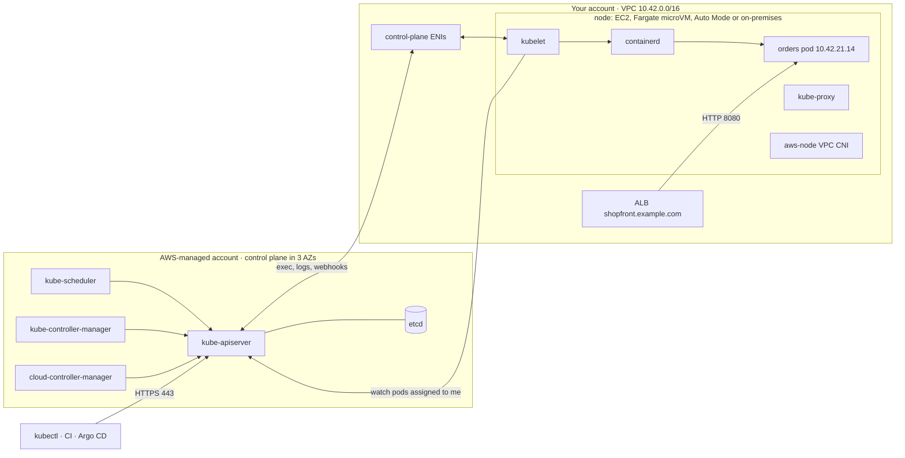

# Amazon EKS · L100 — Kubernetes and EKS basics

**Level:** 100 · **Time:** ~45 min · **Prerequisites:** [01 · L100 containers explained](../01-container-fundamentals/L100-containers-explained.md); [05 · L100 VPC for containers](../05-networking/L100-vpc-for-containers.md); `kubectl`, `eksctl` and the AWS CLI installed

**After this document you can:**

- name the ten Kubernetes objects you will meet in the first week and say what each one is for
- draw the line between the control plane EKS runs and the data plane you run, and place every
  node option (managed node groups, Fargate, Auto Mode, self-managed, Hybrid Nodes) on that line
- create a cluster from the lab file, deploy `shopfront`, read events and logs, and delete it
- read the version table and decide when the next upgrade is due and what it will cost to wait

## 1. Mental model



Kubernetes is a reconciliation loop over a database. You write the state you want (a `Deployment`
with three `orders` replicas) into the API server, which stores it in etcd; controllers notice the
difference between wanted and actual state and create pods; the scheduler picks a node for each pod;
the kubelet on that node sees the assignment and asks containerd to start the containers. EKS runs
the left half of the diagram for you, in an AWS-owned account, spread over three Availability Zones,
patched and backed up. You own the right half: the VPC, the nodes (or you let Fargate and Auto Mode
own the instances too), the workloads and everything in `kube-system` that AWS does not run as a
managed capability. The control plane reaches into your VPC through a few elastic network
interfaces; your nodes reach the control plane through the cluster endpoint. Everything in this
domain is a detail of one of those two arrows.

## 2. Concepts

### 2.1 The object model

| Object | What it is for | `shopfront` example |
| --- | --- | --- |
| `Pod` | The unit of scheduling: one or more containers sharing a network namespace (one IP) and volumes | one `orders` container plus its OTel-configured environment |
| `Deployment` → `ReplicaSet` | Keeps N identical pods running, rolls out new versions, rolls back | `orders`, `catalog`, `fulfillment-worker`, `analytics-consumer` |
| `Service` | A stable virtual IP and DNS name in front of a changing set of pods; types `ClusterIP`, `NodePort`, `LoadBalancer`, headless | `catalog.shopfront.svc.cluster.local:8081` used by `orders` through `CATALOG_URL` |
| `Ingress` | HTTP routing rules (host, path → Service) realised by a controller; on EKS the AWS Load Balancer Controller or Auto Mode turns it into an ALB | `shopfront.example.com/orders` → `orders:8080` |
| `ConfigMap` / `Secret` | Configuration and secrets injected as environment variables or files; Secrets are base64, not encrypted, unless envelope encryption with KMS is on (it is by default on current clusters; verify) | `SQS_QUEUE_URL`, `DATABASE_URL` (the latter from Secrets Manager through External Secrets, see [06 · L200](../06-identity-and-security/L200-iam-for-containers.md)) |
| `Namespace` | A scope for names, RBAC, quotas and network policies | `shopfront`, `kube-system`, `argocd` |
| `Job` / `CronJob` | Run-to-completion work, optionally on a schedule | `report-job` every night at 01:00 UTC |
| `DaemonSet` | One pod per node (or per matching node) | `aws-node`, `kube-proxy`, log and metrics agents |
| `StatefulSet` | Ordered, named pods with their own volumes | not used by `shopfront`: state lives in RDS, Valkey, SQS, MSK ([09 · L100](../09-data-messaging-and-batch/L100-stateful-dependencies.md)) |
| `PersistentVolumeClaim` | A request for storage that a CSI driver satisfies with an EBS or EFS volume | scratch space for a batch job when a local disk is not enough |

Two facts about the API that explain most beginner confusion. First, the API is declarative: you
never "start a pod", you create an object and a controller starts the pod; if the pod dies, the
controller starts another one with a different name and IP. Second, everything is a label query:
a Service finds its pods by `selector`, a Deployment owns its ReplicaSets by label, and `kubectl get
pods -l app.kubernetes.io/name=orders` is the same query the Service runs.

### 2.2 Control plane versus data plane, and what EKS manages

| Component | Runs where | Who operates it | What it does |
| --- | --- | --- | --- |
| kube-apiserver | AWS-managed account, at least two instances across AZs, scaled automatically with load | AWS | The only thing that talks to etcd; authenticates, authorises, admits and stores every request |
| etcd | AWS-managed, three members across three AZs, encrypted, backed up by AWS | AWS | The cluster database; you never see it |
| kube-scheduler | AWS-managed | AWS | Assigns unscheduled pods to nodes based on requests, affinity, taints, spread |
| kube-controller-manager | AWS-managed | AWS | Deployment, ReplicaSet, Job, Node, EndpointSlice and other built-in controllers |
| cloud-controller-manager | AWS-managed | AWS | Labels nodes with instance type and zone, removes Node objects for terminated instances, legacy `type: LoadBalancer` handling |
| kubelet, containerd, kube-proxy, `aws-node` | on every node in your VPC | you (EC2 node groups, self-managed), AWS (Fargate, Auto Mode) | Runs pods, programs Service routing, assigns pod IPs |
| CoreDNS, EBS CSI driver, Load Balancer Controller, metrics-server | pods in your cluster (standard) or AWS-run managed capabilities (Auto Mode) | you install and upgrade as add-ons (standard); AWS (Auto Mode) | Cluster DNS, volumes, ALB/NLB provisioning, resource metrics |

What EKS promises for the control plane: a single-tenant Kubernetes control plane per cluster,
99.95% availability SLA for the endpoint, automatic patching within a Kubernetes minor version
(platform versions `eks.N`), automatic scaling of the API servers, etcd backups, and an upgrade
you trigger. What it does not do for you on a standard cluster: pick your Kubernetes version, upgrade
your nodes and add-ons, size your subnets, or install anything in `kube-system` beyond the default
add-ons.

### 2.3 EKS standard versus EKS Auto Mode

| | Standard cluster | Auto Mode cluster |
| --- | --- | --- |
| Compute | You choose: managed node groups, self-managed nodes, Fargate, Karpenter | AWS provisions EC2 nodes on demand through built-in `NodePool`/`NodeClass` (Karpenter under the hood) |
| Node OS and lifecycle | Your AMI choice (AL2023, Bottlerocket, custom), your upgrade schedule | AWS-managed Bottlerocket image; nodes live at most 21 days and are replaced automatically |
| Core add-ons (VPC CNI, CoreDNS, kube-proxy, EBS CSI, load balancing, Pod Identity) | You install, configure and upgrade them | Built-in managed capabilities; you configure through `NodeClass`, `StorageClass` and `IngressClass`, you do not upgrade them |
| Node access | SSH or SSM if you allow it | None; diagnostics through a `NodeDiagnostic` object that uploads logs to S3 |
| Customisation | Anything Kubernetes allows, including replacing the CNI with Cilium | No custom AMIs, no DaemonSet-based CNI replacement, kubelet only through supported `NodeClass` fields |
| Price | Cluster fee + your EC2/Fargate | Cluster fee + EC2 + a management fee per Auto Mode instance |
| Pick it when | You need a custom CNI, special AMIs, GPUs with specific drivers you own, or you run a mature platform team | You want a production-ready data plane with the smallest operational surface |

The two can coexist: an Auto Mode cluster can still have managed node groups and Fargate profiles
for workloads the built-in NodePools do not fit. The trade-offs with numbers are in
[L400 §2](L400-eks-at-scale.md) and [reference/decision-guides.md](../../reference/decision-guides.md).

### 2.4 Node options at a glance

| Option | Instances live in | Who patches the OS | Scaling | Typical use | Limits to know on day one |
| --- | --- | --- | --- | --- | --- |
| Managed node group | your account (an Auto Scaling group EKS creates) | you trigger `update-nodegroup-version`; EKS rolls nodes honouring PodDisruptionBudgets | Cluster Autoscaler or Karpenter, or fixed size | general workloads, system add-ons | you pick instance types and sizes up front |
| Self-managed nodes | your account, your ASG and launch template | you | you | custom OS, special kernels, edge cases | you own the bootstrap and the join process |
| Fargate profile | AWS-managed microVM per pod | AWS | one microVM per pod, no nodes to scale | isolation, spiky small workloads, teams that must not manage nodes | no DaemonSets, no privileged or `hostNetwork` pods, no GPUs, no EBS volumes, IRSA only, slower start |
| Auto Mode | your account, AWS-operated | AWS (nodes replaced at least every 21 days) | built-in NodePools provision per pending pod | default for new clusters without special needs | no SSH, no custom AMI, no CNI replacement |
| Hybrid Nodes | your data centre or edge site | you | you | latency, data residency, existing hardware | Cilium or Calico as CNI, connectivity you provide, per-vCPU-hour price |

### 2.5 `kubectl` and `eksctl` first steps

`eksctl` is the CLI that creates clusters and node groups from a YAML file (it drives CloudFormation
in your account). `kubectl` talks to the Kubernetes API through the credentials `aws eks
update-kubeconfig` writes into `~/.kube/config` (an exec plugin that runs `aws eks get-token`).

```bash
aws sts get-caller-identity --query Account --output text            # expect 123456789012, never an unknown account
eksctl create cluster -f labs/eks/cluster/eksctl-standard.yaml       # ~15 min control plane, ~5 min node group
aws eks update-kubeconfig --region us-east-1 --name shopfront-dev
kubectl get nodes -o wide                                            # Ready, INTERNAL-IP in 10.42.0.0/16, container runtime containerd
kubectl -n kube-system get pods                                      # aws-node, kube-proxy, coredns, eks-pod-identity-agent
aws eks describe-cluster --name shopfront-dev \
  --query 'cluster.{version:version,platform:platformVersion,endpoint:endpoint,status:status}'
```

The verbs you will use daily: `get`, `describe`, `logs`, `exec`, `apply -k` (Kustomize), `rollout
status`, `rollout undo`, `scale`, `top` (needs metrics-server), `port-forward`, `events`. Read
`kubectl explain deployment.spec.strategy` before searching the web for a field.

### 2.6 Versions and the support policy

Kubernetes releases three minor versions a year. EKS makes each one available a few weeks after
upstream, supports it in **standard support** for 14 months, then in **extended support** for 12
more months at a higher price, and finally force-upgrades clusters still on it. As of September
2026 ([FACTS](../../docs/FACTS-2026-09.md)):

| Kubernetes | On EKS since | Standard support ends | Extended support ends | State today |
| --- | --- | --- | --- | --- |
| 1.36 | 2026-06-02 | 2027-08-02 | 2028-08-02 | newest on EKS |
| 1.35 | 2026-01-27 | 2027-03-27 | 2028-03-27 | standard |
| 1.34 | 2025-10-02 | 2026-12-02 | 2027-12-02 | standard, upgrade planning due |
| 1.33 | 2025-05-29 | 2026-07-29 | 2027-07-29 | extended (paying $0.60/h) |
| 1.32 | 2025-01-23 | 2026-03-23 | 2027-03-23 | extended |
| 1.31 | 2024-09-26 | 2025-11-26 | 2026-11-26 | extended, auto-upgrade in two months |

Kubernetes 1.37 shipped upstream in late August 2026 and is not yet on EKS. Within a minor version
EKS rolls out platform versions (`eks.1`, `eks.2`, …) for patches and new control-plane features
without your involvement. Minor upgrades are in place, one minor at a time, and can be rolled back
to the previous minor within 7 days. Kubernetes 1.36 brought Dynamic Resource Allocation to GA,
stable OCI image volumes, `MutatingAdmissionPolicy` GA and pressure-stall (PSI) metrics; the
operational meaning of each is in [L300 §2.11](L300-eks-internals-and-operations.md).

Node operating systems have their own clock: EKS-optimized Amazon Linux 2 AMIs ended support on
2025-11-26. Every supported version uses Amazon Linux 2023 or Bottlerocket.

### 2.7 Pricing

| Item | Price (us-east-1, as of September 2026; verify on the pricing page) | Note |
| --- | --- | --- |
| Cluster, standard support | $0.10 per hour ≈ $73 per month | per cluster, independent of size |
| Cluster, extended support | $0.60 per hour ≈ $438 per month | starts the day standard support ends |
| EC2 nodes | normal EC2 price | plus EBS root volumes; Spot and Graviton reduce it |
| Fargate pods | per vCPU-second and GB-second, minimum one minute | rounded up to the next supported CPU/memory combination plus 256 MB for the pod's own overhead |
| Auto Mode nodes | EC2 price plus a management fee per instance | fee is a percentage of the instance price; verify the current rate |
| Hybrid Nodes | per vCPU-hour of registered on-premises capacity | |
| Around the cluster | NAT gateway data processing, ALB/NLB hours and LCUs, CloudWatch log ingestion for control plane logs, Container Insights, cross-AZ data transfer | usually more than the cluster fee |

A three-node `m6g.large` `shopfront-dev` costs roughly $73 (cluster) + 3 × $56 (nodes) + $33 (one
NAT gateway) ≈ $270 per month before logs and load balancers. Delete lab clusters when you stop.

### 2.8 ECS or EKS

ECS gives you tasks, services and an AWS-native API with far fewer moving parts; EKS gives you the
Kubernetes API, its ecosystem (Helm charts, operators, Argo CD, KEDA, Cilium) and portability at the
price of operating the components in this domain. Pick ECS when a small team ships a handful of
services and nobody wants to own a cluster; pick EKS when you need the ecosystem, run many teams on
a shared platform, or your workloads already speak Kubernetes. The one-page decision is in
[03 · L100 §2.7](../03-ecs/L100-ecs-basics.md) and [reference/decision-guides.md](../../reference/decision-guides.md).

## 3. How it interacts with the rest of AWS

| Component | Talks to | Protocol/API | Prerequisite (IAM, network, DNS) | What breaks if missing |
| --- | --- | --- | --- | --- |
| `kubectl` | cluster endpoint | HTTPS 443 with an STS-based token | IAM principal with an access entry; public endpoint CIDR allowlist or a route to the private endpoint | `Unauthorized`, or connection timeouts |
| kubelet | cluster endpoint | HTTPS 443 (watch), receives 10250 from control-plane ENIs | node role with `AmazonEKSWorkerNodePolicy`, cluster security group, route to endpoint (NAT or private endpoint) | nodes stay `NotReady` or never register |
| control plane | kubelets, webhooks | ENIs in your subnets → 10250, 443 | at least two subnets in two AZs with free IPs; security group rules | `kubectl logs/exec` fail, admission webhooks time out |
| `aws-node` | EC2 API | `AssignPrivateIpAddresses`, `AttachNetworkInterface` | `AmazonEKS_CNI_Policy` on a pod role (Pod Identity/IRSA) or the node role; free IPs in the node's subnet | pods stuck `ContainerCreating` |
| kubelet | ECR | HTTPS through `ecr.api`, `ecr.dkr`, S3 | `AmazonEC2ContainerRegistryPullOnly` on the node role; NAT or VPC endpoints ([02 · L200](../02-ecr/L200-lifecycle-scanning-access-and-endpoints.md)) | `ImagePullBackOff` |
| pods | AWS services | SDK calls with Pod Identity or IRSA credentials | association or annotated service account, role trust policy ([06 · L200](../06-identity-and-security/L200-iam-for-containers.md)) | `AccessDenied`, or the wrong (node) identity |
| Ingress / Service | ALB / NLB | Load Balancer Controller → ELBv2 API | controller installed with its IAM role, subnets tagged `kubernetes.io/role/elb` or `internal-elb` | Ingress has no address |
| control plane | CloudWatch Logs | log types `api`, `audit`, `authenticator`, `controllerManager`, `scheduler` | enabled per cluster | no audit trail |

The surprise for most newcomers: the control plane is not "in" your VPC, yet it needs IP addresses
in your subnets (for its ENIs) and your nodes need a route to reach its endpoint. A private subnet
with no NAT gateway and no private endpoint produces a cluster whose nodes never join. The second
surprise: a pod that has no identity configured still gets credentials, those of the node's
instance role via IMDS, which is why the labs set the IMDS hop limit to 1 and use Pod Identity.

## 4. Use it when / avoid it when

Use EKS when:

- several teams share a platform and need namespaces, RBAC, quotas and network policies as the
  isolation model
- you want the Kubernetes ecosystem (Helm, operators, Argo CD, KEDA, Cilium, Karpenter) rather than
  building the equivalents on AWS primitives
- workloads must run the same way on AWS, on premises (Hybrid Nodes) or elsewhere
- you need scheduling features ECS lacks: DaemonSets, StatefulSets, topology spread with
  `minDomains`, Dynamic Resource Allocation for accelerators, custom schedulers

Avoid EKS when:

- one small team runs fewer than ten services and nobody wants to learn Kubernetes: ECS on Fargate
  or ECS Express Mode ([03 · L100](../03-ecs/L100-ecs-basics.md))
- the work is batch: AWS Batch on ECS/Fargate needs no cluster to own
  ([09 · L200](../09-data-messaging-and-batch/L200-integration-patterns.md))
- the workload is one HTTP service with no platform ambitions: the cluster fee and the upgrade
  clock are pure overhead

Alternatives, one line each:

- ECS: fewer concepts, no version clock, AWS-shaped API; no Kubernetes ecosystem
- AWS Batch: queues and compute environments for jobs; not for long-running services
- Lambda / App Runner: no containers to schedule at all; execution model limits apply
- Self-managed Kubernetes on EC2: full control of the control plane; you take over etcd, upgrades
  and the 99.95% SLA yourself

## 5. Well-Architected view

The [Amazon EKS Best Practices Guide](https://docs.aws.amazon.com/eks/latest/best-practices/introduction.html)
is the lens for this domain; the six-pillar summary at L100 depth:

| Pillar | What EKS gives you | What it costs you | Practice to apply now |
| --- | --- | --- | --- |
| Operational Excellence | managed control plane, platform versions, managed add-ons, upgrade insights | an upgrade every 14 months, add-on version matrices | put the cluster and node groups in code (`eksctl` file or IaC), read `aws eks list-insights` before every upgrade |
| Security | IAM authentication, envelope-encrypted secrets, Pod Identity, private endpoint option | many defaults are permissive (public endpoint, node role reachable from pods) | private endpoint or CIDR allowlist, Pod Identity for every pod that calls AWS, IMDS hop limit 1 |
| Reliability | three-AZ control plane with an SLA, self-healing controllers | you must spread your own pods and nodes across AZs | at least two AZs of subnets, three replicas of `shopfront` services, PodDisruptionBudgets |
| Performance Efficiency | scheduler bin-packing, HPA, Karpenter/Auto Mode right-sizing | wrong requests waste nodes or starve pods | set requests from measurements, start with Graviton |
| Cost Optimization | cluster fee independent of size, Spot and Graviton support | idle nodes, extended support fees, cross-AZ traffic | delete idle clusters, upgrade before extended support, consolidate nodes |
| Sustainability | bin-packing raises utilisation; arm64 uses less energy per request | over-provisioned node groups | multi-arch images (the labs build `linux/arm64`), consolidation on |

## 6. Failure modes and troubleshooting

| Symptom | Likely cause | How to confirm (command/metric) | Fix |
| --- | --- | --- | --- |
| `kubectl` says `Unauthorized` or `You must be logged in to the server` | your IAM principal has no access entry; wrong profile or Region | `aws sts get-caller-identity`; `aws eks list-access-entries --cluster-name shopfront-dev` | create an access entry and associate a policy ([playbook](../../playbooks/incidents/eks-auth-and-access.md)) |
| Nodes never appear or stay `NotReady` | no route to the cluster endpoint, missing node role policy, wrong security group | `kubectl get nodes`; on the node `journalctl -u kubelet`; `aws eks describe-nodegroup --query nodegroup.health` | add NAT or private endpoint, fix the role, fix the SG ([playbook](../../playbooks/incidents/node-not-ready.md)) |
| Pod stuck `Pending` | no node has room, or no free IPs, or a taint nobody tolerates | `kubectl describe pod` → Events (`Insufficient cpu`, `Too many pods`, `FailedScheduling`) | lower requests, add capacity, fix tolerations ([playbook](../../playbooks/incidents/pending-pods-and-capacity.md)) |
| Pod stuck `ContainerCreating` | VPC CNI cannot get an IP; volume cannot attach | `kubectl describe pod`; `kubectl -n kube-system logs ds/aws-node -c aws-node` | free IPs in the subnet, prefix delegation, correct CNI IAM ([playbook](../../playbooks/incidents/pending-pods-and-capacity.md)) |
| `ImagePullBackOff` | wrong image name, no ECR permission, no route to ECR | `kubectl describe pod` → `Failed to pull image … 403` or timeout | fix the URI, node role or endpoints ([playbook](../../playbooks/incidents/image-pull-failures.md)) |
| `CrashLoopBackOff` | the application exits; misconfiguration such as a missing `DATABASE_URL` | `kubectl logs --previous`; exit code in `kubectl describe pod` | fix config; exit code 2 means configuration per [CONTRACT.md](../../labs/CONTRACT.md) ([playbook](../../playbooks/incidents/crashloop-and-exit-codes.md)) |
| Ingress has no `ADDRESS` | Load Balancer Controller not installed or subnets untagged | `kubectl -n kube-system logs deploy/aws-load-balancer-controller`; `kubectl describe ingress` | install the controller, tag subnets ([playbook](../../playbooks/incidents/alb-5xx-and-unhealthy-targets.md)) |

Universal first command: `kubectl get events -A --sort-by=.lastTimestamp | tail -30`.

## 7. Signals: metrics, logs, traces

At this level, the six signals to look at (full table in
[reference/metrics-catalog.md](../../reference/metrics-catalog.md)):

- `kube_node_status_condition{condition="Ready",status="true"}` (kube-state-metrics) or Container
  Insights `cluster_failed_node_count`: any failed node for more than five minutes is an alarm.
- `kube_pod_status_phase{phase="Pending"}` held for more than a few minutes means the scheduler
  cannot place pods: capacity or IPs.
- `kube_pod_container_status_restarts_total` rising: crash loops; alarm on rate > 0 for a service
  that should be stable.
- Container Insights `node_cpu_utilization`, `node_memory_utilization`,
  `node_filesystem_utilization` (`ContainerInsights` namespace): above 80% sustained means the node
  group needs scaling or pods need right-sizing.
- Control plane logs in CloudWatch Logs group `/aws/eks/shopfront-dev/cluster`: `audit` answers
  "who deleted the deployment", `authenticator` answers "why was I denied".
- Application logs from `kubectl logs` or Fluent Bit / CloudWatch agent; `shopfront` writes JSON
  lines with `trace_id` per [CONTRACT.md §6](../../labs/CONTRACT.md).

Enable the five control plane log types on every cluster you keep:

```bash
aws eks update-cluster-config --name shopfront-dev \
  --logging '{"clusterLogging":[{"types":["api","audit","authenticator","controllerManager","scheduler"],"enabled":true}]}'
```

## 8. Testing and DR notes

Testing at this level means proving the deployment is correct before it reaches the cluster and
after: `kubeconform -strict -ignore-missing-schemas` on the rendered manifests (`kustomize build
labs/eks/manifests/overlays/dev | kubeconform -strict -ignore-missing-schemas`), `kubectl apply
--dry-run=server -k` against the cluster, a `kind` cluster for controller and manifest tests without
AWS ([11 · L200](../11-testing-workloads/L200-testing-in-pipelines-and-clusters.md)), and the
`shopfront` smoke test through a port-forward after deploy.

Disaster recovery for a cluster starts with knowing what state exists: the cluster definition (the
`eksctl` file), the workloads (manifests in Git), images (ECR, replicated), secrets (Secrets Manager),
data (RDS, Valkey, SQS, MSK: not in the cluster). Nothing in etcd is worth backing up for `shopfront`
because everything in it can be re-applied from Git; that is a design choice you should keep. A
rebuild is `eksctl create cluster -f …` plus `kubectl apply -k …`, about 30 minutes; the full
runbook is [cluster rebuild](../../playbooks/dr/cluster-rebuild-runbook.md) and the strategy
discussion is [10 · L300](../10-resilience-and-dr/L300-dr-strategies-for-container-platforms.md).

## 9. Hands-on

Cost warning: a cluster costs about $0.40 per hour with the lab node group. Delete it at the end.

```bash
aws sts get-caller-identity                                          # confirm account 123456789012
eksctl create cluster -f labs/eks/cluster/eksctl-standard.yaml       # creates VPC 10.42.0.0/16, cluster shopfront-dev, node group, add-ons
kubectl get nodes -L topology.kubernetes.io/zone,node.kubernetes.io/instance-type
kubectl apply -k labs/eks/manifests/overlays/dev
kubectl -n shopfront get pods -w                                     # watch Pending → ContainerCreating → Running
kubectl -n shopfront get svc,ingress
kubectl -n shopfront port-forward svc/orders 8080:8080 &
curl -s localhost:8080/readyz                                        # {"status":"ready","checks":{...}}
curl -s -X POST localhost:8080/orders -H 'content-type: application/json' -d '{"productId":1,"quantity":2}'
kubectl -n shopfront logs deploy/orders --tail=5                     # JSON lines with trace_id
kubectl -n shopfront describe pod -l app.kubernetes.io/name=orders | sed -n '/Events/,$p'
kubectl get events -A --sort-by=.lastTimestamp | tail -20
kubectl -n shopfront scale deploy/catalog --replicas=5 && kubectl -n shopfront get pods -l app.kubernetes.io/name=catalog -o wide
eksctl delete cluster -f labs/eks/cluster/eksctl-standard.yaml
```

What to observe: pods spread across two or three zones; `catalog` pods land on different nodes
(topology spread in the base manifests); the `orders` log line for `POST /orders` carries a
`trace_id`; `describe pod` shows the scheduler event `Successfully assigned shopfront/orders-… to
ip-10-42-…`. Then read `kubectl explain` for `deployment.spec.template.spec.topologySpreadConstraints`
before moving to [L200](L200-cluster-components-and-add-ons.md).

## 10. Check yourself

1. Which of these does AWS run for you on a standard EKS cluster: etcd, CoreDNS, kubelet, the
   scheduler, the AWS Load Balancer Controller?

<details><summary>Answer</summary>
etcd and the scheduler (all control plane components: kube-apiserver, etcd, kube-scheduler,
kube-controller-manager, cloud-controller-manager). CoreDNS is a managed add-on you install and
upgrade; the kubelet runs on your nodes; the Load Balancer Controller is something you install.
On an Auto Mode cluster, CoreDNS, the load-balancing controller, the VPC CNI, kube-proxy, the EBS
CSI driver and the Pod Identity agent become AWS-run managed capabilities.
</details>

2. A cluster is on Kubernetes 1.33 in September 2026. What is it costing you, and what happens if
   you do nothing?

<details><summary>Answer</summary>
1.33 left standard support on 2026-07-29, so the cluster fee is $0.60 per hour instead of $0.10
(about $365 extra per month). Extended support ends 2027-07-29; after that EKS auto-upgrades the
cluster to the oldest supported version. Upgrades are one minor at a time, so reaching 1.36 means
three upgrades (1.34, 1.35, 1.36), each with add-on and node updates.
</details>

3. A pod is `Pending`. Name the three most likely reasons and the one command that distinguishes
   them.

<details><summary>Answer</summary>
Insufficient CPU or memory on every node, no free pod IP (VPC CNI or `max-pods` reached), or a
taint/affinity nobody satisfies. `kubectl describe pod <name>` shows the scheduler's reason in
Events: `Insufficient cpu`, `Too many pods`, `didn't match Pod's node affinity/selector`,
`had untolerated taint`. IP exhaustion shows as `ContainerCreating` rather than `Pending` once a
node is chosen.
</details>

4. Why does a pod with no service account annotation and no Pod Identity association still manage
   to call `s3:ListBuckets` on a default managed node group?

<details><summary>Answer</summary>
The SDK credential chain falls through to the EC2 Instance Metadata Service at 169.254.169.254,
which returns the node's instance role credentials. Any pod on the node can use the node role
unless the IMDS hop limit is 1 (packets from a pod's network namespace cross one hop) or IMDS is
blocked by a network policy. Give pods their own identity with Pod Identity and set the hop limit
to 1.
</details>

5. What does Fargate give up compared with a managed node group, and what does it give back?

<details><summary>Answer</summary>
Gives up: DaemonSets, privileged and `hostNetwork` pods, GPUs, EBS volumes, Pod Identity (IRSA
only), image layer caching (slower starts), and per-node cost efficiency for dense workloads.
Gives back: one microVM per pod (strong isolation), no nodes to patch, scale or right-size, and
pay-per-pod billing that suits spiky or small workloads.
</details>

## 11. Sources

- Amazon EKS User Guide — https://docs.aws.amazon.com/eks/latest/userguide/what-is-eks.html
- Amazon EKS Kubernetes versions and support — https://docs.aws.amazon.com/eks/latest/userguide/kubernetes-versions.html
- Amazon EKS platform versions — https://docs.aws.amazon.com/eks/latest/userguide/platform-versions.html
- Amazon EKS pricing — https://aws.amazon.com/eks/pricing/
- Amazon EKS Auto Mode — https://docs.aws.amazon.com/eks/latest/userguide/automode.html
- AWS Fargate for Amazon EKS — https://docs.aws.amazon.com/eks/latest/userguide/fargate.html
- Amazon EKS Hybrid Nodes — https://docs.aws.amazon.com/eks/latest/userguide/hybrid-nodes-overview.html
- Amazon EKS Best Practices Guide — https://docs.aws.amazon.com/eks/latest/best-practices/introduction.html
- Kubernetes documentation: Concepts — https://kubernetes.io/docs/concepts/
- Kubernetes components — https://kubernetes.io/docs/concepts/overview/components/
- eksctl documentation — https://eksctl.io/
- Kubernetes 1.36 release notes — https://kubernetes.io/blog/
