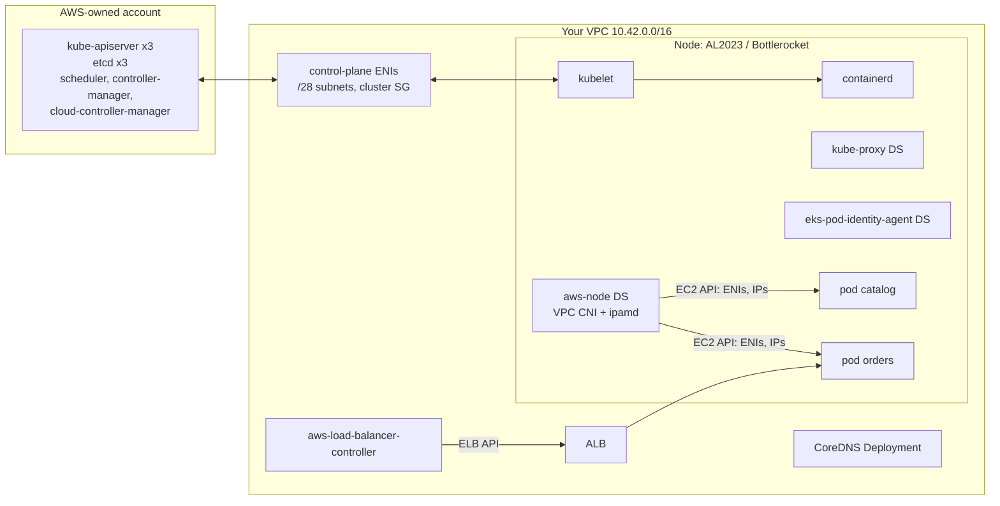

# Amazon EKS · L200 — Cluster components and add-ons

**Level:** 200 · **Time:** ~90 min · **Prerequisites:**
[L100 Kubernetes and EKS basics](L100-kubernetes-and-eks-basics.md),
[Networking L100](../05-networking/L100-vpc-for-containers.md),
[`labs/CONTRACT.md`](../../labs/CONTRACT.md)

**After this document you can:**

- Name every component between a `kubectl apply` and a serving pod on EKS and say who runs it.
- Configure the four core add-ons (VPC CNI, CoreDNS, kube-proxy, Pod Identity agent) with the
  settings that matter and know the upgrade order.
- Choose and configure the data plane: managed node groups, Fargate, Auto Mode, Karpenter.
- Expose a service with the AWS Load Balancer Controller or Auto Mode's built-in load balancing.
- Grant humans and pods access the current way (access entries, Pod Identity) and write a
  Deployment with correct probes, resources, spread and disruption budget.

## 1. Mental model



EKS runs the Kubernetes control plane for you in an AWS-owned account and reaches into your VPC
through elastic network interfaces. Everything else that makes a cluster usable — the node agent
(kubelet) and runtime (containerd), pod networking (VPC CNI), service routing (kube-proxy), name
resolution (CoreDNS), credentials for pods (Pod Identity agent), storage (CSI drivers), and load
balancer provisioning (the controller) — runs in your VPC as add-ons you install and upgrade, or,
with Auto Mode, as capabilities AWS operates for you. The skill at this level is knowing which
component owns each behaviour and which of its fields you must set.

## 2. Concepts

### 2.1 Control plane: what you configure

| Setting | Values | Why it matters |
| --- | --- | --- |
| `version` and `upgradePolicy.supportType` | `1.34`–`1.36` standard; `STANDARD` or `EXTENDED` | `EXTENDED` allows staying past 14 months at a higher price; `STANDARD` clusters are force-upgraded at end of standard support |
| `resourcesVpcConfig.subnetIds` | 2+ subnets in 2+ AZs; recommended dedicated `/28` per AZ | control-plane ENIs live here; do not share with pods to avoid IP exhaustion |
| `endpointPublicAccess` / `endpointPrivateAccess` / `publicAccessCidrs` | public+private is the default; private-only for regulated environments | private access lets nodes reach the API without leaving the VPC; public CIDR allowlist limits `kubectl` sources |
| `logging.clusterLogging` | `api`, `audit`, `authenticator`, `controllerManager`, `scheduler` | audit and authenticator are the security signal; charged as CloudWatch Logs ingestion |
| `encryptionConfig` | KMS key for Kubernetes Secrets (envelope encryption) | new clusters have it by default; verify in the current docs |
| `accessConfig.authenticationMode` | `API`, `API_AND_CONFIG_MAP`, `CONFIG_MAP` | `API` uses access entries only; the `aws-auth` ConfigMap path is legacy |
| `kubernetesNetworkConfig` | `ipFamily` ipv4/ipv6, `serviceIpv4Cidr` | choose IPv6 before creation; it cannot change later |

```bash
aws eks describe-cluster --name shopfront-dev \
  --query 'cluster.{version:version,platform:platformVersion,endpoint:endpoint,auth:accessConfig.authenticationMode,logging:logging.clusterLogging[0]}'
aws eks update-cluster-config --name shopfront-dev \
  --logging '{"clusterLogging":[{"types":["api","audit","authenticator"],"enabled":true}]}'
```

### 2.2 kubelet and containerd on the node

Nodes join with `nodeadm` (AL2023) or Bottlerocket settings; both derive `max-pods`, cluster
endpoint and CA from the cluster. Fields you tune through a `NodeConfig` in the launch template user
data (AL2023):

```yaml
apiVersion: node.eks.aws/v1alpha1
kind: NodeConfig
spec:
  cluster:
    name: shopfront-dev
    apiServerEndpoint: https://ABCDEF0123456789ABCDEF0123456789.gr7.us-east-1.eks.amazonaws.com
    certificateAuthority: LS0tLS1CRUdJTi...   # base64 CA
    cidr: 172.20.0.0/16                       # service CIDR
  kubelet:
    config:
      maxPods: 110                            # only with prefix delegation; default derives from ENI limits
      kubeReserved: { cpu: 100m, memory: 512Mi, ephemeral-storage: 1Gi }
      evictionHard: { memory.available: "200Mi", nodefs.available: "10%", imagefs.available: "15%" }
      imageGCHighThresholdPercent: 80
      imageGCLowThresholdPercent: 60
      registryPullQPS: 10
      registryBurst: 20
    flags: ["--node-labels=workload=general,team=shopfront"]
  containerd:
    config: |
      [plugins."io.containerd.grpc.v1.cri".registry]
        config_path = "/etc/containerd/certs.d"     # registry mirrors, e.g. a pull-through cache
```

`kubeReserved`/`systemReserved` protect the kubelet and containerd from workloads; eviction
thresholds decide when pods are evicted before the node itself starves. Containerd is the runtime;
`crictl` is your tool on the node ([L300 §2.10](L300-eks-internals-and-operations.md)).

### 2.3 kube-proxy and Services

kube-proxy programs the node so that a Service's virtual IP reaches a healthy pod. The EKS add-on
defaults to `iptables`; `ipvs` and `nftables` (GA upstream since 1.33) are selected with
configuration values:

```bash
aws eks update-addon --cluster-name shopfront-dev --addon-name kube-proxy \
  --configuration-values '{"mode":"nftables"}' --resolve-conflicts PRESERVE
```

| Service type | What it creates | Use |
| --- | --- | --- |
| `ClusterIP` | virtual IP inside the service CIDR; DNS `svc.ns.svc.cluster.local` | east-west default (`catalog:8081` → `catalog.shopfront.svc.cluster.local`) |
| headless (`clusterIP: None`) | DNS returns pod IPs | StatefulSets, client-side balancing, Kafka clients |
| `NodePort` | port 30000–32767 on every node | building block for instance-type target groups; rarely used directly |
| `LoadBalancer` | NodePort + a cloud load balancer via the controller (NLB on AWS) | TCP/UDP ingress, non-HTTP protocols |

`externalTrafficPolicy: Local` preserves client IPs and avoids the second hop but only nodes with
a local pod are healthy targets; `Cluster` spreads evenly at the cost of SNAT. With the load
balancer controller in `ip` target mode the pods are targets directly and kube-proxy is not in the
external path at all.

### 2.4 CoreDNS

CoreDNS is a Deployment (two replicas by default) behind the `kube-dns` ClusterIP. Its Corefile:

```text
.:53 {
    errors
    health { lameduck 5s }
    ready
    kubernetes cluster.local in-addr.arpa ip6.arpa { pods insecure; fallthrough in-addr.arpa ip6.arpa; ttl 30 }
    prometheus :9153
    forward . /etc/resolv.conf          # upstream = the VPC resolver (Route 53 Resolver)
    cache 30
    loop
    reload
    loadbalance
}
```

Pods get `/etc/resolv.conf` with `search shopfront.svc.cluster.local svc.cluster.local
cluster.local ec2.internal` and `options ndots:5`. A name with fewer than five dots is tried with
each search domain first: `api.github.com` produces five queries before the real one. Mitigations:
use FQDNs with a trailing dot in configuration (`catalog.shopfront.svc.cluster.local.`), lower
`ndots` in the pod's `dnsConfig` for internet-heavy pods, enable `autopath` (server-side
short-circuit at the price of memory), or deploy NodeLocal DNSCache so lookups stay on the node.
Scale CoreDNS with the add-on's autoscaler rather than a fixed replica count:

```bash
aws eks update-addon --cluster-name shopfront-dev --addon-name coredns \
  --configuration-values '{"autoScaling":{"enabled":true,"minReplicas":2,"maxReplicas":10},
                           "resources":{"requests":{"cpu":"100m","memory":"128Mi"}}}'
```

Failure modes (UDP truncation, conntrack races, resolver throttling) are in
[L300 §2.6](L300-eks-internals-and-operations.md) and the [DNS playbook](../../playbooks/incidents/dns-failures.md).

### 2.5 VPC CNI

The `aws-node` DaemonSet gives each pod a VPC IP from ENIs attached to the node. Its knobs decide
pod density, IP consumption and start-up latency:

| Setting (add-on `configurationValues.env`) | Effect | Recommendation |
| --- | --- | --- |
| `ENABLE_PREFIX_DELEGATION=true` + `WARM_PREFIX_TARGET=1` | assign /28 prefixes instead of single IPs; pod density rises to 110 (250 on larger types) | on for Nitro instances; plan subnets for /28 blocks |
| `WARM_ENI_TARGET` (default 1) | keep a whole spare ENI's IPs warm | default for bursty scale-out |
| `WARM_IP_TARGET` / `MINIMUM_IP_TARGET` | keep N spare IPs / at least M IPs | IP-constrained subnets: `MINIMUM_IP_TARGET=10`, `WARM_IP_TARGET=2` |
| `AWS_VPC_K8S_CNI_CUSTOM_NETWORK_CFG=true` + `ENIConfig` per AZ | pods in different subnets (e.g. secondary CIDR `100.64.0.0/16`) than nodes | when the primary CIDR is scarce |
| `ENABLE_POD_ENI=true` | security groups for pods via branch ENIs (`SecurityGroupPolicy`) | when a pod needs its own SG (database access rules) |
| `enableNetworkPolicy: "true"` (top-level) | eBPF network policy engine (`aws-eks-nodeagent`) | on, then apply default-deny policies |
| `AWS_VPC_K8S_CNI_EXTERNALSNAT=true` | pods keep their IP when leaving the VPC (no node SNAT) | when the VPC has private connectivity to peers |
| `ENABLE_IPv6=true` (cluster `ipFamily: ipv6`) | each pod gets a GUA IPv6; IPv4 egress via NAT64 | new clusters at scale |

```bash
aws eks update-addon --cluster-name shopfront-dev --addon-name vpc-cni --resolve-conflicts PRESERVE \
  --configuration-values '{"env":{"ENABLE_PREFIX_DELEGATION":"true","WARM_PREFIX_TARGET":"1"},"enableNetworkPolicy":"true"}'
# max pods for an instance type with prefix delegation
curl -sO https://raw.githubusercontent.com/awslabs/amazon-eks-ami/main/templates/al2/runtime/max-pods-calculator.sh
bash max-pods-calculator.sh --instance-type m7g.large --cni-version 1.19.0 --cni-prefix-delegation-enabled
```

Without prefix delegation: max pods = ENIs × (IPv4 addresses per ENI − 1) + 2; an m5.large (3 ENIs
× 10 addresses) gives 29. Internals and the IP arithmetic:
[Networking L300 §2.3](../05-networking/L300-container-networking-internals.md).

### 2.6 Managed add-ons and upgrade order

```bash
aws eks describe-addon-versions --kubernetes-version 1.36 --addon-name vpc-cni \
  --query 'addons[0].addonVersions[0:3].{v:addonVersion,default:compatibilities[0].defaultVersion}'
aws eks create-addon --cluster-name shopfront-dev --addon-name eks-pod-identity-agent
aws eks update-addon --cluster-name shopfront-dev --addon-name vpc-cni --addon-version v1.20.1-eksbuild.1 \
  --resolve-conflicts OVERWRITE
aws eks describe-addon --cluster-name shopfront-dev --addon-name vpc-cni --query 'addon.{v:addonVersion,status:status,health:health}'
```

| Add-on | Kind | Notes |
| --- | --- | --- |
| `vpc-cni` | DaemonSet + node agent | first to upgrade; check release notes for `ENIConfig`/prefix changes |
| `kube-proxy` | DaemonSet | must match the control-plane minor within skew rules |
| `coredns` | Deployment | autoscaling and PDB settings live in configuration values |
| `eks-pod-identity-agent` | DaemonSet | required for Pod Identity associations |
| `aws-ebs-csi-driver`, `aws-efs-csi-driver`, `snapshot-controller` | controllers + node DaemonSets | need a role (Pod Identity or IRSA) |
| `amazon-cloudwatch-observability` | agents | Container Insights with enhanced observability + Application Signals |
| `aws-guardduty-agent` | DaemonSet | runtime monitoring |
| `adot` | operator | OpenTelemetry collectors |
| `metrics-server`, community add-ons (`kube-state-metrics`, `prometheus-node-exporter`, `cert-manager`, `external-dns`) | Deployments | community add-ons are AWS-built but community-supported |

Upgrade order for a version bump: control plane → `vpc-cni`, `kube-proxy`, `coredns`,
`eks-pod-identity-agent`, CSI drivers → node groups → redeploy Fargate pods. `--resolve-conflicts
PRESERVE` keeps your configuration values; `OVERWRITE` resets to defaults, which is what you want
when you manage settings through `configurationValues` anyway.

### 2.7 Data plane options

**Managed node groups.** EC2 Auto Scaling groups that EKS creates, labels, drains and upgrades.

```yaml
# excerpt of labs/eks/cluster/eksctl-standard.yaml
managedNodeGroups:
  - name: general-arm64
    amiFamily: AmazonLinux2023
    instanceTypes: [m7g.large, m7g.xlarge]
    capacityType: ON_DEMAND
    minSize: 2
    desiredCapacity: 3
    maxSize: 12
    privateNetworking: true
    volumeSize: 80
    volumeType: gp3
    volumeEncrypted: true
    updateConfig: { maxUnavailablePercentage: 25 }
    labels: { workload: general }
    taints: []
    disableIMDSv1: true            # IMDSv2 required
    # eksctl sets the hop limit to 2 by default for managed node groups; set 1 to block pods:
    overrideBootstrapCommand: null
```

Key behaviours: `updateConfig` controls how many nodes are replaced at once during
`update-nodegroup-version`; taints and labels flow to the node; the launch template decides IMDS
settings (`HttpTokens: required`, `HttpPutResponseHopLimit: 1` so pods cannot reach IMDS unless
`hostNetwork`), volume encryption and user data. Bottlerocket (`amiFamily: Bottlerocket`) is the
hardened alternative with API-driven settings and no shell by default. AL2 AMIs are no longer
published (end of support 2025-11-26).

**Self-managed node groups.** Your own ASGs with the EKS AMI or a custom AMI; you handle joining,
draining and upgrades. Justified only for AMI or lifecycle requirements managed groups cannot meet.

**Fargate profiles.** Pods matching a profile's namespace/label selectors run on Fargate, one pod
per microVM, no node to manage.

| Fargate on EKS limits | Consequence |
| --- | --- |
| no DaemonSets | logging via the built-in Fluent Bit config (`aws-logging` ConfigMap in `aws-observability` namespace); no node exporters |
| no privileged, `hostNetwork`, `hostPort`, `hostPath` | no host-level tooling |
| no GPUs, no EBS-backed volumes (EFS works) | stateless or EFS only (verify EBS support status) |
| pod size rounds up to Fargate vCPU/memory pairs; 256 MiB reserved | cost planning |
| IRSA only (Pod Identity not supported); pod-identity-webhook works | IAM design |
| 20 GiB ephemeral storage default | image and scratch space |

**EKS Auto Mode.** Enable at creation (`eksctl create cluster --enable-auto-mode` or the
`autoModeConfig` in eksctl YAML) or on an existing cluster
(`aws eks update-cluster-config --compute-config enabled=true,nodePools=general-purpose,system
--kubernetes-network-config elasticLoadBalancing={enabled=true} --storage-config blockStorage={enabled=true}`).
AWS then runs Karpenter-based provisioning, Bottlerocket nodes with a 21-day maximum lifetime, and
the VPC CNI, CoreDNS, kube-proxy, EBS CSI, load balancing and Pod Identity as managed capabilities
you do not install or upgrade. You express compute needs with `NodePool` and `NodeClass`:

```yaml
apiVersion: eks.amazonaws.com/v1
kind: NodeClass
metadata: { name: shopfront }
spec:
  role: shopfront-dev-auto-node
  subnetSelectorTerms: [{ tags: { "kubernetes.io/role/internal-elb": "1", "eks.amazonaws.com/cluster": shopfront-dev } }]
  securityGroupSelectorTerms: [{ tags: { "aws:eks:cluster-name": shopfront-dev } }]
  ephemeralStorage: { size: 80Gi, iops: 3000, throughput: 125 }
  snatPolicy: Random
  networkPolicy: DefaultAllow
---
apiVersion: karpenter.sh/v1
kind: NodePool
metadata: { name: general-arm64 }
spec:
  template:
    spec:
      nodeClassRef: { group: eks.amazonaws.com, kind: NodeClass, name: shopfront }
      requirements:
        - { key: eks.amazonaws.com/instance-category, operator: In, values: [c, m, r] }
        - { key: kubernetes.io/arch, operator: In, values: [arm64] }
        - { key: karpenter.sh/capacity-type, operator: In, values: [on-demand, spot] }
  limits: { cpu: "200", memory: 800Gi }
  disruption: { consolidationPolicy: WhenEmptyOrUnderutilized, consolidateAfter: 1m }
```

What you cannot change in Auto Mode: the node AMI, SSH access, the CNI implementation, kubelet
flags outside the supported `NodeClass`/`NodePool` fields, and the managed capabilities' versions.
The 2026 changes (node-local DNS, zram, SOCI, separate pod subnets/security groups, ARC zonal shift)
arrived without configuration ([FACTS](../../docs/FACTS-2026-09.md)).

**Karpenter on standard clusters.** The same provisioning model, self-installed and self-upgraded,
with `EC2NodeClass` instead of `NodeClass`:

```yaml
apiVersion: karpenter.k8s.aws/v1
kind: EC2NodeClass
metadata: { name: default }
spec:
  amiSelectorTerms: [{ alias: al2023@latest }]
  role: shopfront-dev-karpenter-node
  subnetSelectorTerms: [{ tags: { "karpenter.sh/discovery": shopfront-dev } }]
  securityGroupSelectorTerms: [{ tags: { "karpenter.sh/discovery": shopfront-dev } }]
  metadataOptions: { httpTokens: required, httpPutResponseHopLimit: 1 }
  blockDeviceMappings: [{ deviceName: /dev/xvda, ebs: { volumeSize: 80Gi, volumeType: gp3, encrypted: true } }]
---
apiVersion: karpenter.sh/v1
kind: NodePool
metadata: { name: default }
spec:
  template:
    spec:
      nodeClassRef: { group: karpenter.k8s.aws, kind: EC2NodeClass, name: default }
      requirements:
        - { key: karpenter.k8s.aws/instance-category, operator: In, values: [c, m, r] }
        - { key: karpenter.k8s.aws/instance-generation, operator: Gt, values: ["5"] }
        - { key: kubernetes.io/arch, operator: In, values: [arm64, amd64] }
        - { key: karpenter.sh/capacity-type, operator: In, values: [spot, on-demand] }
      expireAfter: 336h
  limits: { cpu: "500" }
  disruption:
    consolidationPolicy: WhenEmptyOrUnderutilized
    consolidateAfter: 2m
    budgets: [{ nodes: "10%" }, { schedule: "0 9 * * mon-fri", duration: 8h, nodes: "0" }]
```

Disruption budgets keep consolidation from churning nodes during business hours. Karpenter itself
runs on a small managed node group or Fargate so it can recreate the nodes it manages.

**Hybrid Nodes.** On-premises or edge machines join the EKS control plane over VPN/Direct Connect
with `nodeadm`; Cilium is the AWS-supported CNI there. Useful for a single control plane across
cloud and site, with the network design doing the heavy lifting.

### 2.8 Storage

```yaml
apiVersion: storage.k8s.io/v1
kind: StorageClass
metadata: { name: gp3-encrypted, annotations: { storageclass.kubernetes.io/is-default-class: "true" } }
provisioner: ebs.csi.aws.com            # ebs.csi.eks.amazonaws.com in Auto Mode
parameters: { type: gp3, encrypted: "true", kmsKeyId: alias/shopfront-dev-ebs }
volumeBindingMode: WaitForFirstConsumer   # pick the AZ where the pod schedules
allowVolumeExpansion: true
---
apiVersion: storage.k8s.io/v1
kind: VolumeAttributesClass
metadata: { name: gp3-fast }
driverName: ebs.csi.aws.com
parameters: { iops: "6000", throughput: "250" }
```

`WaitForFirstConsumer` matters because EBS volumes are zonal. `VolumeAttributesClass` changes
IOPS/throughput of a bound volume and is the supported path in Auto Mode once the annotation-based
modification stops working after 2026-10-31. EFS (regional, multi-writer) uses access points per
application and IAM authorization; `snapshot-controller` enables `VolumeSnapshot` for backups.

### 2.9 Load balancing: the controller and Auto Mode

The AWS Load Balancer Controller turns `Ingress` into ALBs and `Service type: LoadBalancer` into
NLBs. Install with a Pod Identity association (`aws eks create-pod-identity-association --cluster-name
shopfront-dev --namespace kube-system --service-account aws-load-balancer-controller --role-arn …`)
and the Helm values in [`labs/eks/addons/aws-load-balancer-controller-values.yaml`](../../labs/eks/addons/aws-load-balancer-controller-values.yaml).

```yaml
apiVersion: networking.k8s.io/v1
kind: Ingress
metadata:
  name: orders
  namespace: shopfront
  annotations:
    alb.ingress.kubernetes.io/scheme: internet-facing
    alb.ingress.kubernetes.io/target-type: ip
    alb.ingress.kubernetes.io/group.name: shopfront          # several Ingresses share one ALB
    alb.ingress.kubernetes.io/listen-ports: '[{"HTTP":80},{"HTTPS":443}]'
    alb.ingress.kubernetes.io/ssl-redirect: "443"
    alb.ingress.kubernetes.io/certificate-arn: arn:aws:acm:us-east-1:123456789012:certificate/4b1f2c3d-aaaa-bbbb-cccc-0123456789ab
    alb.ingress.kubernetes.io/healthcheck-path: /readyz
    alb.ingress.kubernetes.io/healthcheck-interval-seconds: "15"
    alb.ingress.kubernetes.io/target-group-attributes: deregistration_delay.timeout_seconds=20
    alb.ingress.kubernetes.io/load-balancer-attributes: idle_timeout.timeout_seconds=60,deletion_protection.enabled=true
    alb.ingress.kubernetes.io/wafv2-acl-arn: arn:aws:wafv2:us-east-1:123456789012:regional/webacl/shopfront/0f0f0f0f-1111-2222-3333-4444444444ab
spec:
  ingressClassName: alb                     # controller: ingress.k8s.aws/alb (standard) or eks.amazonaws.com/alb (Auto Mode)
  rules:
    - host: shopfront.example.com
      http:
        paths:
          - path: /orders
            pathType: Prefix
            backend: { service: { name: orders, port: { number: 8080 } } }
```

| Feature | Setting | Why |
| --- | --- | --- |
| `target-type: ip` | pods are targets; required for Fargate; avoids the NodePort hop | health checks hit the pod's `/readyz` |
| IngressGroup (`group.name`) | many Ingresses, one ALB, ordered rules (`group.order`) | one ALB per environment rather than per service |
| pod readiness gates | label the namespace `elbv2.k8s.aws/pod-readiness-gate-inject: enabled` | a pod is Ready only after the ALB marks it healthy: zero-error rollouts |
| `IngressClassParams` | cluster-level defaults (scheme, SGs, tags, `loadBalancerAttributes`) | platform teams set policy once |
| `TargetGroupBinding` | attach pods to an existing target group | ALB owned by another stack or Blue/Green |
| Gateway API | `GatewayClass`/`Gateway`/`HTTPRoute` supported by recent controller versions | role separation between platform and app teams; verify version support |
| NLB via Service | `service.beta.kubernetes.io/aws-load-balancer-type: external`, `-nlb-target-type: ip`, `-scheme: internal` | TCP/UDP, static IPs, PrivateLink |

In Auto Mode the controller is a managed capability: create an `IngressClass` with controller
`eks.amazonaws.com/alb` and an `IngressClassParams` (`eks.amazonaws.com/v1`), then the same Ingress
works with the same annotations family (verify annotation support in the Auto Mode docs).

### 2.10 Authentication and authorization

```bash
# a human platform admin, cluster-wide
aws eks create-access-entry --cluster-name shopfront-dev --type STANDARD \
  --principal-arn arn:aws:iam::123456789012:role/PlatformAdmin
aws eks associate-access-policy --cluster-name shopfront-dev \
  --principal-arn arn:aws:iam::123456789012:role/PlatformAdmin \
  --policy-arn arn:aws:eks::aws:cluster-access-policy/AmazonEKSClusterAdminPolicy --access-scope type=cluster
# a team, namespace-scoped edit
aws eks create-access-entry --cluster-name shopfront-dev --type STANDARD \
  --principal-arn arn:aws:iam::123456789012:role/TeamShopfront --kubernetes-groups shopfront-devs
aws eks associate-access-policy --cluster-name shopfront-dev \
  --principal-arn arn:aws:iam::123456789012:role/TeamShopfront \
  --policy-arn arn:aws:eks::aws:cluster-access-policy/AmazonEKSEditPolicy --access-scope type=namespace,namespaces=shopfront
```

Access entries map an IAM principal to Kubernetes groups and/or AWS-managed access policies
(`AmazonEKSClusterAdminPolicy`, `AmazonEKSAdminPolicy`, `AmazonEKSEditPolicy`, `AmazonEKSViewPolicy`);
Kubernetes RBAC (`Role`/`RoleBinding`) still applies to the groups. Node roles get `EC2_LINUX`
access entries automatically for managed groups. IAM Identity Center permission sets → roles →
access entries is the human path. The `aws-auth` ConfigMap remains only for clusters still in
`CONFIG_MAP` or mixed mode.

For pods, prefer Pod Identity:

| | IRSA | Pod Identity |
| --- | --- | --- |
| Setup | IAM OIDC provider per cluster; trust policy per role with `sub`/`aud` conditions; SA annotation | `eks-pod-identity-agent` add-on; one trust policy (`pods.eks.amazonaws.com`); association via API |
| Cross-cluster reuse of a role | one trust statement per cluster | same role, one association per cluster |
| Session tags for ABAC | no | yes (`eks-cluster-name`, `kubernetes-namespace`, `kubernetes-service-account`, …) |
| Fargate pods | yes | no |
| Cross-account roles | trust policy in the target account | target-role chaining supported; verify current options |

```bash
aws eks create-pod-identity-association --cluster-name shopfront-dev --namespace shopfront \
  --service-account orders --role-arn arn:aws:iam::123456789012:role/shopfront-dev-orders
```

End-to-end flows and trust policies: [06 L200](../06-identity-and-security/L200-iam-for-containers.md).

### 2.11 Workload configuration that operators care about

```yaml
apiVersion: apps/v1
kind: Deployment
metadata: { name: orders, namespace: shopfront, labels: { app.kubernetes.io/name: orders, app.kubernetes.io/part-of: shopfront } }
spec:
  replicas: 3
  strategy: { type: RollingUpdate, rollingUpdate: { maxSurge: 1, maxUnavailable: 0 } }
  selector: { matchLabels: { app.kubernetes.io/name: orders } }
  template:
    metadata: { labels: { app.kubernetes.io/name: orders, app.kubernetes.io/part-of: shopfront } }
    spec:
      serviceAccountName: orders
      terminationGracePeriodSeconds: 30
      topologySpreadConstraints:
        - { maxSkew: 1, topologyKey: topology.kubernetes.io/zone, whenUnsatisfiable: ScheduleAnyway,
            labelSelector: { matchLabels: { app.kubernetes.io/name: orders } } }
      securityContext: { runAsNonRoot: true, runAsUser: 10001, runAsGroup: 10001, fsGroup: 10001, seccompProfile: { type: RuntimeDefault } }
      containers:
        - name: orders
          image: 123456789012.dkr.ecr.us-east-1.amazonaws.com/shopfront/orders@sha256:1f2e3d4c5b6a79880000000000000000000000000000000000000000deadbeef
          ports: [{ name: http, containerPort: 8080 }]
          envFrom: [{ configMapRef: { name: orders-config } }, { secretRef: { name: orders-secrets } }]
          resources:
            requests: { cpu: 250m, memory: 384Mi }
            limits: { memory: 384Mi }            # memory limit = request (Guaranteed for memory); no CPU limit
          startupProbe: { httpGet: { path: /healthz, port: http }, periodSeconds: 2, failureThreshold: 30 }
          readinessProbe: { httpGet: { path: /readyz, port: http }, periodSeconds: 5, failureThreshold: 2 }
          livenessProbe: { httpGet: { path: /healthz, port: http }, periodSeconds: 10, failureThreshold: 3 }
          lifecycle: { preStop: { sleep: { seconds: 5 } } }   # let endpoint removal propagate before SIGTERM
          securityContext: { allowPrivilegeEscalation: false, readOnlyRootFilesystem: true, capabilities: { drop: [ALL] } }
          volumeMounts: [{ name: tmp, mountPath: /tmp }]
      volumes: [{ name: tmp, emptyDir: { sizeLimit: 256Mi } }]
---
apiVersion: policy/v1
kind: PodDisruptionBudget
metadata: { name: orders, namespace: shopfront }
spec: { minAvailable: 2, selector: { matchLabels: { app.kubernetes.io/name: orders } } }
---
apiVersion: autoscaling/v2
kind: HorizontalPodAutoscaler
metadata: { name: orders, namespace: shopfront }
spec:
  scaleTargetRef: { apiVersion: apps/v1, kind: Deployment, name: orders }
  minReplicas: 3
  maxReplicas: 30
  metrics: [{ type: Resource, resource: { name: cpu, target: { type: Utilization, averageUtilization: 60 } } }]
  behavior: { scaleDown: { stabilizationWindowSeconds: 300 } }
```

| Field | Why this value |
| --- | --- |
| `startupProbe` | protects slow starts from the liveness probe; readiness gates traffic |
| `readinessProbe` on `/readyz` | dependency failure removes the pod from Endpoints without restarting it |
| `livenessProbe` on `/healthz` | only restarts a hung process; never checks dependencies |
| `preStop` sleep | endpoint removal is asynchronous; 5 s covers kube-proxy and ALB propagation |
| memory `limit == request`, no CPU limit | no OOM surprises from over-commit; CPU throttling avoided ([01 L400](../01-container-fundamentals/L400-hardening-supply-chain-and-performance.md)) |
| `topologySpreadConstraints` | one AZ failure loses a third, not everything |
| PDB `minAvailable: 2` | drains and Karpenter consolidation keep two serving |
| HPA `stabilizationWindowSeconds` | scale-in waits five minutes of low load |

QoS classes: `Guaranteed` (requests == limits for both), `Burstable` (some requests), `BestEffort`
(none); eviction order under node pressure is BestEffort → Burstable → Guaranteed. VPA (`Off`
recommendation mode first, then `Auto`) sizes requests from history; in-place resize (beta) lets it
avoid restarts on 1.35+ (verify). KEDA adds queue-depth scaling for the worker
([09 L200](../09-data-messaging-and-batch/L200-integration-patterns.md)).

## 3. How it interacts with the rest of AWS

| Component | Talks to | Protocol/API | Prerequisite (IAM, network, DNS) | What breaks if missing |
| --- | --- | --- | --- | --- |
| kubelet | API server | HTTPS via cluster endpoint (private DNS) | node role, cluster SG allows 443 from nodes, endpoint reachable | node `NotReady`, pods never scheduled |
| aws-node (VPC CNI) | EC2 | `ec2:AttachNetworkInterface`, `AssignPrivateIpAddresses`, … via node role or Pod Identity (`AmazonEKS_CNI_Policy`) | subnets with free IPs; ENI quotas | pods stuck `ContainerCreating` with `failed to assign an IP address` |
| CoreDNS | Route 53 Resolver | UDP/TCP 53 to VPC+2 | SG egress | external names fail; cluster names still work |
| Load balancer controller | ELB, EC2, ACM, WAF | ELB API via Pod Identity/IRSA role | subnets tagged `kubernetes.io/role/elb` / `internal-elb` | Ingress stays without address; events show `AccessDenied` or subnet discovery failure |
| EBS CSI controller | EC2 | `ec2:CreateVolume`, `AttachVolume` | role; AZ alignment | PVC `Pending` |
| Pod Identity agent | EKS Auth | `eks-auth:AssumeRoleForPodIdentity` via node role | add-on installed; association exists | pods get `NoCredentialProviders`/fall back to node role if IMDS reachable |
| Karpenter | EC2, Pricing, SQS (interruption queue) | `RunInstances`, `CreateFleet` … | controller role; subnet/SG tags; interruption queue | pods `Pending` with no node created |
| Managed node group | EC2 Auto Scaling | ASG lifecycle | node role with `AmazonEKSWorkerNodePolicy`, `AmazonEC2ContainerRegistryReadOnly` | nodes fail to join; `update-nodegroup-version` fails |
| Control plane | CloudWatch Logs | log delivery | logging enabled | no audit trail |

## 4. Use it when / avoid it when

Use:

- Managed node groups when you need EC2 control (GPUs, specific AMIs, DaemonSets) and are willing
  to run upgrades.
- Auto Mode when you want AWS to own nodes, add-ons and load balancing and can live within its
  supported configuration surface.
- Karpenter on standard clusters when you need Auto Mode's provisioning model plus custom AMIs,
  kubelet flags or DaemonSets Auto Mode does not allow.
- Fargate profiles for isolated, bursty, low-privilege workloads (CI jobs, per-tenant workers).
- The load balancer controller with IngressGroups and readiness gates for every HTTP service.

Avoid:

- Fixed CoreDNS replicas; use the add-on autoscaler.
- CPU limits on latency-sensitive services without measuring throttling.
- `aws-auth` for new access grants; access entries only.
- Node roles as the credential source for pods (block IMDS from pods).
- One giant node group for everything; separate system, general and special (GPU) pools with
  taints.

Alternatives: ECS for the same shopfront services with fewer moving parts
([03 L200](../03-ecs/L200-task-definitions-services-and-scaling.md)); Cilium replacing kube-proxy
and adding network policy/observability on EC2 nodes ([05 L300](../05-networking/L300-container-networking-internals.md)).

## 5. Well-Architected view

| Pillar | What these components give you | What they cost you | Practice (EKS Best Practices Guide) |
| --- | --- | --- | --- |
| Operational Excellence | managed add-ons with versioned upgrades; Auto Mode removes node/add-on toil | upgrade cadence every ~4 months | pin add-on versions in IaC; rehearse upgrades; Auto Mode where its surface suffices |
| Security | access entries, Pod Identity, IMDS hop limit, PSA, network policy engine | IAM design work | restricted PSS on app namespaces; default-deny NetworkPolicy; no `aws-auth` |
| Reliability | multi-AZ control plane; PDBs; topology spread; readiness gates | correct probes and budgets | `maxUnavailable: 0`, PDBs on every Deployment, three AZs |
| Performance Efficiency | prefix delegation, right-sized nodes via Karpenter/Auto Mode, Graviton | IP planning | consolidation with budgets; VPA recommendations |
| Cost Optimization | Spot via NodePools, consolidation, cluster fee amortised over many services | Auto Mode per-instance fee; extended support fee | Savings Plans for baseline; avoid extended support by upgrading |
| Sustainability | bin-packing, scale to zero for non-production NodePools | none | `WhenEmptyOrUnderutilized` consolidation |

## 6. Failure modes and troubleshooting

| Symptom | Likely cause | How to confirm (command/metric) | Fix |
| --- | --- | --- | --- |
| Pods `Pending`, `0/3 nodes are available: insufficient cpu` | requests exceed free capacity; NodePool limits reached | `kubectl describe pod`; Karpenter logs; `kubectl get nodepool -o yaml` limits | raise limits, add instance types ([playbook](../../playbooks/incidents/pending-pods-and-capacity.md)) |
| Pods `ContainerCreating`, `failed to assign an IP address to container` | subnet out of IPs; ENI limit; ipamd warm pool empty | `kubectl -n kube-system logs ds/aws-node -c aws-node`; `awscni_assigned_ip_addresses` | prefix delegation, custom networking, bigger subnets |
| Node `NotReady` after join | node cannot reach API; wrong cluster SG; IMDS hop limit too low for the node itself | `kubectl describe node`; `journalctl -u kubelet` | SG rules, endpoint access ([playbook](../../playbooks/incidents/node-not-ready.md)) |
| External DNS slow or failing | `ndots`, CoreDNS undersized, conntrack | `coredns_dns_request_duration_seconds`, `coredns_forward_responses_total` | FQDNs, autoscaler, NodeLocal DNS ([playbook](../../playbooks/incidents/dns-failures.md)) |
| `kubectl` → `error: You must be logged in to the server (Unauthorized)` | no access entry for the principal; wrong role assumed | `aws sts get-caller-identity`; `aws eks list-access-entries` | create access entry ([playbook](../../playbooks/incidents/eks-auth-and-access.md)) |
| Ingress has no ADDRESS | controller lacks permissions; subnets untagged; certificate ARN wrong | `kubectl -n kube-system logs deploy/aws-load-balancer-controller`; `kubectl describe ingress` | fix role/tags ([playbook](../../playbooks/incidents/alb-5xx-and-unhealthy-targets.md)) |
| `ImagePullBackOff` | node role lacks ECR read; private subnet without endpoints; wrong digest | `kubectl describe pod` events | ([playbook](../../playbooks/incidents/image-pull-failures.md)) |
| Add-on upgrade fails with conflicts | manually edited add-on resources | `describe-addon` health issues | `--resolve-conflicts OVERWRITE` and move settings into `configurationValues` |
| PVC `Pending` | StorageClass without `WaitForFirstConsumer` across AZs; CSI role | `kubectl describe pvc`; EBS CSI controller logs | fix binding mode/role |

## 7. Signals: metrics, logs, traces

- `kube_node_status_condition{condition="Ready",status="true"}` per node; `kube_node_spec_taint`
  for unexpected taints.
- `kube_pod_status_phase{phase="Pending"}` count over 5 minutes: capacity or IP problem.
- `kube_deployment_status_replicas_unavailable` and `kube_deployment_spec_replicas` per Deployment.
- `coredns_dns_request_duration_seconds` p99 and `coredns_dns_responses_total{rcode="SERVFAIL"}`.
- `awscni_assigned_ip_addresses`, `awscni_total_ip_addresses`, `awscni_eni_allocated`,
  `awscni_ipamd_error_count`: pod IP headroom.
- `apiserver_request_total{code=~"429|5.."}` (control plane metrics via `kubectl get --raw /metrics`
  or Container Insights control plane metrics): throttled clients.
- Container Insights: `node_cpu_utilization`, `node_memory_utilization`,
  `pod_memory_utilization_over_pod_limit`, `pod_number_of_container_restarts`.
- Karpenter: `karpenter_nodeclaims_created_total`, `karpenter_pods_startup_duration_seconds`,
  `karpenter_voluntary_disruption_decisions_total`.
- Load balancer controller events (`kubectl get events -n shopfront --field-selector involvedObject.kind=Ingress`)
  and ALB metrics ([05 L200](../05-networking/L200-load-balancing-ingress-and-discovery.md)).

Full table: [`reference/metrics-catalog.md`](../../reference/metrics-catalog.md).

## 8. Testing and DR notes

Testing this layer: validate manifests offline with `kubeconform -strict -ignore-missing-schemas`
(the repository's `make check` does this for `labs/eks`), then `kubectl apply --dry-run=server -k
labs/eks/manifests/overlays/dev` against a real cluster to exercise admission (PSA, policies). Use
`kind` for pure-Kubernetes logic and an ephemeral EKS cluster (Auto Mode, short-lived) for anything
touching the CNI, the load balancer controller or Pod Identity. Chaos: AWS FIS
`aws:eks:terminate-nodegroup-instances` and `aws:eks:pod-delete` verify PDBs, spread and probes;
`kubectl drain` a node during load to confirm zero errors with readiness gates.

DR: the cluster is reproducible from `eksctl` configuration plus manifests (Kustomize) plus Helm
values; Kubernetes objects are in git, not in etcd backups you cannot access. Persistent data lives
in EBS/EFS/RDS and needs snapshots; Velero backs up Kubernetes objects and PV snapshots for
clusters with in-cluster state ([10 L300](../10-resilience-and-dr/L300-dr-strategies-for-container-platforms.md)).
IAM OIDC providers and Pod Identity associations are per cluster and must be recreated in a DR
cluster; encode them in IaC.

## 9. Hands-on

Files: [`labs/eks/cluster/eksctl-standard.yaml`](../../labs/eks/cluster/eksctl-standard.yaml),
[`labs/eks/cluster/eksctl-auto-mode.yaml`](../../labs/eks/cluster/eksctl-auto-mode.yaml),
[`labs/eks/manifests/`](../../labs/eks/manifests/), [`labs/eks/addons/`](../../labs/eks/addons/).
Creating a cluster is billable (about $0.10/h for the control plane plus nodes and load balancers).

```bash
# 1. Validate everything offline first
make check                         # kubeconform on labs/eks manifests among other checks
kubectl kustomize labs/eks/manifests/overlays/dev | head -80

# 2. (Billable) create the standard cluster: managed node groups, add-ons, Pod Identity, access entries
eksctl create cluster -f labs/eks/cluster/eksctl-standard.yaml
aws eks describe-cluster --name shopfront-dev --query 'cluster.[version,platformVersion,accessConfig.authenticationMode]'
kubectl get nodes -o wide && kubectl -n kube-system get pods
# Observe: aws-node, kube-proxy, eks-pod-identity-agent as DaemonSets; coredns as a Deployment.

# 3. Install the load balancer controller and deploy shopfront
labs/eks/addons/pod-identity-associations.sh shopfront-dev
helm repo add eks https://aws.github.io/eks-charts && helm repo update
helm upgrade --install aws-load-balancer-controller eks/aws-load-balancer-controller -n kube-system \
  -f labs/eks/addons/aws-load-balancer-controller-values.yaml --set clusterName=shopfront-dev
kubectl apply -k labs/eks/manifests/overlays/dev
kubectl -n shopfront get deploy,svc,ingress,hpa,pdb
kubectl -n shopfront get ingress orders -o jsonpath='{.status.loadBalancer.ingress[0].hostname}{"\n"}'
# Observe: one ALB shared by the shopfront IngressGroup; targets are pod IPs (target-type ip).

# 4. Prove the data-plane behaviours
kubectl -n shopfront get pods -o wide            # spread across AZs (node column)
kubectl -n shopfront rollout restart deploy/orders && kubectl -n shopfront rollout status deploy/orders
# Observe: maxUnavailable 0 -> a new pod is Ready (readiness gate satisfied) before an old one stops.
kubectl -n kube-system get ds aws-node -o jsonpath='{.spec.template.spec.containers[0].env}' | jq
# Observe: ENABLE_PREFIX_DELEGATION true if you enabled it in the eksctl config.

# 5. Auto Mode variant: same manifests, no add-ons to install
eksctl create cluster -f labs/eks/cluster/eksctl-auto-mode.yaml
kubectl apply -f labs/eks/cluster/auto-mode-nodepool-nodeclass.yaml
kubectl get nodepools,nodeclasses && kubectl get nodes -L eks.amazonaws.com/nodeclass
```

## 10. Check yourself

1. A pod on a managed node group calls an AWS API and succeeds even though its service account has
   no Pod Identity association or IRSA annotation. Why, and which two settings stop it?

<details><summary>Answer</summary>
The SDK fell through the credential chain to IMDS and used the node role. The launch template must
set `HttpPutResponseHopLimit: 1` (with `HttpTokens: required`) so pods (which sit one routed hop
behind the node namespace) cannot complete the IMDSv2 token exchange, and every service account that
needs AWS access must have an explicit Pod Identity association so the SDK finds container
credentials first. A NetworkPolicy denying egress to `169.254.169.254/32` is a third layer.
</details>

2. Why does `ndots:5` make `api.github.com` slow to resolve, and what are three mitigations?

<details><summary>Answer</summary>
The name has two dots, fewer than `ndots`, so the resolver first tries it with each search domain
(`api.github.com.shopfront.svc.cluster.local`, `.svc.cluster.local`, `.cluster.local`,
`.ec2.internal`) and only then the absolute name, producing five queries (ten with A and AAAA).
Mitigations: use a trailing dot (`api.github.com.`), lower `ndots` in the pod `dnsConfig`, enable
CoreDNS `autopath`, or run NodeLocal DNSCache so the extra queries stay on the node.
</details>

3. What does `alb.ingress.kubernetes.io/target-type: ip` change compared with `instance`, and why
   is it mandatory for Fargate?

<details><summary>Answer</summary>
With `ip`, the controller registers pod IPs as targets, so the ALB health-checks and routes to pods
directly, bypassing NodePort and kube-proxy; with `instance` it registers nodes on a NodePort and
kube-proxy forwards. Fargate pods have no node you own, so there is no NodePort to target; the pod
IP is the only addressable target.
</details>

4. In what order do you upgrade a cluster from 1.35 to 1.36 and why does the node group come last?

<details><summary>Answer</summary>
Control plane first (in place, rollback possible within 7 days), then add-ons to versions compatible
with 1.36 (VPC CNI, kube-proxy, CoreDNS, Pod Identity agent, CSI drivers), then node groups (rolling
replacement honouring PDBs), then redeploy Fargate pods. Kubernetes supports kubelets up to three
minor versions older than the API server but never newer, so nodes must follow the control plane;
add-ons go before nodes so the DaemonSets already run the versions the new nodes expect.
</details>

5. Your Deployment has `maxUnavailable: 0`, a PDB with `minAvailable: 2` and three replicas.
   Karpenter wants to consolidate the node hosting two of them. What happens?

<details><summary>Answer</summary>
Karpenter cordons and drains using the eviction API, which respects the PDB: it can evict only one
pod at a time while at least two remain available. It evicts one, waits for the replacement to be
Ready elsewhere, then evicts the next. Consolidation takes longer but the service never drops below
two Ready pods; if replacements cannot schedule, the drain blocks and Karpenter reports it.
</details>

## 11. Sources

- Amazon EKS User Guide: cluster networking and endpoint access — https://docs.aws.amazon.com/eks/latest/userguide/cluster-endpoint.html
- Control plane logging — https://docs.aws.amazon.com/eks/latest/userguide/control-plane-logs.html
- Amazon EKS add-ons — https://docs.aws.amazon.com/eks/latest/userguide/eks-add-ons.html
- Manage CoreDNS (autoscaling) — https://docs.aws.amazon.com/eks/latest/userguide/managing-coredns.html
- Manage kube-proxy — https://docs.aws.amazon.com/eks/latest/userguide/managing-kube-proxy.html
- Amazon VPC CNI: prefix delegation, custom networking, network policy — https://docs.aws.amazon.com/eks/latest/userguide/cni-increase-ip-addresses.html, https://docs.aws.amazon.com/eks/latest/userguide/cni-custom-network.html, https://docs.aws.amazon.com/eks/latest/userguide/cni-network-policy.html
- Managed node groups and update behaviour — https://docs.aws.amazon.com/eks/latest/userguide/managed-node-groups.html
- AL2023 nodeadm NodeConfig — https://awslabs.github.io/amazon-eks-ami/nodeadm/
- AWS Fargate for EKS considerations — https://docs.aws.amazon.com/eks/latest/userguide/fargate.html
- EKS Auto Mode: NodePools and NodeClasses — https://docs.aws.amazon.com/eks/latest/userguide/create-node-pool.html and https://docs.aws.amazon.com/eks/latest/userguide/create-node-class.html
- Karpenter documentation (NodePool, EC2NodeClass, disruption) — https://karpenter.sh/docs/
- Amazon EBS CSI driver and VolumeAttributesClass — https://docs.aws.amazon.com/eks/latest/userguide/ebs-csi.html
- AWS Load Balancer Controller documentation (Ingress annotations, IngressGroup, readiness gates) — https://kubernetes-sigs.github.io/aws-load-balancer-controller/latest/
- Application load balancing on EKS Auto Mode — https://docs.aws.amazon.com/eks/latest/userguide/auto-configure-alb.html
- Grant IAM users access with EKS access entries — https://docs.aws.amazon.com/eks/latest/userguide/access-entries.html
- EKS Pod Identity — https://docs.aws.amazon.com/eks/latest/userguide/pod-identities.html
- Kubernetes docs: Services, DNS for Services and Pods, Pod QoS, PodDisruptionBudget — https://kubernetes.io/docs/concepts/services-networking/service/, https://kubernetes.io/docs/concepts/services-networking/dns-pod-service/, https://kubernetes.io/docs/concepts/workloads/pods/pod-qos/, https://kubernetes.io/docs/tasks/run-application/configure-pdb/
- Amazon EKS Best Practices Guide — https://docs.aws.amazon.com/eks/latest/best-practices/introduction.html
