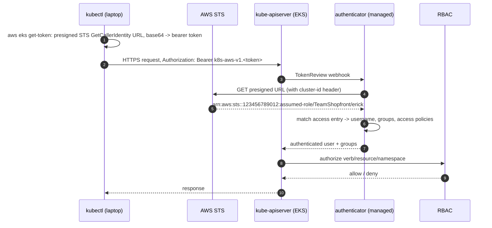
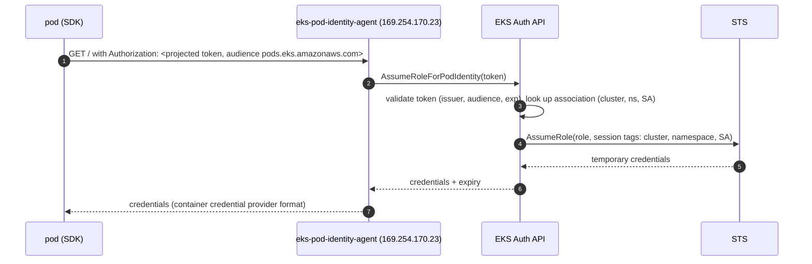
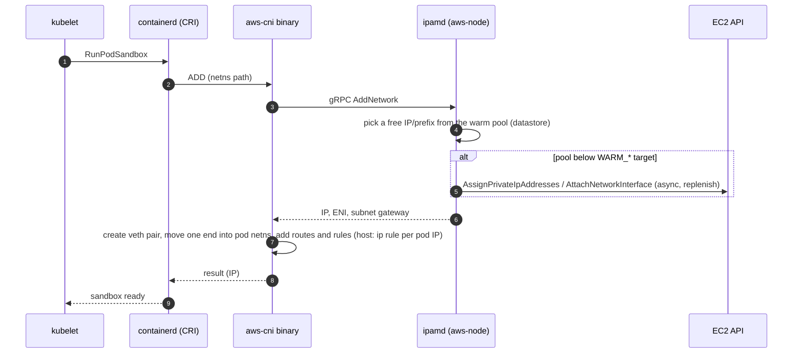

# Amazon EKS · L300 — EKS internals and operations

**Level:** 300 · **Time:** ~120 min · **Prerequisites:**
[L200 Cluster components and add-ons](L200-cluster-components-and-add-ons.md),
[Container fundamentals L300](../01-container-fundamentals/L300-runtimes-and-the-kernel.md),
[Networking L300](../05-networking/L300-container-networking-internals.md)

**After this document you can:**

- Trace a `kubectl` call from your laptop through STS, the authenticator and RBAC.
- Explain how a pod gets its IP from ipamd, how kube-proxy programs a Service and how CoreDNS
  resolves a name, and prove each with a command on a node.
- Diagnose the five DNS failure modes that account for most "the cluster is slow" pages.
- Describe what Auto Mode runs for you, what you cannot change, and how to observe it.
- Run a version upgrade in the right order with the right pre-flight checks, and know when Cilium,
  Windows, GPU or Hybrid Nodes change the picture.

## 1. Mental model



EKS is upstream Kubernetes with four AWS-specific seams: authentication (IAM → Kubernetes identity
through the authenticator), pod networking (the VPC CNI hands out real VPC addresses), cloud
integration (load balancers, volumes, node lifecycle through AWS APIs), and the operating envelope
(versions, add-ons, Auto Mode's managed data plane). Everything else — the API server, etcd, the
scheduler, kubelet, kube-proxy, CoreDNS, containerd — behaves as documented upstream, which means
upstream forensics apply. This document walks each seam at the depth an on-call engineer needs.

## 2. Concepts

### 2.1 Control plane placement and reachability

The API servers and etcd run in an AWS-owned account, spread across at least two AZs, sized and
scaled by EKS (the control plane scales its instance sizes automatically as cluster load grows).
EKS creates 2–4 cross-account ENIs in the subnets you passed at creation; through them the API
server reaches kubelets (`exec`, `logs`, `port-forward`), webhooks and aggregated API servers.
Those ENIs carry the **cluster security group**, which must allow 443 from nodes and 10250 to
nodes; EKS manages the rules when you use the default group.

Endpoint modes: with private access on, the cluster endpoint's DNS name resolves to the ENI IPs from
inside the VPC (a Route 53 private zone EKS manages) and to public IPs elsewhere when public access
is also on; `publicAccessCidrs` restricts who may even attempt the TLS handshake from the internet.
A private-only cluster requires that `kubectl` runs inside the VPC or over VPN/Direct Connect and
that nodes reach ECR, STS, EC2 and other APIs through interface endpoints
([05 L300 §2.9](../05-networking/L300-container-networking-internals.md)).

Control-plane logs (`api`, `audit`, `authenticator`, `controllerManager`, `scheduler`) land in
`/aws/eks/shopfront-dev/cluster`. Two queries you will need:

```text
# audit: who deleted what in the last hour
fields @timestamp, user.username, verb, objectRef.resource, objectRef.namespace, objectRef.name
| filter verb = "delete" | sort @timestamp desc

# authenticator: failed mappings (no access entry)
fields @timestamp, @message | filter @message like /access denied|could not/ | sort @timestamp desc
```

etcd sizing: EKS manages etcd and its backups; you see pressure indirectly (`etcd_db_total_size_in_bytes`
through `kubectl get --raw /metrics`, API latency, `429`s). Very large object counts (hundreds of
thousands of ConfigMaps or Events) degrade the cluster before any quota fires; verify the current
storage limit in the EKS docs.

### 2.2 Authentication and authorization internals

`aws eks get-token` does not call EKS. It presigns an STS `GetCallerIdentity` request (with the
`x-k8s-aws-id: <cluster-name>` header bound into the signature), base64-encodes the URL and prefixes
`k8s-aws-v1.`. The token is valid for 15 minutes. The API server sends it to the managed
authenticator webhook; the authenticator executes the presigned URL, learns the caller's ARN from
STS, and maps it through **access entries** (or `aws-auth` in legacy modes) to a Kubernetes
username, groups and optionally AWS-managed access policies. RBAC then applies as in any cluster.

```bash
aws sts get-caller-identity --query Arn
kubectl auth whoami                                  # username/groups as the API server sees them
kubectl auth can-i --list --namespace shopfront
aws eks list-access-entries --cluster-name shopfront-dev
aws eks describe-access-entry --cluster-name shopfront-dev --principal-arn arn:aws:iam::123456789012:role/TeamShopfront
aws eks list-associated-access-policies --cluster-name shopfront-dev --principal-arn arn:aws:iam::123456789012:role/TeamShopfront
```

Assumed-role session names are stripped: `arn:aws:sts::…:assumed-role/TeamShopfront/erick` maps
through the role ARN `arn:aws:iam::…:role/TeamShopfront`. Paths in role ARNs are removed by the
authenticator, which is the source of many "why is my entry not matching" incidents.

### 2.3 OIDC issuer, projected tokens, IRSA and Pod Identity

Every cluster has an OIDC issuer (`aws eks describe-cluster --query cluster.identity.oidc.issuer`)
that publishes `/.well-known/openid-configuration` and a JWKS. The API server signs **projected
service account tokens** with those keys; a pod requests one through a `projected` volume with an
audience and expiry (`serviceAccountToken` source). IRSA registers the issuer as an IAM identity
provider and lets `sts:AssumeRoleWithWebIdentity` trust those tokens; the `pod-identity-webhook`
(managed) mutates pods whose service account carries `eks.amazonaws.com/role-arn`, adding
`AWS_ROLE_ARN`, `AWS_WEB_IDENTITY_TOKEN_FILE` and the token volume with audience
`sts.amazonaws.com`.

Pod Identity replaces the per-cluster IAM provider with an EKS-side exchange:



The webhook injects `AWS_CONTAINER_CREDENTIALS_FULL_URI=http://169.254.170.23/v1/credentials` and
`AWS_CONTAINER_AUTHORIZATION_TOKEN_FILE=/var/run/secrets/pods.eks.amazonaws.com/serviceaccount/eks-pod-identity-token`;
the SDK's container credential provider handles the rest. The agent runs as a DaemonSet on
`hostNetwork`, so Fargate pods (no DaemonSets) cannot use it. Session tags make ABAC possible in
IAM policies (`aws:PrincipalTag/kubernetes-namespace`). Trust policies and troubleshooting:
[06 L200](../06-identity-and-security/L200-iam-for-containers.md).

### 2.4 VPC CNI internals

`aws-node` runs two processes per node: the **CNI binary** invoked by containerd (through kubelet)
for each pod sandbox, and **ipamd**, the local IP address manager daemon.



ipamd keeps a datastore of ENIs and their IPs/prefixes, attaches ENIs up to the instance limit, and
replenishes according to `WARM_ENI_TARGET`, `WARM_IP_TARGET`, `MINIMUM_IP_TARGET`,
`WARM_PREFIX_TARGET`. Pod traffic uses the ENI the IP belongs to; policy routing (`ip rule`) on the
host sends each pod's traffic out the right ENI. With **prefix delegation** the unit is a /28 on
the ENI, so one EC2 call yields 16 addresses and pod density climbs to 110. **Custom networking**
puts pod ENIs in a different subnet (per-AZ `ENIConfig`), so nodes consume the primary CIDR and pods
a secondary one. **Security groups for pods** allocate a branch ENI from a trunk (`vpc.amazonaws.com/pod-eni`
resource on the node) so the pod carries its own security group. **Network policy** is enforced by
the `aws-eks-nodeagent` container with eBPF programs attached to pod veths.

Introspection on a node (through `kubectl debug node/<node> -it --image=busybox -- chroot /host` or
SSM):

```bash
curl -s http://localhost:61679/v1/enis | jq '.ENIs | to_entries[] | {eni: .key, ips: (.value.IPv4Addresses | length), prefixes: (.value.AvailableIPv4Cidrs | length)}'
curl -s http://localhost:61679/v1/pods | jq 'length'
curl -s http://localhost:61678/metrics | grep -E '^awscni_(assigned_ip_addresses|total_ip_addresses|eni_allocated|ipamd_error_count)'
tail -n 50 /var/log/aws-routed-eni/ipamd.log
tail -n 50 /var/log/aws-routed-eni/plugin.log
ip rule | head; ip route show table main | head
```

`max-pods` is computed from ENI and IP limits per instance type (or the prefix formula) and passed
to kubelet by `nodeadm`; a node whose `allocatable.pods` is lower than expected usually has prefix
delegation off or a `--max-pods` override.

### 2.5 kube-proxy internals

In iptables mode kube-proxy renders every Service into chains: `KUBE-SERVICES` matches
`clusterIP:port` and jumps to `KUBE-SVC-<hash>`, which picks an endpoint with random probability
rules (`statistic mode random probability 0.333…`) and jumps to `KUBE-SEP-<hash>` for DNAT to the pod
IP. Conntrack remembers the choice for the connection's lifetime, which is why long-lived
connections (gRPC, database pools) do not rebalance when new pods appear, and why removing an
endpoint does not break established flows until the pod actually closes them. IPVS mode replaces
the chain walk with a hash table (better at thousands of Services); nftables (GA since 1.33)
replaces iptables with a faster rule set and is the future default. `externalTrafficPolicy: Local`
adds a health-check NodePort so load balancers only send to nodes with local endpoints.

```bash
iptables-save -t nat | grep -E 'KUBE-SVC|KUBE-SEP' | grep orders | head
conntrack -L 2>/dev/null | grep 8080 | head; conntrack -S | head -3
kubectl -n kube-system logs ds/kube-proxy --tail=50
```

Conntrack table exhaustion (`nf_conntrack: table full, dropping packet` in `dmesg`) appears on
nodes with many short connections; raise `net.netfilter.nf_conntrack_max` via kube-proxy's
`conntrack.maxPerCore` or node sysctls ([05 L300](../05-networking/L300-container-networking-internals.md)).

### 2.6 CoreDNS internals and the five failure modes

Resolution path: pod → `/etc/resolv.conf` (`nameserver 172.20.0.10`, the `kube-dns` ClusterIP) →
kube-proxy DNAT → a CoreDNS pod → `kubernetes` plugin for cluster names, `forward` to the VPC
resolver (`169.254.169.253` or VPC+2) for everything else → Route 53 Resolver → private hosted zones,
Resolver rules, or public DNS.

| Failure mode | Mechanism | Symptom | Confirm | Mitigation |
| --- | --- | --- | --- | --- |
| `ndots:5` amplification | search-domain expansion multiplies queries 5× (10× with AAAA) | high CoreDNS QPS, slow external calls | `coredns_dns_requests_total` by type; `tcpdump port 53` in the pod shows NXDOMAIN bursts | trailing dot, `dnsConfig.options ndots:2`, `autopath` |
| UDP truncation | answers > 512 bytes set TC; clients retry over TCP; some clients do not | intermittent failures for names with many records | `dig +noedns` vs `dig +tcp` | `bufsize` plugin, ensure TCP allowed in NetworkPolicy |
| conntrack race on UDP | two parallel A/AAAA queries from the same source port collide in conntrack; one is dropped; glibc waits 5 s | 5 s latency spikes on DNS | `conntrack -S` `insert_failed` counter > 0 | NodeLocal DNSCache (TCP upstream, no conntrack), `single-request-reopen` option, use TCP for DNS |
| Resolver throttling | Route 53 Resolver limits each ENI to 1024 packets/s | `SERVFAIL`/timeouts under load, clustered on the nodes hosting CoreDNS | `coredns_forward_responses_total{rcode="SERVFAIL"}`; per-node ENI packet counts | more CoreDNS replicas spread across nodes (autoscaler + `topologySpreadConstraints`), NodeLocal DNS, cache TTLs |
| CoreDNS undersized or co-located | two replicas on the same node; CPU throttled | latency p99 > 100 ms; `coredns_panics_total`/restarts | `kubectl -n kube-system top pod -l k8s-app=kube-dns`; `container_cpu_cfs_throttled_periods_total` | add-on autoscaling, PDB, anti-affinity, remove CPU limit |

NodeLocal DNSCache runs a DaemonSet that answers from the node (link-local address) and forwards to
CoreDNS over TCP, removing conntrack races and most cross-node DNS hops; Auto Mode ships node-local
DNS as part of its 2026 improvements.

```bash
kubectl -n kube-system get cm coredns -o jsonpath='{.data.Corefile}'
kubectl -n kube-system logs deploy/coredns --tail=100 | grep -E 'SERVFAIL|i/o timeout'
kubectl run -n shopfront dnstest --rm -it --image=busybox:1.36 --restart=Never -- sh -c 'cat /etc/resolv.conf; nslookup catalog.shopfront.svc.cluster.local; nslookup api.github.com'
```

### 2.7 EKS Auto Mode internals

Auto Mode moves the data plane under AWS control. What actually runs:

| Concern | Standard cluster | Auto Mode |
| --- | --- | --- |
| Node provisioning | you (managed node groups or Karpenter you install) | Karpenter run by AWS; `NodePool` (`karpenter.sh/v1`) + `NodeClass` (`eks.amazonaws.com/v1`) |
| Node OS | AL2023/Bottlerocket AMIs you pick and upgrade | Bottlerocket-based EKS-managed AMI; nodes replaced at most every 21 days; no SSH; `kubectl debug node/` works within the sandbox limits (verify) |
| CNI, CoreDNS, kube-proxy, EBS CSI, Pod Identity, load balancing | add-ons you install/upgrade | capabilities run as managed system components; no `aws-node` DaemonSet to inspect, no add-on versions to pick |
| Node-level settings | launch template, `NodeConfig` | `NodeClass` fields only: subnets, security groups, ephemeral storage, SNAT policy, network policy default, KMS key, tags |
| Disruption | your PDBs + Karpenter budgets | same APIs; consolidation on by default |
| Observability of the platform | node logs, add-on pod logs | enhanced logging for managed capabilities (2026-02) to CloudWatch Logs; `NodeClaim`/`NodePool` status; EC2 instance metrics |
| Cost | cluster fee + EC2 | cluster fee + EC2 + Auto Mode management fee per instance |

Consequences for operations: no `kube-system` DaemonSets to break or upgrade, no AMI pipeline, but
also no custom kernel modules, no privileged DaemonSets that rely on host paths outside the
allowlist, no alternative CNI, and node replacement within 21 days that your PDBs must tolerate.
Debugging network issues means reading capability logs rather than `ipamd.log`.

```bash
kubectl get nodepools,nodeclasses,nodeclaims
kubectl describe nodeclaim <name> | sed -n '/Status/,$p'
aws eks describe-cluster --name shopfront-dev --query 'cluster.computeConfig'
aws logs describe-log-groups --log-group-name-prefix /aws/eks/shopfront-dev   # capability logs when enabled
```

### 2.8 Upgrades

Order and mechanics:

1. **Pre-flight**: `kubent` or `pluto` for removed APIs; `kubectl get --raw /metrics | grep
   apiserver_requested_deprecated_apis` for what clients still call; add-on compatibility
   (`describe-addon-versions --kubernetes-version 1.36`); PDBs that would block drains
   (`kubectl get pdb -A` with `ALLOWED DISRUPTIONS 0`); free IPs in control-plane subnets (EKS
   creates new ENIs during the upgrade); webhooks that fail closed.
2. **Control plane** (`aws eks update-cluster-version --name shopfront-dev --kubernetes-version 1.36`):
   in place, API remains available, takes tens of minutes; rollback to the previous minor within 7
   days (`EXTENDED` upgrade policy required to roll back into an extended-support version).
3. **Add-ons** in the order `vpc-cni` → `kube-proxy` → `coredns` → `eks-pod-identity-agent` → CSI
   drivers → observability agents, each to a version listed as compatible with the new minor.
4. **Nodes**: `aws eks update-nodegroup-version` (surge nodes, drain honouring PDBs, `maxUnavailable`)
   or let Karpenter/Auto Mode drift-replace nodes; Fargate pods pick the new kubelet version when
   recreated (`kubectl rollout restart`).
5. **Verify**: `kubectl get nodes` versions, `kubectl get pods -A` restarts, add-on health,
   application SLOs; keep the previous eksctl config for reference.

```bash
aws eks describe-update --name shopfront-dev --update-id <id> --query 'update.{status:status,errors:errors}'
kubectl get nodes -o custom-columns=NAME:.metadata.name,VERSION:.status.nodeInfo.kubeletVersion,OS:.status.nodeInfo.osImage
```

Kubelet skew: nodes may lag the API server by up to three minors, never lead it. Platform versions
(`eks.N`) roll out control-plane patches automatically within a minor. The full runbook:
[EKS version upgrade](../../playbooks/upgrades/eks-version-upgrade.md).

### 2.9 containerd on nodes

```bash
crictl ps -a | head                                  # containers as the CRI sees them
crictl pods --namespace shopfront
crictl inspect <container-id> | jq '.info.runtimeSpec.linux.resources'
crictl logs --tail=50 <container-id>
ctr -n k8s.io images ls | grep shopfront
cat /etc/containerd/config.toml | sed -n '/registry/,/^$/p'
journalctl -u kubelet -u containerd --since -30min | grep -iE 'error|fail' | tail
```

Registry mirrors (`/etc/containerd/certs.d/<registry>/hosts.toml`) redirect public pulls to an ECR
pull-through cache; `image_pull_progress_timeout` (default 5 minutes; verify) aborts stalled pulls,
which surfaces as `ImagePullBackOff` with a context deadline error. Kubelet's `serializeImagePulls`
(default true on some AMIs) and `registryPullQPS` shape parallelism; Auto Mode raised them to
25/50 ([FACTS](../../docs/FACTS-2026-09.md)).

### 2.10 Cilium on EKS

Cilium can replace the VPC CNI on EC2 nodes of a standard cluster, run in chaining mode on top of it,
or be the CNI for Hybrid Nodes (AWS-supported there).

| Mode | Pod IPs | kube-proxy | Notes |
| --- | --- | --- | --- |
| ENI IPAM (`ipam.mode=eni`) | VPC addresses from ENIs, like the VPC CNI | replaceable (`kubeProxyReplacement=true`) | closest to VPC CNI semantics; prefix delegation supported |
| Overlay (VXLAN/Geneve) | cluster CIDR, not VPC-routable | replaceable | more pods per node, pods invisible to VPC security groups and load balancers in `ip` target mode |
| Chaining (`cni.chainingMode=aws-cni`) | VPC CNI assigns IPs; Cilium adds policy and observability | keep kube-proxy | lowest-risk adoption path |

Install caveats: patch or remove `aws-node` when replacing it; taint nodes until Cilium is ready;
Fargate pods are not supported; Auto Mode does not allow CNI replacement; Hubble gives flow logs
and service maps. Gains: identity-based network policy (L3–L7), eBPF datapath performance, mutual
authentication, and observability without sidecars ([05 L300 §2.6](../05-networking/L300-container-networking-internals.md)).

### 2.11 EKS Capabilities, Windows, GPU, Hybrid Nodes

**EKS Capabilities** (Argo CD, ACK, kro) run off-cluster as AWS-managed services with a
*capability role* you grant permissions to; they reach the API server through the cluster endpoint
with their own identities, and their resources (`Application`, ACK CRDs, kro `ResourceGraphDefinition`)
live in the cluster. Upgrades and availability are AWS's; configuration is through CRDs and, for
Argo CD, an `argocd-cm` ConfigMap.

**Windows nodes**: Windows Server AMIs in managed node groups, VPC CNI Windows IPAM enabled through
the `amazon-vpc-cni` ConfigMap, `kube-proxy` and CoreDNS unchanged; no Fargate, taints to keep Linux
pods off.

**GPU nodes**: accelerated AMIs (AL2023 or Bottlerocket NVIDIA variants) plus the NVIDIA device
plugin, or Auto Mode GPU NodePools; Dynamic Resource Allocation is GA in 1.36 and replaces device
plugins over time; SOCI-by-default on G/P/Trn Auto Mode nodes cuts pull time for large images.

**Hybrid Nodes**: `nodeadm` joins on-premises hosts using IAM Roles Anywhere or SSM hybrid
activations; you supply remote node and pod CIDRs so the control-plane ENIs can route to them;
Cilium is the supported CNI; webhooks and load balancers need routes both ways.

### 2.12 Forensics block

```bash
kubectl get events -A --sort-by=.lastTimestamp | tail -30
kubectl describe node <node> | sed -n '/Conditions/,/Addresses/p'
kubectl get nodes -o custom-columns=NAME:.metadata.name,PODS:.status.allocatable.pods,CPU:.status.allocatable.cpu,MEM:.status.allocatable.memory
kubectl -n kube-system get cm amazon-vpc-cni -o yaml
kubectl -n kube-system logs ds/aws-node -c aws-node --tail=100
kubectl -n kube-system logs ds/aws-node -c aws-eks-nodeagent --tail=100     # network policy agent
aws eks describe-cluster --name shopfront-dev --query 'cluster.{v:version,pv:platformVersion,endpoint:endpoint,vpc:resourcesVpcConfig}'
aws eks list-pod-identity-associations --cluster-name shopfront-dev --namespace shopfront
kubectl get --raw /metrics | grep -E '^apiserver_request_total.*code="(429|5..)"' | head
```

## 3. How it interacts with the rest of AWS

| Component | Talks to | Protocol/API | Prerequisite (IAM, network, DNS) | What breaks if missing |
| --- | --- | --- | --- | --- |
| Authenticator | STS | presigned `GetCallerIdentity` | STS reachable from the control plane (always) | all `kubectl` fails `Unauthorized` when entries are wrong |
| Pod Identity agent | EKS Auth API (`eks-auth.<region>.amazonaws.com`) | `AssumeRoleForPodIdentity` | node role `AmazonEKSWorkerNodeMinimalPolicy`/`eks-auth` permission; `eks-auth` endpoint in private clusters | pods get no credentials |
| ipamd | EC2 | ENI/IP assignment APIs | node role or Pod Identity for `aws-node` (`AmazonEKS_CNI_Policy`); `ec2` endpoint | pods stuck `ContainerCreating` |
| CoreDNS | Route 53 Resolver | UDP/TCP 53 | SG egress; Resolver packet limits | external resolution fails |
| Control plane | your VPC | cross-account ENIs | free IPs in control-plane subnets, cluster SG | upgrades fail; `exec`/`logs` fail |
| Karpenter / Auto Mode | EC2, SQS (interruptions), Pricing | `CreateFleet`, `RunInstances` | subnet/SG discovery tags; interruption queue | no nodes appear; Spot interruptions unhandled |
| Node bootstrap | EKS `DescribeCluster` (nodeadm), ECR (pause/add-on images), STS | HTTPS | node role; endpoints for private clusters | nodes never join |
| Cilium (if used) | EC2 (ENI mode) | ENI APIs via its operator role | role, subnet tags | pods without IPs |

## 4. Use it when / avoid it when

Use these internals when:

- A `kubectl` identity problem appears: check the ARN mapping before touching RBAC (§2.2).
- Pods stall in `ContainerCreating`: ipamd first, EC2 quotas second (§2.4).
- Latency spikes have a 5 s signature: DNS conntrack race, not the application (§2.6).
- Planning an upgrade: pre-flight list in §2.8 before touching the control plane.
- Choosing Auto Mode: confirm nothing you run needs what §2.7 says you cannot change.

Avoid:

- Editing add-on-managed resources by hand (`aws-node` env, CoreDNS Deployment); use
  `configurationValues`.
- Running CoreDNS with CPU limits and fixed replicas.
- Replacing the CNI on a cluster with Fargate profiles or Auto Mode.
- Skipping minors or upgrading nodes before the control plane.

Alternatives: ECS avoids all of this at the cost of Kubernetes APIs
([03 L300](../03-ecs/L300-ecs-internals.md)); Auto Mode keeps the APIs and removes most of §2.4–2.9
from your on-call.

## 5. Well-Architected view

| Pillar | Internals that help | Cost | Practice (EKS Best Practices Guide) |
| --- | --- | --- | --- |
| Operational Excellence | control-plane logs, deterministic upgrade order, Auto Mode capability logs | log ingestion cost; upgrade cadence | enable `audit`+`authenticator`; quarterly upgrade rehearsal in a scratch cluster |
| Security | access-entry mapping, short-lived tokens, Pod Identity session tags, IMDS hop limit | IAM design | `API` auth mode; no `system:masters` grants; audit `exec` | <!-- term-ok -->
| Reliability | multi-AZ control plane, CoreDNS autoscaling, NodeLocal DNS, PDB-aware drains | correct budgets | three-AZ node pools; DNS redundancy; upgrade pre-flight |
| Performance Efficiency | prefix delegation, nftables/IPVS at scale, SOCI, `registryPullQPS` | IP planning | prefix delegation on Nitro; NodeLocal DNS on large clusters |
| Cost Optimization | consolidation, right-sized CoreDNS, avoiding extended support | Auto Mode fee | upgrade before standard support ends |
| Sustainability | bin-packing via Karpenter/Auto Mode | none | consolidation on |

## 6. Failure modes and troubleshooting

| Symptom | Likely cause | How to confirm (command/metric) | Fix |
| --- | --- | --- | --- |
| `Unauthorized` for a role that "has" an access entry | entry created for the session ARN or a role with a path | `aws sts get-caller-identity`; compare with `list-access-entries` | recreate entry with the role ARN without path ([playbook](../../playbooks/incidents/eks-auth-and-access.md)) |
| Pods `ContainerCreating` with `failed to assign an IP address` | ipamd pool empty: subnet full, ENI limit, EC2 throttling | ipamd log; `awscni_ipamd_error_count`; `awscni_total_ip_addresses` | prefix delegation, larger subnets, custom networking ([playbook](../../playbooks/incidents/pending-pods-and-capacity.md)) |
| 5 s latency on outbound calls | DNS conntrack race | `conntrack -S` insert_failed; tcpdump shows retransmitted DNS | NodeLocal DNSCache ([playbook](../../playbooks/incidents/dns-failures.md)) |
| `SERVFAIL` bursts under load | Resolver 1024 pps per ENI; CoreDNS on one node | `coredns_forward_responses_total`; per-node distribution | spread and scale CoreDNS; cache; NodeLocal DNS |
| Node `NotReady`, kubelet `Unable to register node` | cluster SG, private endpoint DNS, IMDS hop limit 1 breaking node bootstrap (nodeadm needs IMDS from the host, which hop limit 1 allows) | `journalctl -u kubelet`; SG rules; `dig` the endpoint from the node | fix SG/DNS ([playbook](../../playbooks/incidents/node-not-ready.md)) |
| Upgrade stuck draining a node | PDB with zero allowed disruptions; single-replica Deployment with PDB | `kubectl get pdb -A`; nodegroup update errors | fix PDBs or use `--force` consciously ([playbook](../../playbooks/incidents/upgrade-breakage.md)) |
| After upgrade, webhooks time out | webhook backend not ready; API server → ENI → pod path blocked | `kubectl get validatingwebhookconfigurations`; API server logs | `failurePolicy: Ignore` for non-critical webhooks; fix SG |
| `ImagePullBackOff` with `context deadline exceeded` | large image over slow path; pull timeout | `crictl` logs; pull duration | SOCI, smaller images, pull-through cache ([playbook](../../playbooks/incidents/image-pull-failures.md)) |
| Pod Identity pod gets node role permissions | IMDS reachable and no association | CloudTrail `userIdentity.arn` | association + hop limit 1 ([playbook](../../playbooks/incidents/iam-accessdenied-from-containers.md)) |

## 7. Signals: metrics, logs, traces

- `apiserver_request_duration_seconds` p99 by verb (> 1 s for reads indicates a suffering control
  plane); `apiserver_request_total{code="429"}` (client throttling — find the offender with audit
  logs); `apiserver_current_inflight_requests`.
- `etcd_db_total_size_in_bytes` trend and `apiserver_storage_objects` by resource: object bloat.
- `coredns_dns_request_duration_seconds_bucket` p99, `coredns_forward_responses_total` by rcode,
  `coredns_cache_hits_total`.
- `awscni_assigned_ip_addresses`, `awscni_total_ip_addresses`, `awscni_eni_allocated`,
  `awscni_eni_max`, `awscni_ipamd_action_inprogress`, `awscni_ipamd_error_count`,
  `awscni_ec2api_error_count`.
- `kubelet_pleg_relist_duration_seconds` p99 (> 3 s precedes `NotReady`),
  `kubelet_runtime_operations_errors_total`, node conditions (`MemoryPressure`, `DiskPressure`,
  `PIDPressure`), `node_pressure_*` PSI (GA in 1.36).
- `container_network_receive_errors_total`, `node_netstat_TcpExt_ListenDrops`, conntrack
  `insert_failed`.
- Control-plane logs: audit (`verb`, `user.username`, `responseStatus.code`), authenticator
  failures.
- Karpenter/Auto Mode: `karpenter_nodeclaims_*`, `karpenter_pods_startup_duration_seconds`,
  NodeClaim conditions.

Full table: [`reference/metrics-catalog.md`](../../reference/metrics-catalog.md).

## 8. Testing and DR notes

Testing: rehearse every upgrade on a scratch cluster created from the same eksctl file with the
same add-on versions and the production manifests applied; run `kubent`; drain one node at a time
under synthetic load and count errors; inject DNS failure (`kubectl -n kube-system scale deploy/coredns
--replicas=0` in the scratch cluster) to confirm client timeouts and retries; with FIS, terminate a
node group instance (`aws:eks:terminate-nodegroup-instances`) and delete pods (`aws:eks:pod-delete`)
during load; load DNS with `dnsperf` from a pod to find the Resolver ceiling for your node layout.

DR: the control plane is AWS's problem (multi-AZ, backed up); yours is reproducibility. Keep
eksctl/CDK/Terraform definitions, add-on versions and `configurationValues`, access entries, Pod
Identity associations and OIDC providers in code; store Kubernetes manifests in git and deploy them
with GitOps so a new cluster converges without human steps; snapshot persistent volumes (EBS
snapshots, Velero) and use RDS/EFS for anything that must survive a cluster loss. A cluster rebuild
is a normal operation you have timed ([cluster rebuild runbook](../../playbooks/dr/cluster-rebuild-runbook.md)).

## 9. Hands-on

Requires a cluster from [`labs/eks/cluster/eksctl-standard.yaml`](../../labs/eks/cluster/eksctl-standard.yaml)
(billable) and the shopfront manifests applied.

```bash
# 1. Authentication path
aws eks get-token --cluster-name shopfront-dev | jq -r .status.token | cut -c1-40; echo
kubectl auth whoami
# Observe: the token prefix k8s-aws-v1.; whoami shows the username/groups from your access entry.

# 2. ipamd from a debug pod on a node (hostNetwork gives access to the node's localhost)
NODE=$(kubectl get nodes -o jsonpath='{.items[0].metadata.name}')
kubectl debug node/"$NODE" -it --image=curlimages/curl:8.10.1 -- sh -c \
  'curl -s http://localhost:61679/v1/enis | head -c 600; echo; curl -s http://localhost:61678/metrics | grep -E "^awscni_(assigned|total)_ip_addresses"'
# Observe: ENIs with prefixes (if prefix delegation) and the assigned/total counters.

# 3. kube-proxy rules for the catalog Service
kubectl debug node/"$NODE" -it --image=nicolaka/netshoot:v0.13 --profile=sysadmin -- sh -c \
  'iptables-save -t nat | grep -i "shopfront/catalog" | head -5'
# Observe: KUBE-SVC chain with probability rules, one KUBE-SEP per endpoint.

# 4. DNS behaviour and ndots
kubectl -n shopfront run dnstest --rm -it --image=busybox:1.36 --restart=Never -- sh -c \
  'cat /etc/resolv.conf; time nslookup api.github.com >/dev/null; time nslookup api.github.com. >/dev/null'
# Observe: ndots:5 and search domains; the trailing-dot lookup is faster.

# 5. Pod Identity flow from inside orders (distroless: use the worker pod which has Python)
kubectl -n shopfront exec deploy/fulfillment-worker -- env | grep -E 'AWS_CONTAINER_(CREDENTIALS_FULL_URI|AUTHORIZATION_TOKEN_FILE)'
kubectl -n shopfront exec deploy/fulfillment-worker -- python -c \
  "import boto3; print(boto3.client('sts').get_caller_identity()['Arn'])"
# Observe: the 169.254.170.23 URI and an assumed-role ARN for the worker's role, not the node role.

# 6. Upgrade pre-flight
kubent --target-version 1.36 || true
kubectl get --raw /metrics | grep apiserver_requested_deprecated_apis | head
aws eks describe-addon-versions --kubernetes-version 1.36 --query 'addons[].{name:addonName,v:addonVersions[0].addonVersion}' --output table
```

## 10. Check yourself

1. `kubectl` fails with `Unauthorized` for `arn:aws:iam::123456789012:role/platform/TeamShopfront`
   although an access entry exists for exactly that ARN. What is wrong?

<details><summary>Answer</summary>
The authenticator strips paths from role ARNs before matching, so the caller is seen as
`arn:aws:iam::123456789012:role/TeamShopfront`. Access entries must be created with the path-less
ARN (and never with the `assumed-role` STS ARN). Check with `aws sts get-caller-identity`, then
`aws eks list-access-entries`.
</details>

2. A node shows `allocatable.pods: 29` although prefix delegation was enabled in the add-on. Why?

<details><summary>Answer</summary>
`max-pods` is computed at node bootstrap (nodeadm) from the instance type and the CNI mode at the
time; nodes created before the setting changed keep the old value (29 for an m5.large with three
ENIs × 10 addresses). Replace the nodes (rolling update or Karpenter drift) so bootstrap computes
the prefix-delegation number (110).
</details>

3. Outbound HTTP calls from pods show a bimodal latency: most take 20 ms, some take exactly 5 s
   more. What is the mechanism and the fix?

<details><summary>Answer</summary>
glibc sends A and AAAA queries in parallel from the same UDP source port; a race in conntrack's
insertion drops one, the resolver times out after 5 s and retries. Confirm with `conntrack -S`
(`insert_failed`). Fix with NodeLocal DNSCache (forwards over TCP, no per-pod conntrack entry),
`single-request-reopen` in `dnsConfig.options`, or forcing TCP for DNS.
</details>

4. What can you not change in an Auto Mode cluster that you can in a standard cluster, and what do
   you gain?

<details><summary>Answer</summary>
You cannot pick or SSH into the node AMI, run a different CNI, set arbitrary kubelet flags, install
or version core add-ons (they are managed capabilities), or keep nodes longer than 21 days. You gain
AWS-operated provisioning (Karpenter), patching, CoreDNS/kube-proxy/CNI/EBS/LB/Pod Identity
lifecycle, and the performance improvements shipped in 2026 without configuration.
</details>

5. Why do add-ons upgrade before node groups but after the control plane?

<details><summary>Answer</summary>
Add-on versions are validated against the control-plane minor, so the control plane goes first.
The add-ons run as DaemonSets/Deployments that new nodes will pull on join; upgrading them before the
node rollout means every replaced node starts with compatible CNI/kube-proxy/CoreDNS, and the skew
rules (kubelet may lag but never lead the API server) are honoured throughout.
</details>

## 11. Sources

- Amazon EKS networking (control-plane ENIs, cluster security group) — https://docs.aws.amazon.com/eks/latest/userguide/network_reqs.html and https://docs.aws.amazon.com/eks/latest/userguide/sec-group-reqs.html
- Cluster endpoint access — https://docs.aws.amazon.com/eks/latest/userguide/cluster-endpoint.html
- Amazon EKS cluster authentication and `aws eks get-token` — https://docs.aws.amazon.com/eks/latest/userguide/cluster-auth.html
- Access entries — https://docs.aws.amazon.com/eks/latest/userguide/access-entries.html
- EKS Pod Identity: how it works — https://docs.aws.amazon.com/eks/latest/userguide/pod-id-how-it-works.html
- IAM roles for service accounts — https://docs.aws.amazon.com/eks/latest/userguide/iam-roles-for-service-accounts.html
- Amazon VPC CNI plugin: proposal and IPAM design (GitHub) — https://github.com/aws/amazon-vpc-cni-k8s/blob/master/docs/cni-proposal.md <!-- term-ok -->
- VPC CNI configuration variables — https://github.com/aws/amazon-vpc-cni-k8s#cni-configuration-variables
- Kubernetes kube-proxy modes — https://kubernetes.io/docs/reference/networking/virtual-ips/
- CoreDNS in Kubernetes and NodeLocal DNSCache — https://kubernetes.io/docs/tasks/administer-cluster/dns-custom-nameservers/ and https://kubernetes.io/docs/tasks/administer-cluster/nodelocaldns/
- Route 53 Resolver quotas (packets per second per ENI) — https://docs.aws.amazon.com/vpc/latest/userguide/amazon-dns-limits.html
- EKS Auto Mode: how it works and release notes — https://docs.aws.amazon.com/eks/latest/userguide/automode.html and https://docs.aws.amazon.com/eks/latest/userguide/auto-change.html
- Update an Amazon EKS cluster Kubernetes version — https://docs.aws.amazon.com/eks/latest/userguide/update-cluster.html
- Kubernetes version skew policy — https://kubernetes.io/releases/version-skew-policy/
- Alternate CNI plugins on EKS — https://docs.aws.amazon.com/eks/latest/userguide/alternate-cni-plugins.html
- Cilium documentation: AWS ENI mode, chaining, kube-proxy replacement — https://docs.cilium.io/en/stable/network/concepts/ipam/eni/ and https://docs.cilium.io/en/stable/installation/cni-chaining-aws-cni/
- EKS Capabilities — https://docs.aws.amazon.com/eks/latest/userguide/capabilities.html
- EKS Hybrid Nodes — https://docs.aws.amazon.com/eks/latest/userguide/hybrid-nodes-overview.html
- containerd CRI plugin configuration — https://github.com/containerd/containerd/blob/main/docs/cri/config.md
- Amazon EKS Best Practices Guide — https://docs.aws.amazon.com/eks/latest/best-practices/introduction.html
