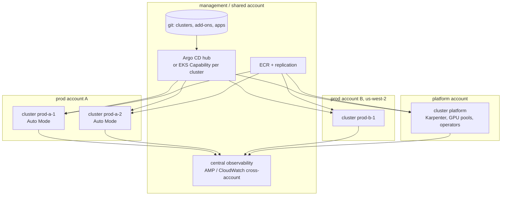

# Amazon EKS · L400 — EKS at scale

**Level:** 400 · **Time:** ~90 min · **Prerequisites:**
[L300 EKS internals and operations](L300-eks-internals-and-operations.md),
[Delivery L400](../08-delivery-cicd-gitops/L400-platform-engineering-and-delivery-at-scale.md),
[Resilience and DR L300](../10-resilience-and-dr/L300-dr-strategies-for-container-platforms.md)

**After this document you can:**

- Choose a multi-cluster topology and defend the number of clusters you run.
- Recognise the scaling walls (etcd, API server, IPs, ENIs, Karpenter) before they hit.
- Design capacity with NodePools, Spot diversification and consolidation budgets, and model the
  cost (cluster fee, Auto Mode fee, extended support, data transfer).
- Harden a fleet with admission, network policy and identity controls that scale to many teams.
- Run upgrades and DR for a fleet of clusters on a cadence, and know when EKS is the wrong tool.

## 1. Mental model



At scale, a Kubernetes cluster is a cattle-grade unit of deployment created from code, converged by
GitOps and replaced when it drifts. The design questions become how many clusters, of which shape,
in which accounts; how capacity is expressed so that hundreds of teams get what they need without a
ticket; how policy is enforced without a review queue; and how upgrades, DR and cost are handled as
fleet operations. EKS's control plane scales for you; the walls you hit are IP space, object counts,
API request rates, and organisational ones.

## 2. Concepts

### 2.1 Topology: how many clusters

| Model | Isolation | Cost | Operational load | Fits |
| --- | --- | --- | --- | --- |
| One cluster per environment, namespaces per team | RBAC + NetworkPolicy + quotas + PSA | lowest ($0.10/h per cluster) | one upgrade per environment; noisy-neighbour risk at the API server and etcd | small/medium organisations, platform-mature teams |
| Cluster per team (or product) per environment | full API-server and etcd isolation; independent upgrade windows | fee × clusters; duplicated system pods | many upgrades; needs fleet GitOps | tens of teams with different risk appetites |
| Cell clusters (N identical clusters, traffic sharded) | blast radius = 1/N of users | N × platform overhead | fleet automation mandatory | tier-1 multi-tenant SaaS |
| Cluster per Region + per account boundary | fault and compliance isolation | duplicated everything | cross-Region GitOps and data | regulated or global |

The rule that ages well: as few clusters as your blast-radius and compliance needs allow, but never
fewer than one per environment and never a shared cluster for workloads with different security
tiers. Every cluster costs an upgrade every four months, an add-on matrix, an identity mapping and a
set of dashboards; the cluster fee is the smallest line.

Account boundaries decide quotas and IAM. Common layout: a platform account for shared clusters
(CI runners, operators, GPU pools), one account per business unit for application clusters, a
management account for GitOps controllers or the Argo CD EKS Capability per cluster, a shared
services account for ECR and observability.

### 2.2 Scaling walls

| Wall | Symptom | Where the limit lives | Mitigation |
| --- | --- | --- | --- |
| IPv4 exhaustion | pods `ContainerCreating`, nodes cannot join | subnet sizes; ENI/IP per instance | prefix delegation, custom networking with `100.64/16`, IPv6 clusters, more/larger subnets ([05 L400](../05-networking/L400-network-architecture-at-scale.md)) |
| ENI attach rate | slow scale-out | EC2 API throttling for `AttachNetworkInterface`/`AssignPrivateIpAddresses` | prefix delegation (one call per 16 IPs), warm targets, fewer/larger nodes |
| API server request rate | `429 Too Many Requests`, controllers lag | Priority and Fairness; a chatty controller or CI | find offenders in audit logs; tune client QPS; shard controllers |
| etcd object count/size | API latency, slow list/watch, upgrade risk | objects (Events, ConfigMaps, CRs), large secrets | TTL on Events, prune CRs, avoid storing blobs; verify the current storage limit |
| Pods per node / per cluster | scheduling latency, kubelet PLEG | kubelet and CNI limits; upstream tested envelope (5,000 nodes, 150,000 pods) | more clusters before approaching upstream limits |
| Node join rate | slow scale-out under bursts | bootstrap + image pulls | warm pools (managed node groups), smaller images, pre-pulled system images, Karpenter consolidation tuned |
| Load balancer targets | Ingress reconcile errors | 1,000 targets per target group, listener rule limits | IngressGroups per environment, several target groups |
| Service quotas | `LimitExceeded` | EC2 instances per Region, EIPs, NAT bandwidth, EBS volumes | Service Quotas monitoring and increases ahead of load |

EKS scales the control plane instances automatically, but object bloat and hot clients still hurt
latency long before AWS-side scaling helps. Treat `apiserver_request_total{code="429"}` and
`apiserver_request_duration_seconds` as capacity metrics ([07 L300](../07-observability/L300-metrics-that-matter-and-alerting.md)).

### 2.3 Capacity design with NodePools

Design NodePools by isolation and cost profile, not by team:

| NodePool | Requirements | Disruption | Purpose |
| --- | --- | --- | --- |
| `system` | on-demand, 2+ nodes, taint `CriticalAddonsOnly` | consolidation `WhenEmpty` only, budgets `nodes: 1` | CoreDNS, controllers, Karpenter itself (standard clusters) |
| `general-arm64` | c/m/r ≥ gen 6, arm64, spot+on-demand | `WhenEmptyOrUnderutilized`, `consolidateAfter: 2m`, business-hours budget `0` | stateless services |
| `general-amd64` | same for images without arm64 builds | same | legacy |
| `batch-spot` | spot only, larger sizes, taint `workload=batch` | aggressive consolidation | workers, Batch on EKS, CI runners |
| `gpu` | g/p families, taint `nvidia.com/gpu`, on-demand or capacity blocks | `WhenEmpty` | ML |
| `stateful` | on-demand, `expireAfter: Never`, taint | `WhenEmpty` | Kafka/Postgres operators (if you must) |

Spot diversification: allow at least ten instance types across three sizes and both architectures;
Karpenter/Auto Mode use price-capacity-optimized allocation and react to interruption notices
(2-minute warning → cordon/drain). Keep `limits` per NodePool so a runaway Deployment cannot buy the
Region. Budget consolidation so it does not compete with deployments (`schedule` budgets). In Auto
Mode the same NodePool API applies with `NodeClass`; the platform fee is per instance-hour, which
is worth it when it replaces a Karpenter/AMI/add-on operations rota.

Pod-level rules that make node pools work: requests on every container (the scheduler and Karpenter
plan from requests), PDBs on every Deployment, topology spread across zones, and `priorityClassName`
for system components so evictions land on the right pods.

### 2.4 Cost model

| Line | Driver | Lever |
| --- | --- | --- |
| Cluster fee | $0.10/h per cluster ($876/year); $0.60/h in extended support | fewer clusters; upgrade before standard support ends |
| Auto Mode fee | percentage of EC2 price per managed instance | compare with the people cost of Karpenter + AMI + add-on operations |
| EC2 | requested resources ÷ bin-packing efficiency | requests right-sized (VPA), consolidation, Graviton (~20% cheaper per vCPU), Spot for interruptible pools, Savings Plans for baseline |
| Data transfer | cross-AZ pod-to-pod and pod-to-database; NAT per GB; cross-Region | topology-aware routing (`trafficDistribution: PreferClose`), AZ-local data reads, VPC endpoints instead of NAT for AWS APIs |
| Load balancers | per ALB/NLB hour + LCU | IngressGroups, shared internal ALBs |
| Observability | logs ingestion, metrics samples | sample traces, drop debug logs at the collector, metric filters |
| Storage | gp3 volumes, snapshots | right-size, delete orphaned PVs (`Retain` policy audit) |

A fleet dashboard with requested vs used CPU/memory per namespace (kube-state-metrics + node
exporter or Container Insights) and a monthly right-sizing review usually recovers 20–40% of EC2
spend in the first year.

### 2.5 Hardening at scale

| Control | Mechanism | Fleet-wide practice |
| --- | --- | --- |
| Pod Security | PSA labels per namespace (`restricted` for apps, `baseline` for system) | enforce via GitOps namespace templates; exceptions as explicit `privileged` namespaces owned by platform |
| Admission policy | `ValidatingAdmissionPolicy`/`MutatingAdmissionPolicy` (GA 1.36) with CEL, or Kyverno/Gatekeeper | require requests/limits, digests, non-root, approved registries, labels; mutate defaults (seccomp, `automountServiceAccountToken: false`) |
| Network | default-deny `NetworkPolicy` per namespace with DNS egress allowed; VPC CNI policy engine or Cilium | policy templates in the namespace bootstrap |
| Identity | Pod Identity only; deny IMDS from pods (hop limit 1 + NetworkPolicy); access entries via Identity Center groups | no `system:masters`; break-glass role with alarms | <!-- term-ok -->
| Images | ECR only, signed (Notation/cosign) and scanned; admission verifies | registry allowlist in policy |
| Runtime | GuardDuty EKS Runtime Monitoring, audit logs to a SIEM | findings to a queue with SLAs |
| Nodes | Bottlerocket or AL2023 with IMDSv2, no SSH (SSM), private subnets | Auto Mode removes the node from your surface |

Depth on each: [06 L300](../06-identity-and-security/L300-hardening-workloads-and-clusters.md) and
[06 L400](../06-identity-and-security/L400-security-architecture-and-incident-response.md).

### 2.6 GitOps as the fleet operating model

Every cluster converges from git: cluster definition (eksctl/Terraform/CDK), add-on versions and
configuration values, platform components (Helm releases pinned), namespace templates with PSA,
quotas, NetworkPolicies and access mappings, then application manifests. Argo CD hub-and-spoke or
the Argo CD EKS Capability per cluster (managed by AWS; up to 3,000 Applications per capability) with
`ApplicationSet` cluster generators makes "add a cluster" a pull request. Application teams own
their manifests; the platform owns namespace bootstrap and the policies that constrain them
([08 L400](../08-delivery-cicd-gitops/L400-platform-engineering-and-delivery-at-scale.md)).

### 2.7 Upgrades as a fleet cadence

Kubernetes ships three minors a year; EKS supports each for 14 months standard. A fleet that stays
on standard support upgrades every cluster roughly every four to six months:

1. Week 0: new EKS minor available. Upgrade the scratch and dev clusters from the same eksctl
   file; run `kubent`; update add-on version pins in git.
2. Week 1–2: staging; application teams run their suites; fix deprecations found by
   `apiserver_requested_deprecated_apis`.
3. Week 3–6: production clusters in waves (one cell/account per wave), each with control plane →
   add-ons → node replacement via Karpenter drift or `update-nodegroup-version`; 7-day rollback
   window observed before the next wave.
4. Always: never two minors behind; extended support is the emergency budget, not the plan.

Auto Mode removes add-on and node steps but not the API deprecations your manifests carry.
Runbook: [EKS version upgrade](../../playbooks/upgrades/eks-version-upgrade.md).

### 2.8 DR and multi-Region

What exists in a cluster that is not in git: PersistentVolumes, Secrets created by operators,
in-cluster databases and message brokers, certificates issued by cert-manager, and CRD state
managed by controllers. Strategy tiers:

| Tier | Approach | RTO / RPO | Tools |
| --- | --- | --- | --- |
| Stateless services, state in managed services | rebuild cluster from git in the same or another Region; data in RDS/ElastiCache/MSK/S3 with their replication | minutes–1 h / data-tier RPO | eksctl + GitOps, ECR replication, Route 53/ARC |
| Stateful in-cluster (PVs) | Velero backups (objects + EBS snapshots) to S3, cross-Region copy | hours / last snapshot | Velero, EBS snapshot policies |
| Active/active multi-Region | identical clusters per Region, global data layer, traffic split by Route 53/Global Accelerator | seconds / near zero for data designed for it | ARC routing controls, DynamoDB global tables, Aurora Global |

AWS backs up etcd for its own recovery; you cannot restore your cluster from it, so treat git plus
Velero as your only backups. ARC zonal shift (supported for EKS, including Auto Mode since 2026-07)
moves traffic away from an impaired AZ at the load balancer and cluster level; pods must be spread
so the remaining zones carry the load ([10 L300](../10-resilience-and-dr/L300-dr-strategies-for-container-platforms.md)).

### 2.9 Well-Architected review of an EKS platform

Questions that separate mature platforms:

- Can you list every cluster, its version, add-on versions and support end date from one query
  (`aws eks list-clusters` across accounts + `describe-cluster`)? Is any cluster in extended support?
- Do all namespaces have PSA labels, quotas, default-deny NetworkPolicies and a resolvable owner?
- Is every container running with requests, a digest-pinned image from an allowlisted registry, and
  a PDB on its Deployment?
- Is IMDS unreachable from pods on every node pool, and does every service account with AWS access
  have a Pod Identity association rather than a node-role fallback?
- Has a cluster been rebuilt from git in the last quarter, and how long did it take?
- What is the fleet's requested-vs-used ratio and Spot share, and who reviews it?
- How long from a Kubernetes release to the last production cluster upgraded?

[12 L300](../12-well-architected/L300-running-a-review.md) runs the review with shopfront.

### 2.10 When EKS is the wrong tool

EKS is the wrong choice when the team wants to run containers, not Kubernetes: a few conventional
services and jobs, no operators or CRDs, no need for the Helm ecosystem, and no one whose job is
the platform. ECS (or ECS Express Mode) removes upgrades, add-ons, node pools and admission policy
from the surface. It is also the wrong choice for event-driven functions under 15 minutes (Lambda)
and for single web services with no platform team (App Runner, Express Mode). It is the right tool
when Kubernetes APIs are the product surface your teams or vendors expect, when operators run your
data or ML platforms, when you need portability, or when you have a platform team that will own it
([decision guides](../../reference/decision-guides.md)).

## 3. How it interacts with the rest of AWS

| Component | Talks to | Protocol/API | Prerequisite (IAM, network, DNS) | What breaks if missing |
| --- | --- | --- | --- | --- |
| Fleet GitOps (Argo CD hub or EKS Capability) | many clusters' API servers | HTTPS with per-cluster identities (access entries) | cross-account roles or capability roles; private endpoint reachability | clusters drift from git silently |
| ECR (shared account) | all clusters and Regions | repository policies + replication rules | KMS key policies per Region | pulls fail after failover |
| Central observability | AMP/CloudWatch cross-account | remote write / cross-account observability | sink roles | blind fleet |
| Identity Center | access entries | permission sets → roles → entries | consistent role names per account | ad hoc `aws-auth` edits |
| Organizations / Config / Security Hub | all accounts | SCPs, Config rules (`eks-cluster-supported-version`, `eks-endpoint-no-public-access`, `eks-secrets-encrypted`), Security Hub EKS controls | delegated admin | drift, unnoticed extended-support clusters |
| Route 53 / ARC / Global Accelerator | ALBs/NLBs per cluster/Region | health checks, routing controls, zonal shift | health endpoints that reflect readiness | traffic to an impaired Region/AZ |
| Compute Optimizer / Cost Explorer | EC2 usage per cluster tag | billing data | tags (`eks:cluster-name`) | no cost attribution |

## 4. Use it when / avoid it when

Use these patterns when:

- More than a handful of teams share Kubernetes and you need consistent policy: namespace templates
  + admission + GitOps.
- Availability targets exceed one Region or one AZ failure: cells, ARC, multi-Region rebuild.
- Spend matters: NodePools with consolidation and Spot, right-sizing loops, Savings Plans.

Avoid:

- Cluster-per-team by default; start with fewer clusters and strong namespace isolation.
- In-cluster databases and brokers unless an operator team owns them; managed services keep DR
  simple.
- Letting clusters drift into extended support.
- Custom admission webhooks written per team; centralise with CEL policies or one policy engine.

Alternatives: ECS for the long tail of conventional services; Auto Mode to shrink the platform
team's surface while keeping Kubernetes APIs.

## 5. Well-Architected view

| Pillar | At fleet scale | Cost | Practice |
| --- | --- | --- | --- |
| Operational Excellence | clusters as cattle from git; fleet inventory; upgrade waves | platform team | GitOps for everything; quarterly rebuild drill |
| Security | PSA + admission + NetworkPolicy templates; Pod Identity; GuardDuty | policy authoring | restricted by default; exceptions reviewed |
| Reliability | multi-AZ pools, PDBs, cells, ARC zonal shift, Velero | duplicated stacks | spread + budgets; failover rehearsals |
| Performance Efficiency | NodePools with diverse types; prefix delegation; NodeLocal DNS | IP planning | topology-aware routing; DNS scaling |
| Cost Optimization | consolidation, Spot, Graviton, Savings Plans, fewer clusters | analysis time | requested-vs-used dashboards; showback per namespace |
| Sustainability | bin-packing, scale to zero non-prod NodePools at night | none | scheduled NodePool limits |

## 6. Failure modes and troubleshooting

| Symptom | Likely cause | How to confirm (command/metric) | Fix |
| --- | --- | --- | --- |
| Whole-cluster slowness, `429`s | a controller or CI hammering the API server; object bloat | audit logs grouped by `user.username`; `apiserver_storage_objects` | throttle the client; prune objects; split clusters |
| Scale-out stalls under a traffic spike | IP exhaustion, EC2 throttling, Spot capacity, NodePool limits | Karpenter/Auto Mode events; `awscni_*`; EC2 `RequestLimitExceeded` | prefix delegation, more subnets, diversify types, raise limits ([playbook](../../playbooks/incidents/pending-pods-and-capacity.md)) |
| Deployments across the fleet fail admission after a policy change | policy too strict, no dry-run | policy reports / audit annotations | roll policies out in `Audit`/`Warn` first |
| Upgrade wave breaks a webhook-dependent workload | webhook fails closed after API server upgrade | API server logs; `kubectl get validatingwebhookconfigurations` | `failurePolicy: Ignore` where safe; upgrade webhook first ([playbook](../../playbooks/incidents/upgrade-breakage.md)) |
| Cluster in extended support, surprise bill | missed cadence | `describe-cluster … upgradePolicy`, Config rule | upgrade; alarms on end-of-support dates |
| DR cluster comes up without workloads | GitOps credentials/OIDC/associations not recreated | Argo CD app status; Pod Identity associations missing | encode identities in IaC; rehearse ([runbook](../../playbooks/dr/cluster-rebuild-runbook.md)) |
| Cross-AZ data transfer spikes | pods talk across zones by default | Cost Explorer data transfer; VPC Flow Logs | `trafficDistribution: PreferClose`, zone-aware clients |
| Node churn during business hours | consolidation without budgets | `karpenter_voluntary_disruption_decisions_total` | disruption budgets with schedules |

## 7. Signals: metrics, logs, traces

- Fleet inventory as metrics: cluster version, days to end of standard support, add-on version
  drift (custom metrics from a scheduled job).
- `apiserver_request_total{code="429"}`, `apiserver_request_duration_seconds` p99,
  `apiserver_storage_objects` per resource, `etcd_db_total_size_in_bytes` per cluster.
- Capacity: `karpenter_nodepool_usage` vs `karpenter_nodepool_limit`, Spot interruption counts,
  `awscni_total_ip_addresses` headroom per subnet, EC2 API throttling.
- Cost: requested vs used CPU/memory per namespace; Spot share; cluster fee count; data transfer
  by category.
- Security: policy violations per namespace (audit mode), GuardDuty findings, pods failing PSA,
  images without signatures.
- Reliability: PDB-blocked drains, pods without requests, single-replica Deployments in production,
  zone skew.

Full table: [`reference/metrics-catalog.md`](../../reference/metrics-catalog.md).

## 8. Testing and DR notes

Fleet-level tests: rebuild a production-shaped cluster from git with a stopwatch (target under an
hour to serving traffic for stateless tiers); run an upgrade wave on a scratch copy with production
manifests and `kubent`; run FIS AZ-impairment experiments (`aws:network:disrupt-connectivity` on a
subnet plus `aws:eks:terminate-nodegroup-instances`) and trigger ARC zonal shift to prove the two
remaining zones carry the load; run a policy rollout in `Audit` mode against every namespace and
count violations before enforcing. DR: git + ECR replication + Velero + data-tier replication;
identities (OIDC providers, Pod Identity associations, access entries) recreated by IaC; rehearse
with the [cluster rebuild runbook](../../playbooks/dr/cluster-rebuild-runbook.md) and the
[region failover runbook](../../playbooks/dr/region-failover-runbook.md).

## 9. Hands-on

```bash
# 1. Fleet inventory in one account/Region (extend with Organizations + assumed roles for a real fleet)
for c in $(aws eks list-clusters --query 'clusters[]' --output text); do
  aws eks describe-cluster --name "$c" --query 'cluster.{name:name,version:version,support:upgradePolicy.supportType,auth:accessConfig.authenticationMode,auto:computeConfig.enabled}' --output json
done
aws eks describe-cluster-versions --query 'clusterVersions[].{v:clusterVersion,status:status,endStd:endOfStandardSupportDate}' --output table

# 2. Capacity design in the labs: NodePools for standard and Auto Mode clusters
cat labs/eks/cluster/karpenter-nodepool.yaml
cat labs/eks/cluster/auto-mode-nodepool-nodeclass.yaml
# Observe: system vs general pools, arm64 + spot requirements, limits and disruption budgets.

# 3. Requested vs used (needs metrics-server; kube-state-metrics for the full picture)
kubectl top pods -n shopfront --sum
kubectl get pods -n shopfront -o json | jq '[.items[].spec.containers[].resources.requests.cpu] | length'

# 4. Policy rollout in audit mode first (Kyverno example in labs/eks/addons/)
ls labs/eks/addons/
# Observe: policies default to Audit; switch to Enforce per namespace after reviewing PolicyReports.

# 5. Rebuild timing rehearsal (billable): create from the same file, apply GitOps, time to first 200
time eksctl create cluster -f labs/eks/cluster/eksctl-auto-mode.yaml
kubectl apply -f labs/eks/gitops/project.yaml -f labs/eks/gitops/applicationset.yaml
```

## 10. Check yourself

1. A platform team proposes one cluster per team for forty teams "for isolation". What are the
   costs, and what alternative gives most of the isolation?

<details><summary>Answer</summary>
Forty clusters mean forty upgrades every four to six months, forty add-on matrices, forty sets of
system pods, forty identity mappings and dashboards, plus $35k/year in cluster fees before nodes.
Namespaces with PSA `restricted`, default-deny NetworkPolicies, ResourceQuotas, namespace-scoped
access entries and admission policies give API-level and network isolation for most teams; reserve
dedicated clusters for different security tiers, compliance boundaries or teams that need cluster
admin.
</details>

2. Which metric tells you a cluster is approaching an API-server wall before users notice, and how
   do you find the culprit?

<details><summary>Answer</summary>
`apiserver_request_total{code="429"}` rising (Priority and Fairness rejecting requests) together
with `apiserver_request_duration_seconds` p99 climbing. Group audit log entries by `user.username`
and `userAgent` over the window to find the client generating the load (a controller in a hot
loop, a CI job listing everything, a misconfigured operator), then throttle or fix it.
</details>

3. What in a running EKS cluster is not recoverable from git, and how do you back it up?

<details><summary>Answer</summary>
PersistentVolume contents, Secrets and certificates created at run time by operators or
cert-manager, in-cluster databases/brokers, and controller state stored in CRs. Back them up with
Velero (objects plus EBS snapshots copied cross-Region) or, better, move state to managed services
(RDS, ElastiCache, MSK, S3) whose replication and snapshots are independent of the cluster. AWS's
etcd backups are not accessible to you.
</details>

4. How does extended support change the economics, and what prevents it?

<details><summary>Answer</summary>
The cluster fee rises from $0.10 to $0.60 per hour (about $4,380 more per cluster per year) once a
version passes 14 months of standard support, and the cluster is force-upgraded at the end of the
extended year. A fleet cadence that upgrades within the standard window (waves per quarter),
end-of-support alarms per cluster, and a Config rule for supported versions prevent it.
</details>

5. Why does Spot diversification matter more for Karpenter/Auto Mode than for a fixed ASG, and how
   do you protect deployments from consolidation?

<details><summary>Answer</summary>
Karpenter picks from the allowed instance types per pending pod set; with few types allowed, a Spot
pool exhaustion leaves pods Pending, while with ten-plus types across sizes and architectures it
finds capacity elsewhere and handles interruptions by replacing nodes. Consolidation is controlled
by disruption budgets (`nodes: 10%`, or `nodes: 0` on a business-hours schedule) and by PDBs on
workloads, so voluntary disruption never removes more capacity than the services can lose.
</details>

## 11. Sources

- Amazon EKS Best Practices Guide: scalability, reliability, cost — https://docs.aws.amazon.com/eks/latest/best-practices/introduction.html
- Kubernetes scalability thresholds (SIG Scalability) — https://github.com/kubernetes/community/blob/master/sig-scalability/configs-and-limits/thresholds.md <!-- term-ok -->
- Amazon EKS pricing (cluster fee, extended support, Auto Mode) — https://aws.amazon.com/eks/pricing/
- Kubernetes version lifecycle on EKS — https://docs.aws.amazon.com/eks/latest/userguide/kubernetes-versions.html
- Karpenter: NodePools, disruption budgets, Spot — https://karpenter.sh/docs/concepts/disruption/
- EKS Auto Mode — https://docs.aws.amazon.com/eks/latest/userguide/automode.html
- Pod Security Admission — https://kubernetes.io/docs/concepts/security/pod-security-admission/
- Validating Admission Policy (CEL) — https://kubernetes.io/docs/reference/access-authn-authz/validating-admission-policy/
- Traffic distribution for Services (`PreferClose`) — https://kubernetes.io/docs/concepts/services-networking/service/#traffic-distribution
- Velero documentation — https://velero.io/docs/
- Amazon Application Recovery Controller zonal shift for EKS — https://docs.aws.amazon.com/eks/latest/userguide/zone-shift.html
- EKS Capabilities (Argo CD, ACK, kro) — https://docs.aws.amazon.com/eks/latest/userguide/capabilities.html
- AWS Config managed rules for EKS — https://docs.aws.amazon.com/config/latest/developerguide/managed-rules-by-aws-config.html
- Amazon EKS service quotas — https://docs.aws.amazon.com/eks/latest/userguide/service-quotas.html
- AWS Well-Architected Framework — https://docs.aws.amazon.com/wellarchitected/latest/framework/welcome.html
