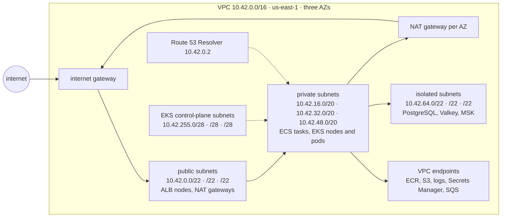
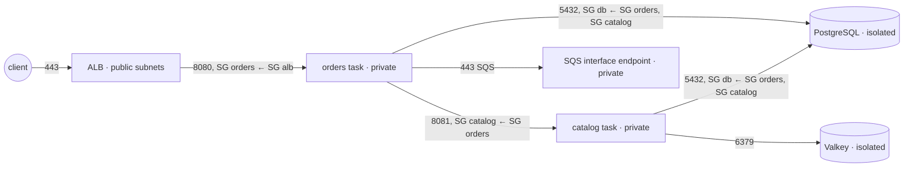

# Networking · L100 — VPC for containers

**Level:** 100 · **Time:** ~45 min · **Prerequisites:**
[Containers explained](../01-container-fundamentals/L100-containers-explained.md), an AWS account
you are allowed to create a VPC in, the AWS CLI configured for `us-east-1`

**After this document you can:**

- Draw the VPC a container platform needs (public, private and isolated subnets across three
  Availability Zones, plus the small subnets EKS wants for its control plane) and explain every
  route in it
- Say which of a security group or a network ACL you need for a given rule, and why the answer
  is almost always the security group
- Explain how an ECS task or an EKS pod ends up with an IP address from your subnet, and what
  that means for subnet sizing and security groups
- Recognise the four load balancer types and pick the one a container HTTP service needs
- Diagnose the three most common "my container cannot reach anything" failures with `aws ec2`
  commands instead of guesswork

## 1. Mental model



A VPC is a private, software-defined network that you carve into subnets, one subnet per
Availability Zone per purpose. Containers do not change the model: an ECS task or an EKS pod is
an ordinary tenant of a subnet with an ordinary VPC IP address, an ordinary security group and
the same route table as everything else in that subnet. What containers change is *density*: a
single EC2 instance may hold fifty pods, each needing an address, so a subnet that felt generous
for virtual machines runs dry. The design problem this document solves is therefore threefold:
put internet-facing things (load balancers, NAT gateways) in public subnets, put compute in
private subnets that can reach out but cannot be reached from the internet, put data in isolated
subnets that reach nothing outside the VPC, and size the private subnets for pods, not for hosts.

## 2. Concepts

### 2.1 VPC, subnets and the address plan

A subnet lives in exactly one Availability Zone and is defined by a CIDR block. AWS reserves the
first four addresses and the last address of every subnet (network, VPC router, VPC DNS, future
use, broadcast), so a `/28` has 11 usable addresses, a `/22` has 1,019 and a `/20` has 4,091.
The repository uses one plan everywhere:

| Tier | Purpose | AZ a | AZ b | AZ c | Default route |
| --- | --- | --- | --- | --- | --- |
| Public | ALB and NLB nodes, NAT gateways, bastions if any | `10.42.0.0/22` | `10.42.4.0/22` | `10.42.8.0/22` | `0.0.0.0/0 → igw` |
| Private | ECS tasks, EKS nodes and pods, Fargate ENIs, interface endpoints | `10.42.16.0/20` | `10.42.32.0/20` | `10.42.48.0/20` | `0.0.0.0/0 → nat-<az>` |
| Isolated | RDS/Aurora, ElastiCache Valkey, MSK brokers | `10.42.64.0/22` | `10.42.68.0/22` | `10.42.72.0/22` | none beyond `local` |
| EKS control plane | cluster ENIs only, no workloads | `10.42.255.0/28` | `10.42.255.16/28` | `10.42.255.32/28` | `local` |
| Reserved | future pod CIDRs, a fourth AZ, secondary ranges | `10.42.80.0/20` onward | | | |

Why these shapes:

- **Public subnets are small.** Only load balancer nodes and NAT gateways live there, and a load
  balancer needs at least eight free addresses per subnet to scale. Nothing that runs your code
  needs a public IP.
- **Private subnets are big (`/20`).** They hold the only thing that grows without bound: pods
  and tasks. See §2.6 for why a node can consume dozens of addresses before a single pod runs.
- **Isolated subnets have no route to the internet at all**, not even through NAT. A database
  that cannot initiate an outbound connection cannot exfiltrate anything.
- **EKS control-plane subnets are `/28` and dedicated.** EKS places a small number of elastic
  network interfaces (typically two, more during upgrades) in subnets you name at cluster
  creation, and it must be able to add more during upgrades and scaling. The EKS documentation asks for at least six free addresses and recommends
  sixteen, hence a `/28` per AZ. Keeping them separate means a subnet exhausted by pods can never
  block a control-plane operation (see
  [EKS L300](../04-eks/L300-eks-internals-and-operations.md) for the cluster ENI mechanics).
- **The whole VPC is a `/16` from `10.0.0.0/8`, chosen to not overlap** with any other VPC or
  office network you may peer with later. Overlaps cannot be fixed after the fact without
  re-addressing. [L400](L400-network-architecture-at-scale.md) covers planning many of these.

### 2.2 Route tables, internet gateway and NAT

Every subnet is associated with exactly one route table; a route table can serve many subnets.
Each table starts with the `local` route for the VPC CIDR, which is how anything in the VPC
reaches anything else regardless of subnet. What makes a subnet "public" is only its route table:
a `0.0.0.0/0` route to an **internet gateway** (IGW) plus a public IP on the resource. A
"private" subnet routes `0.0.0.0/0` to a **NAT gateway**, an AWS-managed device that sits in a
public subnet, translates private source addresses to its own Elastic IP, and lets replies back
in. Nothing from the internet can initiate a connection to a private address through NAT.

Rules that matter for containers:

- **One NAT gateway per AZ**, each in its AZ's public subnet, and each private subnet routes to
  the NAT gateway in *its own* AZ. A single shared NAT gateway saves about $32 a month per AZ and
  costs you the AZ independence you are paying three AZs for, plus cross-AZ data transfer on
  every byte that leaves the VPC.
- **NAT is what makes image pulls work from private subnets** unless you add VPC endpoints for
  ECR, S3, CloudWatch Logs and Secrets Manager (see
  [L200 §2.9](L200-load-balancing-ingress-and-discovery.md) and
  [ECR L200](../02-ecr/L200-lifecycle-scanning-access-and-endpoints.md)). A Fargate task in a
  private subnet with neither will stop within a minute with
  `ResourceInitializationError` — the most common first failure on ECS.
- **NAT costs per gigabyte** ($0.045/GB processed in `us-east-1` as of September 2026; verify on
  the pricing page) on top of the hourly charge. Pulling a 500 MB image onto 50 nodes through NAT
  every deploy adds up; that is one reason interface endpoints and pull-through caches exist.
- **IPv6 does not use NAT.** Private IPv6 subnets use an **egress-only internet gateway**,
  which is the IPv6 equivalent of "outbound yes, inbound no" without address translation.
  [L300 §2.4](L300-container-networking-internals.md) covers dual-stack and IPv6-only.

### 2.3 Security groups vs network ACLs

| | Security group | Network ACL |
| --- | --- | --- |
| Attaches to | an elastic network interface: task ENI, node ENI, ALB node, endpoint, database | a subnet (all ENIs in it) |
| State | stateful: a reply to an allowed connection is allowed automatically | stateless: request *and* reply need rules, including ephemeral ports `1024–65535` |
| Rule types | allow only; all rules are evaluated together | allow and deny; numbered, first match wins |
| Sources and destinations | CIDR, managed prefix list, or **another security group** | CIDR only |
| Default | no inbound, all outbound | the VPC's default NACL allows everything |
| Quotas (default, adjustable) | 5 per ENI, 60 inbound + 60 outbound rules | 20 rules (maximum 40) |
| Use for containers | the only firewall you configure daily: `ALB SG → task SG on 8080`, `task SG → database SG on 5432` | a coarse subnet-level guard, or a deliberate blast radius (chaos tests use NACLs to black-hole a subnet) |

The security-group *reference* is the important trick: instead of allowing `10.42.16.0/20` into
the database, you allow "anything carrying the `orders` security group". Tasks come and go and
change addresses; the rule stays correct. It also documents intent: reading the database security
group tells you exactly which services may connect.

Security groups apply to the ENI, so *who owns the ENI* determines what they protect: an `awsvpc`
task or a Fargate pod has its own ENI and therefore its own security groups; a pod on an EKS
node normally shares the node's ENIs and therefore the node's security groups (the exception,
security groups for pods, is an L300 topic).

### 2.4 The Elastic Load Balancing family

| | Application Load Balancer | Network Load Balancer | Gateway Load Balancer | Classic Load Balancer |
| --- | --- | --- | --- | --- |
| Layer | 7: HTTP/1.1, HTTP/2, gRPC, WebSocket | 4: TCP, UDP, TLS | 3: transparent, GENEVE on 6081 | legacy 4/7 |
| Routes on | host, path, header, query string, method, source IP; weighted target groups | listener port; flow hash to a target | route-table steering into security appliances | none worth using |
| Static IP | no (DNS name that changes) | yes, one per AZ, optionally Elastic IPs | endpoints in your subnets | no |
| Client IP seen by the container | in `X-Forwarded-For` | preserved by default | preserved (inline) | header |
| TLS | terminates with ACM certificates, SNI, optional mTLS | terminates (TLS listener) or passes through | passes through | terminates |
| Target types | `instance`, `ip`, `lambda` | `instance`, `ip`, `alb` | `instance`, `ip` | `instance` |
| Use it for | every HTTP API, web front end, Kubernetes Ingress | non-HTTP protocols, PrivateLink services, static IP requirements, very high connection rates | firewalls and inspection appliances | nothing new; migrate |

For the shopfront `orders` and `catalog` services the answer is an ALB with `ip` targets;
[L200](L200-load-balancing-ingress-and-discovery.md) explains every setting.

### 2.5 DNS in a VPC

Every VPC has a resolver, the **Route 53 Resolver**, reachable at the VPC base address plus two
(`10.42.0.2` here) and at the link-local address `169.254.169.253`. It answers for:

- AWS-provided hostnames (`ip-10-42-20-11.ec2.internal` in `us-east-1`), when
  `enableDnsSupport` and `enableDnsHostnames` are both on — leave them on; private hosted zones
  and interface-endpoint private DNS depend on them;
- **private hosted zones** associated with the VPC, which is how AWS Cloud Map publishes
  `catalog.shopfront.local` and how an interface endpoint makes `sqs.us-east-1.amazonaws.com`
  resolve to a private address inside the VPC;
- public names, recursively, so `sqs.us-east-1.amazonaws.com` resolves to public addresses when
  you have no endpoint.

Containers inherit this resolver: an ECS task's `/etc/resolv.conf` points at `10.42.0.2`; an EKS
pod points at CoreDNS, which forwards anything outside `cluster.local` to `10.42.0.2`. The
resolver has a hard limit of 1,024 packets per second per ENI, which is invisible at this level
and very visible at [L300 §2.6](L300-container-networking-internals.md) and
[L400 §2.7](L400-network-architecture-at-scale.md).

### 2.6 How a task or a pod gets an IP address

| Platform | Who owns the address | Mechanism | Security groups apply to | Addresses consumed per unit |
| --- | --- | --- | --- | --- |
| ECS on Fargate (`awsvpc`) | the task | Fargate creates one ENI per task in your subnet; every container in the task shares it (`localhost` between containers) | the task's ENI | 1 per task |
| ECS on EC2, `awsvpc` mode | the task | the ECS agent attaches a task ENI to the instance (or a branch of a trunk ENI, see L300); host port equals container port | the task's ENI | 1 per task, plus the instance |
| ECS on EC2, `bridge` or `host` mode | the instance | Docker NAT on `docker0` with dynamic host ports, or the host's own stack | the instance's ENI | 1 per instance |
| EKS on EC2 nodes (Amazon VPC CNI) | the pod | the CNI hands each pod a **secondary IP** (or an address from a `/28` prefix) already attached to one of the node's ENIs; a veth pair connects the pod to the node; no overlay network | the node's ENIs (or the pod's own branch ENI with security groups for pods) | pods per node × 1, but the node **pre-allocates** a warm pool: an `m5.large` can hold 3 ENIs × 10 addresses = 30 addresses with a single pod running |
| EKS on Fargate | the pod | one ENI per pod, private subnets only | the cluster security group (or a `SecurityGroupPolicy`) | 1 per pod |
| EKS Auto Mode | the pod | the built-in VPC CNI, same model as EC2 nodes, with node and pod subnets/security groups set on the `NodeClass` | the node's ENIs | as for EC2 nodes |

Two consequences drive the address plan above. First, **pod and task addresses are real VPC
addresses**: a security group on an RDS instance can allow the pod's address range, a VPC flow
log shows pod addresses, and an ALB can target a pod directly (`ip` target type). Second, **a
node reserves addresses ahead of demand** so that pod start-up does not wait on an EC2 API call;
with the default warm pool an `m5.4xlarge` allocates two ENIs × 30 addresses = 60 addresses
before a single pod runs, so ten of them hold 600 addresses while scheduling nothing. The
arithmetic, and the
knobs that change it (prefix delegation, custom networking, IPv6), live in
[L300 §2.4](L300-container-networking-internals.md).

### 2.7 The three-tier layout, end to end

Putting it together for shopfront on ECS Fargate (the EKS picture differs only in who owns the
ENIs):

1. A request to `https://api.shopfront.example.com/orders` resolves, through Route 53, to the
   ALB's public addresses (one per AZ) in the public subnets.
2. The ALB's security group allows `443` from the internet; its listener terminates TLS with an
   ACM certificate and forwards to the `orders` target group, whose targets are task ENI
   addresses in the private subnets, port `8080`.
3. The `orders` task security group allows `8080` only from the ALB security group. The task
   calls `catalog` on `8081` (the `catalog` security group allows `8081` from `orders`), PostgreSQL
   on `5432` in an isolated subnet (allowed from `orders` and `catalog`), and SQS through an
   interface endpoint or the NAT gateway.
4. Nothing in a private or isolated subnet has a public address; everything that must reach the
   internet does so through the NAT gateway of its own AZ.



### 2.8 Link-local addresses you will meet immediately

Some addresses in `169.254.0.0/16` never appear in a route table and are answered by the
platform itself. You need to recognise them before you understand them:

| Address | Answers as | Why a container talks to it |
| --- | --- | --- |
| `169.254.169.254` | EC2 Instance Metadata Service (IMDS) | the *node's* identity and credentials; containers should generally not reach it |
| `169.254.170.2` | ECS task metadata endpoint and task-role credentials | how an ECS task learns its own metadata and gets its IAM role |
| `169.254.170.23` | EKS Pod Identity agent | how an EKS pod gets its IAM role with Pod Identity |
| `169.254.169.253` | Route 53 Resolver | DNS |
| `169.254.169.123` | Amazon Time Sync Service | NTP |

The complete table, the IPv6 equivalents and the mechanics (including why IMDS must usually be
blocked from containers) are in [L300 §2.1–2.2](L300-container-networking-internals.md).

## 3. How it interacts with the rest of AWS

| Component | Talks to | Protocol/API | Prerequisite (IAM, network, DNS) | What breaks if missing |
| --- | --- | --- | --- | --- |
| Fargate task or EKS node | Amazon ECR and S3 (image layers) | HTTPS 443 | route to the internet via NAT, or `ecr.api` + `ecr.dkr` interface endpoints + S3 gateway endpoint | `CannotPullContainerError`, `ResourceInitializationError`, `ImagePullBackOff` |
| Task or pod | Route 53 Resolver `10.42.0.2` | DNS UDP/TCP 53 | `enableDnsSupport`, a NACL that allows 53 and ephemeral ports | every name lookup fails; SDK calls hang |
| ALB node | task or pod target | HTTP on the container port | target security group allows the ALB security group; ALB subnets in ≥ 2 AZs with ≥ 8 free addresses each | targets `unhealthy`, `503` from the ALB |
| ECS agent on EC2 | ECS control plane | HTTPS 443 | NAT or `ecs`, `ecs-agent`, `ecs-telemetry` endpoints | instance never registers; tasks stay `PENDING` |
| EKS node | EKS API endpoint | HTTPS 443 | cluster security group; route to the cluster ENIs (private endpoint) or to the internet (public endpoint) | node `NotReady`, never joins |
| EKS control plane | kubelet on nodes | TCP 10250 from cluster ENIs | cluster security group allows the control plane | `kubectl logs/exec` fail, metrics-server empty |
| Task or pod | AWS APIs (SQS, Secrets Manager, CloudWatch Logs) | HTTPS 443 | NAT or interface endpoints; IAM role | `EndpointConnectionError`, log driver blocks start-up |
| ECS task | `169.254.170.2` | HTTP 80 (link-local) | nothing to configure; provided by the agent or Fargate | SDK finds no credentials, `AccessDenied` |
| Internet client | ALB | HTTPS 443 | IGW route on ALB subnets, ALB security group, Route 53 record | connection timeout |

Three interactions that surprise people:

- **Image pulls are network traffic from your subnet.** On Fargate platform version `1.4.0` the
  pull uses the task's own ENI, so the task's subnet, route table and security group (outbound
  443) decide whether the pull succeeds. There is no "AWS side channel".
- **The EKS control plane lives outside your VPC but reaches into it** through cluster ENIs in
  the subnets you named. Those ENIs carry the cluster security group; delete or tighten it and
  `kubectl exec` stops working while the cluster looks healthy.
- **Credentials arrive over the network too**, from link-local addresses. A NACL that denies
  `169.254.0.0/16` "to be safe" removes every task's IAM role.

## 4. Use it when / avoid it when

Use this layout when:

- you run anything internet-facing: it keeps compute unreachable from outside by construction;
- you expect more than a handful of pods per node: `/20` private subnets postpone IP exhaustion
  for years on a mid-size cluster;
- you want per-AZ independence: one NAT gateway and one set of subnets per AZ lets an AZ fail
  without touching the others;
- you will add EKS later: the `/28` control-plane subnets cost nothing now and avoid a cluster
  rebuild later.

Avoid or adapt it when:

- the workload has no internet dependency at all (batch inside the VPC): drop the NAT gateways,
  use endpoints only, and save the hourly charge — this is the fully private design of
  [L400 §2.5](L400-network-architecture-at-scale.md);
- you need pods to have more addresses than the VPC can spare: use a secondary CIDR with custom
  networking or IPv6 ([L300 §2.4](L300-container-networking-internals.md)) instead of a bigger
  primary range;
- the VPC is shared by many teams or accounts: subnet sharing and Transit Gateway change who
  owns route tables ([L400 §2.2](L400-network-architecture-at-scale.md));
- you are running a laptop demo: the `labs/local` Compose stack needs none of this.

Alternatives, one line each:

- **Public subnets only, tasks with public IPs**: no NAT cost, every task reachable from the
  internet by security group alone; acceptable for a throwaway lab, wrong for anything else.
- **Single NAT gateway**: cheaper by two hourly charges; an AZ outage or a NAT failure takes egress
  down for all three AZs and every cross-AZ byte is billed.
- **VPC endpoints instead of NAT**: predictable, private, no per-gigabyte NAT fee for AWS
  services; each interface endpoint costs about $7/month per AZ and covers one service only.

## 5. Well-Architected view

| Pillar | What the VPC layout gives you | What it costs you | Practice to apply |
| --- | --- | --- | --- |
| Operational Excellence | one plan reused by every environment; failures map to a subnet, route or security group | route tables and security groups are easy to drift by hand | define the VPC in CloudFormation (`01-network.yaml`), never edit in the console; tag subnets by tier |
| Security | compute and data unreachable from the internet; security-group references encode allowed flows | more moving parts than a flat network | isolated subnets for data; SG-to-SG rules; no `0.0.0.0/0` inbound anywhere but the ALB; leave the default NACL alone |
| Reliability | per-AZ subnets and NAT gateways; load balancers across AZs | three of everything | spread tasks and pods across all AZs; one NAT per AZ; keep `/28` control-plane subnets separate |
| Performance Efficiency | no overlay, no encapsulation: pod-to-pod is plain VPC routing at instance line rate | none at this level | keep chatty services in the same AZ where possible (L400 covers cost of cross-AZ) |
| Cost Optimization | small public subnets, isolated subnets without NAT | NAT gateways ($0.045/h each plus per-GB) and interface endpoints are the recurring fees | gateway endpoints for S3 (free); interface endpoints for high-volume services (ECR, logs); measure NAT bytes |
| Sustainability | right-sized subnets avoid re-addressing churn | — | prefer fewer, larger private subnets over many tiny ones you will abandon |

The [Amazon ECS Best Practices Guide](https://docs.aws.amazon.com/AmazonECS/latest/bestpracticesguide/networking.html)
and the [EKS Best Practices Guide](https://docs.aws.amazon.com/eks/latest/best-practices/networking.html)
both start from this same three-tier picture.

## 6. Failure modes and troubleshooting

| Symptom | Likely cause | How to confirm (command/metric) | Fix |
| --- | --- | --- | --- |
| Fargate task stops with `ResourceInitializationError: unable to pull secrets or registry auth` | private subnet with no NAT route and no ECR/Secrets Manager endpoints | `aws ecs describe-tasks --cluster shopfront-dev --tasks <arn> --query 'tasks[0].stoppedReason'`; `aws ec2 describe-route-tables --filters Name=association.subnet-id,Values=<subnet>` shows no `0.0.0.0/0` | add the NAT route or the endpoints; see [image pull failures](../../playbooks/incidents/image-pull-failures.md) and [ECS task stopped reasons](../../playbooks/incidents/ecs-task-stopped-reasons.md) |
| Task in a public subnet cannot reach the internet | `assignPublicIp: DISABLED`, or the route table has no IGW route | `aws ec2 describe-network-interfaces --network-interface-ids <eni> --query 'NetworkInterfaces[0].Association.PublicIp'` is empty | enable `assignPublicIp`, or move the task to a private subnet with NAT (preferred) |
| Pod stays `Pending`, event `failed to assign an IP address to container` | subnet out of addresses (warm pools on many nodes, small subnet) | `kubectl describe pod`; `aws ec2 describe-subnets --subnet-ids <id> --query 'Subnets[0].AvailableIpAddressCount'` | bigger subnets, prefix delegation, custom networking; see [pending pods and capacity](../../playbooks/incidents/pending-pods-and-capacity.md) |
| ALB shows every target `unhealthy` right after a deploy | target security group does not allow the ALB security group on the container port, or health-check path is not `/readyz` | `aws elbv2 describe-target-health --target-group-arn <arn>` shows `Target.Timeout` (security group) or `Target.ResponseCodeMismatch` (path/code) | fix the SG reference or the health-check path; see [ALB 5xx and unhealthy targets](../../playbooks/incidents/alb-5xx-and-unhealthy-targets.md) |
| `kubectl` times out from your laptop | API endpoint is private-only, or public access CIDRs exclude you | `aws eks describe-cluster --name shopfront-dev --query 'cluster.resourcesVpcConfig.[endpointPublicAccess,endpointPrivateAccess,publicAccessCidrs]'` | connect from inside the VPC (SSM, VPN) or add your CIDR; see [EKS auth and access](../../playbooks/incidents/eks-auth-and-access.md) |
| Node never becomes `Ready` | node cannot reach the API endpoint (route, cluster security group, no NAT for a public-only endpoint) | `aws ec2 describe-security-groups --group-ids <cluster-sg>`; on the node `curl -sk https://<endpoint>/healthz` | allow 443 between node SG and cluster SG; enable the private endpoint; see [node NotReady](../../playbooks/incidents/node-not-ready.md) |
| Name resolution fails inside containers only | custom DHCP option set without `AmazonProvidedDNS`, or a NACL blocking UDP/TCP 53 or ephemeral ports | from a task via ECS Exec: `dig @10.42.0.2 sqs.us-east-1.amazonaws.com`; `aws ec2 describe-network-acls` | restore `AmazonProvidedDNS`; fix the NACL; see [DNS failures](../../playbooks/incidents/dns-failures.md) |
| Service in an isolated subnet cannot reach S3 | no S3 gateway endpoint on the isolated route table | `aws ec2 describe-vpc-endpoints --filters Name=service-name,Values=com.amazonaws.us-east-1.s3 --query 'VpcEndpoints[].RouteTableIds'` | add the gateway endpoint to the isolated route tables |

## 7. Signals: metrics, logs, traces

- **NAT gateway** (`AWS/NATGateway`): `BytesOutToDestination` and `BytesInFromDestination`
  tell you what you pay for; `ErrorPortAllocation` above zero means a destination is saturated
  (55,000 connections per destination per NAT IP); `PacketsDropCount` above zero is an AWS-side
  problem worth a support case.
- **Subnet free addresses**: not a CloudWatch metric. Poll
  `aws ec2 describe-subnets --query 'Subnets[].[SubnetId,AvailableIpAddressCount]'` from a
  scheduled job and alarm below 10 % free; the VPC CNI publishes `awscni_*` metrics for the node
  side (L300).
- **ALB** (`AWS/ApplicationELB`): `HealthyHostCount` and `UnHealthyHostCount` per target group
  are the first thing to graph after a deploy; `HTTPCode_ELB_5XX_Count` versus
  `HTTPCode_Target_5XX_Count` tells you whether the load balancer or your code produced the error.
- **VPC Flow Logs**: count `REJECT` records by destination port to find the security group or
  NACL rule you forgot; remember that link-local traffic (DNS to the resolver, IMDS) is not
  logged at all.
- **ECS**: `stoppedReason` on stopped tasks and the service events
  (`aws ecs describe-services --query 'services[0].events[:5]'`) name network causes in plain
  words.
- **EKS**: `kubectl get events -A --field-selector type=Warning` surfaces `FailedCreatePodSandBox`
  (IP or CNI problem) and `Unhealthy` (probe reached but failed).

The full table with thresholds is in [`reference/metrics-catalog.md`](../../reference/metrics-catalog.md).

## 8. Testing and DR notes

Testing the network layer at this level means proving reachability before you deploy code:

- **VPC Reachability Analyzer** answers "can this ENI reach that ENI on port 8080" by analysing
  route tables, security groups and NACLs without sending a packet; it costs a few cents per
  analysis and is the fastest way to prove a security-group chain (§9 shows the commands).
- **Security-group review**: `aws ec2 describe-security-group-rules --filters Name=group-id,Values=<sg>`
  is the artifact to attach to a change request; a rule with `0.0.0.0/0` inbound on anything but
  the ALB is a finding.
- **Game day, first version**: with AWS FIS `aws:network:disrupt-connectivity` on one private
  subnet, watch shopfront keep serving from the other two AZs; the exercise proves the per-AZ
  layout and the load balancer's health checks together
  ([Testing L300](../11-testing-workloads/L300-performance-and-chaos-testing.md)).

Disaster recovery for a VPC is a configuration problem, not a data problem: the VPC holds no
state. What must exist to rebuild it in another Region is the template (`01-network.yaml`), a
CIDR plan that does not overlap the primary Region's (`10.42.0.0/16` here, `10.43.0.0/16` for a
second Region, so the two can be peered or attached to a Transit Gateway later), and a Route 53
zone that can point `api.shopfront.example.com` at the other Region's load balancer. Security
groups, endpoints, NAT gateways and load balancers are all per-Region and must be created there;
the RTO of the network layer is the CloudFormation deploy time, typically under ten minutes.
[Resilience L300](../10-resilience-and-dr/L300-dr-strategies-for-container-platforms.md) puts the
network into the full DR picture.

## 9. Hands-on

Deploy the lab VPC and read it back. The template is
[`labs/ecs/cloudformation/01-network.yaml`](../../labs/ecs/cloudformation/01-network.yaml); the
deploy script prints the target account and requires the confirmation variable documented in
[`labs/README.md`](../../labs/README.md). Confirm the account first and treat an unknown one as
production:

```bash
aws sts get-caller-identity --query 'Account' --output text   # expect 123456789012
```

Read the layout back with the CLI:

```bash
VPC_ID=$(aws ec2 describe-vpcs --filters Name=cidr,Values=10.42.0.0/16 \
  --query 'Vpcs[0].VpcId' --output text)

aws ec2 describe-subnets --filters Name=vpc-id,Values="$VPC_ID" \
  --query 'Subnets[].[SubnetId,AvailabilityZone,CidrBlock,AvailableIpAddressCount,MapPublicIpOnLaunch]' \
  --output table
# Observe: three tiers per AZ, /28 control-plane subnets, MapPublicIpOnLaunch true only on public ones.

aws ec2 describe-route-tables --filters Name=vpc-id,Values="$VPC_ID" \
  --query 'RouteTables[].{id:RouteTableId,routes:Routes[].[DestinationCidrBlock,GatewayId,NatGatewayId]}' \
  --output json
# Observe: public tables route 0.0.0.0/0 to igw-…, private tables to a nat-… in the same AZ,
# isolated tables have only the local route (and the S3 gateway endpoint prefix list).

aws ec2 describe-nat-gateways --filter Name=vpc-id,Values="$VPC_ID" \
  --query 'NatGateways[].[NatGatewayId,SubnetId,State,NatGatewayAddresses[0].PublicIp]' --output table
```

After the ECS services are up (`04-services.yaml`), follow one task to its ENI:

```bash
TASK=$(aws ecs list-tasks --cluster shopfront-dev --service-name orders \
  --query 'taskArns[0]' --output text)
ENI=$(aws ecs describe-tasks --cluster shopfront-dev --tasks "$TASK" \
  --query "tasks[0].attachments[0].details[?name=='networkInterfaceId'].value" --output text)
aws ec2 describe-network-interfaces --network-interface-ids "$ENI" \
  --query 'NetworkInterfaces[0].[PrivateIpAddress,SubnetId,Groups[].GroupName,Association.PublicIp]'
# Observe: a private address inside 10.42.16.0/20 (or the b/c subnet), the orders security group,
# and no public IP.
```

On EKS, confirm there is no overlay: node and pod addresses come from the same subnets.

```bash
kubectl get nodes -o wide                       # INTERNAL-IP inside the private subnets
kubectl -n shopfront get pods -o wide           # pod IPs inside the same subnets
```

Prove the security-group chain with Reachability Analyzer (ALB node to the task on 8080):

```bash
ALB_ENI=$(aws ec2 describe-network-interfaces \
  --filters "Name=description,Values=ELB app/shopfront-dev*" \
  --query 'NetworkInterfaces[0].NetworkInterfaceId' --output text)
NIP_ID=$(aws ec2 create-network-insights-path --source "$ALB_ENI" --destination "$ENI" \
  --protocol tcp --destination-port 8080 \
  --query 'NetworkInsightsPath.NetworkInsightsPathId' --output text)
NIA_ID=$(aws ec2 start-network-insights-analysis --network-insights-path-id "$NIP_ID" \
  --query 'NetworkInsightsAnalysis.NetworkInsightsAnalysisId' --output text)
sleep 20
aws ec2 describe-network-insights-analyses --network-insights-analysis-ids "$NIA_ID" \
  --query 'NetworkInsightsAnalyses[0].[Status,NetworkPathFound,Explanations[].ExplanationCode]'
# Observe: NetworkPathFound true. Remove the ALB rule from the orders security group and re-run:
# the explanation names the security group that blocks the path.
```

## 10. Check yourself

1. A Fargate task in `10.42.16.0/20` stops within a minute with `ResourceInitializationError`.
   The image is in ECR in the same account. What are the two possible network causes?

<details><summary>Answer</summary>
The task's subnet has no path to ECR: either the private route table lacks a `0.0.0.0/0` route
to a NAT gateway, or (in a design without NAT) the `ecr.api`, `ecr.dkr` interface endpoints and
the S3 gateway endpoint are missing or lack private DNS. On Fargate platform 1.4.0 the pull uses
the task ENI, so the task's own subnet and security group (outbound 443) decide the outcome.
</details>

2. The `orders` task opens a connection to PostgreSQL on `5432` in an isolated subnet. Which
   rules do you need if the database is protected by a security group, and which if the subnet
   is protected by a network ACL?

<details><summary>Answer</summary>
Security group: one inbound rule on the database security group allowing `5432` from the
`orders` security group; the reply is allowed automatically because security groups are stateful.
Network ACL: an inbound rule allowing `5432` from the private subnets *and* an outbound rule
allowing ephemeral ports `1024–65535` back to them, because NACLs are stateless; the private
subnets' NACL needs the mirror image.
</details>

3. How many usable addresses does `10.42.16.0/20` have, and why can an EKS cluster with ten
   nodes and twenty pods have consumed hundreds of them?

<details><summary>Answer</summary>
4,096 minus the 5 AWS reserves = 4,091. The VPC CNI pre-allocates secondary addresses on each
node's ENIs (a warm pool, one spare ENI's worth by default) so that pods start without waiting
on EC2 API calls; an `m5.4xlarge` allocates 2 × 30 = 60 addresses before running a single pod
and can grow to 8 × 30 = 240. Pods consume addresses from the pool, not from the subnet directly.
</details>

4. Why does EKS ask for dedicated `/28` subnets, and would you run nodes in them?

<details><summary>Answer</summary>
EKS creates cluster ENIs in the subnets you name so that the control plane can reach kubelets
and so that a private API endpoint has addresses in your VPC; it needs at least six free
addresses and recommends sixteen to add ENIs during upgrades and scaling. Dedicated subnets
guarantee those addresses are never consumed by pods. Nodes and pods go in the large private
subnets, never in the control-plane subnets.
</details>

5. Why must the target group in front of Fargate tasks use the `ip` target type?

<details><summary>Answer</summary>
There is no EC2 instance to register: a Fargate task is reachable only through its own ENI's
private address. In `awsvpc` mode the container port is the host port, so ECS registers
`<task ENI IP>:<containerPort>` as the target. The same holds for EKS pods behind the Load
Balancer Controller with `target-type: ip`, which sends traffic straight to the pod address and
skips the node's kube-proxy hop.
</details>

## 11. Sources

- Amazon VPC User Guide: Subnets for your VPC — https://docs.aws.amazon.com/vpc/latest/userguide/configure-subnets.html
- Amazon VPC User Guide: NAT gateway basics — https://docs.aws.amazon.com/vpc/latest/userguide/nat-gateway-basics.html
- Amazon VPC User Guide: Control traffic to your AWS resources using security groups — https://docs.aws.amazon.com/vpc/latest/userguide/vpc-security-groups.html
- Amazon VPC User Guide: Control subnet traffic with network access control lists — https://docs.aws.amazon.com/vpc/latest/userguide/vpc-network-acls.html
- Amazon VPC User Guide: DNS attributes for your VPC — https://docs.aws.amazon.com/vpc/latest/userguide/vpc-dns.html
- Amazon EKS User Guide: View Amazon EKS networking requirements for VPC and subnets — https://docs.aws.amazon.com/eks/latest/userguide/network-reqs.html
- Amazon EKS User Guide: Assign IPs to Pods with the Amazon VPC CNI — https://docs.aws.amazon.com/eks/latest/userguide/managing-vpc-cni.html
- Amazon ECS Developer Guide: Amazon ECS task networking options for the Fargate launch type — https://docs.aws.amazon.com/AmazonECS/latest/developerguide/fargate-task-networking.html
- Amazon ECS Developer Guide: Amazon ECS task networking options for the EC2 launch type — https://docs.aws.amazon.com/AmazonECS/latest/developerguide/task-networking.html
- Amazon ECS Best Practices Guide: Networking — https://docs.aws.amazon.com/AmazonECS/latest/bestpracticesguide/networking.html
- Amazon EKS Best Practices Guide: Networking — https://docs.aws.amazon.com/eks/latest/best-practices/networking.html
- Elastic Load Balancing User Guide: What is Elastic Load Balancing? — https://docs.aws.amazon.com/elasticloadbalancing/latest/userguide/what-is-load-balancing.html
- Amazon EC2 User Guide: Instance metadata and user data — https://docs.aws.amazon.com/AWSEC2/latest/UserGuide/ec2-instance-metadata.html
- Amazon VPC Reachability Analyzer — https://docs.aws.amazon.com/vpc/latest/reachability/what-is-reachability-analyzer.html
- Amazon VPC pricing (NAT gateway, endpoints) — https://aws.amazon.com/vpc/pricing/
