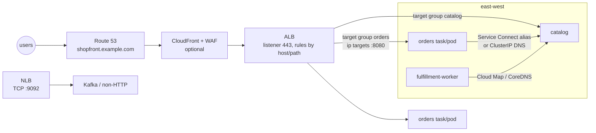

# Networking · L200 — Load balancing, ingress and discovery

**Level:** 200 · **Time:** ~75 min · **Prerequisites:** [L100 VPC for containers](L100-vpc-for-containers.md),
[ECS L200](../03-ecs/L200-task-definitions-services-and-scaling.md) or
[EKS L200](../04-eks/L200-cluster-components-and-add-ons.md)

**After this document you can:**

- Pick ALB, NLB or Gateway Load Balancer for a workload and configure listeners, target groups and
  health checks so deployments are error-free.
- Expose Kubernetes services with the AWS Load Balancer Controller (Ingress, IngressGroup,
  readiness gates, NLB Services) or Auto Mode's built-in load balancing.
- Put API Gateway or CloudFront in front of a load balancer correctly.
- Choose between Cloud Map DNS, ECS Service Connect and Kubernetes Services for east-west traffic.

## 1. Mental model



North-south traffic enters through an Elastic Load Balancing endpoint that sits in public subnets
and forwards to targets in private subnets: for HTTP that is an Application Load Balancer routing by
host and path to target groups whose targets are task or pod IPs; for TCP/UDP or static IPs it is a
Network Load Balancer. East-west traffic between services uses a discovery mechanism instead: a name
resolves to healthy instances (Cloud Map DNS, Kubernetes Services through CoreDNS) or a local proxy
does the routing (ECS Service Connect). The recurring mistake is treating these as interchangeable;
each fixes a different failure (health, staleness, retries, TLS) and each has a cost.

## 2. Concepts

### 2.1 ALB, NLB, Gateway Load Balancer

| | Application Load Balancer | Network Load Balancer | Gateway Load Balancer |
| --- | --- | --- | --- |
| Layer | 7 (HTTP/1.1, HTTP/2, gRPC, WebSocket) | 4 (TCP, UDP, TLS) | 3 (GENEVE to appliances) |
| Routing | host, path, header, query, method, source IP → target groups; weighted targets | port → target group | all traffic to an appliance fleet |
| Targets | `ip`, `instance`, Lambda, another ALB (via NLB) | `ip`, `instance`, ALB | `ip`, `instance` (appliances) |
| Client IP | `X-Forwarded-For`; source IP is the ALB | preserved (client IP visible to targets), unless `ip` targets with Proxy Protocol v2 needed for some cases | preserved |
| Static IP | no (use NLB in front or Global Accelerator) | yes, one per AZ, Elastic IPs | yes |
| TLS | termination with ACM, SNI, security policies, mTLS (verify or passthrough) | TLS listeners with ACM, or passthrough | passthrough |
| WAF | yes | no | no |
| Latency | milliseconds, added per request | microseconds, per flow | per flow |
| Health checks | HTTP/HTTPS/gRPC with path and matcher | TCP/HTTP/HTTPS | TCP/HTTP |
| Cross-zone | on by default (free within ALB) | off by default; enabling adds inter-AZ data transfer charges | configurable |
| Pricing | hours + LCUs (connections, bandwidth, rules, requests) | hours + NLCUs | hours + GLCUs |
| Use in shopfront | `orders` and `catalog` HTTP APIs | Kafka bootstrap for external producers, PrivateLink endpoints | inline firewalls/IDS |

### 2.2 Building the shopfront ALB with the CLI

```bash
ALB=$(aws elbv2 create-load-balancer --name shopfront-dev --scheme internet-facing --type application \
  --ip-address-type dualstack --subnets subnet-pub-a subnet-pub-b subnet-pub-c --security-groups sg-alb \
  --query 'LoadBalancers[0].LoadBalancerArn' --output text)

TG=$(aws elbv2 create-target-group --name shopfront-dev-orders --protocol HTTP --port 8080 --vpc-id vpc-0123 \
  --target-type ip --protocol-version HTTP1 \
  --health-check-protocol HTTP --health-check-path /readyz --health-check-interval-seconds 15 \
  --health-check-timeout-seconds 5 --healthy-threshold-count 2 --unhealthy-threshold-count 3 --matcher HttpCode=200 \
  --query 'TargetGroups[0].TargetGroupArn' --output text)

aws elbv2 modify-target-group-attributes --target-group-arn "$TG" --attributes \
  Key=deregistration_delay.timeout_seconds,Value=20 \
  Key=slow_start.duration_seconds,Value=30 \
  Key=load_balancing.algorithm.type,Value=least_outstanding_requests

aws elbv2 create-listener --load-balancer-arn "$ALB" --protocol HTTP --port 80 \
  --default-actions 'Type=redirect,RedirectConfig={Protocol=HTTPS,Port=443,StatusCode=HTTP_301}'
L443=$(aws elbv2 create-listener --load-balancer-arn "$ALB" --protocol HTTPS --port 443 \
  --ssl-policy ELBSecurityPolicy-TLS13-1-2-2021-06 \
  --certificates CertificateArn=arn:aws:acm:us-east-1:123456789012:certificate/4b1f2c3d-aaaa-bbbb-cccc-0123456789ab \
  --default-actions 'Type=fixed-response,FixedResponseConfig={StatusCode=404,ContentType=text/plain,MessageBody=no route}' \
  --query 'Listeners[0].ListenerArn' --output text)

aws elbv2 create-rule --listener-arn "$L443" --priority 10 \
  --conditions Field=host-header,Values=shopfront.example.com Field=path-pattern,Values='/orders*' \
  --actions Type=forward,TargetGroupArn="$TG"

aws elbv2 modify-load-balancer-attributes --load-balancer-arn "$ALB" --attributes \
  Key=idle_timeout.timeout_seconds,Value=60 Key=routing.http.drop_invalid_header_fields.enabled,Value=true \
  Key=access_logs.s3.enabled,Value=true Key=access_logs.s3.bucket,Value=shopfront-dev-alb-logs-123456789012 \
  Key=deletion_protection.enabled,Value=true
```

| Setting | Why this value |
| --- | --- |
| `--target-type ip` | tasks in `awsvpc` and pods with the VPC CNI are addressable by IP; required for Fargate; avoids the NodePort hop on EKS |
| health check `/readyz`, 15 s, 2/3 | readiness reflects dependencies; a task is marked healthy after ~30 s and unhealthy after ~45 s of failures; `/healthz` would keep routing to a task whose database is gone |
| `deregistration_delay 20` | the ALB stops sending new requests immediately and keeps in-flight connections for 20 s; the application drains within the same 20 s ([ECS L300 §2.10](../03-ecs/L300-ecs-internals.md)) |
| `slow_start 30` | new targets receive a growing share of requests for 30 s; useful for JIT runtimes and cold caches |
| `least_outstanding_requests` | better than round robin when request cost varies |
| HTTP→HTTPS redirect, TLS 1.3 policy | no plaintext; modern ciphers only |
| default action 404 | unknown hosts get nothing useful; rules route only known hosts |
| `drop_invalid_header_fields` | rejects header smuggling attempts |
| access logs to S3 | the only per-request record with target IP, response time split (`request_processing_time`, `target_processing_time`) and error reason |

Health check arithmetic: time to healthy = interval × healthy threshold (15 × 2 = 30 s); time to
unhealthy = interval × unhealthy threshold (45 s). Set ECS `healthCheckGracePeriodSeconds` above
the application's start time plus time-to-healthy so the scheduler does not kill slow starters; on
EKS the readiness gate (below) makes the rollout wait for the ALB.

Cross-zone: ALBs balance across all targets in all zones by default. NLBs default to zonal: each
NLB node sends only to targets in its AZ, so an AZ with no healthy targets returns errors for
clients that resolved that node's IP; enabling cross-zone fixes that at a data-transfer cost. Use the
regional DNS name unless you deliberately want zonal isolation ([L400 §2.5](L400-network-architecture-at-scale.md)).

TLS: ACM certificates renew automatically; SNI lets one listener serve many certificates; mTLS on
ALB can verify client certificates against a trust store or pass them through in headers. Put WAF
on internet-facing ALBs (`aws wafv2 associate-web-acl`). HTTP/2 to the client is on by default;
gRPC needs a target group with `--protocol-version GRPC` and a gRPC health check matcher.

### 2.3 Ingress on EKS: the AWS Load Balancer Controller

The controller watches `Ingress`, `Service` and `TargetGroupBinding` objects and reconciles ALBs,
NLBs, target groups, listeners and rules. Install it with a Pod Identity association and the values
in [`labs/eks/addons/aws-load-balancer-controller-values.yaml`](../../labs/eks/addons/aws-load-balancer-controller-values.yaml);
subnets must carry `kubernetes.io/role/elb` (public) or `kubernetes.io/role/internal-elb`
(private) tags for discovery.

| Annotation (`alb.ingress.kubernetes.io/`) | Meaning | shopfront value |
| --- | --- | --- |
| `scheme` | `internet-facing` or `internal` | `internet-facing` |
| `target-type` | `ip` or `instance` | `ip` |
| `group.name`, `group.order` | share one ALB across Ingresses; rule ordering | `shopfront`, `10` |
| `listen-ports` | JSON list of listeners | `[{"HTTP":80},{"HTTPS":443}]` |
| `ssl-redirect` | redirect HTTP to HTTPS | `443` |
| `certificate-arn` | ACM certificate(s) | ARN |
| `ssl-policy` | TLS policy | `ELBSecurityPolicy-TLS13-1-2-2021-06` |
| `healthcheck-path`, `healthcheck-interval-seconds`, `healthy-threshold-count`, `unhealthy-threshold-count`, `success-codes` | target group health check | `/readyz`, `15`, `2`, `3`, `200` |
| `target-group-attributes` | comma-separated attributes | `deregistration_delay.timeout_seconds=20,slow_start.duration_seconds=30` |
| `load-balancer-attributes` | ALB attributes | `idle_timeout.timeout_seconds=60,deletion_protection.enabled=true,access_logs.s3.enabled=true,access_logs.s3.bucket=…` |
| `wafv2-acl-arn` | WAF association | ARN |
| `subnets`, `security-groups`, `inbound-cidrs` | override discovery, attach your SG, restrict sources | usually omitted |
| `backend-protocol`, `backend-protocol-version` | HTTPS/gRPC to targets | `HTTP`, `HTTP1` |
| `actions.<name>`, `conditions.<name>` | advanced rules (fixed responses, redirects, weighted target groups) | canary weights ([08 L300](../08-delivery-cicd-gitops/L300-progressive-delivery-and-gitops-internals.md)) |

A complete Ingress is in [EKS L200 §2.9](../04-eks/L200-cluster-components-and-add-ons.md) and in
[`labs/eks/manifests/base/ingress.yaml`](../../labs/eks/manifests/base/ingress.yaml). Three features
that decide whether rollouts are clean:

- **IngressGroup**: several Ingresses (orders, catalog) with the same `group.name` share one ALB;
  `group.order` sequences the rules. One ALB per environment instead of one per service saves
  hours and gives one WAF/certificate surface.
- **Pod readiness gates**: label the namespace `elbv2.k8s.aws/pod-readiness-gate-inject: enabled`
  and the controller adds a readiness gate to pods behind an ALB. The pod becomes Ready (and the
  rollout proceeds) only when the target group reports it healthy, so `maxUnavailable: 0` rollouts
  never send traffic to a target the ALB has not yet checked.
- **IngressClassParams** (`elbv2.k8s.aws/v1beta1`): cluster-wide defaults (scheme, tags,
  `loadBalancerAttributes`, security groups, IP address type) attached to an `IngressClass`; teams
  write Ingresses without knowing the platform's policies.

`Service type: LoadBalancer` produces an NLB when annotated:

```yaml
apiVersion: v1
kind: Service
metadata:
  name: kafka-bootstrap
  namespace: streaming
  annotations:
    service.beta.kubernetes.io/aws-load-balancer-type: external
    service.beta.kubernetes.io/aws-load-balancer-nlb-target-type: ip
    service.beta.kubernetes.io/aws-load-balancer-scheme: internal
    service.beta.kubernetes.io/aws-load-balancer-cross-zone-load-balancing-enabled: "true"
    service.beta.kubernetes.io/aws-load-balancer-healthcheck-protocol: TCP
spec:
  type: LoadBalancer
  loadBalancerClass: service.k8s.aws/nlb
  selector: { app.kubernetes.io/name: kafka }
  ports: [{ port: 9092, targetPort: 9092 }]
```

`TargetGroupBinding` attaches a Service's pods to a target group created elsewhere (a CloudFormation
ALB shared with ECS, or blue/green target groups). Recent controller versions implement the
Kubernetes Gateway API (`GatewayClass`, `Gateway`, `HTTPRoute`), which separates the platform-owned
listener from team-owned routes; verify the supported version and feature set in the controller
docs before adopting.

In Auto Mode the controller is a managed capability: create an `IngressClass` whose controller is
`eks.amazonaws.com/alb` with an `IngressClassParams` of `eks.amazonaws.com/v1`; Ingress objects use
the same annotation family (verify per-annotation support in the Auto Mode documentation).

### 2.4 ECS side

An ECS service attaches to target groups through `loadBalancers[]` with `containerName` and
`containerPort`; ECS registers each task's IP when it reaches `ACTIVATING` and deregisters at
`DEACTIVATING` ([ECS L200 §2.5](../03-ecs/L200-task-definitions-services-and-scaling.md)). Native
blue/green and canary deployments need two target groups and a production plus test listener rule
per service. Fargate and `awsvpc` require `ip` target type; `bridge` mode uses `instance` targets
with dynamic ports.

### 2.5 API Gateway and CloudFront in front

**API Gateway HTTP API + VPC Link**: a private integration reaches an internal ALB, an NLB or a
Cloud Map service in your VPC; API Gateway adds JWT authorizers, throttling, usage plans (REST
API) and a managed edge. The ALB stays internal; the VPC Link ENIs in your private subnets need a
security group rule to the ALB. Cost per million requests is higher than an ALB alone, so use it for
the authentication/throttling features, not as a plain proxy.

**CloudFront**: caches static and cacheable API responses, terminates TLS at the edge, absorbs DDoS
with Shield, and hosts WAF. Protect the origin so nobody bypasses CloudFront: attach the
`com.amazonaws.global.cloudfront.origin-facing` managed prefix list to the ALB security group, and
add a custom origin header (`X-Origin-Verify: <secret>`) checked by an ALB listener rule or WAF rule.
Set the origin protocol to HTTPS and forward only the headers, cookies and query strings the
application needs so cache keys stay small.

### 2.6 Service discovery for east-west traffic

| | Cloud Map DNS | ECS Service Connect | Kubernetes Service + CoreDNS |
| --- | --- | --- | --- |
| Registry | Cloud Map namespace (`shopfront.local`) → Route 53 private hosted zone | Cloud Map namespace, read by Envoy agents in each task | Endpoints/EndpointSlices in the API server |
| Name | `catalog.shopfront.local` | client alias `catalog:8081` inside tasks only | `catalog.shopfront.svc.cluster.local` (search domains make `catalog` work in-namespace) |
| Records | A (awsvpc) or SRV (bridge, dynamic ports); TTL 10–15 s | agent resolves per request | ClusterIP (kube-proxy load-balances) or headless (pod IPs) |
| Health | Cloud Map custom health from ECS container health checks | agent outlier detection + ECS health | readiness probes remove endpoints |
| Load balancing | client-side per DNS answer (and client caches) | per request, retries, timeouts | per connection (kube-proxy) |
| TLS | application's job | automatic with AWS Private CA | application's job or mesh |
| Telemetry | none | per client→server metrics in Container Insights | none beyond app metrics |
| Who can use it | anything in the VPC (EC2, Lambda in VPC, EKS) | ECS tasks in the namespace | pods in the cluster (and VPC clients only via a load balancer or `ip` Ingress) |
| Cost | Cloud Map + Route 53 queries | agent CPU/memory per task | none |

Choose Cloud Map DNS when non-ECS clients need the names or when tasks are few and traffic simple;
Service Connect when ECS services call each other and you want retries, metrics and TLS without
code; Kubernetes Services inside EKS always, with a mesh (Cilium, Istio) only when you need
identity-based policy or mTLS ([L300 §2.10](L300-container-networking-internals.md)). A Lambda
function reaches an ECS service through Cloud Map DNS (`servicediscovery:DiscoverInstances` or
DNS if in the VPC), an internal ALB, or VPC Lattice; it cannot use Service Connect aliases.

### 2.7 Endpoints the traffic path depends on

Private subnets need a route to the AWS APIs the platform uses: ECR (`ecr.api`, `ecr.dkr`, S3
gateway), STS, CloudWatch Logs, and for EKS `eks`/`eks-auth`, for ECS `ecs`, `ecs-agent`,
`ecs-telemetry`, for ECS Exec `ssmmessages`. Either NAT gateways or interface endpoints; the full
table with endpoint policies is in [L300 §2.9](L300-container-networking-internals.md) and
[`reference/ports-addresses-and-endpoints.md`](../../reference/ports-addresses-and-endpoints.md).

## 3. How it interacts with the rest of AWS

| Component | Talks to | Protocol/API | Prerequisite (IAM, network, DNS) | What breaks if missing |
| --- | --- | --- | --- | --- |
| ALB | targets (tasks/pods) | HTTP to target port from ALB nodes' private IPs | target SG allows ALB SG on 8080/8081; ALB in 2+ public subnets with 8+ free IPs each | targets `unhealthy`, `Target.Timeout` |
| ALB | ACM, WAF, S3 (logs) | control plane | certificate in the same Region; bucket policy for ELB log delivery | listener creation fails; no logs |
| Load balancer controller | ELB, EC2, ACM, WAF, Shield | AWS APIs via Pod Identity/IRSA | controller IAM policy; subnet tags | Ingress without address; events show the missing permission |
| ECS service | ELB | `RegisterTargets` through service-linked role | target type `ip`; health check path returns 200 | deployment stalls |
| Cloud Map | Route 53 | private hosted zone in the VPC | VPC DNS enabled (`enableDnsSupport`, `enableDnsHostnames`) | names do not resolve |
| Service Connect agent | Cloud Map, Private CA | discovery; certificate issuance | namespace; TLS role | `ResourceInitializationError` |
| API Gateway VPC Link | ALB/NLB | ENIs in private subnets | VPC Link SG → ALB SG | 5xx from the integration |
| CloudFront | ALB origin | HTTPS from CloudFront ranges | prefix list on ALB SG; origin header check | origin bypass or blocked origin |
| Route 53 | ALB/NLB | alias records; health checks | health check endpoint reachable from Route 53 checkers | failover never triggers |

## 4. Use it when / avoid it when

Use:

- ALB with `ip` targets, `/readyz` health checks, 20 s deregistration and readiness gates for every
  HTTP service; one ALB per environment via IngressGroup or shared listener rules.
- NLB for TCP/UDP, static IPs, PrivateLink, or as the front for an ALB when static IPs are
  mandatory.
- Cloud Map DNS when VPC clients outside ECS need the names; Service Connect for ECS-to-ECS.
- CloudFront + WAF in front of public ALBs; API Gateway when you need its authorizers and
  throttling.

Avoid:

- `/healthz` (liveness) as the load balancer health check; it hides dependency failures.
- `instance` targets for Fargate (impossible) or for EKS when `ip` is available.
- Deregistration delay of 300 s (the default) with `stopTimeout` 30 s: tasks are killed while the
  ALB still routes.
- One ALB per microservice; the hourly cost and the certificate/WAF sprawl grow linearly.
- Enabling NLB cross-zone without pricing the data transfer.

Alternatives: VPC Lattice for cross-account/cross-VPC service networking with SigV4 auth policies
([L300 §2.11](L300-container-networking-internals.md)); Global Accelerator for static anycast IPs
in front of ALBs across Regions.

## 5. Well-Architected view

| Pillar | What this layer gives you | What it costs you | Practice |
| --- | --- | --- | --- |
| Operational Excellence | one ALB per environment with rules; access logs; controller-managed reconciliation | annotation sprawl | IngressClassParams for defaults; log analysis in Athena |
| Security | TLS termination with ACM, WAF, origin protection, SG per target | certificate/WAF management | TLS 1.3 policy, WAF managed rules, `drop_invalid_header_fields` |
| Reliability | multi-AZ ALB, health checks on readiness, readiness gates, deregistration delay | correct timeouts are yours | `/readyz`, 20 s delay matched to drain, zonal awareness |
| Performance Efficiency | HTTP/2, gRPC, least outstanding requests, slow start | LCU cost with many rules | cache at CloudFront; keep rules few |
| Cost Optimization | shared ALBs, free ALB cross-zone | NLB cross-zone charges; per-service ALBs | IngressGroups; internal ALB for east-west only when needed |
| Sustainability | fewer load balancers | none | consolidate |

## 6. Failure modes and troubleshooting

| Symptom | Likely cause | How to confirm (command/metric) | Fix |
| --- | --- | --- | --- |
| `502` bursts during deployments | targets closing connections before deregistration ends; keep-alive mismatch | `HTTPCode_ELB_502_Count` aligned with deployments; access logs `target_status_code` `-` | drain ≥ deregistration delay; app keep-alive timeout > ALB idle timeout ([playbook](../../playbooks/incidents/alb-5xx-and-unhealthy-targets.md)) |
| `503` from ALB | no healthy targets in the target group | `HealthyHostCount = 0`; `describe-target-health` reasons | fix health path/SG/port; check readiness dependencies |
| `504` | target did not respond within idle timeout | `TargetResponseTime` p99 vs `idle_timeout` | raise idle timeout for long requests or fix slow paths |
| Targets `unhealthy` with `Target.Timeout` | SG blocks ALB → target | `aws elbv2 describe-target-health` | allow ALB SG on the target SG |
| Ingress has no ADDRESS | controller permission/subnet tags/duplicate `group.name` conflicts | `kubectl describe ingress`; controller logs | fix tags/permissions; check IngressClass |
| Rollout sends traffic to unready pods | no readiness gate; `minReadySeconds` 0 | namespace label missing | enable readiness gates |
| Clients see stale IPs after deployment | Cloud Map TTL or JVM DNS cache | TTL value; client cache settings | lower TTL, Service Connect, or client cache TTL ([playbook](../../playbooks/incidents/dns-failures.md)) |
| NLB clients in one AZ fail | zonal NLB with no healthy targets in that AZ | per-AZ `UnHealthyHostCount` | cross-zone on, or targets in every AZ |
| CloudFront origin bypassed | ALB reachable directly | direct `curl` to the ALB DNS works | prefix list SG + origin header rule |
| ECS deployment stuck at `IN_PROGRESS` | health check grace too short; targets never healthy | service events; `describe-target-health` | raise `healthCheckGracePeriodSeconds` ([playbook](../../playbooks/incidents/ecs-deployment-stuck-or-rolled-back.md)) |

## 7. Signals: metrics, logs, traces

- `AWS/ApplicationELB RequestCount`, `TargetResponseTime` (p50/p99), `HTTPCode_Target_2XX/4XX/5XX_Count`
  vs `HTTPCode_ELB_4XX/5XX_Count` (ELB-generated means routing/health, target-generated means the
  application), specifically `HTTPCode_ELB_502_Count` (target reset/closed), `503` (no healthy
  targets), `504` (timeout).
- `HealthyHostCount`, `UnHealthyHostCount` per target group and per AZ; `RequestCountPerTarget`
  for scaling; `ActiveConnectionCount`, `NewConnectionCount`, `RejectedConnectionCount` (ALB
  capacity), `TargetConnectionErrorCount`, `ELBAuthError` if using OIDC auth actions.
- `AWS/NetworkELB ActiveFlowCount`, `NewFlowCount`, `TCP_Target_Reset_Count`, `TCP_ELB_Reset_Count`,
  `UnHealthyHostCount` per AZ, `ProcessedBytes`.
- ALB access logs in S3 (query with Athena): `elb_status_code`, `target_status_code`,
  `request_processing_time`, `target_processing_time`, `response_processing_time`, `target:port`.
- Route 53 health check status (`HealthCheckStatus`) and Cloud Map `DiscoverInstances` counts;
  Route 53 Resolver query logs for DNS-based discovery volume.
- Controller: `kubectl get events -n shopfront --field-selector involvedObject.kind=Ingress`,
  controller pod logs for reconcile errors.

Full table: [`reference/metrics-catalog.md`](../../reference/metrics-catalog.md).

## 8. Testing and DR notes

Testing: run k6 through the ALB while deploying (`kubectl rollout restart` or `aws ecs
update-service --force-new-deployment`) and assert zero non-2xx; watch `aws elbv2
describe-target-health` cycle through `initial → healthy → draining`; test the health check path
against a deliberately broken dependency and confirm the target leaves the group within the
unhealthy threshold; use Reachability Analyzer from the ALB ENI to a target IP when security groups
are in doubt; verify CloudFront origin protection by curling the ALB directly (must fail).

DR: ALBs and NLBs are zonal-redundant within a Region and recreated from IaC in another Region;
Route 53 failover records with health checks or ARC routing controls move users; ARC zonal shift
moves traffic away from an impaired AZ at the load balancer (ALB/NLB) without redeploying. Keep
certificates in ACM in every Region you fail over to, and keep ALB names/tags deterministic so
DNS automation finds them ([10 L300](../10-resilience-and-dr/L300-dr-strategies-for-container-platforms.md)).

## 9. Hands-on

```bash
# ECS: the ALB, target groups, listener rules and deregistration delay are in one stack
grep -nE 'TargetType|HealthCheckPath|deregistration_delay|SslPolicy|Priority' labs/ecs/cloudformation/04-services.yaml | head -20
.venv/bin/cfn-lint labs/ecs/cloudformation/04-services.yaml

# EKS: the Ingress and controller values
cat labs/eks/manifests/base/ingress.yaml
grep -nE 'clusterName|serviceAccount|enableShield|defaultTags' labs/eks/addons/aws-load-balancer-controller-values.yaml

# After deploying (billable): follow a rollout from the load balancer's point of view
TG=$(aws elbv2 describe-target-groups --names shopfront-dev-orders --query 'TargetGroups[0].TargetGroupArn' --output text)
watch -n 2 "aws elbv2 describe-target-health --target-group-arn $TG --query 'TargetHealthDescriptions[].{ip:Target.Id,state:TargetHealth.State,reason:TargetHealth.Reason}' --output table"
kubectl -n shopfront rollout restart deploy/orders      # or: aws ecs update-service --cluster shopfront-dev --service orders --force-new-deployment
# Observe: new IPs appear as initial -> healthy before old ones go draining -> removed; no window with zero healthy.

# Health check semantics
curl -si https://shopfront.example.com/orders/does-not-exist | head -1     # 404 from the app (routed)
curl -si https://shopfront.example.com/ | head -1                           # 404 fixed response from the listener default
kubectl -n shopfront get ingress -o wide
kubectl -n shopfront get pods -o custom-columns=NAME:.metadata.name,GATES:.spec.readinessGates[*].conditionType
# Observe: readiness gate target-health.elbv2.k8s.aws/<tg> on every pod behind the ALB.
```

## 10. Check yourself

1. Why should the load balancer health check hit `/readyz` and not `/healthz`?

<details><summary>Answer</summary>
`/healthz` answers "the process is alive" and stays 200 while the database is unreachable; the
load balancer would keep sending requests that fail. `/readyz` reports dependency health, so a task
whose dependencies are down leaves the target group (and rejoins when they recover) without being
restarted. Liveness is for the orchestrator's restart decision; readiness is for routing.
</details>

2. Your NLB fronts Kafka in three AZs; producers in one AZ intermittently fail to connect. What is
   the likely cause?

<details><summary>Answer</summary>
NLBs are zonal by default: the NLB node in an AZ only forwards to targets in that AZ. If that AZ has
no healthy target (a broker down or a target group without a target there), clients that resolved
that node's IP get connection failures while other AZs work. Enable cross-zone load balancing
(accepting inter-AZ data charges) or ensure healthy targets in every enabled AZ.
</details>

3. What do pod readiness gates change in a Kubernetes rolling update behind an ALB?

<details><summary>Answer</summary>
Without them a pod is Ready as soon as its readiness probe passes, so the Deployment terminates an
old pod while the ALB may not yet have health-checked the new one, producing 5xx. With the gate
injected by the load balancer controller, the pod's Ready condition also requires the target group
to report it healthy, so the rollout waits for the ALB and traffic never reaches unchecked targets.
</details>

4. A Lambda function must call the `catalog` ECS service. Which discovery options work and which
   does not?

<details><summary>Answer</summary>
Cloud Map DNS works if the function runs in the VPC (`catalog.shopfront.local`) or via the Cloud Map
API (`DiscoverInstances`); an internal ALB works from the VPC; VPC Lattice works across accounts.
Service Connect client aliases do not work: they exist only inside tasks that run the Service
Connect agent.
</details>

5. Requests through CloudFront are protected by WAF, yet you see attack traffic hitting the
   application. What is missing?

<details><summary>Answer</summary>
Origin protection. The ALB is reachable directly by anyone who finds its DNS name, bypassing
CloudFront and WAF. Restrict the ALB security group to the `com.amazonaws.global.cloudfront.origin-facing`
prefix list and require a secret custom origin header verified by a listener rule or a WAF rule on
the ALB.
</details>

## 11. Sources

- Elastic Load Balancing product comparison — https://docs.aws.amazon.com/elasticloadbalancing/latest/userguide/how-elastic-load-balancing-works.html
- Application Load Balancer: target groups, health checks, attributes — https://docs.aws.amazon.com/elasticloadbalancing/latest/application/load-balancer-target-groups.html and https://docs.aws.amazon.com/elasticloadbalancing/latest/application/target-group-health-checks.html
- ALB deregistration delay and slow start — https://docs.aws.amazon.com/elasticloadbalancing/latest/application/edit-target-group-attributes.html
- Network Load Balancer: cross-zone and target groups — https://docs.aws.amazon.com/elasticloadbalancing/latest/network/network-load-balancers.html
- Gateway Load Balancer — https://docs.aws.amazon.com/elasticloadbalancing/latest/gateway/introduction.html
- ALB access log entries — https://docs.aws.amazon.com/elasticloadbalancing/latest/application/load-balancer-access-logs.html
- AWS Load Balancer Controller: Ingress annotations, IngressGroup, readiness gates, Service annotations, TargetGroupBinding, Gateway API — https://kubernetes-sigs.github.io/aws-load-balancer-controller/latest/
- Application load balancing on Amazon EKS Auto Mode — https://docs.aws.amazon.com/eks/latest/userguide/auto-configure-alb.html
- Amazon ECS service load balancing — https://docs.aws.amazon.com/AmazonECS/latest/developerguide/service-load-balancing.html
- API Gateway private integrations (VPC Link) — https://docs.aws.amazon.com/apigateway/latest/developerguide/http-api-private-integration.html
- Restricting access to Application Load Balancer origins (CloudFront) — https://docs.aws.amazon.com/AmazonCloudFront/latest/DeveloperGuide/restrict-access-to-load-balancer.html
- AWS Cloud Map service discovery — https://docs.aws.amazon.com/cloud-map/latest/dg/what-is-cloud-map.html
- Amazon ECS Service Connect — https://docs.aws.amazon.com/AmazonECS/latest/developerguide/service-connect.html
- Kubernetes Service and DNS — https://kubernetes.io/docs/concepts/services-networking/service/ and https://kubernetes.io/docs/concepts/services-networking/dns-pod-service/
- Amazon Application Recovery Controller zonal shift — https://docs.aws.amazon.com/r53recovery/latest/dg/arc-zonal-shift.html
