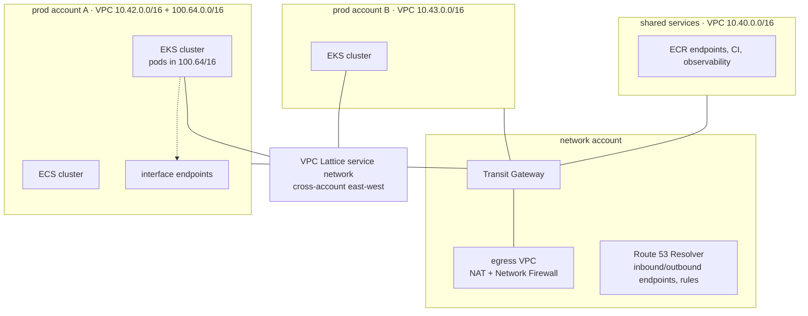

# Networking · L400 — Network architecture at scale

**Level:** 400 · **Time:** ~75 min · **Prerequisites:**
[L300 Container networking internals](L300-container-networking-internals.md),
[EKS L400](../04-eks/L400-eks-at-scale.md), [ECS L400](../03-ecs/L400-ecs-at-scale.md)

**After this document you can:**

- Plan IP space for a fleet of clusters across accounts and Regions without re-addressing later.
- Choose between shared VPCs, Transit Gateway, PrivateLink and VPC Lattice for each traffic class.
- Design egress control and fully private clusters that still pull images and reach AWS APIs.
- Build zonal isolation into the network and use ARC zonal shift in an incident.
- Model data-transfer costs and recognise the network failure stories that only appear at scale.

## 1. Mental model



At fleet scale the network stops being per-cluster plumbing and becomes a shared platform with four
concerns: address space (the one decision you cannot undo), connectivity topology (who can reach
whom, through what), egress and ingress control (what leaves and enters, inspected where), and
isolation (zones, accounts, cells). The container-specific twist is that pods consume addresses at
a rate nothing else does, and that east-west traffic between services dominates volume and
therefore cost. Design for the failure modes you will see — exhaustion, throttling, port
allocation, black holes — because they arrive with growth, not with bugs.

## 2. Concepts

### 2.1 IP planning for fleets

Rules that survive:

- **Allocate `/16` per VPC from a registry** (IPAM: Amazon VPC IPAM with pools per Region and
  environment) and never overlap with on-premises, partner or other-account ranges you may connect.
  A VPC can add secondary CIDRs later; it cannot shrink or move its primary.
- **Separate pod space from node space** on EKS with custom networking: nodes and load balancers
  in the routable `/16`, pods in a secondary CIDR from `100.64.0.0/10` (CGNAT space, non-routable
  over the internet, rarely used on-premises). Pods then no longer compete with databases and
  endpoints for routable addresses, and the pod CIDR does not need to be advertised to peers if SNAT
  stays on.
- **Size private subnets for prefixes**: with prefix delegation each warmed ENI slot holds a `/28`;
  a 100-node cluster with `WARM_PREFIX_TARGET=1` and two ENIs holds 100 × 2 × 16 = 3,200 addresses
  before pods. `/20` per AZ (4,091 usable) is the practical minimum for a serious cluster; `/19` for
  large ones.
- **Alarm on subnet capacity**: a scheduled Lambda publishing `AvailableIpAddressCount` per subnet
  and an alarm at 20% free is cheaper than the outage.
- **IPv6 for new platforms**: an IPv6 EKS cluster removes exhaustion for pods; IPv4 remains for
  the load balancers (dual-stack) and for reaching IPv4-only dependencies through NAT64/DNS64.
  Fargate and ECS support dual-stack tasks; verify service-by-service IPv6 support for the data
  tier.
- **Fewer, larger clusters per VPC** beat many small VPCs when peering and endpoints are
  considered; every VPC needs its own set of interface endpoints (hourly cost each).

### 2.2 Connectivity topology

| Mechanism | Scope | Best for | Limits and cost |
| --- | --- | --- | --- |
| VPC peering | 1:1 between VPCs, no transitive routing | few VPCs, high bandwidth, lowest latency | route table sprawl; per-GB inter-AZ/inter-Region charges |
| Transit Gateway | hub for many VPCs, VPNs, Direct Connect | fleets with tens of VPCs; central egress and inspection | per-attachment hour + per GB processed; route table design |
| Shared VPC (RAM) | one VPC, subnets shared to accounts | central network team owns subnets; workloads in many accounts | quotas per VPC shared by all tenants; blast radius of one VPC |
| PrivateLink (endpoint services) | consumer → producer, one service | exposing an NLB-fronted service to other accounts/VPCs without routing | per-endpoint hour and per GB; no reverse traffic |
| VPC Lattice | application-layer service network across VPCs/accounts | HTTP/gRPC east-west with SigV4 auth policies | per-request and per-hour; HTTP-centric |
| Cloud WAN | global core network policy across Regions | multi-Region segments | cost; abstraction over TGW |

A common shape: one network account with a Transit Gateway per Region, an egress VPC with NAT and
Network Firewall, Route 53 Resolver endpoints for hybrid DNS; workload VPCs attached with routing
segmented (prod cannot reach dev); shared services VPC for ECR/observability reachable from all;
Lattice for cross-account service calls; PrivateLink for the few services exposed to partners.

### 2.3 Egress control and private clusters

Options for controlling what containers can reach outside the VPC:

| Control | Mechanism | Strength | Cost |
| --- | --- | --- | --- |
| No egress at all (private cluster) | no NAT/IGW; interface endpoints for AWS APIs; ECR pull-through cache for public images | strongest | endpoints per VPC; image supply discipline |
| NAT with NACL/SG allowlists | IP-based rules | weak (CDNs, changing IPs) | NAT per AZ |
| AWS Network Firewall in the egress VPC | stateful rules, domain allowlists (TLS SNI/HTTP host), Suricata IDS | strong, central | per-endpoint hour + per GB |
| Explicit proxy (Squid/Envoy) with FQDN allowlists | `HTTP_PROXY` env per workload | strong for HTTP; apps must honour proxy settings | operations |
| Kubernetes-level FQDN policy (Cilium DNS-aware egress) | per-pod allowlists by DNS name | precise; requires Cilium | Cilium |
| Fargate/ECS: security group egress + Network Firewall | per task SG | medium | as above |

Private clusters need the endpoint set from [L300 §2.9](L300-container-networking-internals.md) in
every VPC and a way to obtain public images (pull-through cache rules in ECR). Node bootstrap needs
`eks`, `ecr.*`, `s3`, `sts`, `ec2`, `ssm` reachable; cluster creation itself needs the control
plane to reach the cluster ENIs (always) but nothing else. Test with Reachability Analyzer as part of
provisioning.

### 2.4 Ingress at scale

One internet-facing entry per environment (CloudFront → WAF → ALB) rather than one per service;
IngressGroups on EKS, listener rules on ECS. Global Accelerator provides static anycast IPs and
fast regional failover in front of ALBs/NLBs. Rate limits and bot control belong in WAF at the edge;
per-tenant throttling in API Gateway or the application. Quotas that bite: rules per ALB, target
groups per ALB, certificates per ALB (SNI), WAF WCUs.

### 2.5 Zonal isolation and zonal shift

An Availability Zone impairment is the most common large-scale event. Designs that survive it:

- Three AZs everywhere with capacity for the loss of one (67% headroom rule: each AZ runs at most
  67% of what it can take).
- Per-AZ subnets, NAT gateways and endpoints so no AZ depends on another for basic connectivity.
- Load balancers with health checks at the target level; NLB cross-zone decided deliberately.
- **ARC zonal shift** moves traffic away from an AZ for ALB/NLB (and for EKS clusters, including
  Auto Mode since 2026-07, and ECS services) with one API call, without redeploying; **zonal
  autoshift** lets AWS do it when it detects an impairment. Prerequisite: the remaining zones can
  carry the load, and cross-zone settings do not send traffic back into the impaired AZ.
- **Cells per AZ** (AZ-affine stacks: services, caches, sometimes data replicas per AZ) remove
  cross-AZ dependencies at the cost of duplication; the ALB routes by zone, Kubernetes
  `trafficDistribution: PreferClose` keeps pod-to-pod traffic local.

```bash
aws arc-zonal-shift start-zonal-shift --resource-identifier arn:aws:elasticloadbalancing:us-east-1:123456789012:loadbalancer/app/shopfront-dev/50dc6c495c0c9188 \
  --away-from use1-az1 --expires-in 2h --comment "AZ impairment"
aws arc-zonal-shift list-zonal-shifts --status ACTIVE
```

### 2.6 DNS at scale

Route 53 Resolver answers at most 1024 packets per second per ENI; a CoreDNS pod's node ENI, a
NAT-heavy node, or an ECS instance with hundreds of tasks resolving external names can hit it.
Mitigations: more CoreDNS replicas spread across nodes (add-on autoscaler + topology spread),
NodeLocal DNSCache (Auto Mode ships node-local DNS), longer TTLs for internal names, Resolver
endpoints and rules for hybrid zones, and query logging to find the noisy tenants. Cloud Map TTLs
trade freshness for query volume (10–15 s is the norm). Private hosted zones must be associated with
every VPC that resolves them; centralise with Resolver rules shared through RAM.

### 2.7 Data-transfer cost model

| Flow | Charge (structure; verify current prices) | Container relevance | Lever |
| --- | --- | --- | --- |
| Same AZ, private IP | free | pod → pod in one zone | `trafficDistribution: PreferClose`, AZ-affine cells |
| Cross-AZ within Region | per GB each direction | pods talking to replicas or databases in other AZs; ALB cross-zone (free on ALB, charged on NLB) | zone-aware routing; read replicas per AZ |
| NAT gateway | hourly + per GB processed | image pulls, AWS API calls, external APIs | interface endpoints for ECR/S3/STS/logs/monitoring; pull-through cache |
| Interface endpoint | hourly + per GB | replaces NAT for AWS APIs | worth it above a few hundred GB/month per API |
| Transit Gateway | per attachment hour + per GB | inter-VPC east-west | keep chatty services in one VPC |
| Cross-Region | per GB | replication, DR sync, global tables | batch, compress |
| Internet egress | per GB tiered | responses to users | CloudFront caching (cheaper egress tiers) |

A fleet where every pod pulls images through NAT and every service talks across AZs commonly spends
more on data transfer than on the EKS control plane and load balancers combined. Measure with
Cost Explorer (usage types `DataTransfer-Regional-Bytes`, `NatGateway-Bytes`) and VPC Flow Logs
aggregated by `pkt-dst-aws-service` and AZ.

### 2.8 Mesh decision record

| Requirement | Cheapest adequate answer |
| --- | --- |
| Retries, timeouts, per-request metrics between ECS services | Service Connect |
| TLS between ECS services without code | Service Connect + Private CA |
| L7 policy (which service may call which path) inside EKS | Cilium network policy (L7) or Istio AuthorizationPolicy |
| mTLS with workload identity inside EKS | Cilium mutual auth or Istio |
| Cross-account/cross-VPC service calls with IAM auth | VPC Lattice |
| Traffic shifting by percentage | ECS canary deployments; Argo Rollouts with ALB weights; Lattice weighted target groups; Istio |
| Observability of flows without app changes | Hubble (Cilium), Service Connect metrics, VPC Flow Logs |
| Multi-cluster service discovery | Lattice or Istio multi-cluster; not Service Connect |

Adopt a mesh only for a requirement in the mTLS/L7-policy rows; everything else has a cheaper answer.
App Mesh ends 2026-09-30.

### 2.9 Observability of the network

VPC Flow Logs (to S3, Parquet, Athena) for `REJECT` analysis and volume by AZ/service;
Traffic Mirroring for packet captures on EC2 nodes; Hubble for pod-level flows and policy verdicts;
Reachability Analyzer for "why can A not reach B" with security group and route explanations;
Network Access Analyzer for unintended paths (anything from the internet to isolated subnets);
Resolver query logs for DNS volume and noisy tenants; NAT and endpoint metrics for saturation
([07 L400](../07-observability/L400-observability-at-scale.md)).

### 2.10 Failure stories

**IP exhaustion, quietly.** A `/24` pod subnet per AZ "for now" served 200 pods; two years later
prefix delegation was enabled for density and each new node reserved 32 addresses on start; the
subnet fragmented and new nodes failed with `InsufficientCidrBlocks` while old nodes looked fine.
Fix: secondary CIDR `100.64.0.0/16` with custom networking, `/19` per AZ, subnet alarms.

**Conntrack on ingress nodes.** Ingress-heavy nodes handled 20k new connections per second; the
default `nf_conntrack_max` filled during a sale; the ALB saw healthy targets and 502s at the same
time. Fix: kube-proxy `conntrack.maxPerCore` raised, dedicated node pool for ingress with larger
instances, later Cilium's eBPF datapath.

**DNS throttling.** Two CoreDNS pods landed on one node; the node's ENI hit 1024 packets/s to the
Resolver; `SERVFAIL`s across the cluster looked like an application incident. Fix: CoreDNS
autoscaling with anti-affinity, NodeLocal DNSCache, FQDNs with trailing dots in configuration.

**NAT port exhaustion.** Batch workers opened thousands of connections to one external API
through one NAT gateway; `ErrorPortAllocation` climbed and unrelated services lost outbound
connectivity. Fix: one NAT per AZ, connection pooling in the client, interface endpoints for AWS
traffic, and later an egress proxy with a pool of EIPs.

**PMTU black hole.** Jumbo frames inside the VPC, a partner VPN at 1500, and a security group that
dropped ICMP: uploads over 1400 bytes hung. Fix: allow ICMP type 3 and clamp MSS on the VPN.

**Security group rule limit.** An automation added one rule per pod IP to a database security
group and hit the rules-per-group limit; new pods could not connect. Fix: security groups for pods
(reference the pod SG, not IPs) or a CIDR rule for the pod subnet.

## 3. How it interacts with the rest of AWS

| Component | Talks to | Protocol/API | Prerequisite (IAM, network, DNS) | What breaks if missing |
| --- | --- | --- | --- | --- |
| Amazon VPC IPAM | VPCs across accounts | pool allocations | delegated admin in Organizations | overlapping CIDRs discovered at peering time |
| Transit Gateway | VPC attachments, VPN, Direct Connect | routing tables per segment | attachment subnets per AZ | asymmetric routing; blackholes |
| Network Firewall | egress VPC | endpoints per AZ; rule groups | routing through firewall endpoints | egress bypasses inspection |
| Route 53 Resolver | endpoints, rules, query logs | DNS | RAM-shared rules | hybrid names fail |
| ARC zonal shift | ALB/NLB, EKS, ECS | control plane API | resources registered; capacity in other AZs | traffic stays in an impaired AZ |
| Global Accelerator | ALB/NLB endpoints across Regions | anycast | endpoint groups with health | slow failover |
| VPC Lattice | services across accounts | service network via RAM | auth policies; Gateway API controller on EKS | 403s or unreachable services |
| Cost Explorer / Flow Logs | usage data | billing and logs | tags; log delivery | no attribution of data transfer |

## 4. Use it when / avoid it when

Use:

- IPAM-managed `/16`s with secondary CGNAT space for pods on every EKS VPC above a few hundred pods.
- Transit Gateway with central egress and inspection once you exceed a handful of VPCs.
- Fully private clusters with endpoints and pull-through cache for regulated workloads.
- Three AZs with 67% headroom and ARC zonal shift enabled on production load balancers and clusters.
- Lattice for cross-account service calls; a mesh only for mTLS/L7 policy inside EKS.

Avoid:

- Peering meshes past five or six VPCs; move to Transit Gateway.
- Sharing one NAT gateway across AZs (cross-AZ charges and a single point of failure).
- Overlay CNIs when VPC-native addressing is needed for security groups and `ip` targets.
- Per-IP security group rules for workloads.
- Zonal NLBs without cross-zone unless the design is intentionally zonal.

Alternatives: for single-VPC organisations, none of the hub topology is needed; for multi-Region,
add Cloud WAN or per-Region TGWs with peering and Global Accelerator in front.

## 5. Well-Architected view

| Pillar | At scale | Cost | Practice |
| --- | --- | --- | --- |
| Operational Excellence | IPAM registry; endpoint sets in IaC; Reachability Analyzer in pipelines | central network team | subnet capacity alarms; provisioning tests |
| Security | private clusters; central inspection; Lattice auth; no IMDS from workloads | Network Firewall cost | egress allowlists by FQDN; endpoint policies |
| Reliability | three AZs with headroom; per-AZ NAT/endpoints; zonal shift | duplicated per-AZ resources | quarterly AZ evacuation drill |
| Performance Efficiency | jumbo frames inside; zone-aware routing; prefix delegation | tuning | `PreferClose`; NodeLocal DNS |
| Cost Optimization | endpoints instead of NAT; AZ-local traffic; CloudFront egress tiers | analysis | data-transfer dashboard per service |
| Sustainability | fewer hops, less cross-AZ replication traffic | none | locality |

## 6. Failure modes and troubleshooting

| Symptom | Likely cause | How to confirm (command/metric) | Fix |
| --- | --- | --- | --- |
| New nodes fail, `InsufficientCidrBlocks` | fragmented subnet for prefixes | ipamd log; `describe-subnets` free count vs contiguous space | new larger subnets; custom networking ([playbook](../../playbooks/incidents/pending-pods-and-capacity.md)) |
| Outbound failures fleet-wide, `ErrorPortAllocation` | NAT port exhaustion | NAT metrics | NAT per AZ, endpoints, pooling |
| `SERVFAIL` bursts | Resolver per-ENI limit hit | Resolver query logs; CoreDNS forward errors | spread/scale CoreDNS; NodeLocal DNS ([playbook](../../playbooks/incidents/dns-failures.md)) |
| One AZ's users see errors | zonal NLB without healthy targets; AZ impairment | per-AZ `UnHealthyHostCount`; AWS Health | cross-zone; zonal shift ([playbook](../../playbooks/incidents/alb-5xx-and-unhealthy-targets.md)) |
| Cross-account calls 403 | Lattice auth policy or missing SigV4 | Lattice access logs | fix policy; sign requests |
| Private cluster cannot pull images | missing `ecr.dkr`/S3 endpoint or private DNS | Reachability Analyzer; `dig` shows public IP | add endpoints ([playbook](../../playbooks/incidents/image-pull-failures.md)) |
| Data-transfer bill spikes | cross-AZ chatter, NAT for image pulls | Cost Explorer usage types; Flow Logs by AZ | locality; endpoints |
| Inspection bypass | route table not sending egress through firewall endpoints | route tables per AZ | fix routes; Network Access Analyzer |

## 7. Signals: metrics, logs, traces

- Subnet `AvailableIpAddressCount` (custom), ENI counts vs quota, prefix fragmentation (ipamd
  errors).
- NAT: `ErrorPortAllocation`, `PacketsDropCount`, `ActiveConnectionCount`, `BytesOutToDestination`.
- Resolver: query counts per ENI (Resolver query logs), CoreDNS `forward` errors.
- Transit Gateway: `BytesDropCountBlackhole`, `PacketDropCountNoRoute`, attachment bytes.
- Network Firewall: `DroppedPackets`, rule hits; Flow Logs `REJECT` by SG/NACL.
- ARC: active zonal shifts; per-AZ target health; Global Accelerator endpoint health.
- Cost: `DataTransfer-Regional-Bytes`, `NatGateway-Bytes`, `VpcEndpoint-Bytes` by tag.
- Lattice: request counts, 4xx/5xx by service, access logs.

Full table: [`reference/metrics-catalog.md`](../../reference/metrics-catalog.md).

## 8. Testing and DR notes

Testing at this level is provisioning-time and game-day: Reachability Analyzer paths asserted in
CI for every new VPC (task ENI → endpoints, ALB → target subnet, TGW routes); Network Access
Analyzer scopes that must return zero findings (internet → isolated subnets); an AZ evacuation
drill with FIS (`aws:network:disrupt-connectivity`, `aws:ec2:stop-instances` per AZ) followed by an
ARC zonal shift while measuring error rates and remaining-AZ utilisation; a NAT saturation test in
a non-production VPC to learn the port ceiling; DNS load tests against the Resolver limit.

DR: per-Region VPCs with non-overlapping CIDRs from IPAM so they can interconnect; identical
endpoint sets, IMDS defaults and security group models; capacity headroom in the DR Region equal
to production; Route 53 health checks and ARC routing controls rehearsed
([10 L400](../10-resilience-and-dr/L400-dr-plan-and-game-days.md),
[region failover runbook](../../playbooks/dr/region-failover-runbook.md)).

## 9. Hands-on

```bash
# 1. The lab VPC is a /16 with per-AZ tiers and endpoints; inspect the plan and the endpoint list
grep -nE 'CidrBlock|VPCEndpoint|ServiceName' labs/ecs/cloudformation/01-network.yaml | head -40

# 2. Subnet capacity as a metric (run against a deployed VPC)
aws ec2 describe-subnets --filters Name=tag:Project,Values=shopfront \
  --query 'Subnets[].{az:AvailabilityZone,cidr:CidrBlock,free:AvailableIpAddressCount,name:Tags[?Key==`Name`]|[0].Value}' --output table
# Observe: private /20s with thousands free; public /22s; /28 control-plane subnets.

# 3. Data-transfer attribution (needs Flow Logs to S3 + Athena; example query)
cat <<'SQL'
SELECT az_id, pkt_dst_aws_service, sum(bytes)/1e9 AS gb
FROM vpc_flow_logs WHERE day = date_format(current_date - interval '1' day, '%Y/%m/%d')
GROUP BY 1,2 ORDER BY gb DESC LIMIT 20;
SQL

# 4. Zonal shift rehearsal (billable environment)
ALB_ARN=$(aws elbv2 describe-load-balancers --names shopfront-dev --query 'LoadBalancers[0].LoadBalancerArn' --output text)
aws arc-zonal-shift list-managed-resources --query 'items[?arn==`'"$ALB_ARN"'`]'
aws arc-zonal-shift start-zonal-shift --resource-identifier "$ALB_ARN" --away-from use1-az1 --expires-in 30m --comment drill
# Observe: per-AZ RequestCount drops to zero for use1-az1; error rate unchanged if headroom exists.
aws arc-zonal-shift cancel-zonal-shift --zonal-shift-id <id>

# 5. Reachability proof from a task ENI to the ECR endpoint
ENI=$(aws ec2 describe-network-interfaces --filters Name=description,Values='*shopfront*' --query 'NetworkInterfaces[0].NetworkInterfaceId' --output text)
VPCE=$(aws ec2 describe-vpc-endpoints --filters Name=service-name,Values=com.amazonaws.us-east-1.ecr.dkr --query 'VpcEndpoints[0].NetworkInterfaceIds[0]' --output text)
PATH_ID=$(aws ec2 create-network-insights-path --source "$ENI" --destination "$VPCE" --protocol tcp --destination-port 443 --query 'NetworkInsightsPath.NetworkInsightsPathId' --output text)
aws ec2 start-network-insights-analysis --network-insights-path-id "$PATH_ID"
```

## 10. Check yourself

1. Why does prefix delegation change subnet sizing from "addresses per pod" to something else, and
   what is the new unit?

<details><summary>Answer</summary>
Each warmed ENI slot reserves a contiguous `/28` (16 addresses) regardless of how many pods use it,
so a node's footprint is nodes × warm prefixes × 16 even when nearly empty, and allocation fails on
fragmented subnets (`InsufficientCidrBlocks`) even with free addresses. Plan by contiguous `/28`
blocks per node and keep subnets large (`/20` or bigger per AZ).
</details>

2. What does ARC zonal shift do that a health check cannot, and what must be true for it to help?

<details><summary>Answer</summary>
It removes an entire AZ from a load balancer's (or cluster's) traffic on operator command or
automatically, even when targets in that AZ still pass health checks (grey failures: latency,
partial packet loss). It only helps if the remaining AZs have capacity for the full load and
cross-zone settings do not route traffic back into the impaired AZ.
</details>

3. When does an interface endpoint pay for itself against a NAT gateway?

<details><summary>Answer</summary>
When the per-GB processing charge saved on NAT (plus avoided cross-AZ hops) exceeds the endpoint's
hourly cost across the AZs where you place it. Image pulls, log shipping and metric delivery for a
fleet typically move hundreds of GB to TB per month, so ECR, S3 (gateway, free), STS, CloudWatch
Logs and Monitoring endpoints are worth it early; rarely used APIs are cheaper through NAT.
</details>

4. A partner requires that your services never reach the internet. Describe the minimum design
   for an EKS cluster that still runs shopfront.

<details><summary>Answer</summary>
Private subnets without NAT or IGW routes; interface endpoints for ecr.api, ecr.dkr, sts, logs,
monitoring, ec2, eks, eks-auth, elasticloadbalancing, ssm/ssmmessages, secretsmanager, kms, sqs and
kafka, plus the S3 gateway endpoint, all with private DNS; a private-only cluster endpoint reached
over VPN/Direct Connect or from a bastion in the VPC; public base images through ECR pull-through
cache rules; an internal ALB (or an external one only if the partner allows ingress); Reachability
Analyzer checks in provisioning.
</details>

5. Which cost line do teams most often underestimate in a container platform's network, and what
   are the first two levers?

<details><summary>Answer</summary>
Data transfer: NAT gateway per-GB processing (image pulls, AWS API calls) and cross-AZ pod-to-pod or
pod-to-database traffic. First levers: interface endpoints (and the S3 gateway) for AWS traffic,
then zone-aware routing (`trafficDistribution: PreferClose`, AZ-affine replicas) for east-west
traffic; NLB cross-zone and Transit Gateway per-GB charges follow.
</details>

## 11. Sources

- Amazon VPC IP Address Manager — https://docs.aws.amazon.com/vpc/latest/ipam/what-it-is-ipam.html
- Amazon EKS Best Practices: VPC and subnet considerations, IP optimisation — https://docs.aws.amazon.com/eks/latest/best-practices/subnets.html and https://docs.aws.amazon.com/eks/latest/best-practices/ip-opt.html
- AWS Transit Gateway — https://docs.aws.amazon.com/vpc/latest/tgw/what-is-transit-gateway.html
- Centralized egress with AWS Network Firewall (architecture) — https://docs.aws.amazon.com/network-firewall/latest/developerguide/arch-igw-ngw.html
- Private clusters (EKS) — https://docs.aws.amazon.com/eks/latest/userguide/private-clusters.html
- Amazon Application Recovery Controller zonal shift and autoshift — https://docs.aws.amazon.com/r53recovery/latest/dg/arc-zonal-shift.html
- Route 53 Resolver quotas — https://docs.aws.amazon.com/vpc/latest/userguide/amazon-dns-limits.html
- NAT gateway metrics (`ErrorPortAllocation`) — https://docs.aws.amazon.com/vpc/latest/userguide/vpc-nat-gateway-cloudwatch.html
- Amazon VPC pricing (data transfer, NAT, endpoints) — https://aws.amazon.com/vpc/pricing/ and https://aws.amazon.com/ec2/pricing/on-demand/#Data_Transfer
- Amazon VPC Lattice — https://docs.aws.amazon.com/vpc-lattice/latest/ug/what-is-vpc-lattice.html
- AWS Global Accelerator — https://docs.aws.amazon.com/global-accelerator/latest/dg/what-is-global-accelerator.html
- VPC Flow Logs and Network Access Analyzer — https://docs.aws.amazon.com/vpc/latest/userguide/flow-logs.html and https://docs.aws.amazon.com/vpc/latest/network-access-analyzer/what-is-network-access-analyzer.html
- Kubernetes traffic distribution — https://kubernetes.io/docs/concepts/services-networking/service/#traffic-distribution
- Network MTU for EC2 — https://docs.aws.amazon.com/AWSEC2/latest/UserGuide/network_mtu.html
- AWS App Mesh end of support — https://docs.aws.amazon.com/app-mesh/latest/userguide/what-is-app-mesh.html
