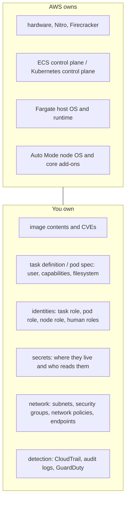

# Identity and security · L100 — Security basics for containers

**Level:** 100 · **Time:** ~40 min · **Prerequisites:**
[Containers explained](../01-container-fundamentals/L100-containers-explained.md),
[ECS basics](../03-ecs/L100-ecs-basics.md) or [Kubernetes and EKS basics](../04-eks/L100-kubernetes-and-eks-basics.md)

**After this document you can:**

- Say, for Fargate, ECS on EC2, EKS standard and EKS Auto Mode, which layers AWS secures and which
  ones you own
- Name every identity that touches a running container and state what each one may do
- Explain why a secret must never live in an image layer or a plain environment variable, and
  where it lives instead
- Apply the ten-line checklist to a new service before its first deployment

## 1. Mental model



A container is a process with a passport. The passport is the IAM role its platform hands it, the
process can do exactly what the passport allows, and everything that goes wrong in container
security is a variation on one of three failures: the process got a passport meant for someone
else (a pod reading the node role through IMDS), a secret was printed into the passport office's
public records (a password in a task definition or an image layer), or the process broke out of
its room (a privileged container or a kernel bug). AWS secures the building; you decide who gets
which passport, what is in the luggage and whether the room is locked.

## 2. Concepts

### 2.1 Shared responsibility per platform

The AWS shared responsibility model says AWS secures the cloud and you secure what you put in it.
Where the line sits depends on the platform. The rows you own are the same everywhere; the rows
that move are the node operating system, the core add-ons and the instance metadata service.

| Layer | Fargate (ECS and EKS) | ECS on EC2 | EKS standard (managed node groups) | EKS Auto Mode |
| --- | --- | --- | --- | --- |
| Hardware, hypervisor, Firecracker or Nitro | AWS | AWS | AWS | AWS |
| Orchestrator control plane | AWS | AWS | AWS runs it; you pick the Kubernetes version and upgrade in time | AWS runs it; version still yours |
| Node operating system, kernel patches, container runtime | AWS (platform versions) | You: AMI choice, rotation, ECS agent version | You: AMI (AL2023 or Bottlerocket), node group updates, kubelet and containerd versions | AWS: Bottlerocket-based nodes, replaced within 21 days, no SSH |
| Core add-ons (CNI, DNS, kube-proxy, CSI, load balancing) | AWS | not applicable | You: managed add-on versions and upgrade order | AWS: built-in capabilities you cannot replace |
| Instance metadata (IMDS) exposure to containers | none: Fargate has no IMDS | You: set `ECS_AWSVPC_BLOCK_IMDS=true` | You: hop limit 1 and IMDSv2 required | AWS: IMDSv2 with hop limit 1, fixed |
| Image contents, task definition or pod spec, identities, secrets | You | You | You | You |
| VPC, subnets, security groups, endpoints, network policies | You | You | You | You |
| Kubernetes RBAC, access entries, admission policies | not applicable / you on EKS Fargate | not applicable | You | You |
| Turning on CloudTrail, audit logs, GuardDuty, Inspector | You | You | You | You |

Two consequences. First, Fargate and Auto Mode remove work but not accountability: nobody at AWS
will notice that your task definition runs as root with a database password in `environment`.
Second, the node operating system row is where most unpatched-kernel incidents live, so moving it
to AWS (Fargate, Auto Mode) is a real security gain, not only an operational one. Depth on what
Fargate isolation provides is in [L300 §2.10](L300-hardening-workloads-and-clusters.md).

### 2.2 The identities in play

Every identity below is an IAM role with a trust policy that names who may assume it. Keep them
separate; the failures in [§6](#6-failure-modes-and-troubleshooting) are mostly two of them
getting mixed up.

| Identity | Platform | Who uses it | Trust principal | Should be allowed to |
| --- | --- | --- | --- | --- |
| Task role | ECS | your application code, through the task metadata endpoint `169.254.170.2` | `ecs-tasks.amazonaws.com` | only the AWS calls the app makes (`orders`: `sqs:SendMessage` on one queue) |
| Task execution role | ECS | the ECS agent or Fargate, on your behalf, before the container starts | `ecs-tasks.amazonaws.com` | pull the image from ECR, write logs, read the secrets named in `secrets[]` |
| Container instance role | ECS on EC2 | the ECS agent on the instance | `ec2.amazonaws.com` | register the instance, poll for work, pull images, send logs; no application permissions |
| ECS service-linked and infrastructure roles | ECS | the ECS service itself | `ecs.amazonaws.com` | manage ENIs, load balancer targets, EBS volumes, Service Connect TLS |
| Cluster role | EKS | the Kubernetes control plane | `eks.amazonaws.com` | manage ENIs and load balancers; in Auto Mode also compute, storage and networking |
| Node role | EKS on EC2 | kubelet, containerd, the Pod Identity agent | `ec2.amazonaws.com` | join the cluster, pull from ECR, `eks-auth:AssumeRoleForPodIdentity`; never application permissions |
| Pod role | EKS | your application code, through Pod Identity (`169.254.170.23`) or IRSA (STS) | `pods.eks.amazonaws.com` or the cluster's OIDC provider | only the AWS calls the app makes |
| Fargate pod execution role | EKS Fargate | Fargate, on your behalf | `eks-fargate-pods.amazonaws.com` | pull images, ship logs |
| Human roles | both | engineers, through IAM Identity Center | your identity provider via Identity Center | `kubectl` through an access entry; ECS console and CLI; ECS Exec only where tagged and logged |
| Pipeline role | both | CI/CD, through OIDC federation | `token.actions.githubusercontent.com` or your CI's provider | push to ECR, update the service or the GitOps repository |

The rule that follows from the table: the application never uses the platform's identity. On EKS
that means a pod must never obtain credentials from the node role; on ECS a task must never obtain
credentials from the container instance role. Both happen silently when IMDS is reachable from the
container and no task or pod role is configured, because the SDK's credential chain ends at IMDS.
[L200 §2.2](L200-iam-for-containers.md) shows how to block it on each platform.

### 2.3 Least privilege, concretely

"Least privilege" is a slogan until you write it down as three habits:

- One role per service, named after the service (`shopfront-orders-task-role`,
  `shopfront-orders-pod-role`). A shared "app role" makes every incident a platform-wide incident.
- Actions and resources, never `*`. `orders` needs `sqs:SendMessage` on
  `arn:aws:sqs:us-east-1:123456789012:orders-created`, not `sqs:*` on `*`. When a service needs
  read and write on the same resource, list both actions rather than a wildcard.
- Conditions where the platform offers them: `aws:SourceArn` and `aws:SourceAccount` in ECS task
  role trust policies, `sub` and `aud` in IRSA trust policies, session tags such as
  `kubernetes-namespace` with Pod Identity. They turn "any task in the account" into "this task".

IAM Access Analyzer's unused-access findings tell you, per role, which permissions were never
exercised; reviewing them quarterly is the cheapest privilege reduction you will do.

### 2.4 Secrets: where they must not be, and where they go

A secret in the wrong place is copied by every tool that touches the artifact. The table names the
places people put secrets by accident and who can read them there.

| Wrong place | Who can read it | Why it happens |
| --- | --- | --- |
| Image layer (`COPY .env`, `ENV DB_PASSWORD=`, a build arg) | anyone who can pull the image, forever, even after a later layer deletes the file | convenience during local builds |
| Task definition `environment` | anyone with `ecs:DescribeTaskDefinition`, CloudTrail, the console, Terraform state | the field is right there |
| Kubernetes `ConfigMap` or pod `env.value` | anyone with `get` on the namespace, GitOps repository readers | copied from a `docker run -e` |
| Git repository, Helm values, Kustomize overlay | everyone with repository access, forks, CI logs | "it is a private repo" |
| Application logs | log readers, log shipping vendors | debug logging of request bodies or connection strings |

Where they go instead: AWS Secrets Manager (rotation, versioning, cross-Region replication) or SSM
Parameter Store `SecureString` (cheaper, no rotation). The platform injects them at start:

- ECS: `secrets[]` with `valueFrom` pointing at the secret ARN; the execution role reads it, the
  agent places it in the container's environment, the task definition contains only the ARN.
- EKS: the Secrets Store CSI driver mounts it as a file, or External Secrets Operator copies it
  into a Kubernetes `Secret`; the pod's role (Pod Identity or IRSA) is what is allowed to read it.

```json
"secrets": [
  {
    "name": "DATABASE_URL",
    "valueFrom": "arn:aws:secretsmanager:us-east-1:123456789012:secret:shopfront/dev/database-url-AbCdEf"
  }
]
```

[L200 §2.9](L200-iam-for-containers.md) covers each mechanism, and what happens when the secret
rotates. Kubernetes `Secret` objects are base64, not encryption; what protects them at rest is
the EKS envelope encryption with KMS ([L200 §2.10](L200-iam-for-containers.md)), and what protects
them from readers is RBAC.

### 2.5 Image scanning

Your image contains an operating system's worth of packages you did not write. Amazon ECR scans
them: basic scanning on push with the AWS-native scanner, or enhanced scanning through Amazon
Inspector which also covers language packages (npm, pip, Go modules) and rescans continuously as
new CVEs are published. Turn on enhanced scanning at the registry level, make the pipeline fail on
critical findings, and route findings to Security Hub. Scanning finds known CVEs; it does not find
your own bugs, secrets you copied in, or a malicious base image, which is why signing and
provenance exist ([L300 §2.8](L300-hardening-workloads-and-clusters.md) and
[01/L400](../01-container-fundamentals/L400-hardening-supply-chain-and-performance.md)).
Configuration lives in [02/L200](../02-ecr/L200-lifecycle-scanning-access-and-endpoints.md).

### 2.6 TLS

Three hops need TLS, and they are configured in three different places:

- Client to edge: the ALB terminates TLS with a certificate from AWS Certificate Manager; tasks and
  pods only accept traffic from the load balancer's security group.
- Service to service: plain HTTP inside the VPC is common and defensible at L100; when you need
  mutual TLS you get it from ECS Service Connect, a mesh, or VPC Lattice
  ([L400 §2.3](L400-security-architecture-and-incident-response.md)).
- Service to datastore and to AWS APIs: always TLS. `DATABASE_URL` carries `sslmode=require`
  outside local development; ElastiCache Valkey with in-transit encryption; every AWS SDK call is
  HTTPS by default.

### 2.7 The ten-line checklist

1. One IAM role per service (task role on ECS, Pod Identity or IRSA on EKS); the node or instance
   role carries no application permissions.
2. IMDS is unreachable from containers: hop limit 1 and IMDSv2 required on EKS nodes,
   `ECS_AWSVPC_BLOCK_IMDS=true` on ECS instances; Fargate has none.
3. No secrets in images, Dockerfiles, task definition `environment`, ConfigMaps or git; inject from
   Secrets Manager or SSM Parameter Store.
4. Non-root user (`10001`), read-only root filesystem, all capabilities dropped, never privileged.
5. Every image scanned in ECR with enhanced scanning; critical findings block the pipeline; deploy
   by digest.
6. Tasks and pods in private subnets with no public IP; the ALB is the only public surface and
   carries an ACM certificate.
7. Humans authenticate through IAM Identity Center with MFA; no IAM users, no long-lived access
   keys anywhere in the platform.
8. CloudTrail, EKS audit logs, GuardDuty (with Runtime Monitoring) and Security Hub are on before
   the first deployment.
9. KMS encryption at rest for EBS, EFS, RDS, S3 and secrets; TLS to every datastore.
10. Clusters, AMIs, Fargate platform versions and add-ons stay inside support; secrets rotate.

## 3. How it interacts with the rest of AWS

| Component | Talks to | Protocol/API | Prerequisite (IAM, network, DNS) | What breaks if missing |
| --- | --- | --- | --- | --- |
| Task or pod code | AWS services | HTTPS, SigV4 signed with task or pod role credentials | task role attached; Pod Identity association or IRSA annotation | `AccessDenied`, or worse, silent use of the node role |
| ECS agent / Fargate | ECR, CloudWatch Logs, Secrets Manager, SSM | HTTPS with the execution role | `AmazonECSTaskExecutionRolePolicy` plus secret read permissions; ECR and logs endpoints reachable | task stops with `CannotPullContainerError` or `ResourceInitializationError` |
| kubelet | ECR | HTTPS with the node role | `AmazonEC2ContainerRegistryPullOnly` on the node role | `ImagePullBackOff` |
| Engineer | EKS API server | HTTPS, token from `aws eks get-token` | Identity Center role, access entry, RBAC | `Unauthorized` |
| Engineer | ECS task | SSM Session Manager (ECS Exec) | `ecs:ExecuteCommand`, `enableExecuteCommand`, task role with `ssmmessages:*` channel permissions | `execute-command` fails to open a session |
| Pipeline | ECR, ECS or the GitOps repository | HTTPS with an OIDC-federated role | IAM OIDC provider for the CI system, trust policy with `sub` condition | push denied |
| GuardDuty, Inspector, Security Hub | CloudTrail, EKS audit logs, runtime agents, ECR | AWS-internal | protection plans enabled per account and Region | nothing visible: findings never appear |

The interaction that surprises people: the execution role and the task role are used at different
times by different parties. When a task fails to start because of a secret, the fix is on the
execution role; when the running application gets `AccessDenied`, the fix is on the task role.
The second surprise: `kubectl` never sees your IAM policy. IAM authenticates you; the access entry
and RBAC authorize you. A principal with `AdministratorAccess` in IAM and no access entry is
`Unauthorized` at the API server.

## 4. Use it when / avoid it when

Use the platform-managed identity (task role, Pod Identity, IRSA) when:

- Your code calls any AWS API. There is no configuration in which static keys are the better
  choice for a container on AWS.
- You need to prove who called what: CloudTrail records the role session, and with Pod Identity
  the session tags name the namespace and service account.

Prefer Fargate or Auto Mode when the deciding factor is security posture:

- You do not want to own kernel patching, AMI rotation or IMDS exposure.
- Workloads from different trust levels share an account and you want microVM isolation per task.

Avoid these:

- Instance or node role permissions for applications, even "temporarily". Removing them later means
  finding every caller that silently depended on them.
- IAM users and access keys for humans or pipelines. Identity Center and OIDC federation cover both.
- `privileged: true` or `hostPath` in application pods, host network mode in ECS, to work around
  a tooling problem. Each one turns a container escape into node ownership.

Alternatives, one line each: kube2iam or kiam (replaced by IRSA and Pod Identity; do not deploy);
HashiCorp Vault (fine as a secrets backend, but you still need an AWS identity to authenticate to
it); a service mesh for mTLS (real value at L400, real cost in operations before then).

## 5. Well-Architected view

| Pillar | What this gives you | What it costs you | Practice to apply |
| --- | --- | --- | --- |
| Operational Excellence | roles named per service make incidents readable in CloudTrail | more roles to manage as code | one IaC module per service that creates role, policy and log group together |
| Security | separated identities, no secrets in artifacts, blocked IMDS | discipline in every task definition and manifest | the ten-line checklist as a pull-request template |
| Reliability | secrets injected at start fail fast with a clear `stoppedReason` | rotation needs a redeploy on ECS | treat rotation as a deployment event |
| Performance Efficiency | Pod Identity assumes once per node instead of once per pod | none noticeable | prefer Pod Identity on EC2 nodes |
| Cost Optimization | Fargate and Auto Mode remove patching labour | higher per-vCPU price than EC2 | count engineer hours in the comparison |
| Sustainability | fewer always-on bastions and agents | none | delete jump hosts; use ECS Exec and `kubectl` |

The Container Build Lens covers the image half of this document (non-root, minimal base, scanning);
the Amazon ECS and Amazon EKS Best Practices Guides cover the identity half.

## 6. Failure modes and troubleshooting

| Symptom | Likely cause | How to confirm (command/metric) | Fix |
| --- | --- | --- | --- |
| App works on EC2 nodes, gets `AccessDenied` on Fargate | it was using the node or instance role through IMDS; Fargate has no IMDS | `aws sts get-caller-identity` from inside the container shows the node role on EC2 | give the workload its own role; block IMDS on the EC2 nodes too |
| Task stops with `ResourceInitializationError: unable to pull secrets` | execution role lacks `secretsmanager:GetSecretValue` or `kms:Decrypt`, or no route to the endpoint | `aws ecs describe-tasks --cluster shopfront-dev --tasks <id> --query 'tasks[0].stoppedReason'` | fix the execution role; add the Secrets Manager VPC endpoint |
| `kubectl` returns `Unauthorized` for an administrator | no access entry for the assumed role | `aws eks list-access-entries --cluster-name shopfront-dev` | create the access entry and associate an access policy; see [EKS auth and access](../../playbooks/incidents/eks-auth-and-access.md) |
| Password visible in the console task definition | secret placed in `environment` | `aws ecs describe-task-definition --task-definition orders --query 'taskDefinition.containerDefinitions[].environment'` | move to `secrets[]`, rotate the secret, register a new revision |
| Image scan shows dozens of critical CVEs | outdated base image | `aws ecr describe-image-scan-findings --repository-name shopfront/orders --image-id imageTag=sha-abc1234` | rebuild on the current base tag; pin by digest; see [02/L200](../02-ecr/L200-lifecycle-scanning-access-and-endpoints.md) |
| `AccessDenied` for the right role on the right resource | resource policy, SCP or permission boundary denies | CloudTrail event `errorMessage` names the denying policy type | read the message; see [IAM AccessDenied from containers](../../playbooks/incidents/iam-accessdenied-from-containers.md) |

## 7. Signals: metrics, logs, traces

- CloudTrail `AccessDenied` and `UnauthorizedOperation` errors per role (CloudTrail Lake or a
  metric filter on the CloudTrail log group): a burst after a deployment means a missing
  permission; a burst without a deployment is worth a look from the on-call.
- CloudTrail `AssumeRole` calls where `userIdentity` is the node or instance role and the caller
  is not kubelet or the ECS agent: should be zero.
- GuardDuty findings count by severity (Security Hub aggregates them): alarm on any High.
- ECR enhanced scanning: number of images in use with critical findings, from Inspector
  (`aws inspector2 list-findings --filter-criteria`): start with "zero critical older than 7 days".
- EKS control plane `audit` log enabled: yes or no is itself a signal at this level.
- Full table with thresholds: [reference/metrics-catalog.md](../../reference/metrics-catalog.md).

## 8. Testing and DR notes

Testing at this level is about proving the passport is the right one:

- From inside a task or pod, run `aws sts get-caller-identity`. The ARN must be the service's own
  role, never a node or instance role.
- Try to reach IMDS from a pod (`curl -m 3 http://169.254.169.254/latest/meta-data/`); the request
  must time out or be refused.
- Grep task definitions and manifests for `environment` entries whose names contain `PASSWORD`,
  `SECRET`, `TOKEN` or `KEY`; the check belongs in the pipeline.
- Run `docker history --no-trunc` or `dive` on a built image and look for copied `.env` files.

DR: identities are Regional in behaviour even when IAM is global. Roles and policies replicate to
every Region automatically; OIDC providers for IRSA, Pod Identity associations, access entries,
KMS keys and secrets do not. A second-Region rebuild recreates them from code, and secrets need
Secrets Manager cross-Region replication set up before the incident. The full list is in
[L200 §8](L200-iam-for-containers.md) and [10/L300](../10-resilience-and-dr/L300-dr-strategies-for-container-platforms.md).

## 9. Hands-on

Inspect the identities in the shopfront labs without deploying anything:

```bash
# ECS: which role does each service run as, and are there secrets in plain environment?
for f in labs/ecs/taskdefs/*.json; do
  echo "== $f"
  jq -r '.taskRoleArn, .executionRoleArn' "$f"
  jq -r '.containerDefinitions[].environment[]?.name' "$f" | grep -Ei 'pass|secret|token|key' || echo "no secret-looking env names"
  jq -r '.containerDefinitions[].secrets[]?.valueFrom' "$f"
done

# EKS: one service account per service, and its identity annotation or association
grep -rn "kind: ServiceAccount" -A 6 labs/eks/manifests/base/ | grep -E "name:|role-arn"
cat labs/eks/addons/pod-identity-associations.sh
```

What to observe: `orders`, `catalog`, `fulfillment-worker` and `analytics-consumer` each have their
own task role and service account; every task definition uses `secrets[]` for `DATABASE_URL`; the
execution role is shared because it does the same job for every service. If you have deployed the
EKS lab, run the passport test:

```bash
kubectl -n shopfront exec deploy/orders -- aws sts get-caller-identity
kubectl -n shopfront exec deploy/orders -- curl -s -m 3 http://169.254.169.254/latest/meta-data/ || echo "IMDS blocked"
```

Expect `arn:aws:sts::123456789012:assumed-role/shopfront-orders-pod-role/...` and "IMDS blocked".

## 10. Check yourself

1. A task on Fargate and the same task on ECS EC2 behave differently: the EC2 one can list S3
   buckets, the Fargate one gets `AccessDenied`. What is the most likely explanation?

<details><summary>Answer</summary>The task has no task role (or one without S3 permissions) and on
EC2 the SDK fell through the credential chain to IMDS and used the container instance role, which
has broader permissions. Fargate has no IMDS, so the chain ends with nothing. Fix: a task role for
the service and <code>ECS_AWSVPC_BLOCK_IMDS=true</code> on the instances.</details>

2. Which role reads the secret referenced in an ECS `secrets[]` entry, and when?

<details><summary>Answer</summary>The task execution role, used by the ECS agent or Fargate before
the container starts. The application never calls Secrets Manager for these values; it finds them
in its environment. Rotation therefore requires a new deployment.</details>

3. You are the account administrator with `AdministratorAccess`. Why does `kubectl get pods`
   return `Unauthorized` on a cluster a colleague created?

<details><summary>Answer</summary>IAM authenticates you to the API server, but authorization is
done by EKS access entries and Kubernetes RBAC. Without an access entry (or an
<code>aws-auth</code> mapping on old clusters) you have no Kubernetes permissions. Create an access
entry and associate an access policy.</details>

4. Name the four rows of the shared-responsibility table that change between ECS on EC2 and
   Fargate.

<details><summary>Answer</summary>Node operating system and runtime patching (yours on EC2, AWS on
Fargate), core add-ons (not applicable), IMDS exposure (you block it on EC2; Fargate has none) and
the container instance role (exists on EC2, absent on Fargate). Image, task definition, identities,
secrets, network and detection stay yours on both.</details>

5. A developer deleted the `.env` file in a later Dockerfile layer. Is the secret gone?

<details><summary>Answer</summary>No. Each layer is content-addressed and immutable; the file is
still in the earlier layer and anyone who can pull the image can extract it. Rotate the secret,
rebuild the image without it (multi-stage build, no secrets in build context) and use the
platform's secret injection.</details>

## 11. Sources

- Shared responsibility model — https://aws.amazon.com/compliance/shared-responsibility-model/
- Security in Amazon ECS — https://docs.aws.amazon.com/AmazonECS/latest/developerguide/security.html
- Amazon ECS task IAM role — https://docs.aws.amazon.com/AmazonECS/latest/developerguide/task-iam-roles.html
- Amazon ECS task execution IAM role — https://docs.aws.amazon.com/AmazonECS/latest/developerguide/task_execution_IAM_role.html
- Pass sensitive data to an Amazon ECS container — https://docs.aws.amazon.com/AmazonECS/latest/developerguide/specifying-sensitive-data.html
- Amazon EKS Best Practices Guide, Security — https://docs.aws.amazon.com/eks/latest/best-practices/security.html
- Learn how EKS Pod Identity grants pods access to AWS services — https://docs.aws.amazon.com/eks/latest/userguide/pod-identities.html
- Grant IAM users access to Kubernetes with EKS access entries — https://docs.aws.amazon.com/eks/latest/userguide/access-entries.html
- Security overview of Amazon EKS Auto Mode — https://docs.aws.amazon.com/whitepapers/latest/security-overview-amazon-eks-auto-mode/eks-auto-mode-data-plane.html
- Amazon ECR image scanning — https://docs.aws.amazon.com/AmazonECR/latest/userguide/image-scanning.html
- Container Build Lens — https://docs.aws.amazon.com/wellarchitected/latest/container-build-lens/container-build-lens.html
- IAM Access Analyzer — https://docs.aws.amazon.com/IAM/latest/UserGuide/what-is-access-analyzer.html
