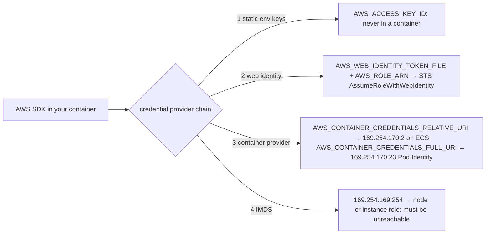
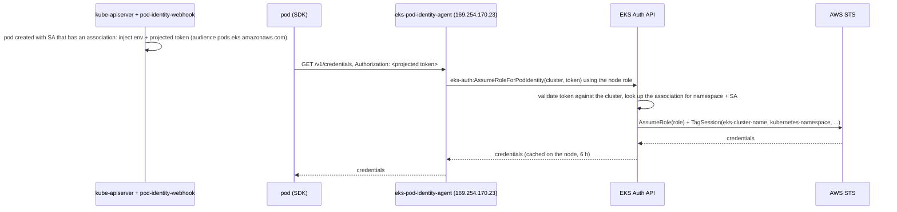

# Identity and security · L200 — IAM for containers

**Level:** 200 · **Time:** ~90 min · **Prerequisites:**
[L100 Security basics](L100-security-basics-for-containers.md),
[ECS task definitions and services](../03-ecs/L200-task-definitions-services-and-scaling.md),
[EKS cluster components and add-ons](../04-eks/L200-cluster-components-and-add-ons.md)

**After this document you can:**

- Write the trust and permission policies for an ECS task role and execution role and say which
  one a given error points at
- Set up IRSA and EKS Pod Identity end to end, explain every step of each credential flow, and pick
  one for a workload with the decision table
- Block IMDS from tasks and pods on every platform and explain what the hop limit does
- Grant a human `kubectl` access with access entries and RBAC, and ECS Exec access with conditions,
  logging and KMS
- Deliver a secret from Secrets Manager to a task or pod and state what happens when it rotates

## 1. Mental model



The SDK does not know which platform it is on. It walks a fixed list of credential sources and
stops at the first one that answers. Every identity mechanism on ECS and EKS is a way of making
one of the early sources answer with the right role, and every identity leak is the chain walking
past them to IMDS. ECS answers from the task metadata endpoint; Pod Identity answers from the
Pod Identity agent; IRSA answers with a token that the SDK trades at STS. The platform roles that
start the container (execution role, node role) are never in that chain by design.

## 2. Concepts

### 2.1 ECS: task role versus task execution role

| | Task role (`taskRoleArn`) | Task execution role (`executionRoleArn`) |
| --- | --- | --- |
| Used by | your application code | the ECS agent (EC2) or the Fargate agent, before and during the task |
| For | the AWS APIs the app calls | pulling the image from ECR, writing to CloudWatch Logs, reading `secrets[]` from Secrets Manager or SSM, FireLens, ECS Exec agent setup |
| Delivered how | credentials served at `169.254.170.2` and pointed to by `AWS_CONTAINER_CREDENTIALS_RELATIVE_URI` | never visible inside the container |
| Trust principal | `ecs-tasks.amazonaws.com` | `ecs-tasks.amazonaws.com` |
| One per | service | usually one per cluster or environment |
| Error when wrong | `AccessDenied` in application logs | task stops before start: `CannotPullContainerError`, `ResourceInitializationError` |

Both roles have the same trust principal, so the confused-deputy conditions matter: without them,
any ECS task in any account that learns your role ARN could pass it in a task definition.

```json
{
  "Version": "2012-10-17",
  "Statement": [
    {
      "Sid": "ECSTasksAssumeRole",
      "Effect": "Allow",
      "Principal": { "Service": "ecs-tasks.amazonaws.com" },
      "Action": "sts:AssumeRole",
      "Condition": {
        "ArnLike": { "aws:SourceArn": "arn:aws:ecs:us-east-1:123456789012:*" },
        "StringEquals": { "aws:SourceAccount": "123456789012" }
      }
    }
  ]
}
```

The permission policy of `shopfront-orders-task-role` is what `orders` does and nothing else:

```json
{
  "Version": "2012-10-17",
  "Statement": [
    {
      "Effect": "Allow",
      "Action": "sqs:SendMessage",
      "Resource": "arn:aws:sqs:us-east-1:123456789012:orders-created"
    },
    {
      "Effect": "Allow",
      "Action": [ "kafka-cluster:Connect", "kafka-cluster:DescribeTopic", "kafka-cluster:WriteData" ],
      "Resource": [
        "arn:aws:kafka:us-east-1:123456789012:cluster/shopfront-dev/*",
        "arn:aws:kafka:us-east-1:123456789012:topic/shopfront-dev/*/orders.created"
      ]
    }
  ]
}
```

The execution role `shopfront-task-execution-role` gets the managed policy
`AmazonECSTaskExecutionRolePolicy` (ECR pull, `logs:CreateLogStream`, `logs:PutLogEvents`) plus the
secrets it must resolve:

```json
{
  "Version": "2012-10-17",
  "Statement": [
    {
      "Effect": "Allow",
      "Action": [ "secretsmanager:GetSecretValue", "ssm:GetParameters" ],
      "Resource": [
        "arn:aws:secretsmanager:us-east-1:123456789012:secret:shopfront/dev/*",
        "arn:aws:ssm:us-east-1:123456789012:parameter/shopfront/dev/*"
      ]
    },
    {
      "Effect": "Allow",
      "Action": "kms:Decrypt",
      "Resource": "arn:aws:kms:us-east-1:123456789012:key/1234abcd-12ab-34cd-56ef-1234567890ab"
    }
  ]
}
```

Two more ECS identities exist and are not yours to use from code: the service-linked role
`AWSServiceRoleForECS` (ENIs, load balancer registration) and the ECS infrastructure role (trust
`ecs.amazonaws.com`) that ECS assumes for EBS volumes, Service Connect TLS and VPC Lattice. How the
agent serves task credentials (port 51679, the iptables redirect on EC2) is in
[03/L300 §2.3](../03-ecs/L300-ecs-internals.md).

### 2.2 Node and instance roles, and IMDS

The node role (EKS) and the container instance role (ECS on EC2) exist so that kubelet and the ECS
agent can join the cluster and pull images. Their credentials are served by IMDS at
`169.254.169.254` to anything on the instance that can reach that address, which by default
includes every container. A pod that reaches IMDS holds the node role: on EKS that is
`AmazonEKSWorkerNodePolicy` plus ECR pull plus, if you attached it there, `AmazonEKS_CNI_Policy`
(create and attach ENIs in your VPC). That is why the CNI policy belongs on the `aws-node` service
account through Pod Identity or IRSA, not on the node role, and why nothing else may be added
there.

| Platform | Node or instance role policies (September 2026) | Application permissions on it |
| --- | --- | --- |
| EKS managed node group / Karpenter | `AmazonEKSWorkerNodePolicy`, `AmazonEC2ContainerRegistryPullOnly`; CNI policy moved to the add-on's own identity | never |
| EKS Auto Mode | `AmazonEKSWorkerNodeMinimalPolicy`, `AmazonEC2ContainerRegistryPullOnly`; the cluster role carries `AmazonEKSComputePolicy`, `AmazonEKSBlockStoragePolicy`, `AmazonEKSLoadBalancingPolicy`, `AmazonEKSNetworkingPolicy` and its trust policy allows `sts:TagSession` | never |
| ECS on EC2 | `AmazonEC2ContainerServiceforEC2Role` | never |
| Fargate | no instance role reachable; Fargate uses the execution role (ECS) or pod execution role (EKS) | not applicable |

IMDSv2 in one paragraph: the client first sends `PUT /latest/api/token` with a header
`X-aws-ec2-metadata-token-ttl-seconds` (1 second to 6 hours) and gets a session token; every later
`GET` carries it in `X-aws-ec2-metadata-token`. The PUT response leaves the instance's network
stack with an IP TTL equal to the configured hop limit. A container in its own network namespace
is one hop away over a veth pair or a bridge, so with hop limit 1 the token never arrives and
IMDSv2 is unusable from the container. The hop limit protects only the PUT; if IMDSv1 is still
allowed, a plain `GET` from the container works, so `HttpTokens: required` is the second half of
the control. Details, including prefix delegation and `hostNetwork` cases, are in
[05/L300](../05-networking/L300-container-networking-internals.md).

| Platform | Default as of September 2026 | How to block containers from IMDS |
| --- | --- | --- |
| EKS managed node group, AL2023, no launch template | IMDSv2 required, hop limit 1: pods cannot reach IMDS | already blocked; verify with `aws ec2 describe-instances --query 'Reservations[].Instances[].MetadataOptions'` |
| EKS managed node group with a custom launch template or custom AMI | hop limit 2: pods can reach IMDS | set `MetadataOptions: {HttpTokens: required, HttpPutResponseHopLimit: 1}` in the launch template |
| Karpenter `EC2NodeClass` | `httpTokens: required`, `httpPutResponseHopLimit: 1` by default | keep the defaults |
| EKS Auto Mode | IMDSv2, hop limit 1, not configurable | nothing to do; pods that need instance metadata are not supported |
| Any EKS node, `hostNetwork: true` pods | share the node network namespace, always reach IMDS | forbid `hostNetwork` with Pod Security Admission baseline |
| ECS on EC2, `awsvpc` tasks | reachable | `ECS_AWSVPC_BLOCK_IMDS=true` in `/etc/ecs/ecs.config` |
| ECS on EC2, `bridge` tasks | reachable | hop limit 1 on the instance, or an iptables rule in `DOCKER-USER` dropping `169.254.169.254/32` from `docker+` interfaces |
| ECS on EC2, `host` tasks | same namespace as the host, cannot be blocked | do not run untrusted workloads in host mode |
| Fargate (ECS and EKS) | no IMDS; only the task metadata endpoint `169.254.170.2` | nothing to do |

Network policy is the other lever on EKS: an egress rule that allows `0.0.0.0/0` with
`except: [169.254.169.254/32]` blocks IMDS regardless of hop limit
([L300 §2.5](L300-hardening-workloads-and-clusters.md)).

### 2.3 IRSA end to end

IAM Roles for Service Accounts turns a Kubernetes service account token into an IAM role session
through OpenID Connect. Every EKS cluster is an OIDC issuer: it signs service account tokens and
publishes the public keys at `<issuer>/.well-known/openid-configuration` and the `jwks_uri` it
points to. IAM trusts that issuer once you register it as an identity provider.

```mermaid
sequenceDiagram
  participant K as kube-apiserver + pod-identity-webhook
  participant KL as kubelet
  participant P as pod (SDK)
  participant STS as AWS STS
  participant IAM as IAM (OIDC provider, role trust policy)
  K->>K: pod created with SA annotated eks.amazonaws.com/role-arn: mutate env + projected volume
  KL->>K: TokenRequest(audience=sts.amazonaws.com, expiry 86400 s)
  K-->>KL: signed JWT (iss=issuer URL, sub=system:serviceaccount:shopfront:orders)
  KL->>P: writes /var/run/secrets/eks.amazonaws.com/serviceaccount/token, refreshes it
  P->>STS: AssumeRoleWithWebIdentity(RoleArn, WebIdentityToken)
  STS->>IAM: fetch JWKS from issuer, verify signature, aud; evaluate trust policy sub/aud
  STS-->>P: temporary credentials (1 h default)
  P->>P: SDK caches, re-reads the token file and repeats before expiry
```

Step 1: find the issuer and register it in IAM (once per cluster).

```bash
ISSUER=$(aws eks describe-cluster --name shopfront-dev --query cluster.identity.oidc.issuer --output text)
echo "$ISSUER"   # https://oidc.eks.us-east-1.amazonaws.com/id/EXAMPLED539D4633E53DE1B71EXAMPLE
aws iam create-open-id-connect-provider --url "$ISSUER" --client-id-list sts.amazonaws.com
# or: eksctl utils associate-iam-oidc-provider --cluster shopfront-dev --approve
```

The thumbprint parameter is optional as of September 2026: when omitted, IAM retrieves the top
intermediate CA thumbprint of the issuer's certificate itself, and for this class of issuer IAM
validates the server certificate against its own trusted root CA library rather than the stored
thumbprint. Older tooling still passes one; it does no harm.

Step 2: the role trust policy names the provider and pins the service account and audience.

```json
{
  "Version": "2012-10-17",
  "Statement": [
    {
      "Effect": "Allow",
      "Principal": {
        "Federated": "arn:aws:iam::123456789012:oidc-provider/oidc.eks.us-east-1.amazonaws.com/id/EXAMPLED539D4633E53DE1B71EXAMPLE"
      },
      "Action": "sts:AssumeRoleWithWebIdentity",
      "Condition": {
        "StringEquals": {
          "oidc.eks.us-east-1.amazonaws.com/id/EXAMPLED539D4633E53DE1B71EXAMPLE:sub": "system:serviceaccount:shopfront:orders",
          "oidc.eks.us-east-1.amazonaws.com/id/EXAMPLED539D4633E53DE1B71EXAMPLE:aud": "sts.amazonaws.com"
        }
      }
    }
  ]
}
```

`sub` is what makes the role usable by one service account; a `StringLike` with
`system:serviceaccount:shopfront:*` widens it to a namespace. The `aud` condition prevents a token
minted for another audience (the Kubernetes API, for example) from being replayed at STS.

Step 3: annotate the service account and let the webhook do the rest.

```yaml
apiVersion: v1
kind: ServiceAccount
metadata:
  name: orders
  namespace: shopfront
  annotations:
    eks.amazonaws.com/role-arn: arn:aws:iam::123456789012:role/shopfront-orders-pod-role
    eks.amazonaws.com/sts-regional-endpoints: "true"
```

The EKS-managed `pod-identity-webhook` is a mutating admission webhook in the control plane. For a
pod whose service account carries the annotation, it adds to every container (unless listed in
`eks.amazonaws.com/skip-containers`):

```yaml
env:
  - name: AWS_ROLE_ARN
    value: arn:aws:iam::123456789012:role/shopfront-orders-pod-role
  - name: AWS_WEB_IDENTITY_TOKEN_FILE
    value: /var/run/secrets/eks.amazonaws.com/serviceaccount/token
  - name: AWS_STS_REGIONAL_ENDPOINTS
    value: regional
  - name: AWS_DEFAULT_REGION
    value: us-east-1
  - name: AWS_REGION
    value: us-east-1
volumeMounts:
  - name: aws-iam-token
    mountPath: /var/run/secrets/eks.amazonaws.com/serviceaccount
    readOnly: true
volumes:
  - name: aws-iam-token
    projected:
      defaultMode: 420
      sources:
        - serviceAccountToken:
            audience: sts.amazonaws.com
            expirationSeconds: 86400
            path: token
```

The projected token is a bound token: audience `sts.amazonaws.com` (change with the annotation
`eks.amazonaws.com/audience`), lifetime 24 hours (`eks.amazonaws.com/token-expiration`), bound to
the pod so it stops validating when the pod is deleted. The kubelet rewrites the file when the
token passes 80% of its lifetime, and the SDK reads the file each time it calls
`AssumeRoleWithWebIdentity`, so rotation needs no application code. The role session lasts one
hour by default and the SDK refreshes it before expiry. The `kubernetes.io` claim in the token
carries the namespace, pod name and UID, which CloudTrail does not record; the CloudTrail event
`AssumeRoleWithWebIdentity` shows the issuer as `identityProvider` and the `sub` as `userName`.

Requirements that still point at IRSA as of September 2026: pods on EKS Fargate, and roles in
another account when you do not use Pod Identity's target-role path.

### 2.4 EKS Pod Identity end to end

Pod Identity moves the OIDC exchange out of your pods and into EKS. An agent on each node serves
credentials on a link-local address; EKS itself validates the pod's token and assumes the role.
There is no OIDC provider to create and one trust policy works for every cluster in the account.



Step 1: install the agent (managed add-on; already present on Auto Mode clusters) and make sure the
node role can call EKS Auth. `AmazonEKSWorkerNodePolicy` includes `eks-auth:AssumeRoleForPodIdentity`.
Nodes in private subnets need the `com.amazonaws.us-east-1.eks-auth` interface endpoint.

```bash
aws eks create-addon --cluster-name shopfront-dev --addon-name eks-pod-identity-agent
kubectl -n kube-system get daemonset eks-pod-identity-agent
```

Step 2: the role trust policy is the same for every cluster and namespace.

```json
{
  "Version": "2012-10-17",
  "Statement": [
    {
      "Sid": "AllowEksAuthToAssumeRoleForPodIdentity",
      "Effect": "Allow",
      "Principal": { "Service": "pods.eks.amazonaws.com" },
      "Action": [ "sts:AssumeRole", "sts:TagSession" ],
      "Condition": {
        "StringEquals": { "aws:SourceAccount": "123456789012" },
        "ArnEquals": { "aws:SourceArn": "arn:aws:eks:us-east-1:123456789012:cluster/shopfront-dev" }
      }
    }
  ]
}
```

`sts:TagSession` is required because EKS attaches session tags. The `aws:SourceArn` condition
narrows the role to one cluster; leave it out for a role shared by several clusters (verify the
condition keys EKS Auth sends in the current documentation before relying on them).

Step 3: create the association; the mapping lives in EKS, not in IAM and not in the manifest.

```bash
aws eks create-pod-identity-association \
  --cluster-name shopfront-dev --namespace shopfront --service-account orders \
  --role-arn arn:aws:iam::123456789012:role/shopfront-orders-pod-role
aws eks list-pod-identity-associations --cluster-name shopfront-dev --namespace shopfront
```

Pods created after the association exist get this from the webhook (existing pods must be
recreated; the webhook only acts at admission):

```yaml
env:
  - name: AWS_CONTAINER_CREDENTIALS_FULL_URI
    value: http://169.254.170.23/v1/credentials
  - name: AWS_CONTAINER_AUTHORIZATION_TOKEN_FILE
    value: /var/run/secrets/pods.eks.amazonaws.com/serviceaccount/eks-pod-identity-token
volumeMounts:
  - name: eks-pod-identity-token
    mountPath: /var/run/secrets/pods.eks.amazonaws.com/serviceaccount/
volumes:
  - name: eks-pod-identity-token
    projected:
      defaultMode: 420
      sources:
        - serviceAccountToken:
            audience: pods.eks.amazonaws.com
            expirationSeconds: 86400
            path: eks-pod-identity-token
```

Session tags make ABAC possible with one role for many namespaces. EKS adds `eks-cluster-arn`,
`eks-cluster-name`, `kubernetes-namespace`, `kubernetes-service-account`, `kubernetes-pod-name`
and `kubernetes-pod-uid`, all transitive, so they survive a further `AssumeRole` into another
account. A policy that lets each namespace read only its own S3 prefix:

```json
{
  "Version": "2012-10-17",
  "Statement": [
    {
      "Effect": "Allow",
      "Action": "s3:GetObject",
      "Resource": "arn:aws:s3:::shopfront-reports-123456789012/${aws:PrincipalTag/kubernetes-namespace}/*"
    }
  ]
}
```

Facts to plan with (verify in the current documentation): up to 5,000 associations per cluster;
one role per service account per cluster; credentials cached on the node for 6 hours, or 59
minutes when the association has a target role (the agent chains into a second role, typically in
another account); `--disable-session-tags` exists for roles whose packed session would exceed the
STS size limit. Not supported: Fargate pods, Windows nodes, Outposts, EKS Anywhere. Pods with
`hostNetwork: true` can use Pod Identity, and they can also reach IMDS.

### 2.5 IRSA or Pod Identity

| Question | IRSA | Pod Identity |
| --- | --- | --- |
| Works on Fargate pods | yes | no |
| Works on Windows nodes | yes | no |
| Cross-account role | trust policy in the other account names your cluster's OIDC provider | association with a target role in the other account (the agent chains); or a role in your account that the app chains itself |
| Trust policy per | cluster (issuer URL is per cluster): new cluster means new trust policies | account: the same `pods.eks.amazonaws.com` principal everywhere |
| Who runs the OIDC exchange | every SDK in every pod | EKS Auth once per node per role |
| Session tags for ABAC | only if the app calls `AssumeRole` again with tags | six tags added automatically |
| Where the mapping lives | annotation in the manifest (GitOps visible) | EKS API (IaC or console) |
| Minimum SDK | any SDK that supports `AssumeRoleWithWebIdentity` (all current ones) | SDKs released after late 2023 (container provider with `FULL_URI` and token file) |
| Blast radius of a stolen token | the token is a bearer JWT exchangeable at STS from anywhere for up to 24 h | the token is never accepted by STS; it can only be exchanged through EKS Auth by a caller that also holds a node role of that cluster |
| Pick it when | Fargate, Windows, add-ons that still require it, existing estates | everything else on EC2 nodes, Auto Mode, multi-cluster estates |

The full decision record, with the mesh and ECS neighbours, is in
[reference/decision-guides.md](../../reference/decision-guides.md).

### 2.6 The credential chain and its traps

The standardized chain that the AWS SDKs and the CLI walk is, in most SDKs: static environment
variables (`AWS_ACCESS_KEY_ID`), then web identity (`AWS_WEB_IDENTITY_TOKEN_FILE` and
`AWS_ROLE_ARN`), then profiles in `~/.aws`, then the container provider
(`AWS_CONTAINER_CREDENTIALS_RELATIVE_URI` or `AWS_CONTAINER_CREDENTIALS_FULL_URI`), then IMDS. The
exact order differs slightly per SDK; check yours. Three consequences:

- A Kubernetes `Secret` with `AWS_ACCESS_KEY_ID` mounted into the environment wins over IRSA and
  Pod Identity. Migrations fail silently this way.
- A pod with both an IRSA annotation and a Pod Identity association uses IRSA, because web identity
  comes first. EKS documents this as the safe migration order: add the association, then remove
  the annotation.
- With no identity configured and IMDS reachable, the chain ends at the node role and works,
  which is the worst outcome: a working deployment with the wrong identity.

### 2.7 Access entries, access policies and RBAC

Authentication to the EKS API server is IAM; authorization is Kubernetes RBAC plus EKS access
policies. The cluster's authentication mode decides where the IAM-to-Kubernetes mapping lives:
`CONFIG_MAP` (the old `aws-auth` ConfigMap only), `API_AND_CONFIG_MAP` (both, for migration) or
`API` (access entries only). Prefer `API`; new clusters default to it.

```bash
aws eks update-cluster-config --name shopfront-dev --access-config authenticationMode=API
```

An access entry binds one IAM principal ARN to a Kubernetes identity. Authorization then comes from
an access policy (EKS-managed, scoped to the cluster or to namespaces) or from Kubernetes groups
that you bind with RBAC, or both.

```bash
# platform administrators: cluster-wide admin through an access policy
aws eks create-access-entry --cluster-name shopfront-dev \
  --principal-arn arn:aws:iam::123456789012:role/aws-reserved/sso.amazonaws.com/AWSReservedSSO_PlatformAdmin_abcdef0123456789 \
  --type STANDARD
aws eks associate-access-policy --cluster-name shopfront-dev \
  --principal-arn arn:aws:iam::123456789012:role/aws-reserved/sso.amazonaws.com/AWSReservedSSO_PlatformAdmin_abcdef0123456789 \
  --policy-arn arn:aws:eks::aws:cluster-access-policy/AmazonEKSClusterAdminPolicy \
  --access-scope type=cluster

# shopfront developers: edit in one namespace through an access policy
aws eks create-access-entry --cluster-name shopfront-dev \
  --principal-arn arn:aws:iam::123456789012:role/aws-reserved/sso.amazonaws.com/AWSReservedSSO_ShopfrontDev_abcdef0123456789 \
  --type STANDARD --kubernetes-groups shopfront-developers
aws eks associate-access-policy --cluster-name shopfront-dev \
  --principal-arn arn:aws:iam::123456789012:role/aws-reserved/sso.amazonaws.com/AWSReservedSSO_ShopfrontDev_abcdef0123456789 \
  --policy-arn arn:aws:eks::aws:cluster-access-policy/AmazonEKSEditPolicy \
  --access-scope type=namespace,namespaces=shopfront
```

Access policies as of September 2026 include `AmazonEKSClusterAdminPolicy`, `AmazonEKSAdminPolicy`,
`AmazonEKSAdminViewPolicy`, `AmazonEKSEditPolicy` and `AmazonEKSViewPolicy` (roughly Kubernetes'
`cluster-admin`, `admin`, `edit`, `view`), plus policies that EKS attaches itself for node roles
and Auto Mode. `aws eks list-access-policies` shows the current set. For anything finer, bind the
Kubernetes group from the access entry with RBAC you own:

```yaml
apiVersion: rbac.authorization.k8s.io/v1
kind: RoleBinding
metadata:
  name: shopfront-developers-logs
  namespace: shopfront
subjects:
  - kind: Group
    name: shopfront-developers
    apiGroup: rbac.authorization.k8s.io
roleRef:
  kind: ClusterRole
  name: view
  apiGroup: rbac.authorization.k8s.io
```

Things that bite: access entries store the principal's unique ID, so deleting and recreating a role
with the same ARN breaks the entry (delete and recreate the entry too); role ARNs may include a
path in access entries (they could not in `aws-auth`); the cluster creator gets an automatic
admin entry unless you turn `bootstrapClusterCreatorAdminPermissions` off; entry types other than
`STANDARD` (`EC2_LINUX`, `EC2_WINDOWS`, `FARGATE_LINUX`, `HYBRID_LINUX`, `EC2` for Auto Mode) are
for node roles and take no access policies.

The human path end to end: IAM Identity Center permission set → role in the account →
`aws sso login` → `aws eks update-kubeconfig --name shopfront-dev` writes an exec plugin →
`kubectl` runs `aws eks get-token`, which produces a presigned STS `GetCallerIdentity` URL as the
bearer token → the authenticator in the control plane validates it with STS, matches the access
entry, and RBAC or the access policy decides. The packet-level walk is in
[04/L300](../04-eks/L300-eks-internals-and-operations.md).

### 2.8 Human access on ECS and ECS Exec

ECS has no RBAC layer; IAM is the whole story. Identity Center permission sets give developers
`ecs:Describe*`/`ecs:List*` plus deployment actions scoped by `ecs:cluster` or resource tags.
ECS Exec is the exception that needs care, because it opens a shell inside a running container.

Mechanics: the ECS agent (EC2) or Fargate bind-mounts the SSM agent binaries into the container and
starts them; `aws ecs execute-command` opens an SSM Session Manager session through the
`ssmmessages` endpoints. Requirements:

- The service or task runs with `enableExecuteCommand` (cannot be turned on for a running task).
- The task role allows `ssmmessages:CreateControlChannel`, `ssmmessages:CreateDataChannel`,
  `ssmmessages:OpenControlChannel`, `ssmmessages:OpenDataChannel`. On EC2, if the task has no task
  role, ECS uses the instance role for this, which is one more reason every task has a role.
- The human principal has `ecs:ExecuteCommand`, ideally with conditions.
- The SSM agent must write inside the container, so `readonlyRootFilesystem: true` is not
  supported with ECS Exec; and commands run as root even when `user` is set. Keep the lab task
  definitions read-only and register a separate debug revision when you need a shell.

```json
{
  "Version": "2012-10-17",
  "Statement": [
    {
      "Effect": "Allow",
      "Action": "ecs:ExecuteCommand",
      "Resource": [
        "arn:aws:ecs:us-east-1:123456789012:cluster/shopfront-dev",
        "arn:aws:ecs:us-east-1:123456789012:task/shopfront-dev/*"
      ],
      "Condition": {
        "StringEquals": { "aws:ResourceTag/environment": "dev", "ecs:container-name": "orders" }
      }
    },
    {
      "Effect": "Deny",
      "Action": "ssm:StartSession",
      "Resource": "*"
    }
  ]
}
```

The `Deny` on `ssm:StartSession` stops someone from opening an unlogged session against the same
SSM-managed target outside ECS Exec. Auditing has two layers: CloudTrail records every
`ExecuteCommand` call (who, cluster, task, container, the command string); session content goes
where the cluster's `executeCommandConfiguration` says.

```bash
aws ecs update-cluster --cluster shopfront-dev --configuration 'executeCommandConfiguration={
  kmsKeyId=arn:aws:kms:us-east-1:123456789012:key/1234abcd-12ab-34cd-56ef-1234567890ab,
  logging=OVERRIDE,
  logConfiguration={cloudWatchLogGroupName=/shopfront/ecs-exec,cloudWatchEncryptionEnabled=true,
                    s3BucketName=shopfront-audit-123456789012,s3EncryptionEnabled=true,s3KeyPrefix=ecs-exec}}'
```

With a KMS key, the session between your terminal and the container is encrypted with that key: the
task role needs `kms:Decrypt` on it and the human needs `kms:GenerateDataKey`. Logging modes are
`NONE`, `DEFAULT` (the `awslogs` group of the container) and `OVERRIDE` (your log group and bucket;
the container needs `script` and `cat` binaries for command logging to work, which distroless
images lack). Sessions time out after 20 minutes idle. Condition keys available on
`ecs:ExecuteCommand`: `ecs:cluster`, `ecs:task`, `ecs:container-name`, `ecs:enable-execute-command`
(to control who may turn it on) and resource tags.

### 2.9 Secrets delivery

| Mechanism | Platform | Identity that reads the store | Reaches the app as | On rotation |
| --- | --- | --- | --- | --- |
| ECS `secrets[]` with `valueFrom` | ECS | task execution role | environment variable, resolved once at task start | new deployment (`update-service --force-new-deployment`) |
| ECS `secrets[]` with `valueFrom` on `logConfiguration.secretOptions` | ECS | execution role | log driver options (FireLens credentials) | new deployment |
| Secrets Store CSI driver + AWS provider (ASCP) | EKS | the pod's own role (Pod Identity with `usePodIdentity: "true"`, or IRSA) | files in a CSI volume; optionally synced to a Kubernetes `Secret` | files update in place when rotation is enabled (poll interval, default 2 minutes); env from the synced `Secret` needs a pod restart |
| External Secrets Operator (ESO) | EKS | the ESO controller's role, or a per-store role it assumes | a Kubernetes `Secret` it creates and refreshes | `Secret` updated every `refreshInterval`; mounted volumes follow within the kubelet sync period; env needs a restart (Reloader or a checksum annotation) |
| Kubernetes `Secret` created by hand or by GitOps (Sealed Secrets, SOPS) | EKS | whoever applied it | volume or env | manual |
| Application calls Secrets Manager itself at start | both | task or pod role | in memory | app restarts or re-reads on `RotationSucceeded` events |

ECS: the task definition carries only ARNs; a JSON key inside a secret can be selected with the
`:json-key:version-stage:version-id` suffix.

```json
"secrets": [
  { "name": "DATABASE_URL",
    "valueFrom": "arn:aws:secretsmanager:us-east-1:123456789012:secret:shopfront/dev/database-url-AbCdEf" },
  { "name": "KAFKA_BROKERS",
    "valueFrom": "arn:aws:ssm:us-east-1:123456789012:parameter/shopfront/dev/kafka-brokers" }
]
```

EKS with the Secrets Store CSI driver: the `SecretProviderClass` names the secrets, the pod mounts
the CSI volume, and the pod's identity is what Secrets Manager authorizes (`secretsmanager:GetSecretValue`
and `secretsmanager:DescribeSecret` on the pod role).

```yaml
apiVersion: secrets-store.csi.x-k8s.io/v1
kind: SecretProviderClass
metadata:
  name: orders
  namespace: shopfront
spec:
  provider: aws
  parameters:
    usePodIdentity: "true"
    objects: |
      - objectName: "shopfront/dev/database-url"
        objectType: "secretsmanager"
        objectAlias: "database-url"
  secretObjects:
    - secretName: orders-db
      type: Opaque
      data:
        - objectName: database-url
          key: DATABASE_URL
---
# in the pod spec
volumes:
  - name: secrets
    csi:
      driver: secrets-store.csi.k8s.io
      readOnly: true
      volumeAttributes:
        secretProviderClass: orders
```

External Secrets Operator writes a `Secret` for you and keeps it current; `orders` then consumes it
as an ordinary `envFrom`:

```yaml
apiVersion: external-secrets.io/v1
kind: ExternalSecret
metadata:
  name: orders-db
  namespace: shopfront
spec:
  refreshInterval: 1h
  secretStoreRef:
    kind: ClusterSecretStore
    name: aws-secrets-manager
  target:
    name: orders-db
    creationPolicy: Owner
  data:
    - secretKey: DATABASE_URL
      remoteRef:
        key: shopfront/dev/database-url
```

Why not `environment` in a task definition or a plain `env.value`: the value is stored in the
control plane's description of the workload, readable by everyone with describe permissions,
copied into CloudTrail request parameters and IaC state, and never rotated. Secrets Manager or SSM
give you one place to rotate, one access log (`GetSecretValue` in CloudTrail) and one KMS key
policy. The rotation and reload behaviours in the table are the part teams forget: on ECS a
rotated database password reaches the tasks only when they are replaced, so make the rotation
Lambda or the pipeline trigger a deployment, or use a two-user rotation strategy so the old
password keeps working for one deployment window ([L300 §2.12](L300-hardening-workloads-and-clusters.md)).

### 2.10 EKS envelope encryption with KMS

The Kubernetes API stores Secrets, ConfigMaps and everything else in etcd. EKS envelope-encrypts
all Kubernetes API data at rest: each object is encrypted with a data key, and the data key is
encrypted with a KMS key. Since March 2025 this is on by default for clusters running supported
versions with an AWS-owned key; you can associate your own customer-managed KMS key
(`encryptionConfig` at creation, or associate it later) to get your key policy, CloudTrail
`Decrypt` events and the ability to revoke. Verify the current default for your cluster version
in the documentation before you promise it in a compliance review. Encryption at rest does not
change who can read a `Secret` through the API; that is RBAC.

## 3. How it interacts with the rest of AWS

| Component | Talks to | Protocol/API | Prerequisite (IAM, network, DNS) | What breaks if missing |
| --- | --- | --- | --- | --- |
| SDK in a pod (IRSA) | STS regional endpoint | HTTPS `AssumeRoleWithWebIdentity` | OIDC provider in IAM; trust policy `sub`/`aud`; route to `sts.us-east-1.amazonaws.com` or an STS VPC endpoint | `InvalidIdentityToken` or `AccessDenied` at STS |
| STS | cluster OIDC issuer | HTTPS fetch of `openid-configuration` and JWKS | the issuer is public; nothing to configure | `Couldn't retrieve verification key` when the provider URL is wrong |
| Pod Identity agent | EKS Auth API | HTTPS `AssumeRoleForPodIdentity` with the node role | `AmazonEKSWorkerNodePolicy`; `eks-auth` VPC endpoint for private subnets | pods get connection errors from `169.254.170.23`, then fall to IMDS if reachable |
| ECS agent | STS (on your behalf) | `AssumeRole` for task and execution roles | trust policy allows `ecs-tasks.amazonaws.com` with matching `aws:SourceAccount` | task fails with `ECS was unable to assume the role` |
| Execution role | ECR, CloudWatch Logs, Secrets Manager, SSM, KMS | HTTPS | policies plus VPC endpoints (`ecr.api`, `ecr.dkr`, S3 gateway, `logs`, `secretsmanager`, `ssm`, `kms`) | `ResourceInitializationError`, `CannotPullContainerError` |
| `kubectl` | STS, EKS API server | presigned `GetCallerIdentity`; HTTPS to the cluster endpoint | access entry; endpoint reachable (public CIDR allowlist or private access from the VPC) | `Unauthorized`, or a TCP timeout |
| ECS Exec | SSM Session Manager, KMS, CloudWatch Logs, S3 | `ssmmessages`, `kms`, `logs`, `s3` | task role channel permissions; `ssmmessages` endpoints; KMS grants | `TargetNotConnectedException` |
| CSI driver / ESO | Secrets Manager, SSM | HTTPS with the pod or controller role | `secretsmanager:GetSecretValue`, `DescribeSecret`; `kms:Decrypt` on the secret's key | pod stuck in `ContainerCreating` (CSI) or `ExternalSecret` status `SecretSyncedError` |

The surprises: STS regional endpoints matter in private clusters, because the global
`sts.amazonaws.com` endpoint is not reachable through a VPC endpoint and the webhook's
`AWS_STS_REGIONAL_ENDPOINTS=regional` is what makes IRSA work there. And Pod Identity depends on
the node role: a node role trimmed below `AmazonEKSWorkerNodePolicy` breaks every pod's
credentials on that node at once.

## 4. Use it when / avoid it when

Use:

- A task role per ECS service, and an execution role per environment with exactly the secrets that
  environment's task definitions reference.
- Pod Identity for workloads on EC2 nodes and Auto Mode; IRSA for Fargate pods, Windows and the
  add-ons that document it as required.
- Access entries in `API` mode with access policies for the common roles and RBAC groups for the
  rest; Identity Center permission sets as the only way humans get roles.
- ECS Exec with tags, KMS and `OVERRIDE` logging, enabled on a debug task definition revision.
- `secrets[]`, the CSI driver or ESO; never a value in the manifest.

Avoid:

- The `aws-auth` ConfigMap on new clusters: a typo in it locks everyone out, and it has no audit
  trail beyond `kubectl` history.
- Wildcards in trust policies (`system:serviceaccount:*:*`) and roles trusted by every cluster
  without `aws:SourceArn`.
- Static AWS keys in Kubernetes `Secret`s or task definitions as a "bridge" while migrating; they
  win the credential chain and stay forever.
- Application permissions on node roles, even for a shared agent; give the agent a service account.

Alternatives, one line each: kube2iam and kiam intercept IMDS with a DaemonSet and are superseded
by Pod Identity; HashiCorp Vault with the AWS auth method still needs one of the identities above
to log in; ECS Anywhere uses SSM-managed instance roles and the same task role model.

## 5. Well-Architected view

| Pillar | What this component gives you | What it costs you | Practice to apply |
| --- | --- | --- | --- |
| Operational Excellence | mapping of workload to role in one API (`list-pod-identity-associations`, `describe-task-definition`) | associations and roles as IaC in two places (EKS and IAM) | one Terraform or CloudFormation module per service producing role, policy and association |
| Security | short-lived credentials bound to a pod or task, ABAC with session tags, no static keys | reviewing trust policies and conditions | `aws:SourceArn`/`aws:SourceAccount`, `sub`/`aud`, deny `ssm:StartSession` |
| Reliability | credentials refresh without application code; Pod Identity caches per node | Pod Identity depends on the agent DaemonSet and EKS Auth | alarm on agent pods not ready; keep IRSA for the cluster's own critical add-ons |
| Performance Efficiency | one STS call per node per role instead of per pod (Pod Identity) | none | prefer Pod Identity on busy clusters |
| Cost Optimization | no NAT egress for STS when using regional or VPC endpoints | interface endpoints have an hourly price | endpoints only in private clusters |
| Sustainability | no bastion hosts thanks to ECS Exec and `kubectl` | none | remove SSH from node security groups |

Relevant guidance: the Amazon EKS Best Practices Guide (identity and access management) and the
Amazon ECS Best Practices Guide (security), both inside the service documentation.

## 6. Failure modes and troubleshooting

| Symptom | Likely cause | How to confirm (command/metric) | Fix |
| --- | --- | --- | --- |
| `AccessDenied: Not authorized to perform sts:AssumeRoleWithWebIdentity` | trust policy `sub` does not match namespace or service account name, or `aud` differs | decode the token: `kubectl exec -n shopfront deploy/orders -- cat /var/run/secrets/eks.amazonaws.com/serviceaccount/token \| cut -d. -f2 \| base64 -d`; compare `sub` and `aud` with the trust policy | fix the condition; see [IAM AccessDenied from containers](../../playbooks/incidents/iam-accessdenied-from-containers.md) |
| `InvalidIdentityToken: No OpenIDConnect provider found in your account` | OIDC provider not created for this cluster | `aws iam list-open-id-connect-providers` against the issuer ID | create the provider |
| Pod uses the node role although an association exists | pod started before the association, or static keys or an IRSA annotation come first in the chain | `kubectl get pod -o yaml` shows no `AWS_CONTAINER_CREDENTIALS_FULL_URI`; `aws sts get-caller-identity` shows the node role | restart the deployment; remove earlier providers; block IMDS |
| `Error retrieving credentials from container endpoint ... 169.254.170.23: connection refused` | Pod Identity agent not running on that node | `kubectl -n kube-system get pods -l app.kubernetes.io/name=eks-pod-identity-agent -o wide` | install or fix the add-on; check the `eks-auth` endpoint in private subnets |
| CloudTrail `AssumeRoleForPodIdentity` with `AccessDenied` | node role lacks `eks-auth:AssumeRoleForPodIdentity`, or the role trust policy lacks `pods.eks.amazonaws.com` or `sts:TagSession` | CloudTrail event `errorMessage` | attach `AmazonEKSWorkerNodePolicy`; fix the trust policy |
| ECS task `stoppedReason: ResourceInitializationError: unable to pull secrets or registry auth` | execution role lacks Secrets Manager, SSM or KMS permissions, or no endpoint route | `aws ecs describe-tasks --cluster shopfront-dev --tasks <id> --query 'tasks[0].stoppedReason'` | fix the execution role; add endpoints; see [ECS task stopped reasons](../../playbooks/incidents/ecs-task-stopped-reasons.md) |
| `ECS was unable to assume the role` | trust policy missing `ecs-tasks.amazonaws.com` or failing `aws:SourceAccount` | `aws iam get-role --role-name shopfront-orders-task-role --query Role.AssumeRolePolicyDocument` | fix the trust policy |
| `kubectl`: `error: You must be logged in to the server (Unauthorized)` | no access entry, wrong role assumed, entry created before the role was recreated | `aws sts get-caller-identity`; `aws eks list-access-entries --cluster-name shopfront-dev`; authenticator log stream in CloudWatch | create or recreate the entry; see [EKS auth and access](../../playbooks/incidents/eks-auth-and-access.md) |
| `kubectl` authenticates but every verb is `Forbidden` | access entry has no access policy and its group has no RoleBinding | `kubectl auth whoami`; `aws eks list-associated-access-policies` | associate a policy or create the binding |
| `execute-command` fails with `TargetNotConnectedException` | Exec not enabled on the task, missing `ssmmessages` permissions or endpoints, read-only root filesystem | `aws ecs describe-tasks ... --query 'tasks[0].containers[].managedAgents'`; run `amazon-ecs-exec-checker` | fix the listed item; use a debug revision without read-only rootfs |
| CSI pod stuck in `ContainerCreating`, event `failed to mount secrets store objects` | pod role lacks `GetSecretValue`/`DescribeSecret`, or `usePodIdentity` set but no association | `kubectl describe pod`; CloudTrail `GetSecretValue` errors | fix the role or association |

## 7. Signals: metrics, logs, traces

- CloudTrail `AssumeRoleWithWebIdentity` events with `errorCode` (`AccessDenied`,
  `InvalidIdentityToken`, `ExpiredTokenException`): count per role; any non-zero after a
  deployment is a misconfiguration, any non-zero without one is worth a look.
- CloudTrail `AssumeRoleForPodIdentity` (event source `eks-auth.amazonaws.com`) errors: same
  treatment; the `requestParameters` name the cluster.
- CloudTrail `AssumeRole` where `userIdentity.invokedBy` is `ecs-tasks.amazonaws.com` and
  `errorCode` is set: trust policy problems on ECS.
- CloudTrail `ExecuteCommand`: every event is a human in a container; alert on production
  clusters, review weekly elsewhere.
- CloudTrail `CreateAccessEntry`, `AssociateAccessPolicy`, `CreatePodIdentityAssociation`,
  `UpdateAssumeRolePolicy`: changes to who may do what; route to the security channel.
- EKS `authenticator` log stream: `access denied` lines name the ARN that tried.
- IAM Access Analyzer unused-access findings per role; trend to zero.
- `eks-pod-identity-agent` DaemonSet: desired versus ready pods (kube-state-metrics
  `kube_daemonset_status_number_ready`); alarm when below desired for more than 5 minutes.
- Full table: [reference/metrics-catalog.md](../../reference/metrics-catalog.md).

## 8. Testing and DR notes

Test the policy before the deployment, then the identity from inside the workload:

```bash
# IAM policy syntax and best-practice findings
aws accessanalyzer validate-policy --policy-type IDENTITY_POLICY --policy-document file://orders-task-policy.json
# would this role be allowed to do X on Y?
aws iam simulate-principal-policy \
  --policy-source-arn arn:aws:iam::123456789012:role/shopfront-orders-task-role \
  --action-names sqs:SendMessage s3:GetObject \
  --resource-arns arn:aws:sqs:us-east-1:123456789012:orders-created
# the passport test, from inside
kubectl -n shopfront exec deploy/orders -- aws sts get-caller-identity
aws ecs execute-command --cluster shopfront-dev --task <task-id> --container orders --interactive --command "aws sts get-caller-identity"
# negative test: IMDS must be unreachable (IMDSv2 PUT and IMDSv1 GET)
kubectl -n shopfront run imds-test --rm -it --restart=Never --image=public.ecr.aws/amazonlinux/amazonlinux:2023 -- \
  bash -c 'curl -s -m 3 -X PUT http://169.254.169.254/latest/api/token -H "X-aws-ec2-metadata-token-ttl-seconds: 60" && echo V2-REACHABLE; \
           curl -s -m 3 http://169.254.169.254/latest/meta-data/ && echo V1-REACHABLE; echo done'
```

Add an integration test that asserts the caller ARN, and a pipeline check that fails when a task
definition has `environment` names matching secret patterns or a manifest has `AWS_ACCESS_KEY_ID`.
Run `kube-bench` against the CIS Amazon EKS Benchmark for the node-side controls.

DR: IAM roles and policies are global and survive a Region loss. What does not: the IAM OIDC
provider for a cluster in another Region (new cluster, new issuer, new provider, new trust policy
conditions), Pod Identity associations (per cluster; recreate from code), access entries (per
cluster), Secrets Manager secrets (replicate with `aws secretsmanager replicate-secret-to-regions`
before you need them), KMS keys used for envelope encryption and secrets (use multi-Region keys or
separate keys per Region referenced through aliases) and the ECS cluster `executeCommandConfiguration`.
Pod Identity's account-wide trust policy is the DR-friendly one: the same role works in the
recovery cluster without any IAM change. Full procedure:
[Region failover runbook](../../playbooks/dr/region-failover-runbook.md).

## 9. Hands-on

```bash
# 1. ECS: read the roles and secrets in the lab task definitions and the CloudFormation that creates them
jq '.taskRoleArn, .executionRoleArn, .containerDefinitions[].secrets' labs/ecs/taskdefs/orders.json
grep -n -A 12 "TaskRole:" labs/ecs/cloudformation/04-services.yaml | head -40

# 2. EKS: service accounts and the association script
grep -rn -B 2 -A 6 "kind: ServiceAccount" labs/eks/manifests/base/serviceaccounts.yaml
cat labs/eks/addons/pod-identity-associations.sh

# 3. With the EKS lab deployed: create the association for orders and watch the webhook act
aws eks create-pod-identity-association --cluster-name shopfront-dev --namespace shopfront \
  --service-account orders --role-arn arn:aws:iam::123456789012:role/shopfront-orders-pod-role
kubectl -n shopfront rollout restart deploy/orders
kubectl -n shopfront get pod -l app.kubernetes.io/name=orders -o jsonpath='{.items[0].spec.containers[0].env}' | jq
kubectl -n shopfront exec deploy/orders -- aws sts get-caller-identity

# 4. Break it on purpose: delete the association, restart, and watch the SDK fall through the chain
aws eks delete-pod-identity-association --cluster-name shopfront-dev --association-id <id>
kubectl -n shopfront rollout restart deploy/orders
kubectl -n shopfront logs deploy/orders | grep -i credential

# 5. Human access: give yourself view-only in the namespace and prove the boundary
aws eks create-access-entry --cluster-name shopfront-dev --principal-arn <your-role-arn> --type STANDARD
aws eks associate-access-policy --cluster-name shopfront-dev --principal-arn <your-role-arn> \
  --policy-arn arn:aws:eks::aws:cluster-access-policy/AmazonEKSViewPolicy --access-scope type=namespace,namespaces=shopfront
kubectl -n shopfront get pods          # works
kubectl -n kube-system get pods        # Forbidden
```

What to observe: in step 3 the pod's environment gains `AWS_CONTAINER_CREDENTIALS_FULL_URI` and
`AWS_CONTAINER_AUTHORIZATION_TOKEN_FILE` and the caller ARN is the pod role. In step 4 the
`orders` logs show the credential error (or, if IMDS is reachable on your nodes, a working pod
with the node role, which is the lesson). In step 5 the namespace scope of the access policy is
enforced by EKS without any RoleBinding.

## 10. Check yourself

1. A task starts, the application logs `AccessDenied` calling `sqs:SendMessage`. Which role do you
   fix, and which error would have pointed at the other role?

<details><summary>Answer</summary>The task role: the application is running and its own calls are
denied. Execution role problems stop the task before the container runs, with
<code>stoppedReason</code> values such as <code>ResourceInitializationError</code> or
<code>CannotPullContainerError</code>.</details>

2. What does the `aud` condition in an IRSA trust policy protect against?

<details><summary>Answer</summary>Token replay across audiences. A service account token minted for
another audience (for example the Kubernetes API server, or another external system) would
otherwise be accepted by STS if its <code>sub</code> matched. Requiring
<code>aud = sts.amazonaws.com</code> means only tokens projected for STS can assume the
role.</details>

3. You create a Pod Identity association and nothing changes for the running pods. Why?

<details><summary>Answer</summary>The environment variables and projected token are injected by a
mutating webhook at pod admission. Existing pods were admitted before the association existed;
restart them. Until then they use whatever the credential chain finds next, possibly the node
role.</details>

4. Why is a Pod Identity trust policy reusable across clusters while an IRSA one is not?

<details><summary>Answer</summary>IRSA trusts a specific OIDC provider whose URL contains the
cluster's unique issuer ID, and the conditions reference that URL. Pod Identity trusts the service
principal <code>pods.eks.amazonaws.com</code>; the cluster, namespace and service account are
resolved by EKS from the association, and can be constrained with <code>aws:SourceArn</code> or
session tags rather than a per-cluster trust policy.</details>

5. An engineer with a working access entry leaves; a new engineer is hired and the same IAM role
   name is deleted and recreated for her. `kubectl` returns `Unauthorized`. Why?

<details><summary>Answer</summary>Access entries store the IAM principal's unique ID, not only its
ARN. The recreated role has a new ID, so the old entry no longer matches. Delete and recreate the
access entry (and prefer Identity Center roles, which are not recreated per person).</details>

## 11. Sources

- Amazon ECS task IAM role — https://docs.aws.amazon.com/AmazonECS/latest/developerguide/task-iam-roles.html
- Amazon ECS task execution IAM role — https://docs.aws.amazon.com/AmazonECS/latest/developerguide/task_execution_IAM_role.html
- Pass sensitive data to an Amazon ECS container — https://docs.aws.amazon.com/AmazonECS/latest/developerguide/specifying-sensitive-data.html
- Monitor Amazon ECS containers with ECS Exec — https://docs.aws.amazon.com/AmazonECS/latest/developerguide/ecs-exec.html
- Amazon ECS container agent configuration (`ECS_AWSVPC_BLOCK_IMDS`) — https://docs.aws.amazon.com/AmazonECS/latest/developerguide/ecs-agent-config.html
- IAM roles for service accounts — https://docs.aws.amazon.com/eks/latest/userguide/iam-roles-for-service-accounts.html
- Create an IAM OIDC provider for your cluster — https://docs.aws.amazon.com/eks/latest/userguide/enable-iam-roles-for-service-accounts.html
- Obtain the thumbprint for an OpenID Connect identity provider — https://docs.aws.amazon.com/IAM/latest/UserGuide/identity-providers-oidc-obtain-thumbprint.html
- Learn how EKS Pod Identity grants pods access to AWS services — https://docs.aws.amazon.com/eks/latest/userguide/pod-identities.html
- Understand how EKS Pod Identity works — https://docs.aws.amazon.com/eks/latest/userguide/pod-id-how-it-works.html
- Grant pods access to AWS resources based on tags — https://docs.aws.amazon.com/eks/latest/userguide/pod-id-abac.html
- EKS Pod Identity target IAM roles — https://docs.aws.amazon.com/eks/latest/userguide/pod-id-assign-target-role.html
- AWS SDKs and Tools standardized credential providers — https://docs.aws.amazon.com/sdkref/latest/guide/standardized-credentials.html
- Container credential provider — https://docs.aws.amazon.com/sdkref/latest/guide/feature-container-credentials.html
- Grant IAM users access to Kubernetes with EKS access entries — https://docs.aws.amazon.com/eks/latest/userguide/access-entries.html
- Create access entries — https://docs.aws.amazon.com/eks/latest/userguide/creating-access-entries.html
- Amazon Linux 2023 on EKS (IMDSv2 hop limit defaults) — https://docs.aws.amazon.com/eks/latest/userguide/al2023.html
- Configure the Instance Metadata Service options — https://docs.aws.amazon.com/AWSEC2/latest/UserGuide/configuring-instance-metadata-options.html
- Default envelope encryption for all Kubernetes API data — https://docs.aws.amazon.com/eks/latest/userguide/kubernetes-encryption.html
- Use ASCP with Pod Identity — https://docs.aws.amazon.com/secretsmanager/latest/userguide/ascp-pod-identity-integration.html
- Secrets Store CSI Driver, secret auto rotation — https://secrets-store-csi-driver.sigs.k8s.io/topics/secret-auto-rotation
- External Secrets Operator, AWS Secrets Manager provider — https://external-secrets.io/latest/provider/aws-secrets-manager/
- Kubernetes: managing service accounts and bound tokens — https://kubernetes.io/docs/reference/access-authn-authz/service-accounts-admin/
