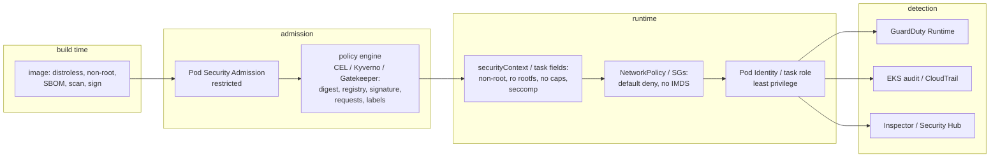

# Identity and security · L300 — Hardening workloads and clusters

**Level:** 300 · **Time:** ~100 min · **Prerequisites:** [L200 IAM for containers](L200-iam-for-containers.md),
[Container fundamentals L300](../01-container-fundamentals/L300-runtimes-and-the-kernel.md),
[Networking L300](../05-networking/L300-container-networking-internals.md)

**After this document you can:**

- Apply Pod Security Standards and write a `securityContext` that passes `restricted`, and map each
  field to the ECS task definition equivalent.
- Choose and write admission policies (CEL policies, Kyverno, Gatekeeper) that enforce your rules
  without a review queue, including image signature verification.
- Turn on and read the AWS detection layer: GuardDuty Runtime Monitoring, Inspector, Security Hub,
  EKS audit logs, CloudTrail for ECS/ECR.
- Harden nodes, block IMDS, restrict egress, rotate secrets and audit ECS Exec.
- Prove each control with a command.

## 1. Mental model



Hardening is a chain: what the build produced, what admission lets in, what the kernel lets the
process do, what the network lets it reach, what identity lets it call, and what detection sees when
the previous links fail. Each link has a concrete control with a concrete proof. The failure of most
"hardened" platforms is a link that exists on paper (a policy in `Audit` mode nobody reads, a
GuardDuty finding routed to nowhere, a `restricted` label on one namespace out of forty). This
document is the chain, link by link, with the command that proves each one.

## 2. Concepts

### 2.1 Pod Security Standards and Admission

Three profiles: `privileged` (anything), `baseline` (no known privilege escalations: no privileged
containers, hostPath, hostNetwork, dangerous capabilities), `restricted` (baseline plus non-root,
dropped capabilities, seccomp, no privilege escalation, restricted volume types). Pod Security
Admission (built in) enforces them per namespace through labels, with modes `enforce` (reject),
`audit` (annotate audit log), `warn` (client warning), and an optional version pin so upgrades do not
change semantics silently:

```bash
kubectl label ns shopfront \
  pod-security.kubernetes.io/enforce=restricted pod-security.kubernetes.io/enforce-version=v1.36 \
  pod-security.kubernetes.io/audit=restricted pod-security.kubernetes.io/warn=restricted --overwrite
kubectl label ns kube-system pod-security.kubernetes.io/enforce=privileged --overwrite   # system DaemonSets need it
kubectl -n shopfront apply --dry-run=server -f labs/eks/manifests/base/deployment-orders.yaml   # see warnings
```

Roll out `audit`+`warn` first, read the audit annotations (`pod-security.kubernetes.io/audit-violations`
in the audit log), fix, then `enforce`. Platform namespaces (CNI, GuardDuty agent, node exporters)
legitimately need `privileged`; keep them few and owned by the platform team.

### 2.2 securityContext field by field

```yaml
spec:
  securityContext:                      # pod level
    runAsNonRoot: true                  # kubelet refuses to start a container whose image runs as uid 0
    runAsUser: 10001                    # explicit uid (the image sets it too; belt and braces)
    runAsGroup: 10001
    fsGroup: 10001                      # group ownership of mounted volumes
    seccompProfile: { type: RuntimeDefault }   # containerd's default syscall allowlist; Localhost for custom profiles
  containers:
    - name: orders
      securityContext:                  # container level
        allowPrivilegeEscalation: false # no setuid binaries gaining privileges; sets no_new_privs
        readOnlyRootFilesystem: true    # image filesystem immutable; writable paths via volumes
        capabilities: { drop: [ALL] }   # add back only what is proven necessary (NET_BIND_SERVICE for <1024 ports)
        privileged: false               # default; never true in application namespaces
        procMount: Default              # Unmasked exposes /proc; never for apps
        appArmorProfile: { type: RuntimeDefault }   # field since 1.30; AppArmor on AL2023/Bottlerocket where loaded
      volumeMounts: [{ name: tmp, mountPath: /tmp }]
  volumes: [{ name: tmp, emptyDir: { sizeLimit: 256Mi } }]
  automountServiceAccountToken: false   # unless the pod calls the Kubernetes API
  hostNetwork: false
  hostPID: false
  hostIPC: false
```

| Field | Blocks | ECS equivalent |
| --- | --- | --- |
| `runAsNonRoot`/`runAsUser` | root in the container; most escape paths need root | `user: "10001:10001"` |
| `allowPrivilegeEscalation: false` | setuid/`CAP_SETUID` privilege gains | Fargate always; EC2 via `linuxParameters.capabilities` |
| `readOnlyRootFilesystem` | writing binaries/webshells into the container | `readonlyRootFilesystem: true` + a `tmp` volume |
| `capabilities.drop: [ALL]` | raw sockets, mount, ptrace, module load, chown | `linuxParameters.capabilities.drop: ["ALL"]` (Fargate allows only `SYS_PTRACE` in add) |
| `seccompProfile RuntimeDefault` | ~40 dangerous syscalls (mount, kexec, ptrace variants…) | Fargate applies its own; EC2 Docker default profile |
| `privileged: false` | full host access | `privileged` unsupported on Fargate; forbid on EC2 with Config rule `ecs-containers-nonprivileged` |
| `hostNetwork/PID/IPC: false` | escaping namespaces | `networkMode: awsvpc` (not `host`), `pidMode`/`ipcMode` unset |
| `automountServiceAccountToken: false` | stolen SA tokens reaching the API server | n/a |
| `sysctls` allowlist | unsafe kernel tunables | `systemControls` limited on Fargate |

Writable paths: runtimes that write caches (`/tmp`, `~/.npm`, `/var/cache`) get `emptyDir`
volumes with `sizeLimit` so a runaway log cannot fill the node. The shopfront images are built for
this ([labs/apps](../../labs/apps/)).

### 2.3 Admission policy engines

| | `ValidatingAdmissionPolicy` / `MutatingAdmissionPolicy` | Kyverno | Gatekeeper (OPA) |
| --- | --- | --- | --- |
| Where it runs | in the API server (no webhook) | webhook Deployment | webhook Deployment |
| Language | CEL | YAML rules (+ CEL) | Rego |
| Mutation | yes (GA 1.36) | yes | limited (mutation CRDs) |
| Image verification | no (needs a webhook) | `verifyImages` (cosign, Notation) | via external data |
| Reports | audit annotations | `PolicyReport` CRDs | `Constraint` status violations |
| Failure mode | none (in-process) | webhook timeout → `failurePolicy` | same |
| Use | simple invariants at zero operational cost | full policy suite with reports and image signatures | organisations already on OPA |

A CEL policy that every namespace in a fleet should have:

```yaml
apiVersion: admissionregistration.k8s.io/v1
kind: ValidatingAdmissionPolicy
metadata: { name: require-digests-and-requests }
spec:
  failurePolicy: Fail
  matchConstraints:
    resourceRules: [{ apiGroups: ["apps"], apiVersions: ["v1"], operations: [CREATE, UPDATE], resources: [deployments, statefulsets, daemonsets] }]
  validations:
    - expression: "object.spec.template.spec.containers.all(c, c.image.contains('@sha256:'))"
      message: "images must be pinned by digest"
    - expression: "object.spec.template.spec.containers.all(c, c.image.startsWith('123456789012.dkr.ecr.us-east-1.amazonaws.com/'))"
      message: "images must come from the organisation ECR registry"
    - expression: "object.spec.template.spec.containers.all(c, has(c.resources.requests) && has(c.resources.requests.cpu) && has(c.resources.requests.memory))"
      message: "every container needs cpu and memory requests"
    - expression: "object.spec.template.spec.containers.all(c, !has(c.securityContext) || !has(c.securityContext.privileged) || !c.securityContext.privileged)"
      message: "privileged containers are not allowed"
---
apiVersion: admissionregistration.k8s.io/v1
kind: ValidatingAdmissionPolicyBinding
metadata: { name: require-digests-and-requests-apps }
spec:
  policyName: require-digests-and-requests
  validationActions: [Deny]                  # start with [Audit, Warn], then Deny
  matchResources:
    namespaceSelector: { matchExpressions: [{ key: kubernetes.io/metadata.name, operator: NotIn, values: [kube-system, kube-node-lease, kube-public] }] }
```

Image signature verification with Kyverno and AWS Signer (Notation) — the signing side is in
[01 L400](../01-container-fundamentals/L400-hardening-supply-chain-and-performance.md):

```yaml
apiVersion: kyverno.io/v1
kind: ClusterPolicy
metadata: { name: verify-shopfront-signatures }
spec:
  validationFailureAction: Enforce
  webhookTimeoutSeconds: 30
  failurePolicy: Fail
  rules:
    - name: notation-aws-signer
      match: { any: [{ resources: { kinds: [Pod], namespaces: [shopfront] } }] }
      verifyImages:
        - type: Notary
          imageReferences: ["123456789012.dkr.ecr.us-east-1.amazonaws.com/shopfront/*"]
          attestors:
            - entries:
                - certificates:
                    cert: |-
                      -----BEGIN CERTIFICATE-----
                      ...AWS Signer root / signing profile certificate chain...
                      -----END CERTIFICATE-----
          mutateDigest: true
          verifyDigest: true
          required: true
```

The cosign keyless variant uses `type: Cosign` with `keyless: { subject, issuer }` against the
Sigstore transparency log. Either way, admission fails closed when the registry or Signer is
unreachable; keep the policy engine highly available (two replicas, PDB, `priorityClassName`) and
exclude `kube-system`.

### 2.4 Network policy as a security control

Default-deny per namespace, allow DNS, allow the specific service-to-service edges, and deny IMDS
explicitly even when the hop limit already blocks it (defence in depth). The manifests are in
[Networking L300 §2.4](../05-networking/L300-container-networking-internals.md) and
[`labs/eks/manifests/base/networkpolicies.yaml`](../../labs/eks/manifests/base/networkpolicies.yaml).
On ECS the equivalent is one security group per service with rules referencing other services'
security groups (never CIDRs of shared subnets), and `ECS_AWSVPC_BLOCK_IMDS=true` on EC2.

### 2.5 IMDS, nodes and the host

| Control | EKS | ECS EC2 | Fargate |
| --- | --- | --- | --- |
| IMDSv2 required, hop limit 1 | launch template / `EC2NodeClass.metadataOptions` / verify Auto Mode default | launch template | n/a (no IMDS) |
| Block IMDS from workloads | hop limit + NetworkPolicy egress deny `169.254.169.254/32` | `ECS_AWSVPC_BLOCK_IMDS=true` | n/a |
| Node OS | Bottlerocket (SELinux enforcing, read-only root, API-only) or AL2023 (SELinux permissive by default — verify; CIS benchmark AMI options) | ECS-optimized AL2023 or Bottlerocket ECS variant | AWS-managed microVM |
| Access to nodes | SSM Session Manager only; no SSH keys; no public IPs | same | none; ECS Exec into tasks |
| Patching | node replacement (managed node group update, Karpenter drift, Auto Mode 21-day) | AMI rotation / Managed Instances | AWS |
| Kernel hardening | Bottlerocket defaults; `kubeletConfig` `protectKernelDefaults`; forbid unsafe sysctls | agent config | n/a |
| Benchmarks | kube-bench (CIS EKS Benchmark) as a Job | CIS AL2023/Bottlerocket | n/a |

```bash
kubectl apply -f https://raw.githubusercontent.com/aquasecurity/kube-bench/main/job-eks.yaml   # pin a version in production
kubectl logs job/kube-bench | grep -E '^\[(FAIL|WARN)\]' | head
```

### 2.6 Detection: GuardDuty, Inspector, Security Hub, audit logs, CloudTrail

**GuardDuty Runtime Monitoring** deploys an agent (EKS managed add-on `aws-guardduty-agent`; for
ECS Fargate a sidecar GuardDuty injects, for EC2 the SSM-installed agent) that reports process,
file and network events to GuardDuty, which correlates them with EKS audit logs and VPC/DNS
telemetry. Finding types you will see: `Execution:Runtime/NewBinaryExecuted`,
`Execution:Runtime/ReverseShell`, `PrivilegeEscalation:Runtime/ContainerMountsHostDirectory`,
`Discovery:Kubernetes/SuccessfulAnonymousAccess`, `CredentialAccess:Kubernetes/MaliciousIPCaller`,
`UnauthorizedAccess:IAMUser/InstanceCredentialExfiltration.OutsideAWS` (verify the current names).
Route findings through EventBridge to a queue with severity SLAs; enable EKS Audit Log Monitoring
(GuardDuty reads the audit stream independently of your CloudWatch logging setting).

```bash
aws guardduty list-detectors
aws guardduty get-detector --detector-id <id> --query 'Features[?Name==`RUNTIME_MONITORING`||Name==`EKS_AUDIT_LOGS`]'
aws guardduty list-findings --detector-id <id> --finding-criteria '{"Criterion":{"severity":{"Gte":7},"service.resourceRole":{"Eq":["TARGET"]}}}'
```

**Amazon Inspector** scans ECR images (enhanced scanning, continuous), EC2 instances and Lambda;
findings with CVSS and exploitability go to Security Hub. **Security Hub** aggregates GuardDuty,
Inspector, Config and its own controls (`EKS.1` endpoint public access, `EKS.2` supported version,
`EKS.3` secrets encrypted, `ECS.1` task definitions with host network + non-root, `ECS.5`
read-only root filesystem, `ECR.1` scan on push — verify current control ids) into standards
(AWS Foundational Security Best Practices, CIS).

**EKS audit logs** (CloudWatch Logs Insights on `/aws/eks/shopfront-dev/cluster`, stream prefix
`kube-apiserver-audit`):

```text
# who exec'd into pods
fields @timestamp, user.username, objectRef.namespace, objectRef.name, requestURI
| filter objectRef.subresource = "exec" | sort @timestamp desc

# secrets read by non-system identities
fields @timestamp, user.username, objectRef.namespace, objectRef.name
| filter objectRef.resource = "secrets" and verb in ["get","list"] and user.username not like /^system:/

# RBAC denials
fields @timestamp, user.username, verb, objectRef.resource, responseStatus.reason
| filter responseStatus.code = 403

# anonymous requests (should be zero beyond health endpoints)
fields @timestamp, requestURI, sourceIPs.0 | filter user.username = "system:anonymous"
```

**CloudTrail** for ECS/ECR: `ExecuteCommand` (who entered which task), `RunTask`/`RegisterTaskDefinition`
(who changed the recipe), `PutImage`/`BatchGetImage`/`GetAuthorizationToken` (who pushed/pulled),
`DeleteRepository`, and `AssumeRole*` for task roles. Alert on `ExecuteCommand` in production and on
`RegisterTaskDefinition` outside the pipeline role.

### 2.7 Fargate isolation, private endpoints, egress

Fargate runs each task in its own Firecracker microVM: no shared kernel between tasks, no host
filesystem, no privileged mode, no IMDS. It is the right default for untrusted or multi-tenant
code; the price is no DaemonSets and no host tooling. Private endpoints keep API traffic inside the
VPC and let endpoint policies restrict destinations (only your ECR registry, only your buckets).
Egress restriction (Network Firewall FQDN allowlists, proxies, Cilium DNS policies) turns "can
exfiltrate to anywhere" into "can reach three named hosts"
([Networking L400 §2.3](../05-networking/L400-network-architecture-at-scale.md)).

### 2.8 Secrets rotation and reload

| Delivery | Rotation reaches the workload when | Practice |
| --- | --- | --- |
| ECS `secrets[]` | new tasks start (values fetched at task start) | rotate, then `update-service --force-new-deployment`; or use IAM DB auth / RDS Proxy so rotation is invisible |
| Kubernetes Secret from External Secrets Operator | ESO refresh interval updates the Secret; pods see mounted files change within the kubelet sync period; env vars never change | mount as files and reload, or Reloader/annotation-driven rollout |
| Secrets Store CSI driver (ASCP) | rotation reconciler updates mounted files; optional sync to Kubernetes Secret | same as above |
| Application fetches from Secrets Manager at start | restart | cache with TTL in the app (AWS-provided caching libraries) |

Never log secret values; redact `DATABASE_URL` in start-up logs as the shopfront services do; use
`aws secretsmanager rotate-secret` with tested rotation Lambdas; alarm on `GetSecretValue` failures.

### 2.9 ECS Exec auditing

Enable only where needed (`enableExecuteCommand` per service), require SSM session encryption with
a KMS key and session logging to CloudWatch Logs/S3 through the cluster's `executeCommandConfiguration`,
restrict `ecs:ExecuteCommand` with condition keys (`ecs:container-name`, `ecs:cluster`, resource tags),
and alert on CloudTrail `ExecuteCommand` events in production. Distroless images reduce what a
session can do (no shell), which is a feature.

```json
{ "Effect": "Allow", "Action": "ecs:ExecuteCommand",
  "Resource": ["arn:aws:ecs:us-east-1:123456789012:cluster/shopfront-dev", "arn:aws:ecs:us-east-1:123456789012:task/shopfront-dev/*"],
  "Condition": { "StringEquals": { "ecs:container-name": "worker", "aws:ResourceTag/Environment": "dev" } } }
```

### 2.10 The hardening checklist with proofs

| Item | Proof command | Expected |
| --- | --- | --- |
| Restricted PSA on app namespaces | `kubectl get ns -L pod-security.kubernetes.io/enforce` | `restricted` on every non-system namespace |
| No privileged pods outside system | `kubectl get pods -A -o json \| jq '[.items[] \| select(.spec.containers[].securityContext.privileged==true) \| .metadata.namespace] \| unique'` | `["kube-system", …platform]` only |
| All images by digest from ECR | policy in `Deny`; `kubectl get pods -A -o jsonpath='{..image}' \| tr ' ' '\n' \| grep -vc '@sha256'` | `0` |
| Signatures verified | deploy an unsigned image → rejected | admission error naming the policy |
| IMDS unreachable from pods | `kubectl run … curl -m 2 -X PUT 169.254.169.254/latest/api/token` | timeout |
| Default-deny in every namespace | `kubectl get networkpolicy -A \| grep default-deny \| wc -l` | equals namespace count |
| Pod Identity for every SA that calls AWS | `aws eks list-pod-identity-associations --cluster-name shopfront-dev` | one per SA; none using node role |
| No `system:masters` grants | `aws eks list-access-entries` + `describe-access-entry` | no `kubernetesGroups` containing `system:masters` <!-- term-ok --> |
| Audit logging on | `aws eks describe-cluster --query 'cluster.logging'` | `audit`, `authenticator` enabled |
| GuardDuty runtime + EKS audit | `aws guardduty get-detector` features | `ENABLED` |
| ECR scanning enhanced | `aws ecr get-registry-scanning-configuration` | `ENHANCED`, `CONTINUOUS_SCAN` |
| ECS: non-root, read-only, no privileged | Config rules `ecs-task-definition-nonroot-user`, `ecs-containers-readonly-access`, `ecs-containers-nonprivileged` | `COMPLIANT` |
| ECS Exec restricted and logged | CloudTrail `ExecuteCommand` alarm; cluster `executeCommandConfiguration.logging` | `OVERRIDE` with KMS |
| Nodes: IMDSv2 required, hop limit 1, no public IP, SSM only | `aws ec2 describe-instances --query 'Reservations[].Instances[].{id:InstanceId,tokens:MetadataOptions.HttpTokens,hop:MetadataOptions.HttpPutResponseHopLimit,pub:PublicIpAddress}'` | `required`, `1`, `null` |
| Secrets not in env/task definitions | `aws ecs describe-task-definition … --query 'taskDefinition.containerDefinitions[].environment'` | no credential-looking values |
| kube-bench | Job output | no `FAIL` in the automated section |

## 3. How it interacts with the rest of AWS

| Component | Talks to | Protocol/API | Prerequisite (IAM, network, DNS) | What breaks if missing |
| --- | --- | --- | --- | --- |
| Policy engine (Kyverno/Ratify) | ECR (signatures, referrers), AWS Signer | HTTPS via Pod Identity | role with `ecr:BatchGetImage`, `signer:GetRevocationStatus`; `ecr.api` endpoint | admission fails closed → no deployments |
| GuardDuty agent | GuardDuty data endpoint | HTTPS | `guardduty-data` endpoint in private clusters; add-on installed | no runtime findings |
| Inspector | ECR registry | scanning configuration | Inspector enabled in the account | no CVE findings |
| Security Hub | GuardDuty, Inspector, Config | integrations | delegated admin | fragmented findings |
| EKS control plane | CloudWatch Logs | audit stream | logging enabled | no audit trail |
| ECS Exec | SSM, KMS, CloudWatch Logs/S3 | session channels | `executeCommandConfiguration`, task role `ssmmessages:*`, KMS grant | sessions unlogged or failing |
| Secrets Store CSI / ESO | Secrets Manager, SSM | `GetSecretValue` via Pod Identity | role per namespace/SA | pods stuck without secrets |
| Config rules | ECS/EKS resources | evaluations | recorder enabled | drift unnoticed |

## 4. Use it when / avoid it when

Use:

- `restricted` PSA plus a small CEL policy set on every application namespace from day one; add
  Kyverno when you need image verification or reports.
- Signature verification for production namespaces; unsigned in dev only if dev is isolated.
- GuardDuty Runtime Monitoring and EKS audit log protection on every production cluster; ECS Fargate
  runtime monitoring on every production cluster.
- Fargate for untrusted or tenant code; Bottlerocket for EC2 nodes.

Avoid:

- Policies in `Audit` forever; set a date to enforce.
- Global exemptions ("platform can do anything") without a list of who is in "platform".
- Webhook engines without HA and `failurePolicy` thought through: a dead webhook can stop every
  deployment (or, with `Ignore`, silently stop enforcing).
- Long-lived `kubectl exec`/ECS Exec permissions for humans in production; time-bound access.

Alternatives: Auto Mode reduces node hardening scope; ECS on Fargate removes the node entirely;
Cilium adds L7 policy where NetworkPolicy is too coarse.

## 5. Well-Architected view

| Pillar | Controls here | Cost | Practice |
| --- | --- | --- | --- |
| Operational Excellence | policy reports, audit queries, checklist with proofs | policy maintenance | policies in git, rolled out audit → enforce |
| Security | PSA, admission, signatures, network policy, IMDS blocking, GuardDuty, Inspector, audit | engine operations; log ingestion | the checklist in §2.10 run monthly |
| Reliability | HA policy engines with PDBs; `failurePolicy` decisions | risk of blocking deployments | exclude system namespaces; alarms on webhook latency |
| Performance Efficiency | in-process CEL over webhooks where possible | none | CEL for invariants, Kyverno for signatures |
| Cost Optimization | GuardDuty/Inspector per-resource pricing | detection spend | scope Inspector to production registries |
| Sustainability | distroless images (less to scan/patch) | none | rebuild cadence |

## 6. Failure modes and troubleshooting

| Symptom | Likely cause | How to confirm (command/metric) | Fix |
| --- | --- | --- | --- |
| Deployment rejected: `violates PodSecurity "restricted"` | missing `runAsNonRoot`, `seccompProfile`, `allowPrivilegeEscalation`, capabilities | the error lists fields | add the securityContext block ([playbook](../../playbooks/incidents/crashloop-and-exit-codes.md)) |
| Pod runs as root despite `runAsUser` | init container or sidecar without context; image `USER` ignored by `runAsUser: 0` | `kubectl exec … id` | set pod-level context; fix images |
| App crashes with `EROFS` | read-only rootfs without writable volume | container logs | `emptyDir` for the path |
| All deployments fail after policy engine upgrade | webhook unavailable, `failurePolicy: Fail` | `kubectl get validatingwebhookconfigurations`; engine pods | HA + PDB; temporary `Ignore` with alarm |
| Signed image rejected | wrong certificate chain/subject; digest tag mismatch; Signer profile revoked | Kyverno logs; `notation verify` locally | fix attestor; re-sign |
| GuardDuty shows `InstanceCredentialExfiltration` | node role used off-instance; pod reached IMDS | CloudTrail source IP for the role | revoke sessions (`aws:TokenIssueTime` deny), block IMDS ([playbook](../../playbooks/incidents/iam-accessdenied-from-containers.md)) |
| ECS task cannot start after enabling read-only rootfs | runtime writes to `/tmp` or home | `stoppedReason`, logs `read-only file system` | bind volume for the path |
| ECS Exec `TargetNotConnectedException` | task role lacks `ssmmessages`; no endpoint; agent not injected | `amazon-ecs-exec-checker` | fix role/endpoint |
| Audit log has no `exec` entries | `audit` log type disabled | `describe-cluster … logging` | enable |
| Access denied for `kubectl` after hardening | removed a group binding; access entry deleted | authenticator log; `list-access-entries` | restore least-privilege entry ([playbook](../../playbooks/incidents/eks-auth-and-access.md)) |

## 7. Signals: metrics, logs, traces

- Policy: Kyverno `PolicyReport` counts (`kyverno_policy_results_total` by result), CEL audit
  annotations in audit logs, admission webhook latency (`apiserver_admission_webhook_admission_duration_seconds`).
- GuardDuty finding counts by severity and type; time to acknowledge/resolve.
- Inspector: critical/high findings per repository; mean time to patch.
- Security Hub: control compliance percentage for EKS/ECS/ECR controls.
- EKS audit: `exec` count, secret reads by humans, 403s, anonymous requests.
- CloudTrail: `ExecuteCommand`, `RegisterTaskDefinition` outside pipelines, `PutImage` from
  unexpected principals, `AssumeRoleWithWebIdentity` failures.
- Inventory: pods without `restricted` PSA, without requests, with `hostNetwork`; images without
  digests or signatures.

Full table: [`reference/metrics-catalog.md`](../../reference/metrics-catalog.md).

## 8. Testing and DR notes

Testing: negative tests as pipeline steps against an ephemeral cluster: a privileged pod must be
rejected, an unsigned image must be rejected, an image from Docker Hub must be rejected, a pod must
time out reaching IMDS, a pod without a NetworkPolicy edge must not reach `catalog`; `kubectl apply
--dry-run=server` against production for policy checks before merge; kube-bench and Inspector
reports diffed release over release; a GuardDuty test finding (`aws guardduty create-sample-findings`)
to prove the routing to the on-call queue works.

DR: controls are code (policies, PSA labels, NetworkPolicies, Config rules, GuardDuty/Inspector
settings) and must be part of the rebuild; per-Region items are the Private CA for Service Connect
TLS, KMS keys (multi-Region keys for secrets), GuardDuty detectors and Inspector enablement,
Pod Identity associations and IRSA providers ([10 L300](../10-resilience-and-dr/L300-dr-strategies-for-container-platforms.md)).

## 9. Hands-on

```bash
# EKS manifests: securityContext, PSA labels and policies in the labs
grep -nA8 'securityContext' labs/eks/manifests/base/deployment-orders.yaml | head -30
grep -n 'pod-security' labs/eks/manifests/base/namespace.yaml
ls labs/eks/addons/                       # policy engine values / CEL policies
kubectl apply -k labs/eks/manifests/overlays/dev
kubectl -n shopfront get pods -o jsonpath='{range .items[*]}{.metadata.name}{" uid="}{.spec.securityContext.runAsUser}{" ro="}{.spec.containers[0].securityContext.readOnlyRootFilesystem}{"\n"}{end}'

# Negative tests (cluster required)
kubectl -n shopfront run privtest --image=busybox:1.36 --restart=Never --overrides='{"spec":{"containers":[{"name":"p","image":"busybox:1.36","securityContext":{"privileged":true}}]}}' ; echo "expected: forbidden"
kubectl -n shopfront run tagtest --image=busybox:latest --restart=Never ; echo "expected: rejected by digest/registry policy"
kubectl -n shopfront run imds --rm -it --image=curlimages/curl:8.10.1 --restart=Never -- -m 2 -sX PUT http://169.254.169.254/latest/api/token -H 'X-aws-ec2-metadata-token-ttl-seconds: 60' ; echo "expected: timeout"

# ECS: task definitions carry the same controls
jq '.containerDefinitions[0] | {user, readonlyRootFilesystem, linuxParameters, secrets: (.secrets|length), env_with_secret_words: [.environment[]? | select(.name|test("PASS|SECRET|TOKEN";"i"))]}' labs/ecs/taskdefs/orders.json

# Detection layer
aws guardduty list-detectors --query 'DetectorIds[0]' --output text | xargs -I{} aws guardduty get-detector --detector-id {} --query 'Features[].{name:Name,status:Status}'
aws ecr get-registry-scanning-configuration --query 'scanningConfiguration.{type:scanType,rules:rules}'
aws logs start-query --log-group-name /aws/eks/shopfront-dev/cluster --start-time $(($(date +%s)-86400)) --end-time $(date +%s) \
  --query-string 'fields @timestamp, user.username, objectRef.namespace, objectRef.name | filter objectRef.subresource = "exec" | sort @timestamp desc | limit 20'
```

## 10. Check yourself

1. Which `securityContext` fields does the `restricted` profile require, and which ECS task
   definition fields express the same intent?

<details><summary>Answer</summary>
`runAsNonRoot: true` (or a non-zero `runAsUser`), `allowPrivilegeEscalation: false`,
`capabilities.drop: ["ALL"]` (only `NET_BIND_SERVICE` may be added), `seccompProfile` of type
`RuntimeDefault` or `Localhost`, no privileged, no host namespaces/ports, no `hostPath`, restricted
volume types. On ECS: `user: "10001:10001"`, `readonlyRootFilesystem: true`,
`linuxParameters.capabilities.drop: ["ALL"]`, no `privileged`, `networkMode: awsvpc`; Fargate
enforces most of the rest by construction.
</details>

2. Why is a webhook-based policy engine both a security control and an availability risk, and how
   do you manage the risk?

<details><summary>Answer</summary>
Every matching admission request waits for the webhook; if the engine is down, `failurePolicy: Fail`
blocks all deployments in scope while `Ignore` silently stops enforcing. Run at least two replicas
with a PDB and a high `priorityClassName`, exclude `kube-system`, keep the engine's own images and
dependencies (registry, Signer) reachable, alarm on webhook latency and error rates, and prefer
in-process CEL policies for simple invariants so the webhook only handles what needs it.
</details>

3. GuardDuty reports `UnauthorizedAccess:IAMUser/InstanceCredentialExfiltration.OutsideAWS` for a
   node role. What happened and what are the first three actions?

<details><summary>Answer</summary>
Credentials of the node's instance role are being used from outside AWS, most likely stolen through
IMDS from a compromised pod (SSRF or a shell). Actions: revoke the role's active sessions with a
deny policy conditioned on `aws:TokenIssueTime` earlier than now, isolate the node (cordon, taint,
quarantine security group) and identify the pod from GuardDuty's resource details and audit logs,
then ensure IMDS is unreachable from pods (hop limit 1, NetworkPolicy) and that workloads use Pod
Identity.
</details>

4. A rotated database password breaks the ECS service an hour later. Why, and what design removes
   the problem?

<details><summary>Answer</summary>
ECS injects `secrets[]` at task start; running tasks keep the old value until replaced, so the
rotation invalidated the password they hold while the new tasks (or a scale-out) got the new one,
producing mixed failures when the old password expired. Either trigger `update-service
--force-new-deployment` as part of rotation, or remove passwords from the equation with IAM database
authentication or RDS Proxy with Secrets Manager integration.
</details>

5. What does `automountServiceAccountToken: false` protect against, and when must it be true?

<details><summary>Answer</summary>
A stolen or leaked projected token grants the pod's service account permissions on the Kubernetes
API (whatever RBAC allows); most application pods never call the API, so no token should exist in
the container. It must be true for pods that talk to the API server (controllers, operators, some
agents) and for Pod Identity/IRSA the token volumes are separate projections with different
audiences, injected by the webhook regardless of this field.
</details>

## 11. Sources

- Pod Security Standards and Pod Security Admission — https://kubernetes.io/docs/concepts/security/pod-security-standards/ and https://kubernetes.io/docs/concepts/security/pod-security-admission/
- Configure a Security Context for a Pod or Container — https://kubernetes.io/docs/tasks/configure-pod-container/security-context/
- Validating Admission Policy and Mutating Admission Policy — https://kubernetes.io/docs/reference/access-authn-authz/validating-admission-policy/ and https://kubernetes.io/docs/reference/access-authn-authz/mutating-admission-policy/
- Kyverno image verification (Notary, Cosign) — https://kyverno.io/docs/policy-types/cluster-policy/verify-images/
- AWS Signer container image signing with Notation — https://docs.aws.amazon.com/signer/latest/developerguide/container-workflow.html
- Amazon EKS Best Practices Guide: security — https://docs.aws.amazon.com/eks/latest/best-practices/security.html
- Amazon ECS security best practices (task definitions, ECS Exec) — https://docs.aws.amazon.com/AmazonECS/latest/bestpracticesguide/security.html
- GuardDuty Runtime Monitoring (EKS, ECS Fargate, EC2) and finding types — https://docs.aws.amazon.com/guardduty/latest/ug/runtime-monitoring.html and https://docs.aws.amazon.com/guardduty/latest/ug/guardduty_finding-types-runtime.html
- Amazon Inspector for Amazon ECR — https://docs.aws.amazon.com/inspector/latest/user/scanning-ecr.html
- AWS Security Hub controls for EKS, ECS, ECR — https://docs.aws.amazon.com/securityhub/latest/userguide/eks-controls.html and https://docs.aws.amazon.com/securityhub/latest/userguide/ecs-controls.html
- Amazon EKS control plane logging (audit) — https://docs.aws.amazon.com/eks/latest/userguide/control-plane-logs.html
- Logging Amazon ECS API calls with CloudTrail — https://docs.aws.amazon.com/AmazonECS/latest/developerguide/logging-using-cloudtrail.html
- ECS Exec logging and auditing — https://docs.aws.amazon.com/AmazonECS/latest/developerguide/ecs-exec.html#ecs-exec-logging
- Bottlerocket security features — https://github.com/bottlerocket-os/bottlerocket/blob/develop/SECURITY_FEATURES.md
- kube-bench (CIS Kubernetes/EKS Benchmark) — https://github.com/aquasecurity/kube-bench
- AWS Secrets and Configuration Provider (ASCP) for the Secrets Store CSI driver — https://docs.aws.amazon.com/secretsmanager/latest/userguide/integrating_csi_driver.html
- AWS Config managed rules for ECS — https://docs.aws.amazon.com/config/latest/developerguide/managed-rules-by-aws-config.html
