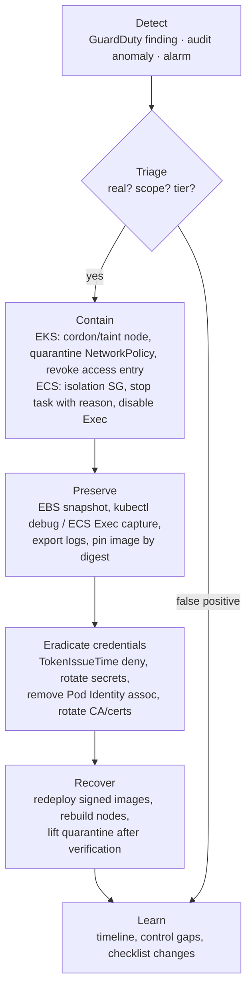

# Identity and security · L400 — Security architecture and incident response

**Level:** 400 · **Time:** ~90 min · **Prerequisites:**
[L300 Hardening workloads and clusters](L300-hardening-workloads-and-clusters.md),
[Networking L400](../05-networking/L400-network-architecture-at-scale.md),
[Observability L400](../07-observability/L400-observability-at-scale.md)

**After this document you can:**

- Build and defend a threat model for a container platform, with a control and an evidence source
  for each threat.
- Choose a multi-tenancy tier per workload and say exactly what it does and does not isolate.
- Decide between Service Connect TLS, Cilium/Istio mTLS and VPC Lattice auth policies for
  workload-to-workload trust.
- Map PCI DSS, HIPAA and SOC 2 expectations to concrete container controls and their evidence.
- Run a container incident end to end: detect, contain, preserve, eradicate, recover, learn.

## 1. Mental model



Security architecture for containers is the deliberate arrangement of boundaries (image, process,
network, identity, account) so that a compromise of one workload stays a compromise of one workload,
and the preparation to prove that when it happens. The threat model tells you which boundaries
matter; the tenancy model tells you where to put them; compliance frameworks tell you what evidence
auditors expect; the incident runbook tells you what to do at 3 a.m. with a GuardDuty finding and no
host to log into.

## 2. Concepts

### 2.1 Threat model

| Threat | Attack path | Primary controls | Evidence |
| --- | --- | --- | --- |
| Malicious or vulnerable base image | typosquatted/compromised public image; unpatched CVE | pull-through cache with allowlisted upstreams; distroless bases; Inspector continuous scanning; rebuild cadence; signature verification at admission | Inspector findings trend; admission rejections; image provenance attestations |
| Compromised CI | attacker modifies the pipeline or steals its role | OIDC federation with `sub` conditions per repository/branch, SHA-pinned actions, ephemeral runners, SLSA provenance, deploy-by-digest, branch protection | CloudTrail for the CI role; provenance verified at admission |
| Dependency confusion / supply chain | malicious package in the build | private package proxies, lockfiles with hashes, SBOM diffs between releases | SBOM per image in ECR; policy on new dependencies |
| Container escape | privileged container, `hostPath`, `hostPID`, kernel CVE | PSA `restricted`, no privileged outside platform namespaces, seccomp, Bottlerocket/AL2023 patched by replacement, Fargate microVMs for untrusted code | GuardDuty runtime findings (`PrivilegeEscalation:Runtime/*`); PSA violations |
| Lateral movement | flat network; shared node role; shared secrets | default-deny NetworkPolicy; security groups per service; Pod Identity per SA; IMDS blocked; namespaces per team | Flow Logs/Hubble denied flows; CloudTrail role usage |
| Credential theft via IMDS/SSRF | app fetches attacker-supplied URL → `169.254.169.254` | IMDSv2 hop limit 1, `ECS_AWSVPC_BLOCK_IMDS`, NetworkPolicy deny, Fargate | GuardDuty `InstanceCredentialExfiltration`; CloudTrail source IPs |
| Token exfiltration and replay | stolen projected SA token or Pod Identity token | short token lifetimes, audience binding (`pods.eks.amazonaws.com`, `sts.amazonaws.com`), `automountServiceAccountToken: false`, association scoped to namespace+SA | audit logs of token use from unexpected IPs; `AssumeRoleForPodIdentity` anomalies |
| Noisy neighbour / resource DoS | no limits; PID/fd exhaustion; log floods | requests/limits, `pids.max`, `ephemeral-storage` limits, ResourceQuota, PDB | throttling/OOM metrics; quota events |
| Control-plane abuse | over-privileged RBAC, cluster-admin access entries, anonymous access, exposed endpoint | access entries via Identity Center groups, no `system:masters`, private endpoint or CIDR allowlist, audit logging <!-- term-ok --> | audit 403s/anonymous; GuardDuty Kubernetes findings |
| Secrets exposure | secrets in env, images, logs, git | `secrets[]`/ESO/CSI, redaction, secret scanning in CI, KMS envelope encryption | CloudTrail `GetSecretValue`; scanner reports |
| Data exfiltration | unrestricted egress | Network Firewall FQDN allowlists, egress proxies, endpoint policies, VPC-only data stores | Firewall logs; Flow Logs to unexpected destinations |
| Availability attacks | L7 floods, ALB exhaustion | CloudFront + WAF + Shield, rate limits, autoscaling limits | WAF blocked requests; ALB `RejectedConnectionCount` |

### 2.2 Multi-tenancy tiers

| Tier | Mechanisms | Isolates | Does not isolate | Cost |
| --- | --- | --- | --- | --- |
| Namespace | RBAC, ResourceQuota, LimitRange, PSA `restricted`, default-deny NetworkPolicy, Pod Identity per SA, admission policies | API objects, network by policy, IAM by SA | kernel (shared node), node resources beyond quota, DNS/Service discovery of other namespaces' names, control-plane availability | lowest |
| Node pool | above + taints/tolerations, NodePool per tenant tier, security groups for pods | kernel from other tiers' pods, node-level noisy neighbours | control plane, cluster-wide resources (CRDs, webhooks), etcd | medium (fragmented capacity) |
| Sandboxed runtime | Fargate (microVM per pod/task) | kernel per pod | control plane | Fargate pricing, no DaemonSets |
| Cluster | separate EKS/ECS cluster | control plane, CRDs, webhooks, upgrade schedules | account quotas, IAM, network if shared VPC | cluster fee + operations |
| Account | separate AWS account (+ VPC) | IAM, quotas, billing, blast radius of misconfiguration | organisation-wide identities, shared services | landing-zone work |

Pick the tier by the trust between tenants and by regulatory boundaries: internal teams of one
company usually get namespaces on shared clusters with strong policy; different security tiers
(PCI in-scope vs out-of-scope) get separate clusters or accounts; third-party/untrusted code gets
Fargate or a dedicated account.

### 2.3 Workload-to-workload trust: mTLS and auth policies

| Option | Identity | Where TLS terminates | Policy | Scope | Operational cost |
| --- | --- | --- | --- | --- | --- |
| ECS Service Connect TLS | ECS service identity, certificates from AWS Private CA | in the Service Connect agents | none beyond namespace membership (add IAM/SG for authorisation) | ECS services in a namespace | low |
| Cilium mutual authentication | SPIFFE IDs per identity (labels) | eBPF datapath with handshake | `CiliumNetworkPolicy` with `authentication.mode: required` | EKS EC2/Hybrid nodes | medium (Cilium) |
| Istio mTLS | SPIFFE IDs per service account | Envoy sidecar or ambient ztunnel | `AuthorizationPolicy` (L7) | EKS | high |
| VPC Lattice auth policies | IAM principals (SigV4-signed requests) | Lattice (TLS to the service) | IAM-style policies on service network/service | cross-account, mixed compute | low–medium; per-request cost |
| Application-level TLS + JWT | your PKI/IdP | in the app | your code | anything | development cost |

Decision: inside ECS use Service Connect TLS; inside EKS use Cilium if you already run it (or Istio
when you need L7 authorisation and traffic management); across accounts or mixed compute use Lattice;
never build your own PKI when one of these fits. Certificates rotate automatically in all four.

### 2.4 Compliance mapping

| Requirement (abridged) | Container control | Evidence source |
| --- | --- | --- |
| PCI DSS 4.0 — segment the CDE (1.x) | separate cluster/account for in-scope services; default-deny NetworkPolicy; security groups per service; egress control | Network Access Analyzer scopes; Flow Logs; policy manifests in git |
| PCI DSS — secure configuration, no defaults (2.x) | PSA `restricted`, admission policies, Bottlerocket, IMDSv2 | policy reports; kube-bench; Config rules |
| PCI DSS — protect stored data / keys (3.x) | KMS envelope encryption for Secrets, EBS/EFS/RDS encryption, Secrets Manager | KMS key policies; Config `eks-secrets-encrypted` |
| PCI DSS — vulnerability management (6.x, 11.x) | Inspector continuous scanning, rebuild cadence, admission blocks critical CVEs | Inspector findings/SLAs; pipeline logs |
| PCI DSS — access control and MFA (7.x, 8.x) | Identity Center with MFA → roles → access entries; namespace-scoped policies; no shared kubeconfigs | access entries inventory; audit logs |
| PCI DSS — logging and monitoring (10.x) | EKS audit + CloudTrail + GuardDuty to a SIEM with retention; ECS Exec logging | log retention settings; alarm inventory |
| HIPAA — access controls, audit controls, integrity, transmission security | same as above plus TLS everywhere (Service Connect TLS/mTLS), signed images | as above |
| SOC 2 — change management | GitOps with reviews, deploy-by-digest, admission policies preventing out-of-band changes | git history; CloudTrail for `RegisterTaskDefinition`/`kubectl apply` outside pipelines |
| SOC 2 — availability | multi-AZ, PDBs, DR drills | game-day records |

AWS Config conformance packs and Security Hub standards produce much of the evidence automatically;
the rest is git history and audit log queries kept as scheduled reports.

### 2.5 Incident response runbook for containers

**Detect.** GuardDuty findings (runtime, Kubernetes, IAM) → EventBridge → paging with severity
routing; audit log alarms (exec into production, secret reads by humans, anonymous access); ECR
critical CVE in a running image; application anomalies.

**Triage.** Identify the workload (GuardDuty resource details give cluster, namespace, pod/task,
container image digest), its identity (Pod Identity association or task role), its data access, its
tier. Decide: contain now (active exploitation) or observe (suspicious but low confidence).

**Contain.**

```bash
# EKS: freeze the node and the pod's network, keep the pod running for evidence
kubectl cordon "$NODE"; kubectl taint nodes "$NODE" incident=true:NoSchedule
kubectl -n shopfront label pod "$POD" quarantine=true
kubectl -n shopfront apply -f - <<'EOF'
apiVersion: networking.k8s.io/v1
kind: NetworkPolicy
metadata: { name: quarantine }
spec:
  podSelector: { matchLabels: { quarantine: "true" } }
  policyTypes: [Ingress, Egress]      # no rules = deny all
EOF
# remove the human who may be compromised
aws eks delete-access-entry --cluster-name shopfront-dev --principal-arn arn:aws:iam::123456789012:role/Suspect
# ECS: move the task to an isolation security group (no rules), stop when evidence is captured
aws ec2 modify-network-interface-attribute --network-interface-id "$TASK_ENI" --groups sg-isolation
aws ecs update-service --cluster shopfront-dev --service orders --no-enable-execute-command
```

**Preserve.**

```bash
# node disk (EKS EC2)
aws ec2 create-snapshot --volume-id "$ROOT_VOL" --description "incident-$(date -u +%FT%TZ) node $NODE"
# process/network state from inside without changing the container
kubectl -n shopfront debug -it "$POD" --image=nicolaka/netshoot:v0.13 --target=orders --profile=netadmin -- sh -c 'ps -ef; ss -tanp; cat /proc/1/environ | tr "\0" "\n" | grep -v SECRET'
kubectl -n shopfront debug node/"$NODE" -it --image=busybox:1.36 -- chroot /host crictl inspect "$CID" > /tmp/inspect.json
kubectl -n shopfront logs "$POD" --all-containers --since=24h > /tmp/pod.log
# ECS Fargate: no host; capture what exists
aws ecs execute-command --cluster shopfront-dev --task "$TASK" --container worker --interactive --command "sh -c 'ps -ef; ss -tanp'"   # only if Exec was enabled and you accept the footprint
aws ecs describe-tasks --cluster shopfront-dev --tasks "$TASK" > /tmp/task.json     # image digests, ENI, roles
aws logs create-export-task --log-group-name /shopfront/dev/orders --from "$START_MS" --to "$END_MS" --destination shopfront-forensics-123456789012
# pin the exact image for later analysis
aws ecr batch-get-image --repository-name shopfront/orders --image-ids imageDigest="$DIGEST" --query 'images[0].imageManifest' > /tmp/manifest.json
```

Fargate constraints: there is no host to snapshot and no kernel-level capture; rely on GuardDuty
runtime events, application and access logs, task metadata, and the image digest. This is a reason
to keep runtime monitoring on and logs complete for Fargate workloads.

**Eradicate credentials.**

```bash
# revoke every session of the suspect role issued before now
aws iam put-role-policy --role-name shopfront-orders-pod-role --policy-name RevokeOlderSessions --policy-document '{
  "Version": "2012-10-17",
  "Statement": [{ "Effect": "Deny", "Action": "*", "Resource": "*",
    "Condition": { "DateLessThan": { "aws:TokenIssueTime": "'"$(date -u +%FT%TZ)"'" } } }] }'
# stop new credentials to the compromised identity
aws eks delete-pod-identity-association --cluster-name shopfront-dev --association-id "$ASSOC"
# rotate secrets the workload could read
aws secretsmanager rotate-secret --secret-id shopfront/dev/orders/database-url --rotate-immediately
# rotate ECR pull credentials are token-based (12 h) — nothing to rotate; review repository policies
# if a node role is implicated: replace the nodes (drain), revoke with the same TokenIssueTime pattern on the node role
```

**Recover.** Redeploy from a known-good, signed digest; replace affected nodes (or let Karpenter/
Auto Mode drift them); restore the Pod Identity association with least privilege reviewed; remove
the quarantine only after verifying no persistence (CronJobs, webhooks, RBAC bindings, new access
entries, modified task definitions) with `kubectl get cronjobs,validatingwebhookconfigurations,
clusterrolebindings -A` diffs against git and CloudTrail `RegisterTaskDefinition` history.

**Learn.** Timeline from audit logs and CloudTrail; which link in the chain failed (build,
admission, runtime, network, identity, detection); a checklist change with an owner and a date;
update the game-day scenarios.

### 2.6 Security metrics

| Metric | Why |
| --- | --- |
| Mean time to patch critical/high CVEs in running images | supply-chain hygiene |
| Percentage of running images signed and pinned by digest | admission effectiveness |
| Percentage of pods in `restricted` namespaces; count of privileged pods outside platform namespaces | blast radius |
| Number of roles with wildcard actions attached to task/pod identities; roles unused in 90 days (Access Analyzer) | least privilege |
| GuardDuty findings by severity, time to acknowledge, time to resolve | detection and response health |
| Human `exec`/ECS Exec sessions in production per month | operational hygiene |
| Access entries with cluster-admin; break-glass uses | control-plane exposure |
| Policy violations per namespace in audit mode before enforcement | rollout readiness |

### 2.7 Well-Architected security pillar checklist

- Identity: Identity Center → roles → access entries; Pod Identity/task roles per workload; IMDS
  unreachable; no long-lived keys anywhere (CI uses OIDC).
- Detection: GuardDuty (runtime, EKS audit, IAM), Inspector, Security Hub standards, EKS audit
  logs and CloudTrail retained and searched; findings routed with SLAs.
- Infrastructure protection: private subnets, endpoints, egress control, security groups per
  service, default-deny NetworkPolicy, Bottlerocket/AL2023 or Fargate, WAF/Shield at the edge.
- Data protection: KMS everywhere (Secrets, EBS, EFS, RDS, S3), TLS in transit (ALB, Service
  Connect/mTLS), secrets never in env/images/logs.
- Incident response: runbook rehearsed, forensics bucket, quarantine policies pre-written,
  `TokenIssueTime` revocation tested, game days twice a year.
- Application security: signed images, SBOMs, admission policies, dependency scanning in CI.

## 3. How it interacts with the rest of AWS

| Component | Talks to | Protocol/API | Prerequisite (IAM, network, DNS) | What breaks if missing |
| --- | --- | --- | --- | --- |
| GuardDuty | EventBridge, Security Hub, SIEM | findings export | detector with runtime and EKS audit features; EventBridge rule to paging | findings unseen |
| Incident responders | EKS API, ECS API, EC2, IAM | `kubectl`, `aws` with a break-glass role | break-glass access entry pre-provisioned with alarms | slow containment |
| Forensics | S3 bucket (Object Lock), EBS snapshots, CloudWatch export | `create-snapshot`, `create-export-task` | bucket with retention; snapshot permissions | evidence lost |
| Identity revocation | IAM, EKS Pod Identity, Secrets Manager | `put-role-policy`, `delete-pod-identity-association`, `rotate-secret` | responder permissions scoped to incident actions | attacker keeps credentials |
| Service Connect TLS / mTLS | AWS Private CA / SPIRE | certificate issuance | CA per Region; role with `acm-pca:*Certificate*` | plaintext or failed connections |
| VPC Lattice | IAM | SigV4 auth policies | clients sign requests | 403 |
| Security Hub / Config | all accounts | standards and rules | delegated admin, recorders | no compliance evidence |
| Identity Center | roles | permission sets | groups mapped to access entries | inconsistent access |

## 4. Use it when / avoid it when

Use:

- The threat table as the agenda for a design review of any new platform component.
- Namespace tenancy for internal teams; cluster/account tenancy for security tiers; Fargate for
  untrusted code.
- Service Connect TLS (ECS) or Cilium/Istio mTLS (EKS) when data classification requires
  encryption in transit inside the VPC; Lattice for cross-account.
- Pre-written quarantine policies, isolation security groups, forensics bucket and break-glass role
  before the first production workload.

Avoid:

- Treating a mesh as a security control without authorisation policies (mTLS alone is transport).
- Incident containment by deleting the pod/task first: you lose the evidence; isolate, then
  capture, then delete.
- Shared "admin" kubeconfigs and long-lived credentials for responders.
- Compliance by document: every requirement above has an automated evidence source; use it.

Alternatives: managed platforms (ECS Fargate + Express Mode) shrink the threat surface for teams
without a security engineering function; the runbook still applies to the parts that remain.

## 5. Well-Architected view

| Pillar | Architecture-level control | Cost | Practice |
| --- | --- | --- | --- |
| Operational Excellence | IR runbook, game days, evidence automation | rehearsal time | twice-yearly IR game day with a real GuardDuty sample finding |
| Security | the threat model and tenancy tiers | engineering | review the table quarterly against new services |
| Reliability | quarantine that does not take down the service; break-glass that works | duplicated access paths | test break-glass monthly |
| Performance Efficiency | in-process CEL, eBPF policy, agents sized | overhead of sidecars/agents | prefer sidecar-less options |
| Cost Optimization | scope GuardDuty/Inspector; consolidate clusters where tenancy allows | detection spend | production-first coverage |
| Sustainability | fewer clusters, distroless images | none | consolidate |

## 6. Failure modes and troubleshooting

| Symptom | Likely cause | How to confirm (command/metric) | Fix |
| --- | --- | --- | --- |
| Finding arrives hours late | EventBridge rule missing or routed to email | rule targets; GuardDuty export frequency (default 6 h for updates; set 15 min) | route to paging; set frequency |
| Quarantine policy has no effect | policy engine off; `hostNetwork` pod | node agent logs; pod spec | enable engine; cordon node instead |
| `TokenIssueTime` deny breaks the service | applied to a shared role | CloudTrail `AccessDenied` for legitimate tasks | roles per service; redeploy to obtain fresh tokens |
| Cannot capture evidence on Fargate | no host; Exec disabled | n/a | rely on logs/GuardDuty; enable Exec only for the incident with logging |
| Attacker persistence returns after redeploy | CronJob, webhook, RBAC binding, modified task definition revision | diff cluster objects vs git; CloudTrail `RegisterTaskDefinition` | remove; pin pipeline as the only writer |
| Compliance evidence missing at audit | logs not retained; Config recorder off | retention settings; Config status | retention ≥ 1 year; recorders on |
| mTLS enabled, unauthorised calls still succeed | no authorisation policy | mesh policy list | add `AuthorizationPolicy`/`CiliumNetworkPolicy` |
| Cross-account Lattice calls fail after enabling auth | clients not signing | Lattice access logs `403` | SigV4 signing (SDK interceptors) |

## 7. Signals: metrics, logs, traces

- GuardDuty: findings by type/severity, `MTTA`/`MTTR`, sample-finding drill results.
- Audit/CloudTrail: `exec`/`ExecuteCommand` counts, access entry changes, `RegisterTaskDefinition`
  by principal, `AssumeRoleForPodIdentity`/`AssumeRoleWithWebIdentity` failures, IAM policy changes.
- Inventory: privileged pods outside platform namespaces, unsigned images, roles with wildcards,
  unused roles, clusters with public endpoints and no CIDR allowlist.
- Network: denied flows by NetworkPolicy/Firewall (unexpected spikes), egress to new destinations.
- Compliance: Security Hub score per standard; Config non-compliant resources by rule.
- Response readiness: break-glass test results, forensics bucket writes, quarantine policy presence
  per cluster.

Full table: [`reference/metrics-catalog.md`](../../reference/metrics-catalog.md).

## 8. Testing and DR notes

Testing: an IR game day twice a year — generate a GuardDuty sample finding
(`aws guardduty create-sample-findings --detector-id … --finding-types "Execution:Runtime/NewBinaryExecuted"`),
run the runbook against a staging cluster with a stopwatch, verify the quarantine policy blocks
traffic, the `TokenIssueTime` deny revokes a live session, evidence lands in the forensics bucket,
and the break-glass role works from a clean laptop; tabletop the Fargate variant; run purple-team
tests (an SSRF probe to IMDS from a test pod; an attempt to run an unsigned image) as pipeline
checks.

DR meets security: the DR Region needs the same detectors, policies, CA, KMS keys (multi-Region),
forensics bucket replication and break-glass entries; a failover under incident conditions must not
lower controls. Include "security controls present" in the DR readiness checklist
([10 L400](../10-resilience-and-dr/L400-dr-plan-and-game-days.md)).

## 9. Hands-on

```bash
# 1. Pre-provision containment artefacts (from the labs)
cat labs/eks/manifests/base/networkpolicies.yaml | sed -n '/quarantine/,/^---/p'
grep -n 'Isolation' labs/ecs/cloudformation/01-network.yaml       # isolation security group with no rules

# 2. Drill: sample finding → check it reaches your queue (billable account with GuardDuty)
DET=$(aws guardduty list-detectors --query 'DetectorIds[0]' --output text)
aws guardduty create-sample-findings --detector-id "$DET" --finding-types "Execution:Runtime/NewBinaryExecuted"
aws guardduty list-findings --detector-id "$DET" --finding-criteria '{"Criterion":{"service.additionalInfo.sample":{"Eq":["true"]}}}'

# 3. Drill: revoke sessions of a lab role and observe the effect on the worker
aws iam put-role-policy --role-name shopfront-dev-worker --policy-name RevokeOlderSessions --policy-document "{\"Version\":\"2012-10-17\",\"Statement\":[{\"Effect\":\"Deny\",\"Action\":\"*\",\"Resource\":\"*\",\"Condition\":{\"DateLessThan\":{\"aws:TokenIssueTime\":\"$(date -u +%FT%TZ)\"}}}]}"
kubectl -n shopfront logs deploy/fulfillment-worker --since=2m | grep -i denied | head -3
kubectl -n shopfront rollout restart deploy/fulfillment-worker      # fresh credentials after the cut-off
aws iam delete-role-policy --role-name shopfront-dev-worker --policy-name RevokeOlderSessions

# 4. Quarantine a pod and prove isolation
POD=$(kubectl -n shopfront get pod -l app.kubernetes.io/name=orders -o jsonpath='{.items[0].metadata.name}')
kubectl -n shopfront label pod "$POD" quarantine=true
kubectl -n shopfront exec deploy/fulfillment-worker -- python -c "import urllib.request; urllib.request.urlopen('http://orders:8080/healthz', timeout=2)" ; echo "expected: timeout to the quarantined pod (others still answer through the Service)"

# 5. Evidence inventory for one task/pod
kubectl -n shopfront get pod "$POD" -o jsonpath='{.spec.containers[*].image}{"\n"}{.spec.serviceAccountName}{"\n"}{.status.podIP}{"\n"}'
aws eks list-pod-identity-associations --cluster-name shopfront-dev --namespace shopfront --service-account orders
```

## 10. Check yourself

1. Why does containment start with isolation rather than deleting the pod or stopping the task?

<details><summary>Answer</summary>
Deleting destroys the evidence you need to understand scope: process list, open connections,
environment, filesystem changes, and the exact image digest. Isolating (quarantine NetworkPolicy,
isolation security group, cordon/taint) stops the attacker's traffic while preserving state for
capture; deletion comes after snapshots and log exports.
</details>

2. How does a deny statement conditioned on `aws:TokenIssueTime` revoke stolen credentials, and what
   is its side effect?

<details><summary>Answer</summary>
Temporary credentials cannot be invalidated directly, but every STS session carries its issue time;
a deny on all actions for tokens issued before a timestamp makes every existing session useless
while sessions obtained afterwards work. The side effect is that legitimate workloads holding old
sessions also fail until they refresh (restart or SDK refresh), so apply it to the specific role
and trigger a redeploy.
</details>

3. What does namespace tenancy fail to isolate that a separate cluster does, and when does that
   matter?

<details><summary>Answer</summary>
The kernel (all pods on a node share it), the control plane (a hot tenant degrades the API server
for all), cluster-scoped objects (CRDs, webhooks, ClusterRoles, IngressClasses), upgrade windows
and DNS visibility of Service names across namespaces. It matters for different security tiers
(PCI in-scope), for tenants running untrusted code (use Fargate or a dedicated cluster/account), and
for teams that need cluster-admin.
</details>

4. Your ECS services encrypt east-west traffic with Service Connect TLS. An auditor asks how you
   authorise which service may call which. What is the honest answer and the fix?

<details><summary>Answer</summary>
Service Connect TLS provides encryption and server identity, not authorisation: any task in the
namespace can call any client alias. Authorisation comes from security groups per service (task SG
to task SG rules on the port), IAM where the callee verifies SigV4 (or VPC Lattice auth policies),
or application-level tokens. Document the security group matrix as the authorisation control.
</details>

5. Which evidence sources satisfy "monitor all access to system components" for containers, and
   what retention do you configure?

<details><summary>Answer</summary>
EKS audit and authenticator logs (who did what through the API, including `exec`), CloudTrail
(AWS API calls including ECS `ExecuteCommand`, ECR pulls/pushes, IAM/STS), GuardDuty findings,
application and access logs with identity fields, and Security Hub/Config compliance history.
Retain at least a year (PCI requires 12 months with 3 months immediately available); export to a
bucket with Object Lock for integrity.
</details>

## 11. Sources

- Amazon EKS Best Practices Guide: security (tenancy, IR, detective controls) — https://docs.aws.amazon.com/eks/latest/best-practices/security.html
- Amazon ECS security best practices — https://docs.aws.amazon.com/AmazonECS/latest/bestpracticesguide/security.html
- AWS Security Incident Response Guide — https://docs.aws.amazon.com/whitepapers/latest/aws-security-incident-response-guide/aws-security-incident-response-guide.html
- Revoking IAM role temporary security credentials (`aws:TokenIssueTime`) — https://docs.aws.amazon.com/IAM/latest/UserGuide/id_roles_use_revoke-sessions.html
- GuardDuty Runtime Monitoring and Kubernetes finding types — https://docs.aws.amazon.com/guardduty/latest/ug/runtime-monitoring.html and https://docs.aws.amazon.com/guardduty/latest/ug/guardduty_finding-types-kubernetes.html
- Kubernetes multi-tenancy — https://kubernetes.io/docs/concepts/security/multi-tenancy/
- Amazon ECS Service Connect TLS — https://docs.aws.amazon.com/AmazonECS/latest/developerguide/service-connect-tls.html
- Cilium mutual authentication — https://docs.cilium.io/en/stable/network/servicemesh/mutual-authentication/mutual-authentication/
- Istio security (mTLS, AuthorizationPolicy) — https://istio.io/latest/docs/concepts/security/
- Amazon VPC Lattice auth policies — https://docs.aws.amazon.com/vpc-lattice/latest/ug/auth-policies.html
- PCI DSS on AWS (compliance guide) — https://docs.aws.amazon.com/whitepapers/latest/pci-dss-scoping-on-aws/pci-dss-scoping-on-aws.html
- HIPAA on AWS — https://docs.aws.amazon.com/whitepapers/latest/architecting-hipaa-security-and-compliance-on-aws/architecting-hipaa-security-and-compliance-on-aws.html
- AWS Security Hub standards and controls — https://docs.aws.amazon.com/securityhub/latest/userguide/standards-reference.html
- Debugging pods with ephemeral containers (`kubectl debug`) — https://kubernetes.io/docs/tasks/debug/debug-application/debug-running-pod/
- Amazon S3 Object Lock — https://docs.aws.amazon.com/AmazonS3/latest/userguide/object-lock.html
- AWS Well-Architected Framework: Security pillar — https://docs.aws.amazon.com/wellarchitected/latest/security-pillar/welcome.html
