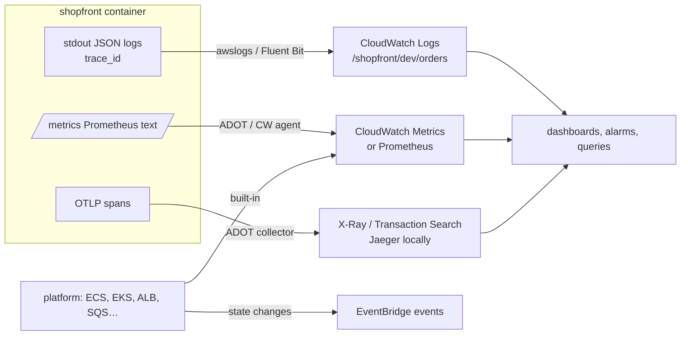

# Observability · L100 — Observability basics

**Level:** 100 · **Time:** ~30 min · **Prerequisites:** [Container fundamentals L100](../01-container-fundamentals/L100-containers-explained.md),
an AWS account with CloudWatch access

**After this document you can:**

- Tell logs, metrics, traces and events apart and name where each lives in AWS.
- Read a CloudWatch log group, a metric with dimensions, an alarm and a dashboard.
- Explain what Container Insights shows for a cluster and what it costs.
- Run the first five checks when a container is unhealthy.

## 1. Mental model



Four signals answer four questions. **Logs** say what happened, one line at a time, with context;
**metrics** say how much and how often, as numbers over time you can graph and alarm on; **traces**
say where the time went across services for one request; **events** say that something changed state
(a task stopped, a deployment finished, a node joined). AWS services emit metrics and events on their
own; your containers must emit logs, metrics and traces themselves, which is why the shopfront
contract fixes their shape. Observability is the discipline of collecting these four, correlating them
(by time, by `trace_id`, by service), and turning them into alarms that page and dashboards that
explain.

## 2. Concepts

### 2.1 Logs

Containers write to stdout/stderr; the platform's log driver or agent ships those lines. On ECS the
`awslogs` driver sends them straight to a CloudWatch Logs **log group** (`/shopfront/dev/orders`),
one **log stream** per container (`ecs/orders/<task-id>`). On EKS the kubelet writes them to
`/var/log/pods` and a Fluent Bit DaemonSet ships them. JSON lines matter: CloudWatch Logs Insights
parses them into fields you can filter and aggregate.

```text
fields @timestamp, level, msg, trace_id, order_id
| filter level = "error"
| sort @timestamp desc
| limit 50
```

Retention is per log group (default: never expire; set 30–90 days for application logs). Ingestion
is the main cost line; volume control (no debug in production, no request bodies) is a design
decision, not an afterthought.

### 2.2 Metrics

A CloudWatch metric is a name inside a **namespace** (`AWS/ECS`, `AWS/ApplicationELB`,
`ECS/ContainerInsights`, `ContainerInsights`, or your own) with **dimensions** (`ClusterName=shopfront-dev,
ServiceName=orders`), sampled at a period (1 minute standard) and summarised by a statistic (Average,
Sum, p99). AWS services publish theirs automatically; applications publish through agents (the ADOT
collector scraping `/metrics`, or the CloudWatch agent) or through Embedded Metric Format lines in
logs. Prometheus is the other model: the application exposes `/metrics`, a collector scrapes it, and
you query with PromQL in Grafana; on AWS, Amazon Managed Service for Prometheus stores them.

| Question | Metric family | Example |
| --- | --- | --- |
| Is the service up and healthy behind the load balancer? | `AWS/ApplicationELB HealthyHostCount`, `HTTPCode_Target_5XX_Count` | 0 healthy hosts → outage |
| Are tasks/pods running as desired? | `ECS/ContainerInsights RunningTaskCount`; Kubernetes `kube_deployment_status_replicas_available` | running < desired |
| Is it using its resources? | `CpuUtilized`/`CpuReserved`, `MemoryUtilized`/`MemoryReserved` | memory near reservation → OOM risk |
| Is work piling up? | `AWS/SQS ApproximateAgeOfOldestMessage` | age growing → consumers behind |
| Is the application itself healthy? | your `http_requests_total{status=~"5.."}`, `orders_failed_total` | error ratio |

### 2.3 Traces

A trace is a tree of spans for one request: `POST /orders` in `orders`, a child span for the HTTP
call to `catalog`, one for the database insert, one for the SQS send, and, because the trace context
travels in the message attribute, the `order.fulfill` span in the worker minutes later. Traces come
from OpenTelemetry SDKs in the code; a collector receives them over OTLP and exports to X-Ray (and
CloudWatch Transaction Search) on AWS or Jaeger locally. The `trace_id` printed in every log line is
the join key between logs and traces.

### 2.4 Events

ECS emits `ECS Task State Change`, `ECS Service Action` and `ECS Deployment State Change` events to
EventBridge; EKS emits Kubernetes Events (`kubectl get events`) and control-plane logs; AWS Health
emits service events. Events are how you keep `stoppedReason` after the task disappears and how you
alert on "deployment rolled back" without polling.

### 2.5 Alarms and dashboards

An alarm watches one metric (or a metric math expression) against a threshold for N periods and
changes state (`OK`, `ALARM`, `INSUFFICIENT_DATA`); actions notify (SNS → paging), scale, or roll back
a deployment. Composite alarms combine alarms with boolean logic so a single page fires for a service.
Dashboards arrange widgets (graphs, numbers, logs queries) per service; a starter dashboard for
`orders` shows request rate, 5xx ratio, p99 latency, running tasks vs desired, CPU/memory vs
reservation, and the SQS queue age it feeds ([L200 §2.11](L200-tooling-on-aws.md)).

### 2.6 Container Insights at a glance

Container Insights (a cluster setting on ECS, an add-on on EKS) collects CPU, memory, network and
storage metrics per cluster, service/namespace, task/pod and container, plus **performance log
events** with the raw samples; **enhanced observability** adds container-level and more granular
metrics and pre-built views for both ECS and EKS. It is the fastest way to see "which service is
burning memory" without installing Prometheus. Cost is per metric and per GB of performance logs;
turn it on for production, budget it for dev ([L200 §2.2](L200-tooling-on-aws.md)).

### 2.7 The first five checks for an unhealthy container

1. **State**: ECS `describe-tasks` (`lastStatus`, `stoppedReason`, exit codes) or `kubectl describe
   pod` (events, `Last State`, restarts).
2. **Logs**: the last 200 lines in the log group/stream or `kubectl logs --previous`; look for
   `configuration error`, stack traces, `shutdown signal received` (was it stopped on purpose?).
3. **Health checks**: load balancer target health (`describe-target-health` reasons) and the
   readiness endpoint's own output (`/readyz` names the failing dependency).
4. **Resources**: memory utilised vs reserved (OOM at 100%), CPU throttling, disk/ephemeral storage.
5. **Dependencies**: the metrics of what it talks to — database connections, queue age, downstream
   5xx — and the trace of one failing request.

## 3. How it interacts with the rest of AWS

| Component | Talks to | Protocol/API | Prerequisite (IAM, network, DNS) | What breaks if missing |
| --- | --- | --- | --- | --- |
| `awslogs` driver / Fluent Bit | CloudWatch Logs | `logs:CreateLogStream`, `PutLogEvents` | execution role / node role or Pod Identity; `logs` endpoint | task fails to start (ECS) or logs silently dropped (EKS) |
| ADOT / CloudWatch agent | CloudWatch Metrics, X-Ray | `cloudwatch:PutMetricData`, `xray:PutTraceSegments` | role; `monitoring`/`xray` endpoints | no metrics/traces |
| Container Insights | CloudWatch | agent add-on or cluster setting | `containerInsights` setting; add-on role | blank views |
| ECS/EKS | EventBridge | state change events | rule + target | lost `stoppedReason` history |
| Alarms | SNS / Application Auto Scaling / ECS deployments | alarm actions | topic policy; alarm names in deployment configuration | no paging, no rollback |
| Logs Insights | log groups | queries | retention long enough | no history to query |

## 4. Use it when / avoid it when

Use:

- JSON logs with `trace_id` from day one; `/metrics` and OTLP traces in every service (the contract).
- Container Insights for the platform view; alarms on the five starter metrics per service.
- EventBridge rules to persist ECS task state changes.

Avoid:

- Debug logging in production, request/response bodies in logs, secrets in logs.
- Alarms on averages for latency (use p99) or on raw counts without a rate/ratio.
- Dashboards nobody looks at during incidents; start from the runbook's questions.

Alternatives: Prometheus/Grafana (managed) for teams fluent in PromQL; third-party SaaS backends via
the same OpenTelemetry collector.

## 5. Well-Architected view

| Pillar | Contribution | Cost | Practice |
| --- | --- | --- | --- |
| Operational Excellence | the four signals with a join key; runbook-driven dashboards | ingestion and metric costs | log retention policy; alarm per SLO |
| Security | audit logs and CloudTrail as detection sources | log storage | no secrets in logs; restrict log access |
| Reliability | alarms feeding rollbacks and scaling | none | alarm coverage of every deployment |
| Performance Efficiency | resource metrics drive right-sizing | agent overhead | Container Insights for sizing |
| Cost Optimization | retention, sampling, metric selection | analysis | monthly review of ingestion by log group |
| Sustainability | fewer over-provisioned tasks | none | sizing loops |

## 6. Failure modes and troubleshooting

| Symptom | Likely cause | How to confirm (command/metric) | Fix |
| --- | --- | --- | --- |
| No logs for a task | execution role lacks logs permissions; wrong group/Region in `logConfiguration` | `stoppedReason` mentions logger; `aws logs describe-log-streams` | fix role/options |
| Logs arrive but Insights shows no fields | not JSON, or multi-line | sample lines | JSON one object per line (contract) |
| Metrics missing for a service | agent not deployed; Container Insights off | `aws ecs describe-clusters --include SETTINGS`; add-on status | enable |
| Alarm stuck `INSUFFICIENT_DATA` | metric has no data points at low traffic | metric graph | `TreatMissingData: notBreaching`; use ratios with `RequestCount > 0` |
| Cannot correlate logs and traces | no `trace_id` in logs; different services name it differently | sample lines | inject from the active span (all shopfront services do) |
| Bill spikes from logs | debug level; a chatty sidecar | Logs ingestion metric by group (`IncomingBytes`) | lower level; drop at the agent; retention |

## 7. Signals: metrics, logs, traces

- Per service: request rate, error ratio (`5xx / requests`), p99 latency (ALB `TargetResponseTime`
  and your `http_request_duration_seconds`), running vs desired tasks/pods, CPU and memory vs
  reservation, restarts.
- Per queue consumer: `ApproximateAgeOfOldestMessage`, messages visible, `orders_failed_total`.
- Platform: `HealthyHostCount`, `PendingTaskCount`, node conditions.
- Log volume: `AWS/Logs IncomingBytes` per group (cost).

Full table: [`reference/metrics-catalog.md`](../../reference/metrics-catalog.md).

## 8. Testing and DR notes

Testing: generate a known load with `make smoke` (or k6) and confirm every dashboard widget moves and
every alarm can be driven to `ALARM` with `aws cloudwatch set-alarm-state` (then back); check that a
log line with `trace_id` finds its trace. DR: dashboards and alarms are IaC per Region (they cannot be
copied by hand during an incident); log groups in the DR Region exist with the same names; the DR
Region's observability must be in place before failover, not after
([10 L300](../10-resilience-and-dr/L300-dr-strategies-for-container-platforms.md)).

## 9. Hands-on

```bash
make up && make smoke
# Logs: JSON lines with trace_id
docker compose -f labs/local/compose.yaml logs --no-log-prefix orders | tail -3 | jq '{time, level, msg, trace_id}'
# Metrics: Prometheus text on every service
curl -s localhost:8080/metrics | grep -E '^(http_requests_total|orders_created_total)'
curl -s localhost:8082/metrics | grep -E '^(orders_fulfilled_total|sqs_messages_received_total)'
# Traces: one trace across orders -> catalog -> SQS -> worker (and Kafka -> analytics)
open http://localhost:16686   # service orders, operation POST /orders
# Events (local analogue): container state changes
docker events --since 5m --filter type=container --filter event=die | head
```

On AWS after deploying the labs: `aws logs tail /shopfront/dev/orders --follow --format short`,
the Container Insights console for `shopfront-dev`, and the dashboard created by
[`labs/ecs/cloudformation/05-observability.yaml`](../../labs/ecs/cloudformation/05-observability.yaml).

## 10. Check yourself

1. Which signal answers "where did the 800 ms go in this request", and what makes it joinable with
   logs?

<details><summary>Answer</summary>
A trace: spans across `orders`, `catalog`, the database and SQS show the time per hop. The
`trace_id` written into every JSON log line (from the active span) joins logs to the trace.
</details>

2. Why does an alarm on average latency hide problems that p99 shows?

<details><summary>Answer</summary>
Averages are dominated by the many fast requests; a small share of very slow requests (a throttled
task, one bad dependency) moves p99 dramatically while the average barely changes. Users experience
the tail, so alarm on p99 (or p95) with a request-count guard.
</details>

3. What does the `awslogs` driver require of the task, and what happens without it?

<details><summary>Answer</summary>
An execution role allowed to create streams and put events (and create the group if
`awslogs-create-group`), plus network reach to CloudWatch Logs (NAT or the `logs` endpoint). Without
it the task fails to start with a `ResourceInitializationError` about the logging driver.
</details>

4. Where do you find why a task stopped an hour ago, and how do you keep that information?

<details><summary>Answer</summary>
`describe-tasks` shows `stoppedReason` only while the stopped task is retained (about an hour). Keep
it by routing `ECS Task State Change` events from EventBridge to a CloudWatch Logs group (or a
queue), then query the reasons over time.
</details>

5. Name the five checks for an unhealthy container in order.

<details><summary>Answer</summary>
State (task/pod status and stop reason or restarts), logs (last lines, configuration errors,
intentional shutdowns), health checks (load balancer target health and `/readyz` output), resources
(memory vs reservation, CPU throttling, disk), dependencies (their metrics and one failing trace).
</details>

## 11. Sources

- Amazon CloudWatch concepts (namespaces, dimensions, statistics) — https://docs.aws.amazon.com/AmazonCloudWatch/latest/monitoring/cloudwatch_concepts.html
- CloudWatch Logs Insights query syntax — https://docs.aws.amazon.com/AmazonCloudWatch/latest/logs/CWL_QuerySyntax.html
- Using the awslogs log driver (ECS) — https://docs.aws.amazon.com/AmazonECS/latest/developerguide/using_awslogs.html
- Container Insights — https://docs.aws.amazon.com/AmazonCloudWatch/latest/monitoring/ContainerInsights.html
- Amazon ECS events with EventBridge — https://docs.aws.amazon.com/AmazonECS/latest/developerguide/ecs_cwe_events.html
- CloudWatch alarms (composite alarms, missing data) — https://docs.aws.amazon.com/AmazonCloudWatch/latest/monitoring/AlarmThatSendsEmail.html
- OpenTelemetry concepts (signals, context propagation) — https://opentelemetry.io/docs/concepts/
- AWS X-Ray concepts — https://docs.aws.amazon.com/xray/latest/devguide/xray-concepts.html
- AWS Observability Best Practices guide — https://aws-observability.github.io/observability-best-practices/
