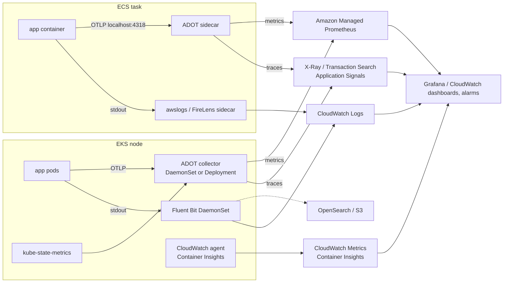

# Observability · L200 — Tooling on AWS

**Level:** 200 · **Time:** ~75 min · **Prerequisites:** [L100 Observability basics](L100-observability-basics.md),
[ECS L200](../03-ecs/L200-task-definitions-services-and-scaling.md) or
[EKS L200](../04-eks/L200-cluster-components-and-add-ons.md)

**After this document you can:**

- Choose between Container Insights, the CloudWatch agent, Fluent Bit/FireLens and the ADOT
  collector for each signal on ECS and EKS, and place each agent (sidecar, DaemonSet, gateway).
- Instrument with OpenTelemetry and export to X-Ray/Transaction Search, Application Signals, AMP or
  a third party without changing code.
- Route logs (CloudWatch, OpenSearch, S3) with retention and cost controls.
- Turn on control-plane logs and events, write alarms and composite alarms, and build the starter
  dashboard.

## 1. Mental model



Three agent families, three signals, two orchestrators. Logs move through a log router (the ECS log
driver or FireLens sidecar; a Fluent Bit DaemonSet on EKS). Metrics come either from AWS (service
metrics, Container Insights through the CloudWatch agent) or from Prometheus-style scraping by a
collector. Traces always go through an OpenTelemetry collector (the AWS Distro, ADOT) to X-Ray and
its CloudWatch successors or to Prometheus-compatible backends. The choice is less about "which
product" and more about where each agent runs and who pays for cardinality.

## 2. Concepts

### 2.1 The CloudWatch building blocks

Log groups with retention and KMS; metric filters (count `level="error"` lines into a metric);
subscription filters (stream logs to Lambda/Firehose/OpenSearch); Logs Insights (ad hoc queries,
saved queries, cross-group); Metrics with dimensions, metric math, anomaly detection bands, Metrics
Insights SQL-like queries; Embedded Metric Format (structured log lines that CloudWatch turns into
metrics without an agent, good for high-cardinality-free custom metrics); alarms (metric, math,
composite) with actions; dashboards (JSON, cross-account, cross-Region); Synthetics canaries;
Contributor Insights (top-N from logs); Application Signals and Transaction Search (below).

### 2.2 Container Insights and enhanced observability

| | ECS | EKS |
| --- | --- | --- |
| Enable | `aws ecs update-cluster-settings --cluster shopfront-dev --settings name=containerInsights,value=enhanced` (or `enabled` for the standard tier) | `amazon-cloudwatch-observability` add-on (CloudWatch agent + Fluent Bit) with enhanced observability on by default |
| Namespace | `ECS/ContainerInsights` | `ContainerInsights` |
| Granularity | cluster, service, task (enhanced adds container and more fields) | cluster, namespace, node, pod, container; control-plane metrics (API server) in enhanced |
| Extra | Service Connect traffic metrics; deployment-related counts | Application Signals wiring, GPU/EFA metrics, NVMe |
| Cost | custom-metric pricing per metric per dimension set + performance log ingestion | same; nodes × pods drive cardinality |

Enhanced observability is worth it in production for the drill-down views (cluster → service → task
→ container) and because it supplies the resource metrics the right-sizing loop needs. Watch the
performance log group ingestion (`/aws/ecs/containerinsights/<cluster>/performance`,
`/aws/containerinsights/<cluster>/performance`) in cost reviews.

### 2.3 Agents: which one, where

| Agent | Collects | Runs as | Pick when |
| --- | --- | --- | --- |
| `awslogs` log driver (ECS) | container stdout to CloudWatch Logs | in the ECS agent / Fargate | default for ECS logs to CloudWatch |
| FireLens (`awsfirelens` + `aws-for-fluent-bit` sidecar) | stdout to any Fluent Bit output (CloudWatch, OpenSearch, S3, Firehose, third parties), filtering/parsing | sidecar per task | multiple destinations, parsing, sampling on ECS |
| Fluent Bit DaemonSet (EKS) | pod logs from `/var/log/pods`, Kubernetes metadata enrichment | DaemonSet (part of the observability add-on or self-installed) | all EKS EC2 nodes |
| Fargate on EKS built-in logging | pod logs | platform; configured by the `aws-logging` ConfigMap in `aws-observability` namespace | Fargate pods (no DaemonSets) |
| CloudWatch agent (`amazon-cloudwatch-observability`) | Container Insights metrics, StatsD/collectd, Application Signals | DaemonSet (EKS) / not needed on ECS (platform collects) | Container Insights on EKS |
| ADOT collector | OTLP traces and metrics, Prometheus scraping, X-Ray/EMF/AMP exporters | sidecar (ECS), DaemonSet (agent) and/or Deployment (gateway) on EKS | traces always; Prometheus metrics to AMP/CloudWatch |
| ADOT/Application Signals auto-instrumentation | spans and RED metrics without code changes (Java, Python, .NET, Node.js) | init/agent injection via the CloudWatch add-on (EKS) or sidecar + env (ECS) | quick APM |
| `kube-state-metrics`, node exporter | object states, node OS metrics | Deployment / DaemonSet (community add-ons) | Prometheus-based alerting on EKS |
| `metrics-server` | live CPU/memory for HPA and `kubectl top` | Deployment (add-on) | always on EKS |

Fluent Bit filter tips: drop health-check request logs, parse JSON, add `cluster`/`namespace`
labels, sample debug logs, and set `retry_limit`/buffer so a CloudWatch throttle does not stall the
app (the ECS `awslogs` `mode: non-blocking` equivalent).

### 2.4 OpenTelemetry on AWS

The shopfront services use the OpenTelemetry SDKs (Go, Node.js, Python) with W3C `traceparent`
propagation and OTLP/HTTP to `OTEL_EXPORTER_OTLP_ENDPOINT`. The collector (ADOT is AWS's build of
the upstream collector with the AWS exporters vetted) is configured as receivers → processors →
exporters:

```yaml
receivers:
  otlp: { protocols: { grpc: { endpoint: 0.0.0.0:4317 }, http: { endpoint: 0.0.0.0:4318 } } }
  prometheus:
    config:
      scrape_configs:
        - job_name: shopfront
          kubernetes_sd_configs: [{ role: pod, namespaces: { names: [shopfront] } }]
          relabel_configs:
            - { source_labels: [__meta_kubernetes_pod_annotation_prometheus_io_scrape], action: keep, regex: "true" }
processors:
  memory_limiter: { check_interval: 1s, limit_percentage: 80, spike_limit_percentage: 25 }
  resourcedetection: { detectors: [env, eks, ecs, ec2] }        # adds cluster/task/pod attributes
  batch: { timeout: 5s, send_batch_size: 1024 }
exporters:
  awsxray: { region: us-east-1, index_all_attributes: true }
  awsemf: { region: us-east-1, namespace: shopfront, log_group_name: /shopfront/dev/emf }
  prometheusremotewrite: { endpoint: https://aps-workspaces.us-east-1.amazonaws.com/workspaces/ws-0123abcd/api/v1/remote_write, auth: { authenticator: sigv4auth } }
extensions: { sigv4auth: { region: us-east-1 }, health_check: {} }
service:
  extensions: [sigv4auth, health_check]
  pipelines:
    traces: { receivers: [otlp], processors: [memory_limiter, resourcedetection, batch], exporters: [awsxray] }
    metrics: { receivers: [otlp, prometheus], processors: [memory_limiter, resourcedetection, batch], exporters: [prometheusremotewrite, awsemf] }
```

Deployment shapes: **sidecar** on ECS (`127.0.0.1:4318`, per task; simplest, costs CPU/memory per
task); **DaemonSet agent** on EKS (node-local endpoint via `status.hostIP`, buffers per node); **gateway
Deployment** (central, with tail sampling and fan-out) fed by agents or directly by pods. The ADOT EKS
add-on (`adot`) installs the operator and lets you declare `OpenTelemetryCollector` CRs; the
`amazon-cloudwatch-observability` add-on brings its own agent for Container Insights and Application
Signals. Values for the lab collector: [`labs/eks/addons/adot-collector.yaml`](../../labs/eks/addons/adot-collector.yaml);
the local equivalent is [`labs/local/otel-collector.yaml`](../../labs/local/otel-collector.yaml).

### 2.5 X-Ray today

X-Ray remains the trace store and console (service map, trace search, groups, sampling rules) and
the `awsxray` exporter works from any collector. AWS's direction since 2025 is OpenTelemetry-first:
the X-Ray SDKs and daemon are on a migration path to ADOT/OTel, and new capabilities land in
CloudWatch (Application Signals, Transaction Search) rather than in the X-Ray SDKs
([FACTS](../../docs/FACTS-2026-09.md)). New services: instrument with OpenTelemetry, export through
ADOT; existing X-Ray SDK users: keep working, plan the move. X-Ray sampling rules (head-based,
centralised) still apply to spans exported through `awsxray`; the OTel SDKs also sample locally.

### 2.6 Application Signals and Transaction Search

**Application Signals** auto-instruments supported runtimes (Java, Python, .NET, Node.js) via the
CloudWatch agent/ADOT, computes RED metrics per service and operation, draws the service map, and
lets you define **SLOs** (latency or availability, period, goal, burn-rate alarms) on those metrics.
On EKS the observability add-on injects the instrumentation with an annotation
(`instrumentation.opentelemetry.io/inject-python: "true"`); on ECS you add the ADOT sidecar and the
runtime's auto-instrumentation environment variables.

**Transaction Search** is an account-level setting that ingests 100% of spans (head sampling
notwithstanding) as structured logs in CloudWatch (`aws/spans` log group) with CloudWatch Logs
pricing, so you can search any span attribute, build metrics from spans and keep X-Ray's trace view.
Enable with `aws xray update-trace-segment-destination --destination CloudWatchLogs` and
`update-indexing-rule` (verify current CLI), then set the indexing percentage that decides what
appears in trace summaries versus span search.

### 2.7 Amazon Managed Service for Prometheus and Amazon Managed Grafana

AMP is a Prometheus-compatible store: workspaces, SigV4-authenticated remote write (from the ADOT
collector or the Prometheus agent mode), PromQL query API, recording rules and alert manager
definitions uploaded as rule files, alerts routed to SNS. AMG is Grafana with Identity Center/SAML
SSO and native data sources for AMP, CloudWatch, X-Ray, OpenSearch, Athena; dashboards as code via
the Grafana API/Terraform. Choose AMP+AMG when the team is Prometheus-native, needs PromQL joins
across `kube_*`, `container_*` and application metrics, or runs Kubernetes-heavy alerting; choose
CloudWatch-only when the fleet is ECS-heavy and alarms feed native integrations (deployment
rollbacks, auto scaling). Many platforms run both: CloudWatch for AWS-service metrics and alarms
that act, AMP/AMG for Kubernetes and application analysis.

### 2.8 Kubernetes metric sources

| Source | What | Scrape/collect |
| --- | --- | --- |
| kubelet `/metrics/cadvisor` | container CPU/memory/network/fs (`container_*`) | collector via kubelet, or Container Insights |
| kubelet `/metrics` | kubelet health (`kubelet_pleg_*`, runtime ops) | collector |
| `kube-state-metrics` | object states (`kube_pod_status_phase`, `kube_deployment_*`, `kube_node_status_condition`) | collector |
| node exporter | OS (`node_cpu_*`, `node_filesystem_*`, conntrack, PSI) | collector |
| CoreDNS `:9153` | `coredns_*` | collector |
| VPC CNI `aws-node :61678` | `awscni_*` | collector (annotate the DaemonSet) |
| API server `/metrics` | `apiserver_*`, `etcd_*` (EKS exposes a subset) | collector with cluster RBAC; Container Insights control-plane metrics |
| `metrics-server` | live usage for HPA | not for storage |

### 2.9 Log routing and retention

| Pattern | Path | Use |
| --- | --- | --- |
| CloudWatch only | `awslogs` / Fluent Bit → log groups | default; Logs Insights; alarms via metric filters |
| CloudWatch + archive | subscription filter → Firehose → S3 (Parquet) → Athena | long retention cheaply; audits |
| OpenSearch | Fluent Bit output or Firehose → OpenSearch Service/Serverless | full-text search, dashboards on logs |
| Third party | FireLens/Fluent Bit output plugins | existing SaaS |
| Structured metrics from logs | EMF lines → CloudWatch metrics; metric filters | avoid agents for simple counters |

Retention: 14–30 days hot in CloudWatch for application logs, 1 year+ for audit/security in a cold
tier; drop health-check and debug lines at the router; set `awslogs` non-blocking mode. Ingestion
($ per GB) dominates; storage is cheap by comparison.

### 2.10 Control-plane logs and events

EKS: enable `api`, `audit`, `authenticator` (and `controllerManager`, `scheduler` when debugging) to
`/aws/eks/shopfront-dev/cluster`; Kubernetes Events are ephemeral (1 hour) — export them with an
events exporter or the observability add-on if you need history. ECS: service events in
`describe-services`, task/service/deployment state changes through EventBridge to a log group; ECS
agent logs on instances. Both: CloudTrail for API calls ([06 L300](../06-identity-and-security/L300-hardening-workloads-and-clusters.md)).

### 2.11 Alarms, composite alarms and the starter dashboard

```bash
aws cloudwatch put-metric-alarm --alarm-name shopfront-dev-orders-5xx-ratio \
  --metrics '[
    {"Id":"e","MetricStat":{"Metric":{"Namespace":"AWS/ApplicationELB","MetricName":"HTTPCode_Target_5XX_Count","Dimensions":[{"Name":"TargetGroup","Value":"targetgroup/shopfront-dev-orders/0123456789abcdef"},{"Name":"LoadBalancer","Value":"app/shopfront-dev/50dc6c495c0c9188"}]},"Period":60,"Stat":"Sum"},"ReturnData":false},
    {"Id":"r","MetricStat":{"Metric":{"Namespace":"AWS/ApplicationELB","MetricName":"RequestCount","Dimensions":[{"Name":"TargetGroup","Value":"targetgroup/shopfront-dev-orders/0123456789abcdef"},{"Name":"LoadBalancer","Value":"app/shopfront-dev/50dc6c495c0c9188"}]},"Period":60,"Stat":"Sum"},"ReturnData":false},
    {"Id":"ratio","Expression":"IF(r > 50, 100 * e / r, 0)","Label":"5xx %"}]' \
  --comparison-operator GreaterThanThreshold --threshold 2 --evaluation-periods 3 --datapoints-to-alarm 3 \
  --treat-missing-data notBreaching --alarm-actions arn:aws:sns:us-east-1:123456789012:shopfront-dev-pages
aws cloudwatch put-composite-alarm --alarm-name shopfront-dev-orders-unhealthy \
  --alarm-rule 'ALARM("shopfront-dev-orders-5xx-ratio") OR ALARM("shopfront-dev-orders-p99") OR ALARM("shopfront-dev-orders-no-healthy-hosts")' \
  --alarm-actions arn:aws:sns:us-east-1:123456789012:shopfront-dev-pages
```

Starter dashboard per service (the one [`labs/ecs/cloudformation/05-observability.yaml`](../../labs/ecs/cloudformation/05-observability.yaml)
creates): request rate; 5xx ratio and 4xx; p50/p99 latency; healthy/unhealthy hosts; running vs
desired tasks; CPU and memory utilised vs reserved; deployment markers (annotations from ECS
deployment events); for the worker: queue age, visible messages, DLQ depth, `orders_failed_total`;
for the cluster: pending tasks, capacity provider reservation; a Logs Insights widget of recent
errors. Alarms: 5xx ratio, p99, no healthy hosts, running < desired for 5 minutes, queue age, DLQ >
0, memory > 90% of reservation.

## 3. How it interacts with the rest of AWS

| Component | Talks to | Protocol/API | Prerequisite (IAM, network, DNS) | What breaks if missing |
| --- | --- | --- | --- | --- |
| Fluent Bit / FireLens | CloudWatch Logs, OpenSearch, Firehose | `logs:PutLogEvents`, `es:ESHttpPost`, `firehose:PutRecordBatch` | task/pod role; endpoints | logs buffered then dropped |
| CloudWatch agent add-on | CloudWatch | `cloudwatch:PutMetricData`, `logs:*` | Pod Identity/IRSA (`CloudWatchAgentServerPolicy`) | Container Insights empty |
| ADOT collector | X-Ray, CloudWatch, AMP | `xray:PutTraceSegments`, `PutTelemetryRecords`; `cloudwatch:PutMetricData`; `aps:RemoteWrite` | role; `xray`, `monitoring`, `aps-workspaces` endpoints | traces/metrics missing; collector logs `AccessDenied` |
| Application Signals | CloudWatch | agent + auto-instrumentation | add-on with Application Signals enabled; `application-signals` service-linked role | no service map/SLOs |
| Transaction Search | CloudWatch Logs | X-Ray segment destination | account setting; log group `aws/spans` | spans not searchable |
| AMP | ADOT remote write | SigV4 | workspace; role | 403 on remote write |
| AMG | AMP, CloudWatch, X-Ray | data source roles | workspace role permissions | empty panels |
| EKS control plane | CloudWatch Logs | logging types | enabled | no audit |
| Alarms | SNS, ECS deployments, Auto Scaling | actions | topic policy; alarm names | silent failures |

## 4. Use it when / avoid it when

Use:

- Container Insights enhanced in production clusters; `awslogs` non-blocking or FireLens on ECS;
  Fluent Bit DaemonSet on EKS EC2; the `aws-logging` ConfigMap for EKS Fargate.
- OpenTelemetry SDKs + ADOT for traces (and Prometheus metrics to AMP) in every service.
- Application Signals for quick RED metrics/SLOs on supported runtimes; Transaction Search when you
  need every span searchable.
- AMP/AMG when Kubernetes-native alerting and PromQL matter.

Avoid:

- The X-Ray SDK for new code; use OpenTelemetry.
- One collector Deployment for a whole cluster without agents (single point of loss); use agents +
  gateway.
- Logging everything at debug to CloudWatch (ingestion cost) or logging request bodies.
- Alarms on single data points; use 3-of-3 or 3-of-5 with rates.

Alternatives: third-party SaaS observability fed by the same collector; Grafana Loki/Tempo self-hosted
for teams with strong operations capacity.

## 5. Well-Architected view

| Pillar | Contribution | Cost | Practice |
| --- | --- | --- | --- |
| Operational Excellence | uniform telemetry contract; Container Insights drill-downs; SLOs | agents to operate | add-ons over hand-installed agents; alarms tied to runbooks |
| Security | audit logs, CloudTrail, GuardDuty inputs; log encryption | storage | KMS on log groups; restrict `logs:GetLogEvents` |
| Reliability | alarms drive rollback and scaling; DaemonSet agents survive pod churn | none | composite alarms per service; `notBreaching` on low traffic |
| Performance Efficiency | resource metrics for sizing; traces for latency | agent CPU/memory | sidecar sizing; batch processors |
| Cost Optimization | retention, EMF, sampling, metric selection | analysis | ingestion review per group; enhanced observability where it pays |
| Sustainability | fewer over-provisioned resources | none | right-size from Container Insights |

## 6. Failure modes and troubleshooting

| Symptom | Likely cause | How to confirm (command/metric) | Fix |
| --- | --- | --- | --- |
| Traces missing for one service | `OTEL_EXPORTER_OTLP_ENDPOINT` unset/wrong; collector rejecting; sampling | service logs at start (shopfront logs the endpoint); collector logs | fix env; check `otelcol_receiver_refused_spans` |
| Trace breaks between `orders` and the worker | `traceparent` not propagated through SQS attributes | inspect message attributes | contract §5 propagation |
| Container Insights shows nodes but no pods | CloudWatch agent lacks permissions/hostPath | add-on pod logs | fix role; add-on reinstall |
| `AccessDenied` in collector logs for X-Ray/AMP | Pod Identity association or task role missing actions | CloudTrail | add `xray:*Put*`, `aps:RemoteWrite` |
| Fluent Bit drops logs under load | small buffers, CloudWatch throttling | Fluent Bit metrics `fluentbit_output_retries_failed_total` | raise `Retry_Limit`, storage buffering, split groups |
| Logs cost doubled | debug level or a new chatty component | `IncomingBytes` by group | drop at router; retention |
| Alarm never fires on errors at night | `TreatMissingData: breaching`/`missing` with low traffic; average instead of ratio | alarm history | ratio with request guard; `notBreaching` |
| Application Signals shows no service | runtime unsupported or injection annotation missing | agent logs; pod annotations | annotate; ADOT manual instrumentation |
| AMP remote write 429/403 | ingestion quota or SigV4 misconfigured | collector exporter errors | request quota increase; fix `sigv4auth` |

## 7. Signals: metrics, logs, traces

- Collector health: `otelcol_receiver_accepted_spans`, `otelcol_receiver_refused_spans`,
  `otelcol_exporter_send_failed_spans`, `otelcol_processor_dropped_spans`, `otelcol_exporter_queue_size`.
- Log pipeline: Fluent Bit `fluentbit_output_proc_records_total`, `fluentbit_output_errors_total`,
  `retries_failed_total`; CloudWatch `IncomingBytes`, `ForwardedBytes`, `ThrottleCount` (Logs).
- Container Insights: `pod_cpu_utilization`, `pod_memory_utilization_over_pod_limit`,
  `node_filesystem_utilization`, `service_number_of_running_pods`; ECS `RunningTaskCount`,
  `CpuUtilized/CpuReserved`.
- Application Signals: `Latency`, `Error`, `Fault` per service/operation; SLO attainment and
  burn rate.
- X-Ray/Transaction Search: trace counts, throttled segments (`xray:PutTraceSegments` errors).
- AMP: `aps_ingestion_*` quota usage; alert manager notifications.

Full table: [`reference/metrics-catalog.md`](../../reference/metrics-catalog.md).

## 8. Testing and DR notes

Testing: after any pipeline change, run a load test and verify each hop — spans accepted and exported
(collector metrics), logs in the group with fields parsed, Container Insights metrics moving, alarms
driveable with `set-alarm-state`, a Synthetics canary against `/readyz` succeeding; test the failure
of the collector (scale it to zero) and confirm the application keeps serving (telemetry must never be
on the request path). DR: agents/add-ons, log groups, dashboards, alarms, AMP workspaces and Grafana
data sources are regional — create them in the DR Region with IaC before you need them; use
CloudWatch cross-Region dashboards for the fleet view ([10 L300](../10-resilience-and-dr/L300-dr-strategies-for-container-platforms.md)).

## 9. Hands-on

```bash
# Local pipeline: the same collector config shape as ADOT
sed -n '1,60p' labs/local/otel-collector.yaml
make up && make smoke
docker compose -f labs/local/compose.yaml logs otel-collector | grep -iE 'ready|error' | tail -3
curl -s 'http://localhost:16686/api/v3/services' | jq .   # Jaeger v2 API lists orders, catalog, workers
# Observe: one trace id in orders logs equals the trace shown in Jaeger with worker spans attached.

# EKS: ADOT collector values and the observability add-on
cat labs/eks/addons/adot-collector.yaml | sed -n '1,80p'
aws eks describe-addon-versions --addon-name amazon-cloudwatch-observability --kubernetes-version 1.36 --query 'addons[0].addonVersions[0].addonVersion'
# (billable) aws eks create-addon --cluster-name shopfront-dev --addon-name amazon-cloudwatch-observability

# ECS: the ADOT sidecar and the observability stack
jq '.containerDefinitions[] | select(.name=="otel-collector") | {image, command, healthCheck}' labs/ecs/taskdefs/orders.json
grep -nE 'AWS::CloudWatch::(Alarm|CompositeAlarm|Dashboard)|containerInsights' labs/ecs/cloudformation/05-observability.yaml labs/ecs/cloudformation/02-cluster.yaml | head
# (billable) drive an alarm and watch the composite
aws cloudwatch set-alarm-state --alarm-name shopfront-dev-orders-5xx-ratio --state-value ALARM --state-reason drill
aws cloudwatch describe-alarms --alarm-names shopfront-dev-orders-unhealthy --query 'CompositeAlarms[0].StateValue'
```

## 10. Check yourself

1. Which agent ships logs for an EKS Fargate pod, and why is it different from EC2 nodes?

<details><summary>Answer</summary>
Fargate pods cannot host DaemonSets, so the platform runs a built-in Fluent Bit configured through
the `aws-logging` ConfigMap in the `aws-observability` namespace (CloudWatch, Firehose, OpenSearch
outputs). EC2 nodes run your Fluent Bit DaemonSet (or the CloudWatch observability add-on's).
</details>

2. What does Transaction Search change compared with classic X-Ray sampling?

<details><summary>Answer</summary>
Classic X-Ray stores the sampled traces only; Transaction Search ingests 100% of spans as structured
logs in CloudWatch (billed as logs), making every span attribute searchable and metricable, with an
indexing percentage controlling what appears in trace summaries. It is an account-level setting and
part of AWS's OpenTelemetry-first direction.
</details>

3. Where should the ADOT collector run on ECS and on EKS, and why?

<details><summary>Answer</summary>
On ECS as a sidecar in each task (there is no node you own; `127.0.0.1:4318` keeps the path local and
the execution/task role scoped). On EKS as a DaemonSet agent (node-local endpoint, per-node
buffering) optionally forwarding to a gateway Deployment that does tail sampling and fan-out;
a single central Deployment alone is a point of loss and a hot spot.
</details>

4. Why alarm on a 5xx ratio with a request-count guard rather than on the 5xx count?

<details><summary>Answer</summary>
Counts scale with traffic (100 errors is 10% of 1,000 requests but 0.1% of 100,000) and low traffic
produces missing data. A ratio expresses user impact; the guard (`IF(r > 50, …, 0)`) prevents a
handful of errors during quiet periods from paging, and `TreatMissingData: notBreaching` keeps the
alarm out of `INSUFFICIENT_DATA`.
</details>

5. When would you add AMP/AMG next to CloudWatch, and what would you keep in CloudWatch?

<details><summary>Answer</summary>
Add AMP/AMG when the team needs PromQL across Kubernetes object metrics (`kube_*`), container and
application metrics, Prometheus-style alert rules, or Grafana's dashboards and data-source joins.
Keep AWS-service metrics and the alarms that trigger actions (ECS deployment rollback, auto scaling,
paging through SNS) in CloudWatch, where the integrations are native.
</details>

## 11. Sources

- Container Insights with enhanced observability (ECS and EKS) — https://docs.aws.amazon.com/AmazonCloudWatch/latest/monitoring/ContainerInsights.html
- Amazon CloudWatch Observability EKS add-on — https://docs.aws.amazon.com/AmazonCloudWatch/latest/monitoring/install-CloudWatch-Observability-EKS-addon.html
- Custom log routing with FireLens — https://docs.aws.amazon.com/AmazonECS/latest/developerguide/using_firelens.html
- Fargate logging on EKS — https://docs.aws.amazon.com/eks/latest/userguide/fargate-logging.html
- AWS Distro for OpenTelemetry — https://aws-otel.github.io/docs/introduction
- ADOT EKS add-on — https://docs.aws.amazon.com/eks/latest/userguide/opentelemetry.html
- AWS X-Ray SDKs/Daemon migration to OpenTelemetry — https://aws.amazon.com/blogs/mt/aws-x-ray-sdks-daemon-migration-to-opentelemetry/
- CloudWatch Application Signals — https://docs.aws.amazon.com/AmazonCloudWatch/latest/monitoring/CloudWatch-Application-Monitoring-Sections.html
- CloudWatch Transaction Search — https://docs.aws.amazon.com/AmazonCloudWatch/latest/monitoring/CloudWatch-Transaction-Search.html
- Amazon Managed Service for Prometheus — https://docs.aws.amazon.com/prometheus/latest/userguide/what-is-Amazon-Managed-Service-Prometheus.html
- Amazon Managed Grafana — https://docs.aws.amazon.com/grafana/latest/userguide/what-is-Amazon-Managed-Service-Grafana.html
- CloudWatch Embedded Metric Format — https://docs.aws.amazon.com/AmazonCloudWatch/latest/monitoring/CloudWatch_Embedded_Metric_Format.html
- CloudWatch alarms: metric math and composite alarms — https://docs.aws.amazon.com/AmazonCloudWatch/latest/monitoring/Create-alarm-on-metric-math-expression.html and https://docs.aws.amazon.com/AmazonCloudWatch/latest/monitoring/Create_Composite_Alarm.html
- Amazon EKS control plane logging — https://docs.aws.amazon.com/eks/latest/userguide/control-plane-logs.html
- kube-state-metrics and Prometheus node exporter — https://github.com/kubernetes/kube-state-metrics and https://github.com/prometheus/node_exporter
- AWS Observability Best Practices — https://aws-observability.github.io/observability-best-practices/
