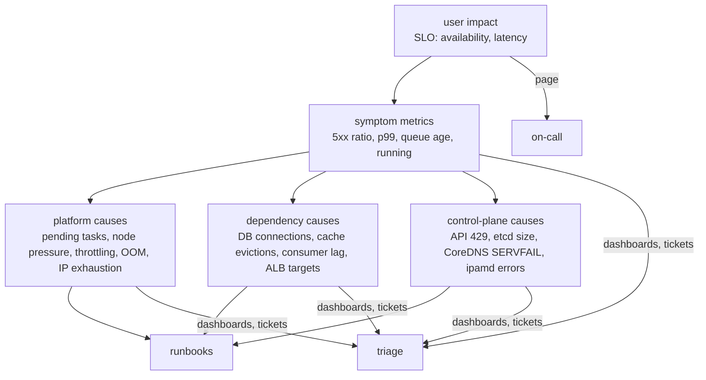

# Observability · L300 — Metrics that matter and alerting

**Level:** 300 · **Time:** ~100 min · **Prerequisites:** [L200 Tooling on AWS](L200-tooling-on-aws.md),
[EKS L300](../04-eks/L300-eks-internals-and-operations.md), [ECS L300](../03-ecs/L300-ecs-internals.md)

**After this document you can:**

- For every component in this repository, name the three to five metrics that predict or explain
  an incident, where they come from and what a bad value means.
- Turn golden signals into SLOs and multi-window burn-rate alerts that page for user impact only.
- Use anomaly detection where thresholds fail and keep the alarm inventory small and actionable.

## 1. Mental model



Page on symptoms that users feel (SLO burn); investigate with cause metrics arranged by layer. Every
metric below is either a symptom (belongs in an SLO or a page) or a cause (belongs on a dashboard and
maybe a ticket). Thresholds are starting points to tune with your own baselines; the mechanism behind
each metric is what makes the threshold defensible.

## 2. Concepts

### 2.1 Kubernetes control plane

| Metric | Source | Meaning | Start alerting at |
| --- | --- | --- | --- |
| `apiserver_request_duration_seconds` p99 by verb (exclude WATCH) | API server `/metrics` (Container Insights control-plane metrics or scrape) | API latency; slow list/watch = etcd or object bloat | reads > 1 s, writes > 2 s for 10 min |
| `apiserver_request_total{code="429"}` | same | Priority and Fairness rejecting clients | any sustained rate; find the client in audit logs |
| `apiserver_request_total{code=~"5.."}` rate | same | API server errors | > 0.1% of requests |
| `etcd_db_total_size_in_bytes` | same | object storage growth (Events, ConfigMaps, CRs) | trend up without bound; compare with the documented limit |
| `apiserver_storage_objects` by resource | same | which resource bloats | Events > 100k, Secrets/ConfigMaps growth |
| `apiserver_admission_webhook_admission_duration_seconds` p99 | same | slow/failing webhooks delaying every write | > 1 s |
| `apiserver_current_inflight_requests` | same | saturation | near the limit |
| Authenticator failures | control-plane logs | broken access entries | spikes after IAM changes |

### 2.2 Nodes

| Metric | Source | Meaning | Start alerting at |
| --- | --- | --- | --- |
| `kube_node_status_condition{condition="Ready",status="true"}` | kube-state-metrics | node readiness | `false` for 5 min |
| `MemoryPressure`, `DiskPressure`, `PIDPressure` conditions | kube-state-metrics / `kubectl describe node` | eviction imminent | any `true` |
| `node_memory_MemAvailable_bytes` / total | node exporter; Container Insights `node_memory_utilization` | headroom | < 10% |
| `node_filesystem_avail_bytes{mountpoint="/"}`; `container_fs_usage_bytes` | node exporter / cAdvisor | disk; image GC thresholds | < 15% |
| `node_pressure_memory_stalled_seconds_total` rate, `node_pressure_cpu_waiting_seconds_total` | PSI (node exporter; Kubernetes 1.36 GA node metrics) | reclaim thrash / CPU contention before failures | memory stall > 20% of time |
| `kubelet_pleg_relist_duration_seconds` p99 | kubelet | container runtime health; precedes `NotReady` | > 3 s |
| `kubelet_runtime_operations_errors_total` rate | kubelet | containerd errors | any sustained |
| `node_nf_conntrack_entries` / `_limit` | node exporter | conntrack saturation | > 80% |
| ENI/IP headroom: `awscni_total_ip_addresses − awscni_assigned_ip_addresses` | VPC CNI | free pod IPs per node | < warm target for 10 min |
| Container Insights `node_cpu_utilization`, `node_memory_utilization`, `node_number_of_running_pods` | CloudWatch | fleet view | > 80% sustained |

### 2.3 Pods and containers

| Metric | Source | Meaning | Start alerting at |
| --- | --- | --- | --- |
| `kube_pod_container_status_restarts_total` rate | kube-state-metrics | crash loops | > 3 restarts / 15 min |
| `kube_pod_container_status_last_terminated_reason{reason="OOMKilled"}` | kube-state-metrics | memory limit hit | any in production |
| `container_memory_working_set_bytes` / limit | cAdvisor | distance to OOM | > 90% |
| `container_cpu_cfs_throttled_periods_total` / `container_cpu_cfs_periods_total` | cAdvisor | CPU quota throttling | > 25% on latency-sensitive pods |
| `kube_pod_status_phase{phase="Pending"}` duration | kube-state-metrics | scheduling/capacity/IP problems | Pending > 5 min |
| `kube_deployment_status_replicas_unavailable` | kube-state-metrics | rollout or capacity trouble | > 0 for 10 min outside rollouts |
| `kube_pod_container_status_waiting_reason` (`ImagePullBackOff`, `CrashLoopBackOff`, `CreateContainerConfigError`) | kube-state-metrics | start failures | any |
| `container_processes` vs `pids.max` | cAdvisor | thread/process leaks | > 80% |
| `kube_horizontalpodautoscaler_status_current_replicas` = `spec_max_replicas` | kube-state-metrics | HPA pinned at max | sustained |
| Container Insights `pod_memory_utilization_over_pod_limit`, `pod_number_of_container_restarts` | CloudWatch | the same, CloudWatch-native | as above |

### 2.4 CoreDNS

| Metric | Meaning | Start alerting at |
| --- | --- | --- |
| `coredns_dns_request_duration_seconds` p99 | resolution latency | > 100 ms |
| `coredns_dns_responses_total{rcode="SERVFAIL"}` rate | upstream/Resolver failures | > 1% of responses |
| `coredns_forward_requests_total`, `coredns_forward_responses_total` by rcode | upstream health (Route 53 Resolver throttling) | SERVFAIL/timeouts rising |
| `coredns_cache_hits_total` / requests | cache effectiveness | < 60% suggests `ndots` churn |
| `coredns_panics_total`, restarts | crashes | any |
| `coredns_dns_requests_total` per replica | load balance across replicas | one replica > 2× others |

### 2.5 VPC CNI

| Metric | Meaning | Start alerting at |
| --- | --- | --- |
| `awscni_assigned_ip_addresses`, `awscni_total_ip_addresses` | pod IPs used / available on the node | free < warm target |
| `awscni_eni_allocated` vs `awscni_eni_max` | ENI attachment headroom | at max with pods Pending |
| `awscni_ipamd_error_count`, `awscni_ec2api_error_count`, `awscni_aws_api_error_count` | EC2 API failures (throttling, quota) | any sustained |
| `awscni_ipamd_action_inprogress` | ipamd busy | stuck > 0 for minutes |
| `awscni_add_ip_req_count` − `awscni_del_ip_req_count` | churn | very high churn hints at CrashLoop |
| Subnet `AvailableIpAddressCount` (custom) | subnet exhaustion | < 20% |

### 2.6 ECS

| Metric | Namespace | Meaning | Start alerting at |
| --- | --- | --- | --- |
| `CPUUtilization`, `MemoryUtilization` (service) | `AWS/ECS` | percent of reservation | > 80% for 10 min; memory > 90% |
| `CpuUtilized`/`CpuReserved`, `MemoryUtilized`/`MemoryReserved` (task, container) | `ECS/ContainerInsights` | right-sizing inputs | ratio < 0.4 → oversized; > 0.9 → risk |
| `RunningTaskCount` vs `DesiredTaskCount`, `PendingTaskCount` | `ECS/ContainerInsights` | scheduler health | running < desired 5 min; pending > 0 for 5 min |
| `DeploymentCount`, `TaskSetCount` | `ECS/ContainerInsights` | rollout in progress/stuck | > 1 longer than expected |
| Service Connect: request count, 5xx, `TargetResponseTime`, active connections, TLS errors per pair | `ECS/ContainerInsights` (verify names) | east-west health | 5xx ratio > 2%; TLS errors > 0 |
| `CapacityProviderReservation` | `AWS/ECS/ManagedScaling` | ASG capacity vs demand | > 100 for 10 min |
| Task state change events (`stoppedReason` counts) | EventBridge → logs | why tasks stop | `ResourceInitializationError`/`OutOfMemoryError` > 0 |
| `EphemeralStorageUtilized`/`Reserved` (Fargate, enhanced) | `ECS/ContainerInsights` | disk | > 85% |

### 2.7 Load balancers, NAT, Resolver

| Metric | Meaning | Start alerting at |
| --- | --- | --- |
| ALB `HTTPCode_Target_5XX_Count / RequestCount` | application errors | > 2% for 3 min (page) |
| ALB `HTTPCode_ELB_5XX_Count` split: 502 (target reset/closed), 503 (no healthy targets), 504 (timeout) | routing/health/timeouts | 503 any; 502/504 > 0.5% |
| ALB `TargetResponseTime` p99 | latency | above SLO for 3 min (page) |
| ALB `UnHealthyHostCount` / `HealthyHostCount` per AZ | capacity and health | healthy = 0 (page); unhealthy > 0 for 5 min |
| ALB `RequestCountPerTarget` | per-target load; scaling metric | above the scaling target |
| ALB `RejectedConnectionCount`, `TargetConnectionErrorCount`, `ActiveConnectionCount` | ALB/target saturation | rejected > 0 |
| NLB `UnHealthyHostCount` per AZ, `TCP_Target_Reset_Count`, `ActiveFlowCount` | zonal health, resets | unhealthy > 0; resets rising |
| NAT `ErrorPortAllocation`, `PacketsDropCount` | port exhaustion | > 0 |
| Resolver: per-ENI query rate (query logs) | 1024 pps limit | > 800 pps on a node |

### 2.8 ECR

ECR has few native metrics (`RepositoryPullCount` where available; verify). Derive: CloudTrail
`BatchGetImage`/`GetDownloadUrlForLayer` errors (`ThrottlingException`, `AccessDenied`,
`ImageNotFoundException`) as metric filters on the CloudTrail log group; Inspector findings by
severity per repository (Security Hub or `list-finding-aggregations`); image age of running task
definitions (custom). Alert on throttling and on critical findings for images that are running.

### 2.9 SQS

| Metric | Meaning | Start alerting at |
| --- | --- | --- |
| `ApproximateAgeOfOldestMessage` | consumer lag in seconds; the SLO metric for async work | > 300 s (tune to the business) |
| `ApproximateNumberOfMessagesVisible` | backlog; scaling input (per task) | backlog / consumers > target |
| `ApproximateNumberOfMessagesNotVisible` | in flight; stuck consumers if high and age grows | in-flight ≈ backlog with age rising |
| `NumberOfMessagesSent` vs `Received`/`Deleted` | throughput balance | received ≫ deleted → failures/redeliveries |
| DLQ `ApproximateNumberOfMessagesVisible` | poison messages | > 0 (ticket), > N (page) |
| `NumberOfEmptyReceives` | over-polling cost | high with long polling off |

### 2.10 RDS and Aurora

| Metric | Meaning | Start alerting at |
| --- | --- | --- |
| `DatabaseConnections` vs `max_connections` | pool exhaustion from many small containers | > 80% |
| `CPUUtilization`, `ACUUtilization` (Serverless v2) | saturation | > 80% |
| `FreeableMemory` | memory pressure | < 10% |
| `ReadLatency`, `WriteLatency`, `CommitLatency` | storage/lock contention | above baseline ×2 |
| `ReplicaLag`, `AuroraReplicaLag` | replica freshness | > 1 s (reads), by RPO for Global |
| `Deadlocks`, `BufferCacheHitRatio` | contention; working set vs memory | deadlocks > 0; hit ratio < 95% |
| RDS Proxy `DatabaseConnectionsCurrentlySessionPinned`, `ClientConnections` | pinning defeats pooling | pinned ratio high |

### 2.11 ElastiCache Valkey

| Metric | Meaning | Start alerting at |
| --- | --- | --- |
| `EngineCPUUtilization` | single-threaded engine saturation | > 70% |
| `DatabaseMemoryUsagePercentage`, `Evictions` | memory pressure; cache churn | > 80%; evictions > 0 when they should not happen |
| `CacheHitRate` (`CacheHits`/(`CacheHits`+`CacheMisses`)) | effectiveness | < 80% for a cache-aside |
| `CurrConnections`, `NewConnections` | connection storms from redeploys | spikes at deployments |
| `ReplicationLag` | replica freshness | > 1 s |
| Serverless: `ElastiCacheProcessingUnits`, `BytesUsedForCache` | cost/size | budget |

### 2.12 MSK

| Metric | Meaning | Start alerting at |
| --- | --- | --- |
| `MaxOffsetLag`, `EstimatedMaxTimeLag` per consumer group | consumer lag | time lag > SLO (e.g. 300 s) |
| `UnderReplicatedPartitions` | broker/replication trouble | > 0 |
| `ActiveControllerCount` | cluster control | ≠ 1 |
| `KafkaDataLogsDiskUsed` | disk | > 80% |
| `CpuUser` + `CpuSystem` | broker saturation | > 60% |
| `BytesInPerSec`/`BytesOutPerSec`, `MessagesInPerSec` | throughput | capacity planning |
| Client-side: consumer `records-lag-max`, producer `record-error-rate` | application view | errors > 0 |

### 2.13 AWS Batch

Job counts by state (`SUBMITTED`, `PENDING`, `RUNNABLE`, `STARTING`, `RUNNING`, `FAILED`) from
`ListJobs` or EventBridge job state changes; time in `RUNNABLE` (capacity starvation) — alert when
the oldest runnable job exceeds a threshold; compute environment `DesiredvCpus` vs `MaxvCpus`; failed
job rate; for Batch on EKS the pod metrics above. Container Insights covers Batch's ECS/EKS tasks.

### 2.14 Application golden signals from shopfront

| Signal | Metric | Note |
| --- | --- | --- |
| Traffic | `rate(http_requests_total[5m])` by route | |
| Errors | `rate(http_requests_total{status=~"5.."}[5m]) / rate(http_requests_total[5m])` | SLO availability |
| Latency | `histogram_quantile(0.99, rate(http_request_duration_seconds_bucket[5m]))` | SLO latency |
| Saturation | CPU throttling ratio, memory vs limit, DB pool wait, queue age | causes |
| Business | `orders_created_total`, `orders_fulfilled_total`, `orders_failed_total`, `catalog_cache_hits_total / (hits+misses)` | created − fulfilled growing = pipeline stall |

RED (Rate, Errors, Duration) for services; USE (Utilisation, Saturation, Errors) for resources; the
golden signals add saturation to RED. Every service dashboard has the four; every resource dashboard
has the three.

### 2.15 SLOs and burn-rate alerts

An SLO states a target over a window: "99.9% of `POST /orders` requests succeed with p99 < 500 ms
over 30 days". The error budget is 0.1% of requests. Burn rate = (observed error ratio) ÷ (budget
ratio); burn rate 1 spends the budget exactly in 30 days. Multi-window, multi-burn-rate alerts page
when the budget is being spent fast and ticket when it is being spent slowly:

| Alert | Burn rate | Long window | Short window | Budget consumed by the time it fires | Action |
| --- | --- | --- | --- | --- | --- |
| Fast | 14.4 | 1 h | 5 min | 2% | page |
| Medium | 6 | 6 h | 30 min | 5% | page |
| Slow | 1 | 3 d | 6 h | 10% | ticket |

Implement with metric math (CloudWatch: `error_ratio / 0.001 > 14.4` on 1 h and 5 min periods, both
required; Application Signals SLOs do this natively) or Prometheus recording rules. Availability SLIs
use the ALB target 5xx ratio or the application's own; latency SLIs use histogram buckets ("fraction
of requests under 500 ms"). Queue SLIs use `ApproximateAgeOfOldestMessage` under a bound.

### 2.16 Anomaly detection and alarm hygiene

CloudWatch anomaly detection fits a band from two weeks of history (seasonality-aware) and alarms
outside it; use it for traffic-shaped metrics (request count, queue depth, cost) where fixed
thresholds fail, not for ratios with clear thresholds. Hygiene: every alarm has an owner, a runbook
link in its description, a severity (page vs ticket), and a review date; composite alarms collapse
cause alarms under a symptom; `TreatMissingData` chosen deliberately; alarms on rates and ratios, 3
of 3 or 3 of 5 data points; delete alarms nobody acted on in 90 days. Fewer than ten paging alarms
per service is a healthy number.

## 3. How it interacts with the rest of AWS

| Component | Talks to | Protocol/API | Prerequisite (IAM, network, DNS) | What breaks if missing |
| --- | --- | --- | --- | --- |
| Collector (scrape) | kubelet, kube-state-metrics, CoreDNS, aws-node | HTTP `/metrics` | RBAC for `nodes/metrics`, `pods`; NetworkPolicy allowing the collector | blank Kubernetes panels |
| CloudWatch alarms | ECS deployments, Auto Scaling, SNS | alarm actions | alarm names referenced in deployment configuration and scaling policies | no rollback/scaling |
| Application Signals SLOs | CloudWatch | SLO API | Application Signals enabled | manual burn-rate math |
| AMP rules | SNS via alert manager | rule files | workspace alert manager configured | Prometheus alerts silent |
| EventBridge (task state, Batch job state) | CloudWatch Logs/metrics | rules | rules deployed | no `stoppedReason`/job-state metrics |
| CloudTrail metric filters (ECR) | CloudWatch Logs | trail to log group | trail configured | no ECR throttling signal |
| Contributor Insights | CloudWatch Logs | rules | log fields | no top-N analysis |

## 4. Use it when / avoid it when

Use:

- SLO burn-rate alerts as the only pages for request-driven services; queue age for async.
- Cause dashboards per layer (control plane, node, pod, DNS, CNI, load balancer, data tier) linked
  from the runbooks.
- Anomaly detection for volume metrics; fixed thresholds for ratios and saturation.
- Container Insights enhanced as the CloudWatch-native source; Prometheus scraping for `kube_*`,
  `coredns_*`, `awscni_*`.

Avoid:

- Paging on CPU utilisation or on a single 5xx.
- Alarms on averages of latency; on counts without rates.
- Hundreds of alarms without owners; alarms without runbooks.
- Ignoring control-plane metrics until the API server is slow.

Alternatives: Application Signals SLOs (managed burn-rate) when the runtime is supported; Grafana
alerting with AMP for PromQL-native teams.

## 5. Well-Architected view

| Pillar | Contribution | Cost | Practice |
| --- | --- | --- | --- |
| Operational Excellence | SLOs, actionable alarms, layered dashboards | metric costs | alarm inventory review quarterly |
| Security | detection metrics (auth failures, exec counts) alongside operational ones | none | see 06 L300 |
| Reliability | early signals (PSI, pending, IP headroom, lag) before user impact | none | cause alarms as tickets |
| Performance Efficiency | throttling, saturation and right-sizing metrics | none | monthly right-sizing from Container Insights |
| Cost Optimization | metric cardinality control | analysis | drop unused metrics at the collector |
| Sustainability | utilisation-driven scaling | none | requested vs used dashboards |

## 6. Failure modes and troubleshooting

| Symptom | Likely cause | How to confirm (command/metric) | Fix |
| --- | --- | --- | --- |
| Pages during every deployment | alarms too sensitive to transient 5xx; no request guard | alarm history vs deployment events | 3-of-3, ratio with guard, bake time |
| SLO alert fires with no user complaints | SLI measured at the wrong place (ELB 5xx vs target), health-check traffic counted | compare ELB vs target metrics | SLI on target metrics excluding health checks |
| Missing `kube_*` metrics after upgrade | kube-state-metrics version mismatch | pod logs | upgrade the community add-on ([playbook](../../playbooks/incidents/upgrade-breakage.md)) |
| `awscni_*` absent | aws-node not annotated for scraping; NetworkPolicy blocks | collector targets | annotate; allow collector |
| Anomaly band useless | metric history < 2 weeks or changed shape | band width | wait/retrain; exclude periods |
| Queue age alarm flapping | single slow message ages while throughput is fine | age vs visible messages | alarm on age AND visible > N; DLQ for poison messages ([playbook](../../playbooks/incidents/queue-backlog-and-consumer-lag.md)) |
| Node alarms noisy on Spot churn | interruptions counted as failures | correlate with Spot events | exclude terminating nodes; alarm on capacity not on nodes |

## 7. Signals: metrics, logs, traces

This document is the catalogue; the compact table with every metric, source and threshold is
[`reference/metrics-catalog.md`](../../reference/metrics-catalog.md). The minimum paging set per
service: 5xx ratio (target), p99 latency, no healthy hosts, running < desired, queue age (for
consumers), DLQ depth; per cluster: pending tasks/pods, node NotReady count, API 429s, CoreDNS
SERVFAIL ratio, IP headroom; per data store: connections, replica lag, evictions, consumer lag.

## 8. Testing and DR notes

Testing: validate each alarm with `aws cloudwatch set-alarm-state` (routing) and with a real fault
(FIS or load) to confirm the metric moves as the mechanism predicts; run an SLO "budget spend"
exercise where you inject 1% errors and time the fast-burn alert; review dashboards during game days
and remove panels nobody used. DR: alarms and dashboards are Region-scoped resources in IaC; the DR
Region needs the same set before failover; SLO definitions should include both Regions' metrics or be
duplicated ([10 L400](../10-resilience-and-dr/L400-dr-plan-and-game-days.md)).

## 9. Hands-on

```bash
# Locally: compute RED for orders from Prometheus text (a 30-second window by hand)
curl -s localhost:8080/metrics | grep -E '^http_requests_total|^http_request_duration_seconds_(bucket|count)' | head
# Generate load and watch errors/latency change
for i in $(seq 1 200); do curl -s -o /dev/null -w '%{http_code}\n' -X POST localhost:8080/orders -H 'content-type: application/json' -d '{"productId":1,"quantity":1}'; done | sort | uniq -c
# Cause metric: stop Valkey and watch catalog_cache_* and X-Cache change; stop Postgres and watch /readyz go 503
docker compose -f labs/local/compose.yaml stop valkey; curl -si localhost:8081/products/1 | grep -i x-cache; docker compose -f labs/local/compose.yaml start valkey

# AWS (billable): the alarms and dashboard in the labs stack, and an SLO burn-rate alarm
grep -nE 'AlarmName|Threshold|EvaluationPeriods|TreatMissingData' labs/ecs/cloudformation/05-observability.yaml | head -30
aws cloudwatch describe-alarms --alarm-name-prefix shopfront-dev --query 'MetricAlarms[].{name:AlarmName,state:StateValue,threshold:Threshold}' --output table
# Application Signals SLO (after enabling Application Signals):
aws application-signals list-service-level-objectives --query 'SloSummaries[].Name'
```

## 10. Check yourself

1. A service shows 30% average CPU and rising p99 latency. Which metric tells you whether the CPU
   limit is the cause?

<details><summary>Answer</summary>
`container_cpu_cfs_throttled_periods_total / container_cpu_cfs_periods_total` (or
`container_cpu_cfs_throttled_seconds_total`). A high throttled ratio with low average CPU means the
process bursts past its quota within 100 ms periods and stalls; the average hides it. Raise or
remove the CPU limit and size thread pools to the available CPU.
</details>

2. Why does the ALB metric split between `HTTPCode_ELB_5XX_Count` and `HTTPCode_Target_5XX_Count`
   matter for triage?

<details><summary>Answer</summary>
Target 5xx means the application answered with an error (application bug, dependency failure);
ELB-generated 5xx means the load balancer could not get a good answer from a target: 502 (target
closed/reset the connection, often during deployments), 503 (no healthy targets), 504 (target timed
out). They point at different runbooks: application logs versus health checks, deregistration timing
and capacity.
</details>

3. Design the paging alerts for the fulfillment worker.

<details><summary>Answer</summary>
Page on `ApproximateAgeOfOldestMessage` above the business bound (for example 300 s) for 5 minutes
combined with `ApproximateNumberOfMessagesVisible` above a small floor (to ignore one stuck message),
and on `RunningTaskCount < DesiredTaskCount` for 5 minutes. Ticket on DLQ depth > 0 and on
`orders_failed_total` rate; dashboard the receive/delete balance and processing duration. CPU is
irrelevant for a long-polling consumer.
</details>

4. What does a burn rate of 14.4 over one hour mean for a 30-day 99.9% SLO, and why pair it with a
   five-minute window?

<details><summary>Answer</summary>
At burn rate 14.4 the service spends 2% of the monthly error budget in one hour (14.4 × 1/720 of the
window); left alone it would exhaust the budget in about two days, so it deserves a page. The
short window (5 minutes at the same rate) confirms the problem is still happening when the alert
fires and lets the alert resolve quickly once fixed, avoiding a page that stays active for an hour
after recovery.
</details>

5. Which three control-plane metrics would you watch during a cluster consolidation that doubles
   the number of pods, and what do they predict?

<details><summary>Answer</summary>
`apiserver_request_duration_seconds` p99 (API latency as watch/list load grows),
`apiserver_request_total{code="429"}` (Priority and Fairness rejecting clients as controllers scale),
and `etcd_db_total_size_in_bytes` with `apiserver_storage_objects` (object growth toward storage
limits). Rising values predict slow deployments, lagging controllers and, eventually, a cluster that
must be split.
</details>

## 11. Sources

- Kubernetes metrics reference (API server, kubelet) — https://kubernetes.io/docs/reference/instrumentation/metrics/
- kube-state-metrics exposed metrics — https://github.com/kubernetes/kube-state-metrics/tree/main/docs
- cAdvisor metrics (`container_*`) — https://github.com/google/cadvisor/blob/master/docs/storage/prometheus.md <!-- term-ok -->
- CoreDNS metrics — https://coredns.io/plugins/metrics/
- Amazon VPC CNI metrics (`awscni_*`) — https://github.com/aws/amazon-vpc-cni-k8s/blob/master/docs/prometheus.md <!-- term-ok -->
- Amazon ECS CloudWatch metrics and Container Insights metrics — https://docs.aws.amazon.com/AmazonECS/latest/developerguide/cloudwatch-metrics.html and https://docs.aws.amazon.com/AmazonCloudWatch/latest/monitoring/Container-Insights-metrics-ECS.html
- Container Insights metrics for EKS — https://docs.aws.amazon.com/AmazonCloudWatch/latest/monitoring/Container-Insights-metrics-EKS.html
- Application Load Balancer and Network Load Balancer CloudWatch metrics — https://docs.aws.amazon.com/elasticloadbalancing/latest/application/load-balancer-cloudwatch-metrics.html and https://docs.aws.amazon.com/elasticloadbalancing/latest/network/load-balancer-cloudwatch-metrics.html
- Amazon SQS CloudWatch metrics — https://docs.aws.amazon.com/AWSSimpleQueueService/latest/SQSDeveloperGuide/sqs-available-cloudwatch-metrics.html
- Amazon RDS and Aurora metrics — https://docs.aws.amazon.com/AmazonRDS/latest/UserGuide/rds-metrics.html and https://docs.aws.amazon.com/AmazonRDS/latest/AuroraUserGuide/Aurora.AuroraMonitoring.Metrics.html
- ElastiCache metrics for Valkey and Redis OSS — https://docs.aws.amazon.com/AmazonElastiCache/latest/dg/CacheMetrics.Redis.html
- Amazon MSK metrics — https://docs.aws.amazon.com/msk/latest/developerguide/metrics-details.html
- AWS Batch job states and EventBridge events — https://docs.aws.amazon.com/batch/latest/userguide/job_states.html
- Google SRE Workbook: alerting on SLOs (burn rates) — https://sre.google/workbook/alerting-on-slos/
- CloudWatch anomaly detection — https://docs.aws.amazon.com/AmazonCloudWatch/latest/monitoring/CloudWatch_Anomaly_Detection.html
- CloudWatch Application Signals SLOs — https://docs.aws.amazon.com/AmazonCloudWatch/latest/monitoring/CloudWatch-ServiceLevelObjectives.html
