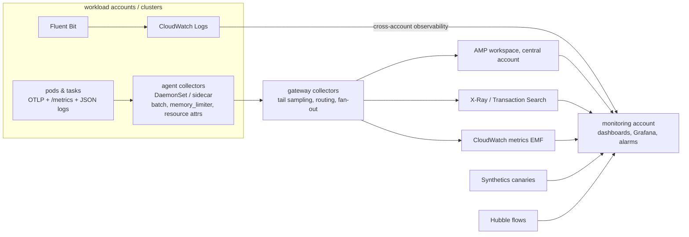

# Observability · L400 — Observability at scale

**Level:** 400 · **Time:** ~75 min · **Prerequisites:** [L300 Metrics that matter and alerting](L300-metrics-that-matter-and-alerting.md),
[EKS L400](../04-eks/L400-eks-at-scale.md), [Data, messaging and batch L300](../09-data-messaging-and-batch/L300-messaging-and-data-deep-dive.md)

**After this document you can:**

- Design an OpenTelemetry pipeline for a fleet (agents, gateways, tail sampling) and keep it within a
  budget.
- Propagate trace context through HTTP, SQS and Kafka and prove one trace spans the whole flow.
- Control cardinality and cost across logs, metrics and traces without losing the signals that page.
- Build central observability across accounts and Regions, add synthetics, profiling, audit analytics
  and eBPF flows, and design on-call around it.

## 1. Mental model



At scale, observability is a data pipeline with a budget. Telemetry volume grows with pods × requests
× attributes, and the two failure modes are blindness (dropped or sampled-away signals during an
incident) and cost (cardinality explosions, debug logs, 100% traces). The architecture that survives
both has agents near the workloads that batch and enrich, gateways that decide (tail sampling, routing),
central sinks in a monitoring account, and explicit policies for what is kept at what resolution and
for how long. Context propagation across queues is what makes traces useful in an event-driven system
like shopfront; without it, every consumer is a new root span.

## 2. Concepts

### 2.1 Pipeline design

| Layer | Runs as | Responsibilities | Sizing |
| --- | --- | --- | --- |
| SDK | in process | instrumentation, head sampling (`OTEL_TRACES_SAMPLER=parentbased_traceidratio`, `OTEL_TRACES_SAMPLER_ARG=0.1`), resource attributes from env | negligible |
| Agent collector | DaemonSet (EKS) / sidecar (ECS) | receive OTLP locally, `memory_limiter`, `batch`, `resourcedetection` (cluster, node, task), `k8sattributes` (pod labels), scrape `/metrics`, forward to gateway | 100–250m CPU, 256–512 MiB per node; sidecar 0.1 vCPU / 128 MiB |
| Gateway collector | Deployment (2–N replicas behind a Service/NLB) | `tail_sampling`, `routing` by tenant/environment, `filter`/`transform` (drop attributes), fan-out to X-Ray/AMP/EMF/third parties, retry queues with persistent storage | scale on `otelcol_exporter_queue_size` and CPU |
| Backends | managed | storage, query | quotas: AMP ingestion, X-Ray segment limits, CloudWatch Logs ingestion |

Tail sampling keeps every trace with an error or high latency and a fraction of the rest; it needs
all spans of a trace at one gateway (load-balance by trace ID with the `loadbalancing` exporter in
agents):

```yaml
processors:
  tail_sampling:
    decision_wait: 10s
    num_traces: 200000
    policies:
      - { name: errors, type: status_code, status_code: { status_codes: [ERROR] } }
      - { name: slow, type: latency, latency: { threshold_ms: 500 } }
      - { name: orders-write, type: string_attribute, string_attribute: { key: http.route, values: ["/orders"], enabled_regex_matching: false } }
      - { name: baseline, type: probabilistic, probabilistic: { sampling_percentage: 5 } }
```

Head sampling in the SDK reduces cost early but is blind to outcomes; tail sampling sees outcomes but
costs gateway memory (`num_traces × spans × decision_wait`). Transaction Search changes the calculus:
with 100% spans ingested as logs, sampling applies to trace summaries/indexing rather than to
whether a span exists.

### 2.2 Context propagation across HTTP, SQS and Kafka

W3C `traceparent` (`00-<trace-id>-<span-id>-<flags>`) is the wire format; HTTP instrumentation
injects it as a header automatically. Queues and streams need explicit carriers:

| Hop | Carrier | Producer | Consumer |
| --- | --- | --- | --- |
| orders → catalog (HTTP) | header | auto (undici/fetch instrumentation) | auto (otelhttp) |
| orders → SQS | message attribute `traceparent` (String) | `propagation.inject` into `MessageAttributes` | `context_from_sqs_attributes` → parent for `order.fulfill` (CONSUMER span) |
| orders → Kafka | record header `traceparent` | `traceCarrier()` into `headers` | `context_from_kafka_headers` → parent for `kafka.consume` |
| worker → Postgres | in-process | psycopg instrumentation child span | — |

Spans on consumers use `SpanKind.CONSUMER` with messaging semantic attributes
(`messaging.system`, `messaging.destination.name`, `messaging.message.id`,
`messaging.kafka.offset`) so backends draw the async edge; the shopfront workers do exactly this
([`labs/apps/worker/worker/telemetry.py`](../../labs/apps/worker/worker/telemetry.py)). Batch consumers
(one poll, ten messages) should create one span per message linked to the batch span (`links`) rather
than one giant span. Long gaps (a message waits an hour) are normal; backends show them as latency
between producer and consumer spans — the "queue time" you want to measure.

### 2.3 Cardinality and cost

| Signal | Cost driver | Control |
| --- | --- | --- |
| Metrics (CloudWatch) | unique metric × dimension sets per month; API `PutMetricData` calls | EMF with few dimensions; no per-request IDs as dimensions; aggregate at the collector (`metricstransform`); Container Insights only where needed |
| Metrics (Prometheus/AMP) | active series; ingestion samples | drop labels (`pod_template_hash`, IDs) with `relabel_configs`; recording rules; retention per workspace; `metric_relabel_configs` to drop histograms you never query |
| Logs | GB ingested | drop health-check and debug lines at the agent; sample repetitive lines; structured fields instead of verbose messages; retention 14–30 days hot, archive to S3; `awslogs` non-blocking so cost controls do not become outages |
| Traces (X-Ray) | traces recorded and retrieved | head/tail sampling; Transaction Search indexing percentage |
| Spans (Transaction Search) | GB of span logs | attribute filtering at the gateway; indexing percentage |
| Events | rules and targets | archive to logs only what you query |

Cardinality bombs to watch for: `http.route` replaced by raw URLs with IDs (use route templates),
user IDs or order IDs as metric labels, per-pod metrics without aggregation on 1,000-pod clusters,
Kafka partition-level metrics for hundreds of partitions. A weekly report of top series/label
combinations (AMP: `topk(20, count by (__name__)({__name__=~".+"}))`) catches them early.

### 2.4 Central observability across accounts and Regions

CloudWatch cross-account observability: a monitoring account with sinks, source accounts linked
(logs, metrics, traces, Application Signals shared), dashboards and alarms built in the monitoring
account; Organizations-wide linking with a single policy. AMP: one workspace per environment or one
per Region with remote write from every cluster (SigV4 roles per account); Grafana in the monitoring
account with data sources per workspace/Region and folders per team. X-Ray/Transaction Search:
cross-account traces through the same linking. Keep the monitoring account read-only for humans and
give alarms there the paging integrations; workload accounts keep the alarms that act (rollbacks,
scaling). Regional isolation: dashboards for the DR Region exist before failover; alert routing does
not depend on the failing Region.

### 2.5 Synthetics, profiling, audit analytics, eBPF

- **Synthetics**: CloudWatch Synthetics canaries run scripted requests (`GET /readyz`, a full
  "create order" flow) from outside every minute; their success rate is the cleanest availability SLI
  and the first alarm to fire in a Region-level event. Run them from another Region too.
- **Profiling**: continuous profilers (Pyroscope/Parca, or vendor agents) attach to CPU-heavy
  services; on EKS they run as DaemonSets using eBPF or per-runtime agents; on Fargate only in-process
  profilers work. Use for the "CPU is high but where" question that traces do not answer.
- **Audit analytics**: EKS audit logs and CloudTrail into a searchable store with scheduled queries
  (exec into production, secrets reads, access entry changes, `RegisterTaskDefinition` outside the
  pipeline); Contributor Insights for top-N callers; findings to Security Hub
  ([06 L300](../06-identity-and-security/L300-hardening-workloads-and-clusters.md)).
- **eBPF flows**: Hubble (Cilium) exports flow logs and L7 metrics per identity without sidecars;
  the VPC CNI network policy agent logs denied flows; VPC Flow Logs remain the network-wide record
  ([05 L400](../05-networking/L400-network-architecture-at-scale.md)).

### 2.6 Observability for DR and game days

During a failover, the observability of the failing Region is suspect. Requirements: alarms for
Region health evaluated from outside (Synthetics from another Region, Route 53 health checks), a
monitoring account whose dashboards span Regions, AMP/Grafana reachable independently of the
workload Region, and a game-day checklist that includes "confirm telemetry from the DR Region
arrives" before traffic moves. Game days also test the collectors' behaviour under load: a 5× traffic
surge should not turn agents into OOM victims (memory_limiter) nor block applications (exporters are
asynchronous with bounded queues) ([10 L400](../10-resilience-and-dr/L400-dr-plan-and-game-days.md)).

### 2.7 On-call design

Alerts route by service ownership (labels/tags → team) with severity: page for SLO burn and
availability, ticket for cause metrics. Every page links a runbook (the [playbooks](../../playbooks/README.md)
in this repository are the shape), a dashboard scoped to the service, and the recent deployments.
Measure the on-call itself: pages per week, percentage actionable, time to acknowledge, time to
resolve; DORA's time to restore and change failure rate connect delivery and operations. Alert
fatigue is a leading indicator of a future outage; review the alert inventory monthly and delete or
demote what did not lead to action.

## 3. How it interacts with the rest of AWS

| Component | Talks to | Protocol/API | Prerequisite (IAM, network, DNS) | What breaks if missing |
| --- | --- | --- | --- | --- |
| Agent collectors | gateway Service/NLB | OTLP gRPC | NetworkPolicy allowing 4317; NLB internal | spans dropped (queue full) |
| Gateway collectors | X-Ray, CloudWatch, AMP (cross-account) | SigV4 with roles in the monitoring account | assume-role or resource policies; endpoints | export failures |
| Monitoring account | source accounts | CloudWatch OAM sinks/links | Organizations policy | fragmented views |
| Grafana (AMG) | AMP workspaces, CloudWatch, X-Ray in many accounts | data-source roles | trust per account | empty panels |
| Synthetics | endpoints | HTTPS from canary Lambdas | VPC config for internal endpoints | no external SLI |
| Hubble | Cilium agents | in-cluster | Cilium installed | no flow view |
| Profilers | kernel (eBPF) or runtimes | DaemonSet privileges | PSA `privileged` namespace | no profiles |
| Paging | SNS → incident tool | HTTPS | topic subscriptions | alerts unseen |

## 4. Use it when / avoid it when

Use:

- Agent + gateway collectors with tail sampling for fleets above a handful of clusters.
- Explicit propagation through SQS attributes and Kafka headers (the contract) for every async hop.
- A monitoring account with cross-account observability, AMG and Synthetics from another Region.
- Cardinality budgets per team with weekly reports.

Avoid:

- 100% trace retention in X-Ray classic at scale (cost) or 1% head sampling everywhere (blind to
  rare errors); use tail sampling or Transaction Search deliberately.
- Per-request labels on metrics; raw URLs as routes.
- Observability that depends on the Region it observes.
- Paging on cause metrics.

Alternatives: vendor SaaS backends via the same collectors (the pipeline design does not change);
Grafana Tempo/Loki/Mimir self-hosted for large platform teams.

## 5. Well-Architected view

| Pillar | At scale | Cost | Practice |
| --- | --- | --- | --- |
| Operational Excellence | central account, layered pipelines, on-call metrics | platform team | telemetry contract enforced by templates |
| Security | audit analytics, read-only monitoring account | storage | least-privilege sinks |
| Reliability | telemetry off the request path; bounded queues; external SLIs | gateway capacity | Synthetics from another Region; game-day telemetry checks |
| Performance Efficiency | batching, tail sampling, aggregation at the edge | gateway compute | size by exporter queue metrics |
| Cost Optimization | cardinality controls, retention tiers, EMF | analysis | weekly top-series report; ingestion by log group |
| Sustainability | less telemetry moved and stored | none | drop what nobody queries |

## 6. Failure modes and troubleshooting

| Symptom | Likely cause | How to confirm (command/metric) | Fix |
| --- | --- | --- | --- |
| Traces missing during incidents | head sampling too low; gateway OOM under surge | `otelcol_processor_dropped_spans`, gateway restarts | tail sampling with error policy; `memory_limiter`; scale gateways |
| Broken traces at the queue hop | producer/consumer use different propagators (B3 vs W3C) | inspect `traceparent` attribute/header | standardise on W3C (`OTEL_PROPAGATORS=tracecontext,baggage`) |
| AMP ingestion throttled | series explosion | `topk` on series count; exporter 429s | relabel/drop; quota increase |
| CloudWatch bill spike | new debug logging or metric dimension | `IncomingBytes` by group; metric count by namespace | drop at agent; remove dimension |
| Dashboards empty in the DR Region | regional resources not created | IaC diff | create ahead of time |
| Synthetics green while users fail | canary hits `/readyz` only | canary script scope | full-flow canary |
| Alert fatigue, missed real page | too many cause alarms paging | pages/week, actionable % | demote to tickets; composite alarms |
| Gateway is a hot spot | agents send to one replica | connection distribution | `loadbalancing` exporter by trace ID; more replicas |

## 7. Signals: metrics, logs, traces

- Pipeline: `otelcol_receiver_accepted_*`, `refused_*`, `otelcol_exporter_sent_*`,
  `send_failed_*`, `otelcol_exporter_queue_size/capacity`, `otelcol_processor_tail_sampling_*`
  (sampling decisions), collector CPU/memory, restarts.
- Cost: CloudWatch `IncomingBytes` per log group, metric counts per namespace, AMP active series,
  X-Ray/Transaction Search ingestion; per-team attribution via tags/labels.
- Coverage: percentage of services emitting all three signals with the contract attributes; percentage
  of async hops with propagated context (traces with consumer spans / producer spans).
- External SLIs: Synthetics success rate and latency per Region.
- On-call: pages per week, actionable ratio, MTTA/MTTR, alerts without runbooks.

Full table: [`reference/metrics-catalog.md`](../../reference/metrics-catalog.md).

## 8. Testing and DR notes

Testing the pipeline: load tests at 3–5× normal traffic while watching collector drops and queue
sizes; chaos on the gateway (kill replicas) to confirm agents buffer and retry; a "propagation test"
in CI that creates an order in the Compose stack and asserts, through the Jaeger API, that the
worker's span shares the trace ID (the smoke test's step 7 is the manual form); cardinality tests
that fail the build when a new metric label exceeds a budget. DR: telemetry from the DR Region must
be visible in the monitoring account before failover; run the checklist during game days; keep
Synthetics in a third Region so the SLI survives the loss of either.

## 9. Hands-on

```bash
# 1. The contract in code: propagation through SQS attributes and Kafka headers
grep -n 'traceparent' labs/apps/orders/src/publishers.ts labs/apps/worker/worker/telemetry.py | head
# 2. Prove one trace spans producer and consumers (Jaeger v2 API)
make up && make smoke
TRACE=$(docker compose -f labs/local/compose.yaml logs --no-log-prefix fulfillment-worker | grep -m1 '"order fulfilled"' | jq -r .trace_id)
curl -s "http://localhost:16686/api/v3/traces/$TRACE" | jq '[.result.resourceSpans[].scopeSpans[].spans[] | .name] | unique'
# Observe: POST /orders, GET to catalog, INSERT, SQS send, Kafka send, order.fulfill, kafka.consume in one trace.

# 3. Gateway-style collector features in the local config (batch, memory_limiter) and where tail sampling would go
grep -nE 'memory_limiter|batch|tail_sampling|exporters:' labs/local/otel-collector.yaml labs/eks/addons/adot-collector.yaml

# 4. Cardinality check on the local metrics (labels per metric)
curl -s localhost:8080/metrics | grep -E '^http_requests_total' | sed 's/{.*//' | sort | uniq -c
curl -s localhost:8080/metrics | grep -E '^http_requests_total' | wc -l     # series count; routes are templates, not raw paths

# 5. (billable) cross-account observability links and Synthetics in the monitoring account
aws oam list-sinks && aws oam list-attached-links --sink-identifier <sink-arn>
aws synthetics describe-canaries --query 'Canaries[].{name:Name,state:Status.State,schedule:Schedule.Expression}'
```

## 10. Check yourself

1. Why does tail sampling require all spans of a trace to reach the same gateway, and how do agents
   guarantee it?

<details><summary>Answer</summary>
The sampling decision (keep on error or latency) is made after `decision_wait` from the whole trace;
if spans of one trace land on different gateways, each sees a partial trace and decisions diverge
(kept root, dropped children). Agents use the `loadbalancing` exporter that hashes by trace ID so all
spans of a trace go to one gateway replica.
</details>

2. A consumer's spans appear as separate traces from the producer's. Which two things do you check?

<details><summary>Answer</summary>
That the producer injects `traceparent` into the SQS message attributes or Kafka headers (not only
HTTP headers) and that the consumer extracts it and starts its span with that parent context; and
that both sides use the same propagator (W3C TraceContext) — a B3-only producer and a W3C consumer
never link.
</details>

3. What is the cheapest way to add a business metric (orders per minute by product) without a
   cardinality problem?

<details><summary>Answer</summary>
Emit an Embedded Metric Format log line (or a Prometheus counter) with `product_id` as a *field*, not
a dimension/label, and aggregate the metric with a small dimension set (service, environment); query
per-product breakdowns from the logs or from traces when needed. Dimensions/labels with thousands of
values multiply metric costs and series counts.
</details>

4. Why should Synthetics canaries run from a Region other than the one they monitor?

<details><summary>Answer</summary>
A Regional impairment can affect the canary's own execution (Lambda, CloudWatch in that Region) and
make the monitor fail or go silent along with the workload; a canary in another Region gives an
independent, external view of availability and is the signal Route 53/ARC failover decisions should
trust.
</details>

5. What distinguishes a page from a ticket in this design, and what metric tells you the split is
   wrong?

<details><summary>Answer</summary>
Pages are for user-facing symptoms (SLO burn, availability, queue age beyond bounds); tickets are for
cause metrics (throttling, pressure, lag trends) that need action but not now. The actionable
percentage of pages (how many led to an intervention) and pages per on-call week reveal alert
fatigue; below ~70% actionable or above a handful per week, demote alarms.
</details>

## 11. Sources

- OpenTelemetry Collector: deployment patterns, tail sampling processor, load-balancing exporter — https://opentelemetry.io/docs/collector/deployment/ and https://github.com/open-telemetry/opentelemetry-collector-contrib/tree/main/processor/tailsamplingprocessor
- OpenTelemetry semantic conventions for messaging — https://opentelemetry.io/docs/specs/semconv/messaging/
- W3C Trace Context — https://www.w3.org/TR/trace-context/
- AWS Distro for OpenTelemetry collector configuration — https://aws-otel.github.io/docs/getting-started/collector
- CloudWatch cross-account observability — https://docs.aws.amazon.com/AmazonCloudWatch/latest/monitoring/CloudWatch-Unified-Cross-Account.html
- Amazon Managed Service for Prometheus: quotas and cross-account ingestion — https://docs.aws.amazon.com/prometheus/latest/userguide/AMP_quotas.html and https://docs.aws.amazon.com/prometheus/latest/userguide/set-up-ingest-metrics-cross-account.html
- CloudWatch Transaction Search (indexing) — https://docs.aws.amazon.com/AmazonCloudWatch/latest/monitoring/CloudWatch-Transaction-Search.html
- CloudWatch Synthetics — https://docs.aws.amazon.com/AmazonCloudWatch/latest/monitoring/CloudWatch_Synthetics_Canaries.html
- CloudWatch Logs pricing and Embedded Metric Format — https://aws.amazon.com/cloudwatch/pricing/ and https://docs.aws.amazon.com/AmazonCloudWatch/latest/monitoring/CloudWatch_Embedded_Metric_Format.html
- Cilium Hubble — https://docs.cilium.io/en/stable/observability/hubble/
- Grafana Pyroscope — https://grafana.com/docs/pyroscope/latest/
- Google SRE Book: monitoring distributed systems; being on-call — https://sre.google/sre-book/monitoring-distributed-systems/ and https://sre.google/sre-book/being-on-call/
- AWS Observability Best Practices — https://aws-observability.github.io/observability-best-practices/
