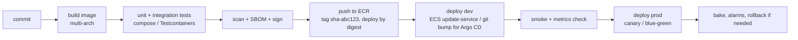

# Delivery · L100 — CI/CD basics

**Level:** 100 · **Time:** ~30 min · **Prerequisites:** [Container fundamentals L100](../01-container-fundamentals/L100-containers-explained.md),
[ECR L100](../02-ecr/L100-ecr-basics.md)

**After this document you can:**

- Name the stages every container pipeline has and what each one produces.
- Explain why deployments reference digests, not tags, and how environments are promoted.
- Distinguish CI, CD and GitOps and say which tool families do which.
- Place GitHub Actions, CodePipeline, Jenkins, Argo CD and ECS/EKS deployment mechanics on one map.

## 1. Mental model



A pipeline turns source into a running, verified revision through a fixed sequence of artifacts:
source → image (bytes identified by a digest) → registry entry → deployment description that names
that digest → running tasks or pods → verification. Continuous integration (CI) covers building and
testing the artifact; continuous delivery (CD) covers moving it through environments; GitOps is a
CD style where the desired state of each environment lives in git and a controller (Argo CD, Flux)
makes the cluster match it. The artifact never changes after the build; only the pointers to it move.

## 2. Concepts

### 2.1 The stages and their outputs

| Stage | Input | Output | Fails when |
| --- | --- | --- | --- |
| Build | source, Dockerfile, lockfiles | OCI image for `linux/amd64` and `linux/arm64` | compile/test errors, missing base image |
| Test | image or source | test report; local stack with Compose (`make up && make smoke`) | behaviour regressions |
| Scan | image | vulnerability report (Trivy/Grype), later Inspector in ECR | critical CVEs with fixes |
| SBOM and sign | image digest | SBOM artifact, signature (Notation/Signer or cosign) | signing identity missing |
| Push | image | `123456789012.dkr.ecr.us-east-1.amazonaws.com/shopfront/orders:sha-1a2b3c4d` and its digest | ECR permissions, quota |
| Deploy | digest + environment configuration | new ECS task definition revision / updated Kubernetes manifest in git | health checks, alarms |
| Verify | running revision | smoke tests, dashboards, error budget | 5xx, latency, failed hooks |

The shopfront pipelines in [`labs/pipelines/`](../../labs/pipelines/) implement exactly this order.

### 2.2 Tags versus digests

A tag (`sha-1a2b3c4d`, `v1.4.2`, `latest`) is a mutable pointer; a digest (`sha256:…`) is the
content. Humans read tags; deployments must reference digests so that every task or pod in a rollout
runs identical bytes and a rollback is exact. Pipelines push a tag for traceability and then resolve
it to a digest (`aws ecr describe-images --query 'imageDetails[0].imageDigest'`) before writing the
task definition or manifest. `latest` is never deployed
([01 L200](../01-container-fundamentals/L200-images-builds-and-registries.md)).

### 2.3 Environments and promotion

Environments are separate copies of the platform (dev, staging, prod), usually separate AWS
accounts or at least separate clusters and namespaces, with the same manifests and different
parameters (replicas, sizes, endpoints, secrets). Promotion means pointing the next environment at
the digest that passed verification in the previous one, never rebuilding. In GitOps this is a commit
to the environment's overlay (Kustomize `overlays/prod`) or Helm values; on ECS it is registering a
task definition revision with the digest and updating the service.

### 2.4 CI, CD and GitOps

| | Continuous integration | Continuous delivery (push) | GitOps (pull) |
| --- | --- | --- | --- |
| Question | is this commit good? | how does the artifact reach each environment? | what should each environment look like? |
| Actor | pipeline runner | pipeline runner with deploy permissions | controller in/near the cluster reading git |
| AWS tools | GitHub Actions, CodeBuild, Jenkins | CodePipeline/CodeDeploy, GitHub Actions deploy jobs, Jenkins, `aws ecs update-service` | Argo CD (self-managed or EKS Capability), Flux |
| Fits | every project | ECS (no in-cluster controller), simple setups | EKS at scale, many clusters, audit of desired state |
| Weakness | none | pipeline needs broad credentials to every environment; drift undetected | no native ECS support; another controller to run (or the Capability) |

Both styles share CI. ECS is normally deployed by push (a pipeline step calls the ECS API, possibly
through CodeDeploy or native strategies); EKS is normally deployed by pull (the pipeline commits a
digest to git and Argo CD applies it).

### 2.5 The tool map

| Tool | Role | Notes |
| --- | --- | --- |
| GitHub Actions | CI and push CD | OIDC federation to AWS roles; hosted or self-hosted runners; the default for repositories on GitHub |
| AWS CodePipeline + CodeBuild + CodeDeploy | AWS-native CI/CD | CodeBuild runs builds inside your account; CodeDeploy handles ECS blue/green (legacy path now that ECS has native strategies) |
| Jenkins | self-hosted CI/CD | flexible, plugin-heavy; runs well on EKS with ephemeral pod agents or on ECS with Fargate agents; you own upgrades and backups |
| Argo CD | GitOps CD for Kubernetes | Applications sync manifests from git; available as a managed EKS Capability since late 2025 |
| Argo Rollouts / Flagger | progressive delivery on Kubernetes | canary and blue/green with metric analysis |
| ECS deployment types | progressive delivery on ECS | rolling with circuit breaker, blue/green, canary, lifecycle hooks — built in |
| Helm / Kustomize | packaging Kubernetes manifests | Helm for third-party charts, Kustomize for your own overlays (or both) |
| Copilot CLI, Docker Compose ECS | retired | end of support 2026-06-12 and 2023-11 ([FACTS](../../docs/FACTS-2026-09.md)) |

### 2.6 A first pipeline in words

For shopfront on GitHub: on every push to `main`, a workflow assumes an AWS role through OIDC (no
stored keys), builds the four images with `docker buildx` for both architectures, runs `make smoke`
against the Compose stack, scans with Trivy, generates SBOMs, signs with Notation, pushes to ECR with
the tag `sha-<gitsha>`, resolves digests, then either registers new ECS task definitions and updates
the dev services (ECS path) or commits the digests into `labs/eks/manifests/overlays/dev` for Argo CD
to sync (EKS path). Promotion to prod is a second workflow gated by an environment protection rule
that requires approval ([L200](L200-pipelines-on-aws.md)).

## 3. How it interacts with the rest of AWS

| Component | Talks to | Protocol/API | Prerequisite (IAM, network, DNS) | What breaks if missing |
| --- | --- | --- | --- | --- |
| CI runner | ECR | `ecr:GetAuthorizationToken`, `BatchCheckLayerAvailability`, `PutImage`, `InitiateLayerUpload`… | role assumed via OIDC or CodeBuild service role | push fails `denied` |
| CI runner | ECS | `RegisterTaskDefinition`, `UpdateService`, `DescribeServices` + `iam:PassRole` for task/execution roles | deploy role per environment | deployment step fails |
| CI runner | git (GitOps) | commit to environment overlay | deploy key or app token scoped to the repo | Argo CD never sees the change |
| Argo CD | EKS API server | HTTPS with an access entry / capability role | cluster registered; RBAC | applications `Unknown`/`OutOfSync` forever |
| ECS/EKS | ECR | pulls by digest | execution/node role; endpoints | tasks/pods fail to start |
| Pipeline | CloudWatch | alarms for rollback and verification | alarm names in the deployment configuration | rollouts complete blind |

## 4. Use it when / avoid it when

Use:

- GitHub Actions with OIDC for CI when code lives on GitHub; CodeBuild when builds must run inside
  your account/VPC; Jenkins when you already run it well.
- Push CD for ECS; GitOps (Argo CD) for EKS.
- Digests everywhere; tags for humans.

Avoid:

- Long-lived AWS access keys in CI secrets.
- Rebuilding images per environment ("prod build"); promote the same digest.
- `latest` in any deployment description.
- Deploying to prod from a laptop; the pipeline's role is the only writer.

Alternatives: ECS Express Mode for a single web service with AWS-managed defaults; App Runner for
web apps without a platform team.

## 5. Well-Architected view

| Pillar | Contribution | Cost | Practice |
| --- | --- | --- | --- |
| Operational Excellence | repeatable, auditable releases; rollback by digest | pipeline maintenance | one pipeline template per service type |
| Security | OIDC federation, scanning, signing, least-privilege deploy roles | policy work | no stored keys; verify signatures before deploy |
| Reliability | verification gates, canary/blue-green, automatic rollback | slower releases | alarm-gated deployments |
| Performance Efficiency | build caches, multi-arch once | cache storage | remote BuildKit cache; ECR pull-through for bases |
| Cost Optimization | ephemeral runners, Graviton builders | none | scale runners to zero |
| Sustainability | fewer rebuilds through promotion | none | build once |

## 6. Failure modes and troubleshooting

| Symptom | Likely cause | How to confirm (command/metric) | Fix |
| --- | --- | --- | --- |
| Push to ECR `denied: User is not authorized` | role lacks ECR actions or repository policy | CloudTrail `PutImage` AccessDenied | fix role/repository policy ([playbook](../../playbooks/incidents/image-pull-failures.md)) |
| Deployment rolls back immediately | health check path wrong; image for wrong architecture | ECS events / `kubectl describe pod` | fix health check; multi-arch build ([playbook](../../playbooks/incidents/ecs-deployment-stuck-or-rolled-back.md)) |
| Two tasks run different code after one deploy | tag mutated between pulls | compare `imageDigest` in `describe-tasks` | deploy by digest |
| Argo CD shows `OutOfSync` after a manual `kubectl apply` | drift from git | Argo CD diff | revert manual change; enable self-heal |
| Prod deployed an untested digest | promotion rebuilt instead of copying the digest | compare digests across environments | promote digests, not sources |
| Pipeline `AccessDenied` on `iam:PassRole` | deploy role cannot pass the task/execution role | CloudTrail | add `iam:PassRole` scoped to those roles ([playbook](../../playbooks/incidents/iam-accessdenied-from-containers.md)) |

## 7. Signals: metrics, logs, traces

- Pipeline: success rate, duration per stage, queue time for runners.
- Delivery: deployments per day, lead time from commit to prod, change failure rate, time to
  restore (DORA).
- Deployment health: ECS `DeploymentCount`, rollback events; Kubernetes `kube_deployment_status_replicas_unavailable`
  during rollouts; Argo CD sync status and health per Application.
- Artifact: images pushed per day, scan findings per image, signature coverage.

Full table: [`reference/metrics-catalog.md`](../../reference/metrics-catalog.md).

## 8. Testing and DR notes

Testing in the pipeline: unit tests in the language toolchain, integration tests against the Compose
stack (`make up && make smoke`), container structure tests, manifest validation (`cfn-lint`,
`kubeconform`, `helm template | kubeconform`), a smoke test after every deployment, and load or
canary analysis before production traffic ([11 L200](../11-testing-workloads/L200-testing-in-pipelines-and-clusters.md)).

DR: the pipeline definitions live in git; images in ECR replicate to the DR Region; the deploy roles
exist in every account; Argo CD state is reconstructible from git (or managed by the EKS Capability).
A DR rebuild is "run the pipeline against the DR Region"; rehearse it ([10 L300](../10-resilience-and-dr/L300-dr-strategies-for-container-platforms.md)).

## 9. Hands-on

```bash
# Run the CI stages locally in the order the pipeline does
make build-images                      # build
make up && make smoke                  # test against the real dependencies
docker inspect shopfront/orders:dev --format '{{index .RepoDigests 0}}' 2>/dev/null || echo "digest appears after a push"
make down

# Read the GitHub Actions workflow and find each stage
grep -nE '^\s+- name:' labs/pipelines/github-actions/ci.yml
# Observe: build (buildx, two platforms), test (smoke), scan (trivy), sbom, sign, push, resolve digest.

# Read how ECS and EKS receive the digest
grep -nE 'image|digest' labs/pipelines/github-actions/deploy-ecs.yml | head
grep -nE 'kustomize|image' labs/pipelines/github-actions/deploy-eks.yml | head
```

## 10. Check yourself

1. Why does a rollback by tag sometimes not restore the previous behaviour, while a rollback by
   digest always does?

<details><summary>Answer</summary>
A tag is a pointer that may have moved (rebuilt `v1.4.2`, or `latest`), so re-deploying the tag can
pull different bytes than the ones that ran before. A digest names the exact content, so the
rollback runs precisely the previous image.
</details>

2. What is the difference between push-based CD and GitOps, and which fits ECS and EKS by default?

<details><summary>Answer</summary>
Push CD: the pipeline runner calls the deployment API with credentials for the target. GitOps: the
desired state is committed to git and a controller in or near the cluster pulls and applies it,
detecting drift. ECS has no in-cluster controller, so push (pipeline → ECS API) is the norm; EKS
fits GitOps with Argo CD or Flux.
</details>

3. Why should promotion to production not rebuild the image?

<details><summary>Answer</summary>
A rebuild produces different bytes (new base digest, new dependency resolution, timestamps) that
were never tested; the digest verified in staging is the only artifact with evidence. Promotion
copies the digest reference into the production configuration.
</details>

4. What permission does a deploy role need beyond `ecs:UpdateService` to change a task definition,
   and why is it a security-sensitive one?

<details><summary>Answer</summary>
`iam:PassRole` on the task role and execution role named in the task definition. Passing a role
lets the caller make ECS run code under that role, so an over-broad `iam:PassRole` allows privilege
escalation to any role in the account; scope it to the specific role ARNs.
</details>

5. Where does scanning happen twice, and why is the second time necessary?

<details><summary>Answer</summary>
Once in CI before push (Trivy/Grype gating on fixable critical/high CVEs) and continuously in ECR
with Inspector after push. New CVEs are published after the build; only continuous rescanning of
stored (and running) images tells you when a previously clean image becomes vulnerable.
</details>

## 11. Sources

- Amazon ECR: pushing an image and image tag mutability — https://docs.aws.amazon.com/AmazonECR/latest/userguide/docker-push-ecr-image.html and https://docs.aws.amazon.com/AmazonECR/latest/userguide/image-tag-mutability.html
- Configuring OpenID Connect in Amazon Web Services (GitHub Actions) — https://docs.github.com/en/actions/security-for-github-actions/security-hardening-your-deployments/configuring-openid-connect-in-amazon-web-services
- AWS CodePipeline user guide — https://docs.aws.amazon.com/codepipeline/latest/userguide/welcome.html
- Amazon ECS deployment types — https://docs.aws.amazon.com/AmazonECS/latest/developerguide/deployment-types.html
- Argo CD documentation — https://argo-cd.readthedocs.io/en/stable/
- EKS Capabilities (Argo CD) — https://docs.aws.amazon.com/eks/latest/userguide/capabilities.html
- Jenkins on Kubernetes (Kubernetes plugin) — https://plugins.jenkins.io/kubernetes/
- Kubernetes Deployments (rolling updates) — https://kubernetes.io/docs/concepts/workloads/controllers/deployment/
- DORA metrics (Accelerate State of DevOps) — https://dora.dev/guides/dora-metrics-four-keys/
- AWS Well-Architected Container Build Lens — https://docs.aws.amazon.com/wellarchitected/latest/container-build-lens/container-build-lens.html
