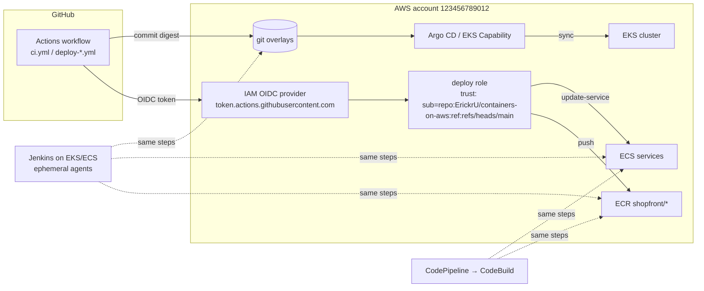

# Delivery · L200 — Pipelines on AWS

**Level:** 200 · **Time:** ~75 min · **Prerequisites:** [L100 CI/CD basics](L100-cicd-basics.md),
[ECR L200](../02-ecr/L200-lifecycle-scanning-access-and-endpoints.md),
[Identity and security L200](../06-identity-and-security/L200-iam-for-containers.md)

**After this document you can:**

- Federate GitHub Actions to AWS with OIDC and write the trust policy that keeps it narrow.
- Build a CodePipeline/CodeBuild pipeline and know when CodeDeploy still matters.
- Run Jenkins on EKS with ephemeral pod agents or on ECS with Fargate agents, configured as code.
- Choose where images are built (hosted runners, self-hosted runners, CodeBuild, in-cluster).
- Package with Helm and Kustomize and drive Argo CD (self-managed or the EKS Capability).

## 1. Mental model



Every pipeline product does the same five things — obtain AWS credentials, build, publish to ECR,
change the deployment description, verify — and differs in where the runner lives and how it gets
credentials. GitHub Actions and Jenkins runners live outside or inside your account and use OIDC or
instance/pod roles; CodeBuild runs inside your account with a service role. For EKS the last step is
a git commit that Argo CD applies; for ECS it is an API call. Configure each product as code, pin
every action and plugin, and give each environment its own narrowly trusted role.

## 2. Concepts

### 2.1 The stage set every pipeline implements

Build multi-arch with BuildKit (`docker buildx build --platform linux/amd64,linux/arm64 --push`),
test against the Compose stack, scan (`trivy image --exit-code 1 --severity CRITICAL,HIGH
--ignore-unfixed`), attach an SBOM and provenance (`--sbom=true --provenance=mode=max`), sign
(`notation sign` with AWS Signer or `cosign sign`), push by tag `sha-<gitsha>`, resolve the digest,
then deploy. Supply-chain details: [01 L400](../01-container-fundamentals/L400-hardening-supply-chain-and-performance.md).

### 2.2 GitHub Actions with OIDC

Create the provider once per account, then a role per environment whose trust policy names the
repository and ref (or environment) allowed to assume it:

```json
{
  "Version": "2012-10-17",
  "Statement": [{
    "Effect": "Allow",
    "Principal": { "Federated": "arn:aws:iam::123456789012:oidc-provider/token.actions.githubusercontent.com" },
    "Action": "sts:AssumeRoleWithWebIdentity",
    "Condition": {
      "StringEquals": { "token.actions.githubusercontent.com:aud": "sts.amazonaws.com" },
      "StringLike": { "token.actions.githubusercontent.com:sub": "repo:ErickrU/containers-on-aws:environment:prod" }
    }
  }]
}
```

`sub` claims look like `repo:<owner>/<repo>:ref:refs/heads/main`, `repo:…:environment:prod`,
`repo:…:pull_request`; bind production roles to the `environment:prod` form and protect that GitHub
environment with required reviewers. In the workflow:

```yaml
permissions: { id-token: write, contents: read }
steps:
  - uses: actions/checkout@<commit-sha>            # every third-party action pinned to a SHA
  - uses: aws-actions/configure-aws-credentials@<commit-sha>
    with:
      role-to-assume: arn:aws:iam::123456789012:role/shopfront-github-deploy-prod
      aws-region: us-east-1
      role-session-name: gha-${{ github.run_id }}
  - uses: aws-actions/amazon-ecr-login@<commit-sha>
  - uses: docker/setup-buildx-action@<commit-sha>
  - uses: docker/build-push-action@<commit-sha>
    with:
      context: labs/apps/orders
      platforms: linux/amd64,linux/arm64
      push: true
      tags: 123456789012.dkr.ecr.us-east-1.amazonaws.com/shopfront/orders:sha-${{ github.sha }}
      provenance: mode=max
      sbom: true
      cache-from: type=gha
      cache-to: type=gha,mode=max
```

The deploy role's policy: ECR push on `shopfront/*` repositories only; for ECS `ecs:RegisterTaskDefinition`,
`ecs:UpdateService`, `ecs:Describe*` on the environment's cluster plus `iam:PassRole` on the exact
task and execution roles; for EKS/GitOps no cluster permissions at all — the workflow commits to git.
Self-hosted runners (Actions Runner Controller on EKS, or EC2 runners) are for private-network builds
and large caches; keep them ephemeral (one job per runner pod). The complete workflows are in
[`labs/pipelines/github-actions/`](../../labs/pipelines/github-actions/).

### 2.3 CodePipeline, CodeBuild, CodeDeploy

| Service | Role | Configuration |
| --- | --- | --- |
| CodePipeline | orchestrates stages (Source → Build → Deploy) with manual approvals and cross-account actions | pipeline definition (CloudFormation in [`labs/pipelines/codepipeline/pipeline.yaml`](../../labs/pipelines/codepipeline/pipeline.yaml)) |
| CodeBuild | runs builds in your account (VPC access optional, privileged mode for Docker, ARM and GPU fleets, reserved capacity) | `buildspec.yml` in the repo; service role; cache in S3 or local |
| CodeDeploy | ECS blue/green deployments with traffic shifting and hooks | `appspec.yaml` + `taskdef.json`; largely superseded by ECS native blue/green and canary |
| CodeConnections | GitHub/GitLab source integration | connection resource + repository permissions |

`buildspec.yml` phases (`install`, `pre_build` with `aws ecr get-login-password`, `build` with
`docker buildx`, `post_build` writing `imagedefinitions.json` or `imageDetail.json` for the deploy
action) are in [`labs/pipelines/codepipeline/buildspec.yml`](../../labs/pipelines/codepipeline/buildspec.yml).
The `ECS` deploy action performs a rolling update with the digest from `imagedefinitions.json`; for
blue/green use the ECS native strategy through `UpdateService` in a CodeBuild step rather than the
CodeDeploy action for new pipelines. Choose CodeBuild when builds must not leave the account or VPC,
when you need managed ARM/GPU build fleets, or when the organisation standardises on AWS-native tooling.

### 2.4 Jenkins on EKS and on ECS

Jenkins is a controller (stateful: `JENKINS_HOME`) plus agents that run jobs. On Kubernetes the
Kubernetes plugin creates a pod per job from a pod template and deletes it afterwards; on ECS the
Amazon ECS plugin launches a Fargate task per job.

```groovy
// labs/pipelines/jenkins/Jenkinsfile (excerpt)
pipeline {
  agent {
    kubernetes {
      yaml '''
        apiVersion: v1
        kind: Pod
        spec:
          serviceAccountName: jenkins-agent          # Pod Identity association -> ECR push role
          securityContext: { runAsNonRoot: true, runAsUser: 10001, seccompProfile: { type: RuntimeDefault } }
          containers:
            - name: buildkit
              image: moby/buildkit:v0.17.2-rootless
              args: ["--oci-worker-no-process-sandbox"]
              securityContext: { seccompProfile: { type: Unconfined }, appArmorProfile: { type: Unconfined } }
              resources: { requests: { cpu: "1", memory: 2Gi }, limits: { memory: 4Gi } }
      '''
    }
  }
  options { timeout(time: 30, unit: 'MINUTES'); disableConcurrentBuilds() }
  stages {
    stage('build+push') { steps { container('buildkit') { sh 'buildctl build --frontend dockerfile.v0 --local context=labs/apps/orders --local dockerfile=labs/apps/orders --output type=image,name=$ECR/shopfront/orders:sha-$GIT_COMMIT,push=true --opt platform=linux/amd64,linux/arm64' } } }
    stage('deploy dev') { steps { sh 'aws ecs update-service --cluster shopfront-dev --service orders --task-definition $(scripts/register-taskdef.sh orders $DIGEST)' } }
  }
}
```

Controller practices: Jenkins Configuration as Code (`jcasc.yaml`: security realm via OIDC,
authorisation, credentials from Secrets Manager or the CSI driver, agent clouds), plugins pinned in
`plugins.txt`, `JENKINS_HOME` on EFS or a PVC with snapshots, one controller per team boundary,
Helm chart values in [`labs/pipelines/jenkins/`](../../labs/pipelines/jenkins/). On ECS the
controller runs as a service with an EFS volume and the ECS plugin uses a task definition template
for agents with a task role for ECR push. Controller HA is approximated by fast restarts (single
active controller) plus backup of `JENKINS_HOME`; jobs are stateless because they live in git
(`Jenkinsfile`).

### 2.5 Where to build images

| Option | Runs where | Credentials | Cache | Fits |
| --- | --- | --- | --- | --- |
| GitHub-hosted runners | GitHub | OIDC → role | `type=gha` cache, ECR pull-through for bases | most projects |
| Self-hosted runners (ARC on EKS) | your cluster | Pod Identity | registry cache in ECR, PVC | private networks, large caches, Graviton builds natively |
| CodeBuild | your account | service role | S3/local cache; ECR pull-through | AWS-native, VPC access, ARM/GPU fleets |
| In-cluster BuildKit (rootless) or kaniko | your cluster | Pod Identity | registry cache | Jenkins/Tekton pipelines; no Docker daemon |
| Docker-in-Docker | your cluster | — | — | avoid (privileged) |

Rootless BuildKit or kaniko avoid privileged pods; both push directly to ECR. A remote cache in ECR
(`--cache-to type=registry,ref=…/cache,mode=max`) makes multi-arch builds fast on ephemeral runners.

### 2.6 Helm and Kustomize

Kustomize for your own manifests: `base/` with the Deployments, Services, Ingress, HPA, PDB,
NetworkPolicies and ServiceAccounts, `overlays/dev` and `overlays/prod` with replicas, resources and
image digests (`kustomize edit set image 123456789012.dkr.ecr.us-east-1.amazonaws.com/shopfront/orders=…@sha256:…`).
Helm for third-party components (load balancer controller, KEDA, Argo CD, Argo Rollouts, Cilium)
with values files pinned to chart versions in [`labs/eks/addons/`](../../labs/eks/addons/). A pipeline
bumps the digest in the overlay; nothing else in git changes per release.

### 2.7 Argo CD and Flux

Argo CD objects: `AppProject` (which repos, destinations and resource kinds a team may deploy),
`Application` (source repo/path/revision → destination cluster/namespace, sync policy with automated
prune and self-heal, sync waves and hooks for ordering and migrations), `ApplicationSet` (generate
Applications from a list, git directories or a cluster list). App of Apps bootstraps a cluster from
one Application that points at a directory of Applications.

```yaml
apiVersion: argoproj.io/v1alpha1
kind: Application
metadata: { name: shopfront-dev, namespace: argocd }
spec:
  project: shopfront
  source:
    repoURL: https://github.com/ErickrU/containers-on-aws.git
    targetRevision: main
    path: labs/eks/manifests/overlays/dev
  destination: { server: https://kubernetes.default.svc, namespace: shopfront }
  syncPolicy:
    automated: { prune: true, selfHeal: true }
    syncOptions: [CreateNamespace=true, ServerSideApply=true]
    retry: { limit: 5, backoff: { duration: 10s, factor: 2, maxDuration: 3m } }
```

The **EKS Capability for Argo CD** runs the Argo CD control plane as an AWS-managed service outside
the cluster: no `argocd` Deployments to run or upgrade, a capability role for AWS permissions,
Identity Center integration, up to 3,000 Applications per capability, custom configuration through a
standard `argocd-cm` ConfigMap (since 2026-08). You still write the same `Application`/`AppProject`
objects. Choose it for new clusters unless you need Argo CD features it does not expose (verify the
current feature list). **Flux** is the alternative GitOps toolkit (Kustomization, HelmRelease,
ImageUpdateAutomation CRDs, no UI by default); the concepts map one to one.

### 2.8 ECR lifecycle in pipelines

Pipelines create many tags; lifecycle policies expire untagged and old `sha-*` images while
protecting anything a live task definition or manifest references (keep the last N per prefix,
never expire release tags). Deploying by digest means the digest must survive: coordinate lifecycle
rules with promotion tags (`prod-current`) or keep counts generous
([02 L200](../02-ecr/L200-lifecycle-scanning-access-and-endpoints.md)).

## 3. How it interacts with the rest of AWS

| Component | Talks to | Protocol/API | Prerequisite (IAM, network, DNS) | What breaks if missing |
| --- | --- | --- | --- | --- |
| GitHub Actions | IAM OIDC provider → STS | `AssumeRoleWithWebIdentity` | provider registered; trust `sub`/`aud` conditions; `id-token: write` | `Not authorized to perform sts:AssumeRoleWithWebIdentity` |
| Workflow role | ECR | push APIs on `shopfront/*` | scoped policy | push denied |
| Workflow role | ECS | `RegisterTaskDefinition`, `UpdateService`, `iam:PassRole` | scoped to the cluster and roles | deploy step fails |
| CodeBuild | ECR, S3 (cache/artifacts), VPC (optional) | service role; VPC ENIs | subnets/SGs for VPC builds | build cannot reach private resources |
| Jenkins agents | ECR, ECS/EKS API | Pod Identity (EKS) or task role (ECS) | associations/roles per agent SA | agents cannot push/deploy |
| Argo CD (self-managed) | git, EKS API server, ECR (image updater) | HTTPS; in-cluster SA | repo credentials; RBAC | apps `Unknown` |
| Argo CD Capability | cluster API | capability role + access entry | capability created; role permissions | sync fails |
| Pipeline | CloudWatch alarms | `DescribeAlarms` for verification gates | alarm names | blind deployments |

## 4. Use it when / avoid it when

Use:

- GitHub Actions + OIDC for GitHub repositories; CodeBuild for in-account/VPC builds; Jenkins when
  it already exists and is run as code with ephemeral agents.
- Argo CD (Capability first) for EKS; push deployments with native strategies for ECS.
- Kustomize overlays per environment; Helm for third-party charts.

Avoid:

- Docker-in-Docker with privileged pods; use rootless BuildKit/kaniko or CodeBuild.
- Jenkins controllers with hand-clicked configuration; JCasC and `plugins.txt` or nothing.
- Argo CD Applications pointing at `HEAD` of a development branch for production.
- CodeDeploy ECS blue/green for new services; ECS native strategies cover it with less glue.

Alternatives: Tekton or Argo Workflows for Kubernetes-native CI; GitLab CI with OIDC (same pattern
as GitHub).

## 5. Well-Architected view

| Pillar | Contribution | Cost | Practice |
| --- | --- | --- | --- |
| Operational Excellence | pipelines as code, GitOps drift detection, reproducible controllers (JCasC) | tooling upkeep | pin actions/plugins/charts; one template per service type |
| Security | OIDC instead of keys, environment-bound roles, signatures, no cluster credentials in CI for GitOps | IAM design | `sub` conditions; `iam:PassRole` scoped; branch/environment protection |
| Reliability | verification gates; Argo CD self-heal; retries | slower pipelines | alarm gates; sync retries |
| Performance Efficiency | remote caches, Graviton builders, ephemeral agents | cache storage | registry cache; ARC runners on Spot |
| Cost Optimization | scale-to-zero agents/runners; CodeBuild per-minute | none | ephemeral everything |
| Sustainability | build once, promote digests | none | promotion |

## 6. Failure modes and troubleshooting

| Symptom | Likely cause | How to confirm (command/metric) | Fix |
| --- | --- | --- | --- |
| `Not authorized to perform sts:AssumeRoleWithWebIdentity` | `sub` mismatch (branch vs environment), missing `id-token: write`, wrong audience | decode the OIDC token claims in the job (`echo $ACTIONS_ID_TOKEN_REQUEST_TOKEN` is not the claim; use `aws sts` error + trust policy review) | fix `sub` pattern; add permissions |
| ECR push `denied` | policy scoped to another repository; registry in another Region | CloudTrail `PutImage` | fix ARN/Region |
| ECS deploy `AccessDenied` on `iam:PassRole` | deploy role cannot pass task roles | CloudTrail | scope `iam:PassRole` to the two roles ([playbook](../../playbooks/incidents/iam-accessdenied-from-containers.md)) |
| Argo CD `ComparisonError` / `OutOfSync` forever | repo credentials, CRD missing, server-side apply conflicts | `argocd app get shopfront-dev`; controller logs | fix credentials; sync waves for CRDs |
| Jenkins agent pods `Pending` | no capacity, PSA blocks BuildKit's `Unconfined` seccomp | `kubectl describe pod` | dedicated namespace with `privileged` PSA for builds only, taints |
| Builds slow on ephemeral runners | no remote cache | build logs show full rebuilds | `cache-to type=registry` or `type=gha` |
| Deployment rolled back | health/alarms | ECS events; Argo Rollouts analysis | ([playbook](../../playbooks/incidents/ecs-deployment-stuck-or-rolled-back.md)) |
| Digest deleted by lifecycle policy while referenced | rule too aggressive | ECR events; `CannotPullContainerError` | protect release tags; raise counts ([playbook](../../playbooks/incidents/image-pull-failures.md)) |

## 7. Signals: metrics, logs, traces

- Pipeline duration and success rate per stage; runner queue time; cache hit ratio.
- OIDC assumptions per role (CloudTrail `AssumeRoleWithWebIdentity` by `sub`); failed assumptions.
- ECR: pushes per repository, image count vs lifecycle, scan findings on new images.
- Argo CD: `argocd_app_info` by sync/health status, `argocd_app_sync_total` failures, reconcile
  duration; Capability logs.
- Jenkins: executor utilisation, queue length, agent provisioning time, controller restarts.
- Deployment outcome metrics from the targets (ECS `DeploymentCount`, rollbacks; Kubernetes rollout
  duration).

Full table: [`reference/metrics-catalog.md`](../../reference/metrics-catalog.md).

## 8. Testing and DR notes

Testing the pipeline itself: `act` or a fork to run workflows on pull requests; `cfn-lint` on
`pipeline.yaml`; `kubeconform` on the Kustomize output; a dry-run deploy (`aws ecs
register-task-definition --generate-cli-skeleton`, `kubectl apply --dry-run=server`) as a stage;
smoke tests after each deploy; periodic verification that the OIDC trust policy rejects other
branches (a job on a feature branch must fail to assume the prod role).

DR: workflows and Jenkinsfiles are in git; the OIDC provider and roles exist per account (recreate in
DR accounts with IaC); `JENKINS_HOME` backed up (EFS backup or snapshots) or treated as disposable
with JCasC; Argo CD state is git plus cluster secrets (or the Capability's managed state); ECR
replicated. A DR drill includes running the deploy workflow against the DR Region
([10 L300](../10-resilience-and-dr/L300-dr-strategies-for-container-platforms.md)).

## 9. Hands-on

```bash
# GitHub Actions: read the trust boundary and the stages
grep -nE 'role-to-assume|id-token|uses:' labs/pipelines/github-actions/ci.yml | head -20
grep -nE 'environment:|needs:|if:' labs/pipelines/github-actions/deploy-ecs.yml | head

# CodePipeline: lint the pipeline template and read the buildspec phases
.venv/bin/cfn-lint labs/pipelines/codepipeline/pipeline.yaml
grep -nE '^\s+(install|pre_build|build|post_build):' labs/pipelines/codepipeline/buildspec.yml

# Jenkins: configuration as code
grep -nE 'securityRealm|clouds|credentials' labs/pipelines/jenkins/jcasc.yaml | head
grep -nE 'agent|stage\(' labs/pipelines/jenkins/Jenkinsfile

# Argo CD: project, application set and rollout
kubectl kustomize labs/eks/manifests/overlays/dev | kubeconform -strict -ignore-missing-schemas -summary
cat labs/eks/gitops/project.yaml labs/eks/gitops/applicationset.yaml
# (billable cluster) install the Capability or Argo CD, then:
kubectl apply -f labs/eks/gitops/project.yaml -f labs/eks/gitops/applicationset.yaml
argocd app list && argocd app get shopfront-dev
# Observe: Synced/Healthy; change a replica count in git and watch self-heal revert a manual kubectl scale.
```

## 10. Check yourself

1. Why is `token.actions.githubusercontent.com:sub` the most important condition in the trust
   policy, and what happens if it is a bare wildcard?

<details><summary>Answer</summary>
The `sub` claim identifies the repository and the branch/environment/pull request that requested
the token; it is the only thing preventing any GitHub repository (or any branch of yours, including
a pull request from a fork) from assuming your role. A wildcard `repo:*` lets every GitHub workflow
in the world assume the role; `repo:ErickrU/containers-on-aws:*` lets any branch or PR deploy to
production. Bind production roles to `environment:prod` and protect that environment.
</details>

2. Where does the deployment credential live in a GitOps setup, and why is that better?

<details><summary>Answer</summary>
Nowhere in CI: the workflow only commits a digest to git, and Argo CD (in the cluster or as the EKS
Capability) applies it with its own identity. CI needs no cluster-admin credentials, drift between
git and the cluster is detected and healed, and every change to an environment is a reviewed commit.
</details>

3. When would you still choose CodeBuild over GitHub-hosted runners?

<details><summary>Answer</summary>
When builds must run inside your AWS account or VPC (private dependencies, compliance), when you
want managed ARM or GPU build fleets without running self-hosted runners, when the organisation
standardises on AWS-native tooling and CodePipeline approvals, or when egress from GitHub's runners
to your resources is not allowed.
</details>

4. What makes Jenkins agents on Kubernetes safe enough to run image builds?

<details><summary>Answer</summary>
Ephemeral pods per job (nothing persists between builds), a dedicated namespace with its own PSA
level and taints, rootless BuildKit or kaniko instead of a Docker daemon (no privileged containers),
a service account with a Pod Identity association scoped to ECR push, and pinned agent images.
</details>

5. Your lifecycle policy expires images older than 30 days; a rollback to a digest from 45 days ago
   fails. How do you design lifecycle rules for a digest-based pipeline?

<details><summary>Answer</summary>
Protect what can be referenced: keep the last N images per `sha-` prefix (N covering your rollback
window), never expire tags that mark promoted releases (`prod-*`, semantic versions), and expire
untagged images quickly. Alternatively retag promoted digests with a protected tag at promotion time
so lifecycle rules can be aggressive on everything else.
</details>

## 11. Sources

- GitHub Actions: configuring OpenID Connect in AWS; security hardening — https://docs.github.com/en/actions/security-for-github-actions/security-hardening-your-deployments/configuring-openid-connect-in-amazon-web-services and https://docs.github.com/en/actions/security-for-github-actions/security-guides/security-hardening-for-github-actions
- aws-actions/configure-aws-credentials — https://github.com/aws-actions/configure-aws-credentials
- AWS CodeBuild build specification reference — https://docs.aws.amazon.com/codebuild/latest/userguide/build-spec-ref.html
- CodePipeline ECS deploy action and ECS blue/green with CodeDeploy — https://docs.aws.amazon.com/codepipeline/latest/userguide/action-reference-ECS.html and https://docs.aws.amazon.com/codepipeline/latest/userguide/tutorials-ecs-ecr-codedeploy.html
- Jenkins Kubernetes plugin and Amazon ECS plugin — https://plugins.jenkins.io/kubernetes/ and https://plugins.jenkins.io/amazon-ecs/
- Jenkins Configuration as Code — https://www.jenkins.io/projects/jcasc/
- Actions Runner Controller — https://github.com/actions/actions-runner-controller
- BuildKit rootless mode; kaniko — https://github.com/moby/buildkit/blob/master/docs/rootless.md and https://github.com/GoogleContainerTools/kaniko <!-- term-ok -->
- Kustomize and Helm documentation — https://kubectl.docs.kubernetes.io/references/kustomize/ and https://helm.sh/docs/
- Argo CD: Applications, Projects, ApplicationSets, sync options — https://argo-cd.readthedocs.io/en/stable/
- EKS Capability for Argo CD — https://docs.aws.amazon.com/eks/latest/userguide/capabilities.html
- Flux documentation — https://fluxcd.io/flux/
- Amazon ECR lifecycle policies — https://docs.aws.amazon.com/AmazonECR/latest/userguide/LifecyclePolicies.html
