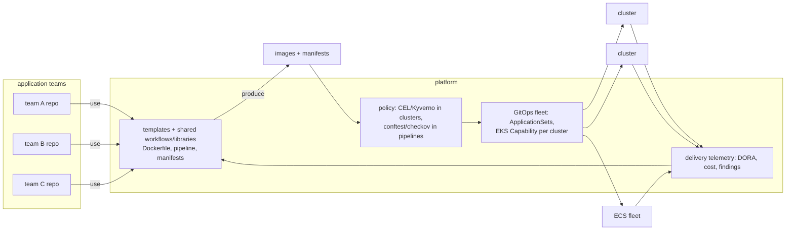

# Delivery · L400 — Platform engineering and delivery at scale

**Level:** 400 · **Time:** ~75 min · **Prerequisites:**
[L300 Progressive delivery and GitOps internals](L300-progressive-delivery-and-gitops-internals.md),
[EKS L400](../04-eks/L400-eks-at-scale.md), [Identity and security L400](../06-identity-and-security/L400-security-architecture-and-incident-response.md)

**After this document you can:**

- Design golden paths that make the secure, observable, cheap way the easy way for many teams.
- Choose a multi-cluster GitOps topology and explain what the EKS Capability changes.
- Put policy into the pipeline and the cluster so reviews stop being the bottleneck.
- Plan the DR of the delivery system itself and reach SLSA levels you can defend.
- Make builds fast and cheap, and measure delivery with DORA metrics that drive decisions.

## 1. Mental model



At scale, delivery is a product the platform team builds for application teams: templates that
encode the organisation's decisions (base images, pipeline stages, manifest defaults, deployment
strategies), controllers that converge many clusters from git, policies that reject what the
templates would never produce, and telemetry that shows whether the product works (lead time, change
failure rate, cost per deploy). The measure of success is that a new service reaches production
through the golden path in a day with no platform ticket, and that an exception requires an
explicit, reviewed deviation.

## 2. Concepts

### 2.1 Golden paths

A golden path is a supported, opinionated route: a repository template (Dockerfile per runtime,
`Makefile`, tests, Compose for local), a reusable pipeline (GitHub reusable workflow or Jenkins shared
library: build → test → scan → SBOM → sign → push → deploy), a manifest/task-definition generator
with enforced defaults (non-root, read-only rootfs, requests, probes, PDB, topology spread, alarms,
`stopTimeout`), and a deployment strategy per tier. Teams fill in service name, ports and resource
sizes; everything else is inherited and updated centrally (a change to the shared workflow rolls out
to every repository on the next run). The shopfront services are one golden path instance: identical
health endpoints, telemetry, shutdown and image conventions from [`labs/CONTRACT.md`](../../labs/CONTRACT.md).

Developer portals (Backstage or a lighter catalogue) make the path discoverable: a "create service"
action instantiates the template, registers ownership, and links dashboards, runbooks and the
deployment history. Ownership metadata (`app.kubernetes.io/part-of`, team labels, tags on ECS
resources) is what makes cost showback and incident routing possible later.

### 2.2 Multi-cluster GitOps topologies

| Topology | How | Strengths | Weaknesses |
| --- | --- | --- | --- |
| Hub-and-spoke Argo CD | one Argo CD (management cluster) registers every workload cluster; `ApplicationSet` cluster generator deploys per cluster | one UI/API, one RBAC model, fleet-wide view | hub is a single point of failure and a high-value target; cross-account network paths and credentials |
| Argo CD per cluster (self-managed) | each cluster runs Argo CD pointing at its own overlays | failure isolation; no cross-cluster credentials | N instances to upgrade; N SSO configs |
| EKS Capability for Argo CD per cluster | AWS runs the Argo CD control plane per cluster; you write Applications | isolation of per-cluster, no upgrades, Identity Center integration, 3,000 Applications per capability | one capability per cluster (no hub view by default); feature parity to verify |
| Flux per cluster | `GitRepository` + `Kustomization` bootstrapped per cluster | lightweight, no UI | same N-instance operations |

Recommended today: the EKS Capability on each EKS cluster for isolation and zero operations, with an
`ApplicationSet` in each that renders the cluster's Applications from a fleet directory in git
(`fleet/clusters/<name>/`), plus a read-only fleet dashboard built from Argo CD metrics or the
Capability's logs. Hub-and-spoke remains useful for a small number of clusters with a strong platform
team. ECS has no controller: the fleet is driven by pipelines that iterate over environments with
staggered waves.

Repository layout that scales: a `platform` repo (cluster definitions, add-on versions, namespace
templates with PSA/quotas/NetworkPolicies, policies), per-team application repos (code +
manifests base), and an `environments` repo (overlays per environment with digests) written only by
pipelines. Promotion is a pull request between overlay directories, reviewable and revertible.

### 2.3 Policy in the pipeline and in the cluster

| Where | Tool | Checks | Feedback speed |
| --- | --- | --- | --- |
| Pre-commit / PR | `conftest` (Rego), `kubeconform`, `cfn-lint`, `checkov`, `hadolint`, `trivy config` | schema, security misconfigurations, banned fields, image sources | seconds, in the PR |
| Pipeline gate | scan, signature, SBOM, provenance verification | supply chain | minutes |
| Admission | CEL policies, Kyverno, Gatekeeper; ECS: Config rules + pipeline verify step | the same rules enforced at the API regardless of how the object arrived | at deploy |
| Continuous | Config rules, Security Hub, Kyverno background scans, `kubectl` audits | drift and new rules against existing resources | hours |

Write each rule once as data (a policy library) and evaluate it in all three places: the pipeline
gives fast feedback, admission guarantees, continuous scans catch drift. Roll new rules out as
warnings first with a date to enforce, and publish the violation counts per team.

### 2.4 Release trains and environments at scale

Many teams deploying independently is the goal; coordination is needed only for shared platform
changes (cluster upgrades, add-on versions, base-image rebuilds). Patterns: environment promotion by
digest with automatic dev → staging and approved staging → prod; deployment windows only where
regulation demands; canary-first for tier-1 services with derived bake times; fleet-wide platform
changes rolled per cell/cluster wave with pause points; "freeze" replaced by "stricter analysis".
Base-image rebuilds are a train of their own: a weekly rebase job rebuilds every service image and
opens promotion PRs, so CVE hygiene does not depend on teams remembering.

### 2.5 DR of the delivery system

| Component | State | Recovery |
| --- | --- | --- |
| Pipeline definitions | git | none needed |
| GitHub/OIDC trust | IAM provider + roles per account | IaC; verify in DR account |
| Runners/agents | ephemeral | recreate from IaC (ARC/ECS plugin) |
| Jenkins controller | `JENKINS_HOME` | snapshot restore or JCasC rebuild (history lost) |
| Argo CD (self-managed) | Applications in git; credentials in secrets manager | reinstall + bootstrap Application |
| Argo CD Capability | AWS-managed | enable capability on the rebuilt cluster; apply Applications |
| ECR images/signatures/SBOMs | replicated | replication rules to every Region in the DR plan |
| Signing profiles/keys | AWS Signer (regional) | profiles per Region; trust stores reference both |
| Alarms used for rollback | CloudWatch (regional) | IaC per Region |
| Environments repo | git | none |

The DR question for delivery is "can we deploy a fix during the disaster?" — rehearse a deployment
into the DR Region during game days, not only a rebuild ([10 L400](../10-resilience-and-dr/L400-dr-plan-and-game-days.md)).

### 2.6 SLSA levels you can defend

| Level | Requirement (abridged) | How on AWS/GitHub |
| --- | --- | --- |
| L1 | provenance exists | `buildx --provenance`, attestation actions |
| L2 | provenance generated by the hosted build platform and signed | GitHub Actions artifact attestations or CodeBuild + Signer; signature verified at admission |
| L3 | build runs in an isolated, hardened environment; provenance unforgeable by build steps | ephemeral runners with no persistent credentials; signing identity separate from the build steps (OIDC job identity); reusable workflows pinned by SHA; no self-hosted runners with shared state |

Most fleets should require L2 provenance at admission (builder identity = your workflow) and move to
L3 for tier-1 services. The attestations also answer "which images contain package X" in minutes
when a supply-chain incident hits ([01 L400](../01-container-fundamentals/L400-hardening-supply-chain-and-performance.md)).

### 2.7 Build performance and cost

| Lever | Effect |
| --- | --- |
| ECR pull-through cache for base images | no Docker Hub limits; faster, in-Region pulls |
| Remote BuildKit cache (`type=registry,mode=max` or `type=gha`) | rebuilds only changed layers on ephemeral runners |
| Dependency layer ordering (`COPY package*.json` before `COPY .`) | dependency layers cached across commits |
| Native arm64 builders (Graviton CodeBuild fleets, ARC runners on Graviton) instead of QEMU | multi-arch builds minutes instead of tens of minutes |
| Ephemeral runners on Spot (ARC) with scale-to-zero | runner cost proportional to builds |
| Test parallelism and Compose-based integration tests on the runner | shorter pipelines |
| Digest promotion (no rebuild per environment) | one build per commit |
| Image size discipline | faster push/pull, less transfer |

Measure pipeline duration per stage and cache hit ratio; a `ci.yml` that takes 25 minutes is a tax
every team pays several times a day.

### 2.8 DORA metrics and what to do with them

| Metric | Source | Signal |
| --- | --- | --- |
| Deployment frequency | ECS deployments / Argo CD syncs per service per day | batch size; friction |
| Lead time for changes | commit timestamp → production sync/deployment complete | pipeline speed, approvals |
| Change failure rate | rollbacks + incidents attributed to deployments ÷ deployments | test and canary quality |
| Time to restore | incident start → resolved (deploy of fix or rollback) | runbooks, rollback automation |

Publish per team, not as a leaderboard but as a conversation starter; the platform's own metric is
how many services are on the golden path and how long a new service takes to reach production.

### 2.9 Anti-patterns

- A central "release team" clicking deploy buttons: the pipeline is the only writer.
- One shared deploy role for all environments; one Argo CD hub with cluster-admin everywhere.
- Templates copied once and never updated (fork drift); use reusable workflows/libraries with
  versions.
- Policies that only live in the pipeline (bypassable) or only at admission (slow feedback).
- Rebuilding per environment; tags instead of digests; `latest`.
- Bake times without traffic math; canaries that receive too little traffic to detect anything.
- Migrations in application start-up; secrets in git.
- Adopting Kubernetes for the ecosystem and then wrapping it in a custom deploy CLI nobody can debug.

## 3. How it interacts with the rest of AWS

| Component | Talks to | Protocol/API | Prerequisite (IAM, network, DNS) | What breaks if missing |
| --- | --- | --- | --- | --- |
| Reusable workflows | per-environment roles in many accounts | OIDC → STS | one provider + role per account; consistent role names | teams hardcode credentials |
| Fleet GitOps (Capability per cluster) | clusters, git | capability role; repo credentials via secrets manager | Applications in git per cluster | clusters drift |
| Policy library | pipelines and clusters | conftest/Kyverno/CEL from one source | versioned policy repo | inconsistent rules |
| Central ECR | all Regions/accounts | replication + repository policies | KMS per Region | DR pulls fail |
| Delivery telemetry | CloudWatch/AMP, Argo CD metrics, ECS events | metrics + logs | tags/labels for ownership | no DORA per team |
| Signer | pipelines and admission | signing profiles per Region | trust stores | admission fails closed |
| Identity Center | Argo CD UI/API, Jenkins, AWS accounts | SSO | groups mapped to RBAC | ad hoc access |

## 4. Use it when / avoid it when

Use:

- Golden paths and reusable pipelines once more than three teams deliver containers.
- The EKS Capability for Argo CD per cluster plus ApplicationSets from a fleet repo for EKS; staggered
  pipeline waves for ECS.
- Policy as data evaluated in PR, pipeline and admission.
- SLSA L2 at admission for production; L3 for tier-1.

Avoid:

- A platform team that owns deployments instead of the tooling; ownership stays with service teams.
- Cluster-admin hubs reachable from CI.
- Metrics used punitively; use them to find friction.

Alternatives: for small organisations, a single well-made reusable workflow and one cluster with
namespaces deliver most of the value without a portal or a fleet repo.

## 5. Well-Architected view

| Pillar | At scale | Cost | Practice |
| --- | --- | --- | --- |
| Operational Excellence | golden paths, fleet GitOps, delivery telemetry, rehearsed DR | platform team | measure golden-path adoption and lead time |
| Security | SLSA L2/L3, policy in three places, scoped roles per environment | policy authoring | admission requires signature + provenance |
| Reliability | canary/blue-green by tier, staggered waves, rollback automation | slower fleet changes | pause points; derived bake times |
| Performance Efficiency | caches, native arm64 builders, digest promotion | cache storage | stage timing dashboards |
| Cost Optimization | ephemeral Spot runners, one build per commit | none | scale-to-zero |
| Sustainability | fewer builds and failed deployments | none | promotion, rebase trains |

## 6. Failure modes and troubleshooting

| Symptom | Likely cause | How to confirm (command/metric) | Fix |
| --- | --- | --- | --- |
| A shared workflow change breaks every repository | no versioning of reusable workflows | failure spike across repos | version tags (`@v3`) with staged rollout; canary repos |
| Fleet drift despite GitOps | manual changes with `selfHeal` off; clusters not in the fleet repo | Argo CD `OutOfSync` counts; audit logs | self-heal on; inventory reconciliation |
| Policy blocks a platform component | rule without namespace exclusions | admission errors in system namespaces | exclusions for platform namespaces; test policies against system manifests |
| Provenance verification fails after runner migration | builder identity changed | admission logs | update the expected builder identity; version the policy |
| Deploying during an AWS event fails in one Region only | regional alarms/Signer/roles missing in DR Region | error details | IaC per Region; DR deploy drill |
| Lead time balloons | approvals, slow builds, flaky tests | DORA dashboards per stage | caches, parallel tests, remove redundant approvals |
| Hub Argo CD compromised | cluster-admin everywhere | audit | per-cluster Capability; least-privilege destinations |

## 7. Signals: metrics, logs, traces

- Golden-path adoption: services on the template (by label), template version distribution.
- DORA per team and fleet; pipeline duration per stage; cache hit ratio; runner queue time.
- Policy: violations per rule per team (warn mode), admission rejections, drift counts.
- Supply chain: percentage of production images with verified signature + provenance; image age.
- GitOps: `argocd_app_info` by status across clusters; sync failures; Capability logs.
- Cost: build minutes and runner spend per team; ECR storage; data transfer for pulls.

Full table: [`reference/metrics-catalog.md`](../../reference/metrics-catalog.md).

## 8. Testing and DR notes

Testing the platform: template repositories have their own CI that instantiates the template and
runs it end to end (build, deploy to a scratch cluster, smoke); policy libraries have unit tests
(`conftest verify`, Kyverno CLI tests) and are evaluated against every manifest in the fleet repo in
warn mode before enforcement; reusable workflow changes are canaried on a few repositories. DR:
rehearse "deploy a fix into the DR Region" quarterly, including the OIDC roles, ECR replication,
Signer profiles, alarms and the Capability/Argo CD bootstrap; time it and publish the number
([playbooks/dr](../../playbooks/dr/dr-plan-template.md)).

## 9. Hands-on

```bash
# The repository's own golden path: identical conventions across four services
grep -nE 'healthz|readyz|metrics|SHUTDOWN_TIMEOUT|10001' labs/CONTRACT.md | head -12
ls labs/apps/*/Dockerfile

# Reusable pipeline stages and environment binding
grep -nE 'workflow_call|uses: \./|environment:' labs/pipelines/github-actions/*.yml | head

# Fleet GitOps: ApplicationSet generating per-environment applications
cat labs/eks/gitops/applicationset.yaml
# Observe: a generator over environments/clusters; one Application per overlay; project restrictions.

# Policy in three places (repo tooling)
make check                                 # schema + lint in CI-equivalent form
ls labs/eks/addons/ | grep -i -E 'kyverno|policy' || echo "policies live with the add-ons values"

# DORA from ECS deployment history (billable environment)
for s in orders catalog fulfillment-worker analytics-consumer; do
  aws ecs describe-service-deployments --cluster shopfront-dev --service "$s" \
    --query 'serviceDeployments[].{svc:`'"$s"'`,status:status,start:startedAt,end:finishedAt}' --output json
done | jq -s 'add | group_by(.svc) | map({svc: .[0].svc, deployments: length, rollbacks: map(select(.status|startswith("ROLLBACK"))) | length})'
```

## 10. Check yourself

1. What distinguishes a golden path from a mandate, and why does the distinction matter for
   adoption?

<details><summary>Answer</summary>
A golden path is the supported, easiest route with inherited updates and built-in compliance; teams
may deviate with an explicit, reviewed exception. A mandate forbids alternatives and pushes teams to
work around the platform. The path wins by being faster than any alternative (a service in production
in a day with no ticket) and by absorbing platform changes centrally, so adoption comes from
self-interest and exceptions stay visible.
</details>

2. Why evaluate the same policy in the PR, the pipeline and at admission?

<details><summary>Answer</summary>
PR/pipeline evaluation gives fast feedback where the author can fix it; admission guarantees the
rule regardless of how an object reaches the cluster (pipeline bypass, manual apply, another tool);
continuous scans catch drift and apply new rules to existing resources. Each place alone is either
bypassable or slow.
</details>

3. What does the EKS Capability for Argo CD change in the multi-cluster topology decision?

<details><summary>Answer</summary>
It removes the operational cost of running Argo CD per cluster (upgrades, HA, SSO wiring), which
was the main argument for a hub-and-spoke instance. Per-cluster capabilities give failure and
credential isolation with zero operations; the trade-offs are one capability per cluster (fleet view
must be built from metrics/logs) and a feature surface to verify against self-managed Argo CD.
</details>

4. What is the difference between SLSA L2 and L3 in practice on GitHub Actions?

<details><summary>Answer</summary>
L2: provenance generated and signed by the hosted platform (attestation actions or buildx
provenance) and verified at admission. L3 adds isolation guarantees: ephemeral runners, no
persistent or shared credentials, the signing identity bound to the job's OIDC identity so build
steps cannot forge provenance, and reusable workflows pinned by SHA so the build definition itself is
trusted. L3 is harder with long-lived self-hosted runners.
</details>

5. Which single question tells you whether your delivery system is DR-ready?

<details><summary>Answer</summary>
"Can we deploy a fix into the DR Region right now, through the normal pipeline?" It exercises the OIDC
roles and deploy roles in that account/Region, ECR replication (images, signatures, SBOMs), Signer
profiles and trust stores, alarms referenced by deployment configurations, and the GitOps bootstrap
(Capability or Argo CD) on the rebuilt cluster. If any of those is missing, a rebuild recovers
infrastructure but not the ability to change it.
</details>

## 11. Sources

- Amazon EKS Best Practices Guide (GitOps, multi-cluster, cost) — https://docs.aws.amazon.com/eks/latest/best-practices/introduction.html
- EKS Capabilities: Argo CD — https://docs.aws.amazon.com/eks/latest/userguide/capabilities.html
- Argo CD ApplicationSet controller (generators) — https://argo-cd.readthedocs.io/en/stable/operator-manual/applicationset/
- GitHub reusable workflows and artifact attestations — https://docs.github.com/en/actions/sharing-automations/reusing-workflows and https://docs.github.com/en/actions/security-for-github-actions/using-artifact-attestations/using-artifact-attestations-to-establish-provenance-for-builds
- SLSA levels — https://slsa.dev/spec/v1.0/levels
- Open Policy Agent conftest; Kyverno CLI — https://www.conftest.dev/ and https://kyverno.io/docs/kyverno-cli/
- Backstage — https://backstage.io/docs/overview/what-is-backstage
- Actions Runner Controller — https://docs.github.com/en/actions/hosting-your-own-runners/managing-self-hosted-runners-with-actions-runner-controller
- AWS CodeBuild reserved capacity and ARM fleets — https://docs.aws.amazon.com/codebuild/latest/userguide/fleets.html
- DORA metrics — https://dora.dev/guides/dora-metrics-four-keys/
- AWS Well-Architected: Operational Excellence pillar — https://docs.aws.amazon.com/wellarchitected/latest/operational-excellence-pillar/welcome.html
- Container Build Lens — https://docs.aws.amazon.com/wellarchitected/latest/container-build-lens/container-build-lens.html
