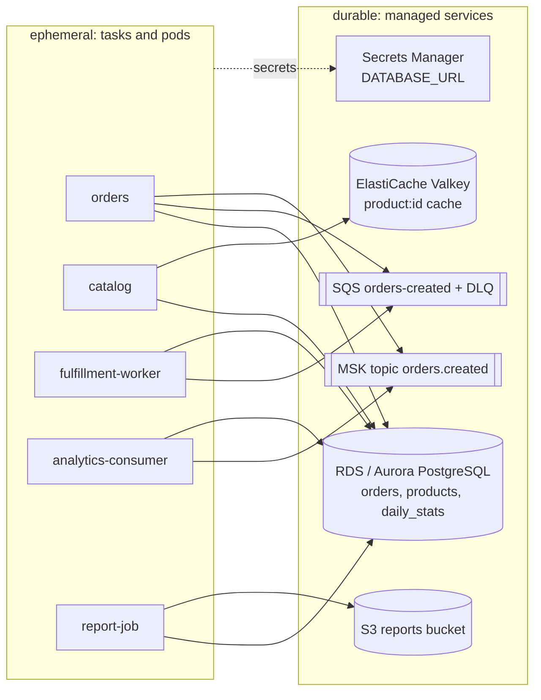

# Data, messaging and batch · L100 — Stateful dependencies

**Level:** 100 · **Time:** ~35 min · **Prerequisites:** [Container fundamentals L100](../01-container-fundamentals/L100-containers-explained.md),
[Networking L100](../05-networking/L100-vpc-for-containers.md)

**After this document you can:**

- Explain why containers should hold no durable state and where each kind of state belongs.
- Describe what RDS/Aurora, ElastiCache Valkey, DynamoDB, S3, EFS/EBS, SQS/SNS/EventBridge and
  MSK are for, in one sentence each, and how a container connects to them.
- Map the shopfront services to their stateful dependencies.

## 1. Mental model



A container can be stopped, replaced or moved at any moment; its filesystem disappears with it. So
anything that must survive — records, files, messages not yet processed, cached values worth keeping
— lives in a managed service designed for that kind of state, and the container connects to it over
the network with credentials from its task or pod role. This separation is what makes scaling,
deployments and disaster recovery of the compute layer simple: the hard problems (durability,
replication, backups) are pushed to services built for them.

## 2. Concepts

### 2.1 Relational databases: RDS and Aurora

Amazon RDS runs PostgreSQL (and MySQL, MariaDB, SQL Server, Oracle) on instances with automated
backups, Multi-AZ standby, read replicas, patching windows. Aurora is AWS's distributed storage
implementation of PostgreSQL/MySQL: storage replicated six ways across three AZs, fast failover,
reader endpoints, Serverless v2 (capacity in ACUs that scales in seconds), Global Database for
cross-Region replicas. A container reaches the database at its endpoint DNS name on port 5432 inside
the VPC; security groups on the database allow the task/pod security group; credentials come from
Secrets Manager (managed rotation) or IAM database authentication (short-lived tokens). shopfront's
`orders`, `catalog`, both workers and the report job use one PostgreSQL database.

### 2.2 Caches: ElastiCache with Valkey

ElastiCache runs Valkey (the default engine since 2024), Redis OSS and Memcached: in-memory key-value
stores for sub-millisecond reads. Cache-aside is the pattern: read the cache, on a miss read the
database and write the cache with a TTL. `catalog` caches `product:{id}` for 60 seconds and reports
`X-Cache: HIT|MISS|BYPASS`; when Valkey is unreachable it bypasses the cache rather than failing.
Node-based clusters (replication groups, cluster mode for sharding) or Serverless (no capacity
planning, pay per ECPU and storage). Always in isolated subnets with TLS and auth tokens or IAM auth.

### 2.3 DynamoDB and S3

DynamoDB is a serverless key-value/document database with single-digit millisecond latency at any
scale, on-demand or provisioned capacity, global tables for multi-Region; containers call it through
the SDK over HTTPS (a VPC gateway endpoint keeps it private). S3 is object storage: reports, exports,
uploads, backups, artifacts; the `report-job` writes `daily-<date>.json/csv` to
`s3://shopfront-reports-123456789012/daily/`. Both need only IAM permissions on the task/pod role
and, in private subnets, a gateway endpoint.

### 2.4 Filesystems: EFS and EBS

EBS volumes are block devices attached to one node/task at a time in one AZ (Kubernetes
PersistentVolumes via the EBS CSI driver; ECS tasks via `volumeConfigurations`); EFS is a regional
NFS filesystem mountable by many tasks/pods across AZs (EFS CSI driver, ECS `efsVolumeConfiguration`,
also on Fargate). Use them for state that must be a filesystem (legacy applications, ML checkpoints,
shared uploads before they reach S3); for everything else prefer the managed databases above.
shopfront needs neither: its scratch space is `emptyDir`/tmpfs and its durable state is in
PostgreSQL and S3.

### 2.5 Queues and buses: SQS, SNS, EventBridge

SQS is a managed queue: producers send messages, consumers receive them with a visibility timeout,
process, and delete; messages that fail repeatedly move to a dead-letter queue. It decouples
`orders` (which returns 201 quickly) from `fulfillment-worker` (which processes at its own pace) and
absorbs bursts. SNS fans one message out to many subscribers (queues, Lambda, HTTP); EventBridge routes
events by pattern to targets and runs schedules (the `report-job` schedule). All three are reached
over HTTPS with IAM permissions; locally ElasticMQ stands in for SQS.

### 2.6 Streams: MSK and Kafka

Kafka is a distributed log: producers append records to topic partitions, consumers in groups read
them in order per partition and keep their own offsets, and records stay for a retention period so
several consumers can read the same stream independently. Amazon MSK runs Kafka for you
(Provisioned with Standard or Express brokers, or Serverless) with IAM authentication. `orders`
publishes `orders.created` events that `analytics-consumer` aggregates into `daily_stats`; a second
consumer group could read the same stream for another purpose without touching `orders`. Locally a
single-node Kafka in KRaft mode does the job.

### 2.7 Connecting from a container: the three prerequisites

| Prerequisite | RDS/ElastiCache/MSK (VPC-native) | SQS/SNS/DynamoDB/S3 (API services) |
| --- | --- | --- |
| Network | task/pod security group allowed inbound on the service's security group; same VPC or routed | route to the regional endpoint: NAT, or an interface (SQS/SNS) or gateway (S3/DynamoDB) endpoint |
| Identity | Secrets Manager secret via `secrets[]`/ESO, or IAM database/Valkey/MSK auth with the task/pod role | task/pod role policy (`sqs:SendMessage`, `s3:PutObject`) |
| Configuration | endpoint hostname and port in environment variables (`DATABASE_URL`, `VALKEY_URL`, `KAFKA_BROKERS`) | queue URL / bucket name in environment (`SQS_QUEUE_URL`, `REPORT_OUTPUT`) |

The shopfront contract ([`labs/CONTRACT.md`](../../labs/CONTRACT.md) §2) lists every variable; the
same images run locally against Compose services and on AWS against managed ones.

### 2.8 The shopfront mapping

| Service | Reads | Writes | Why this store |
| --- | --- | --- | --- |
| `catalog` | PostgreSQL `products`; Valkey `product:{id}` | Valkey (cache fill) | relational truth, cache for hot reads |
| `orders` | PostgreSQL `orders`; catalog over HTTP | PostgreSQL `orders`; SQS; Kafka | transactional insert; async fan-out |
| `fulfillment-worker` | SQS | PostgreSQL `orders.status` | at-least-once work queue |
| `analytics-consumer` | Kafka | PostgreSQL `daily_stats` | replayable stream |
| `report-job` | PostgreSQL | S3 (or local file) | durable artifacts |

## 3. How it interacts with the rest of AWS

| Component | Talks to | Protocol/API | Prerequisite (IAM, network, DNS) | What breaks if missing |
| --- | --- | --- | --- | --- |
| Container | RDS/Aurora | PostgreSQL over TLS, 5432 | SG rule; secret or IAM auth | `/readyz` 503, connection refused/timeouts |
| Container | ElastiCache Valkey | RESP over TLS, 6379 | SG rule; auth token or IAM | `X-Cache: BYPASS` (degraded) |
| Container | SQS/SNS/EventBridge | HTTPS | role; NAT or interface endpoint | 500 on order creation (SQS is on the critical path) |
| Container | MSK | Kafka protocol 9098 (IAM) | SG rule; `kafka-cluster:*` permissions | analytics lag (Kafka is best-effort in shopfront) |
| Container | S3/DynamoDB | HTTPS | role; gateway endpoint | report job exit 1 |
| Platform | Secrets Manager | `GetSecretValue` at task start / ESO refresh | execution role / Pod Identity | task fails to start / pods without secrets |

## 4. Use it when / avoid it when

Use:

- RDS/Aurora for relational, transactional data; DynamoDB for key-value at scale; S3 for files.
- Valkey for hot reads with a TTL, always with a bypass path.
- SQS for work queues with retries and DLQs; Kafka/MSK for replayable streams with several consumers.
- EFS only when a shared POSIX filesystem is a hard requirement.

Avoid:

- State on the container filesystem or on `emptyDir` beyond scratch.
- Running databases, caches or brokers inside the cluster without an operator team (DR and upgrades
  become yours).
- Kafka for a simple work queue, or SQS for a stream several consumers must replay.
- Sharing one database user/secret across all services.

Alternatives: Aurora Serverless v2 and ElastiCache Serverless when capacity planning is the pain;
Amazon MQ (RabbitMQ/ActiveMQ) for AMQP/JMS protocol needs; Kinesis Data Streams as the AWS-native
stream when Kafka compatibility is not needed.

## 5. Well-Architected view

| Pillar | Contribution | Cost | Practice |
| --- | --- | --- | --- |
| Operational Excellence | managed backups, patching, failover | service costs | one service, one credential, one security group rule |
| Security | private subnets, TLS, IAM or rotated secrets | secret management | IAM auth where supported; never plain passwords in env |
| Reliability | Multi-AZ, replication, DLQs, retention | replicas | Multi-AZ for production; DLQ on every queue |
| Performance Efficiency | caches, read replicas, right-sized instances | cache invalidation logic | TTLs and bypass |
| Cost Optimization | serverless tiers for spiky loads | per-request pricing | measure before choosing serverless vs provisioned |
| Sustainability | shared managed services at high utilisation | none | consolidate small databases |

## 6. Failure modes and troubleshooting

| Symptom | Likely cause | How to confirm (command/metric) | Fix |
| --- | --- | --- | --- |
| `/readyz` 503 with `database` error | SG, wrong endpoint/secret, DB down | logs name the check; `aws rds describe-db-instances --query 'DBInstances[0].DBInstanceStatus'` | fix SG/secret; wait for failover |
| Orders return 500 | SQS unreachable or role missing `sqs:SendMessage` | orders logs; CloudTrail | endpoint/route; policy |
| `X-Cache: BYPASS` always | Valkey unreachable/auth | catalog logs | SG/auth token; TLS setting |
| Orders stay `CREATED` | worker not receiving (queue URL, permissions) or DLQ | queue metrics; worker logs | ([playbook](../../playbooks/incidents/queue-backlog-and-consumer-lag.md)) |
| `daily_stats` never updates | analytics cannot reach MSK / IAM auth | consumer logs | SG 9098; `kafka-cluster` permissions |
| Report job exit 1 | S3 permission or bucket in another Region | job logs | role; `AWS_REGION` |

## 7. Signals: metrics, logs, traces

- RDS: `DatabaseConnections`, `CPUUtilization`, `FreeableMemory`; ElastiCache: `CacheHitRate`,
  `Evictions`; SQS: `ApproximateAgeOfOldestMessage`, DLQ depth; MSK: consumer lag; S3: request
  errors; Batch/EventBridge: failed invocations.
- Application: `catalog_cache_hits_total`/`misses`, `orders_created_total` vs `orders_fulfilled_total`,
  `sqs_messages_received_total`, `kafka_messages_consumed_total`.

Full table: [`reference/metrics-catalog.md`](../../reference/metrics-catalog.md).

## 8. Testing and DR notes

Testing: the Compose stack provides real PostgreSQL, Valkey, Kafka and an SQS-compatible queue; the
smoke test exercises every integration; stop a dependency (`docker compose stop valkey`) and watch the
degradation path. DR: state is where RTO/RPO live — RDS/Aurora snapshots and replicas, ElastiCache
backups (or accept cold caches), SQS is regional (messages do not replicate; design for
re-publication), MSK replication with MSK Replicator, S3 cross-Region replication
([10 L300](../10-resilience-and-dr/L300-dr-strategies-for-container-platforms.md)).

## 9. Hands-on

```bash
make up && make smoke
# Watch each dependency do its job
docker compose -f labs/local/compose.yaml exec -T postgres psql -U app -d shopfront -c 'select status, count(*) from orders group by 1;'
docker compose -f labs/local/compose.yaml exec -T valkey valkey-cli keys 'product:*'
curl -s http://localhost:9325/ | head -5       # ElasticMQ UI: queues and message counts
docker compose -f labs/local/compose.yaml exec -T kafka /opt/kafka/bin/kafka-consumer-groups.sh --bootstrap-server localhost:9092 --describe --group analytics
# Degrade one dependency and observe the design choice it exposes
docker compose -f labs/local/compose.yaml stop valkey && curl -si localhost:8081/products/1 | grep -i x-cache   # BYPASS, still 200
docker compose -f labs/local/compose.yaml start valkey
# The AWS equivalents are created by labs/ecs/cloudformation/03-data.yaml
grep -nE 'AWS::(RDS|ElastiCache|SQS|MSK|S3)::' labs/ecs/cloudformation/03-data.yaml
```

## 10. Check yourself

1. Why does `catalog` return 200 with `X-Cache: BYPASS` when Valkey is down instead of failing?

<details><summary>Answer</summary>
A cache is an optimisation, not the source of truth; the database can answer every read, so the
service degrades to slower reads rather than to errors. The readiness endpoint still reports the
cache check so operators see the degradation, but traffic keeps flowing.
</details>

2. What are the three prerequisites for a container to reach an RDS database, and which one is
   different for SQS?

<details><summary>Answer</summary>
Network (security group rule from the task/pod group to the database group, same VPC), identity
(a secret or IAM database authentication via the task/pod role) and configuration (`DATABASE_URL`).
SQS is an API service: network means a route to the regional endpoint (NAT or interface endpoint)
and identity is purely the task/pod role's IAM policy.
</details>

3. When is Kafka the right choice over SQS?

<details><summary>Answer</summary>
When several independent consumers need the same events, when replay from a point in time matters,
when per-key ordering across a high-throughput stream is required, or when downstream analytics
expect a log. For a single consumer pool doing work with retries and a dead-letter path, SQS is
simpler and cheaper.
</details>

4. Which shopfront dependency failure is on the critical path of `POST /orders`, and which is not?

<details><summary>Answer</summary>
PostgreSQL (the insert) and SQS (fulfilment depends on the message) are on the critical path: SQS
failure returns 500 with the order stored as `CREATED`. Kafka is best-effort: a failed produce is
logged and the order still succeeds; analytics may miss the event.
</details>

5. Why is DR "mostly a data problem" for a container platform?

<details><summary>Answer</summary>
Compute is stateless and rebuilt from images and IaC in minutes; databases, caches, queues and
streams hold the state whose replication lag defines RPO and whose failover/restore time defines
RTO. Regional services like SQS do not replicate messages, so the design must tolerate republishing.
</details>

## 11. Sources

- Amazon RDS and Amazon Aurora user guides — https://docs.aws.amazon.com/AmazonRDS/latest/UserGuide/Welcome.html and https://docs.aws.amazon.com/AmazonRDS/latest/AuroraUserGuide/CHAP_AuroraOverview.html
- Amazon ElastiCache (Valkey) — https://docs.aws.amazon.com/AmazonElastiCache/latest/dg/WhatIs.html
- Amazon DynamoDB and Amazon S3 developer guides — https://docs.aws.amazon.com/amazondynamodb/latest/developerguide/Introduction.html and https://docs.aws.amazon.com/AmazonS3/latest/userguide/Welcome.html
- Amazon EFS and EBS with ECS and EKS — https://docs.aws.amazon.com/AmazonECS/latest/developerguide/efs-volumes.html and https://docs.aws.amazon.com/eks/latest/userguide/storage.html
- Amazon SQS, SNS, EventBridge developer guides — https://docs.aws.amazon.com/AWSSimpleQueueService/latest/SQSDeveloperGuide/welcome.html, https://docs.aws.amazon.com/sns/latest/dg/welcome.html, https://docs.aws.amazon.com/eventbridge/latest/userguide/eb-what-is.html
- Amazon MSK developer guide — https://docs.aws.amazon.com/msk/latest/developerguide/what-is-msk.html
- Twelve-Factor App: backing services — https://12factor.net/backing-services
