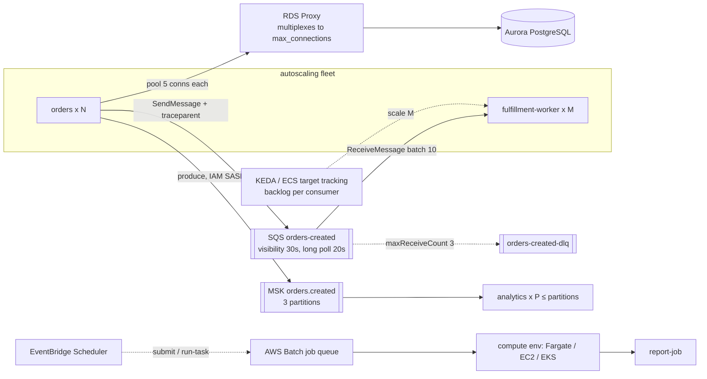

# Data, messaging and batch · L200 — Integration patterns

**Level:** 200 · **Time:** ~90 min · **Prerequisites:** [L100 Stateful dependencies](L100-stateful-dependencies.md),
[ECS L200](../03-ecs/L200-task-definitions-services-and-scaling.md) or [EKS L200](../04-eks/L200-cluster-components-and-add-ons.md),
[Identity and security L200](../06-identity-and-security/L200-iam-for-containers.md)

**After this document you can:**

- Connect an autoscaling fleet to PostgreSQL without exhausting connections (pooling, RDS Proxy, IAM
  auth, rotation).
- Configure Valkey for cache-aside safely, and SQS/SNS/EventBridge for reliable async work.
- Scale consumers on backlog with KEDA on EKS or target tracking on ECS.
- Connect to MSK with IAM auth and choose between Provisioned, Express and Serverless.
- Run batch work with AWS Batch, Step Functions, Kubernetes Jobs or ECS scheduled tasks, and know
  which to pick.

## 1. Mental model



Integration patterns exist because fleets scale and dependencies do not scale the same way: one
database has a fixed connection limit, one queue has visibility semantics, one Kafka topic has a fixed
number of partitions, one batch scheduler has queues and compute environments. The patterns bound the
fleet's pressure on each dependency (pooling and proxies), make failure safe (visibility timeouts,
DLQs, idempotent consumers), and make scaling follow the work (backlog per consumer) rather than
follow CPU.

## 2. Concepts

### 2.1 PostgreSQL from an ephemeral fleet

**Connections.** PostgreSQL forks a process per connection and `max_connections` is finite (RDS
default derives from instance memory, e.g. ~1,600 on 16 GiB; verify per class). Twenty tasks with a
pool of 20 each is 400 connections before the first query. Rules: small per-task pools (5–10), a
statement/connection timeout, and **RDS Proxy** in front when the fleet scales past a few dozen
tasks or when Lambda-style connection churn exists. RDS Proxy keeps a warm pool to the database and
multiplexes client connections; pinning (session state such as prepared statements or `SET`) reduces
multiplexing — watch `DatabaseConnectionsCurrentlySessionPinned`.

**Credentials.** Two good options: Secrets Manager secrets injected by the platform (`secrets[]`,
External Secrets) with managed rotation (RDS-managed admin credentials via `ManageMasterUserPassword`, or a rotation Lambda), or <!-- term-ok -->
**IAM database authentication**: the task/pod role calls `rds:GenerateDBAuthToken`-equivalent
(SDK `generate-db-auth-token`), gets a 15-minute token used as the password, and no long-lived
password exists. RDS Proxy integrates with Secrets Manager and can require IAM auth from clients,
which removes passwords from the application entirely.

```bash
# IAM auth from a task: the token is the password (SDK helpers exist for Go, Node, Python)
TOKEN=$(aws rds generate-db-auth-token --hostname shopfront-dev.cluster-abc123.us-east-1.rds.amazonaws.com --port 5432 --username app_iam --region us-east-1)
PGPASSWORD="$TOKEN" psql "host=shopfront-dev.cluster-abc123.us-east-1.rds.amazonaws.com dbname=shopfront user=app_iam sslmode=verify-full sslrootcert=/etc/ssl/certs/global-bundle.pem"
```

**TLS.** `sslmode=verify-full` with the RDS global CA bundle baked into the image or mounted; Aurora
and RDS enforce TLS when the parameter `rds.force_ssl=1`.

**Rotation and deployments.** With `secrets[]` the value is read at task start; rotation must be
followed by a rolling deployment or use RDS Proxy/IAM auth so running tasks keep working
([06 L300 §2.8](../06-identity-and-security/L300-hardening-workloads-and-clusters.md)).

**Aurora specifics.** Writer and reader endpoints; Serverless v2 ACU ranges (set a minimum that
covers connection overhead); fast failover (reader promoted in about 30 s; clients must reconnect —
the shopfront services retry connections on start and their pools reconnect); Global Database for
cross-Region with managed failover.

### 2.2 Valkey on ElastiCache

| Choice | Node-based | Serverless |
| --- | --- | --- |
| Capacity | you pick node type and shards (cluster mode) | scales automatically; pay per ECPU and GB |
| Endpoint | primary/reader endpoints (cluster mode: configuration endpoint) | one endpoint, TLS required |
| Cost model | hourly per node | usage-based with minimum |
| Fits | steady high throughput, predictable | spiky or unknown load, minimal ops |

Connect with TLS (`rediss://`), auth token or **IAM authentication** (user groups with IAM-enabled
users; the client signs a short-lived token), from the task/pod security group to the cache security
group on 6379. Cache-aside rules: TTL on every key, key namespace per entity (`product:{id}`), a size
cap (`maxmemory-policy allkeys-lru` for pure caches), bypass on errors (the catalog behaviour), and
never store anything you cannot rebuild from the source. Invalidate on write (`orders` does not
change products; a product update path would `DEL product:{id}`). Cluster mode when the dataset or
throughput exceeds one node; clients must be cluster-aware.

### 2.3 SQS

| Setting | Value in shopfront | Why |
| --- | --- | --- |
| Queue type | standard | at-least-once, unlimited throughput; FIFO only for per-key ordering with deduplication |
| Visibility timeout | 30 s | must exceed the worst-case processing time; heartbeat with `ChangeMessageVisibility` for long work |
| Receive wait (long polling) | 20 s | fewer empty receives, lower cost, lower latency |
| Batch size | 10 | fewer API calls; process messages independently |
| Redrive policy | DLQ after `maxReceiveCount: 3` | poison messages leave the main queue |
| Message retention | 4 days (default) → consider 14 | time to recover a broken consumer |
| Encryption | SSE-KMS | at rest |
| Access | queue policy + task/pod role | least privilege |

Consumer loop (as the worker implements): receive with long polling and `MessageAttributeNames=All`,
process each message idempotently, delete on success, do nothing on failure (redelivery after
visibility timeout), let the redrive policy move poison messages, monitor DLQ depth and redrive with
`StartMessageMoveTask` once fixed.

**Scaling consumers on backlog.** The metric is backlog per consumer, not CPU.

On EKS with KEDA (`ScaledObject` on the worker Deployment, scaler `aws-sqs-queue`, `queueLength`
= messages per replica; authentication through Pod Identity on the KEDA operator or a
`TriggerAuthentication` with `podIdentity`):

```yaml
apiVersion: keda.sh/v1alpha1
kind: ScaledObject
metadata: { name: fulfillment-worker, namespace: shopfront }
spec:
  scaleTargetRef: { name: fulfillment-worker }
  minReplicaCount: 1
  maxReplicaCount: 50
  cooldownPeriod: 120
  triggers:
    - type: aws-sqs-queue
      authenticationRef: { name: keda-aws }
      metadata:
        queueURL: https://sqs.us-east-1.amazonaws.com/123456789012/shopfront-dev-orders-created
        queueLength: "100"            # target messages per replica
        awsRegion: us-east-1
        scaleOnInFlight: "true"
```

On ECS with Application Auto Scaling: publish `backlogPerTask = ApproximateNumberOfMessagesVisible /
RunningTaskCount` (metric math in a target tracking policy's customized metric, or a scheduled Lambda)
with target 100 ([ECS L200 §2.6](../03-ecs/L200-task-definitions-services-and-scaling.md)). Scale-in
must respect in-flight work: `SHUTDOWN_TIMEOUT_SECONDS` below `stopTimeout`/grace so a terminating
worker finishes its batch, and idempotent processing so a message killed mid-way is safe to redeliver.

### 2.4 SNS and EventBridge

SNS topics fan out one message to many subscriptions (SQS queues with their own DLQs and filter
policies, Lambda, HTTPS); use it when more than one consumer needs `order.created` with queue
semantics (Kafka is the alternative when replay matters). EventBridge routes events by pattern to
targets across accounts, archives and replays events, and its Scheduler runs `run-task`, `submit-job`
or Lambda on cron/rate schedules with retries and a DLQ; EventBridge Pipes connects SQS/Kinesis/MSK
sources to targets with filtering and enrichment without code. ECS and Batch emit their own state
change events to EventBridge, which is how you alarm on failed jobs and stopped tasks.

### 2.5 MSK

| Option | Brokers | Scaling | Fits |
| --- | --- | --- | --- |
| Provisioned, Standard brokers | you choose count/type; storage per broker | add brokers/storage; tiered storage | full Kafka control, custom configs |
| Provisioned, Express brokers | AWS-managed storage, faster recovery, higher throughput per broker | add brokers | most new provisioned clusters |
| Serverless | none visible | automatic (limits per cluster/partition) | spiky/unknown load, no capacity planning |

Connect with **IAM authentication** (port 9098; SASL/OAUTHBEARER with the `aws-msk-iam-sasl-signer`
libraries — the analytics consumer supports `KAFKA_SASL_IAM=true`), permissions
`kafka-cluster:Connect`, `DescribeTopic`, `ReadData`/`WriteData`, `AlterGroup`, `DescribeGroup` on
cluster/topic/group ARNs; security group 9098 from the task/pod group; bootstrap servers from
`aws kafka get-bootstrap-brokers`. Topics: partitions decide parallelism (consumers in a group ≤
partitions), replication factor 3, retention by time/size; key by `orderId` for per-order ordering.
Consumers: manual offset commits after processing (as the analytics consumer does), `auto.offset.reset`
chosen deliberately, and lag as the health metric. AWS Glue Schema Registry (or Confluent-compatible
registries) enforces Avro/JSON/Protobuf compatibility across producers and consumers. MSK Connect
runs connectors; MSK Replicator copies topics across clusters/Regions.

### 2.6 AWS Batch

| Object | Role | shopfront |
| --- | --- | --- |
| Compute environment | where jobs run: ECS on Fargate (serverless), ECS on EC2 (managed, Spot allowed, instance types), or EKS (Batch launches nodes into your cluster) | Fargate CE for `report-job`; EKS CE variant |
| Job queue | FIFO (or fair-share) queue mapped to one or more CEs by priority | `shopfront-dev-reports` |
| Job definition | container properties (image, vCPU/memory, roles, command, env, secrets), retry strategy, timeout, platform capabilities | `report-job` with `REPORT_OUTPUT=s3://…` |
| Job | an instance of a definition submitted to a queue; array jobs (up to 10,000 children with `AWS_BATCH_JOB_ARRAY_INDEX`), dependencies (`dependsOn`), multi-node parallel | daily report; array over dates for backfills |

```bash
aws batch submit-job --job-name report-2026-09-28 --job-queue shopfront-dev-reports \
  --job-definition shopfront-report-job:3 \
  --container-overrides '{"environment":[{"name":"REPORT_DATE","value":"2026-09-28"}]}' \
  --retry-strategy attempts=3 --timeout attemptDurationSeconds=1800
aws batch submit-job --job-name backfill-sep --job-queue shopfront-dev-reports --job-definition shopfront-report-job:3 --array-properties size=30
```

Batch adds what Scheduler + `run-task` lacks: queues with priorities, retries with exit-code
conditions, dependencies, array jobs, fair-share scheduling between teams, and Spot with automatic
retry on interruption. Batch on EKS runs jobs as pods in a namespace you delegate (RBAC for the
`aws-batch` identity), on nodes Batch launches and manages (not on Fargate; not in Auto Mode
NodePools — verify current support) ([L300 §2.8](L300-messaging-and-data-deep-dive.md)).

### 2.7 Step Functions with ECS and EKS

Step Functions orchestrates multi-step workflows with `ecs:runTask.sync` (wait for the task to
stop, capture exit code), `eks:runJob.sync`, `batch:submitJob.sync`, Lambda, and service
integrations (SQS, SNS, DynamoDB) with retries, catch blocks, parallel and map states (distributed
map for large fan-outs). Use it when a batch process is a workflow (extract → transform → notify) with
branching and error handling; use Batch alone for many independent jobs; combine them
(Step Functions submitting Batch array jobs) for pipelines.

### 2.8 Which batch mechanism

| Need | Choose |
| --- | --- |
| One container on a schedule, minutes, no retries beyond simple | EventBridge Scheduler → ECS `run-task` or Kubernetes `CronJob` |
| Many independent jobs, retries, priorities, Spot, array/backfill | AWS Batch (ECS Fargate/EC2 or EKS) |
| Multi-step workflow with branching and human/waits | Step Functions (+ Batch/ECS/Lambda) |
| Kubernetes-native pipelines with artifacts and DAGs | Argo Workflows on EKS |
| Event-driven, sub-15-minute, small | Lambda |

## 3. How it interacts with the rest of AWS

| Component | Talks to | Protocol/API | Prerequisite (IAM, network, DNS) | What breaks if missing |
| --- | --- | --- | --- | --- |
| Tasks/pods | RDS Proxy → Aurora | PostgreSQL TLS 5432 | SG chain task → proxy → DB; proxy role `secretsmanager:GetSecretValue`; IAM auth policy `rds-db:connect` | connection refused / auth failures |
| Tasks/pods | ElastiCache | TLS 6379 | SG; IAM user group or auth token | `BYPASS` |
| Tasks/pods | SQS | HTTPS | `sqs:SendMessage`/`ReceiveMessage`/`DeleteMessage`/`ChangeMessageVisibility`/`GetQueueAttributes`; endpoint | 500s / consumer idle |
| KEDA operator | SQS (`GetQueueAttributes`) | HTTPS via Pod Identity | association on `keda-operator` SA | ScaledObject `Ready: False` |
| Tasks/pods | MSK | 9098 IAM | SG; `kafka-cluster:*` on cluster/topic/group | `SASL authentication failed` |
| Batch | ECS/EKS, EC2 | service-linked role; job role + execution role; EKS RBAC | CE state `VALID` | jobs stuck `RUNNABLE` |
| Step Functions | ECS/EKS/Batch | `ecs:RunTask`, `iam:PassRole`, `eks:*` via state machine role | permissions; EKS access entry for the state machine role | execution `FAILED` |
| EventBridge Scheduler | ECS/Batch | `RunTask`/`SubmitJob` + `iam:PassRole` | scheduler role | schedules fire, nothing runs |

## 4. Use it when / avoid it when

Use:

- RDS Proxy or IAM auth for any fleet above a few tasks; small pools; TLS `verify-full`.
- Standard SQS with DLQ and long polling for work queues; KEDA/target tracking on backlog per
  consumer.
- MSK Express or Serverless for new Kafka; IAM auth; manual commits; Glue Schema Registry.
- Batch for many jobs; Scheduler for one; Step Functions for workflows.

Avoid:

- Pools sized for one instance copied to fifty tasks.
- Scaling consumers on CPU; visibility timeouts shorter than processing.
- Passwords in environment variables; shared users across services.
- Kafka consumers > partitions (idle consumers) or auto-commit before processing (data loss).
- Batch for a single nightly container (Scheduler is enough) or CronJobs for thousands of jobs.

Alternatives: Amazon MQ for AMQP; Kinesis for AWS-native streams; Argo Workflows for Kubernetes DAGs;
Aurora Limitless/DSQL for scale-out relational (verify fit).

## 5. Well-Architected view

| Pillar | Contribution | Cost | Practice |
| --- | --- | --- | --- |
| Operational Excellence | managed proxies/queues/brokers with metrics; Batch retries and events | more moving parts | DLQ + redrive runbook; job state events to alarms |
| Security | IAM auth everywhere it exists (RDS, Valkey, MSK), least-privilege queue/topic policies | setup | no passwords; SGs referencing SGs |
| Reliability | visibility timeouts, DLQs, idempotency, Multi-AZ data stores | replicas | `maxReceiveCount` ≥ 3; heartbeat long jobs |
| Performance Efficiency | pooling and proxying; partitions sized to consumers; Express brokers | proxy hourly cost | pool sizes from `max_connections` budget |
| Cost Optimization | long polling, Serverless tiers for spiky loads, Spot for Batch | measurement | `NumberOfEmptyReceives` ≈ 0 |
| Sustainability | scale consumers to backlog, zero when idle | none | KEDA `minReplicaCount: 0` where latency allows |

## 6. Failure modes and troubleshooting

| Symptom | Likely cause | How to confirm (command/metric) | Fix |
| --- | --- | --- | --- |
| `FATAL: remaining connection slots are reserved` | fleet pools exceed `max_connections` | `DatabaseConnections` vs limit | smaller pools; RDS Proxy |
| Proxy not multiplexing | session pinning | `DatabaseConnectionsCurrentlySessionPinned` | avoid `SET`/prepared statements that pin (verify driver settings) |
| IAM DB auth fails | user lacks `rds_iam` role; token used with wrong host/user | DB logs | `GRANT rds_iam TO app_iam`; regenerate token |
| Queue age grows, consumers idle | queue URL/permissions; visibility too long after crash | worker logs; `ApproximateNumberOfMessagesNotVisible` | fix; tune visibility ([playbook](../../playbooks/incidents/queue-backlog-and-consumer-lag.md)) |
| Same order processed twice | consumer not idempotent; visibility < processing time | duplicate effects | idempotent update (`WHERE status='CREATED'`); heartbeat |
| DLQ filling | poison messages or a bug | sample DLQ messages | fix, then `StartMessageMoveTask` |
| KEDA does not scale | operator lacks `sqs:GetQueueAttributes`; wrong queue URL | `kubectl describe scaledobject`; operator logs | Pod Identity; URL |
| MSK `SASL authentication failed` | missing `kafka-cluster:Connect`; wrong port | client logs | policy; 9098 |
| Consumer lag with idle consumers | consumers > partitions | group description | more partitions (cannot shrink) |
| Batch jobs stuck `RUNNABLE` | CE invalid/at max vCPUs, no instance types match, EKS nodes cannot join | `describe-compute-environments`; job `statusReason` | fix CE; quotas |

## 7. Signals: metrics, logs, traces

- RDS/Aurora: `DatabaseConnections`, RDS Proxy `ClientConnections`/pinned, `CPUUtilization`,
  `ReplicaLag`, `ACUUtilization`.
- ElastiCache: `CacheHitRate`, `Evictions`, `CurrConnections`, `EngineCPUUtilization`,
  `DatabaseMemoryUsagePercentage`.
- SQS: `ApproximateAgeOfOldestMessage`, `ApproximateNumberOfMessagesVisible`/`NotVisible`, DLQ depth,
  `NumberOfEmptyReceives`; KEDA `keda_scaler_metrics_value`.
- MSK: `EstimatedMaxTimeLag`, `MaxOffsetLag`, `UnderReplicatedPartitions`; client `records-lag-max`.
- Batch: jobs by state, runnable age, failed jobs (EventBridge), CE `DesiredvCpus`.
- Application: `orders_created_total − orders_fulfilled_total` (in-flight), `orders_failed_total`,
  `sqs_messages_received_total`, `kafka_messages_consumed_total`, `processing_duration_seconds`.

Full table: [`reference/metrics-catalog.md`](../../reference/metrics-catalog.md).

## 8. Testing and DR notes

Testing: the Compose stack reproduces every integration; test poison messages with `FAIL_EVERY_N`
and confirm the DLQ path; duplicate a message (send the same body twice) and confirm idempotency;
kill a worker mid-batch and confirm redelivery; load-test `orders` and watch connection counts to
justify pool sizes; for Kafka, run two consumers in the group and observe partition assignment.
DR: RDS/Aurora snapshots and cross-Region replicas or Global Database; ElastiCache snapshots or accept
a cold cache; SQS is regional — producers must be able to republish or the design accepts loss of
in-flight messages; MSK Replicator for topics; Batch definitions are IaC. Details in
[L300 §2.9](L300-messaging-and-data-deep-dive.md) and [10 L300](../10-resilience-and-dr/L300-dr-strategies-for-container-platforms.md).

## 9. Hands-on

```bash
# Local: DLQ and idempotency paths
FAIL_EVERY_N=1 docker compose -f labs/local/compose.yaml up -d fulfillment-worker
curl -s -X POST localhost:8080/orders -H 'content-type: application/json' -d '{"productId":3,"quantity":1}' | jq .id
sleep 100; curl -s http://localhost:9325/ | grep -o 'orders-created-dlq[^<]*' | head -2      # message moved after 3 receives
docker compose -f labs/local/compose.yaml up -d fulfillment-worker                         # knob off
# Kafka consumer group and partitions
docker compose -f labs/local/compose.yaml exec -T kafka /opt/kafka/bin/kafka-consumer-groups.sh --bootstrap-server localhost:9092 --describe --group analytics
# Connection budget: count Postgres connections while load runs
docker compose -f labs/local/compose.yaml exec -T postgres psql -U app -d shopfront -tAc "select count(*) from pg_stat_activity where datname='shopfront';"

# AWS: the data stack and the KEDA/Batch objects
grep -nE 'AWS::RDS::DBProxy|IAMAuth|ManageMasterUserPassword|TransitEncryption|RedrivePolicy|ClientAuthentication' labs/ecs/cloudformation/03-data.yaml
cat labs/eks/manifests/base/scaledobject-fulfillment.yaml
cat labs/batch/job-definition-fargate.json | jq '{jobDefinitionName, platformCapabilities, retryStrategy, timeout}'
```

## 10. Check yourself

1. Fifty `orders` tasks each hold a pool of 10 connections and the database allows 500. What
   breaks first during a deployment with `maximumPercent: 200`, and what are two fixes?

<details><summary>Answer</summary>
During the rollout up to 100 tasks run, wanting 1,000 connections: new tasks fail to connect
(`remaining connection slots are reserved`) and `/readyz` stays 503, so the deployment stalls or
rolls back. Fixes: shrink pools (5 per task) and cap `maximumPercent`, or put RDS Proxy in front so
client connections multiplex onto a bounded database pool; IAM auth through the proxy also removes
password rotation problems.
</details>

2. Why is backlog per consumer the right scaling metric for the worker, and what must be true for
   scale-in to be safe?

<details><summary>Answer</summary>
Long-polling consumers use little CPU regardless of backlog; `ApproximateNumberOfMessagesVisible /
consumers` measures work waiting per worker and drives replicas toward a target latency. Scale-in is
safe when processing is idempotent (a message interrupted mid-way is redelivered and skipped or
redone harmlessly) and when the shutdown budget lets the current batch finish before SIGKILL.
</details>

3. What does a dead-letter queue give you that retries alone do not?

<details><summary>Answer</summary>
Isolation of poison messages: after `maxReceiveCount` failed receives the message leaves the main
queue, so it stops consuming worker capacity and blocking healthy messages, and it is preserved for
inspection and redrive after a fix rather than being retried forever or lost.
</details>

4. Name three things IAM authentication changes for MSK and RDS compared with passwords.

<details><summary>Answer</summary>
No long-lived secret to store, rotate or leak (tokens last minutes and derive from the task/pod
role); authorisation moves into IAM policies with resource ARNs (cluster/topic/group; database
user), auditable in CloudTrail; and network reach alone is no longer enough to attempt a login, so a
stolen endpoint name is useless without the role.
</details>

5. When do you pick AWS Batch over a Kubernetes CronJob for the report job, and what does Batch add?

<details><summary>Answer</summary>
When the "one job" becomes many (backfills over dates as array jobs), needs priorities and fair
share between teams, retries conditioned on exit codes, timeouts, dependencies, or Spot with
interruption retries. A CronJob is fine for one nightly run; Batch adds the queueing and scheduling
semantics and can still run the same image on Fargate or in the EKS cluster.
</details>

## 11. Sources

- Amazon RDS Proxy — https://docs.aws.amazon.com/AmazonRDS/latest/UserGuide/rds-proxy.html
- IAM database authentication for PostgreSQL — https://docs.aws.amazon.com/AmazonRDS/latest/UserGuide/UsingWithRDS.IAMDBAuth.html
- Aurora Serverless v2 and Aurora Global Database — https://docs.aws.amazon.com/AmazonRDS/latest/AuroraUserGuide/aurora-serverless-v2.html and https://docs.aws.amazon.com/AmazonRDS/latest/AuroraUserGuide/aurora-global-database.html
- ElastiCache Serverless and IAM authentication for Valkey — https://docs.aws.amazon.com/AmazonElastiCache/latest/dg/WhatIs.serverless.html and https://docs.aws.amazon.com/AmazonElastiCache/latest/dg/auth-iam.html
- Amazon SQS: visibility timeout, dead-letter queues, long polling — https://docs.aws.amazon.com/AWSSimpleQueueService/latest/SQSDeveloperGuide/sqs-visibility-timeout.html and https://docs.aws.amazon.com/AWSSimpleQueueService/latest/SQSDeveloperGuide/sqs-dead-letter-queues.html
- KEDA AWS SQS scaler and Pod Identity authentication — https://keda.sh/docs/latest/scalers/aws-sqs/ and https://keda.sh/docs/latest/authentication-providers/aws/
- Amazon SNS fan-out; Amazon EventBridge Scheduler and Pipes — https://docs.aws.amazon.com/sns/latest/dg/sns-common-scenarios.html, https://docs.aws.amazon.com/scheduler/latest/UserGuide/what-is-scheduler.html, https://docs.aws.amazon.com/eventbridge/latest/userguide/eb-pipes.html
- Amazon MSK: IAM access control, Express brokers, Serverless — https://docs.aws.amazon.com/msk/latest/developerguide/iam-access-control.html, https://docs.aws.amazon.com/msk/latest/developerguide/msk-express-brokers.html, https://docs.aws.amazon.com/msk/latest/developerguide/serverless.html
- AWS Glue Schema Registry — https://docs.aws.amazon.com/glue/latest/dg/schema-registry.html
- AWS Batch: compute environments, job definitions, array jobs, Batch on EKS — https://docs.aws.amazon.com/batch/latest/userguide/compute_environments.html, https://docs.aws.amazon.com/batch/latest/userguide/job_definitions.html, https://docs.aws.amazon.com/batch/latest/userguide/eks.html
- AWS Step Functions service integrations (ECS, EKS, Batch) — https://docs.aws.amazon.com/step-functions/latest/dg/connect-supported-services.html
