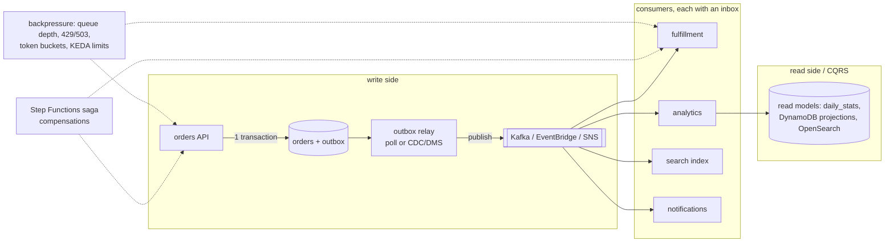

# Data, messaging and batch · L400 — Event-driven architecture at scale

**Level:** 400 · **Time:** ~75 min · **Prerequisites:** [L300 Messaging and data deep dive](L300-messaging-and-data-deep-dive.md),
[Resilience and DR L300](../10-resilience-and-dr/L300-dr-strategies-for-container-platforms.md),
[Observability L400](../07-observability/L400-observability-at-scale.md)

**After this document you can:**

- Choose and implement the outbox pattern, CQRS and sagas for container services on AWS and say what
  each costs.
- Design backpressure and load shedding so a burst degrades gracefully instead of cascading.
- Pick a multi-Region data strategy per store and explain its consistency and cost.
- Model the cost of messaging choices, observe async flows end to end, and test them.
- Name the anti-patterns that appear in event-driven systems at scale and what replaces them.

## 1. Mental model



Event-driven systems trade synchronous coupling for eventual consistency; at scale, the work is
managing that trade: making sure an event is published if and only if the state change committed
(outbox), keeping read models cheap and specialised (CQRS), coordinating multi-service business
transactions without distributed locks (sagas), and making sure a burst upstream becomes a queue, not
an outage, downstream (backpressure). Every one of these is a container-shaped pattern: stateless
services, managed stores, idempotent consumers.

## 2. Concepts

### 2.1 The outbox pattern

Problem: `orders` inserts the row, then publishes to SQS/Kafka. A crash between the two loses the
event; publishing first and crashing before the insert produces a phantom event. Dual writes cannot be
atomic across a database and a broker.

Solution: write the event into an `outbox` table in the same transaction as the business row; a relay
publishes outbox rows and marks them sent. Relay options on AWS:

| Relay | Mechanism | Latency | Ordering | Operations |
| --- | --- | --- | --- | --- |
| Polling publisher (a small worker or a Lambda on a schedule) | `SELECT … FOR UPDATE SKIP LOCKED` batches, publish, mark sent | seconds | per batch; use `ORDER BY id` and one publisher per partition key range | trivial; the shopfront worker image could host it |
| Change data capture with AWS DMS or Debezium (MSK Connect) | reads the WAL, streams inserts on `outbox` to Kafka | sub-second | commit order | more infrastructure; exactly the log you want |
| DynamoDB Streams / EventBridge Pipes | for DynamoDB-based services | sub-second | per partition key | serverless |

Consumers keep an **inbox** (processed event ids) for idempotency; producers include an event id,
type, version, occurred-at and the aggregate id (shopfront's `order.created` payload is the seed of
this envelope). Publish to the right fan-out: EventBridge (routing rules, archive/replay, schema
registry) for cross-domain integration events, Kafka for high-volume streams with replay, SNS→SQS for
simple fan-out to queues.

### 2.2 CQRS and read models

Separate the write model (normalised `orders`, transactional) from read models optimised per query:
`daily_stats` (analytics consumer), a DynamoDB table keyed by customer for "my orders", an OpenSearch
index for search. Read models are rebuilt from the event log (Kafka retention or an event store),
which is the operational superpower: a bug in a projection is fixed by replaying. Costs: eventual
consistency the UI must tolerate ("your order will appear shortly"), duplicated storage, and one
consumer group per projection to operate and observe (lag per projection is the freshness SLI).

### 2.3 Sagas with Step Functions

A business transaction spanning services (reserve stock in `catalog`, charge payment, create
shipment) cannot use one database transaction. A saga is a sequence of local transactions with
compensations: if shipment creation fails, refund the payment and release the stock. Orchestrated
sagas run in Step Functions (states call services via HTTP/SQS/Lambda/`ecs:runTask`, `Catch` blocks
route to compensation states, retries with backoff, execution history is the audit log); choreographed
sagas react to events (each service listens and emits). Orchestration is easier to observe and test;
choreography scales without a central definition but hides the flow. Idempotency and timeouts on
every step are non-negotiable either way.

### 2.4 Backpressure and load shedding

| Layer | Mechanism | Behaviour under burst |
| --- | --- | --- |
| Edge | WAF rate rules, API Gateway throttling, ALB connection limits | reject excess early with 429 |
| Service | bounded concurrency (semaphores), request timeouts, circuit breakers to dependencies, 503 with `Retry-After` when saturated | fail fast instead of piling up |
| Queue | SQS as the buffer; producers stop when `ApproximateNumberOfMessagesVisible` exceeds a bound (or accept and let consumers scale) | latency grows, nothing breaks |
| Consumers | KEDA/target tracking with `maxReplicaCount` sized to the database's capacity | scale to the dependency's ceiling, not to the backlog |
| Database | RDS Proxy queueing, statement timeouts, `max_connections` budget | bounded concurrency |
| Cache | early expiration, single-flight | no stampede |

The invariant: every hop has a bounded queue and a decision for "full". Unbounded in-memory queues
(a Node process buffering Kafka produces, a worker prefetching thousands of messages) turn a burst
into an OOM. Prefer shedding at the edge and buffering in SQS/Kafka, where capacity is elastic and
observable.

### 2.5 Multi-Region data

| Strategy | Stores | Consistency | Cost/complexity |
| --- | --- | --- | --- |
| Active/passive, async replication | Aurora Global Database, S3 CRR, MSK Replicator, ElastiCache Global Datastore | RPO seconds; single writer | moderate; failover = promotion + DNS/ARC + republish SQS work |
| Active/active, partitioned by tenant/geography | independent stacks per Region, each owning its tenants; routing by Route 53/ARC | strong within a tenant; no cross-Region conflicts | duplicate stacks; tenant migration tooling |
| Active/active, shared data | DynamoDB global tables (last-writer-wins), Aurora DSQL (verify), CRDT-style designs | conflicts must be resolvable | highest; only for data designed for it |

Events and queues: SQS is regional, so failover republishes from the source of truth (outbox or
`orders` table); Kafka via MSK Replicator gives a replica topic (consumer offsets translated);
EventBridge global endpoints fail over event ingestion with replication. Decide per store; write the
RPO for each in the DR plan ([10 L400](../10-resilience-and-dr/L400-dr-plan-and-game-days.md)).

### 2.6 Cost model of messaging

| Choice | Cost shape | Trap |
| --- | --- | --- |
| SQS | per request (batching lowers it), free tier | polling without long polling; tiny messages unbatched |
| SNS | per publish + per delivery | fan-out to many endpoints |
| EventBridge | per event published; archive/replay storage | high-volume streams (use Kafka/Kinesis) |
| MSK Provisioned | brokers + storage hours regardless of traffic | idle clusters; Express brokers cut storage ops |
| MSK Serverless | per cluster-hour + partition-hour + data | many partitions idle |
| Kinesis | shards/on-demand | shard limits |
| Step Functions Standard | per state transition | chatty workflows (Express workflows for high volume) |
| Batch | compute only | idle EC2 CEs with `minvCpus > 0` |
| Data transfer | cross-AZ producer→broker→consumer | rack-aware clients (`client.rack`) to read from the local AZ |

Kafka's cross-AZ traffic is often the hidden line: producers write to leaders in other AZs and
consumers read across AZs unless follower fetching (`client.rack`) is enabled.

### 2.7 Observability of async flows

Propagate `traceparent` through queue attributes and headers (the contract does); on consumers,
create `CONSUMER` spans with messaging attributes so the backend draws the edge and measures queue
time; emit business counters at each stage (`orders_created_total`, `orders_fulfilled_total`) and
alert on their divergence (in-flight orders growing = pipeline stalled); per projection, lag is the
freshness SLI; sagas expose execution history in Step Functions. Correlation ids in every event
envelope let you follow a business transaction across traces that sampling may have separated
([07 L400](../07-observability/L400-observability-at-scale.md)).

### 2.8 Testing async systems

Contract tests on event schemas (registry compatibility checks in CI); consumer tests replaying
recorded event fixtures, including duplicates and out-of-order sequences; end-to-end tests that
assert eventual state with polling and timeouts (the smoke test waits up to 30 s for `FULFILLED`);
chaos on the broker/queue (stop Kafka in Compose: `orders` must still return 201); saga tests that
force each step to fail and assert compensations; load tests that measure end-to-end latency
(created→fulfilled) and backlog behaviour under 5× traffic ([11 L300](../11-testing-workloads/L300-performance-and-chaos-testing.md)).

### 2.9 Anti-patterns

- Dual writes without an outbox ("we publish after commit, it is fine").
- Events as commands ("`please_fulfil_order`") that couple producer to consumer behaviour.
- Fat events carrying whole aggregates without versioning; or thin events that force every consumer
  to call back synchronously.
- One giant topic/queue for everything; or one per consumer with copies of the same data.
- Consumers that call each other synchronously in a chain (a distributed monolith with queues).
- Retrying forever without DLQs; DLQs nobody drains.
- Scaling consumers without bounding them to the database's capacity.
- Treating Kafka as a database (unbounded retention, no compaction design) or a queue (one consumer,
  no replay use).
- Multi-Region active/active on data that has no conflict resolution.

## 3. How it interacts with the rest of AWS

| Component | Talks to | Protocol/API | Prerequisite (IAM, network, DNS) | What breaks if missing |
| --- | --- | --- | --- | --- |
| Outbox relay (CDC) | RDS/Aurora WAL, MSK/Kinesis | DMS or MSK Connect (Debezium) | logical replication enabled (`rds.logical_replication`), replication slot management | slot bloat fills storage; relay lag |
| EventBridge | consumers, archives, cross-account buses | rules; resource policies | bus policies | events undelivered |
| Step Functions | services | HTTP tasks, `ecs:runTask`, SQS | state machine role; access entries for EKS | saga steps fail |
| KEDA / Auto Scaling | queues and metrics | as before | `maxReplicaCount` aligned to dependency capacity | database overload |
| MSK Replicator | source/target MSK | replicator role | IAM on both clusters | replica topics stale |
| Aurora Global | secondary Region | storage replication | Global cluster | RPO drift |
| Glue Schema Registry | producers/consumers/CI | HTTPS | `glue:*Schema*` | incompatible schema deployed |
| Route 53 / ARC | Regional stacks | DNS/routing controls | health checks | traffic to the wrong Region |

## 4. Use it when / avoid it when

Use:

- Outbox + inbox for any event a business process depends on; CDC relays when latency matters.
- CQRS when read patterns diverge from the write model or when rebuildable projections matter more
  than immediate consistency.
- Orchestrated sagas (Step Functions) for multi-step business transactions with compensations.
- Bounded queues at every hop; shedding at the edge; consumer ceilings tied to dependencies.
- Active/passive with async replication unless the data is designed for multi-writer.

Avoid:

- Event-driven designs for CRUD that a single database transaction serves.
- Unbounded fan-out or unbounded retention as defaults.
- Active/active on relational data without a partitioning scheme.
- Sagas hand-rolled in application code with no visibility.

Alternatives: synchronous request/response with idempotency keys for low-volume, strongly consistent
flows; workflow engines (Temporal) for teams that prefer code-defined durable workflows over Step
Functions.

## 5. Well-Architected view

| Pillar | At scale | Cost | Practice |
| --- | --- | --- | --- |
| Operational Excellence | replayable projections; saga histories; DLQ runbooks | pattern complexity | event envelope standard; inbox library |
| Security | per-topic/queue IAM; encrypted buses; schema validation | policy work | least privilege per producer/consumer |
| Reliability | outbox atomicity, idempotent consumers, bounded queues, async replication | eventual consistency to design for | chaos on brokers; failover republish drills |
| Performance Efficiency | specialised read models; batching; rack-aware clients | duplicated storage | lag SLIs per projection |
| Cost Optimization | batching, long polling, right broker tier, cross-AZ awareness | analysis | messaging cost per 1,000 orders |
| Sustainability | fewer synchronous retries and idle polling | none | event-driven scaling |

## 6. Failure modes and troubleshooting

| Symptom | Likely cause | How to confirm (command/metric) | Fix |
| --- | --- | --- | --- |
| Orders exist without downstream effects | dual write lost the event | `orders.status=CREATED` older than N min with no outbox row/event | outbox pattern; reconciliation job |
| Phantom fulfilments / events for missing orders | published before commit | consumer logs `order not found` | outbox |
| Projection diverges from source | consumer bug or double counting | recompute vs projection | inbox; replay from retention |
| Burst causes database CPU 100% and cascading 5xx | consumers scaled unboundedly; no shedding | consumer replicas vs DB connections | `maxReplicaCount`; edge throttling; queue buffering |
| Saga stuck half-done | missing compensation/timeouts | Step Functions execution history | `Catch` + compensations; heartbeat/timeouts |
| Cross-AZ transfer cost from Kafka | clients not rack-aware | Cost Explorer; broker metrics per AZ | `client.rack` follower fetching |
| After failover, fulfilment stops | SQS regional; consumers pointed at the old queue | queue depth in new Region zero | republish from source; queue URLs per Region in config |
| Replication slot fills disk (CDC) | relay down, slot retained | `TransactionLogsDiskUsage` | alarm; drop stale slots; resume relay |
| Schema change breaks consumers | no registry compatibility check | consumer deserialisation errors | registry with `BACKWARD` in CI |

## 7. Signals: metrics, logs, traces

- Pipeline health: `orders_created_total − orders_fulfilled_total` (in-flight), age of the oldest
  `CREATED` order (SQL, as a custom metric), outbox unsent count and oldest unsent age, DLQ depth.
- Freshness: consumer lag per projection (MSK `EstimatedMaxTimeLag`, SQS age), CDC relay lag,
  replication lag (Aurora Global `AuroraGlobalDBReplicationLag`).
- Saturation: consumer replicas vs `maxReplicaCount`, `DatabaseConnections`, 429/503 counts at the
  edge (`RejectedConnectionCount`, WAF blocked, API Gateway 429).
- Sagas: Step Functions `ExecutionsFailed`, `ExecutionsTimedOut`, execution duration.
- Cost: messaging spend per 1,000 orders; cross-AZ bytes for brokers.
- Traces: producer→consumer latency (queue time) percentiles.

Full table: [`reference/metrics-catalog.md`](../../reference/metrics-catalog.md).

## 8. Testing and DR notes

Testing: contract tests with the schema registry; replay-based consumer tests with duplicates and
reordering; failure injection at each hop (stop Kafka → orders still 201; stop the worker → queue age
alarm; kill a saga step → compensation runs); load tests at 5× with backlog and end-to-end latency
recorded; a reconciliation job (orders `CREATED` with no event) run as a test oracle. DR: per-store
strategy documented with RPO; failover drill includes promoting Aurora Global, switching queue URLs,
republishing in-flight work from the outbox/orders table, validating projections' lag in the new
Region, and the reverse for failback ([region failover runbook](../../playbooks/dr/region-failover-runbook.md),
[data recovery runbook](../../playbooks/dr/data-recovery-runbook.md)).

## 9. Hands-on

```bash
make up
# 1. The dual-write hazard exists today in orders (insert, then SQS). Observe the behaviour when the queue is down:
docker compose -f labs/local/compose.yaml stop elasticmq
curl -s -o /dev/null -w '%{http_code}\n' -X POST localhost:8080/orders -H 'content-type: application/json' -d '{"productId":1,"quantity":1}'   # 500; row stored as CREATED
docker compose -f labs/local/compose.yaml exec -T postgres psql -U app -d shopfront -tAc "select count(*) from orders where status='CREATED';"
docker compose -f labs/local/compose.yaml start elasticmq
# An outbox would publish that CREATED order on the next relay tick; a reconciliation query finds it now:
docker compose -f labs/local/compose.yaml exec -T postgres psql -U app -d shopfront -c "select id, created_at from orders where status='CREATED' and created_at < now() - interval '1 minute';"

# 2. Kafka down must not break orders (best-effort path), analytics resumes later
docker compose -f labs/local/compose.yaml stop kafka
curl -s -o /dev/null -w '%{http_code}\n' -X POST localhost:8080/orders -H 'content-type: application/json' -d '{"productId":2,"quantity":1}'   # 201
docker compose -f labs/local/compose.yaml start kafka
# Observe: analytics-consumer rejoins and daily_stats catches up only for events produced while Kafka was up (the trade-off).

# 3. Backpressure: bound the worker and watch the queue absorb a burst
docker compose -f labs/local/compose.yaml up -d --scale fulfillment-worker=1 fulfillment-worker
seq 1 200 | xargs -P 20 -I{} curl -s -o /dev/null -X POST localhost:8080/orders -H 'content-type: application/json' -d '{"productId":1,"quantity":1}'
curl -s http://localhost:9325/ | grep -oE 'orders-created[^<]*' | head -2      # visible count then drains
```

## 10. Check yourself

1. Why can the `orders` service not make "insert row" and "publish event" atomic, and what does the
   outbox pattern change?

<details><summary>Answer</summary>
The database and the broker are separate systems with no shared transaction; a crash between the two
loses the event or produces a phantom. The outbox writes the event into a table in the same database
transaction as the row, so both commit or neither; a relay publishes committed outbox rows
afterwards, giving at-least-once publication that inbox-equipped consumers make safe.
</details>

2. When is CQRS worth its eventual consistency, and how do you recover a broken read model?

<details><summary>Answer</summary>
When read patterns (search, per-customer views, aggregates) would otherwise force the write model into
awkward indexes or the reads would contend with writes at scale, and when the UI can tolerate a
short delay. A broken projection is recovered by fixing the consumer and replaying the event stream
(Kafka retention or an event store) into a fresh read model, then switching reads to it.
</details>

3. Where should load be shed in the shopfront system during a 10× burst, and where buffered?

<details><summary>Answer</summary>
Shed at the edge (WAF/API Gateway/ALB limits and 429/503 from `orders` when its bounded concurrency
is full) so the database is never asked for more than it can do; buffer in SQS for fulfilment (the
queue grows, workers scale to a ceiling matched to database capacity, latency rises gracefully) and
in Kafka for analytics. Never buffer unboundedly inside a process.
</details>

4. What must a Region failover do about SQS, and what design removes the problem?

<details><summary>Answer</summary>
Because queues are regional, in-flight messages are lost; the failover republishes work derived from
the source of truth (orders still `CREATED`, or unsent outbox rows) into the new Region's queue after
promoting the database. An outbox makes this exact (the relay republishes unsent rows); a replicated
stream (MSK Replicator) as the event source avoids the loss for stream consumers.
</details>

5. Which cost line in a Kafka-based system is most often missed, and what setting addresses it?

<details><summary>Answer</summary>
Cross-AZ data transfer between clients and brokers: producers write to partition leaders in other
AZs and consumers fetch from leaders in other AZs by default. Setting `client.rack` on consumers
(follower fetching from the local AZ's replica) and placing producers/consumers AZ-aware reduces it;
Express brokers and Serverless change the broker-side accounting but not the client's AZ hops.
</details>

## 11. Sources

- Transactional outbox pattern (Microservices patterns) — https://microservices.io/patterns/data/transactional-outbox.html
- Saga pattern; Step Functions saga implementation guidance — https://microservices.io/patterns/data/saga.html and https://docs.aws.amazon.com/prescriptive-guidance/latest/modernization-data-persistence/saga-pattern.html
- CQRS pattern — https://docs.aws.amazon.com/prescriptive-guidance/latest/modernization-data-persistence/cqrs-pattern.html
- AWS DMS change data capture with PostgreSQL; Debezium on MSK Connect — https://docs.aws.amazon.com/dms/latest/userguide/CHAP_Source.PostgreSQL.html and https://debezium.io/documentation/
- Amazon EventBridge: archive and replay, global endpoints, schema registry — https://docs.aws.amazon.com/eventbridge/latest/userguide/eb-archive.html and https://docs.aws.amazon.com/eventbridge/latest/userguide/eb-global-endpoints.html
- Amazon MSK Replicator — https://docs.aws.amazon.com/msk/latest/developerguide/what-is-msk-replicator.html
- Kafka rack-aware consumers (follower fetching, KIP-392) — https://cwiki.apache.org/confluence/display/KAFKA/KIP-392%3A+Allow+consumers+to+fetch+from+closest+replica
- Aurora Global Database — https://docs.aws.amazon.com/AmazonRDS/latest/AuroraUserGuide/aurora-global-database.html
- DynamoDB global tables — https://docs.aws.amazon.com/amazondynamodb/latest/developerguide/GlobalTables.html
- AWS Step Functions: Standard vs Express workflows, error handling — https://docs.aws.amazon.com/step-functions/latest/dg/concepts-standard-vs-express.html and https://docs.aws.amazon.com/step-functions/latest/dg/concepts-error-handling.html
- Amazon SQS and Amazon MSK pricing — https://aws.amazon.com/sqs/pricing/ and https://aws.amazon.com/msk/pricing/
- AWS Well-Architected: Reliability pillar (throttling, backpressure, limits) — https://docs.aws.amazon.com/wellarchitected/latest/reliability-pillar/welcome.html
- OpenTelemetry messaging semantic conventions — https://opentelemetry.io/docs/specs/semconv/messaging/
