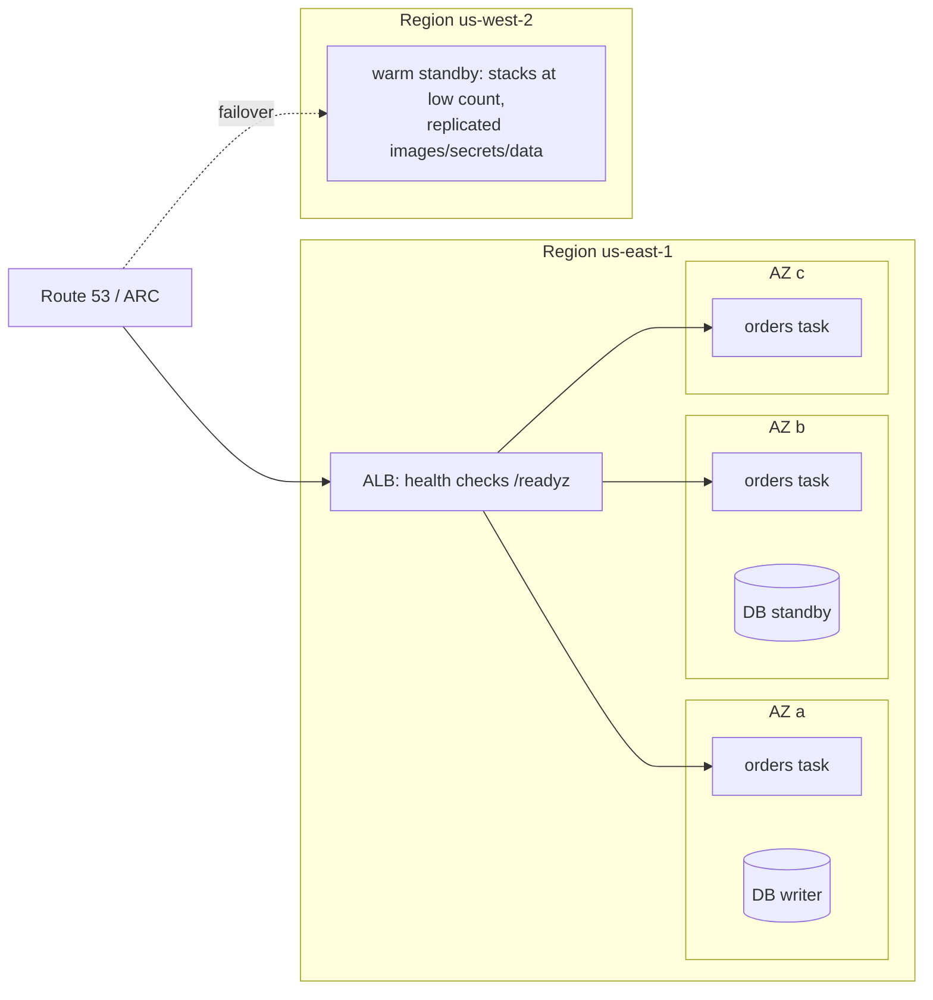

# Resilience and DR · L100 — Resilience basics

**Level:** 100 · **Time:** ~30 min · **Prerequisites:** [Networking L100](../05-networking/L100-vpc-for-containers.md),
[ECS L100](../03-ecs/L100-ecs-basics.md) or [EKS L100](../04-eks/L100-kubernetes-and-eks-basics.md)

**After this document you can:**

- Explain what Availability Zones and Regions isolate and why multi-AZ is the default, not an option.
- Describe how health checks, restarts and replicas turn failures into non-events.
- Define RTO and RPO and name the four disaster recovery strategies with their trade-offs.

## 1. Mental model



Failures are normal; the platform is built so that most of them are absorbed automatically. A task
or pod dies and the scheduler replaces it; a container stops answering its health check and the load
balancer stops sending traffic while the orchestrator restarts it; an Availability Zone degrades and
the copies in the other two keep serving; a whole Region is impaired and, if you planned for it,
another Region takes over. Resilience is the automatic part; disaster recovery is the planned,
human-triggered part; both start from the same two numbers: how long you may be down (RTO) and how
much data you may lose (RPO).

## 2. Concepts

### 2.1 Availability Zones and Regions

A Region is a geographic area with several Availability Zones: separate data centres with independent
power, cooling and networking, close enough for synchronous replication (single-digit millisecond
latency). AWS designs so that an AZ failure does not take down another; Region-wide events are rare
but real. Consequences for containers: run every service in at least two, preferably three AZs;
keep the data tier Multi-AZ (RDS standby, Aurora's storage, ElastiCache replicas); load balancers
already span AZs. Multi-Region is a separate, deliberate investment.

### 2.2 Shared responsibility for resilience

| Layer | AWS | You |
| --- | --- | --- |
| Fargate / Auto Mode nodes | host hardware, patching, replacement | task/pod count and spread, health endpoints, shutdown behaviour |
| ECS control plane / EKS control plane | multi-AZ, backups, scaling | choosing AZs/subnets, deployment settings |
| EC2 nodes (EKS managed groups, ECS EC2) | hardware | AMIs, node replacement, capacity, draining |
| Managed data services | replication, failover, backups | choosing Multi-AZ, backup windows, cross-Region |
| Load balancers, DNS | zonal redundancy | health check paths, failover records |
| Application | — | idempotency, retries, timeouts, graceful shutdown |

### 2.3 Health checks, restarts and replicas

The orchestrator keeps a desired number of copies (`desiredCount`, `replicas`). A **liveness** signal
(`/healthz`) says the process is alive; a failing liveness check restarts the container. A
**readiness** signal (`/readyz`) says it can serve; a failing readiness check removes the copy from
traffic without restarting it. Load balancers run their own health checks against the readiness path
and stop routing to unhealthy targets within seconds. With three copies across three AZs, losing one
copy or one AZ leaves capacity serving while replacements start; with one copy, every restart is an
outage. Start-up grace (`startupProbe`, `healthCheckGracePeriodSeconds`) protects slow starters from
being killed before they are ready.

### 2.4 RTO and RPO

**Recovery Time Objective**: the maximum acceptable time from failure to restored service.
**Recovery Point Objective**: the maximum acceptable data loss, measured as time (the last committed
transaction that survives). A stateless service rebuilt from images has an RTO of minutes and no RPO
of its own; the databases and queues behind it define the real numbers. Business tiers assign them:
tier 1 (checkout) might need RTO 15 minutes and RPO 1 minute; tier 3 (reporting) a day and a day.

### 2.5 The four DR strategies

| Strategy | Standby footprint | RTO | RPO | Cost | Fits |
| --- | --- | --- | --- | --- | --- |
| Backup and restore | none; backups copied to another Region | hours | hours (last backup) | lowest | tier 3, dev/test |
| Pilot light | data replicated, core infrastructure defined but compute off/minimal | tens of minutes | minutes | low | tier 2 |
| Warm standby | full stack running at reduced capacity | minutes | seconds–minutes | medium | tier 1 |
| Multi-site active/active | full capacity in both Regions, traffic split | near zero | near zero | highest | tier 0, global |

Containers make pilot light and warm standby cheap on the compute side: the same images (replicated
by ECR), the same IaC, a `desiredCount` of 1 that becomes 20 on failover. The data tier decides which
strategy is possible ([09 L300](../09-data-messaging-and-batch/L300-messaging-and-data-deep-dive.md)).

### 2.6 What "resilient by default" looks like for shopfront

Three AZs for tasks/pods and the load balancer; RDS Multi-AZ; ElastiCache with a replica; SQS
(regional, redundant by design); MSK with three brokers across AZs; readiness on `/readyz` with
dependencies checked; graceful shutdown within 20 seconds; retries with backoff on start-up; a
warm-standby plan for a second Region documented in [L400](L400-dr-plan-and-game-days.md).

## 3. How it interacts with the rest of AWS

| Component | Talks to | Protocol/API | Prerequisite (IAM, network, DNS) | What breaks if missing |
| --- | --- | --- | --- | --- |
| Scheduler (ECS service / Deployment controller) | capacity in several AZs | placement | subnets in 3 AZs; capacity headroom | one AZ loss = capacity loss |
| Load balancer | targets' `/readyz` | HTTP health checks | correct path/port/SG | traffic to unhealthy copies |
| Data services | standby/replicas | synchronous replication | Multi-AZ enabled | failover impossible |
| Route 53 | Regional endpoints | health checks, failover records | health check endpoints | no Region failover |
| Backups | S3/snapshots in another Region | copy jobs | cross-Region copy configured | backup-and-restore impossible |

## 4. Use it when / avoid it when

Use:

- Three AZs and at least two copies for anything users depend on; Multi-AZ data.
- Readiness checks that include dependencies; liveness checks that do not.
- A named DR strategy per tier with written RTO/RPO.

Avoid:

- Single-copy services "because they are small".
- Liveness checks that call the database (a database blip restarts every copy).
- Multi-Region before multi-AZ is solid.
- RTO/RPO that nobody agreed with the business.

Alternatives: for internal tools, backup-and-restore is often enough; for global products,
active/active with partitioned data.

## 5. Well-Architected view

| Pillar | Contribution | Cost | Practice |
| --- | --- | --- | --- |
| Operational Excellence | automatic replacement, written tiers | documentation | RTO/RPO per service in the catalogue |
| Security | DR Regions with the same controls | duplication | controls as code |
| Reliability | multi-AZ, health checks, replicas, DR strategy | standby capacity | three AZs; Multi-AZ data; rehearsals |
| Performance Efficiency | AZ-local traffic where possible | none | zone-aware routing (L200) |
| Cost Optimization | strategy matched to tier | standby cost | pilot light for tier 2 |
| Sustainability | no idle full copies where not needed | none | tiers |

## 6. Failure modes and troubleshooting

| Symptom | Likely cause | How to confirm (command/metric) | Fix |
| --- | --- | --- | --- |
| One AZ event takes the service down | all copies in one AZ; single subnet | task/pod AZ distribution | subnets in 3 AZs; spread ([playbook](../../playbooks/incidents/alb-5xx-and-unhealthy-targets.md)) |
| Every copy restarts at once | liveness probe depends on the database | restart events aligned with DB blip | liveness = process only |
| Deployment causes an outage | one replica, `maxUnavailable` 1 | replica count | ≥ 2 replicas; `maxUnavailable: 0` |
| Database failover breaks the app for minutes | no reconnect logic; DNS cached | connection errors after failover | reconnecting pools; short DNS TTL |
| "We have backups" but restore never tested | no restore drill | last restore date | quarterly restore test |

## 7. Signals: metrics, logs, traces

- Running vs desired tasks/pods; healthy hosts per AZ; restarts.
- Data tier: replica lag, failover events (RDS events), backup age.
- Route 53 health check status; ARC zonal shift state.
- For DR: age of the last successful cross-Region backup/replication; documented RTO/RPO vs last
  drill result.

Full table: [`reference/metrics-catalog.md`](../../reference/metrics-catalog.md).

## 8. Testing and DR notes

Testing at this level: stop a task/pod and time its replacement; fail the readiness check of one copy
and confirm traffic avoids it; stop the database in the Compose stack and watch `/readyz` go 503 while
`/healthz` stays 200. DR at this level: know your tier's RTO/RPO, know which strategy you have, and
know the date of the last restore test ([L300](L300-dr-strategies-for-container-platforms.md)).

## 9. Hands-on

```bash
make up && make smoke
# Readiness vs liveness under a dependency failure
docker compose -f labs/local/compose.yaml stop postgres
curl -s -o /dev/null -w 'healthz %{http_code}\n' localhost:8080/healthz
curl -s -w '\nreadyz %{http_code}\n' localhost:8080/readyz
docker compose -f labs/local/compose.yaml start postgres; sleep 5; curl -s -o /dev/null -w 'readyz %{http_code}\n' localhost:8080/readyz
# Observe: healthz 200 throughout (no restart), readyz 503 then 200.

# Replacement: kill a worker and watch compose restart it (the orchestrator analogue)
docker compose -f labs/local/compose.yaml kill fulfillment-worker && sleep 3 && docker compose -f labs/local/compose.yaml ps fulfillment-worker

# On AWS: the multi-AZ layout in the labs
grep -nE 'AvailabilityZone|Subnet.*(a|b|c)|MultiAZ' labs/ecs/cloudformation/01-network.yaml labs/ecs/cloudformation/03-data.yaml | head
grep -nE 'topologySpreadConstraints|minAvailable|replicas' labs/eks/manifests/base/deployment-orders.yaml labs/eks/manifests/base/pdb.yaml
```

## 10. Check yourself

1. Why should a liveness check never depend on the database?

<details><summary>Answer</summary>
A failing liveness check restarts the container. If liveness includes the database, a database blip
restarts every copy at once, turning a partial dependency failure into a full outage and a restart
storm. Readiness is the right place for dependency checks: it removes copies from traffic without
restarting them.
</details>

2. What do RTO and RPO measure, and which layer of a container platform usually determines them?

<details><summary>Answer</summary>
RTO is the maximum acceptable time to restore service; RPO is the maximum acceptable data loss
expressed as time. Stateless compute rebuilds in minutes and loses nothing, so the data tier
(databases, queues, streams) with its replication lag and restore time determines the real values.
</details>

3. Name the four DR strategies in order of increasing cost and what distinguishes pilot light from
   warm standby.

<details><summary>Answer</summary>
Backup and restore, pilot light, warm standby, multi-site active/active. Pilot light keeps data
replicated and infrastructure defined but compute off or minimal; warm standby runs the full stack at
reduced capacity so failover is scaling up and switching traffic rather than provisioning.
</details>

4. Three copies of a service run in one AZ. What does multi-AZ change and what does it not?

<details><summary>Answer</summary>
Spreading the copies across three AZs means an AZ failure removes a third of capacity instead of all
of it, and the scheduler replaces the lost copies in healthy AZs. It does not protect against a
Region-level event, a bad deployment (all copies get the same code), or a failure of a single-AZ
dependency the service still relies on.
</details>

5. Why does the shopfront readiness endpoint report each dependency by name?

<details><summary>Answer</summary>
So the load balancer removes a task whose dependency is unreachable (traffic protection) and so the
operator sees which dependency failed (triage) without restarting anything. The named checks turn a
503 into a diagnosis.
</details>

## 11. Sources

- AWS Global Infrastructure: Regions and Availability Zones — https://docs.aws.amazon.com/whitepapers/latest/aws-fault-isolation-boundaries/availability-zones.html
- AWS Well-Architected Reliability pillar — https://docs.aws.amazon.com/wellarchitected/latest/reliability-pillar/welcome.html
- Disaster recovery options in the cloud (strategies) — https://docs.aws.amazon.com/whitepapers/latest/disaster-recovery-workloads-on-aws/disaster-recovery-options-in-the-cloud.html
- Kubernetes: liveness, readiness and startup probes — https://kubernetes.io/docs/tasks/configure-pod-container/configure-liveness-readiness-startup-probes/
- Amazon ECS health checks — https://docs.aws.amazon.com/AmazonECS/latest/developerguide/healthcheck.html
- Amazon RDS Multi-AZ deployments — https://docs.aws.amazon.com/AmazonRDS/latest/UserGuide/Concepts.MultiAZ.html
- Amazon Route 53 DNS failover — https://docs.aws.amazon.com/Route53/latest/DeveloperGuide/dns-failover.html
