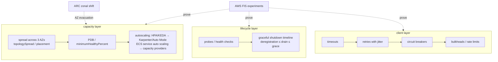

# Resilience and DR · L200 — Designing for failure

**Level:** 200 · **Time:** ~75 min · **Prerequisites:** [L100 Resilience basics](L100-resilience-basics.md),
[ECS L200](../03-ecs/L200-task-definitions-services-and-scaling.md) or [EKS L200](../04-eks/L200-cluster-components-and-add-ons.md),
[Networking L200](../05-networking/L200-load-balancing-ingress-and-discovery.md)

**After this document you can:**

- Configure replicas, spread, disruption budgets and the autoscaling layers so capacity survives
  node, AZ and deployment events.
- Write the graceful-shutdown timeline for a service and set every timeout in it correctly.
- Choose probes and health checks that protect traffic without causing restart storms.
- Add timeouts, retries, circuit breakers and bulkheads that stop failures from cascading.
- Run a first fault-injection experiment with AWS FIS and use ARC zonal shift.

## 1. Mental model



Designing for failure is three layers of decisions. Capacity: enough copies, spread wide enough, with
rules that stop voluntary disruptions from removing too many at once, and autoscaling that adds
capacity before users notice. Lifecycle: health signals that route traffic correctly and a shutdown
sequence in which nobody stops serving before the load balancer stops sending. Client behaviour:
every call has a timeout, retries are bounded and jittered, breakers stop hammering a failing
dependency, and bulkheads keep one slow dependency from consuming all threads. Fault injection is how
you find out which decision you got wrong before production does.

## 2. Concepts

### 2.1 Replicas and spread

| Platform | Mechanism | Setting |
| --- | --- | --- |
| EKS | `topologySpreadConstraints` on `topology.kubernetes.io/zone` (and `kubernetes.io/hostname`) with `maxSkew: 1`; `whenUnsatisfiable: ScheduleAnyway` for zone (availability over strictness), `DoNotSchedule` for hostname when copies must not share a node | `replicas ≥ 3` for tier 1 |
| ECS | Fargate spreads across the listed subnets; EC2 `placementStrategy: spread attribute:ecs.availability-zone` then `binpack`; `availabilityZoneRebalancing: ENABLED` | `desiredCount ≥ 3` |
| Both | subnets in three AZs; capacity headroom so two AZs can carry the load (each AZ ≤ 67% of what it can take) | capacity planning |

The 67% rule: with three AZs and one lost, the remaining two must absorb 100% of traffic, so normal
utilisation per AZ must stay at or below two thirds of its capacity (for two AZs: 50%).

### 2.2 Disruption budgets

Voluntary disruptions — node drains for upgrades, Karpenter consolidation, Auto Mode's 21-day node
replacement, `kubectl drain` — go through the eviction API, which honours `PodDisruptionBudget`s:

```yaml
apiVersion: policy/v1
kind: PodDisruptionBudget
metadata: { name: orders, namespace: shopfront }
spec:
  minAvailable: 2                       # or maxUnavailable: 1; never both
  selector: { matchLabels: { app.kubernetes.io/name: orders } }
  unhealthyPodEvictionPolicy: AlwaysAllow   # do not let crash-looping pods block drains
```

Rules: every Deployment in production has a PDB; `minAvailable` below `replicas` (a PDB equal to
replicas blocks every drain and stalls upgrades); `AlwaysAllow` for unhealthy pods. ECS's equivalent
is `minimumHealthyPercent` for deployments and managed draining for capacity providers (tasks are
moved before an instance terminates, respecting the deployment configuration).

### 2.3 Autoscaling layers

| Layer | EKS | ECS | Reacts in |
| --- | --- | --- | --- |
| Workload (copies) | HPA on CPU/memory/custom; KEDA on external metrics (queue depth); VPA for sizing | service auto scaling: target tracking (CPU, `ALBRequestCountPerTarget`, backlog per task), step, scheduled, predictive | 15 s–1 min |
| Capacity (where copies run) | Karpenter / Auto Mode NodePools (seconds to a couple of minutes), Cluster Autoscaler (minutes), Fargate profiles (per pod) | Fargate (per task); capacity providers with managed scaling (ASG minutes); Managed Instances | 1–4 min on EC2; ~30–60 s on Fargate |
| Data tier | Aurora Serverless v2, ElastiCache Serverless, RDS Proxy | same | seconds–minutes |

Design rules: scale on the signal closest to user demand (requests per target, queue age) and let CPU
be a guard rail; set `maxReplicas`/`max-capacity` to what the data tier can take; scale-in slowly
(`stabilizationWindowSeconds: 300`, ECS scale-in cooldown 180 s); keep headroom for the capacity layer's
lag (Karpenter's 1–2 minutes means the HPA target should trigger before saturation, e.g. CPU 60% not
85%); pre-scale for known peaks with scheduled actions.

### 2.4 Probes and health checks

| Probe | Question | Failure action | shopfront setting |
| --- | --- | --- | --- |
| `startupProbe` | has the process finished starting? | keeps liveness/readiness off until success; kills after `failureThreshold × period` | `/healthz`, 2 s × 30 |
| `readinessProbe` | can this copy serve right now? | removes from Endpoints/target group; no restart | `/readyz` (DB, cache), 5 s × 2 |
| `livenessProbe` | is the process hung? | restarts the container | `/healthz`, 10 s × 3 |
| ECS container health check | same as liveness | task replaced when unhealthy (essential) | only on images with a shell (worker) |
| ELB health check | can this target serve? | stops routing; ECS replaces task after grace period | `/readyz`, 15 s, 2/3 |
| ECS `healthCheckGracePeriodSeconds` | how long before ELB health matters? | scheduler ignores ELB failures during start | 60 s |

Anti-patterns: liveness on dependencies (restart storms); readiness on nothing (routing to a copy
that cannot serve); ELB health checks on `/healthz` (traffic to broken copies); tight thresholds that
flap during GC pauses.

### 2.5 The graceful-shutdown timeline

```text
EKS (terminationGracePeriodSeconds 30, preStop sleep 5, ALB deregistration 20, app drain ≤ 20)
t=0    pod deletion: Endpoints/EndpointSlice removal starts (async); ALB deregistration starts (readiness gate)
t=0-5  preStop sleep: kube-proxy and ALB stop sending new connections while the app still accepts
t=5    SIGTERM: app stops accepting, finishes in-flight, flushes telemetry, exits 0 (≤ 20 s)
t=20   ALB deregistration delay elapsed
t=30   SIGKILL if still running

ECS (stopTimeout 30, deregistration 20, app drain ≤ 20)
t=0    DEACTIVATING: target deregistration begins; Service Connect stops new inbound
t≈2    SIGTERM (stopTimeout clock starts)
t≤22   app drains and exits 0
t=20   deregistration delay elapsed
t=32   SIGKILL if still running
```

Invariants: application drain ≤ grace/`stopTimeout`; the application keeps accepting until the load
balancer has stopped routing (the `preStop` sleep on EKS; on ECS deregistration begins before
SIGTERM); connection keep-alive timeouts in the app longer than the ALB idle timeout so the ALB, not
the app, closes idle connections. The shopfront services implement this with
`SHUTDOWN_TIMEOUT_SECONDS=20` ([`labs/CONTRACT.md`](../../labs/CONTRACT.md) §7).

### 2.6 Timeouts, retries, circuit breakers, bulkheads

| Pattern | Rule | shopfront example |
| --- | --- | --- |
| Timeouts | every outbound call has one; connect timeout short (1–2 s), request timeout per dependency SLO; total budget per request propagated downstream | `orders` → `catalog`: 2 s |
| Retries | only for idempotent or safe operations; bounded (1–3); exponential backoff with jitter; retry budget (max 10% of requests are retries) so retries do not amplify an outage | one retry on 5xx/timeout to `catalog`; SDK retries for SQS |
| Circuit breaker | after N failures stop calling for a cooling period; half-open probes; fail fast with a fallback | catalog cache-aside bypass is a built-in fallback; a breaker around Kafka produce would skip the best-effort path when the broker is down |
| Bulkheads | separate connection pools/thread pools per dependency; bounded concurrency | separate pools for Postgres and Valkey; bounded HTTP client concurrency |
| Rate limiting / load shedding | reject early (429/503 with `Retry-After`) when saturated | ALB/WAF limits; API Gateway; app-level semaphores |
| Idempotency | retried writes must be safe: idempotency keys, conditional updates | worker `WHERE status='CREATED'`; `POST /orders` could accept an `Idempotency-Key` header |
| Fallbacks and degradation | serve stale, partial or default data instead of failing | `X-Cache: BYPASS`; analytics best-effort |

Where these live: in the application (resilience libraries per language), in a proxy (ECS Service
Connect retries/timeouts/outlier detection; a mesh), or at the load balancer (ALB has no retries;
timeouts only). Prefer platform-provided where available, but timeouts are always the application's
responsibility.

### 2.7 Dependency failure handling

Classify each dependency: critical (fail the request: PostgreSQL for `orders`), degradable (serve
without it: Valkey), best-effort (log and continue: Kafka for analytics). Encode the classification in
readiness (`/readyz` fails only on critical dependencies — the catalog contract counts Valkey as a
readiness check, a deliberate choice worth revisiting for a cache), in breakers and fallbacks, and in
the runbook. Start-up dependencies get retry with backoff (30 s) rather than crash loops that hammer
a recovering database.

### 2.8 AWS Fault Injection Service

FIS runs experiments (templates with targets, actions, stop conditions tied to alarms):

| Action | Proves |
| --- | --- |
| `aws:ecs:stop-task` on 30% of a service's tasks | replacement time, no client errors with spread and drain |
| `aws:ecs:task-cpu-stress`, `task-io-stress`, `task-network-latency` (SSM-based, in-task) | limits and timeouts |
| `aws:eks:pod-delete`, `aws:eks:pod-cpu-stress`, `pod-network-latency` | PDBs, probes, client timeouts |
| `aws:eks:terminate-nodegroup-instances` | spread, PDBs, Karpenter/Auto Mode replacement |
| `aws:ec2:stop-instances`, `send-spot-instance-interruptions` | node loss, Spot handling |
| `aws:network:disrupt-connectivity` on subnets | AZ impairment, cross-AZ dependencies |
| `aws:rds:failover-db-cluster`, `reboot-db-instances` | reconnect logic, failover time |
| `aws:elasticache:*`, `aws:ssm:send-command` | cache loss, custom faults |

Start in staging with a stop condition on the 5xx alarm; graduate to production during game days
([L400 §2.5](L400-dr-plan-and-game-days.md)).

### 2.9 ARC zonal shift and autoshift

Amazon Application Recovery Controller zonal shift moves traffic away from an AZ for ALB/NLB (and
EKS clusters, including Auto Mode, and ECS services) without redeploying; autoshift lets AWS start a
shift when it detects an AZ impairment, with practice runs you schedule. Prerequisites: capacity
headroom (§2.1), no cross-zone settings that route back, and readiness of the workload in the other
AZs. Start/cancel with `aws arc-zonal-shift start-zonal-shift --resource-identifier <arn> --away-from
use1-az1 --expires-in 1h` ([05 L400 §2.5](../05-networking/L400-network-architecture-at-scale.md)).

## 3. How it interacts with the rest of AWS

| Component | Talks to | Protocol/API | Prerequisite (IAM, network, DNS) | What breaks if missing |
| --- | --- | --- | --- | --- |
| HPA / KEDA | metrics-server, CloudWatch/SQS/AMP | metrics APIs | metrics-server add-on; KEDA Pod Identity | no scaling |
| Karpenter / Auto Mode / capacity providers | EC2 | instance lifecycle | NodePool limits; ASG limits | Pending pods / tasks |
| Eviction API | PDBs | Kubernetes API | PDBs present and satisfiable | drains blocked or unsafe |
| ALB | targets | health checks, deregistration | correct path and delay | 5xx during rollouts |
| FIS | ECS/EKS/EC2/RDS/network | experiment role | role permissions; stop-condition alarms | experiments fail or run unbounded |
| ARC zonal shift | ALB/NLB/EKS/ECS | control plane | resources registered; headroom | traffic stays in impaired AZ |
| RDS/Aurora failover | applications | DNS endpoint change | reconnecting pools; short TTL | minutes of errors |

## 4. Use it when / avoid it when

Use:

- Three AZs, `topologySpreadConstraints`/placement spread, PDBs on every Deployment, `maxUnavailable: 0`
  rollouts with readiness gates.
- Autoscaling on demand signals with data-tier-aware ceilings; slow scale-in.
- The shutdown timeline with `preStop` (EKS) and `stopTimeout` (ECS) matched to deregistration.
- Timeouts everywhere; bounded, jittered retries with budgets; breakers for non-critical paths.
- FIS in staging monthly, in production during game days; zonal shift practice runs.

Avoid:

- PDBs equal to replicas; single-replica production services.
- Liveness probes on dependencies; ELB checks on liveness paths.
- Unbounded retries (retry storms) and retries on non-idempotent writes.
- Scaling ceilings above what the database can take.

Alternatives: ECS Service Connect or a mesh for retries/timeouts/outlier detection outside code;
Aurora Serverless/ElastiCache Serverless to make the data tier elastic too.

## 5. Well-Architected view

| Pillar | Contribution | Cost | Practice (Reliability pillar) |
| --- | --- | --- | --- |
| Operational Excellence | deterministic shutdown, FIS experiments as code | experiment design | experiment templates in IaC |
| Security | resilience controls do not weaken controls (quarantine ≠ shutdown) | none | see 06 L400 |
| Reliability | spread, PDBs, autoscaling, probes, drain, client resilience, zonal shift | headroom (about 33% for three AZs) | REL 5–11 best practices: limits, retries, static stability |
| Performance Efficiency | scale on demand signals; AZ-local traffic | none | request-based scaling |
| Cost Optimization | scale-in discipline; headroom tuned to real AZ loss | headroom cost | measure with FIS, then trim |
| Sustainability | scale to demand | none | scheduled scale-down off-hours (non-prod) |

## 6. Failure modes and troubleshooting

| Symptom | Likely cause | How to confirm (command/metric) | Fix |
| --- | --- | --- | --- |
| Node drain hangs | PDB with 0 allowed disruptions | `kubectl get pdb -A` | `minAvailable < replicas`; `AlwaysAllow` ([playbook](../../playbooks/incidents/upgrade-breakage.md)) |
| 5xx on every deploy | app closes listener at SIGTERM; no `preStop`; drain > grace | ALB 502 vs deployment events | fix timeline ([playbook](../../playbooks/incidents/alb-5xx-and-unhealthy-targets.md)) |
| Restart storm after DB blip | liveness on dependency | restarts aligned with DB event | liveness = process only |
| Retry storm amplifies outage | unbounded retries, no jitter | request rate ×N during dependency failure | retry budget; breaker |
| Pods Pending during AZ loss | no headroom; NodePool limits | `kubectl get pods -A | grep Pending`; Karpenter events | 67% rule; raise limits ([playbook](../../playbooks/incidents/pending-pods-and-capacity.md)) |
| HPA flapping | scale-in too fast; metric noisy | HPA events | stabilization window; smoother metric |
| Zonal shift did not reduce errors | cross-zone routing back; dependency in the impaired AZ | per-AZ metrics | AZ-affine design |
| FIS experiment runs to completion despite damage | no stop condition | template | alarm-based stop conditions |

## 7. Signals: metrics, logs, traces

- Capacity: running vs desired per AZ; healthy hosts per AZ; Pending duration; NodePool usage vs
  limits; `CapacityProviderReservation`.
- Lifecycle: restarts, probe failures (`kube_pod_container_status_last_terminated_reason`), ALB 502
  aligned with deployments, drain durations.
- Client resilience: retry counts, breaker state changes (app metrics), timeout rates, saturation
  (rejected/queued requests).
- Experiments: FIS experiment state and stop-condition alarms; zonal shift active/expired.
- Data tier during failures: connection errors, failover events, replica lag.

Full table: [`reference/metrics-catalog.md`](../../reference/metrics-catalog.md).

## 8. Testing and DR notes

Testing: locally, `docker compose stop postgres` during a k6 run shows readiness removal and retry
behaviour; `docker compose kill` a worker mid-batch shows redelivery; in staging, FIS `stop-task`/
`pod-delete` at 30% under load must produce zero client errors; `terminate-nodegroup-instances` must
be absorbed by PDBs and spread; an RDS failover must recover within the pool's reconnect logic; a
zonal shift practice run must keep error rates flat. DR: these mechanisms are what make the DR
strategies in [L300](L300-dr-strategies-for-container-platforms.md) executable — a warm standby that
cannot scale out or drain cleanly fails its RTO.

## 9. Hands-on

```bash
# The settings in the labs
grep -nE 'topologySpreadConstraints|minAvailable|unhealthyPodEvictionPolicy|preStop|terminationGracePeriodSeconds|startupProbe|readinessProbe|livenessProbe' -r labs/eks/manifests/base/ | head -20
jq '.containerDefinitions[0] | {stopTimeout, healthCheck}' labs/ecs/taskdefs/worker.json
grep -nE 'MinimumHealthyPercent|MaximumPercent|HealthCheckGracePeriodSeconds|deregistration_delay|TargetTrackingScalingPolicyConfiguration' labs/ecs/cloudformation/04-services.yaml | head

# Local shutdown timeline under load
make up
(while true; do curl -s -o /dev/null -w '%{http_code}\n' localhost:8081/products/1; sleep 0.1; done) > /tmp/codes.txt &
LOAD=$!; sleep 3; docker compose -f labs/local/compose.yaml stop catalog; sleep 2; kill $LOAD
sort /tmp/codes.txt | uniq -c                 # 200s then connection failures (000); no truncated responses
docker compose -f labs/local/compose.yaml start catalog

# AWS (billable): a first FIS experiment — stop 30% of orders tasks with a stop condition on the 5xx alarm
aws fis create-experiment-template --cli-input-json file://labs/ecs/fis-stop-tasks.json 2>/dev/null || echo "template example in playbooks/dr/game-day-guide.md"
aws arc-zonal-shift list-managed-resources --query 'items[].{name:name,arn:arn}' --output table
```

## 10. Check yourself

1. Explain the 67% rule and what it costs.

<details><summary>Answer</summary>
With three AZs, losing one must leave two able to carry 100% of load, so each AZ's normal utilisation
stays at or below two thirds of its capacity: about 50% more capacity than the load strictly needs.
The cost is that headroom (about a third of the fleet idle in normal operation), which is the price of
surviving an AZ event without scaling first; autoscaling can shrink it if the capacity layer reacts
faster than the failure grows.
</details>

2. What does a `preStop` sleep do that `terminationGracePeriodSeconds` does not?

<details><summary>Answer</summary>
The grace period bounds how long the process may take to exit after SIGTERM. The `preStop` sleep
delays SIGTERM itself, giving the asynchronous endpoint removal (kube-proxy rules, ALB deregistration
via readiness gates) time to stop sending new connections while the application is still accepting;
without it the application may stop accepting before clients learn it is gone, causing 502s.
</details>

3. Why do retries need a budget and jitter?

<details><summary>Answer</summary>
When a dependency slows, every client retrying immediately multiplies load exactly when the dependency
can least handle it (retry storm), turning a partial failure into an outage. Jitter spreads retries in
time; a budget (retries as a bounded fraction of requests) caps the amplification; breakers stop
retries altogether after repeated failures.
</details>

4. Which FIS action tests PDBs and spread together, and what result do you expect?

<details><summary>Answer</summary>
`aws:eks:terminate-nodegroup-instances` (or `aws:ec2:stop-instances` on a subset of nodes): pods on
the lost nodes are rescheduled to other AZs, PDBs keep `minAvailable` serving during any voluntary
part of the process, and with spread and headroom the ALB never sees zero healthy targets, so the 5xx
alarm (the experiment's stop condition) does not fire.
</details>

5. When is readiness the wrong place for a dependency check?

<details><summary>Answer</summary>
When the dependency is degradable (a cache) and the service can serve without it: failing readiness
would remove a working copy from traffic, converting a cache outage into reduced capacity. Keep such
dependencies as informational checks or in metrics, and reserve readiness failures for critical
dependencies without which requests would fail anyway.
</details>

## 11. Sources

- AWS Well-Architected Reliability pillar (workload architecture, change and failure management) — https://docs.aws.amazon.com/wellarchitected/latest/reliability-pillar/welcome.html
- Kubernetes: Pod topology spread constraints; PodDisruptionBudgets — https://kubernetes.io/docs/concepts/scheduling-eviction/topology-spread-constraints/ and https://kubernetes.io/docs/tasks/run-application/configure-pdb/
- Kubernetes: pod lifecycle and termination; probes — https://kubernetes.io/docs/concepts/workloads/pods/pod-lifecycle/
- Horizontal Pod Autoscaler and behaviour settings — https://kubernetes.io/docs/tasks/run-application/horizontal-pod-autoscale/
- Amazon ECS service auto scaling and deployment configuration — https://docs.aws.amazon.com/AmazonECS/latest/developerguide/service-auto-scaling.html and https://docs.aws.amazon.com/AmazonECS/latest/developerguide/deployment-type-ecs.html
- Amazon ECS task lifecycle and `stopTimeout` — https://docs.aws.amazon.com/AmazonECS/latest/developerguide/task_definition_parameters.html
- ALB deregistration delay — https://docs.aws.amazon.com/elasticloadbalancing/latest/application/edit-target-group-attributes.html
- Timeouts, retries and backoff with jitter (Amazon Builders' Library) — https://aws.amazon.com/builders-library/timeouts-retries-and-backoff-with-jitter/
- Avoiding insurmountable queue backlogs; static stability (Amazon Builders' Library) — https://aws.amazon.com/builders-library/avoiding-insurmountable-queue-backlogs/ and https://aws.amazon.com/builders-library/static-stability-using-availability-zones/
- AWS Fault Injection Service actions reference — https://docs.aws.amazon.com/fis/latest/userguide/fis-actions-reference.html
- Amazon Application Recovery Controller zonal shift and autoshift — https://docs.aws.amazon.com/r53recovery/latest/dg/arc-zonal-shift.html
- Amazon EKS Best Practices: reliability — https://docs.aws.amazon.com/eks/latest/best-practices/reliability.html
