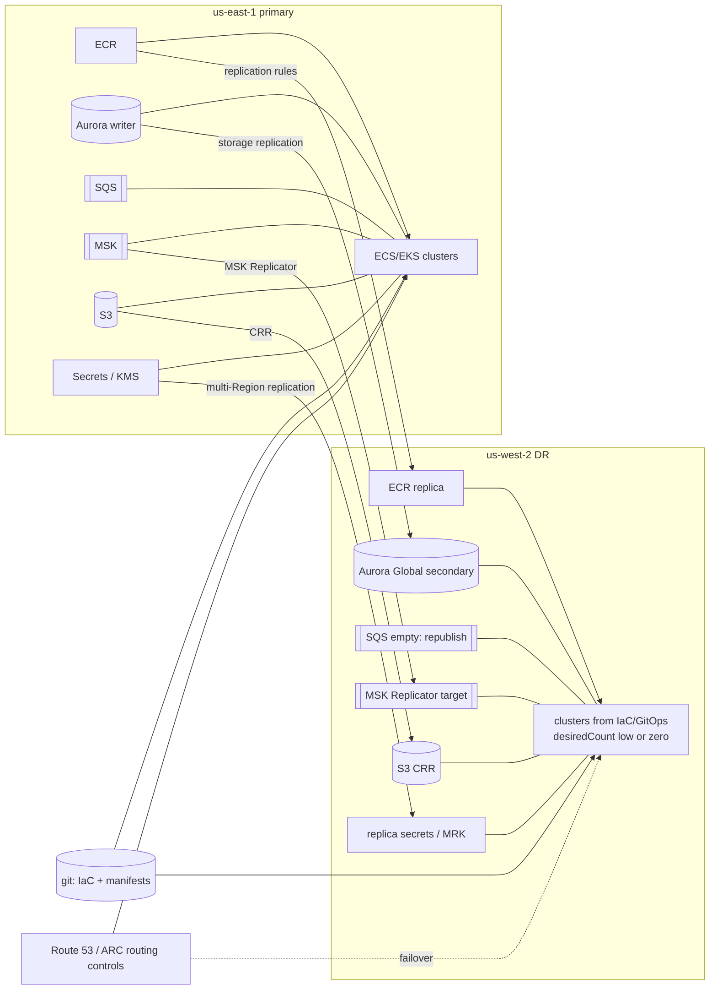

# Resilience and DR · L300 — DR strategies for container platforms

**Level:** 300 · **Time:** ~90 min · **Prerequisites:** [L200 Designing for failure](L200-designing-for-failure.md),
[Data, messaging and batch L300](../09-data-messaging-and-batch/L300-messaging-and-data-deep-dive.md),
[ECR L300](../02-ecr/L300-pull-through-cache-replication-and-limits.md)

**After this document you can:**

- Apply backup/restore, pilot light, warm standby and active/active to ECS and EKS and know what
  each requires in the second Region before the disaster.
- Inventory every kind of state a container platform has and name its replication or backup tool.
- Use Route 53 and ARC to move traffic, and rebuild a cluster or environment from code on a clock.
- Do the RTO/RPO arithmetic per tier and defend it.

## 1. Mental model



A container platform's DR is an inventory problem: list every piece of state, decide how it reaches
the second Region (replicated ahead of time, restored from backup, or rebuilt from code), and then
the failover is a sequence of promotions, scale-ups and a DNS change. Compute is the easy row of the
inventory — images plus code equals a cluster — which is exactly why teams underestimate the rows
below it: databases, queues, streams, secrets, certificates, identities and quotas.

## 2. Concepts

### 2.1 The four strategies applied to ECS and EKS

| Strategy | Second Region before the event | Failover steps | RTO / RPO (typical) | Cost |
| --- | --- | --- | --- | --- |
| Backup and restore | ECR replication; IaC/GitOps repos; database snapshots copied cross-Region; S3 CRR | create VPC/cluster stacks (15–40 min), restore database from snapshot (minutes–hours by size), deploy services, switch DNS | hours / last snapshot (hours) | storage only |
| Pilot light | everything above plus a live database replica (Aurora Global secondary, RDS cross-Region replica) and pre-created VPC/endpoints; clusters defined, node capacity minimal/zero | promote database, create/scale node capacity and services (10–30 min), switch DNS | tens of minutes / seconds–minutes | replica + idle control planes (EKS cluster fee) |
| Warm standby | full stack running at low `desiredCount`/replicas with real traffic-free health checks; replicated secrets, certificates, images; queues/streams ready | promote database, scale services to production counts (2–5 min), republish in-flight queue work, switch DNS/ARC | minutes / seconds | fraction of production compute + data replicas |
| Active/active | identical stacks serving traffic, data partitioned (per tenant/Region) or globally replicated with conflict handling | shift traffic weights (ARC routing controls, Global Accelerator) | near zero / near zero for partitioned data | ~2× compute + data |

ECS specifics: clusters, services and task definitions are cheap to keep defined in every Region;
Fargate makes warm standby a matter of `desiredCount`; Service Connect namespaces and Cloud Map are
regional and come from the stack. EKS specifics: the control plane fee makes idle clusters cost real
money (pilot light with a cluster is ~$73/month per cluster before nodes); Auto Mode scales nodes
from zero; Pod Identity associations, IRSA providers and access entries are per cluster and must be
in IaC; GitOps converges the workloads once the cluster exists.

### 2.2 State inventory

| State | Where it lives | Reaches the DR Region by | Owner |
| --- | --- | --- | --- |
| Images, signatures, SBOMs | ECR | replication rules (cross-Region; verify referrer artifacts replicate) | platform |
| Infrastructure definitions | git (CloudFormation/eksctl/Terraform) | deploy with Region parameters | platform |
| Kubernetes objects | git (Kustomize/Helm) via Argo CD/Flux | GitOps bootstrap on the new cluster | teams + platform |
| Kubernetes in-cluster state (PVs, operator-created Secrets, CRs) | etcd (AWS-managed, not restorable by you) + EBS | Velero backups to S3 with cross-Region copy and EBS snapshot replication | teams |
| Task definitions, services, capacity providers | ECS API (from IaC) | redeploy stacks | platform |
| Secrets | Secrets Manager | multi-Region replication with a multi-Region KMS key | platform/teams |
| Encryption keys | KMS | multi-Region keys (MRK) or re-encryption with Region keys | platform |
| Certificates | ACM, AWS Private CA | issue in each Region (ACM certificates are regional); a subordinate CA per Region or a CA in the DR Region | platform |
| IAM roles, OIDC providers, Pod Identity associations, access entries | IAM (global) / EKS (regional) | roles are global; providers/associations/entries recreated by IaC per cluster | platform |
| Databases | RDS/Aurora | Multi-AZ inside Region; Aurora Global Database or cross-Region replica; snapshots copied | data owners |
| Caches | ElastiCache | Global Datastore or accept cold cache; snapshots | teams |
| Queues | SQS (regional, not replicated) | republish from the source of truth / outbox; dual-write | teams |
| Streams | MSK | MSK Replicator (topics and consumer offsets translated) | teams |
| Objects | S3 | Cross-Region Replication, multi-Region access points | teams |
| DNS and routing | Route 53 (global) | failover records, ARC routing controls | platform |
| Quotas | per Region | raised in advance to production levels | platform |
| Observability | CloudWatch/AMP/dashboards (regional) | IaC per Region; cross-Region dashboards in the monitoring account | platform |

### 2.3 Images, code and clusters

ECR replication rules copy new pushes to the DR Region (existing images need a one-time copy with
`crane copy`); repositories are created by replication or by repository creation templates with the
same policies; lifecycle policies must not race the DR Region's needs. IaC deploys with Region-specific
parameters (AMIs are regional — use SSM public parameters or Bottlerocket/AL2023 aliases; AZ ids
differ; endpoint service names carry the Region). For EKS, `eksctl create cluster -f` with a
Region-parameterised file, then the GitOps bootstrap Application; for ECS, the numbered stacks in
[`labs/ecs/cloudformation/`](../../labs/ecs/cloudformation/) with `parameters/<env>-<region>.json`.
Time it: a cluster with add-ons and workloads typically converges in 20–40 minutes from nothing;
scaling a warm standby takes minutes ([cluster rebuild runbook](../../playbooks/dr/cluster-rebuild-runbook.md)).

### 2.4 Kubernetes state: Velero

Velero backs up Kubernetes objects (by namespace/label) to S3 and takes volume snapshots through the
CSI snapshot API (EBS snapshots) on a schedule; restores into another cluster, including another
Region when the bucket and snapshots are replicated (`velero backup-location` per Region; EBS
snapshot copy). What it is for: stateful in-cluster workloads (PVs), operator-managed Secrets,
CRs whose source is not git. What it is not for: replacing GitOps for stateless manifests (restore
git instead) or backing up the control plane (AWS does that for its own recovery). Restore order:
CRDs → namespaces → PVs/PVCs → workloads; test restores quarterly.

### 2.5 Data tier per store

| Store | Recommended DR primitive | Failover | Notes |
| --- | --- | --- | --- |
| Aurora PostgreSQL | Global Database | managed switchover (planned, zero data loss) or failover (unplanned, RPO ~1 s) promotes the secondary; writer endpoint changes | applications reconnect; Secrets Manager replica secret must point at the new endpoint or use a stable CNAME |
| RDS PostgreSQL | cross-Region read replica + automated snapshots copied | promote replica (breaks replication; minutes) | consider Aurora for tighter RPO |
| ElastiCache Valkey | Global Datastore (secondary read-only) or none | promote secondary | cold cache = database load spike; warm with a job |
| SQS | none (regional) | recreate queues from IaC; republish unprocessed work from `orders`/outbox | DLQ contents lost with the Region |
| MSK | MSK Replicator to a DR cluster | consumers switch bootstrap servers; offsets translated | replication lag = RPO |
| S3 | CRR + replication time control | switch bucket name/multi-Region access point | versioning required |
| DynamoDB | global tables | none | conflict resolution |
| EFS | replication to another Region | switch filesystem id | RPO minutes |

Runbook: [data recovery](../../playbooks/dr/data-recovery-runbook.md).

### 2.6 Moving traffic: Route 53 and ARC

| Mechanism | How | Latency to effect | Notes |
| --- | --- | --- | --- |
| Route 53 failover records | primary/secondary alias records with health checks (from outside, ideally on Synthetics or a deep health endpoint) | health check interval × failure threshold (30–90 s) + DNS TTL | automatic; risk of flapping; keep TTL ≤ 60 s |
| ARC routing controls | manual or automated on/off switches per Region evaluated by Route 53 health checks; safety rules prevent turning everything off | seconds after the switch | deliberate failover with guardrails; readiness checks audit that the DR Region matches |
| ARC zonal shift/autoshift | AZ-level, not Region | seconds | first response to AZ impairment |
| Global Accelerator | anycast IPs with endpoint groups per Region, health-based | ~30 s | for TCP/static IP needs and faster than DNS |
| Weighted records | percentage shift for active/active or gradual failback | TTL | canary the DR Region with 5% before full cut |

Clients cache DNS beyond TTL (JVM defaults, mobile resolvers); Global Accelerator or short TTLs plus
connection draining reduce the tail.

### 2.7 Rebuild automation

Every step of the failover is a script or a pipeline job with a name: `01-promote-database`,
`02-scale-services`, `03-republish-queues`, `04-verify-readiness`, `05-switch-routing`,
`06-notify`. Parameterise Region; store in the runbook repository; run the whole sequence in a game
day against the DR environment. Verify each step by observation (the new writer endpoint answers;
`RunningTaskCount` equals target; Synthetics in the DR Region green) before the next. A rebuild from
zero (backup/restore tier) is the same sequence with `00-create-stacks` in front.

### 2.8 RTO/RPO arithmetic

RTO = detection + decision + execution + propagation. For shopfront on warm standby: detection 2–5
min (Synthetics/alarms), decision 5–10 min (on-call confirms Region impairment), execution 5–10 min
(Aurora Global failover ~1–2 min, scale services 2–3 min, republish 1–2 min, verification), DNS
propagation 1–2 min → 15–30 min RTO. RPO = replication lag at the moment of failure: Aurora Global
~1 s; MSK Replicator seconds; SQS in-flight messages = the reconciliation window (orders `CREATED` in
the last N minutes republished, duplicates handled by idempotency); S3 CRR minutes unless RTC.
Publish both numbers per tier and compare with the last game day's measurements; the difference is
your risk.

## 3. How it interacts with the rest of AWS

| Component | Talks to | Protocol/API | Prerequisite (IAM, network, DNS) | What breaks if missing |
| --- | --- | --- | --- | --- |
| ECR replication | DR registry | registry-level rule | destination registry permission policy; KMS in DR | pulls fail in DR |
| Aurora Global | secondary Region | storage replication | Global cluster created; instance class in DR | no promotion target |
| Secrets Manager replication | DR Region | replica secrets | multi-Region KMS key | tasks fail at start (`ResourceInitializationError`) |
| Velero | S3 (replicated), EBS snapshots | Pod Identity role | bucket policy; snapshot copy | no PV restore |
| Route 53 / ARC | endpoints | health checks; routing controls | checks from outside the Region; ARC cluster | traffic stuck |
| GitOps | DR cluster | Argo CD Capability/bootstrap | access entries; repo credentials in DR | empty cluster |
| Quotas | DR account/Region | Service Quotas | raised in advance | scale-out stops at default limits |
| Synthetics / dashboards | DR Region | regional resources | IaC per Region | blind failover |

## 4. Use it when / avoid it when

Use:

- Warm standby for tier 1 with Aurora Global, ECR replication, replicated secrets, low-count
  services and rehearsed scripts.
- Pilot light for tier 2 where 30–60 minutes is acceptable.
- Backup/restore for tier 3 and non-production; test restores.
- ARC routing controls for deliberate Region failover; zonal shift for AZ events.

Avoid:

- "We have IaC so we have DR" without replicated data, secrets, certificates and quotas.
- Active/active on relational data without partitioning.
- DNS-only failover with long TTLs and no external health checks.
- Velero as the source of truth for stateless manifests (git is).

Alternatives: cell-based single-Region architectures with strong AZ isolation cover many
availability goals at lower cost than multi-Region; Aurora DSQL / DynamoDB global tables for
multi-writer needs (verify fit).

## 5. Well-Architected view

| Pillar | Contribution | Cost | Practice |
| --- | --- | --- | --- |
| Operational Excellence | runbooks as scripts; timed rebuilds | maintenance | quarterly execution; measured RTO |
| Security | DR Region with identical controls (GuardDuty, policies, KMS) | duplication | controls in the rebuild pipeline |
| Reliability | strategy per tier; data replication; traffic controls | standby cost | REL 13: DR objectives, strategy, testing, drift management |
| Performance Efficiency | DR Region sized for 100% load | headroom | quotas and NodePool limits mirrored |
| Cost Optimization | pilot light where RTO allows; scale-to-zero compute | data replicas | tier the strategy |
| Sustainability | avoid idle full copies | none | warm standby at minimal counts |

## 6. Failure modes and troubleshooting

| Symptom | Likely cause | How to confirm (command/metric) | Fix |
| --- | --- | --- | --- |
| Tasks/pods in DR fail to pull images | replication missing older digests; repository policy | `aws ecr describe-images --region us-west-2` | one-time `crane copy`; replication rules; policies ([playbook](../../playbooks/incidents/image-pull-failures.md)) |
| Tasks fail with secret errors in DR | secrets not replicated; KMS key regional | `describe-secret --query ReplicationStatus` | replicate with MRK ([playbook](../../playbooks/incidents/ecs-task-stopped-reasons.md)) |
| Application cannot connect after promotion | old endpoint in config/secret; DNS cached | connection logs | stable CNAME; update replica secret; restart pools |
| Scale-out stops in DR | quotas at defaults; NodePool limits copied from a small environment | Service Quotas; Karpenter events | raise in advance ([playbook](../../playbooks/incidents/pending-pods-and-capacity.md)) |
| Fulfilment stops after failover | SQS regional; work not republished | queue empty; orders `CREATED` piling | republish job from source of truth |
| Route 53 fails over and back repeatedly | flapping health check; TTL | health check history | longer failure threshold; ARC routing controls |
| EKS pods in DR have no AWS access | Pod Identity associations/IRSA provider not recreated | `list-pod-identity-associations` | IaC for identities ([playbook](../../playbooks/incidents/iam-accessdenied-from-containers.md)) |
| Velero restore fails | CRDs missing; snapshot in other Region | restore logs | restore order; snapshot copy |

## 7. Signals: metrics, logs, traces

- Replication health: ECR replication status (CloudTrail `ReplicateImage`), `AuroraGlobalDBReplicationLag`,
  `AuroraGlobalDBRPOLag`, MSK Replicator `ReplicationLatency`, S3 `ReplicationLatency`
  (RTC), Secrets Manager replica status, EFS replication lag.
- Backup health: age of last Velero backup, snapshot copy jobs, RDS snapshot age.
- Readiness of the DR Region: ARC readiness checks (quotas, capacity, configuration parity),
  Synthetics from the DR Region against the DR stack, `RunningTaskCount` at standby levels.
- Failover execution: time per runbook step (custom metric or the incident tool), DNS health check
  states, ARC routing control states.
- Drift: differences between primary and DR IaC parameters; add-on/task definition versions.

Full table: [`reference/metrics-catalog.md`](../../reference/metrics-catalog.md).

## 8. Testing and DR notes

Test the strategy, not the diagram: quarterly, execute the failover scripts against the DR
environment with a stopwatch (planned Aurora switchover, scale-up, republish, ARC switch to DR,
verify with Synthetics, then fail back), record RTO/RPO achieved, and fix the gaps. Between game
days, run continuous checks: ARC readiness checks, a pipeline that deploys the current release to the
DR Region (proving images, secrets and IaC parity), Velero restore into a scratch cluster, and a
reconciliation job that lists orders that would need republishing. Details in
[L400](L400-dr-plan-and-game-days.md) and the [game-day guide](../../playbooks/dr/game-day-guide.md).

## 9. Hands-on

```bash
# The inventory as code in this repository
grep -nE 'ReplicationConfiguration|Region' labs/ecs/cloudformation/02-cluster.yaml | head        # ECR replication
grep -nE 'GlobalCluster|ReplicaRegions|MultiRegion' labs/ecs/cloudformation/03-data.yaml | head     # Aurora Global / secrets
ls labs/ecs/cloudformation/parameters/                                                             # per-environment (and per-Region) parameters
cat labs/eks/gitops/applicationset.yaml | grep -nE 'cluster|region|url'                             # GitOps bootstrap per cluster

# Replication status checks (billable, after deploying with DR enabled)
aws ecr describe-registry --query 'replicationConfiguration.rules[].destinations'
aws rds describe-global-clusters --query 'GlobalClusters[].{id:GlobalClusterIdentifier,members:GlobalClusterMembers[].{arn:DBClusterArn,writer:IsWriter}}'
aws secretsmanager describe-secret --secret-id shopfront/dev/orders/database-url --query 'ReplicationStatus[].{region:Region,status:Status}'
aws route53-recovery-readiness list-readiness-checks --query 'ReadinessChecks[].ReadinessCheckName' 2>/dev/null || echo "ARC readiness not configured"

# Rebuild timing rehearsal (billable): create the ECS environment in a second Region with the same stacks
time CONFIRM_DEPLOY=yes AWS_REGION=us-west-2 labs/ecs/cloudformation/deploy.sh dev
# Observe: minutes per stack; the data stack is the long pole; services reach steady state after images pull from the replica registry.
```

## 10. Check yourself

1. Why is an EKS cluster more expensive to keep as a pilot light than an ECS cluster, and what does
   Auto Mode change?

<details><summary>Answer</summary>
An EKS control plane bills per hour whether or not nodes run (about $73/month per cluster), plus
regional add-on and identity configuration to keep in sync; an ECS cluster is a free logical
grouping. Auto Mode removes the node-side cost of the pilot light (NodePools scale from zero) and the
add-on maintenance, leaving the control-plane fee as the standby cost.
</details>

2. List what must already exist in the DR Region for a warm standby of shopfront to fail over in
   minutes.

<details><summary>Answer</summary>
Replicated images (ECR rules), the VPC with endpoints and quotas raised, running clusters/services at
low counts converged from IaC/GitOps, an Aurora Global secondary, replicated secrets with a
multi-Region KMS key, ACM certificates and a Private CA (for Service Connect TLS), Pod Identity
associations/access entries, SQS queues and MSK Replicator target, S3 replication, Route 53/ARC
routing constructs, dashboards/alarms/Synthetics in that Region, and the failover scripts tested
against it.
</details>

3. What is the RPO of a system whose only asynchronous channel is SQS, and how do you bound it?

<details><summary>Answer</summary>
SQS does not replicate across Regions, so every message in flight at the moment of failure is lost:
the RPO for that work equals the backlog age. Bound it by keeping the source of truth in a replicated
store (orders in Aurora, or an outbox) and republishing unprocessed work in the DR Region after
promotion, with idempotent consumers absorbing duplicates; or dual-write to queues in both Regions.
</details>

4. Why prefer ARC routing controls over plain Route 53 failover records for Region failover?

<details><summary>Answer</summary>
Failover records react automatically to health checks, which can flap or misjudge partial failures,
and offer no guardrails. ARC routing controls make failover a deliberate, audited switch with safety
rules (never turn off both Regions), evaluate in seconds, and pair with readiness checks that confirm
the DR Region's capacity, quotas and configuration match before you rely on them. Zonal shift covers
the AZ case automatically.
</details>

5. What does Velero back up that git does not, and what does it not back up?

<details><summary>Answer</summary>
Run-time state inside the cluster: PersistentVolume contents (via EBS snapshots), Secrets and CRs
created by operators or users rather than committed, and the exact live object set of a namespace.
It does not back up the control plane/etcd itself (AWS-managed, not restorable by you), nor is it
the right tool for stateless manifests whose source of truth is git.
</details>

## 11. Sources

- Disaster recovery options in the cloud (AWS whitepaper) — https://docs.aws.amazon.com/whitepapers/latest/disaster-recovery-workloads-on-aws/disaster-recovery-options-in-the-cloud.html
- AWS Well-Architected Reliability pillar: REL 13 plan for disaster recovery — https://docs.aws.amazon.com/wellarchitected/latest/reliability-pillar/plan-for-disaster-recovery-dr.html
- Amazon ECR private image replication — https://docs.aws.amazon.com/AmazonECR/latest/userguide/replication.html
- Aurora Global Database (switchover, failover, RPO) — https://docs.aws.amazon.com/AmazonRDS/latest/AuroraUserGuide/aurora-global-database-disaster-recovery.html
- Secrets Manager multi-Region secrets and KMS multi-Region keys — https://docs.aws.amazon.com/secretsmanager/latest/userguide/create-manage-multi-region-secrets.html and https://docs.aws.amazon.com/kms/latest/developerguide/multi-region-keys-overview.html
- Amazon MSK Replicator — https://docs.aws.amazon.com/msk/latest/developerguide/what-is-msk-replicator.html
- Amazon S3 Cross-Region Replication and Replication Time Control — https://docs.aws.amazon.com/AmazonS3/latest/userguide/replication.html
- ElastiCache Global Datastore — https://docs.aws.amazon.com/AmazonElastiCache/latest/dg/Redis-Global-Datastore.html
- Velero documentation — https://velero.io/docs/
- Amazon Application Recovery Controller (routing controls, readiness checks) — https://docs.aws.amazon.com/r53recovery/latest/dg/what-is-route53-recovery.html
- Route 53 DNS failover — https://docs.aws.amazon.com/Route53/latest/DeveloperGuide/dns-failover.html
- AWS Global Accelerator — https://docs.aws.amazon.com/global-accelerator/latest/dg/what-is-global-accelerator.html
- Amazon EKS Best Practices: reliability (multi-Region considerations) — https://docs.aws.amazon.com/eks/latest/best-practices/reliability.html
- Amazon ECS multi-Region guidance (Prescriptive Guidance) — https://docs.aws.amazon.com/prescriptive-guidance/latest/patterns/welcome.html
