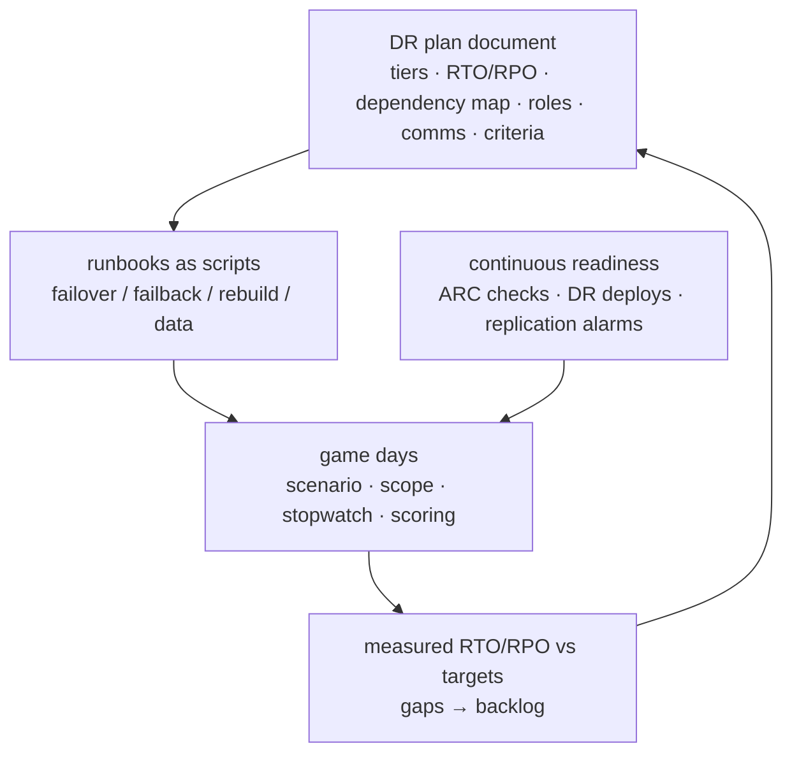

# Resilience and DR · L400 — The DR plan and game days

**Level:** 400 · **Time:** ~75 min · **Prerequisites:** [L300 DR strategies for container platforms](L300-dr-strategies-for-container-platforms.md),
[Well-Architected L300](../12-well-architected/L300-running-a-review.md)

**After this document you can:**

- Write a DR plan for a container platform that an on-call engineer can execute at 3 a.m.
- Structure failover and failback runbooks with decision criteria and verification.
- Design and run game days that produce measured RTO/RPO and a fix list.
- Pick a multi-Region reference architecture for ECS or EKS and know its pitfalls and cost.

## 1. Mental model



A DR plan is a contract between the business (which tolerates a given outage and data loss) and the
platform (which promises to meet it), made credible by runbooks that are scripts and by game days that
measure them. Without the measurement the plan is a hypothesis; without the plan the game day has no
pass criteria. The loop — plan, script, rehearse, measure, fix — is the deliverable; the documents
are its artifacts.

## 2. Concepts

### 2.1 The DR plan document

Sections, with the shopfront example in brackets ([template](../../playbooks/dr/dr-plan-template.md)):

1. **Scope and tiers**: services grouped by business impact; RTO/RPO per tier agreed with owners
   [tier 1: orders/catalog API, RTO 30 min, RPO 1 min; tier 2: fulfilment, RTO 2 h, RPO 15 min
   (republish window); tier 3: analytics/reporting, RTO 24 h, RPO 24 h].
2. **Strategy per tier**: warm standby / pilot light / backup-restore [tier 1–2 warm standby in
   us-west-2; tier 3 backup-restore].
3. **Dependency map**: every external and internal dependency with its DR property [Aurora Global,
   ElastiCache cold, SQS republish, MSK Replicator, S3 CRR, Secrets replicas, ACM/PCA per Region,
   third-party payment API endpoints per Region].
4. **Roles**: incident commander, platform lead, data lead, communications, business approver; on-call
   rotation and escalation.
5. **Decision criteria**: what evidence triggers failover [AWS Health event for the Region or
   Synthetics from two other Regions failing for 10 minutes with no recovery signal and the incident
   commander's call]; who approves; what is *not* a trigger (single-AZ events → zonal shift).
6. **Communications**: status page, stakeholder channel, customer messaging templates, cadence.
7. **Runbooks**: links to failover, failback, cluster rebuild, data recovery, each a script with
   verification steps.
8. **Continuous readiness**: replication alarms, ARC readiness checks, DR deploy pipeline, quota
   parity, quarterly game day; the metrics in §2.8.
9. **Known gaps and risks**: accepted deviations with owners and dates.

### 2.2 Failover runbook structure

Each step has a command, an expected observation and an abort path:

| Step | Action | Verify | Abort/rollback |
| --- | --- | --- | --- |
| 0 Declare | incident opened, roles assigned, comms started | timeline started | — |
| 1 Freeze | pause deployments in both Regions (pipeline lock) | no in-progress rollouts | — |
| 2 Promote data | Aurora Global failover/switchover to us-west-2; promote ElastiCache Global Datastore or accept cold | new writer endpoint answers `SELECT 1`; replication direction reversed | if primary recovers before promotion: cancel |
| 3 Secrets/config | confirm replica secrets resolve; update endpoint CNAMEs if not stable | tasks in DR reach `/readyz` 200 | — |
| 4 Scale compute | ECS `desiredCount` → production; EKS HPA min/replicas → production; NodePool limits | `RunningTaskCount`/Ready pods at target | scale back |
| 5 Republish async work | run the reconciliation job (orders `CREATED` older than N minutes → SQS in DR; MSK consumers switch bootstrap) | queue depth rises then drains | — |
| 6 Verify | Synthetics in DR green; smoke tests; error rate and latency within SLO | dashboards | fix before routing |
| 7 Route traffic | ARC routing control: primary off, DR on (or weighted 5% → 100%) | Route 53 health checks; traffic in DR; primary quiet | switch back |
| 8 Communicate | status page update; stakeholders | — | — |
| 9 Stabilise | watch 30 minutes; scale as needed; note data reconciliation tasks | SLO met | — |

Failback is the mirror with two additions: data resynchronisation direction (Aurora Global switchover
back once the old primary is healthy; MSK Replicator reversed), and a deliberate low-traffic window
with weighted routing because failback is a second failover you chose.

### 2.3 Cluster rebuild and data recovery runbooks

The [cluster rebuild runbook](../../playbooks/dr/cluster-rebuild-runbook.md) covers the backup/restore
tier and the "cluster lost" case: stacks from IaC, add-ons/capabilities, identities (OIDC providers,
Pod Identity associations, access entries), GitOps bootstrap, Velero restore for stateful namespaces,
verification. The [data recovery runbook](../../playbooks/dr/data-recovery-runbook.md) covers
point-in-time restore for Aurora/RDS (logical corruption, not Region loss), cache rebuild, queue
redrive and republish, MSK topic recovery from the replica, S3 versioning recovery.

### 2.4 Game-day design

| Element | Choice |
| --- | --- |
| Scenario | one named failure per game day: Region impairment (full failover), AZ impairment (zonal shift), database corruption (PITR), cluster loss (rebuild), dependency outage (payment API), deployment gone wrong (rollback) |
| Scope | staging first, then production for AZ-level and deployment scenarios; Region failover in production only after two staging rehearsals with the same scripts |
| Blast radius controls | FIS stop conditions on SLO alarms; ARC safety rules; a named "stop the game" role |
| Roles | the real on-call executes; authors observe; a scribe records timestamps |
| Measurements | detection time, decision time, execution time per step, RTO, RPO (data checks), errors seen by Synthetics, cost of the exercise |
| Scoring | pass = RTO/RPO within target with no manual improvisation; every improvisation becomes a script fix |
| Follow-up | a fix list with owners and dates; the next game day starts by verifying them |

Cadence: quarterly for tier 1 (alternating scenarios), twice a year full Region failover in
production for organisations whose tier-1 targets justify it, monthly small FIS experiments in
staging. The [game-day guide](../../playbooks/dr/game-day-guide.md) has the agenda and scorecard.

### 2.5 Fault injection scenarios that matter

| Scenario | Tooling | Pass criteria |
| --- | --- | --- |
| AZ impairment | FIS `aws:network:disrupt-connectivity` on one AZ's subnets + `stop-instances`; ARC zonal shift | error rate flat; remaining AZs under 67%; shift completed within 5 min |
| Node loss at scale | FIS `terminate-nodegroup-instances` 30% | pods rescheduled within PDB limits; no 5xx |
| Database failover | FIS `aws:rds:failover-db-cluster` | reconnect within pool timeouts; errors < 60 s |
| Cache loss | delete/flush ElastiCache (staging) | database within capacity; `BYPASS` path holds |
| Queue consumer outage | scale worker to zero for 10 min | queue age alarm; drain time as predicted; no data loss |
| Region failover | ARC routing controls + runbook | RTO/RPO within target; all steps scripted |
| Bad deployment | deploy a revision returning 5xx to 5% | canary/alarm rollback within bake time |

### 2.6 Multi-Region reference architectures

**ECS warm standby (tier 1–2)**: per Region a VPC (IPAM-allocated CIDRs), ECS cluster on Fargate,
ALB + WAF, Service Connect namespace, ECR with replication both ways, Aurora Global (writer in primary),
ElastiCache per Region (Global Datastore optional), SQS per Region with a republish job, MSK Replicator
to the standby, S3 CRR, Secrets replicas, ACM per Region, Synthetics from a third Region, ARC routing
controls; services at `desiredCount 1` in standby with auto scaling min raised on failover.

**EKS warm standby**: the same data and edge layers; per Region an EKS cluster (Auto Mode: nodes scale
from zero), GitOps (EKS Capability or Argo CD) converging the same overlays with Region parameters,
Pod Identity associations and access entries from IaC, Velero for stateful namespaces if any.

**Active/active (tier 0)**: only with partitioned data (tenant → home Region) or globally replicated
stores designed for it (DynamoDB global tables); Global Accelerator or latency-based routing with
health checks; every Region sized for the other's failover load or a degraded mode defined.

### 2.7 Pitfalls

- Quotas at defaults in the DR Region (Fargate vCPU, EC2 instances, EIPs, ENIs); raise them ahead.
- AMIs, Bottlerocket variants and add-on versions differ per Region; parameterise.
- IAM roles are global but OIDC providers, Pod Identity associations, access entries, Private CA,
  ACM certificates, KMS keys (unless MRK), Secrets (unless replicated), CloudWatch alarms, dashboards,
  FIS templates and ARC constructs are regional.
- Data reconciliation after failback: writes that happened in DR must flow back (Aurora Global
  switchover handles it; SQS/manual side effects do not).
- Third-party dependencies with Region-specific endpoints or IP allowlists.
- Pipelines pinned to one Region (a fix cannot be deployed during the disaster).
- DNS TTLs and client caches; long-lived connections to the old Region.
- Cost surprises: cross-Region replication data transfer, duplicate load balancers, EKS control-plane
  fees, MSK Replicator per-GB.

### 2.8 Cost of DR and readiness metrics

Cost lines: standby compute (warm: 10–20% of production; pilot light: control planes only), data
replicas (Aurora Global secondary instances, MSK replica cluster, ElastiCache secondary), replication
transfer (ECR, S3, MSK, Aurora), duplicate edge (ALB/WAF/NAT), observability per Region, game-day
hours. Compare against the cost of the outage the tier's RTO/RPO implies; document the decision.

Readiness metrics (dashboard and monthly report): replication lag per store; age of last successful
DR deploy of the current release; ARC readiness check status (capacity, quotas, configuration parity);
quota headroom in DR; last game day date and measured RTO/RPO vs target; open fix-list items; drift
between primary and DR IaC parameters; percentage of runbook steps automated.

## 3. How it interacts with the rest of AWS

| Component | Talks to | Protocol/API | Prerequisite (IAM, network, DNS) | What breaks if missing |
| --- | --- | --- | --- | --- |
| Runbook scripts | RDS/Aurora, ECS/EKS, SQS, ARC, Route 53 | AWS APIs with a break-glass DR role | role in both Regions with scoped permissions | improvisation at 3 a.m. |
| ARC | Route 53 health checks, routing controls, readiness checks | control plane (5-Region cluster) | ARC cluster and control panel created | no guarded failover |
| FIS | targets | experiment role | stop conditions | unbounded experiments |
| AWS Health | incident process | EventBridge `aws.health` events | rule to paging | slow detection |
| Synthetics (third Region) | both stacks | HTTPS | canaries per Region | no external SLI |
| Pipelines | DR Region | OIDC roles per account/Region | Region parameter | no fixes during disaster |
| Cost Explorer | DR resources | tags | `DR=true` tag | untracked DR spend |

## 4. Use it when / avoid it when

Use:

- A written plan with tiers agreed by the business; runbooks as scripts; quarterly game days with
  scorecards; readiness metrics on a dashboard.
- Warm standby for tier 1 unless active/active is justified by data design and revenue.
- ARC routing controls and readiness checks for Region failover; zonal shift for AZ events.

Avoid:

- Plans that name products but not steps; runbooks that were never executed.
- Game days without stop conditions or without the real on-call executing.
- Failback without a low-traffic window and a data reconciliation check.
- Active/active as a default; partition first.

Alternatives: for tier 3 and internal tools, a tested backup/restore with a documented RTO in hours
is a legitimate plan; for organisations without multi-Region requirements, invest in AZ isolation and
cells first.

## 5. Well-Architected view

| Pillar | Contribution | Cost | Practice (REL 13) |
| --- | --- | --- | --- |
| Operational Excellence | plan, scripts, game days, readiness dashboard | rehearsal time | quarterly cadence; fix lists tracked |
| Security | DR Region controls verified in readiness checks | duplication | controls in the rebuild pipeline; break-glass audited |
| Reliability | measured RTO/RPO; guarded failover; drift management | standby | REL 13: define objectives, use defined strategies, test DR, manage configuration drift |
| Performance Efficiency | DR sized for full load | headroom | ARC capacity readiness |
| Cost Optimization | tiered strategies; standby right-sized | replicas | cost vs outage decision documented |
| Sustainability | no idle duplicate stacks beyond need | none | pilot light where RTO allows |

## 6. Failure modes and troubleshooting

| Symptom | Likely cause | How to confirm (command/metric) | Fix |
| --- | --- | --- | --- |
| Game day exceeds RTO at "scale compute" | quotas or NodePool limits in DR | Karpenter/ECS events; Service Quotas | raise; encode in readiness checks |
| Failover succeeds, users still hit primary | DNS caching; long-lived connections | client-side resolution; connection counts on old ALB | Global Accelerator; connection draining; shorter TTLs |
| Data in DR missing recent writes | replication lag at failover; unplanned vs planned switchover | `AuroraGlobalDBRPOLag`; app-level reconciliation | accept RPO or use switchover when possible; reconcile |
| Fulfilment does not resume | republish job not run or pointed at wrong queue | queue depth; job logs | scripted step 5; Region-parameterised queue URLs |
| Failback corrupts data | writes in both Regions | audit | freeze writes before failback; single-writer discipline |
| Runbook step fails due to permissions | DR role missing actions in the other Region | `AccessDenied` | policy scoped for both Regions; test in game day |
| Nobody can deploy a fix during failover | pipeline pinned to primary Region | pipeline logs | Region parameter; DR deploy job rehearsed |
| Readiness checks green, failover fails | checks cover quotas but not application config | game day | add configuration parity checks (secrets, endpoints) |

## 7. Signals: metrics, logs, traces

- Replication: Aurora Global lag/RPO lag, MSK Replicator latency, S3 RTC latency, ECR replication
  events, Secrets replication status, Velero backup age.
- Readiness: ARC readiness check status per rule; quota headroom in DR; last DR deploy age; IaC drift.
- Execution: step timings from the incident timeline (custom metrics), ARC routing control state
  changes, Route 53 health check flips, Synthetics in DR.
- Business: orders created vs fulfilled during and after failover; reconciliation counts.
- Governance: game days per year, measured RTO/RPO vs target, open fix items, runbook automation
  percentage, DR cost as a share of production.

Full table: [`reference/metrics-catalog.md`](../../reference/metrics-catalog.md).

## 8. Testing and DR notes

This document is the testing programme: game days with scenarios from §2.5, scored against the plan's
targets, plus continuous readiness (DR deploy pipeline, ARC checks, replication alarms, Velero restore
tests). Record every exercise (date, scenario, RTO/RPO achieved, improvisations, fixes) in the plan's
history; auditors and future on-call engineers read that section first.

## 9. Hands-on

```bash
# 1. Fill the DR plan template for shopfront and read the runbooks
sed -n '1,80p' playbooks/dr/dr-plan-template.md
grep -nE '^## |^### ' playbooks/dr/region-failover-runbook.md playbooks/dr/game-day-guide.md

# 2. Tabletop the failover locally: the "republish" step against the Compose stack
make up && make smoke
docker compose -f labs/local/compose.yaml stop fulfillment-worker
for i in 1 2 3; do curl -s -o /dev/null -X POST localhost:8080/orders -H 'content-type: application/json' -d '{"productId":1,"quantity":1}'; done
docker compose -f labs/local/compose.yaml exec -T postgres psql -U app -d shopfront -c \
  "select id, created_at from orders where status='CREATED' order by created_at;"   # the republish candidates
docker compose -f labs/local/compose.yaml start fulfillment-worker                 # in DR this is: republish + start consumers

# 3. (billable) readiness and routing constructs
aws route53-recovery-control-config list-clusters --query 'Clusters[].Name' 2>/dev/null || echo "ARC cluster not created"
aws route53-recovery-readiness list-recovery-groups --query 'RecoveryGroups[].RecoveryGroupName' 2>/dev/null
aws health describe-events --filter eventStatusCodes=open --query 'events[].{service:service,region:region,type:eventTypeCode}' 2>/dev/null

# 4. (billable) game-day stopwatch skeleton
START=$(date +%s); echo "declare $(date -u +%T)"
# ... run playbooks/dr/region-failover-runbook.md steps, echoing timestamps after each ...
echo "RTO seconds: $(( $(date +%s) - START ))"
```

## 10. Check yourself

1. What makes a DR runbook credible, and what is the difference between a plan and a hypothesis?

<details><summary>Answer</summary>
Credible runbooks are executable scripts with a verification and an abort path per step, run by the
real on-call in game days with a stopwatch. A plan becomes more than a hypothesis when it records
measured RTO/RPO from those exercises against the agreed targets, with the gaps tracked to fixes.
</details>

2. Which failover step most often exceeds its estimate on first execution, and how do readiness
   checks prevent it?

<details><summary>Answer</summary>
Scaling compute in the DR Region: default quotas (Fargate vCPU, EC2 instances, ENIs), NodePool or
ASG limits copied from a small environment, or missing capacity types stall the scale-out. ARC
readiness checks (or your own) continuously compare quotas, capacity and configuration between
Regions and alarm on drift before the day you need them.
</details>

3. Why is failback riskier than failover, and what two controls reduce the risk?

<details><summary>Answer</summary>
Failback is a deliberate second failover during recovery, and writes now exist in the DR Region that
must flow back without conflict. Controls: a low-traffic window with weighted routing (5% first) and
a strict single-writer sequence (freeze writes, Aurora Global switchover so replication reverses,
reconcile side effects and queues) before moving the rest of the traffic.
</details>

4. What does a game-day scorecard contain?

<details><summary>Answer</summary>
Scenario and scope, participants and roles, timestamps per step, measured detection/decision/
execution/propagation times (RTO), data checks (RPO), errors observed by Synthetics and alarms, every
improvisation or manual deviation, cost, pass/fail against targets, and the fix list with owners and
dates to verify at the start of the next game day.
</details>

5. Name four AWS resources that must exist per Region in the DR plan even though "IAM is global".

<details><summary>Answer</summary>
EKS Pod Identity associations and IRSA OIDC providers (per cluster), access entries, AWS Private CA and
ACM certificates, KMS keys (unless multi-Region keys), Secrets Manager secrets (unless replicated),
CloudWatch alarms/dashboards/Synthetics, FIS experiment templates, ARC constructs, VPC endpoints and
Service Quotas. IAM roles themselves are global, but nearly everything that binds them to a cluster or
a resource is regional.
</details>

## 11. Sources

- AWS Well-Architected Reliability pillar: REL 13 plan for disaster recovery — https://docs.aws.amazon.com/wellarchitected/latest/reliability-pillar/plan-for-disaster-recovery-dr.html
- Disaster recovery of workloads on AWS (whitepaper) — https://docs.aws.amazon.com/whitepapers/latest/disaster-recovery-workloads-on-aws/disaster-recovery-workloads-on-aws.html
- Amazon Application Recovery Controller: routing controls, readiness checks, zonal shift — https://docs.aws.amazon.com/r53recovery/latest/dg/what-is-route53-recovery.html
- AWS Fault Injection Service: experiment templates and stop conditions — https://docs.aws.amazon.com/fis/latest/userguide/what-is.html
- AWS Health API and EventBridge integration — https://docs.aws.amazon.com/health/latest/ug/cloudwatch-events-health.html
- Aurora Global Database switchover and failover — https://docs.aws.amazon.com/AmazonRDS/latest/AuroraUserGuide/aurora-global-database-disaster-recovery.html
- Amazon EKS Best Practices: reliability — https://docs.aws.amazon.com/eks/latest/best-practices/reliability.html
- Amazon ECS Best Practices Guide: resilience and availability — https://docs.aws.amazon.com/AmazonECS/latest/bestpracticesguide/intro.html
- Chaos engineering on AWS (Prescriptive Guidance) — https://docs.aws.amazon.com/prescriptive-guidance/latest/chaos-engineering-on-aws/introduction.html
- Multi-Region fundamentals (AWS whitepaper) — https://docs.aws.amazon.com/whitepapers/latest/aws-multi-region-fundamentals/aws-multi-region-fundamentals.html
- Google SRE Workbook: disaster role playing and DiRT — https://sre.google/sre-book/accelerating-sre-on-call/
