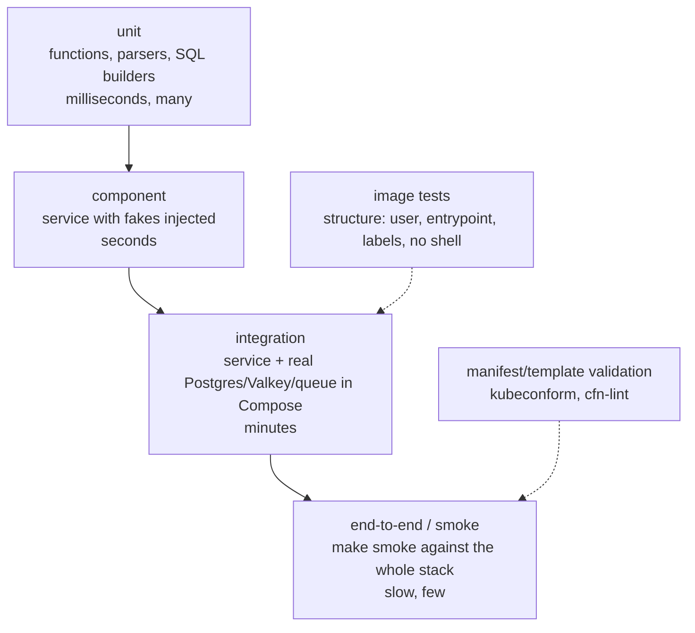

# Testing workloads · L100 — Testing basics

**Level:** 100 · **Time:** ~30 min · **Prerequisites:** [Container fundamentals L100](../01-container-fundamentals/L100-containers-explained.md),
a working `make up`

**After this document you can:**

- Place each kind of test for a container service on the pyramid and say what it proves.
- Run unit tests, integration tests against real dependencies with Compose, and a smoke test.
- Write a container structure test and a health endpoint test.

## 1. Mental model



Tests trade speed for realism. Unit tests run in milliseconds and prove logic; component tests
exercise the service's HTTP surface with fake dependencies and prove wiring; integration tests run the
service against real dependencies in containers and prove the contract with PostgreSQL, Valkey, SQS
and Kafka; smoke tests exercise the deployed system end to end and prove it works where it runs.
Two container-specific rungs sit beside the pyramid: tests of the image itself (does it run as the
right user, with the right entrypoint, without a shell?) and validation of the infrastructure code
that deploys it. The pipeline runs them in that order so the cheapest test fails first.

## 2. Concepts

### 2.1 The pyramid for shopfront

| Rung | Where in the repository | Runs in | Proves |
| --- | --- | --- | --- |
| Unit | `labs/apps/catalog/internal/*/…_test.go`; `labs/apps/orders/test/app.test.ts`; `labs/apps/worker/tests/`; `labs/apps/report-job/tests/` | `go test`, `node --test`, `pytest` | handlers, parsing, SQL argument building, telemetry extraction |
| Component | the same test files using injected fakes (`buildApp({deps})`, fake `Store`/`Cache`) and `app.inject()`/`httptest` | seconds | routes, status codes, `X-Cache` header, readiness 503 semantics |
| Integration | `make up` then targeted `curl`/SQL | Compose | real database schema, queue attributes, Kafka headers |
| Smoke / end-to-end | [`labs/local/smoke.sh`](../../labs/local/smoke.sh) | Compose or a deployed environment (`ORDERS_URL=…`) | the seven contract steps: readiness, cache HIT, order, fulfilment, metrics, analytics, trace |
| Image | container structure tests (§2.4) | CI after build | non-root, entrypoint, labels, no shell |
| Infrastructure | `make check` (`kubeconform`, `cfn-lint`, `shellcheck`, link/heading checks) | seconds | manifests and templates are valid before any deploy |

### 2.2 Unit and component tests with fakes

The services are written so their edges are injectable: `catalog` takes `Store` and `Cache`
interfaces; `orders` builds its Fastify app from a `deps` object; the worker's handlers take a
database object. Fakes make the tests deterministic and fast, and let you test failure paths that are
hard to produce with real dependencies (a store that errors, a cache that times out).

```bash
(cd labs/apps/orders && npm test)                                  # 12 tests with fakes: 201/404/409/400, readyz 503, metrics
docker run --rm -v "$PWD/labs/apps/catalog":/src -w /src golang:1.23-bookworm go test ./...
docker run --rm -v "$PWD/labs/apps/worker":/src -w /src python:3.12-slim-bookworm sh -c 'pip install -q -r requirements.txt pytest && python -m pytest -q'
```

### 2.3 Integration tests with Compose

Compose gives every developer and every CI job the same PostgreSQL 16, Valkey 8, Kafka 3.9 and an
SQS-compatible ElasticMQ, seeded with the schema. Integration tests are the tests you cannot write
with fakes: the SQL against the real schema, the queue's redrive policy, Kafka header propagation.
The pattern: start the stack, wait for readiness, run the assertions, tear down.

```bash
make up                         # builds images, starts dependencies and services
curl -s localhost:8081/products/1 | jq .sku
docker compose -f labs/local/compose.yaml exec -T postgres psql -U app -d shopfront -tAc "select count(*) from products;"
make down
```

Testcontainers does the same from inside a test runner per test class ([L200 §2.1](L200-testing-in-pipelines-and-clusters.md)).

### 2.4 Container structure tests

The image is an artifact with its own contract: it runs as uid 10001, has the expected entrypoint,
carries OCI labels, exposes the documented port and (for distroless) has no shell. Test it after every
build:

```bash
for img in catalog orders worker report-job; do
  docker inspect shopfront/$img:dev --format '{{.Config.User}} | {{join .Config.Entrypoint " "}} | {{index .Config.Labels "org.opencontainers.image.title"}}'
done
docker run --rm --entrypoint /bin/sh shopfront/catalog:dev -c 'echo shell' && echo "FAIL: shell present" || echo "PASS: distroless has no shell"
docker run --rm shopfront/orders:dev 2>&1 | head -2 ; echo "exit $? (expect 2: configuration error without env)"
```

The `container-structure-test` tool (Google) expresses these as YAML (`fileExistenceTests`,
`metadataTest`, `commandTests`) and runs in CI.

### 2.5 Health endpoint tests

Health endpoints are part of the contract: `/healthz` must be 200 whenever the process is up;
`/readyz` must be 503 with the failing check named when a dependency is down. Test both branches:

```bash
make up
curl -s -o /dev/null -w '%{http_code}\n' localhost:8080/healthz              # 200
docker compose -f labs/local/compose.yaml stop postgres
curl -s localhost:8080/readyz | jq                                          # 503 {"status":"not-ready","checks":{"database":"error: …"}}
docker compose -f labs/local/compose.yaml start postgres
```

### 2.6 Smoke tests after deploy

A smoke test is the smallest end-to-end exercise that proves the deployed system works: create an
order, watch it get fulfilled, check a metric, find the trace. It runs after every deployment
(locally, in staging, in production against a test product) and is the last gate before traffic or the
first alarm after it. `labs/local/smoke.sh` accepts `ORDERS_URL`, `CATALOG_URL` and `JAEGER_URL` so the
same script runs against an environment on AWS.

## 3. How it interacts with the rest of AWS

| Component | Talks to | Protocol/API | Prerequisite (IAM, network, DNS) | What breaks if missing |
| --- | --- | --- | --- | --- |
| CI runner | Docker Engine (Compose) | local | Docker available on the runner (hosted runners have it; CodeBuild privileged mode) | integration tests cannot run |
| Smoke test | deployed ALB endpoint | HTTPS | test data (product ids) and network reach from the runner | false failures |
| Image tests | built images | local | build step before tests | untested images |
| `make check` | none | local | `.venv`, `kubeconform`, `shellcheck` | invalid manifests reach deploy |

## 4. Use it when / avoid it when

Use:

- Unit/component tests with injected fakes for logic and status codes; Compose for anything that
  touches SQL, queue semantics or Kafka.
- Structure tests on every image; health endpoint tests for both branches.
- The smoke test after every deployment, everywhere.

Avoid:

- Mocking the database for SQL-heavy code (the fake agrees with itself, not with PostgreSQL).
- Tests that need a real AWS account to pass in CI (use Compose/LocalStack for the API layer, a
  scheduled job for real-account checks).
- Skipping structure tests because "the Dockerfile has `USER`" — verify the artifact, not the intent.

Alternatives: Testcontainers instead of a repo-wide Compose file for per-test isolation; a scratch EKS
cluster for tests that need Kubernetes semantics ([L200](L200-testing-in-pipelines-and-clusters.md)).

## 5. Well-Architected view

| Pillar | Contribution | Cost | Practice |
| --- | --- | --- | --- |
| Operational Excellence | fast feedback; smoke tests as deployment gates | test maintenance | tests run in the pipeline order of the pyramid |
| Security | structure tests catch root/shell regressions | none | non-root/no-shell assertions |
| Reliability | health endpoint tests catch readiness bugs | none | both branches tested |
| Performance Efficiency | fast unit tests keep pipelines short | none | fakes for logic |
| Cost Optimization | Compose instead of cloud environments for integration | runner time | local dependencies |
| Sustainability | fewer cloud test environments | none | Compose/Testcontainers |

## 6. Failure modes and troubleshooting

| Symptom | Likely cause | How to confirm (command/metric) | Fix |
| --- | --- | --- | --- |
| Integration tests flaky in CI | services start before dependencies are ready | logs show connection retries | health-conditioned `depends_on`; wait for `/readyz` |
| Smoke step 4 times out | worker cannot reach the queue; DLQ | worker logs; ElasticMQ UI | fix config ([playbook](../../playbooks/incidents/queue-backlog-and-consumer-lag.md)) |
| Structure test fails on user | `USER` missing or overridden | `docker inspect` | fix Dockerfile |
| Tests pass locally, fail on hosted runner | architecture (arm64 vs amd64) or Docker not privileged | runner logs | multi-arch images; runner with Docker |
| Health test always 200 | readiness endpoint does not check dependencies | code | implement checks per contract |

## 7. Signals: metrics, logs, traces

- Test suite duration and pass rate per rung; flaky-test count.
- Smoke test results per environment and deployment (a metric emitted by the pipeline).
- Image test failures per build.
- From the smoke run itself: the trace it produced (Jaeger/X-Ray), `orders_created_total` increment.

Full table: [`reference/metrics-catalog.md`](../../reference/metrics-catalog.md).

## 8. Testing and DR notes

This document is the base of the testing programme; DR enters at [L300](L300-performance-and-chaos-testing.md)
and [L400](L400-verification-at-scale.md): the same smoke test runs against the DR Region after a
failover and is the first evidence that the rebuilt environment works.

## 9. Hands-on

```bash
# 1. Run the pyramid bottom-up
(cd labs/apps/orders && npm test)
docker run --rm -v "$PWD/labs/apps/catalog":/src -w /src -e GOFLAGS=-mod=mod golang:1.23-bookworm go test ./...
make build-images && for i in catalog orders worker report-job; do docker inspect shopfront/$i:dev --format '{{.Config.User}} {{.Config.Entrypoint}}'; done
make up && make smoke

# 2. Break something and watch the right test catch it
docker compose -f labs/local/compose.yaml stop valkey && make smoke ; echo "step 2 should FAIL with BYPASS"
docker compose -f labs/local/compose.yaml start valkey

# 3. Point the smoke test at another environment (after deploying the labs)
ORDERS_URL=https://shopfront.example.com CATALOG_URL=https://shopfront.example.com JAEGER_URL=https://console.aws.amazon.com/cloudwatch labs/local/smoke.sh
make down
```

## 10. Check yourself

1. Which tests should use fakes and which must use real dependencies?

<details><summary>Answer</summary>
Fakes for logic and wiring: status codes, validation, header semantics, error branches that are hard
to reproduce. Real dependencies for anything whose truth is in the dependency: SQL against the schema,
queue visibility/redrive behaviour, Kafka header propagation, cache TTL behaviour. Compose or
Testcontainers make the real ones cheap.
</details>

2. What does a container structure test catch that unit tests cannot?

<details><summary>Answer</summary>
Properties of the built artifact: the effective user (a base image change can reintroduce root), the
entrypoint, labels, exposed ports, the presence of a shell or package manager, file permissions. Unit
tests run source, not the image.
</details>

3. Why must the readiness endpoint be tested in its failing branch?

<details><summary>Answer</summary>
A readiness endpoint that always returns 200 passes every happy-path test and silently routes traffic
to a copy whose database is unreachable in production; the load balancer and the orchestrator rely on
the 503 to remove it. Stopping the dependency in Compose and asserting 503 with the named check proves
the behaviour.
</details>

4. What is a smoke test and where does it run?

<details><summary>Answer</summary>
The smallest end-to-end exercise proving the deployed system works (create an order, see it fulfilled,
check a metric and a trace). It runs after every deployment in every environment, including production
against a test product, as the final gate and the first detector.
</details>

5. Why do the shopfront tests avoid needing an AWS account?

<details><summary>Answer</summary>
Tests that need real AWS resources are slow, cost money, need credentials in CI and fail for reasons
unrelated to the code. Compose provides PostgreSQL, Valkey, Kafka and an SQS-compatible API locally; the
SDK's endpoint override variables point the same code at them. Real-account checks belong in scheduled
jobs and game days, not in every pull request.
</details>

## 11. Sources

- Docker Compose documentation (healthchecks, `depends_on` conditions, profiles) — https://docs.docker.com/compose/
- container-structure-test — https://github.com/GoogleContainerTools/container-structure-test
- Testcontainers — https://testcontainers.com/
- Node.js test runner; Go testing; pytest — https://nodejs.org/api/test.html, https://pkg.go.dev/testing, https://docs.pytest.org/
- Kubernetes probes — https://kubernetes.io/docs/tasks/configure-pod-container/configure-liveness-readiness-startup-probes/
- The practical test pyramid (Martin Fowler) — https://martinfowler.com/articles/practical-test-pyramid.html
- AWS Well-Architected Container Build Lens: testing — https://docs.aws.amazon.com/wellarchitected/latest/container-build-lens/container-build-lens.html
