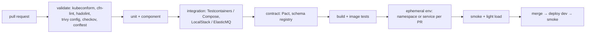

# Testing workloads · L200 — Testing in pipelines and clusters

**Level:** 200 · **Time:** ~60 min · **Prerequisites:** [L100 Testing basics](L100-testing-basics.md),
[Delivery L200](../08-delivery-cicd-gitops/L200-pipelines-on-aws.md)

**After this document you can:**

- Use Testcontainers and Compose in CI, and LocalStack/ElasticMQ for AWS APIs.
- Write contract tests between services and events.
- Stand up ephemeral environments per pull request on EKS and ECS, and use kind for pure Kubernetes
  logic.
- Validate every manifest, template and Dockerfile offline with the right tool.
- Choose a load-testing tool and generate test data safely.

## 1. Mental model



The pipeline is a funnel: the cheapest checks first, the environment-bound ones last, each producing
an artifact the next stage trusts. Validation tools catch malformed infrastructure code in seconds;
Testcontainers and Compose give integration tests real dependencies on any runner; contract tests keep
services and events compatible without deploying everything; an ephemeral environment per pull request
proves the change in a real cluster before merge; load and chaos wait for later levels.

## 2. Concepts

### 2.1 Testcontainers

Testcontainers starts dependencies as containers from inside the test runner and tears them down per
test class: `PostgreSqlContainer`, `GenericContainer("valkey/valkey:8-alpine")`, Kafka (KRaft) modules,
LocalStack module. Compared with a shared Compose file it isolates tests (each gets a fresh database),
parallelises, and needs only a Docker socket (or Testcontainers Cloud/`docker:dind`-free runners).

```go
// Go: a real PostgreSQL for the store tests
pg, _ := postgres.Run(ctx, "postgres:16-alpine", postgres.WithDatabase("shopfront"), postgres.WithUsername("app"), postgres.WithPassword("app"),
    postgres.WithInitScripts("../../local/schema.sql", "../../local/seed.sql"))
dsn, _ := pg.ConnectionString(ctx, "sslmode=disable")
```

```typescript
// Node: same idea
const pg = await new PostgreSqlContainer("postgres:16-alpine").withDatabase("shopfront").start();
```

Keep the images identical to Compose (`postgres:16-alpine`, `valkey/valkey:8-alpine`,
`apache/kafka:3.9.1`, `softwaremill/elasticmq-native`) so tests and local runs agree with production
versions.

### 2.2 Compose in CI

Hosted GitHub runners and CodeBuild (privileged mode) run Docker; `docker compose up -d --wait` starts
the stack with health conditions, `make smoke` asserts, `docker compose down -v` cleans up. Cache
image pulls (registry cache, pull-through cache) to keep the stage under a few minutes. Publish the
Compose logs as an artifact on failure. For Jenkins on EKS, the agent pod needs Docker (Docker
socket is a security risk); prefer Testcontainers with a remote Docker host or move integration tests
to a Kubernetes-native harness ([08 L200 §2.5](../08-delivery-cicd-gitops/L200-pipelines-on-aws.md)).

### 2.3 LocalStack and ElasticMQ

ElasticMQ implements the SQS API and is what the labs use (small, fast, exact visibility/redrive
semantics). LocalStack emulates many AWS APIs (S3, SQS, SNS, DynamoDB, Secrets Manager, EventBridge…)
for tests of code that calls several services; point the SDKs at it with `AWS_ENDPOINT_URL` (or
per-service `AWS_ENDPOINT_URL_S3`) and dummy credentials, as the compose file does. Emulators are for
API shape and application logic; they do not prove IAM policies, quotas or service behaviour under load
— those need a real account in later stages.

### 2.4 Contract tests

Between HTTP services: consumer-driven contracts (Pact) where `orders` publishes the expectations it
has of `catalog` (`GET /products/{id}` returns `id, sku, name, price_cents, stock`) and `catalog`'s
pipeline verifies them; or OpenAPI schemas validated on both sides. Between event producers and
consumers: the event envelope (`type`, `version`, fields) versioned in a schema registry with
compatibility rules (`BACKWARD`), checked in CI before a producer can publish a new version
([09 L300 §2.4](../09-data-messaging-and-batch/L300-messaging-and-data-deep-dive.md)). Contract
tests replace many slow end-to-end tests and catch breaking changes before deployment.

### 2.5 Ephemeral environments

| Platform | Pattern | Isolation | Teardown |
| --- | --- | --- | --- |
| EKS | namespace per PR (`pr-1234`) from the Kustomize base with an overlay generated by the pipeline; Ingress host `pr-1234.dev.shopfront.example.com` via IngressGroup + external-dns; own database schema or a per-PR Aurora clone/Serverless database | namespace + NetworkPolicy + quota | pipeline deletes the namespace on PR close; TTL controller as backstop |
| ECS | service per PR in a shared dev cluster with a listener rule on the shared ALB; task definition family per PR | security group per PR | pipeline deletes; scheduled cleanup |
| Data | seeded schema per environment; Aurora fast clone for realistic data (masked) | per-PR credentials | delete with the environment |

Argo CD `ApplicationSet` with a pull-request generator creates the EKS variant automatically. Cost
control: small resource requests, Fargate/Auto Mode scale-to-zero when idle, TTLs.

### 2.6 kind and minikube

kind runs Kubernetes in Docker in under a minute and is right for testing manifests' behaviour
(admission policies, RBAC, NetworkPolicy semantics with a CNI that enforces them, operators, Helm
charts) without a cloud. It is wrong for anything AWS-specific (VPC CNI, load balancer controller,
Pod Identity, EBS). The pipeline: `kind create cluster`, `kubectl apply -k overlays/kind` (a lightweight
overlay with NodePort Services), run tests, delete.

### 2.7 Validation tooling

| Tool | Validates | Command |
| --- | --- | --- |
| `kubeconform` | Kubernetes manifests against schemas (with CRD schemas from a catalog) | `kubectl kustomize labs/eks/manifests/overlays/dev | kubeconform -strict -ignore-missing-schemas -summary` |
| `kube-linter` | Kubernetes best practices (probes, resources, non-root, PDBs) | `kube-linter lint labs/eks/manifests/` |
| `helm lint` / `helm template … | kubeconform` | charts and rendered output | as shown |
| `cfn-lint` | CloudFormation syntax, resource properties, rules | `cfn-lint labs/ecs/cloudformation/*.yaml` |
| `cfn-guard` / `checkov` / `trivy config` | policy: encryption, public access, IMDSv2, logging | `checkov -d labs/ecs/cloudformation/`; `trivy config labs/` |
| `hadolint` | Dockerfile best practices | `hadolint labs/apps/*/Dockerfile` |
| `trivy image` | vulnerabilities, secrets, misconfigurations in images | `trivy image --severity HIGH,CRITICAL --ignore-unfixed shopfront/orders:dev` |
| `conftest` | custom Rego policies on any YAML/JSON | `conftest test -p policy/ labs/eks/manifests/` |
| `shellcheck`, `actionlint` | scripts and workflows | `shellcheck labs/**/*.sh`; `actionlint labs/pipelines/github-actions/*.yml` |
| `tools/check.sh` (this repo) | headings, links, language, YAML/JSON, plus the above where installed | `make check` |

Run them as pre-commit hooks and as the first pipeline stage; fail fast.

### 2.8 Load-testing tools

| Tool | Model | Strengths | Use |
| --- | --- | --- | --- |
| k6 | scripted (JavaScript), open/closed executors, thresholds | CI-friendly, precise, SLO thresholds fail the run | the default for API load tests |
| Locust | Python users, distributed workers | complex user behaviour, Python ecosystem | scenario-heavy tests |
| Artillery | YAML scenarios, plugins | quick HTTP/WebSocket tests | simple services |
| Distributed Load Testing on AWS | AWS Solution running JMeter/k6/Locust on Fargate across Regions | scale without managing generators | large or multi-Region tests |
| Vegeta/hey/wrk | constant-rate or connection-based | quick benchmarks | one-off measurements |

Design questions (open vs closed models, thresholds, warm-up) are in [L300 §2.1](L300-performance-and-chaos-testing.md).

### 2.9 Test data

Seed deterministic data (the 12 products) for functional tests; generate volume with scripts for load
tests; never copy production data into non-production without masking (Aurora clones plus a masking
job, or synthetic generators); keep test products/accounts in production for smoke tests and exclude
them from analytics.

## 3. How it interacts with the rest of AWS

| Component | Talks to | Protocol/API | Prerequisite (IAM, network, DNS) | What breaks if missing |
| --- | --- | --- | --- | --- |
| CI runner (Testcontainers/Compose) | Docker | local socket | Docker on runner; privileged CodeBuild | no integration stage |
| Ephemeral env pipeline | EKS/ECS, Route 53 (external-dns), ECR | deploy role per environment | wildcard certificate; DNS zone; quotas for many environments | PRs cannot be previewed |
| Argo CD ApplicationSet PR generator | GitHub API, cluster | token; RBAC | app project allows the namespace pattern | environments not created |
| Validation stage | none | local | tools installed/pinned | invalid IaC reaches deploy |
| Load generators (DLT) | target ALB | HTTPS | allowlisting; WAF rules for test traffic | tests blocked or skew metrics |
| LocalStack | SDKs | HTTP | endpoint env vars | tests hit real AWS by accident |

## 4. Use it when / avoid it when

Use:

- Testcontainers for per-test isolation; Compose for the whole-system smoke; identical image tags.
- Contract tests to decouple service pipelines; schema registry checks for events.
- Ephemeral environments for anything touching Ingress, Pod Identity or the load balancer controller.
- The full validation toolset as the first stage.

Avoid:

- Docker socket mounts in Jenkins agents for tests; use Testcontainers with a remote host or kind.
- Production data in test environments without masking.
- Emulators as proof of IAM correctness.
- Long-lived "staging" as the only pre-production environment for many teams (contention).

Alternatives: shared staging with feature flags for teams without ephemeral environments; Testcontainers
Cloud when runners lack Docker.

## 5. Well-Architected view

| Pillar | Contribution | Cost | Practice |
| --- | --- | --- | --- |
| Operational Excellence | fast feedback; environments as code | pipeline complexity | validation stage first; TTL cleanup |
| Security | policy tools (`checkov`, `trivy config`) catch misconfigurations pre-deploy; masked data | tool upkeep | pinned tool versions |
| Reliability | contract tests prevent breaking changes | maintenance | consumer-driven contracts |
| Performance Efficiency | k6 thresholds in CI catch regressions | runner time | light load test per PR |
| Cost Optimization | ephemeral envs with TTL; Compose over cloud | Docker runner time | scale-to-zero previews |
| Sustainability | fewer permanent environments | none | TTLs |

## 6. Failure modes and troubleshooting

| Symptom | Likely cause | How to confirm (command/metric) | Fix |
| --- | --- | --- | --- |
| Testcontainers cannot start | no Docker on runner; socket permissions | test logs | runner with Docker; Testcontainers Cloud |
| Ephemeral env stuck without address | IngressGroup conflict; external-dns permissions | controller logs | unique hosts; permissions |
| kubeconform passes, apply fails | CRD schema missing (`-ignore-missing-schemas`) | server dry-run | add CRD schemas; `kubectl apply --dry-run=server` |
| PR environments leak | teardown skipped on PR close | namespace list | TTL controller; scheduled cleanup |
| Tests hit real AWS | endpoint variables not set | CloudTrail | fail tests when `AWS_ENDPOINT_URL*` missing in CI |
| Contract test passes, production breaks | contract not versioned with the deployment | mismatch of versions | publish contracts per commit; can-i-deploy checks |

## 7. Signals: metrics, logs, traces

- Pipeline stage durations and failure rates by stage; flaky-test rate.
- Ephemeral environment count, age, cost.
- Validation findings per rule over time (fewer is progress).
- Contract verification results per consumer/provider pair.
- Load test thresholds pass/fail per PR (light) and per release (full).

Full table: [`reference/metrics-catalog.md`](../../reference/metrics-catalog.md).

## 8. Testing and DR notes

The pipeline's validation and smoke stages are also DR tools: `make check` proves the IaC that
rebuilds a Region is valid, and the smoke test proves the rebuilt environment works. A scheduled job
that deploys the current release into the DR Region and runs the smoke test is the cheapest
continuous DR check ([10 L300](../10-resilience-and-dr/L300-dr-strategies-for-container-platforms.md)).

## 9. Hands-on

```bash
# Validation stage, exactly as CI runs it
make check
hadolint labs/apps/*/Dockerfile 2>/dev/null || echo "brew install hadolint"
trivy image --severity HIGH,CRITICAL --ignore-unfixed shopfront/orders:dev 2>/dev/null || echo "brew install trivy"

# Compose in CI form
docker compose -f labs/local/compose.yaml up -d --build --wait && labs/local/smoke.sh; docker compose -f labs/local/compose.yaml --profile jobs down -v

# kind for manifest behaviour (no AWS pieces)
kind create cluster --name shopfront && kubectl kustomize labs/eks/manifests/overlays/dev | kubeconform -strict -ignore-missing-schemas -summary
kubectl apply --dry-run=server -k labs/eks/manifests/overlays/dev 2>&1 | head    # CRD-backed objects (ScaledObject, Rollout) will be unknown without their CRDs
kind delete cluster --name shopfront

# Light load test with k6 against the local stack (brew install k6)
cat > /tmp/orders.js <<'EOF'
import http from 'k6/http'; import { check } from 'k6';
export const options = { scenarios: { rps: { executor: 'constant-arrival-rate', rate: 20, timeUnit: '1s', duration: '30s', preAllocatedVUs: 20 } },
  thresholds: { http_req_failed: ['rate<0.01'], http_req_duration: ['p(99)<500'] } };
export default function () {
  const r = http.post('http://localhost:8080/orders', JSON.stringify({ productId: 1, quantity: 1 }), { headers: { 'content-type': 'application/json' } });
  check(r, { created: (res) => res.status === 201 });
}
EOF
k6 run /tmp/orders.js
```

## 10. Check yourself

1. When is Testcontainers better than a shared Compose file, and when not?

<details><summary>Answer</summary>
Better for per-test isolation and parallelism (fresh database per test class), for tests that live
inside a language's test runner, and for repositories where each service owns its dependencies. Not
better for the whole-system smoke test, which needs every service running together; Compose (or a
deployed environment) is the harness for that.
</details>

2. What can a contract test prove that an end-to-end test cannot do cheaply?

<details><summary>Answer</summary>
That a provider change would break a specific consumer's expectations, at the provider's pipeline,
before deployment and without standing up the consumer; and that an event schema change is compatible
with every registered consumer. End-to-end tests find the same breakage only after both are deployed
together, slowly and with many other variables.
</details>

3. Which parts of shopfront can kind test and which cannot?

<details><summary>Answer</summary>
kind tests Kubernetes semantics: manifests apply, probes and resources are valid, NetworkPolicies
behave (with a CNI that enforces them), admission policies reject what they should, Helm charts
render. It cannot test AWS-bound behaviour: VPC CNI IP assignment, ALB Ingress via the load balancer
controller, Pod Identity credentials, EBS volumes, KEDA against real SQS.
</details>

4. Why should the validation stage run before unit tests?

<details><summary>Answer</summary>
It is the cheapest and fastest check (seconds, no build), it catches a whole class of failures (invalid
YAML, wrong resource properties, missing probes, insecure defaults) that would otherwise surface only at
deploy time, and failing fast on infrastructure code saves the longer stages' runner time.
</details>

5. What makes an ephemeral environment safe to run for every pull request?

<details><summary>Answer</summary>
Isolation (namespace or service with its own NetworkPolicy/security group and quota), unique routing
(host per PR under a wildcard certificate), its own data (schema or masked clone, never shared
production data), a deploy role limited to the dev cluster, small resource requests with scale-to-zero,
and guaranteed teardown (pipeline on PR close plus a TTL controller).
</details>

## 11. Sources

- Testcontainers documentation (Go, Node, Python modules) — https://testcontainers.com/guides/
- Docker Compose in CI (`--wait`, health conditions) — https://docs.docker.com/reference/cli/docker/compose/up/
- LocalStack documentation; ElasticMQ — https://docs.localstack.cloud/ and https://github.com/softwaremill/elasticmq
- Pact (consumer-driven contracts) — https://docs.pact.io/
- AWS Glue Schema Registry compatibility — https://docs.aws.amazon.com/glue/latest/dg/schema-registry.html
- Argo CD ApplicationSet pull request generator — https://argo-cd.readthedocs.io/en/stable/operator-manual/applicationset/Generators-Pull-Request/
- kind — https://kind.sigs.k8s.io/
- kubeconform, kube-linter, cfn-lint, checkov, hadolint, trivy, conftest — https://github.com/yannh/kubeconform, https://docs.kubelinter.io/, https://github.com/aws-cloudformation/cfn-lint, https://www.checkov.io/, https://github.com/hadolint/hadolint, https://aquasecurity.github.io/trivy/, https://www.conftest.dev/
- k6 documentation (executors, thresholds) — https://grafana.com/docs/k6/latest/
- Locust and Artillery — https://docs.locust.io/ and https://www.artillery.io/docs
- Distributed Load Testing on AWS — https://aws.amazon.com/solutions/implementations/distributed-load-testing-on-aws/
- Aurora fast database cloning — https://docs.aws.amazon.com/AmazonRDS/latest/AuroraUserGuide/Aurora.Managing.Clone.html
