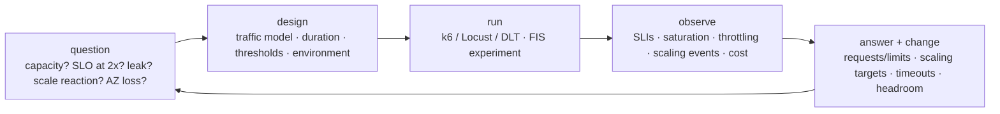

# Testing workloads · L300 — Performance and chaos testing

**Level:** 300 · **Time:** ~75 min · **Prerequisites:** [L200 Testing in pipelines and clusters](L200-testing-in-pipelines-and-clusters.md),
[Resilience and DR L200](../10-resilience-and-dr/L200-designing-for-failure.md),
[Observability L300](../07-observability/L300-metrics-that-matter-and-alerting.md)

**After this document you can:**

- Design a load test that answers a specific question (capacity, SLO compliance, scaling reaction,
  leak) with the right traffic model and thresholds.
- Right-size tasks and pods from measured data and benchmark Graviton against x86 honestly.
- Run chaos experiments with AWS FIS, Litmus or Chaos Mesh with stop conditions, and inject DNS and
  dependency failures.
- Plan a game day that produces numbers.

## 1. Mental model



A performance or chaos test is an experiment: it starts from a question, controls the variables
(traffic model, duration, environment parity), measures against thresholds derived from SLOs, and ends
with a change to configuration or code. Tests without a question produce charts; tests without
thresholds produce opinions. The container-specific measurements are throttling, memory working set,
image pull and start-up time, scaling reaction time and behaviour under node/AZ loss.

## 2. Concepts

### 2.1 Load test design

| Model | k6 executor | Simulates | Use |
| --- | --- | --- | --- |
| Closed (fixed VUs) | `constant-vus`, `ramping-vus` | N users looping as fast as responses allow; load falls when latency rises (coordinated omission) | user-behaviour tests |
| Open (arrival rate) | `constant-arrival-rate`, `ramping-arrival-rate` | requests arrive regardless of latency; queues build | API capacity and SLO tests (the default for services behind a load balancer) |
| Spike | `ramping-arrival-rate` with a step | sudden 5–10× | autoscaling reaction, shedding |
| Soak | constant rate for hours | slow leaks, connection growth, log volume | memory/connection leaks |
| Stress/capacity | ramp until thresholds fail | the ceiling and the first bottleneck | capacity planning |
| Breakpoint with scaling | ramp slower than autoscaling reacts | whether scaling keeps SLOs | HPA/Karpenter/ECS scaling validation |

Thresholds come from SLOs: `http_req_failed rate < 0.1%`, `p(99) < 500ms` for `POST /orders`; add
platform thresholds: throttling ratio < 25%, memory working set < 85% of limit, no `OOMKilled`, no 5xx
from the load balancer. Warm-up (1–2 minutes) excluded from statistics; realistic payloads and key
distributions (hot products for cache tests); generators outside the tested AZ/cluster (Distributed
Load Testing on AWS on Fargate, or a separate node pool) so they do not compete for resources;
identical environment shape to production (same task sizes, same instance families, same data volume)
or a documented scaling factor.

```javascript
// k6: capacity ramp with SLO thresholds and per-endpoint tags
export const options = {
  scenarios: { ramp: { executor: 'ramping-arrival-rate', startRate: 50, timeUnit: '1s', preAllocatedVUs: 200, maxVUs: 2000,
    stages: [{ target: 200, duration: '5m' }, { target: 600, duration: '10m' }, { target: 1200, duration: '10m' }, { target: 0, duration: '2m' }] } },
  thresholds: { 'http_req_failed{endpoint:orders}': ['rate<0.001'], 'http_req_duration{endpoint:orders}': ['p(99)<500'],
                'http_req_duration{endpoint:catalog}': ['p(99)<100'] },
};
```

What to record per run: request rate at which each threshold failed, the first saturated resource
(CPU throttling, DB connections, queue age), scaling events with timestamps (HPA/Karpenter/ECS), cost
of the run (Cost Explorer tag).

### 2.2 Capacity tests that measure scaling

The interesting number is reaction time: from the moment demand exceeds capacity to the moment new
copies serve. Design: a ramp faster than the workload autoscaler's stabilisation but slower than the
capacity layer's provisioning; record HPA/ECS scaling activity timestamps, Karpenter `NodeClaim`
creation and node Ready times, pod/task start-to-ready (image pull + start-up), and the SLI during the
gap. Results feed scaling targets (scale at 60% CPU, not 85%), warm pools, image size work, and
`minReplicas`.

### 2.3 Soak tests for leaks

Run at 50–70% of capacity for 4–24 hours; watch `container_memory_working_set_bytes` slope, file
descriptors, database/valkey connection counts, Kafka consumer group stability, log volume and cost.
A rising memory slope with flat traffic is a leak or an unbounded cache; a rising connection count is a
pool bug; periodic restarts hide both.

### 2.4 Right-sizing

| Source | What it gives | Use |
| --- | --- | --- |
| VPA in `Off` mode | recommended requests per container from usage history | set requests; memory limit = request |
| Compute Optimizer (ECS on Fargate, EC2) | task size recommendations, instance recommendations | Fargate CPU/memory pairs |
| Container Insights `CpuUtilized/CpuReserved`, `MemoryUtilized/MemoryReserved` | utilisation ratios per service | target 0.6–0.8 at p95 |
| Load tests | p99 latency vs allocation curve | the point where smaller sizes hurt |
| Throttling ratio | whether the CPU limit is the bottleneck | remove/raise limits ([01 L400](../01-container-fundamentals/L400-hardening-supply-chain-and-performance.md)) |

Process: set requests from VPA/p95 + 20%, memory limit = request, no CPU limit for latency-sensitive
services, re-run the load test, compare p99 and cost, repeat quarterly.

### 2.5 Graviton versus x86

Same load test, same environment shape, `runtimePlatform ARM64` / arm64 NodePool versus x86: compare
requests per second per vCPU at the SLO threshold and cost per million requests (Fargate ARM64 is ~20%
cheaper per vCPU/GB; Graviton instances similar). Check native dependencies and CPU-bound hot paths;
record the numbers per service — some workloads gain more than the list price difference, a few lose.
Keep both images (multi-arch) so the choice is per service.

### 2.6 Chaos with AWS FIS

An experiment template names targets (resource type, filters/tags, selection mode such as
`PERCENT(30)`), actions with parameters and durations, stop conditions (CloudWatch alarms) and a role.

| Question | Action(s) | Stop condition | Pass |
| --- | --- | --- | --- |
| Do we survive 30% task loss under load? | `aws:ecs:stop-task` on `PERCENT(30)` of a service's tasks | 5xx ratio alarm | no threshold breach; replacements within 2 min |
| Do PDBs and spread hold under node loss? | `aws:eks:terminate-nodegroup-instances` 20% | same | pods rescheduled; no availability drop |
| Do timeouts protect us from a slow dependency? | `aws:eks:pod-network-latency` (or `aws:ecs:task-network-latency`) 500 ms to the catalog pods | latency alarm | orders fails fast (2 s timeout) and degrades, no thread exhaustion |
| Does the app survive a database failover? | `aws:rds:failover-db-cluster` | 5xx alarm | reconnect within pool timeouts |
| What happens when an AZ goes dark? | `aws:network:disrupt-connectivity` scope `all` on one AZ's subnets for 10 min | 5xx alarm | remaining AZs carry load; zonal shift optional |
| Spot interruption handling | `aws:ec2:send-spot-instance-interruptions` | none needed | graceful drain |
| CPU/memory pressure | `aws:ecs:task-cpu-stress`, `aws:eks:pod-memory-stress` | latency alarm | limits/throttling behave as designed |

```json
{
  "description": "shopfront-dev: stop 30% of orders tasks under load",
  "roleArn": "arn:aws:iam::123456789012:role/shopfront-dev-fis",
  "targets": { "orders-tasks": { "resourceType": "aws:ecs:task", "selectionMode": "PERCENT(30)",
    "parameters": { "cluster": "shopfront-dev", "service": "orders" } } },
  "actions": { "stop": { "actionId": "aws:ecs:stop-task", "targets": { "Tasks": "orders-tasks" } } },
  "stopConditions": [ { "source": "aws:cloudwatch:alarm", "value": "arn:aws:cloudwatch:us-east-1:123456789012:alarm:shopfront-dev-orders-5xx-ratio" } ],
  "logConfiguration": { "cloudWatchLogsConfiguration": { "logGroupArn": "arn:aws:logs:us-east-1:123456789012:log-group:/shopfront/dev/fis:*" }, "logSchemaVersion": 2 },
  "tags": { "Project": "shopfront" }
}
```

Run experiments under load (the k6 ramp running), in staging first, then production during game days
with stop conditions on SLO alarms. Every experiment has a hypothesis written before the run.

### 2.7 Litmus, Chaos Mesh and dependency injection

Kubernetes-native chaos (LitmusChaos, Chaos Mesh) adds pod-level faults FIS does not: DNS chaos
(wrong answers, delays for specific names), HTTP fault injection (abort/delay on paths), I/O faults,
time skew, container kill with precise selectors. Use them for dependency-failure drills: make
`catalog.shopfront.svc.cluster.local` resolve slowly and watch `orders` timeouts and fallbacks; return
500 from 10% of catalog calls and verify retries/breakers. Toxiproxy in Compose does the same locally
(insert it between `orders` and `catalog` and add latency/`reset_peer`).

### 2.8 Game days

Structure: hypothesis, blast radius, participants (the on-call executes), stopwatch, observers,
scorecard; scenarios from [10 L400 §2.5](../10-resilience-and-dr/L400-dr-plan-and-game-days.md);
what to record: detection time (did alarms fire?), diagnosis time (did dashboards and runbooks lead to
the cause?), mitigation time, SLI impact, surprises. Follow-ups become tickets with dates. The
[game-day guide](../../playbooks/dr/game-day-guide.md) has the agenda.

## 3. How it interacts with the rest of AWS

| Component | Talks to | Protocol/API | Prerequisite (IAM, network, DNS) | What breaks if missing |
| --- | --- | --- | --- | --- |
| Load generators (DLT/Fargate, EC2) | ALB | HTTPS | WAF rules allow test traffic; generator capacity | tests blocked or generator-bound |
| FIS | ECS/EKS/EC2/RDS/network | experiment role (`ecs:StopTask`, `eks:*`, `ec2:*`, `rds:FailoverDBCluster`, `ssm:SendCommand`, network actions) | targets tagged; stop-condition alarms; SSM agent for in-task actions | experiments fail or run unbounded |
| Litmus/Chaos Mesh | Kubernetes API, CNI | CRDs, privileged DaemonSets | PSA `privileged` namespace for chaos | faults not injected |
| VPA/Compute Optimizer | metrics | recommendations | VPA installed; Compute Optimizer opted in | no sizing data |
| Cost Explorer | test resources | tags | `Test=true` tags | untracked test cost |
| CloudWatch | thresholds and stop conditions | alarms | alarms on SLIs | blind experiments |

## 4. Use it when / avoid it when

Use:

- Open-model load tests with SLO thresholds for APIs; soak tests before major releases; capacity
  tests when changing sizes, scaling targets or instance families.
- FIS with stop conditions in staging monthly and in production game days; Litmus/Chaos Mesh for
  DNS/HTTP faults.
- VPA recommendations + load tests for right-sizing; Graviton benchmarks per service.

Avoid:

- Closed-model tests to answer capacity questions (they hide queueing).
- Load tests from inside the cluster under test.
- Chaos without a hypothesis, a stop condition and observers.
- Right-sizing from averages (use p95/p99 and throttling).

Alternatives: production traffic replay (shadowing) for realism ([L400](L400-verification-at-scale.md));
Compute Optimizer alone for a first pass.

## 5. Well-Architected view

| Pillar | Contribution | Cost | Practice (Reliability REL 12, Performance PERF) |
| --- | --- | --- | --- |
| Operational Excellence | game days, runbook validation | time | quarterly cadence |
| Security | chaos roles scoped; experiments logged | none | least-privilege FIS role |
| Reliability | verified recovery under injected faults | staging capacity | REL 12: test reliability, chaos engineering, game days |
| Performance Efficiency | measured sizing; scaling targets from data | test runs | quarterly right-sizing |
| Cost Optimization | right-sizing and Graviton decisions from measurements | test cost | tagged test spend |
| Sustainability | less over-provisioning | none | utilisation targets |

## 6. Failure modes and troubleshooting

| Symptom | Likely cause | How to confirm (command/metric) | Fix |
| --- | --- | --- | --- |
| Load test shows great latency, production does not | closed model; generator too small; cache-warm data | executor type; generator CPU | open model; DLT; realistic keys |
| Results not reproducible | environment drift; noisy neighbours; different data volume | compare environment parameters | pin shapes; dedicated test cluster |
| FIS experiment "succeeds" but broke things | no stop condition; alarm too lenient | experiment log vs SLI | stop conditions on SLO alarms |
| Chaos pods cannot inject faults | PSA/permissions | Litmus/Chaos Mesh logs | privileged chaos namespace |
| Scaling test stalls at Pending | capacity limits/IPs | Karpenter/ECS events | ([playbook](../../playbooks/incidents/pending-pods-and-capacity.md)) |
| OOM during soak | leak; page cache from logging | working set slope | fix; log volume ([playbook](../../playbooks/incidents/oom-and-cpu-throttling.md)) |
| Graviton slower | native library fallback; JIT differences | per-arch profiles | check dependencies; benchmark per service |

## 7. Signals: metrics, logs, traces

- Load: request rate, error ratio, p50/p99 per endpoint (k6 and ALB), saturation (throttling ratio,
  memory working set, DB connections, queue age), scaling events with timestamps, node Ready time,
  pod/task start-to-ready.
- Soak: memory slope, connection counts, fd counts, log bytes/hour, cost/hour.
- Chaos: SLI during and after, replacement/reschedule times, alarm firing times, FIS experiment
  state, stop-condition triggers.
- Sizing: VPA recommendations vs requests, Compute Optimizer findings, utilisation ratios.
- Benchmarks: requests per vCPU-second per architecture; cost per million requests.

Full table: [`reference/metrics-catalog.md`](../../reference/metrics-catalog.md).

## 8. Testing and DR notes

Chaos and load tests are how the DR plan's assumptions get numbers: the warm standby's scale-up time
is a capacity test in the DR Region; the "AZ loss" experiment is the zonal-shift rehearsal; the
database failover experiment is the data-tier RTO measurement. Record them in the DR plan history
([10 L400](../10-resilience-and-dr/L400-dr-plan-and-game-days.md)).

## 9. Hands-on

```bash
# Local: a scaling-shaped test against the Compose stack while watching resources
make up
docker stats --no-stream
k6 run - <<'EOF'
import http from 'k6/http'; import { check } from 'k6';
export const options = { scenarios: { ramp: { executor: 'ramping-arrival-rate', startRate: 10, timeUnit: '1s', preAllocatedVUs: 50, maxVUs: 500,
  stages: [{ target: 100, duration: '1m' }, { target: 300, duration: '1m' }, { target: 0, duration: '20s' }] } },
  thresholds: { http_req_failed: ['rate<0.01'], http_req_duration: ['p(99)<500'] } };
export default function () { const r = http.get('http://localhost:8081/products/' + (1 + Math.floor(Math.random() * 12))); check(r, { ok: (x) => x.status === 200 }); }
EOF
docker stats --no-stream; curl -s localhost:8081/metrics | grep -E '^catalog_cache_(hits|misses)_total'
# Observe: where p99 crosses 500 ms and whether the cache hit ratio explains it.

# Local chaos: latency between orders and catalog with toxiproxy (docker run ghcr.io/shopify/toxiproxy), or the crude version:
docker compose -f labs/local/compose.yaml pause catalog; sleep 3
curl -s -o /dev/null -w 'orders with catalog paused: %{http_code} in %{time_total}s\n' -X POST localhost:8080/orders -H 'content-type: application/json' -d '{"productId":1,"quantity":1}'
docker compose -f labs/local/compose.yaml unpause catalog
# Observe: 502 after ~2 s + one retry (the timeout works); no hang.

# AWS (billable): FIS experiment template from §2.6 and a right-sizing readout
aws fis create-experiment-template --cli-input-json file:///tmp/fis-stop-tasks.json
aws fis start-experiment --experiment-template-id <id> --tags Project=shopfront
aws compute-optimizer get-ecs-service-recommendations --service-arns arn:aws:ecs:us-east-1:123456789012:service/shopfront-dev/orders \
  --query 'ecsServiceRecommendations[0].{finding:finding,current:currentServiceConfiguration.{cpu:cpu,mem:memory},options:serviceRecommendationOptions[0].{cpu:cpu,mem:memory}}'
```

## 10. Check yourself

1. Why does a closed-model load test under-report a capacity problem?

<details><summary>Answer</summary>
With a fixed number of virtual users looping, each user waits for the response before sending the
next request, so when latency rises the offered load falls automatically (coordinated omission); the
test reports "fine at N users" while real clients would keep arriving and queue. An open model
(arrival rate) keeps offering load and exposes queueing, timeouts and errors.
</details>

2. What does a capacity test with a ramp reveal about autoscaling, and which two timestamps matter?

<details><summary>Answer</summary>
Whether the workload and capacity autoscalers react before SLOs break: the moment demand exceeds
capacity (SLI starts degrading) and the moment new copies serve (pods Ready/tasks healthy, including
node provisioning and image pull). The gap is the reaction time you must cover with headroom, lower
scaling targets, warm pools or smaller images.
</details>

3. How do you right-size a service without guessing?

<details><summary>Answer</summary>
Take VPA recommendations (or Container Insights p95 utilisation) for requests plus ~20% headroom, set
memory limit equal to request and drop CPU limits for latency-sensitive services, re-run the same
open-model load test, compare p99 and throttling against the previous sizing, and record cost per
million requests; repeat when traffic or code changes materially.
</details>

4. What must every FIS experiment have before it runs in production?

<details><summary>Answer</summary>
A written hypothesis, a bounded blast radius (percentage of targets, duration), stop conditions tied
to SLO alarms, an experiment role with least privilege, logging to CloudWatch, observers watching the
dashboards, and a prior successful run in staging under comparable load.
</details>

5. Which chaos faults need Litmus/Chaos Mesh or Toxiproxy rather than FIS?

<details><summary>Answer</summary>
Application-level faults: DNS answers delayed or wrong for a specific name, HTTP aborts/delays on a
path, I/O errors on a volume, clock skew, precise container kills by label. FIS covers infrastructure
faults (task/pod/instance termination, network disruption at subnet level, CPU/memory/IO stress via SSM,
RDS failover).
</details>

## 11. Sources

- k6 documentation: executors, thresholds, open vs closed models — https://grafana.com/docs/k6/latest/using-k6/scenarios/concepts/open-vs-closed/
- Distributed Load Testing on AWS — https://aws.amazon.com/solutions/implementations/distributed-load-testing-on-aws/
- AWS Fault Injection Service: actions, templates, stop conditions — https://docs.aws.amazon.com/fis/latest/userguide/fis-actions-reference.html and https://docs.aws.amazon.com/fis/latest/userguide/experiment-templates.html
- LitmusChaos and Chaos Mesh — https://litmuschaos.io/ and https://chaos-mesh.org/docs/
- Toxiproxy — https://github.com/Shopify/toxiproxy
- Vertical Pod Autoscaler — https://github.com/kubernetes/autoscaler/tree/master/vertical-pod-autoscaler <!-- term-ok -->
- AWS Compute Optimizer for ECS services on Fargate — https://docs.aws.amazon.com/compute-optimizer/latest/ug/view-ecs-recommendations.html
- AWS Graviton getting started (performance runbook) — https://github.com/aws/aws-graviton-getting-started/blob/main/perfrunbook/README.md
- AWS Well-Architected Reliability pillar: REL 12 test reliability — https://docs.aws.amazon.com/wellarchitected/latest/reliability-pillar/test-reliability.html
- Principles of chaos engineering — https://principlesofchaos.org/
- Chaos engineering on AWS (Prescriptive Guidance) — https://docs.aws.amazon.com/prescriptive-guidance/latest/chaos-engineering-on-aws/introduction.html
