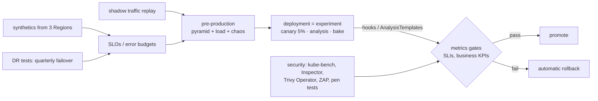

# Testing workloads · L400 — Verification at scale

**Level:** 400 · **Time:** ~60 min · **Prerequisites:** [L300 Performance and chaos testing](L300-performance-and-chaos-testing.md),
[Delivery L300](../08-delivery-cicd-gitops/L300-progressive-delivery-and-gitops-internals.md),
[Identity and security L300](../06-identity-and-security/L300-hardening-workloads-and-clusters.md)

**After this document you can:**

- Verify releases in production with canary analysis, shadow traffic and synthetics without
  risking users.
- Wire continuous verification into ECS lifecycle hooks and Argo Rollouts so every deployment is a
  test.
- Run DR tests, security tests and compliance-as-code as recurring, measured programmes.
- Define quality gates from metrics and recognise the anti-patterns of testing at scale.

## 1. Mental model



At scale, the boundary between testing and operating disappears: every deployment is an experiment
with a control group (the stable revision) and a treatment (the canary) judged by production metrics;
synthetics measure the SLO continuously from outside; shadow traffic lets you test with real requests
without real consequences; security and DR tests run on schedules with scores. The organisation's job
is to define the gates — which metrics, which thresholds, which windows — and to keep them honest.

## 2. Concepts

### 2.1 Canary analysis

A canary is a statistical comparison of the new revision against the stable one on the same traffic
mix. Requirements: traffic split by weight (ECS canary strategy; Argo Rollouts with ALB weights),
metrics separable per revision (target group dimension; pod labels), enough requests for significance
(see the canary math in [ECS L400 §2.4](../03-ecs/L400-ecs-at-scale.md)), and a comparison rule:
absolute thresholds (canary error ratio < 0.5%, p99 < SLO) plus relative ones (canary p99 not more
than 20% above stable). Automated analysis (Argo Rollouts `AnalysisTemplate`, Kayenta-style
comparisons, or a Lambda in an ECS lifecycle hook) decides; humans watch. Bake time derives from
traffic and the smallest effect you must detect; slow failures (leaks, connection growth) need longer
canaries or a soak in staging.

### 2.2 Shadow traffic and synthetics

**Shadow/mirrored traffic** duplicates real requests to a candidate that does not answer users:
ALB has no mirroring, so use a mesh (Istio `mirror`), an ingress proxy, or an application-level tee;
side effects must be suppressed (a shadow `orders` must not send to SQS/Kafka — a `SHADOW=true`
mode that skips publishers, or pointed at scratch queues) and data isolated (a clone of the
database). Shadowing tests performance and error behaviour on real traffic shapes without user
impact; it does not test correctness of writes.

**Synthetics**: CloudWatch Synthetics canaries executing the real user journey (create a test order,
verify fulfilment via `GET /orders/{id}`) from several Regions every minute; their success rate is the
cleanest availability SLI, independent of the platform under test, and the first alarm in a Region
event. Tag synthetic transactions so analytics and billing exclude them.

### 2.3 Continuous verification in the deployment path

| Platform | Hook | What runs | Fail behaviour |
| --- | --- | --- | --- |
| ECS blue/green and canary | lifecycle hooks (`POST_TEST_TRAFFIC_SHIFT`, `POST_PRODUCTION_TRAFFIC_SHIFT`) invoking Lambda | smoke suite against the test listener; metric queries on the green target group during bake | hook returns `FAILED` → rollback before/after traffic shift |
| ECS rolling | CloudWatch alarm rollback | alarms on the service's SLIs | alarm → rollback |
| Kubernetes with Argo Rollouts | `AnalysisTemplate` (CloudWatch/AMP/Job/webhook providers) at steps and in background | error ratio and latency per target group; a Job running the smoke test; a webhook calling a test service | `Failed` → abort and scale down canary |
| Kubernetes with Argo CD | `PostSync` hook Job | smoke test after sync | app `Degraded`; no automatic rollback (revert commit) |
| Any | pipeline stage after deploy | `labs/local/smoke.sh` with environment URLs, k6 light thresholds | pipeline fails; manual/automatic rollback |

The rule: the deployment mechanism itself evaluates the tests; a green pipeline stage that runs after
traffic already shifted is monitoring, not verification.

### 2.4 DR tests as a programme

Quarterly failover rehearsals with stopwatch and scorecard ([10 L400](../10-resilience-and-dr/L400-dr-plan-and-game-days.md));
continuous readiness checks (ARC, replication alarms, DR deploy pipeline running the smoke test in the
DR Region weekly); restore tests (Aurora PITR to a scratch cluster, Velero restore to a scratch EKS
cluster) monthly with automated verification queries. Publish achieved RTO/RPO next to targets.

### 2.5 Security testing

| Layer | Tool | Cadence |
| --- | --- | --- |
| Images | Trivy/Grype in CI (gate), Inspector continuous in ECR, Trivy Operator in-cluster (running images, exposed secrets, misconfigurations as CRDs) | every build; continuous |
| Cluster configuration | kube-bench (CIS EKS Benchmark) as a Job; `kubectl` audits of RBAC (`rbac-tool`, `kubectl-who-can`) | monthly; on change |
| Manifests/IaC | `checkov`, `trivy config`, `conftest` with the policy library | every PR |
| Admission negative tests | privileged pod, unsigned image, `:latest`, Docker Hub image must be rejected; IMDS unreachable from a pod | every pipeline run against an ephemeral cluster |
| Application | OWASP ZAP baseline scan against the ephemeral environment; dependency scanning; secret scanning in git | every PR (baseline), release (full) |
| Platform | penetration tests by a third party against staging/production scope; GuardDuty sample findings to test routing | annual; quarterly |
| Compliance | Security Hub standards, Config conformance packs, Kyverno/`PolicyReport`s | continuous, reported monthly |

Findings flow to the same backlog with SLAs by severity; the metric is time to fix, not count.

### 2.6 Compliance as code

Encode controls as checks that run continuously and produce evidence: Config rules (`eks-secrets-encrypted`,
`ecs-containers-nonprivileged`, `ecr-private-image-scanning-enabled`…), Security Hub controls, Kyverno
background scans producing `PolicyReport`s, custom Lambda checks (every service has a PDB, every
namespace has default-deny, every task role is used), and scheduled queries over audit logs. The
evidence (reports, dashboards, exports to S3 with Object Lock) is what an audit consumes; the same
signals page the platform team when compliance regresses ([06 L400 §2.4](../06-identity-and-security/L400-security-architecture-and-incident-response.md)).

### 2.7 Metrics-driven quality gates

| Gate | Metric | Threshold (example) | Where enforced |
| --- | --- | --- | --- |
| Pre-merge | unit/component pass; validation clean; light k6 thresholds; contract verification | 100% pass; p99 < 2× SLO on the PR env | pipeline |
| Pre-production promotion | smoke pass in staging; load test thresholds; no critical CVEs with fix; policy audit clean | as defined | pipeline |
| Canary → full | canary error ratio and p99 vs stable; business KPI (orders per minute) not down | absolute + relative rules | Rollouts analysis / ECS hooks |
| Release health (24 h) | SLO burn rate; change failure rate | burn < 1; no rollback | on-call + dashboards |
| Platform health (monthly) | requested-vs-used, PDB coverage, restricted PSA coverage, signed image %, DR readiness | targets per platform | platform review |

Gates must be few, measured automatically, and revisited when they block without preventing incidents
or pass while incidents happen.

### 2.8 Anti-patterns

- A single shared staging environment as the only pre-production test bed for many teams.
- Canaries with bake times chosen by convenience; canaries on 1% of a low-traffic service.
- Verification stages that run after traffic already shifted and cannot roll back.
- Shadow traffic with side effects enabled (double orders, duplicate emails).
- Security scans whose findings nobody owns; kube-bench once at launch.
- DR tests in staging only, or "tested" by reading the runbook.
- Quality gates on vanity metrics (test count, coverage percentage) instead of SLIs and failure rates.
- Load tests from laptops; results without environment parity notes.

## 3. How it interacts with the rest of AWS

| Component | Talks to | Protocol/API | Prerequisite (IAM, network, DNS) | What breaks if missing |
| --- | --- | --- | --- | --- |
| ECS lifecycle hook Lambda | test listener, CloudWatch | HTTPS, `GetMetricData` | hook role; Lambda in VPC with SG to the test listener | hook times out → rollback of good releases |
| Argo Rollouts | CloudWatch/AMP | `GetMetricData` via Pod Identity | role; metric dimensions per target group | analysis `Error` |
| Synthetics | endpoints in several Regions | HTTPS from canary Lambdas | canaries per Region; test product | no external SLI |
| Trivy Operator | Kubernetes API, ECR | in-cluster; Pod Identity for ECR | CRDs; role | no runtime vulnerability view |
| kube-bench | node filesystem | Job with hostPath (privileged namespace) | PSA exception | no benchmark |
| ZAP | ephemeral environment | HTTPS | env reachable from runner | no DAST |
| Config/Security Hub | resources | recorders/standards | enabled | no compliance evidence |
| DR test pipeline | DR Region stacks | deploy role | Region parameter | untested DR |

## 4. Use it when / avoid it when

Use:

- Canary analysis for tier-1 services with derived bake times; synthetics from three Regions for every
  public endpoint; shadow traffic for risky performance changes.
- Verification inside the deployment mechanism (hooks, analysis) rather than after.
- Scheduled DR and security programmes with published scores.

Avoid:

- Treating coverage percentage as a gate; gates on SLIs and failure rates instead.
- Shadowing writes without side-effect suppression.
- Manual canary judgement at scale; automate the comparison and let humans watch.

Alternatives: feature flags with gradual exposure (AppConfig) as a lighter canary for behaviour changes;
dark launches behind flags for shadow-like validation of new code paths.

## 5. Well-Architected view

| Pillar | Contribution | Cost | Practice |
| --- | --- | --- | --- |
| Operational Excellence | deployments as experiments; scored programmes | analysis tooling | gates reviewed quarterly |
| Security | continuous scanning and negative admission tests; compliance evidence | scanner spend | findings with SLAs |
| Reliability | canary/synthetics catch regressions before users; DR rehearsals | bake time | REL 8/12: deploy with automated testing and rollback |
| Performance Efficiency | shadow traffic validates performance on real shapes | infrastructure for shadows | side-effect suppression |
| Cost Optimization | ephemeral shadows and test envs with TTL | test infra | tagged, scheduled |
| Sustainability | fewer failed releases and rebuilds | none | promotion by digest |

## 6. Failure modes and troubleshooting

| Symptom | Likely cause | How to confirm (command/metric) | Fix |
| --- | --- | --- | --- |
| Canary passes, full rollout fails | canary too small/short; failure is load- or time-dependent | traffic at canary vs full | bigger/longer canary; soak; capacity test |
| Analysis flaps | metric noise at low traffic; missing data as failure | analysis run values | request-count guard; longer intervals |
| Hook Lambda times out | cannot reach test listener (SG/VPC) | Lambda logs | VPC config; SG rules ([playbook](../../playbooks/incidents/ecs-deployment-stuck-or-rolled-back.md)) |
| Synthetics red, users fine | canary script brittle; test product missing | canary logs | robust script; seeded test data |
| Shadow traffic creates real side effects | publishers not disabled | duplicate orders/messages | `SHADOW` mode; scratch queues |
| Security findings pile up | no ownership/SLA | backlog age | route to owners; SLA metrics |
| DR test "passed" but RTO unknown | no stopwatch/scorecard | report | game-day template |
| Compliance evidence missing at audit | reports not retained | retention settings | export with Object Lock |

## 7. Signals: metrics, logs, traces

- Release: canary analysis outcomes, rollback rate, change failure rate, time to restore, bake time
  per release.
- Synthetics: success rate and latency per Region; SLO attainment and burn rate.
- Security: findings by severity and age; percentage of images scanned/signed; admission negative
  tests pass rate; kube-bench failures.
- DR: achieved vs target RTO/RPO per exercise; readiness check status; DR deploy pipeline success.
- Compliance: Security Hub score; Config non-compliant resources; policy report violations.
- Program health: game days per year, tests per release, gates that blocked vs incidents prevented.

Full table: [`reference/metrics-catalog.md`](../../reference/metrics-catalog.md).

## 8. Testing and DR notes

This level *is* the testing and DR programme: deployments as experiments with automatic rollback,
synthetics as the SLI, scheduled DR rehearsals with scorecards, scheduled security tests with SLAs, and
compliance evidence generated continuously. The [game-day guide](../../playbooks/dr/game-day-guide.md)
and the [DR plan template](../../playbooks/dr/dr-plan-template.md) hold the operating cadence.

## 9. Hands-on

```bash
# 1. Continuous verification objects in the labs
grep -nE 'analysis|AnalysisTemplate|setWeight|pause' labs/eks/gitops/rollout-orders-canary.yaml | head
grep -nE 'LifecycleHooks|HookTargetArn|BakeTime' labs/ecs/cloudformation/04-services.yaml | head

# 2. The smoke test as a post-deploy gate against any environment
ORDERS_URL=https://shopfront.example.com CATALOG_URL=https://shopfront.example.com labs/local/smoke.sh || echo "gate failed: roll back"

# 3. Negative admission tests (ephemeral cluster) — the security gate
kubectl -n shopfront run privtest --image=busybox:1.36 --restart=Never --overrides='{"spec":{"containers":[{"name":"p","image":"busybox:1.36","securityContext":{"privileged":true}}]}}' && echo "FAIL" || echo "PASS: privileged rejected"
kubectl -n shopfront run tagtest --image=busybox:latest --restart=Never && echo "FAIL" || echo "PASS: tag/registry rejected"

# 4. (billable) synthetics and canary analysis readouts
aws synthetics describe-canaries-last-run --query 'CanariesLastRun[].{name:CanaryName,status:LastRun.Status.State}'
kubectl argo rollouts get rollout orders -n shopfront    # analysis run results per step

# 5. Security programme readouts
kubectl get vulnerabilityreports -A 2>/dev/null | head    # Trivy Operator
aws securityhub get-findings --filters '{"SeverityLabel":[{"Value":"CRITICAL","Comparison":"EQUALS"}],"WorkflowStatus":[{"Value":"NEW","Comparison":"EQUALS"}]}' --query 'Findings[].{title:Title,resource:Resources[0].Id}' --max-items 10
```

## 10. Check yourself

1. What separates canary analysis from "watch the dashboard after deploy"?

<details><summary>Answer</summary>
A control group and a decision rule: the canary and the stable revision receive the same traffic mix
at the same time, metrics are separable per revision, and an automated comparison (absolute SLO
thresholds plus relative deltas) decides within a derived bake time whether to promote or roll back
before most users are exposed. Watching a dashboard after 100% rollout has no control group and no
automatic rollback.
</details>

2. Why must shadow traffic suppress side effects, and how would you do it for `orders`?

<details><summary>Answer</summary>
Mirrored requests are real user requests; a shadow `orders` that publishes to SQS/Kafka or writes the
production database would create duplicate orders, fulfilments and analytics. Run the shadow with a
`SHADOW=true` mode that skips publishers (or targets scratch queues/topics) and against a cloned
database, and exclude its metrics from SLOs while comparing its latency and errors with production.
</details>

3. Where should the verification that gates a release execute, and why?

<details><summary>Answer</summary>
Inside the deployment mechanism: ECS lifecycle hooks and alarm rollback, Argo Rollouts analysis
steps, Argo CD `PostSync` hooks for smoke. Only there can a failure stop or reverse the traffic shift
automatically; a pipeline stage running after traffic has moved can detect but not prevent user
impact.
</details>

4. Which security tests belong in every pipeline run and which on a schedule?

<details><summary>Answer</summary>
Every run: image scanning with a fix-available gate, IaC/manifest policy checks (`checkov`, `trivy
config`, `conftest`), secret scanning, negative admission tests against an ephemeral cluster, a ZAP
baseline. Scheduled: Inspector continuous rescans (automatic), Trivy Operator in-cluster reports,
kube-bench monthly, GuardDuty routing drills quarterly, third-party penetration tests annually.
</details>

5. Name three quality gates based on SLIs and one vanity metric you would not use.

<details><summary>Answer</summary>
Canary error ratio and p99 versus stable within thresholds; SLO burn rate below 1 for 24 hours after
release; smoke and light load thresholds passing in the pre-production environment (p99 under twice
the SLO). A vanity metric: unit test coverage percentage as a hard gate — it measures lines executed,
not behaviour or user impact.
</details>

## 11. Sources

- Argo Rollouts analysis and experiments — https://argo-rollouts.readthedocs.io/en/stable/features/analysis/
- Amazon ECS blue/green lifecycle hooks — https://docs.aws.amazon.com/AmazonECS/latest/developerguide/deployment-type-blue-green.html
- CloudWatch Synthetics canaries — https://docs.aws.amazon.com/AmazonCloudWatch/latest/monitoring/CloudWatch_Synthetics_Canaries.html
- Istio traffic mirroring — https://istio.io/latest/docs/tasks/traffic-management/mirroring/
- Trivy Operator — https://aquasecurity.github.io/trivy-operator/latest/
- kube-bench (CIS EKS Benchmark) — https://github.com/aquasecurity/kube-bench
- OWASP ZAP baseline scan — https://www.zaproxy.org/docs/docker/baseline-scan/
- AWS Config conformance packs and Security Hub standards — https://docs.aws.amazon.com/config/latest/developerguide/conformance-packs.html and https://docs.aws.amazon.com/securityhub/latest/userguide/standards-reference.html
- AWS Well-Architected Reliability pillar: REL 8 implement change; REL 12 test reliability — https://docs.aws.amazon.com/wellarchitected/latest/reliability-pillar/implement-change.html and https://docs.aws.amazon.com/wellarchitected/latest/reliability-pillar/test-reliability.html
- Google SRE Workbook: canarying releases — https://sre.google/workbook/canarying-releases/
- DORA metrics — https://dora.dev/guides/dora-metrics-four-keys/
