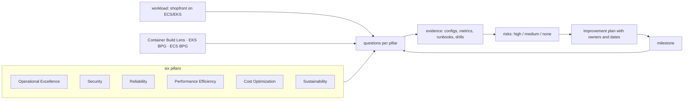

# Well-Architected · L100 — Pillars for containers

**Level:** 100 · **Time:** ~30 min · **Prerequisites:** none beyond a general idea of what ECS or EKS do

**After this document you can:**

- Name the six pillars and restate each one as a question about a container workload.
- Explain what the Container Build Lens and the EKS/ECS best-practices guides add to the framework.
- Describe how a Well-Architected review runs and what it produces.

## 1. Mental model



The framework is a structured conversation. For each pillar it asks questions ("How do you manage
identities for people and machines?", "How do you design your workload to withstand component
failures?"); the team answers with evidence, not intentions; unanswered or weakly answered questions
become risks; risks become a plan with milestones. Nothing in it is container-specific until you add a
lens: the Container Build Lens asks how images are built and deployed; the EKS and ECS best-practices
guides turn the pillars into concrete settings for each orchestrator. This repository is organised so
that every hub document already answers "which pillar does this touch and what is the practice".

## 2. Concepts

### 2.1 The six pillars, restated for containers

| Pillar | The question, for a container workload | Where this repository answers it |
| --- | --- | --- |
| Operational Excellence | Can you deploy, observe and change the workload safely and repeatedly? Are runbooks real? | [07 Observability](../07-observability/README.md), [08 Delivery](../08-delivery-cicd-gitops/README.md), [playbooks](../../playbooks/README.md) |
| Security | Do tasks/pods run with least privilege (roles, no IMDS), from trusted images, on hardened nodes, with detection turned on? | [06 Identity and security](../06-identity-and-security/README.md), [01 L400](../01-container-fundamentals/L400-hardening-supply-chain-and-performance.md), [02 ECR](../02-ecr/README.md) |
| Reliability | Does the workload survive task, node, AZ and dependency failures, and can it be recovered from a Region loss within agreed RTO/RPO? | [10 Resilience and DR](../10-resilience-and-dr/README.md), [03](../03-ecs/README.md)/[04](../04-eks/README.md) deployment and scheduling |
| Performance Efficiency | Are tasks/pods right-sized, does scaling follow demand, is the architecture (Graviton, caches, queues) appropriate? | [01 L400](../01-container-fundamentals/L400-hardening-supply-chain-and-performance.md), [11 Testing](../11-testing-workloads/README.md), [09 Data](../09-data-messaging-and-batch/README.md) |
| Cost Optimization | Do you pay for used rather than idle capacity (Fargate vs EC2 utilisation, Spot, Savings Plans, data transfer, logs)? | [03 L400](../03-ecs/L400-ecs-at-scale.md), [04 L400](../04-eks/L400-eks-at-scale.md), [05 L400](../05-networking/L400-network-architecture-at-scale.md), [07 L400](../07-observability/L400-observability-at-scale.md) |
| Sustainability | Do you minimise resources per unit of work (utilisation, arm64, scale to zero, retention)? | the Sustainability rows of every section 5 table |

Design principles that matter most for containers: operate as code (task definitions, manifests,
policies in git), make frequent small reversible changes (canary, digest rollbacks), automate recovery
(replicas, PDBs, autoscaling), test recovery (FIS, game days), stop guessing capacity (autoscaling,
measured sizing), and mechanical sympathy (know what Fargate/Firecracker, containerd and the VPC CNI
actually do).

### 2.2 The Container Build Lens

A lens is a pillar-by-pillar set of questions for a domain. The Container Build Lens covers the
container image lifecycle: design principles (build in multiple stages, minimise the image, pin
dependencies, make images reproducible and immutable, embed health and observability, treat the image
as the artifact from development to production) and best practices per pillar (build process
security — scanning, signing, SBOMs; operational excellence — CI/CD, tagging and digests, build
observability; reliability — health checks, graceful shutdown; performance — small images, start-up;
cost — layer caching, build efficiency; sustainability — efficient images). Every `labs/apps/*/Dockerfile`
and the pipeline in [`labs/pipelines/github-actions/ci.yml`](../../labs/pipelines/github-actions/ci.yml)
are shaped by it ([01 L400 §2.10](../01-container-fundamentals/L400-hardening-supply-chain-and-performance.md)).

### 2.3 The EKS and ECS Best Practices Guides

Both live inside the service documentation and are organised by concern (security, reliability,
networking, scalability, cost, observability, upgrades for EKS; security, networking, auto scaling,
deployment, observability for ECS). They are prescriptive ("use Pod Identity", "set IMDS hop limit to
1", "block IMDS from tasks with `ECS_AWSVPC_BLOCK_IMDS`", "enable Container Insights") where the
framework is interrogative. Use the framework to find risks and the guides to fix them; the L200
checklists in this domain map one to the other.

### 2.4 How a review works

1. **Scope** a workload (shopfront production on ECS in us-east-1, including its data tier and
   pipelines) and its owners.
2. **Answer** the pillar questions with evidence: configuration exports, dashboards, runbooks, drill
   records, cost reports. "We plan to" counts as not done.
3. **Rate risks**: high (likely and severe: no DR test ever, IMDS reachable from tasks), medium,
   none.
4. **Plan** improvements with owners and dates; prioritise high risks with low effort.
5. **Milestone** the review in the AWS Well-Architected Tool (workload + lenses + milestones), which
   tracks risk counts over time and generates reports; re-review after major changes and at least
   yearly.

Reviews are for learning, not grading: the output is a plan, and the culture that makes them work is
one where "high risk" is information, not blame.

## 3. How it interacts with the rest of AWS

| Component | Talks to | Protocol/API | Prerequisite (IAM, network, DNS) | What breaks if missing |
| --- | --- | --- | --- | --- |
| AWS Well-Architected Tool | reviewers | console/API (`wellarchitected:*`) | permissions; lenses attached | reviews live in documents nobody updates |
| Trusted Advisor / Security Hub / Config / Compute Optimizer / Cost Explorer | the review | findings as evidence | services enabled | evidence is anecdotal |
| Container Insights, CloudWatch | Operational Excellence and Performance questions | metrics/dashboards | enabled | "we think it is fine" |
| GitOps/IaC repositories | Operational Excellence and Security questions | configuration as evidence | everything in git | drift between claim and reality |
| FIS, game-day records | Reliability questions | drill outcomes | drills executed | untested resilience |

## 4. Use it when / avoid it when

Use:

- Before production launch, after major architecture changes, and yearly for every tier-1 workload.
- With the Container Build Lens for image pipelines and the EKS/ECS guides for platform settings.
- As the agenda for the L200 checklists and for the trade-off decisions in L400.

Avoid:

- Reviews as compliance theatre with answers written by one person without evidence.
- Treating "high risk" counts as a scorecard between teams.
- Reviewing the platform without its data tier and pipelines (the risks live in the seams).

Alternatives: lightweight internal checklists for small internal tools; the full framework for
anything customers or revenue depend on.

## 5. Well-Architected view

| Pillar | This domain's contribution | Cost | Practice |
| --- | --- | --- | --- |
| Operational Excellence | the review cadence and evidence discipline | time | yearly review + after changes |
| Security | the Security pillar questions mapped to controls | time | evidence from Security Hub/Config |
| Reliability | REL questions mapped to drills and settings | time | drill records as evidence |
| Performance Efficiency | sizing evidence from metrics and tests | time | Compute Optimizer + load tests |
| Cost Optimization | cost evidence from Cost Explorer and utilisation | time | requested-vs-used |
| Sustainability | utilisation targets | time | arm64 share, scale-to-zero coverage |

## 6. Failure modes and troubleshooting

| Symptom | Likely cause | How to confirm (command/metric) | Fix |
| --- | --- | --- | --- |
| Review finds no high risks in a young platform | answers without evidence | ask for the artifact behind each answer | evidence-first questions |
| Same risks every year | plan without owners/dates | improvement plan status | milestones with owners; track in the backlog |
| Review ignores containers' specifics | framework without lenses | question list | add Container Build Lens; use the EKS/ECS guides |
| Findings contradict monitoring | claims vs metrics | Container Insights/Security Hub | evidence from tools, not memory |

## 7. Signals: metrics, logs, traces

Review evidence is mostly the signals other domains define: SLO attainment and alarm inventory
(Operational Excellence), Security Hub score and GuardDuty findings (Security), drill RTO/RPO and PDB
coverage (Reliability), utilisation ratios and throttling (Performance), requested-vs-used and Spot
share (Cost), arm64 share and scale-to-zero coverage (Sustainability). The Well-Architected Tool adds
risk counts per pillar over time.

Full table: [`reference/metrics-catalog.md`](../../reference/metrics-catalog.md).

## 8. Testing and DR notes

The Reliability pillar's questions are answered by test and drill records: FIS experiments, game-day
scorecards, restore tests, the DR plan with measured RTO/RPO ([10 L400](../10-resilience-and-dr/L400-dr-plan-and-game-days.md),
[11 L400](../11-testing-workloads/L400-verification-at-scale.md)). A review without them rates
Reliability as high risk regardless of the architecture diagram.

## 9. Hands-on

```bash
# Every hub document carries a Well-Architected table; collect them for one domain
grep -A8 '^## 5. Well-Architected view' hub/03-ecs/L200-task-definitions-services-and-scaling.md | head -12

# The Container Build Lens applied to the labs' images
grep -nE '^FROM|^USER|^LABEL|HEALTHCHECK' labs/apps/*/Dockerfile

# Start a review in the Well-Architected Tool (billable account; the tool itself is free)
aws wellarchitected list-lenses --query 'LensSummaries[].{alias:LensAlias,name:LensName}' --output table | head -20
aws wellarchitected create-workload --workload-name shopfront-prod --description "shopfront on ECS/EKS" \
  --environment PRODUCTION --aws-regions us-east-1 --review-owner platform@example.com \
  --lenses wellarchitected containerbuild --client-request-token "$(uuidgen)"
```

## 10. Check yourself

1. What does a lens add to the framework, and which one applies to every container workload?

<details><summary>Answer</summary>
A lens is a domain-specific set of pillar questions and best practices layered on the general
framework. The Container Build Lens applies to every container workload because every workload has an
image build, scan, sign and deploy lifecycle; the EKS and ECS best-practices guides then add
orchestrator-specific prescriptions.
</details>

2. Why is "we plan to enable Container Insights" rated as not done in a review?

<details><summary>Answer</summary>
Reviews rate the workload as it is, with evidence; intentions carry no risk reduction. The finding
becomes an improvement item with an owner and a date, and the risk stays until the evidence (the
metrics existing) appears.
</details>

3. Which two pillars are most often rated high risk for young container platforms, and why?

<details><summary>Answer</summary>
Reliability (no tested DR, single-AZ dependencies, no PDBs or graceful shutdown) and Security (tasks
or pods able to reach IMDS, over-privileged roles, unsigned images, no runtime detection). Both are
invisible in normal operation and only show up under failure or attack, which is exactly what the
review is for.
</details>

4. How does this repository make reviews faster?

<details><summary>Answer</summary>
Every leveled document ends with a Well-Architected table naming what the component gives, what it
costs and the practice per pillar, and the L200 checklists in this domain map each checklist item to
the mechanism document and a proving command. The review becomes collecting evidence against a known
list rather than inventing questions.
</details>

5. What is the output of a review?

<details><summary>Answer</summary>
A rated list of risks per pillar with the evidence behind each answer, and an improvement plan with
owners and dates, recorded as a milestone so the next review measures progress. Not a score, and not a
document nobody opens again.
</details>

## 11. Sources

- AWS Well-Architected Framework — https://docs.aws.amazon.com/wellarchitected/latest/framework/welcome.html
- The six pillars (whitepapers) — https://docs.aws.amazon.com/wellarchitected/latest/framework/the-pillars-of-the-framework.html
- Container Build Lens — https://docs.aws.amazon.com/wellarchitected/latest/container-build-lens/container-build-lens.html
- Amazon EKS Best Practices Guide — https://docs.aws.amazon.com/eks/latest/best-practices/introduction.html
- Amazon ECS Best Practices Guide — https://docs.aws.amazon.com/AmazonECS/latest/bestpracticesguide/intro.html
- AWS Well-Architected Tool — https://docs.aws.amazon.com/wellarchitected/latest/userguide/intro.html
- Well-Architected review process — https://docs.aws.amazon.com/wellarchitected/latest/framework/the-review-process.html
