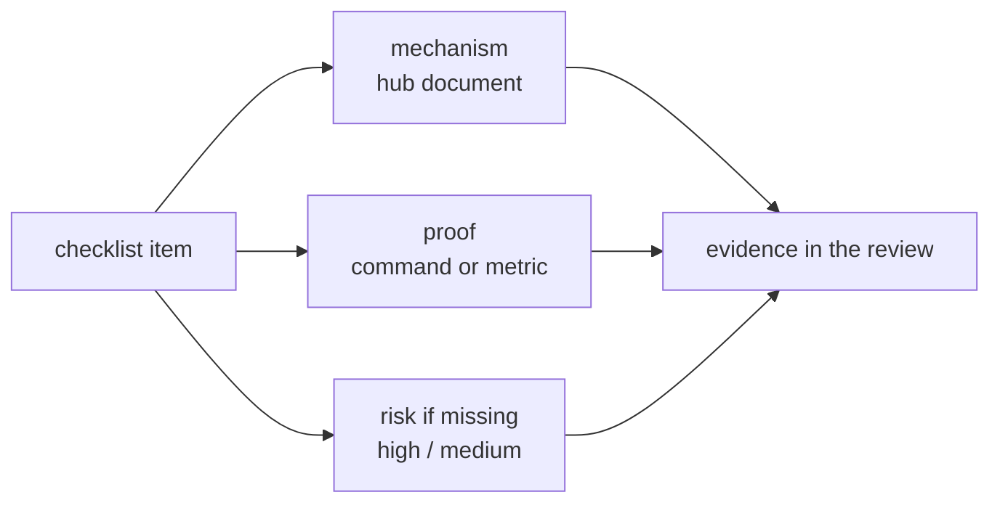

# Well-Architected · L200 — Pillar checklists for ECS and EKS

**Level:** 200 · **Time:** ~60 min · **Prerequisites:** [L100 Pillars for containers](L100-pillars-for-containers.md),
[ECS L200](../03-ecs/L200-task-definitions-services-and-scaling.md) or [EKS L200](../04-eks/L200-cluster-components-and-add-ons.md)

**After this document you can:**

- Walk an ECS or EKS workload through a checklist per pillar where every item names the mechanism,
  the document that explains it and the command that proves it.
- Use the checklists as the evidence list for a review and as the acceptance list for a new service.

## 1. Mental model



A checklist item is only useful if it points at the mechanism (so the fix is known) and at a proof (so
the answer is not an opinion). The tables below are written that way: item, where the mechanism is
explained in this repository, how to prove it, and the risk level a review would assign when it is
missing. Run them as a new-service gate, as a quarterly platform audit, and as the evidence list for
the review in [L300](L300-running-a-review.md).

## 2. Concepts

### 2.1 Operational Excellence

| Item | Mechanism | Proof | Risk |
| --- | --- | --- | --- |
| Infrastructure and deployment definitions in git; no console-made changes | [08 L200](../08-delivery-cicd-gitops/L200-pipelines-on-aws.md) | CloudTrail `RegisterTaskDefinition`/`UpdateService` only from pipeline roles; Argo CD `Synced` | high |
| Images deployed by digest; `latest` never deployed | [01 L200](../01-container-fundamentals/L200-images-builds-and-registries.md) | ECS: `describe-task-definition … image` contains `@sha256`; EKS: policy rejects tags | medium |
| Structured logs with `trace_id`; `/healthz`, `/readyz`, `/metrics` on every service | [07 L100](../07-observability/L100-observability-basics.md) | `curl /readyz`; log sample | medium |
| Container Insights (enhanced) on; dashboards per service; alarms with runbook links | [07 L200](../07-observability/L200-tooling-on-aws.md) | `describe-clusters --include SETTINGS`; alarm descriptions | medium |
| Deployments alarm-gated with automatic rollback (ECS circuit breaker + alarms; Rollouts analysis) | [08 L300](../08-delivery-cicd-gitops/L300-progressive-delivery-and-gitops-internals.md) | deployment configuration; last rollback event | high |
| Runbooks exist for the top incidents and are linked from alarms | [playbooks](../../playbooks/README.md) | alarm descriptions; playbook dates | medium |
| Task/pod state changes and audit logs retained | [07 L200 §2.10](../07-observability/L200-tooling-on-aws.md) | EventBridge rule; EKS logging types | medium |
| Upgrade cadence within standard support (EKS); AMI/agent rotation (ECS EC2) | [04 L300 §2.8](../04-eks/L300-eks-internals-and-operations.md), [playbooks/upgrades](../../playbooks/upgrades/eks-version-upgrade.md) | `describe-cluster … version`; AMI age | high if extended support |

### 2.2 Security

| Item | Mechanism | Proof | Risk |
| --- | --- | --- | --- |
| Every task has a task role; every pod that needs AWS has a Pod Identity association (IRSA on Fargate) | [06 L200](../06-identity-and-security/L200-iam-for-containers.md) | `describe-services`/`describe-task-definition` `taskRoleArn`; `list-pod-identity-associations` | high |
| IMDS unreachable from workloads (Fargate; `ECS_AWSVPC_BLOCK_IMDS`; EKS hop limit 1 + NetworkPolicy) | [05 L300 §2.2](../05-networking/L300-container-networking-internals.md) | `curl` token PUT from a task/pod times out | high |
| Secrets only via `secrets[]`/ESO/CSI; none in `environment`, images or git | [06 L200 §2.9](../06-identity-and-security/L200-iam-for-containers.md) | `describe-task-definition … environment` review; secret scanner | high |
| Non-root, read-only rootfs, capabilities dropped, seccomp default; PSA `restricted` on EKS namespaces | [06 L300 §2.1–2.2](../06-identity-and-security/L300-hardening-workloads-and-clusters.md) | task definition fields; `kubectl get ns -L pod-security.kubernetes.io/enforce` | high |
| Images from the organisation registry only, scanned (Inspector enhanced), signed and verified at admission (EKS) or in the pipeline (ECS) | [01 L400](../01-container-fundamentals/L400-hardening-supply-chain-and-performance.md), [02 L200](../02-ecr/L200-lifecycle-scanning-access-and-endpoints.md) | `get-registry-scanning-configuration`; policy engine reports | high |
| Default-deny network policy per namespace / security group per service referencing groups | [05 L300 §2.4](../05-networking/L300-container-networking-internals.md) | `kubectl get networkpolicy -A`; SG rules | medium |
| Private subnets, interface endpoints, egress control | [05 L400 §2.3](../05-networking/L400-network-architecture-at-scale.md) | no public IPs on tasks/nodes; endpoints list | medium |
| Access via Identity Center → roles → access entries; no `aws-auth`, no `system:masters` grants <!-- term-ok --> | [04 L200 §2.10](../04-eks/L200-cluster-components-and-add-ons.md) | `list-access-entries` review | high |
| GuardDuty Runtime Monitoring, EKS audit logs, CloudTrail, Security Hub enabled; findings routed | [06 L300 §2.6](../06-identity-and-security/L300-hardening-workloads-and-clusters.md) | `get-detector` features; EventBridge rules | high |
| ECS Exec restricted, logged, encrypted; `kubectl exec` audited | [06 L300 §2.9](../06-identity-and-security/L300-hardening-workloads-and-clusters.md) | cluster `executeCommandConfiguration`; audit queries | medium |
| Nodes: Bottlerocket/AL2023, IMDSv2 required, SSM only, no SSH keys; or Fargate/Auto Mode | [06 L300 §2.5](../06-identity-and-security/L300-hardening-workloads-and-clusters.md) | `describe-instances … MetadataOptions`; key pairs | medium |
| Incident response runbook rehearsed; break-glass role exists and alarms | [06 L400 §2.5](../06-identity-and-security/L400-security-architecture-and-incident-response.md) | game-day record | medium |

### 2.3 Reliability

| Item | Mechanism | Proof | Risk |
| --- | --- | --- | --- |
| Three AZs for tasks/pods and load balancers; data tier Multi-AZ | [10 L200 §2.1](../10-resilience-and-dr/L200-designing-for-failure.md) | subnet list; RDS `MultiAZ` | high |
| ≥ 2 copies per production service; topology spread / placement spread | [10 L200 §2.1](../10-resilience-and-dr/L200-designing-for-failure.md) | `desiredCount`; `replicas`; AZ distribution | high |
| PDBs on every Deployment with `minAvailable < replicas`; ECS `minimumHealthyPercent ≥ 100` behind load balancers | [10 L200 §2.2](../10-resilience-and-dr/L200-designing-for-failure.md) | `kubectl get pdb -A`; deployment configuration | medium |
| Probes correct: readiness on dependencies, liveness on process only; ELB health checks on `/readyz`; grace periods | [10 L200 §2.4](../10-resilience-and-dr/L200-designing-for-failure.md) | manifests/task definitions; target group settings | high |
| Graceful shutdown timeline: drain ≤ `stopTimeout`/grace; `preStop`; deregistration delay matched | [10 L200 §2.5](../10-resilience-and-dr/L200-designing-for-failure.md) | zero 502 during a rollout under load | medium |
| Autoscaling on demand signals with data-tier-aware ceilings; capacity layer with headroom (67% rule) | [10 L200 §2.3](../10-resilience-and-dr/L200-designing-for-failure.md) | scaling policies; load test record | medium |
| Timeouts, bounded jittered retries, breakers for non-critical dependencies; idempotent consumers | [10 L200 §2.6](../10-resilience-and-dr/L200-designing-for-failure.md), [09 L300](../09-data-messaging-and-batch/L300-messaging-and-data-deep-dive.md) | code review; FIS latency experiment | medium |
| DLQs on every queue with alarms; redrive runbook | [09 L200 §2.3](../09-data-messaging-and-batch/L200-integration-patterns.md) | queue attributes; alarms | medium |
| Quotas reviewed and raised for peak and DR | [reference/quotas](../../reference/quotas-and-limits.md) | Service Quotas usage | medium |
| DR strategy per tier with RTO/RPO; replication in place (ECR, secrets, data); failover rehearsed in the last quarter with recorded RTO/RPO | [10 L300](../10-resilience-and-dr/L300-dr-strategies-for-container-platforms.md), [10 L400](../10-resilience-and-dr/L400-dr-plan-and-game-days.md) | DR plan history | high |
| FIS experiments run regularly with stop conditions; zonal shift practice | [11 L300 §2.6](../11-testing-workloads/L300-performance-and-chaos-testing.md) | experiment history | medium |

### 2.4 Performance Efficiency

| Item | Mechanism | Proof | Risk |
| --- | --- | --- | --- |
| Requests set on every container; memory limit = request; CPU limits only where justified by measured throttling | [01 L400 §2.6](../01-container-fundamentals/L400-hardening-supply-chain-and-performance.md) | manifests; throttling ratio | medium |
| Right-sizing loop (VPA/Compute Optimizer + load tests) at least quarterly | [11 L300 §2.4](../11-testing-workloads/L300-performance-and-chaos-testing.md) | recommendations vs requests | medium |
| Runtime container awareness (JVM/Node/Go flags) | [01 L400 §2.6](../01-container-fundamentals/L400-hardening-supply-chain-and-performance.md) | env/flags in manifests | medium |
| Images small, multi-arch; Graviton evaluated per service; SOCI for large images on Fargate | [01 L200](../01-container-fundamentals/L200-images-builds-and-registries.md), [01 L400 §2.9](../01-container-fundamentals/L400-hardening-supply-chain-and-performance.md) | image sizes; `runtimePlatform`; pull times | low |
| Scaling on request/queue signals; capacity layer reaction time measured | [10 L200 §2.3](../10-resilience-and-dr/L200-designing-for-failure.md) | scaling policies; capacity test record | medium |
| Caches with TTL and bypass; connection pooling/RDS Proxy | [09 L200](../09-data-messaging-and-batch/L200-integration-patterns.md) | `CacheHitRate`; `DatabaseConnections` | medium |
| Load balancer: `ip` targets, HTTP/2, least outstanding requests where useful; DNS/NodeLocal tuned | [05 L200](../05-networking/L200-load-balancing-ingress-and-discovery.md), [04 L300 §2.6](../04-eks/L300-eks-internals-and-operations.md) | target group attributes; CoreDNS metrics | low |
| Prefix delegation on Nitro nodes; IP headroom | [05 L300 §2.3](../05-networking/L300-container-networking-internals.md) | `allocatable.pods`; subnet free IPs | medium |

### 2.5 Cost Optimization

| Item | Mechanism | Proof | Risk |
| --- | --- | --- | --- |
| Compute model chosen with a utilisation-based comparison (Fargate vs EC2 vs Managed Instances vs Auto Mode) | [03 L400 §2.2](../03-ecs/L400-ecs-at-scale.md), [04 L400 §2.4](../04-eks/L400-eks-at-scale.md) | decision record | medium |
| Requested-vs-used ratio tracked per service/namespace; idle services retired | [04 L400 §2.4](../04-eks/L400-eks-at-scale.md) | Container Insights ratios | medium |
| Spot for interruptible workloads with `base` on-demand / diversified NodePools; Savings Plans for baseline | [03 L200 §2.7](../03-ecs/L200-task-definitions-services-and-scaling.md), [04 L200 §2.7](../04-eks/L200-cluster-components-and-add-ons.md) | capacity strategy; Savings Plans coverage | medium |
| Non-production scaled to zero off-hours | [10 L200 §2.3](../10-resilience-and-dr/L200-designing-for-failure.md) | scheduled actions | low |
| Data transfer minimised: interface endpoints for ECR/S3/STS/logs, AZ-local routing, NLB cross-zone deliberate | [05 L400 §2.7](../05-networking/L400-network-architecture-at-scale.md) | Cost Explorer data-transfer lines | medium |
| Logs: retention set, debug dropped, EMF for metrics; Container Insights scoped | [07 L400 §2.3](../07-observability/L400-observability-at-scale.md) | `IncomingBytes` per group; retention | medium |
| Shared ALB per environment (IngressGroups / listener rules) | [05 L200 §2.3](../05-networking/L200-load-balancing-ingress-and-discovery.md) | load balancer count | low |
| No EKS cluster in extended support; cluster count justified | [04 L400 §2.1](../04-eks/L400-eks-at-scale.md) | `describe-cluster … upgradePolicy`, version | medium |
| ECR lifecycle policies; pull-through cache | [02 L200](../02-ecr/L200-lifecycle-scanning-access-and-endpoints.md) | repository image counts | low |

### 2.6 Sustainability

| Item | Mechanism | Proof | Risk |
| --- | --- | --- | --- |
| Utilisation targets (60–80% at p95) and consolidation/bin-packing | [04 L400 §2.3](../04-eks/L400-eks-at-scale.md) | requested-vs-used; NodePool consolidation | low |
| arm64 (Graviton) where the workload allows | [01 L400 §2.9](../01-container-fundamentals/L400-hardening-supply-chain-and-performance.md) | architecture share | low |
| Scale to zero for idle consumers/environments (KEDA, scheduled actions) | [09 L200 §2.3](../09-data-messaging-and-batch/L200-integration-patterns.md) | `minReplicaCount: 0` where applicable | low |
| Telemetry and data retention minimised to what is used | [07 L400 §2.3](../07-observability/L400-observability-at-scale.md) | retention settings | low |
| Batch on Spot with checkpointing; off-peak scheduling | [09 L300 §2.8](../09-data-messaging-and-batch/L300-messaging-and-data-deep-dive.md) | CE allocation strategy | low |

### 2.7 Platform-specific quick lists

**ECS**: `awsvpc`; task role + execution role per service; `secrets[]`; `readonlyRootFilesystem`,
`user`, `initProcessEnabled`, capabilities dropped; `stopTimeout` ≥ drain; `awslogs` non-blocking or
FireLens; health check grace; circuit breaker + alarms; `minimumHealthyPercent 100`; three subnets;
capacity strategy with `base`; Container Insights enhanced; ECS Exec logged; `ECS_AWSVPC_BLOCK_IMDS`
on EC2; AL2023/Bottlerocket AMIs; Service Connect TLS where east-west encryption is required.

**EKS**: version in standard support; `API` authentication mode with access entries; audit +
authenticator logs; Pod Identity agent and associations; VPC CNI with prefix delegation and network
policy; CoreDNS autoscaling; managed add-ons pinned; nodes AL2023/Bottlerocket with IMDSv2 hop limit
1 (or Auto Mode); PSA `restricted` on app namespaces; CEL/Kyverno policies (digests, registry,
requests, signatures); default-deny NetworkPolicies; PDBs; topology spread; readiness gates; Karpenter/
Auto Mode NodePools with limits and budgets; observability add-on; GuardDuty agent; GitOps.

## 3. How it interacts with the rest of AWS

| Component | Talks to | Protocol/API | Prerequisite (IAM, network, DNS) | What breaks if missing |
| --- | --- | --- | --- | --- |
| Evidence collection scripts | ECS/EKS/EC2/IAM/GuardDuty/CloudWatch APIs | read-only role | `ReadOnlyAccess`-class permissions | manual, inconsistent evidence |
| AWS Config rules | ECS/EKS/ECR resources | evaluations | recorder | no continuous checklist |
| Security Hub | Config, GuardDuty, Inspector | standards | delegated admin | fragmented security evidence |
| Well-Architected Tool | reviewers | API | workload created | findings not tracked |

## 4. Use it when / avoid it when

Use the checklists as: the acceptance gate for a new service (every item answered before production),
the quarterly platform audit (automated where possible), and the evidence list for the formal review.
Avoid using them as a one-time launch checklist that is never re-run, or as a substitute for
understanding the mechanism behind an item (the links exist for that).

## 5. Well-Architected view

This document is the pillar view; the table per item above carries the risk rating. The meta-practice:
automate the proofs (a scheduled job that evaluates the commands and publishes a compliance percentage
per pillar), and treat a falling percentage as an operational alarm.

## 6. Failure modes and troubleshooting

| Symptom | Likely cause | How to confirm (command/metric) | Fix |
| --- | --- | --- | --- |
| Checklist "complete" but incidents keep happening | items checked without proof | re-run the proof commands | evidence-first; automate |
| Items impossible to prove | mechanism not observable | look for the metric/API | add the signal (e.g. EventBridge for task state) |
| Teams disagree on risk ratings | no shared definition | the risk column here; the framework's definitions | adopt the framework's high/medium definitions |
| Checklist drifts from platform reality | new services/features | quarterly review of the checklist itself | tie to `docs/FACTS-2026-09.md` updates |

## 7. Signals: metrics, logs, traces

Compliance percentage per pillar and per platform from automated proofs; count of high-risk items open;
age of the oldest open high-risk item; percentage of services passing the new-service gate on first
attempt.

Full table: [`reference/metrics-catalog.md`](../../reference/metrics-catalog.md).

## 8. Testing and DR notes

Several Reliability items are only provable by tests: zero 502 during rollout (load test during a
deploy), 67% headroom (AZ evacuation drill), RTO/RPO (failover rehearsal), breaker behaviour (FIS
latency). Record the test date next to the item; an item whose proof is older than a quarter is
unproven.

## 9. Hands-on

```bash
# Automate a slice of the checklist against the labs (billable environment)
CLUSTER=shopfront-dev
echo "== ECS: task roles, secrets in env, read-only, non-root"
for s in orders catalog fulfillment-worker analytics-consumer; do
  TD=$(aws ecs describe-services --cluster $CLUSTER --services $s --query 'services[0].taskDefinition' --output text)
  aws ecs describe-task-definition --task-definition "$TD" --query 'taskDefinition.{svc:family,taskRole:taskRoleArn,ro:containerDefinitions[0].readonlyRootFilesystem,user:containerDefinitions[0].user,envSecrets:containerDefinitions[0].environment[?contains(name,`PASS`)||contains(name,`SECRET`)].name}'
done
echo "== ECS: Container Insights and Exec logging"
aws ecs describe-clusters --clusters $CLUSTER --include SETTINGS CONFIGURATIONS --query 'clusters[0].{settings:settings,exec:configuration.executeCommandConfiguration.logging}'
echo "== EKS: version/support, auth mode, logging, PSA labels, PDBs, associations"
aws eks describe-cluster --name $CLUSTER --query 'cluster.{v:version,support:upgradePolicy.supportType,auth:accessConfig.authenticationMode,logs:logging.clusterLogging[0].types}'
kubectl get ns -L pod-security.kubernetes.io/enforce | grep -v '^kube'
kubectl get pdb -A; kubectl get networkpolicy -A | grep -c default-deny
aws eks list-pod-identity-associations --cluster-name $CLUSTER --query 'associations[].{ns:namespace,sa:serviceAccount}' --output table
echo "== nodes: IMDSv2 and hop limit"
aws ec2 describe-instances --filters "Name=tag:eks:cluster-name,Values=$CLUSTER" --query 'Reservations[].Instances[].{id:InstanceId,tokens:MetadataOptions.HttpTokens,hop:MetadataOptions.HttpPutResponseHopLimit,public:PublicIpAddress}' --output table
```

## 10. Check yourself

1. Which three checklist items would you verify first on an unfamiliar ECS cluster, and why?

<details><summary>Answer</summary>
Task roles on every service and IMDS blocked on EC2 (credential exposure is the most exploitable
gap), secrets not in `environment` (visible to anyone with describe permissions), and deployment
configuration with circuit breaker and alarms (the difference between a bad deploy being a blip or an
outage). All three are provable in minutes with `describe-*` calls.
</details>

2. Why does an item need both a mechanism link and a proof command?

<details><summary>Answer</summary>
Without the mechanism, a failing item cannot be fixed with understanding, only by copying settings;
without the proof, an item is an opinion and drifts silently. Together they make the checklist
executable and repeatable by anyone.
</details>

3. What is the risk level of "no PDB on a Deployment", and when does it become high?

<details><summary>Answer</summary>
Medium by default: drains and consolidation may remove several copies at once, causing brief
capacity dips. It becomes high when the service has few replicas and the platform performs voluntary
disruptions often (Karpenter consolidation, Auto Mode's node replacement, frequent upgrades), because
then the dip is an outage.
</details>

4. Which Cost Optimization item is most often surprising on first measurement?

<details><summary>Answer</summary>
Data transfer: NAT gateway per-GB processing for image pulls and AWS API calls, and cross-AZ traffic
between pods/tasks and their data stores or brokers. Interface endpoints and AZ-local routing usually
recover more than instance right-sizing on a first pass.
</details>

5. How do you keep the checklist honest over time?

<details><summary>Answer</summary>
Automate the proofs as a scheduled job that publishes compliance per pillar, alarm on regressions,
record proof dates for test-based items and treat proofs older than a quarter as unproven, and review
the checklist itself when the facts sheet or the platform changes.
</details>

## 11. Sources

- AWS Well-Architected Framework pillars — https://docs.aws.amazon.com/wellarchitected/latest/framework/the-pillars-of-the-framework.html
- Amazon ECS Best Practices Guide — https://docs.aws.amazon.com/AmazonECS/latest/bestpracticesguide/intro.html
- Amazon EKS Best Practices Guide — https://docs.aws.amazon.com/eks/latest/best-practices/introduction.html
- Container Build Lens best practices — https://docs.aws.amazon.com/wellarchitected/latest/container-build-lens/best-practices.html
- AWS Config managed rules (ECS, EKS, ECR) — https://docs.aws.amazon.com/config/latest/developerguide/managed-rules-by-aws-config.html
- AWS Security Hub controls reference — https://docs.aws.amazon.com/securityhub/latest/userguide/securityhub-controls-reference.html
- AWS Well-Architected Tool — https://docs.aws.amazon.com/wellarchitected/latest/userguide/intro.html
