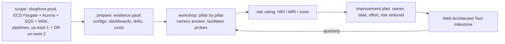

# Well-Architected · L300 — Running a review

**Level:** 300 · **Time:** ~60 min · **Prerequisites:** [L200 Pillar checklists for ECS and EKS](L200-pillar-checklists-ecs-and-eks.md),
familiarity with the [`labs/`](../../labs/) system

**After this document you can:**

- Scope, schedule and facilitate a Well-Architected review of a container workload.
- Collect evidence per pillar with commands and reports rather than interviews alone.
- Rate risks consistently, write an improvement plan and track it as milestones in the
  Well-Architected Tool.
- Read a worked review of the shopfront labs as a template.

## 1. Mental model



A review is a facilitated workshop with homework. The homework is the evidence pack: the outputs of
the L200 proof commands, dashboards, the DR plan history, cost reports, the last game-day scorecard.
The workshop walks the pillars, rates each question and turns high-risk items into a plan. The tool
records the state so the next review measures change instead of repeating the conversation.

## 2. Concepts

### 2.1 Scoping and preparation

Scope the workload as a user sees it: shopfront production = the ECS services (or EKS workloads), the
ALB/WAF edge, Aurora, ElastiCache, SQS, MSK, S3, the pipelines that change them, the observability that
watches them, and the DR Region. Exclude nothing the workload depends on; include the on-call and the
owners of the data tier. Duration: half a day for a mature platform, a full day for a first review.
Participants: workload owner, platform engineer, data owner, security, someone who has been on call for
it, a facilitator who did not build it.

Evidence pack (collected the week before):

| Pillar | Evidence |
| --- | --- |
| Operational Excellence | pipeline definitions; last 20 deployments with outcomes; alarm inventory with runbook links; dashboards; postmortems from the last quarter |
| Security | L200 proof outputs (roles, IMDS, secrets, PSA, signatures); Security Hub score; GuardDuty findings summary; access entries/IAM role review; last IR drill |
| Reliability | AZ distribution; PDBs/deployment configurations; probe settings; DR plan with history; FIS/game-day scorecards; quota report |
| Performance Efficiency | utilisation ratios; throttling; load test reports; Compute Optimizer/VPA recommendations |
| Cost Optimization | Cost Explorer by service/tag; requested-vs-used; Spot/Savings Plans coverage; data transfer lines; log ingestion |
| Sustainability | utilisation, arm64 share, scale-to-zero coverage, retention settings |

### 2.2 Facilitating the workshop

Walk each pillar's questions (framework plus Container Build Lens, with the EKS/ECS guides as the
prescriptive reference). For each: ask for the evidence, not the belief; write the answer as observed
("tasks run with task roles; IMDS is blocked on the two EC2 capacity providers; verified by curl from a
task on 2026-09-15"); rate; capture the improvement as an action with an owner. Keep the tone
investigative; the facilitator's job is to make "no" a safe answer. Time-box: 30–45 minutes per pillar.

### 2.3 Risk rating

| Rating | Definition | Example |
| --- | --- | --- |
| High risk issue (HRI) | likely to cause significant impact and no mitigation is in place | no DR test ever; tasks can reach IMDS on shared EC2; no alarms on deployments |
| Medium risk issue (MRI) | could cause impact; partial mitigations exist | PDBs missing on some services; logs without retention; no Graviton evaluation |
| None | best practice met with evidence | three AZs, spread, alarms with rollback, evidence dated |
| Not applicable | the question does not apply (document why) | GPU practices for a CPU-only workload |

Rate the question, not the person; when in doubt, rate higher and let the plan decide the priority.

### 2.4 Improvement plan

Each HRI/MRI becomes an item: what, why (the risk), how (the mechanism document in this repository),
owner, date, effort (S/M/L), risk reduced. Order by risk reduced per effort; schedule HRIs within a
quarter. Record a milestone in the Well-Architected Tool; the next review starts by re-answering the
questions behind the items.

### 2.5 The worked review: shopfront production on ECS Fargate (excerpt)

| Pillar | Question (abridged) | Evidence found | Rating | Improvement |
| --- | --- | --- | --- | --- |
| OE | How do you deploy changes safely? | pipelines register task definitions by digest; rolling with circuit breaker and 5xx/p99 alarm rollback on all four services ([`04-services.yaml`](../../labs/ecs/cloudformation/04-services.yaml)); last 20 deploys: 1 rollback (alarm) | none | consider canary for `orders` (tier 1) |
| OE | How do you understand workload health? | Container Insights enhanced; dashboards per service; 9 alarms with runbook links; task state events to logs | none | add SLO burn-rate alerts |
| SEC | How do you manage machine identities? | task role per service; execution role shared per environment; Fargate → no IMDS; secrets via `secrets[]` | none | scope execution role secrets per service |
| SEC | How do you protect compute? | non-root, read-only rootfs, capabilities dropped; images distroless/slim, scanned (Inspector enhanced); signing in CI but **not verified before deploy** | MRI | add `notation verify` step before `register-task-definition` |
| SEC | How do you detect events? | GuardDuty runtime for ECS Fargate on; CloudTrail; ECS Exec logged | none | Security Hub standard enabled? (verify) |
| REL | How do you design to withstand failures? | 3 AZs; `desiredCount 3`; `minimumHealthyPercent 100`; `stopTimeout 30`, deregistration 20; readiness on dependencies | none | run the drain test under load quarterly |
| REL | How do you back up and recover? | Aurora Global to us-west-2; ECR replication; secrets replicated; **SQS republish job not written**; no failover rehearsal in the last quarter | HRI | write the republish job; schedule the game day |
| REL | How do you manage capacity? | target tracking on CPU and `ALBRequestCountPerTarget`; worker on backlog per task; quotas raised in primary, **not in DR** | MRI | quota parity checks (ARC readiness) |
| PERF | How do you select compute? | Fargate ARM64; sizes from Compute Optimizer last quarter | none | re-run after the next load test |
| PERF | How do you monitor performance? | p99 alarms; throttling not tracked (Fargate hides CFS stats? — Container Insights `CpuUtilized` only) | MRI | add application latency histograms to dashboards |
| COST | How do you manage demand and supply? | Fargate Spot for workers with `base 1`; dev scaled to zero at night | none | Savings Plans for the on-demand baseline |
| COST | How do you monitor usage? | tags per service; monthly report; **data transfer not attributed** | MRI | Flow Logs to Athena by AZ/service |
| SUS | How do you align to demand? | KEDA-equivalent scaling on queue depth; ARM64 | none | — |

Result: 1 HRI (DR rehearsal + republish), 4 MRIs, plan with owners; milestone `2026-Q3` recorded.
Running the review against the EKS variant adds questions on cluster version cadence, PSA coverage,
Pod Identity associations, NetworkPolicies and admission — the L200 EKS quick list.

### 2.6 Using the Well-Architected Tool

Create the workload with the framework lens plus the Container Build Lens; answer questions (choices
map to best practices; add notes with the evidence pointer); the tool computes risks and produces a
report; save a milestone after the workshop and after completing the plan; share the workload with the
platform team's account; custom lenses can encode the L200 checklists as your organisation's own
questions.

```bash
WL=$(aws wellarchitected create-workload --workload-name shopfront-prod --description "shopfront production" \
  --environment PRODUCTION --aws-regions us-east-1 us-west-2 --review-owner platform@example.com \
  --lenses wellarchitected containerbuild --client-request-token "$(uuidgen)" --query WorkloadId --output text)
aws wellarchitected list-answers --workload-id "$WL" --lens-alias wellarchitected --pillar-id reliability --query 'AnswerSummaries[].{q:QuestionTitle,risk:Risk}' --output table
aws wellarchitected update-answer --workload-id "$WL" --lens-alias wellarchitected --question-id <id> \
  --selected-choices <choice-ids> --notes "Evidence: DR plan history 2026-09-15; SQS republish job missing"
aws wellarchitected create-milestone --workload-id "$WL" --milestone-name 2026-Q3-review --client-request-token "$(uuidgen)"
aws wellarchitected get-lens-review-report --workload-id "$WL" --lens-alias wellarchitected --query 'LensReviewReport.Base64String' --output text | base64 -d > /tmp/report.pdf
```

## 3. How it interacts with the rest of AWS

| Component | Talks to | Protocol/API | Prerequisite (IAM, network, DNS) | What breaks if missing |
| --- | --- | --- | --- | --- |
| Reviewers | Well-Architected Tool | `wellarchitected:*` | permissions; workload shared across accounts | no record of risks |
| Evidence scripts | read-only APIs across accounts | `ReadOnlyAccess`-class role | cross-account roles | manual evidence |
| Security Hub / Config / Trusted Advisor | evidence | reports | enabled | thin Security evidence |
| Cost Explorer / CUR | evidence | reports | tags | thin Cost evidence |
| Backlog tool | improvement plan | tickets | integration | plan not tracked |

## 4. Use it when / avoid it when

Use: before launch, after major changes, yearly for tier 1, with the Container Build Lens always and
custom lenses for organisational standards. Avoid: reviews without evidence packs, reviews of the
platform without its data tier and pipelines, plans without owners, and treating the tool's risk count
as a KPI to game.

## 5. Well-Architected view

The review is the framework's own feedback loop; its Well-Architected property is cadence and honesty.
Practice: quarterly light re-check of open items, yearly full review, evidence automated where the
L200 proofs allow.

## 6. Failure modes and troubleshooting

| Symptom | Likely cause | How to confirm (command/metric) | Fix |
| --- | --- | --- | --- |
| Workshop runs out of time | no evidence pack; debates about mechanisms | agenda | homework first; time-box; park mechanism debates to the hub documents |
| Everything rated "none" | belief-based answers | ask for artifacts | evidence-first facilitation |
| Plan never executed | no owners/dates; not in the backlog | milestone comparison | tickets with dates; quarterly check |
| Different reviewers, different ratings | undefined criteria | rating table | adopt the HRI/MRI definitions |
| Review contradicts monitoring later | evidence stale | dates on evidence | re-collect within a week of the workshop |

## 7. Signals: metrics, logs, traces

HRI/MRI counts per pillar over milestones; open improvement items by age; evidence age; percentage of
questions answered with dated evidence; reviews per workload per year.

Full table: [`reference/metrics-catalog.md`](../../reference/metrics-catalog.md).

## 8. Testing and DR notes

Reliability answers must cite tests: the DR plan history with measured RTO/RPO, FIS experiment logs,
load test reports. A review is also a good moment to schedule the next game day and to compare the
plan's targets with the last measured values ([10 L400](../10-resilience-and-dr/L400-dr-plan-and-game-days.md)).

## 9. Hands-on

```bash
# Build the evidence pack for the labs environment (billable account) into one directory
mkdir -p /tmp/war-evidence && cd /tmp/war-evidence
aws ecs describe-clusters --clusters shopfront-dev --include SETTINGS CONFIGURATIONS > ecs-cluster.json
for s in orders catalog fulfillment-worker analytics-consumer; do
  aws ecs describe-services --cluster shopfront-dev --services $s --query 'services[0].{deploy:deploymentConfiguration,az:networkConfiguration.awsvpcConfiguration.subnets,hc:healthCheckGracePeriodSeconds}' > svc-$s.json
done
aws cloudwatch describe-alarms --alarm-name-prefix shopfront-dev --query 'MetricAlarms[].{name:AlarmName,desc:AlarmDescription,actions:AlarmActions}' > alarms.json
aws rds describe-global-clusters > aurora-global.json
aws ecr describe-registry > ecr-registry.json
aws guardduty list-detectors --query 'DetectorIds[0]' --output text | xargs -I{} aws guardduty get-detector --detector-id {} > guardduty.json
aws securityhub get-enabled-standards > securityhub.json 2>/dev/null || echo '{"note":"Security Hub not enabled"}' > securityhub.json
aws ce get-cost-and-usage --time-period Start=$(date -u -v-30d +%F),End=$(date -u +%F) --granularity MONTHLY --metrics UnblendedCost --group-by Type=DIMENSION,Key=SERVICE > cost.json
ls -la
# Then run the workshop with the L200 tables as the agenda and record answers in the Well-Architected Tool (§2.6).
```

## 10. Check yourself

1. What belongs in the evidence pack for the Reliability pillar, and what does not count?

<details><summary>Answer</summary>
AZ distribution and deployment configurations exported from the APIs, probe/health settings, PDBs, the
DR plan with its history of measured RTO/RPO, FIS and game-day scorecards, quota reports. Diagrams and
statements of intent ("we can fail over") do not count without a dated exercise behind them.
</details>

2. How do you rate "images are signed in CI but not verified before deployment"?

<details><summary>Answer</summary>
Medium risk: a control exists (signing, scanning) but the enforcement point is missing, so a
compromised pipeline step or a manual deploy could run an unsigned image. The improvement is a
verification gate (`notation verify` before `register-task-definition` on ECS; admission policy on
EKS), small effort, meaningful risk reduction.
</details>

3. Why include the data tier and pipelines in the workload scope?

<details><summary>Answer</summary>
Most container-platform risks sit in the seams: RPO lives in the database and queues, change risk lives
in the pipeline, credentials live in how the pipeline and tasks get them. Reviewing only the cluster
produces a clean report about the least risky part.
</details>

4. What does a milestone in the Well-Architected Tool give you?

<details><summary>Answer</summary>
A snapshot of every answer and risk at a point in time, so the next review shows what changed
(risks closed, new risks from new features) instead of repeating the whole conversation, and a report
you can share with stakeholders and auditors.
</details>

5. The workshop finds one HRI and several MRIs. How do you order the plan?

<details><summary>Answer</summary>
By risk reduced per unit of effort with HRIs first: the DR republish job plus a scheduled game day
(high risk, medium effort) before data-transfer attribution (medium risk, medium effort) and signature
verification (medium risk, small effort — do it early anyway because it is cheap). Assign owners and
dates within the quarter for the HRI.
</details>

## 11. Sources

- The Well-Architected review process — https://docs.aws.amazon.com/wellarchitected/latest/framework/the-review-process.html
- AWS Well-Architected Tool user guide (workloads, lenses, milestones, custom lenses) — https://docs.aws.amazon.com/wellarchitected/latest/userguide/intro.html
- Well-Architected Tool API reference — https://docs.aws.amazon.com/wellarchitected/latest/APIReference/Welcome.html
- Container Build Lens — https://docs.aws.amazon.com/wellarchitected/latest/container-build-lens/container-build-lens.html
- Amazon ECS and EKS Best Practices Guides — https://docs.aws.amazon.com/AmazonECS/latest/bestpracticesguide/intro.html and https://docs.aws.amazon.com/eks/latest/best-practices/introduction.html
- AWS Security Hub and AWS Config as evidence sources — https://docs.aws.amazon.com/securityhub/latest/userguide/what-is-securityhub.html and https://docs.aws.amazon.com/config/latest/developerguide/WhatIsConfig.html
- AWS Cost Explorer and Cost and Usage Reports — https://docs.aws.amazon.com/cost-management/latest/userguide/ce-what-is.html
