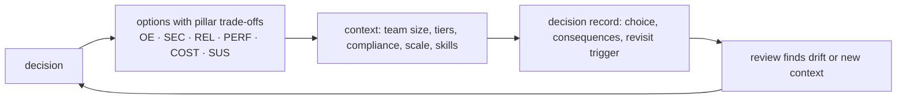

# Well-Architected · L400 — Trade-offs and anti-patterns

**Level:** 400 · **Time:** ~60 min · **Prerequisites:** [L300 Running a review](L300-running-a-review.md),
the L400 documents of domains [03](../03-ecs/L400-ecs-at-scale.md), [04](../04-eks/L400-eks-at-scale.md),
[05](../05-networking/L400-network-architecture-at-scale.md), [10](../10-resilience-and-dr/L400-dr-plan-and-game-days.md)

**After this document you can:**

- Write decision records for the recurring hard choices of a container platform, with the pillar
  trade-offs made explicit.
- Recognise the anti-patterns reviews keep finding, name the failure each one causes, and know the
  replacement.

## 1. Mental model



A trade-off is a decision where every option loses on some pillar. Writing it down as a decision record
— options, the pillar each option favours and hurts, the context that made the choice right, and the
trigger that should reopen it — is what lets a platform evolve without re-arguing everything or
silently keeping a choice past its context. Anti-patterns are decisions made by default; the
catalogue below names them so a review can point at one and say what it costs.

## 2. Concepts

### 2.1 Compute model: Fargate vs EC2 vs Managed Instances vs Auto Mode

| Option | Favours | Hurts | Right when | Revisit when |
| --- | --- | --- | --- | --- |
| Fargate (ECS/EKS) | OE (no hosts), SEC (microVM isolation, no IMDS), REL (per-task ENI, AZ spread) | COST at very high utilisation; PERF for GPUs/local NVMe/kernel tuning | small teams, bursty fleets, untrusted code, compliance | steady fleet > 60% utilisation with Savings Plans; GPU or DaemonSet needs |
| EC2 (ECS capacity providers, EKS managed node groups + Karpenter) | COST at high utilisation, PERF (any instance, DaemonSets), flexibility | OE (AMIs, patching, agents), SEC (shared kernel, IMDS discipline) | hardware needs, large steady fleets with a platform team | ops cost exceeds savings; team shrinks |
| ECS Managed Instances | EC2 economics/hardware with AWS-operated hosts | management fee; less host control | EC2 needs without host operations | fee vs savings; feature needs |
| EKS Auto Mode | OE (nodes, add-ons, LB, CNI managed), PERF (Karpenter), SEC (Bottlerocket, 21-day nodes) | COST (per-instance fee), flexibility (no custom CNI/AMI/kubelet flags) | most new EKS clusters | need for Cilium as CNI, custom kernels, DaemonSets outside the allowlist |

Decision record (shopfront): Fargate on ECS for services and workers (team of five, bursty, no
hardware needs); revisit at 60% sustained utilisation or when a GPU workload appears. For the EKS
variant: Auto Mode; revisit if Cilium becomes a requirement.

### 2.2 Cluster topology: one big cluster vs many

| Option | Favours | Hurts | Right when |
| --- | --- | --- | --- |
| Few clusters, namespaces per team | COST, OE (fewer upgrades) | REL/SEC (shared control plane and kernel; blast radius), noisy neighbours | internal teams, mature policy (PSA, quotas, NetworkPolicy) |
| Cluster per team/product | REL/SEC isolation, independent upgrade windows | COST (fees, duplicated system pods), OE (fleet GitOps required) | many teams with different risk appetites |
| Cells | REL (blast radius 1/N) | COST/OE (N of everything) | tier-0 multi-tenant SaaS |
| Cluster per compliance boundary | SEC/compliance | duplication | PCI/HIPAA scopes |

Record: start with one cluster per environment and strong namespaces; split by security tier and by
team only when a concrete isolation need appears; never by default ([04 L400 §2.1](../04-eks/L400-eks-at-scale.md)).

### 2.3 Service mesh or not

| Requirement | Cheapest adequate answer | Mesh justified |
| --- | --- | --- |
| Retries/timeouts/metrics between ECS services | Service Connect | no |
| Encryption in transit inside the VPC | Service Connect TLS (ECS); Cilium/Istio mTLS (EKS) | on EKS, yes if mTLS with identities is mandated |
| L7 authorisation between services | Cilium L7 policy / Istio `AuthorizationPolicy` | yes |
| Cross-account service networking | VPC Lattice | no |
| Traffic shifting | ECS canary strategies; Argo Rollouts; Lattice weights | only for very fine control |

Record: no mesh for shopfront on ECS (Service Connect + security groups); on EKS, Cilium only if
identity-based L7 policy or mTLS is required by compliance. App Mesh is out (end of support
2026-09-30) ([05 L400 §2.8](../05-networking/L400-network-architecture-at-scale.md)).

### 2.4 Multi-Region or not

| Option | Favours | Hurts | Right when |
| --- | --- | --- | --- |
| Single Region, three AZs, cells | COST, OE, simplicity | REL against Region events | most workloads; RTO ≥ hours acceptable or Region risk accepted |
| Warm standby | REL (RTO minutes) | COST (~10–20% + data replicas), OE (drills, parity) | tier 1 with revenue impact per hour |
| Active/active | REL, latency for global users | COST (2×), data design complexity | global tier 0 with partitionable data |

Record: single Region for dev/staging; warm standby for production tier 1; revisit when the business
puts a number on an hour of downtime that exceeds the standby cost ([10 L400](../10-resilience-and-dr/L400-dr-plan-and-game-days.md)).

### 2.5 Managed vs self-managed add-ons and controllers

| Component | Managed option | Self-managed | Choose managed unless |
| --- | --- | --- | --- |
| CNI, CoreDNS, kube-proxy, CSI, Pod Identity | EKS managed add-ons / Auto Mode capabilities | Helm charts | you need versions or settings the managed path does not expose |
| Node lifecycle | Auto Mode / managed node groups | Karpenter on standard cluster | custom AMIs, kubelet flags, DaemonSets outside Auto Mode's surface |
| GitOps | EKS Capability for Argo CD | Argo CD/Flux Helm | features missing in the Capability; hub-and-spoke requirement |
| Observability agents | `amazon-cloudwatch-observability`, `adot` add-ons | Prometheus operator, Fluent Bit charts | Prometheus-native stack with AMP; specific collector features |
| Policy | ValidatingAdmissionPolicy (in-process) | Kyverno/Gatekeeper | image verification, reports |
| Kafka, Postgres, Redis | MSK, RDS/Aurora, ElastiCache | Strimzi, CloudNativePG, Redis operators | data-platform team exists and needs cluster-local semantics |

Managed options lower OE cost and usually SEC risk; self-managed buys flexibility with an upgrade
rota you must staff.

### 2.6 Observability and CI/CD stacks

Observability: CloudWatch-centric (Container Insights, Application Signals, alarms that act) for
ECS-heavy fleets; add AMP/AMG for Kubernetes-native alerting and PromQL; OpenTelemetry for all
instrumentation regardless of backend ([07 L200](../07-observability/L200-tooling-on-aws.md)). CI/CD:
GitHub Actions + OIDC when code is on GitHub; CodeBuild for in-account builds; Jenkins only where it is
already run well; Argo CD (Capability) for EKS; push deployments for ECS
([08 L200](../08-delivery-cicd-gitops/L200-pipelines-on-aws.md)). Record the choice with its revisit
trigger (team fluency, cost per build minute, feature gaps).

### 2.7 Cost vs resilience: the honest table

| Resilience feature | Cost shape | Skip only when |
| --- | --- | --- |
| Third AZ with 67% headroom | ~33% idle compute | dev/test; batch that tolerates delay |
| Multi-AZ database | ~2× database instance cost | non-production |
| Warm standby Region | 10–20% compute + replicas + transfer | RTO of hours acceptable |
| Canary/blue-green | brief 2× capacity, longer releases | low-traffic internal services |
| Enhanced observability, 100% span ingestion | per metric/GB | sampled traces suffice; non-production |
| GuardDuty runtime, Inspector | per resource | never for production |
| Interface endpoints | hourly per AZ | tiny traffic volumes |

### 2.8 Anti-pattern catalogue

| Anti-pattern | Failure it causes | Replacement |
| --- | --- | --- |
| Tasks/pods using the instance/node role (IMDS reachable) | credential theft via SSRF; over-privilege | task roles / Pod Identity; hop limit 1; `ECS_AWSVPC_BLOCK_IMDS` |
| `latest` tags and mutable references in deployments | mixed versions; impossible rollbacks | digests; immutability |
| Secrets in environment variables or images | leaks via describe/inspect/logs | `secrets[]`, ESO/CSI, IAM auth |
| Single replica production services; no PDBs | outages on every drain/deploy | ≥ 2 replicas, spread, PDBs |
| Liveness probes on dependencies | restart storms | readiness for dependencies |
| Deregistration delay > `stopTimeout`, no `preStop` | 502s on every deploy | matched shutdown timeline |
| Scaling queue consumers on CPU | backlog grows with idle CPU | backlog per consumer (KEDA/target tracking) |
| Pools sized per host copied to fifty tasks | database connection exhaustion | small pools; RDS Proxy |
| One ALB per microservice | cost, certificate/WAF sprawl | IngressGroups / shared listener rules |
| NAT for everything | data-transfer bills; Docker Hub limits | interface endpoints; pull-through cache |
| Fixed CoreDNS replicas; `ndots` ignored | DNS timeouts under load | add-on autoscaler; FQDNs; NodeLocal DNS |
| CPU limits copied from a template | tail latency from throttling | measure; requests-only for latency-sensitive services |
| Cluster per team by default | upgrade and fee sprawl | namespaces + policy; split on need |
| Clusters in extended support | 6× fee; forced upgrades | cadence; alarms on end-of-support |
| Alternate CNI or custom AMIs "for control" without a reason | operations burden; Auto Mode excluded | managed add-ons/Auto Mode unless a requirement exists |
| Mesh for retries | sidecar cost and operations | Service Connect / client libraries |
| App Mesh in 2026 | end of support | Service Connect / Lattice / Cilium-Istio |
| Docker Compose ECS integration / Copilot for new work | retired tooling | CloudFormation/CDK/Terraform; Express Mode |
| Dual writes without an outbox | lost/phantom events | outbox + inbox |
| DLQs nobody drains; unbounded retries | silent data loss; retry storms | alarms + redrive runbooks; budgets |
| DR "tested" by reading the runbook | RTO unknown | game days with scorecards |
| Observability that depends on the Region it observes | blind failover | monitoring account; Synthetics elsewhere |
| Per-request IDs as metric dimensions | cardinality bills | EMF fields; route templates |
| Reviews without evidence | false confidence | proof commands; dated artifacts |
| Policies only in the pipeline (or only at admission) | bypass (or slow feedback) | both, plus continuous scans |
| Long-lived credentials in CI | key leaks | OIDC federation with `sub` conditions |

## 3. How it interacts with the rest of AWS

| Component | Talks to | Protocol/API | Prerequisite (IAM, network, DNS) | What breaks if missing |
| --- | --- | --- | --- | --- |
| Decision records | architecture reviews, Well-Architected Tool | documents linked from milestones | a place to keep them (repo `docs/decisions/`) | decisions relitigated or forgotten |
| Config rules / policy engines | anti-pattern detection | continuous evaluation | rules mapped to the catalogue | anti-patterns re-enter silently |
| Cost Explorer / Compute Optimizer | compute model revisit triggers | reports | tags | choices outlive their context |
| AWS Health / What's New | revisit triggers (new capabilities, deprecations) | RSS/EventBridge | someone reads them; `docs/FACTS-2026-09.md` updates | stale decisions |

## 4. Use it when / avoid it when

Use decision records for every row in §2.1–2.6 and for any choice a review flags; use the anti-pattern
catalogue as a review aid and as the source for automated checks. Avoid decisions without revisit
triggers, and avoid replacing a default anti-pattern with a default "best practice" without checking
the context column.

## 5. Well-Architected view

Each trade-off table already names the pillars it favours and hurts; the practice is to make the loss
explicit and accepted in writing, and to reopen the record when the context column changes.

## 6. Failure modes and troubleshooting

| Symptom | Likely cause | How to confirm (command/metric) | Fix |
| --- | --- | --- | --- |
| The same architectural argument every quarter | no decision record | search the repo | write the record with context and triggers |
| A choice persists past its context (Fargate at 90% steady utilisation; EC2 fleet with a two-person team) | no revisit trigger | utilisation/cost trend; team size | add triggers; revisit |
| Anti-patterns reappear after being fixed | no automated detection | Config/policy reports | encode as rules |
| Reviews flag trade-offs as risks | trade-off not recorded as accepted | decision records | link records from the review |

## 7. Signals: metrics, logs, traces

The revisit triggers are metrics: sustained utilisation (compute model), cluster count and upgrade
lead time (topology), data-transfer and NAT spend (endpoints), throttling ratio (CPU limits), change
failure rate (delivery), measured RTO/RPO (multi-Region), anti-pattern rule violations over time.

Full table: [`reference/metrics-catalog.md`](../../reference/metrics-catalog.md).

## 8. Testing and DR notes

Trade-off decisions on resilience are validated only by tests: the 67% headroom by an AZ evacuation
drill, the warm standby by a failover game day, the canary strategy by a deliberately bad release in
staging. Record the test that validated each decision in its record; a decision without a validating
test is a belief ([11 L400](../11-testing-workloads/L400-verification-at-scale.md)).

## 9. Hands-on

```bash
# Write decision records for shopfront using this template
mkdir -p docs/decisions && cat > docs/decisions/0001-compute-model.md <<'EOF'
# ADR-0001: Compute model for shopfront production
Status: accepted (2026-09)
Context: team of five; bursty traffic (5x daily peak); no GPU or DaemonSet needs; PCI out of scope.
Options: Fargate (ECS) / EC2 capacity providers / Managed Instances / EKS Auto Mode.
Decision: ECS on Fargate (ARM64) for services and workers; Fargate Spot with base 1 for workers.
Consequences: no host operations; pay for requested task size; no privileged/kernel features.
Revisit when: sustained utilisation > 60% for a quarter (compare Savings Plans on EC2/Managed Instances), a GPU workload appears, or the team adopts Kubernetes for other reasons (then Auto Mode).
EOF

# Detect catalogue anti-patterns in the labs' own configuration
grep -rn ':latest' labs/ecs/taskdefs labs/eks/manifests || echo "no :latest references"
grep -rn 'livenessProbe' -A3 labs/eks/manifests/base/*.yaml | grep -E 'readyz' && echo "ANTI-PATTERN: liveness on readiness path" || echo "liveness probes use /healthz"
jq '.containerDefinitions[0].environment[] | select(.name|test("PASS|SECRET|TOKEN";"i"))' labs/ecs/taskdefs/*.json && echo "ANTI-PATTERN: secret-like env" || echo "no secret-like environment variables"
grep -rn 'hostNetwork: true\|privileged: true' labs/eks/manifests || echo "no privileged/hostNetwork in app manifests"
```

## 10. Check yourself

1. Which pillar does Fargate hurt, and under what measurable condition does that become decisive?

<details><summary>Answer</summary>
Cost Optimization (and Performance Efficiency for hardware-specific needs): Fargate bills the
requested task size, so a large, steady fleet at high utilisation with Savings Plans on EC2 or Managed
Instances can be cheaper. The trigger is sustained utilisation above roughly 60% for a quarter, at
which point the comparison including operations cost should be redone.
</details>

2. Why is "cluster per team" an anti-pattern as a default but a valid decision in some contexts?

<details><summary>Answer</summary>
As a default it multiplies upgrades, add-on matrices, identity mappings and fees without a stated
isolation need, and namespaces with PSA, quotas and NetworkPolicies already isolate internal teams
well. It is valid when teams have different security tiers or compliance scopes, need cluster-admin,
or need independent upgrade windows — contexts a decision record should name.
</details>

3. What distinguishes a recorded trade-off from a risk in a review?

<details><summary>Answer</summary>
A recorded trade-off names the pillar being sacrificed, the context that justifies it and the trigger
to revisit; the review can then treat it as an accepted, monitored decision. An unrecorded shortfall
is a risk because nobody owns the loss or watches for the context changing.
</details>

4. Name three anti-patterns that a single automated check each can detect.

<details><summary>Answer</summary>
`:latest` or tag-based image references (admission policy or a Config rule on task definitions);
secret-like environment variables in task definitions (Config rule or a scheduled `describe-task-definition`
scan); missing PDBs or single-replica production Deployments (a Kyverno background policy or a
scheduled `kubectl` audit). Others: IMDS reachability tests from a pod/task, clusters in extended
support (`describe-cluster`), tasks without a task role.
</details>

5. What should reopen the "no service mesh" decision for shopfront on EKS?

<details><summary>Answer</summary>
A requirement for identity-based mutual TLS between workloads or L7 authorisation policies (which
service may call which path) mandated by compliance or by a zero-trust programme, or the appearance of
multi-cluster service discovery needs; retries, timeouts and metrics alone do not justify a mesh because
Service Connect, client libraries and the load balancer already provide them.
</details>

## 11. Sources

- AWS Well-Architected Framework: trade-offs and design principles — https://docs.aws.amazon.com/wellarchitected/latest/framework/welcome.html
- Amazon ECS Best Practices Guide; Amazon EKS Best Practices Guide — https://docs.aws.amazon.com/AmazonECS/latest/bestpracticesguide/intro.html and https://docs.aws.amazon.com/eks/latest/best-practices/introduction.html
- Architecture decision records (Michael Nygard) — https://cognitect.com/blog/2011/11/15/documenting-architecture-decisions
- AWS Prescriptive Guidance: choosing a container service (ECS vs EKS) — https://docs.aws.amazon.com/decision-guides/latest/containers-on-aws-how-to-choose/choosing-aws-container-service.html
- AWS Fargate, ECS Managed Instances and EKS Auto Mode pricing — https://aws.amazon.com/fargate/pricing/, https://aws.amazon.com/ecs/pricing/, https://aws.amazon.com/eks/pricing/
- AWS App Mesh end of support — https://docs.aws.amazon.com/app-mesh/latest/userguide/what-is-app-mesh.html
- Kubernetes multi-tenancy — https://kubernetes.io/docs/concepts/security/multi-tenancy/
- Disaster recovery options in the cloud — https://docs.aws.amazon.com/whitepapers/latest/disaster-recovery-workloads-on-aws/disaster-recovery-options-in-the-cloud.html
