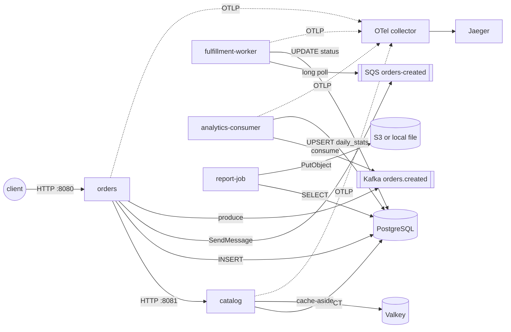

# labs — the shopfront system

`shopfront` is the one system every lab in this repository runs, deploys, breaks and observes. It
is small on purpose (five processes, one database, one cache, one queue, one topic, one object
store) and it touches every integration the hub teaches: HTTP between services, PostgreSQL, a
cache, at-least-once queue processing, a Kafka stream, a batch job and OpenTelemetry end to end.

[`CONTRACT.md`](CONTRACT.md) is the source of truth for ports, environment variables, endpoints,
schema, message shapes, telemetry and shutdown behaviour. Code, Compose, task definitions and
manifests must agree with it.

## Architecture



| Service | Code | Runtime | Port | Role |
| --- | --- | --- | --- | --- |
| `catalog` | [`apps/catalog/`](apps/catalog/) | Go, distroless | 8081 | products API, Valkey cache-aside, `X-Cache` header |
| `orders` | [`apps/orders/`](apps/orders/) | Node.js 22, Fastify | 8080 | creates orders, calls catalog, publishes to SQS and Kafka |
| `fulfillment-worker` | [`apps/worker/`](apps/worker/) | Python 3.12 | 8082 | SQS consumer, idempotent `UPDATE ... WHERE status='CREATED'` |
| `analytics-consumer` | [`apps/worker/`](apps/worker/) | Python 3.12 | 8083 | Kafka consumer, manual commits, `daily_stats` upsert |
| `report-job` | [`apps/report-job/`](apps/report-job/) | Python 3.12 | none | run-to-completion daily report to a directory or S3 |

Local stand-ins: PostgreSQL 16, Valkey 8, Apache Kafka 3.9 (KRaft, one node), ElasticMQ (SQS
API), OpenTelemetry Collector, Jaeger v2. On AWS the same images talk to RDS, ElastiCache, MSK,
SQS and S3 without code changes; only environment variables differ.

## Prerequisites

- Docker Engine with the Compose plugin (Docker Desktop, or Colima on macOS: `colima start` and
  `brew install docker-compose`, then symlink it into `~/.docker/cli-plugins`).
- `make`, `curl`, `jq` (for the smoke test).
- About 3 GB of RAM for the stack; Kafka is the hungriest container.
- No AWS account. Nothing here reaches AWS unless you run the deploy scripts in `ecs/`, `eks/` or
  `batch/` yourself.

## Run it

From the repository root:

```bash
make up          # builds the five images from source, starts everything, prints the URLs
make smoke       # the seven contract steps: readiness, cache HIT, order, fulfillment, metrics, analytics, trace
make report      # report-job for the previous UTC day -> labs/local/out/daily-<date>.{json,csv}
make logs        # follow all logs (one JSON object per line per service)
make down        # stop and delete containers, network and the PostgreSQL volume
```

Useful variants:

```bash
REPORT_DATE=$(date -u +%F) make report               # report on today's fulfilled orders
FAIL_EVERY_N=1 docker compose -f labs/local/compose.yaml up -d fulfillment-worker   # DLQ demo, see below
docker compose -f labs/local/compose.yaml exec -T postgres psql -U app -d shopfront  # SQL prompt
```

The first `make up` pulls the infrastructure images and builds the application images; expect a
few minutes. Later starts take seconds. Postgres runs `local/schema.sql` and `local/seed.sql`
on its first start, and the `db-migrate` one-shot re-applies both (idempotently) on every start,
which is the same shape as a migration task on ECS or a Job on Kubernetes.

## What to observe

Cache-aside. Call `curl -i localhost:8081/products/1` twice. The first response carries
`X-Cache: MISS` (PostgreSQL), the second `X-Cache: HIT` (Valkey, TTL `CACHE_TTL_SECONDS`).
Stop Valkey (`docker compose -f labs/local/compose.yaml stop valkey`) and the header becomes
`BYPASS`: the service degrades instead of failing.

One trace across five hops. After `make smoke`, open <http://localhost:16686>, service `orders`,
operation `POST /orders`. The trace contains the HTTP call to catalog, the PostgreSQL insert, the
SQS `SendMessage`, the Kafka produce, and then, under the same trace id, the `order.fulfill` span
of the fulfillment worker and the `kafka.consume` span of the analytics consumer. The context
travelled as the `traceparent` SQS message attribute and Kafka record header; nothing in the
brokers knows about tracing.

Queues you can look at. ElasticMQ's UI at <http://localhost:9325> shows `orders-created` and
`orders-created-dlq` with visible, delayed and in-flight counts.

Dead-letter queue demo. Start the worker with the chaos knob:

```bash
FAIL_EVERY_N=1 docker compose -f labs/local/compose.yaml up -d fulfillment-worker
curl -s -X POST localhost:8080/orders -H 'content-type: application/json' -d '{"productId":2,"quantity":1}'
```

Every receive now raises before the database is touched, the message is not deleted, and after
the visibility timeout (30 s) SQS redelivers it. `orders_failed_total` on
<http://localhost:8082/metrics> increases with each attempt; after the third receive
(`maxReceiveCount: 3`) the message moves to `orders-created-dlq`, visible in the ElasticMQ UI.
Restart without the knob (`docker compose -f labs/local/compose.yaml up -d fulfillment-worker`)
and the order stays `CREATED`: a dead-lettered message needs an operator decision (redrive or
fix the data), which is the point of the DLQ.

Idempotency. Redrive is safe because the worker's UPDATE matches `status = 'CREATED'` only. Send
the same message twice and the second attempt logs `order already processed` and still deletes
the message.

Graceful shutdown. `docker compose -f labs/local/compose.yaml stop fulfillment-worker` sends
SIGTERM; the worker logs `shutdown signal received`, finishes the current batch, flushes spans and
exits 0 within `SHUTDOWN_TIMEOUT_SECONDS` (20). Compose waits `stop_grace_period` (30 s), the
same relationship ECS `stopTimeout` and Kubernetes `terminationGracePeriodSeconds` have with the
application's own budget.

Health. Every long-running process answers `/healthz` (liveness), `/readyz` (readiness, 503 with
the failing check named when PostgreSQL is down) and `/metrics` (Prometheus text). Stop Postgres
and watch `/readyz` on ports 8080 to 8083 flip to 503 while `/healthz` stays 200: the platform
should stop routing to the task, not restart it.

Hardening you can verify. Application containers run read-only with a tmpfs `/tmp`, all
capabilities dropped, `no-new-privileges`, as uid 10001. `docker compose exec fulfillment-worker
touch /app/x` fails; `id` prints `uid=10001`.

## The same images on AWS

The images built here are the artifacts the AWS labs deploy; they are configured entirely through
the environment variables in [`CONTRACT.md`](CONTRACT.md) §2 and read secrets from the platform's
secret injection, never from files in the image.

| Target | Directory | What changes |
| --- | --- | --- |
| Amazon ECS on Fargate | [`ecs/`](ecs/) | CloudFormation for VPC, cluster, RDS/ElastiCache/MSK/SQS, services behind an ALB, ADOT collector; task definitions with `secrets[]`, `stopTimeout`, `readonlyRootFilesystem` |
| Amazon EKS | [`eks/`](eks/) | eksctl cluster configs (standard and Auto Mode), Kustomize base and overlays, Pod Identity, KEDA scaling on queue depth, Argo CD and Argo Rollouts |
| AWS Batch | [`batch/`](batch/) | job definitions for `report-job` on Fargate and on EKS, submit script |
| Pipelines | [`pipelines/`](pipelines/) | GitHub Actions (OIDC, multi-arch, SBOM, signing), Jenkins on EKS, CodePipeline |

Images are pushed as `sha-<gitsha>` and deployed by digest; `latest` is never deployed
([`CONTRACT.md`](CONTRACT.md) §8).

## Cost warning

Everything under `local/` is free. Everything under `ecs/`, `eks/` and `batch/` creates billable
resources: an EKS cluster costs about USD 0.10 per hour before any node, an MSK cluster and an RDS
instance run around the clock, NAT gateways bill per hour and per GB, and load balancers bill per
hour. A full shopfront environment left running costs several hundred USD per month. The deploy
scripts print the target account, require an explicit confirmation variable and have a matching
destroy script; run `aws sts get-caller-identity` first and treat an unknown account as
production. Delete what you created when you finish a lab.

## Troubleshooting

| Symptom | Check | Usual cause |
| --- | --- | --- |
| `make smoke` step 1 fails | `docker compose -f labs/local/compose.yaml ps` and `logs orders catalog` | a build failed, or Postgres is still initialising (the first start takes longer) |
| step 2 returns `BYPASS` | `logs catalog` mentions Valkey | Valkey not reachable; catalog runs without cache |
| step 4 times out | `logs fulfillment-worker`, ElasticMQ UI | worker cannot reach ElasticMQ or Postgres; or `FAIL_EVERY_N` is set |
| step 6 times out | `logs analytics-consumer kafka` | Kafka not healthy yet; the consumer joins as soon as the broker answers |
| no trace in Jaeger | `logs otel-collector` | `OTEL_EXPORTER_OTLP_ENDPOINT` unset in a service, or the collector rejected the batch |
| Linux host: report-job cannot write `/out` | `ls -ld labs/local/out` | bind-mount directory owned by root; `mkdir -p labs/local/out && chmod o+w labs/local/out` |
