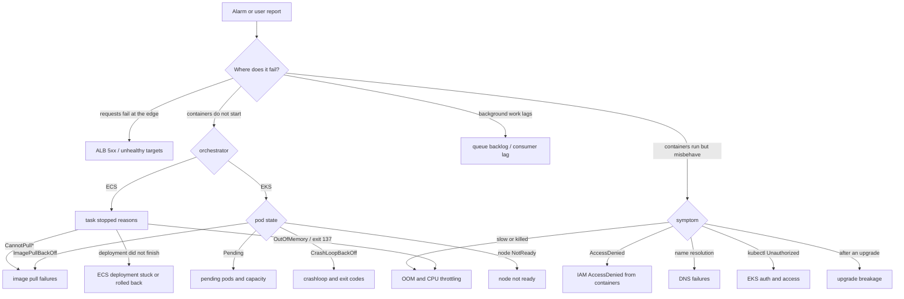

# Playbooks

Operational documents for the container platform: incident runbooks indexed by the symptom you see,
disaster-recovery plan and runbooks, and upgrade runbooks. Every runbook follows the same shape
(symptoms, five-minute triage, causes and fixes, verify, prevent, related) so that under pressure you
know where to look. The hub documents explain the mechanisms; these tell you what to type.

## Triage flow

## Incidents, by symptom

| You see | Runbook | Applies to |
| --- | --- | --- |
| `ImagePullBackOff`, `CannotPullContainerError`, `403 Forbidden` from ECR, pulls that hang | [image-pull-failures.md](incidents/image-pull-failures.md) | both |
| `CrashLoopBackOff`, "Essential container in task exited", exit codes 1/137/139/143 | [crashloop-and-exit-codes.md](incidents/crashloop-and-exit-codes.md) | both |
| `OOMKilled`, `OutOfMemoryError`, exit 137, CPU throttling, latency without load | [oom-and-cpu-throttling.md](incidents/oom-and-cpu-throttling.md) | both |
| Pods `Pending`, "insufficient cpu", "too many pods", ECS `RESOURCE:CPU`, Karpenter or Auto Mode not adding nodes | [pending-pods-and-capacity.md](incidents/pending-pods-and-capacity.md) | both |
| Node `NotReady`, PLEG, disk pressure, ENI attach failures, IMDS surprises | [node-not-ready.md](incidents/node-not-ready.md) | EKS |
| `NXDOMAIN`, `SERVFAIL`, DNS timeouts, slow first request, CoreDNS restarts | [dns-failures.md](incidents/dns-failures.md) | both |
| ALB 502/503/504, `UnHealthyHostCount` > 0, targets flapping | [alb-5xx-and-unhealthy-targets.md](incidents/alb-5xx-and-unhealthy-targets.md) | both |
| ECS task `STOPPED` with a `stoppedReason` you do not recognise | [ecs-task-stopped-reasons.md](incidents/ecs-task-stopped-reasons.md) | ECS |
| ECS deployment `IN_PROGRESS` for too long, circuit breaker tripped, rolled back | [ecs-deployment-stuck-or-rolled-back.md](incidents/ecs-deployment-stuck-or-rolled-back.md) | ECS |
| `AccessDenied`, `NoCredentialProviders`, `Unable to locate credentials`, `AssumeRoleWithWebIdentity` errors | [iam-accessdenied-from-containers.md](incidents/iam-accessdenied-from-containers.md) | both |
| `kubectl`: `Unauthorized`, `You must be logged in to the server`, `the server has asked for the client to provide credentials` | [eks-auth-and-access.md](incidents/eks-auth-and-access.md) | EKS |
| Things broke right after a cluster, add-on, AMI or agent upgrade | [upgrade-breakage.md](incidents/upgrade-breakage.md) | both |
| SQS age growing, Kafka lag growing, DLQ filling, KEDA not scaling, DB connections exhausted | [queue-backlog-and-consumer-lag.md](incidents/queue-backlog-and-consumer-lag.md) | both |

## Disaster recovery

| Document | Use |
| --- | --- |
| [dr-plan-template.md](dr/dr-plan-template.md) | Fill-in plan: tiers, RTO/RPO, dependencies, roles, decision criteria, communications |
| [region-failover-runbook.md](dr/region-failover-runbook.md) | Move shopfront to the secondary Region and back |
| [cluster-rebuild-runbook.md](dr/cluster-rebuild-runbook.md) | Rebuild an EKS cluster or the ECS environment from code |
| [data-recovery-runbook.md](dr/data-recovery-runbook.md) | Aurora, Valkey, SQS, MSK, S3 recovery |
| [game-day-guide.md](dr/game-day-guide.md) | Plan, run and score a game day |

## Upgrades

| Document | Use |
| --- | --- |
| [eks-version-upgrade.md](upgrades/eks-version-upgrade.md) | Control plane → add-ons → nodes, pre-flight, rollback window |
| [ecs-ami-agent-and-platform.md](upgrades/ecs-ami-agent-and-platform.md) | ECS-optimised AMI rotation, agent updates, Fargate platform versions, Managed Instances |
| [addon-and-controller-upgrades.md](upgrades/addon-and-controller-upgrades.md) | VPC CNI, CoreDNS, kube-proxy, load balancer controller, Karpenter, Cilium, KEDA, Argo |

## Conventions

- Commands assume `us-east-1`, account `123456789012`, cluster `shopfront-dev`, namespace `shopfront`.
- Every triage step states what each result means; do not run a fix before the triage points to it.
- "Verify the fix" is a command whose output you can paste into the incident channel.
- Severity guide: SEV1 customer-facing outage, SEV2 degraded or single-AZ, SEV3 internal or background.
