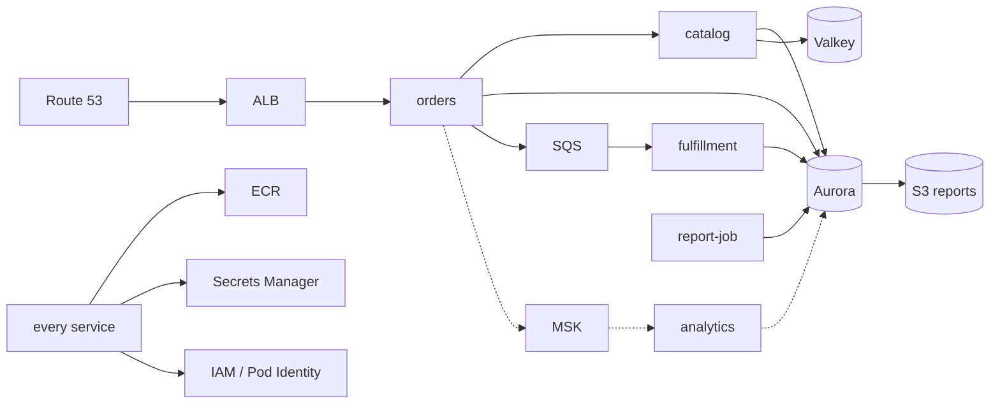

# Disaster recovery plan for a container platform (fill-in template)

**Applies to:** both · **Severity guide:** this document is read during SEV1 Regional or account-level events · **Time to first fix:** the RTO you write below

Copy this file per platform or per product, replace every `<...>`, and keep it next to the runbooks
it references. A plan nobody has rehearsed is a wish; the last section schedules the rehearsal.
The reasoning behind every field is in [10 · L400](../../hub/10-resilience-and-dr/L400-dr-plan-and-game-days.md);
the strategies (backup/restore, pilot light, warm standby, active/active) and their costs in
[10 · L300](../../hub/10-resilience-and-dr/L300-dr-strategies-for-container-platforms.md).

## 1. Scope and ownership

| Field | Value |
| --- | --- |
| System | `<shopfront>` (orders, catalog, fulfillment-worker, analytics-consumer, report-job) |
| Owner (accountable) | `<team / role>` |
| DR lead during an event | `<on-call role>`; deputy `<role>` |
| Primary Region | `us-east-1` |
| Recovery Region | `<us-west-2>` |
| Strategy | `<pilot light / warm standby / active-active>` for tier 1; `<backup and restore>` for tier 3 |
| Last full rehearsal | `<date>` · result `<met RTO/RPO? yes/no>` · report `<link>` |
| Next rehearsal | `<date>` |

## 2. Tiers, RTO and RPO

| Tier | Services | RTO | RPO | Strategy | Notes |
| --- | --- | --- | --- | --- | --- |
| 1 | orders API, catalog API, ALB, Aurora | `<30 min>` | `<1 min>` | warm standby | Aurora Global Database replication lag is the RPO |
| 2 | fulfillment-worker, SQS | `<2 h>` | `<0 (messages are replayed from producers)>` | pilot light | Queue is Regional: unfulfilled orders are re-queued from the database |
| 3 | analytics-consumer, MSK, daily_stats | `<24 h>` | `<24 h>` | backup and restore | Rebuilt from the orders table |
| 3 | report-job, S3 reports | `<24 h>` | `<24 h>` | backup and restore | S3 cross-Region replication of `daily/` |

RTO covers detection + decision + execution + verification. Write the measured numbers from the last
rehearsal next to the targets: `detection <min> · decision <min> · execution <min> · verification <min>`.

## 3. Where the state is, and how it gets to the recovery Region

| State | Primary location | Replication / backup | Recovery Region copy | Verified how |
| --- | --- | --- | --- | --- |
| Container images | ECR `shopfront/*` us-east-1 | ECR replication rule (02-cluster.yaml `ReplicationRegion`) | ECR `shopfront/*` `<us-west-2>` | `aws ecr describe-images` in both Regions, same digests |
| Infrastructure definitions | git (CloudFormation, eksctl, kustomize) | git remote + mirror `<CodeCommit/second provider>` | clone | `git fetch --all` in the rehearsal |
| Task definitions / manifests | git + rendered revisions | same | same | `make check` |
| Relational data | Aurora PostgreSQL `shopfront-dev` | Aurora Global Database (03-data.yaml `ReplicationRegion`), automated backups 3–14 days | secondary cluster, read-only until promoted | `aws rds describe-global-clusters` lag < RPO |
| Cache | ElastiCache Serverless Valkey | none (cache) | rebuilt empty | warm-up load test |
| Queue | SQS `shopfront-*-orders-created` | none (Regional) | new queue, replay from DB `status = CREATED` | replay script rehearsed |
| Streams | MSK Serverless `orders.created` | MSK Replicator `<optional>` or none | rebuilt; consumers restart from earliest of the new cluster | lag metric after failover |
| Secrets | Secrets Manager `shopfront/*` | multi-Region replication (03-data.yaml `ReplicaRegions`) | replica secrets | `describe-secret --query ReplicationStatus` |
| KMS keys | `<CMK or AWS-managed>` | multi-Region keys if CMK | replica key | key policy identical |
| Reports | S3 `shopfront-reports-*` | S3 replication rule `<to be added>` | replica bucket | replication metrics |
| Kubernetes objects | EKS cluster (etcd, AWS-managed) | git (GitOps); Velero `<optional>` for anything not in git | rebuilt from git by Argo CD | cluster-rebuild runbook |
| DNS | Route 53 `shopfront.example.com` | global service | health-check failover record | `dig` during rehearsal |
| Observability | CloudWatch (Regional), dashboards/alarms in 05-observability.yaml | IaC redeployed | redeployed | alarms exist in the recovery Region after failover |
| Delivery | GitHub Actions / Jenkins / CodePipeline | Jenkins volume snapshots; pipelines are code | redeploy pipeline stacks | pipeline runs in the recovery Region |

## 4. Dependency map

External dependencies and their own DR: `<payment provider, identity provider, SaaS observability>`.

## 5. Decision criteria to declare a Regional failover

Fail over when **all** of these hold, or when AWS posts a Regional service event affecting a tier-1
dependency with no ETA:

1. Tier-1 error ratio or availability breaches `<SLO>` for `<15 min>` and the cause is not in our code or configuration.
2. At least two independent signals agree (ALB 5xx ratio, synthetic canary from another Region, AWS Health Dashboard).
3. The recovery Region is healthy (its canary is green, replication lag is under RPO).
4. The DR lead and `<one more named role>` agree; record the time and the names.

Do **not** fail over for a single-AZ impairment: use ARC zonal shift (`aws arc-zonal-shift start-zonal-shift`) and let multi-AZ do its job.

## 6. Roles and communications

| Role | Person/rotation | Does |
| --- | --- | --- |
| DR lead | `<>` | Owns the decision, runs the runbook, calls the steps |
| Operator(s) | `<>` | Execute the runbook commands, one reads, one types |
| Communications | `<>` | Status page, stakeholder updates every `<15 min>`, customer wording |
| Data owner | `<>` | Approves promotion of the secondary database (RPO loss acknowledgement) |
| Scribe | `<>` | Timeline in the incident channel; feeds the post-incident review |

Channels: `<incident channel>`, bridge `<link>`, status page `<link>`. Templates for the first, update
and all-clear messages live in `<link>`.

## 7. Runbooks this plan invokes

- Regional failover and failback: [region-failover-runbook.md](region-failover-runbook.md)
- Rebuild compute from code: [cluster-rebuild-runbook.md](cluster-rebuild-runbook.md)
- Data: [data-recovery-runbook.md](data-recovery-runbook.md)
- Rehearsal: [game-day-guide.md](game-day-guide.md)

## 8. Known gaps and accepted risks

| Gap | Impact | Decision | Review date |
| --- | --- | --- | --- |
| `<SQS not replicated>` | unfulfilled orders during the gap are replayed from the database, duplicates possible | accepted: consumers are idempotent | `<>` |
| `<MSK not replicated>` | analytics lag up to 24 h | accepted (tier 3) | `<>` |
| `<quota in recovery Region below primary>` | cannot reach full capacity | quota increase requested `<case id>` | `<>` |

## 9. Verification checklist after any recovery

- [ ] `GET /products` and `POST /orders` succeed through the recovery Region's ALB and through the public DNS name.
- [ ] Orders created since the event reach `FULFILLED` (consumer path works).
- [ ] Aurora is a standalone primary (or the new global primary); replication lag to the old Region is either re-established or intentionally broken.
- [ ] Alarms, dashboards and on-call routing exist in the recovery Region.
- [ ] Pipelines can deploy to the recovery Region (a no-op deploy succeeded).
- [ ] Data owner confirmed the RPO loss window and the reconciliation plan.
- [ ] Timeline captured; post-incident review scheduled within `<5 business days>`.

## 10. Rehearsal schedule

| Exercise | Cadence | Last | Next | Owner |
| --- | --- | --- | --- | --- |
| Tabletop walk-through of this plan | quarterly | `<>` | `<>` | `<>` |
| Cluster rebuild in a sandbox account | quarterly | `<>` | `<>` | `<>` |
| Database restore to a point in time + verification queries | monthly (automated) | `<>` | `<>` | `<>` |
| Full Regional failover and failback (game day) | twice a year | `<>` | `<>` | `<>` |
| Zonal shift drill | quarterly | `<>` | `<>` | `<>` |

## Verify

The plan is "verified" when the last full rehearsal met RTO and RPO and every gap in §8 has an
owner and a date. Anything else is a draft.

## Related

- [10 · L300 DR strategies](../../hub/10-resilience-and-dr/L300-dr-strategies-for-container-platforms.md), [10 · L400 the DR plan and game days](../../hub/10-resilience-and-dr/L400-dr-plan-and-game-days.md)
- [09 · L300 data DR](../../hub/09-data-messaging-and-batch/L300-messaging-and-data-deep-dive.md), [02 · L400 registry DR](../../hub/02-ecr/L400-supply-chain-and-multi-account-registries.md)
