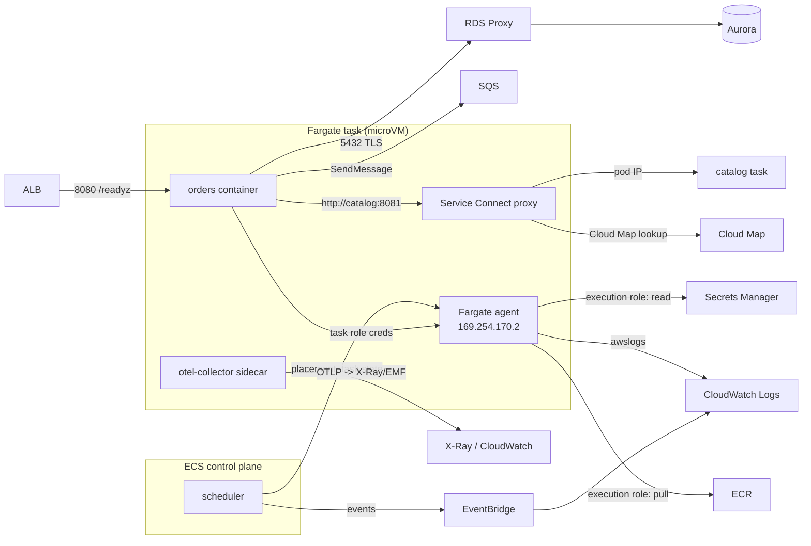
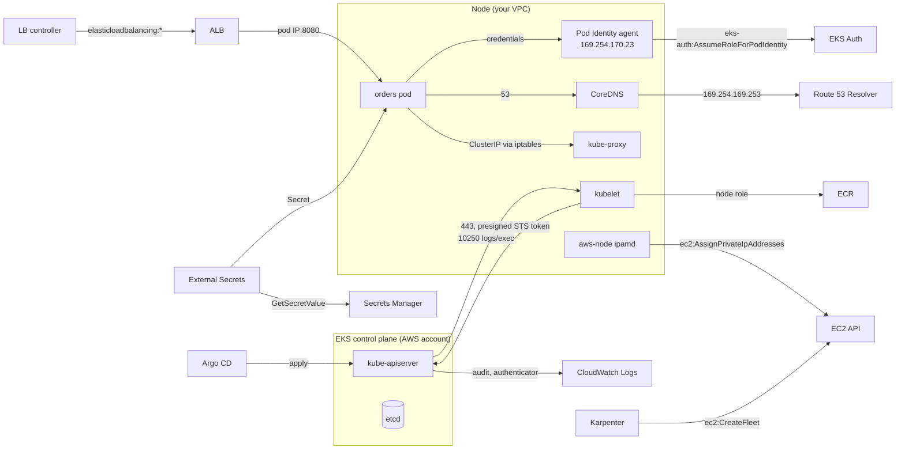

# Service interaction map

Who talks to whom, over what, and what must exist for the call to work. Each row is a prerequisite
you can check when something "cannot reach" something. Diagrams first, then the tables.

## ECS (Fargate) data and control paths

## EKS data and control paths

## Interactions and prerequisites

| From | To | Protocol / API | Prerequisites (IAM · network · DNS) | Breaks as |
| --- | --- | --- | --- | --- |
| ECS agent / Fargate | ECR | HTTPS `ecr:GetAuthorizationToken`, `BatchGetImage`, `GetDownloadUrlForLayer`; layers from S3 | execution role · NAT or `ecr.api`+`ecr.dkr`+S3 gateway endpoints · endpoint private DNS | `CannotPullContainerError` |
| ECS agent / Fargate | Secrets Manager / SSM / KMS | `secretsmanager:GetSecretValue`, `ssm:GetParameters`, `kms:Decrypt` | execution role · endpoints or NAT | `ResourceInitializationError: unable to pull secrets` |
| ECS agent / Fargate | CloudWatch Logs | `logs:CreateLogStream`, `PutLogEvents` | execution role · `logs` endpoint or NAT · log group exists | task fails to start (awslogs) |
| Container | ECS credentials | HTTP `169.254.170.2` `$AWS_CONTAINER_CREDENTIALS_RELATIVE_URI` | task role attached · SDK supports container provider · no proxy on link-local | `Unable to locate credentials` |
| ECS scheduler | ALB target group | `RegisterTargets`/`DeregisterTargets` (service-linked role) | `LoadBalancers[]` container port matches · target type `ip` | `service ... unable to register targets` |
| ALB | task/pod | TCP to container port + health check path | target SG allows ALB SG · health check path returns 200 | `Target.Timeout`, `Target.FailedHealthChecks` |
| ECS service (Service Connect) | Cloud Map | agent registers instances; proxy resolves aliases | namespace ARN in `ServiceConnectConfiguration` · both services in the namespace | `NXDOMAIN` for alias |
| orders | catalog (ECS) | HTTP via Service Connect alias `catalog:8081` | both in the Service Connect namespace · `PortName` matches | connect refused / `NXDOMAIN` |
| orders | catalog (EKS) | HTTP via ClusterIP `catalog.shopfront.svc:8081` | Service selector matches pod labels · NetworkPolicy allows · kube-proxy healthy | timeouts / `ENOTFOUND` |
| Any app | RDS Proxy → Aurora | PostgreSQL 5432 with TLS; proxy auth `SECRETS` | data SG allows services SG on 5432 · proxy role reads the admin secret · `sslmode=require` | `connection refused` / `password authentication failed` (secret mismatch) |
| catalog | Valkey | RESP over TLS 6379 | data SG · `rediss://` · serverless endpoint | cache disabled path (degraded, not down) |
| orders / worker | SQS | HTTPS `SendMessage` / `ReceiveMessage`... | task/pod role · endpoint or NAT · `AWS_REGION` | `AccessDenied` / `NonExistentQueue` |
| orders / analytics | MSK | Kafka over TLS 9098 with SASL/IAM | `kafka-cluster:*` in role · MSK SG allows 9098 from services SG · bootstrap string | auth failure / `TimeoutException` |
| report-job | S3 | HTTPS `PutObject` | role scoped to `daily/*` · S3 gateway endpoint | `AccessDenied` |
| kubelet | kube-apiserver | HTTPS 443, bootstrap via presigned `sts:GetCallerIdentity` → authenticator → access entry `EC2_LINUX` | node role access entry · cluster SG 443 · endpoint reachable (private DNS) | node `NotReady`, `Unauthorized` |
| kube-apiserver | kubelet | HTTPS 10250 | cluster SG allows control plane → nodes | `kubectl logs/exec` fail, metrics-server empty |
| kube-apiserver | admission webhooks (LBC, Kyverno, Karpenter) | HTTPS 9443/8443 to pod IPs | control plane can reach pod IPs on the port (cluster SG default allows) | `failed calling webhook` on every apply |
| aws-node (ipamd) | EC2 API | `ec2:AssignPrivateIpAddresses`, `AttachNetworkInterface`, `CreateNetworkInterface`, `DescribeNetworkInterfaces`... | CNI Pod Identity/IRSA or node role · `ec2` endpoint or NAT | pods stuck `ContainerCreating` (no IP) |
| Pod | Pod Identity agent | HTTP `169.254.170.23` with the projected token | association exists · agent DaemonSet · pod created after association | node role used instead / no credentials |
| Pod Identity agent | EKS Auth | `eks-auth:AssumeRoleForPodIdentity` | role trust `pods.eks.amazonaws.com` (`AssumeRole` + `TagSession`) · `eks-auth` endpoint or NAT | 4xx from the agent |
| Pod (IRSA) | STS | `sts:AssumeRoleWithWebIdentity` with the projected OIDC token | OIDC provider for the cluster · trust `sub`/`aud` · `sts` endpoint or NAT | `InvalidIdentityToken` / not authorized |
| kubectl (human) | kube-apiserver | 443 with `aws eks get-token` | access entry + policy or RBAC · public CIDR allowlist or VPN | `Unauthorized`, `Forbidden` |
| CoreDNS | Route 53 Resolver | UDP/TCP 53 to `169.254.169.253` / VPC+2 | node SG allows egress · 1024 pps/ENI | `SERVFAIL` on external names |
| Pods | CoreDNS | UDP/TCP 53 to `kube-dns` ClusterIP | NetworkPolicy `allow-dns` · kube-proxy rules · CoreDNS Ready | `ENOTFOUND`, 5 s stalls |
| Load balancer controller | ELB / EC2 / WAF / ACM | `elasticloadbalancing:*`, `ec2:Describe*`, `wafv2:AssociateWebACL`, `acm:ListCertificates` | Pod Identity association with the versioned policy | Ingress without ADDRESS, controller `AccessDenied` |
| Karpenter | EC2 / Pricing / SQS / SSM | `ec2:CreateFleet`, `RunInstances`, `pricing:GetProducts`, `ssm:GetParameter` (AMI), `sqs:*` (interruptions), `iam:PassRole` (node role), `eks:DescribeCluster` | controller role · node role/instance profile · subnets and SGs tagged `karpenter.sh/discovery` | pods stay Pending, `could not launch` |
| Karpenter node | kube-apiserver | bootstrap via `nodeadm` user data | node role access entry · cluster endpoint | NodeClaim never `Registered` |
| External Secrets Operator | Secrets Manager | `GetSecretValue`, `DescribeSecret` | controller Pod Identity · ClusterSecretStore · endpoint or NAT | `ExternalSecret` `SecretSyncedError`, pods `CreateContainerConfigError` |
| KEDA operator | SQS / CloudWatch | `sqs:GetQueueAttributes`, `cloudwatch:GetMetricData` | operator Pod Identity · TriggerAuthentication `aws` | `ScaledObject` not Ready, HPA `<unknown>` |
| ADOT collector | X-Ray / CloudWatch / AMP | `xray:PutTraceSegments`, `cloudwatch:PutMetricData`, `aps:RemoteWrite` | collector Pod Identity · endpoints or NAT | `otelcol_exporter_send_failed_*` |
| Argo CD | git / API server / ECR (image updater) | HTTPS · in-cluster API · `ecr:GetAuthorizationToken` | repo credentials · AppProject destinations · cluster registered | `OutOfSync`, `ComparisonError` |
| GitHub Actions | AWS | OIDC `sts:AssumeRoleWithWebIdentity` | IAM OIDC provider for `token.actions.githubusercontent.com` · trust `sub` bound to repo/ref/environment | `Not authorized to perform sts:AssumeRoleWithWebIdentity` |
| CodePipeline | CodeBuild / CloudFormation / GitHub | service role `codebuild:StartBuild`, `cloudformation:*ChangeSet`, `codeconnections:UseConnection` | connection handshake done · deploy role trust `cloudformation.amazonaws.com` | pipeline stage failed with the IAM error |
| EventBridge Scheduler | Batch | `batch:SubmitJob` universal target | scheduler role trust `scheduler.amazonaws.com` | schedule invocation failed (DLQ if configured) |
| Batch | ECS / Fargate | `RunTask` via the Batch service-linked role | compute environment subnets/SGs · job definition execution role | job `RUNNABLE` forever, `FAILED` with the ECS reason |
| EventBridge (ECS events) | CloudWatch Logs / SNS | `logs:PutLogEvents` (resource policy), `sns:Publish` (topic policy) | Logs resource policy trusts `events.amazonaws.com`+`delivery.logs.amazonaws.com` · topic policy | events silently dropped |
| CloudWatch alarms | SNS | `sns:Publish` | topic not encrypted with `alias/aws/sns` (or CMK with a CloudWatch policy) | alarm state changes with no notification |
| FIS | ECS / EC2 | `ecs:StopTask`, `ec2:TerminateInstances`... via the experiment role | role trust `fis.amazonaws.com` · stop-condition alarm exists | experiment `failed` with IAM error |

## Where to look when a row fails

| Symptom class | First command |
| --- | --- |
| IAM | `aws iam simulate-principal-policy` for the caller role; CloudTrail `errorCode` |
| Network | `aws ec2 describe-security-groups` rules both ways; VPC Reachability Analyzer for ENI → ENI; VPC Flow Logs `REJECT` |
| DNS | `nslookup` from inside a pod/task; `aws route53resolver` query logs |
| Endpoint | `aws ec2 describe-vpc-endpoints` state + private DNS + endpoint SG |
| Kubernetes | `kubectl describe` on the object with the condition; controller logs |

Runbooks: [iam-accessdenied-from-containers](../playbooks/incidents/iam-accessdenied-from-containers.md),
[image-pull-failures](../playbooks/incidents/image-pull-failures.md), [dns-failures](../playbooks/incidents/dns-failures.md),
[alb-5xx-and-unhealthy-targets](../playbooks/incidents/alb-5xx-and-unhealthy-targets.md).
